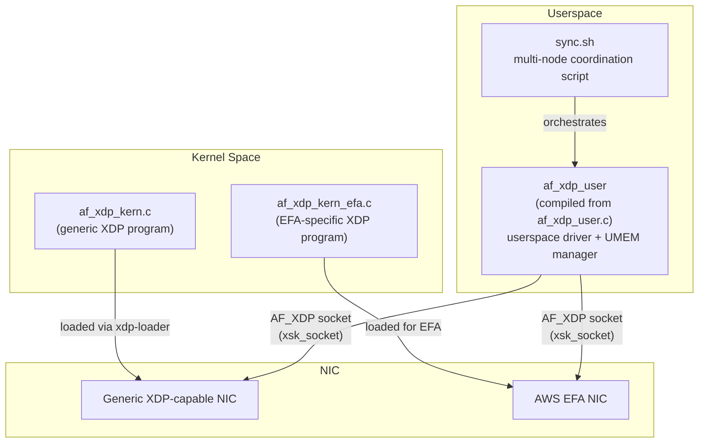
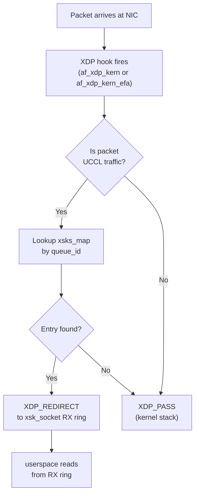
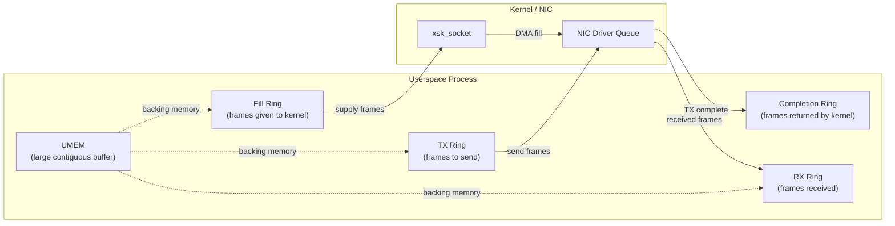
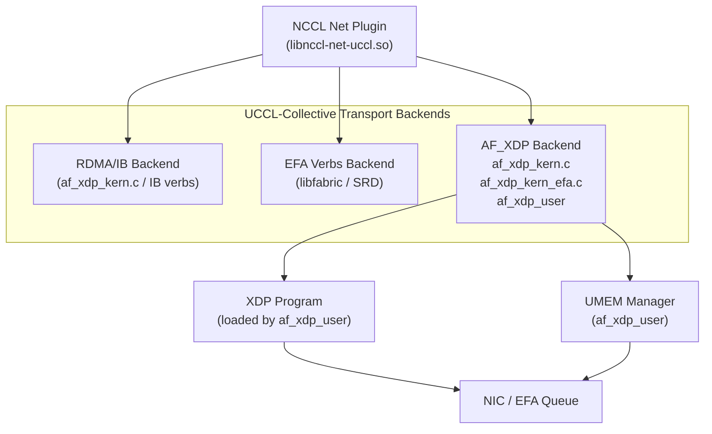

<!-- source: DeepWiki mcp.deepwiki.com · repo uccl-project/uccl · page 2.4 AF_XDP Backend · fetched 2026-11-11 -->

# AF_XDP Backend

Relevant source files

The following files were used as context for generating this wiki page:

- [.gitignore](.gitignore)
- [pyproject.toml](pyproject.toml)

## Purpose and Scope

This page documents the AF_XDP backend for UCCL-collective, located under `ccl/advanced04-aws-afxdp/`. It covers the XDP kernel programs (`af_xdp_kern.c`, `af_xdp_kern_efa.c`), the userspace counterpart (`af_xdp_user`), EFA-specific integration in XDP mode, and the `sync.sh` coordination script used for multi-node setup.

This backend is one of several transport backends available to the UCCL-collective subsystem. For the standard RDMA/InfiniBand backend, see [2.2](#2.2). For the EFA backend using the conventional verbs path, see [2.3](#2.3). For the overall UCCL-collective plugin architecture, see [2.1](#2.1).

---

## Background: AF_XDP in UCCL

AF_XDP (Address Family eXpress Data Path) is a Linux socket type that provides kernel-bypass-style packet I/O using eBPF/XDP programs pinned to a network interface. Unlike RDMA verbs, AF_XDP works at the Ethernet frame level and can be used on NICs that expose an XDP hook — including AWS EFA in certain configurations.

In the UCCL context, the AF_XDP backend provides an alternative transport path for the UCCL-collective layer. It complements the RDMA/EFA verbs backends by offering a zero-copy, kernel-accelerated data path without requiring a full RDMA stack.

### Key Concepts

| Concept | Description |
|---|---|
| XDP program | eBPF bytecode attached to a NIC's receive path; runs before the kernel network stack |
| UMEM | Userspace-managed memory region registered with the kernel for zero-copy frame I/O |
| Fill / Completion ring | Queues through which userspace supplies and reclaims UMEM frames for RX |
| TX / RX ring | Per-socket descriptor rings for packet transmission and reception |
| `AF_XDP` socket | Userspace socket bound to a specific NIC queue, using UMEM for zero-copy |
| `xsk_socket` | The kernel-side socket type backing an AF_XDP connection |

---

## Component Architecture

The backend is split into two layers: a kernel-side XDP program and a userspace driver program. The diagram below maps these to their source files.

**AF_XDP Backend Component Map**

Sources: [.gitignore:63]()

---

## XDP Kernel Programs

The kernel-side component is a compiled eBPF object that the kernel attaches to the NIC's ingress XDP hook. UCCL provides two variants:

### `af_xdp_kern.c` — Generic XDP Program

This program handles the common case for XDP-capable NICs. Its primary responsibility is to redirect incoming packets from the NIC driver into an `AF_XDP` socket's RX ring, bypassing the normal kernel network stack (`XDP_REDIRECT` action).

Key behaviors:
- Parses Ethernet and IP headers to identify UCCL traffic.
- Applies a redirect map (`xsks_map`) to route packets to the correct `xsk_socket` based on queue index.
- Falls through to `XDP_PASS` for non-UCCL traffic, allowing normal kernel processing.

### `af_xdp_kern_efa.c` — EFA-Specific XDP Program

AWS EFA exposes a different hardware model and requires EFA-specific packet format handling. `af_xdp_kern_efa.c` is a separate XDP program adapted for EFA's network characteristics:

- Handles EFA-specific encapsulation or header fields that differ from standard Ethernet frames.
- May apply custom queue assignment logic that aligns with EFA's multi-queue model.
- Shares the same overall structure (`XDP_REDIRECT` via `xsks_map`) as the generic variant.

**XDP Kernel Program Execution Flow**

Sources: [.gitignore:63]()

---

## Userspace Implementation (`af_xdp_user`)

The userspace component (`af_xdp_user`, built from `af_xdp_user.c`) is the main driver program. It is listed in `.gitignore` as a compiled artifact [.gitignore:63]().

The userspace program is responsible for:

1. **UMEM allocation** — Allocating a large contiguous memory region and registering it with the kernel via `xsk_umem__create()`. This region is shared between userspace and the kernel for zero-copy frame exchange.
2. **Socket creation** — Opening one or more `AF_XDP` sockets with `xsk_socket__create()`, each bound to a specific NIC queue.
3. **Ring management** — Maintaining Fill, Completion, RX, and TX rings to coordinate frame ownership with the kernel.
4. **Packet I/O loop** — Polling RX rings for incoming packets, processing them, and posting TX descriptors for outbound packets.
5. **XDP program loading** — Loading the appropriate compiled eBPF object (`af_xdp_kern.o` or `af_xdp_kern_efa.o`) onto the target interface.

### UMEM and Ring Layout

---

## EFA Integration in XDP Mode

When running on AWS EFA, the AF_XDP backend uses `af_xdp_kern_efa.c` instead of the generic kernel program. The userspace program detects or is configured to use the EFA interface and loads the EFA-specific eBPF object.

The EFA XDP path differs from the standard EFA verbs path (documented in [2.3](#2.3)) in that:

- It operates at the packet level rather than through the `libfabric`/`rdma-core` verbs API.
- UMEM buffers are managed entirely in userspace, without using EFA's provider-level memory registration.
- The XDP hook provides an earlier intercept point than the verbs completion queue model.

This makes the AF_XDP path suitable for workloads where low per-packet overhead is more important than the feature richness of the verbs path.

---

## `sync.sh` Coordination Script

Multi-node AF_XDP deployments require that XDP programs be loaded on all participating nodes before traffic flows. `sync.sh` provides a lightweight coordination mechanism for this:

| Step | Action |
|---|---|
| 1 | Establishes SSH connectivity or uses a shared signal file to coordinate node readiness |
| 2 | Triggers `af_xdp_user` launch on each node in the correct sequence |
| 3 | Waits for all nodes to confirm XDP program attachment before allowing traffic |
| 4 | Optionally tears down XDP programs on exit via `xdp-loader unload` |

This script serves the same role as barrier synchronization in MPI initialization — it ensures all NIC queues have the XDP redirect program installed and sockets bound before any collective operation begins.

---

## Integration with UCCL-Collective

The AF_XDP backend is one of the transport backends selectable within the UCCL-collective plugin. The diagram below shows how it slots into the broader UCCL-collective architecture.

**AF_XDP Backend Position in UCCL-Collective**

Sources: [.gitignore:57-63]()

---

## Summary of Source Files

| File | Location | Role |
|---|---|---|
| `af_xdp_kern.c` | `ccl/advanced04-aws-afxdp/` | eBPF/XDP kernel program for generic NICs |
| `af_xdp_kern_efa.c` | `ccl/advanced04-aws-afxdp/` | eBPF/XDP kernel program for AWS EFA |
| `af_xdp_user.c` | `ccl/advanced04-aws-afxdp/` | Userspace driver: UMEM, sockets, I/O loop |
| `sync.sh` | `ccl/advanced04-aws-afxdp/` | Multi-node startup coordination |
| `af_xdp_user` | _(build artifact, gitignored)_ | Compiled binary from `af_xdp_user.c` |

Sources: [.gitignore:57-63]()

---

