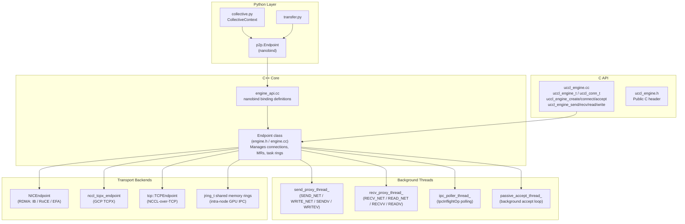
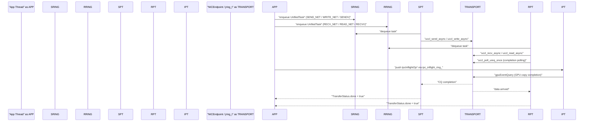
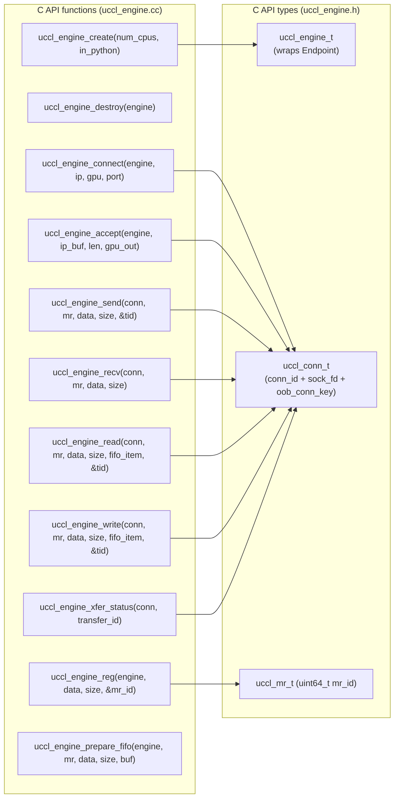

<!-- source: DeepWiki mcp.deepwiki.com · repo uccl-project/uccl · page 3 UCCL-P2P Engine · fetched 2026-11-11 -->

# UCCL-P2P Engine

<details>
<summary>Relevant source files</summary>

The following files were used as context for generating this wiki page:

- [.github/PULL_REQUEST_TEMPLATE.md](.github/PULL_REQUEST_TEMPLATE.md)
- [.github/workflows/uccl-build-test.yml](.github/workflows/uccl-build-test.yml)
- [README.md](README.md)
- [build.sh](build.sh)
- [collective/efa/README.md](collective/efa/README.md)
- [collective/rdma/README.md](collective/rdma/README.md)
- [docs/wheels.md](docs/wheels.md)
- [ep/Makefile](ep/Makefile)
- [ep/README.md](ep/README.md)
- [ep/bench/run_ep.sh](ep/bench/run_ep.sh)
- [ep/setup.py](ep/setup.py)
- [ep/src/common.cpp](ep/src/common.cpp)
- [include/util/gpu_rt.h](include/util/gpu_rt.h)
- [include/util/util.h](include/util/util.h)
- [p2p/Makefile](p2p/Makefile)
- [p2p/README.md](p2p/README.md)
- [p2p/benchmarks/benchmark_nccl.py](p2p/benchmarks/benchmark_nccl.py)
- [p2p/benchmarks/benchmark_nixl.py](p2p/benchmarks/benchmark_nixl.py)
- [p2p/benchmarks/benchmark_uccl.py](p2p/benchmarks/benchmark_uccl.py)
- [p2p/benchmarks/benchmark_uccl_readwrite.py](p2p/benchmarks/benchmark_uccl_readwrite.py)
- [p2p/engine.cc](p2p/engine.cc)
- [p2p/engine.h](p2p/engine.h)
- [p2p/tests/test_engine_onesided_ipc.py](p2p/tests/test_engine_onesided_ipc.py)
- [p2p/uccl_engine.cc](p2p/uccl_engine.cc)
- [p2p/uccl_engine.h](p2p/uccl_engine.h)
- [scripts/efa_monitor.sh](scripts/efa_monitor.sh)

</details>


This page covers the UCCL-P2P subsystem: its design goals, component structure, supported backends, operation types, and the layered API from C++ through to Python. UCCL-P2P is the primary building block for point-to-point GPU memory transfers in UCCL.

For the higher-level Python collective API built on top of this engine, see [CollectiveContext Python API](#3.4). For the RDMA transport layer details (channel groups, QP management, device selection), see [RDMA Transport Layer](#3.2). For memory registration internals, see [Memory Registration and Buffer Management](#3.3). For the expert-parallelism engine (which has a different architecture), see [UCCL-EP Expert Parallelism](#4).

---

## Purpose

UCCL-P2P is a high-performance peer-to-peer transfer engine designed for distributed ML workloads such as KV-cache transfers and reinforcement learning weight exchanges. It is purpose-built for multi-NIC, high-bandwidth environments (e.g., 800 Gbps NICs) with an explicit multi-threaded design.

Key design goals:
- Efficient use of multiple CPU threads and multiple NICs per transfer
- Support for both **remote (RDMA over IB/RoCE/EFA/TCPX)** and **local (GPU IPC via shared memory)** connections
- Both blocking and non-blocking (async) transfer APIs
- Two-sided (send/recv) and one-sided (read/write) RDMA operations
- A thin C API (`libuccl_p2p.so`) and a Python extension (`p2p.abi3.so`) layered over the same C++ core

---

## Component Structure

**Component structure of UCCL-P2P**



Sources: [p2p/engine.h:1-543](), [p2p/engine.cc:1-245](), [p2p/uccl_engine.h:1-200](), [p2p/uccl_engine.cc:1-130](), [p2p/Makefile:1-60]()

---

## The `Endpoint` Class

The `Endpoint` class ([p2p/engine.h:246-543]()) is the central object of UCCL-P2P. Every application-level operation (connect, accept, register, send, recv, read, write) routes through an `Endpoint` instance. It is exposed to Python as `p2p.Endpoint` via nanobind, and to C applications via `uccl_engine_t` in the C API.

### Constructor Variants

| Constructor | Purpose |
|---|---|
| `Endpoint(local_gpu_idx, num_cpus)` | Full initialization: starts background threads, opens listen socket, creates IPC streams for all GPUs |
| `Endpoint(num_cpus)` | Lazy initialization: engine starts without a bound GPU; actual initialization occurs on first `reg()` call, using the device of the registered pointer |

[p2p/engine.cc:180-277]()

### Internal State

| Field | Type | Role |
|---|---|---|
| `ep_` | `RDMAEndPoint` (shared_ptr) | Active transport endpoint (`NICEndpoint` or `TCPEndpoint`) |
| `send_unified_task_ring_` | `jring_t*` | MPSC ring feeding the send proxy thread |
| `recv_unified_task_ring_` | `jring_t*` | MPSC ring feeding the recv proxy thread |
| `ipc_inflight_ring_` | `jring_t*` | MPSC ring for in-flight IPC operations |
| `conn_id_to_conn_` | `unordered_map<uint64_t, Conn*>` | Active connections indexed by `conn_id` |
| `mr_id_to_mr_` | `unordered_map<uint64_t, MR*>` | Registered memory regions indexed by `mr_id` |
| `inbox_rings_` | `array<ShmRingHandle, 8>` | Per-GPU shared-memory rings for IPC messaging |
| `ipc_streams_` | `vector<vector<gpuStream_t>>` | CUDA/HIP streams for IPC async copies |

[p2p/engine.h:466-502]()

---

## Threading Model

**Threading model of Endpoint**



Sources: [p2p/engine.h:488-512](), [p2p/engine.cc:686-724]()

The three background threads are started unconditionally during `Endpoint` construction with a GPU index [p2p/engine.cc:228-232](). The passive accept thread is started optionally via `start_passive_accept()`.

---

## Task Types and Dispatch

All transfer operations are described by `UnifiedTask` ([p2p/engine.h:184-229]()). Tasks carry a `TaskType` tag and a union `SpecificData` that holds either a `FifoItem` (for one-sided RDMA), an `IpcTransferInfo` (for IPC), or a `TaskBatch` (for vectorized ops).

| `TaskType` | Ring | Description |
|---|---|---|
| `SEND_NET` | send | Two-sided RDMA send |
| `RECV_NET` | recv | Two-sided RDMA receive |
| `WRITE_NET` | send | One-sided RDMA write |
| `READ_NET` | recv | One-sided RDMA read |
| `SENDV` | send | Vectorized send (scatter) |
| `RECVV` | recv | Vectorized receive (gather) |
| `WRITEV` | send | Vectorized RDMA write |
| `READV` | recv | Vectorized RDMA read |
| `SEND_IPC` | (direct) | Intra-node GPU copy, initiator |
| `RECV_IPC` | (direct) | Intra-node GPU copy, responder |

[p2p/engine.h:111-124]()

For async operations, the caller receives a `uint64_t transfer_id` which is actually a pointer to a heap-allocated `TransferStatus` object. Polling is done via `poll_async(transfer_id, &is_done)`. [p2p/engine.h:179-182]()

---

## Connection Lifecycle

**Connection lifecycle: remote (RDMA) and local (IPC)**

```mermaid
flowchart TD
    subgraph "Remote RDMA Connection"
        A["Endpoint::connect(ip, gpu_idx, port)"]
        B["uccl_connect(ep_, ...)"]
        C["TCP handshake + RDMA QP exchange"]
        D["ConnID returned\n(sock_fd + flow_id)"]
        E["conn_id_to_conn_ entry created\n(Conn struct)"]
        A --> B --> C --> D --> E
    end

    subgraph "Local IPC Connection"
        F["Endpoint::connect_local(remote_gpu_idx)"]
        G["Unix domain socket handshake"]
        H["Attach remote inbox_rings_[i] via shm_fd"]
        I["conn.is_local_ = true\nconn.shm_attached_ = true"]
        F --> G --> H --> I
    end

    subgraph "Metadata Exchange (Python path)"
        J["get_metadata() / get_unified_metadata()"]
        K["parse_metadata(bytes) -> (ip, port, gpu_idx)"]
        L["add_remote_endpoint(metadata) -> conn_id"]
        J --> K --> L
    end
```



Sources: [p2p/engine.cc:349-530](), [p2p/engine.h:274-290](), [p2p/engine.h:435-437]()

A `Conn` struct ([p2p/engine.h:69-78]()) records the logical connection: `conn_id_`, `uccl_conn_id_` (the underlying transport handle), `ip_addr_`, `remote_gpu_idx_`, `is_local_`, and a `ShmRingHandle remote_inbox_` for IPC connections.

---

## Operation API Summary

### Blocking Operations

```
send(conn_id, mr_id, ptr, size) -> bool
recv(conn_id, mr_id, ptr, size) -> bool
read(conn_id, mr_id, dst, size, slot_item) -> bool
write(conn_id, mr_id, src, size, slot_item) -> bool
sendv(conn_id, mr_id_v, data_v, size_v, num_iovs) -> bool
recvv(conn_id, mr_id_v, data_v, size_v, num_iovs) -> bool
readv(conn_id, mr_id_v, dst_v, size_v, slot_item_v, num_iovs) -> bool
writev(conn_id, mr_id_v, src_v, size_v, slot_item_v, num_iovs) -> bool
```

### Async Operations

```
send_async(conn_id, mr_id, ptr, size, &transfer_id) -> bool
recv_async(conn_id, mr_id, ptr, size, &transfer_id) -> bool
read_async(conn_id, mr_id, dst, size, slot_item, &transfer_id) -> bool
write_async(conn_id, mr_id, src, size, slot_item, &transfer_id) -> bool
sendv_async(..., &transfer_id) -> bool
recvv_async(..., &transfer_id) -> bool
readv_async(..., &transfer_id) -> bool
writev_async(..., &transfer_id) -> bool
poll_async(transfer_id, &is_done) -> bool
```

### IPC Operations (intra-node)

```
send_ipc(conn_id, data, size) -> bool
recv_ipc(conn_id, data, size) -> bool
send_ipc_async(conn_id, data, size, &transfer_id) -> bool
recv_ipc_async(conn_id, data, size, &transfer_id) -> bool
write_ipc(conn_id, data, size, IpcTransferInfo) -> bool
read_ipc(conn_id, data, size, IpcTransferInfo) -> bool
writev_ipc(conn_id, data_v, size_v, info_v, num_iovs) -> bool
readv_ipc(conn_id, data_v, size_v, info_v, num_iovs) -> bool
```

### Memory Registration

```
reg(ptr, size, &mr_id) -> bool
regv(data_v, size_v, &mr_id_v) -> bool
dereg(mr_id) -> bool
```

Sources: [p2p/engine.h:291-432](), [p2p/README.md:447-750]()

One-sided RDMA `read` and `write` operations require a `FifoItem` that encodes the remote address and key. This is advertised by the remote side using `advertise(conn_id, mr_id, addr, len, out_buf)` or pre-computed with `prepare_fifo(mr_id, addr, len, out_buf)`. [p2p/engine.h:374-385]()

---

## C API (`uccl_engine.h`)

For applications that cannot use C++ or Python directly, UCCL-P2P exposes a flat C API compiled into `libuccl_p2p.so`. The C API wraps the `Endpoint` class behind opaque handle types.

**C API type and function mapping**



Sources: [p2p/uccl_engine.h:1-200](), [p2p/uccl_engine.cc:41-405]()

The C API also supports OOB notification passing (`uccl_engine_send_notif`, `uccl_engine_get_notifs`) used by NIXL-style initiator/target transfer workflows. [p2p/uccl_engine.cc:382-453]()

---

## Backend Selection

The backend is selected at compile time using preprocessor flags.

| Flag | Backend | Transport endpoint |
|---|---|---|
| _(default)_ | InfiniBand / RoCE | `NICEndpoint` |
| `USE_EFA=1` | AWS EFA | `NICEndpoint` (EFA variant) |
| `USE_TCPX=1` | GCP TCPX | `nccl_tcpx::Endpoint` |
| `USE_TCP=1` | NCCL-over-TCP | `tcp::TCPEndpoint` |

[p2p/Makefile:28-43](), [p2p/engine.h:36-47]()

At runtime, the GID index for RDMA networks can be tuned via environment variable `UCCL_P2P_RDMA_GID_INDEX` (default 0 for EFA, 3 for IB). Additional tuning knobs:

| Environment Variable | Description | Default |
|---|---|---|
| `UCCL_P2P_LOG_LEVEL` | Log verbosity | `WARNING` |
| `UCCL_P2P_RDMA_GID_INDEX` | RDMA GID index | 0 (EFA) / 3 (IB) |
| `UCCL_P2P_RDMA_SL` | Service level | 8 (EFA) / 3 (IB) |
| `UCCL_P2P_RDMA_TC` | Traffic class | 104 (IB) |

Sources: [p2p/README.md:98-104](), [p2p/engine.cc:156-174]()

---

## Python Usage Example

The following shows the canonical client/server pattern with GPU tensor transfer.

```python
# Server side
from uccl import p2p
import torch

ep = p2p.Endpoint(local_gpu_idx=0, num_cpus=4)
ok, remote_ip, remote_gpu, conn_id = ep.accept()

buf = torch.zeros(1024, dtype=torch.float32).cuda()
ok, mr_id = ep.reg(buf.data_ptr(), buf.numel() * 4)
ok = ep.recv(conn_id, mr_id, buf.data_ptr(), buf.numel() * 4)

# Client side
ep = p2p.Endpoint(local_gpu_idx=0, num_cpus=4)
metadata = ep.get_metadata()   # exchange via torch.distributed or out-of-band
ip, port, gpu = p2p.Endpoint.parse_metadata(metadata)
ok, conn_id = ep.connect(ip, gpu, remote_port=port)

buf = torch.ones(1024, dtype=torch.float32).cuda()
ok, mr_id = ep.reg(buf.data_ptr(), buf.numel() * 4)
ok = ep.send(conn_id, mr_id, buf.data_ptr(), buf.numel() * 4)
```

For multi-tensor scatter/gather, use `sendv` / `recvv`. For one-sided operations, the remote side first calls `advertise()` to produce a `FifoItem` blob, which is shared out-of-band; the initiator then calls `read()` or `write()` with that blob. [p2p/README.md:391-444]()

---

## Build Artifacts

The build system produces two artifacts from the `p2p/` directory:

| Artifact | Purpose |
|---|---|
| `p2p.abi3.so` | Python extension module, installed as `uccl/p2p.abi3.so` |
| `libuccl_p2p.so` | Shared library exposing the C API (`uccl_engine.h`) |

Both are built from the same source files (`engine.cc`, `engine_api.cc`) with nanobind objects included in the Python extension only. [p2p/Makefile:77-132]()

To build:
```bash
# Via top-level build script (recommended)
bash build.sh cuda p2p --install

# Or directly
cd p2p && make -j install

# With EFA support
cd p2p && make -j USE_EFA=1 install
```

Sources: [p2p/Makefile:107-132](), [p2p/README.md:23-68](), [build.sh:67-100]()

---

