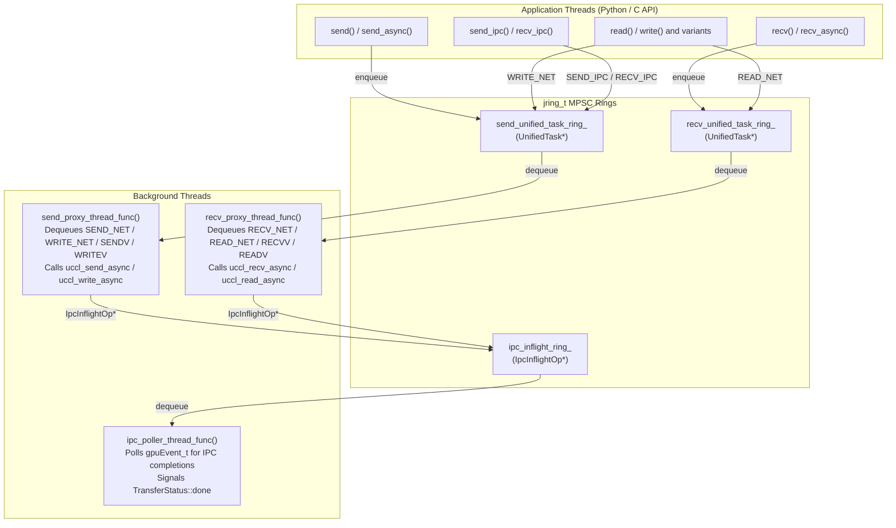
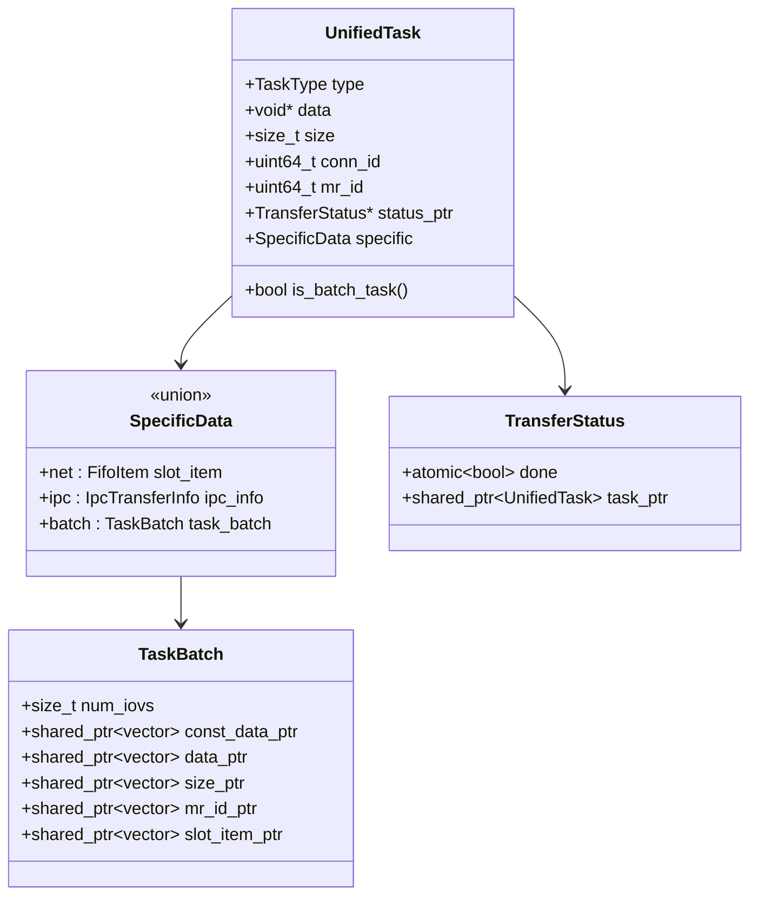
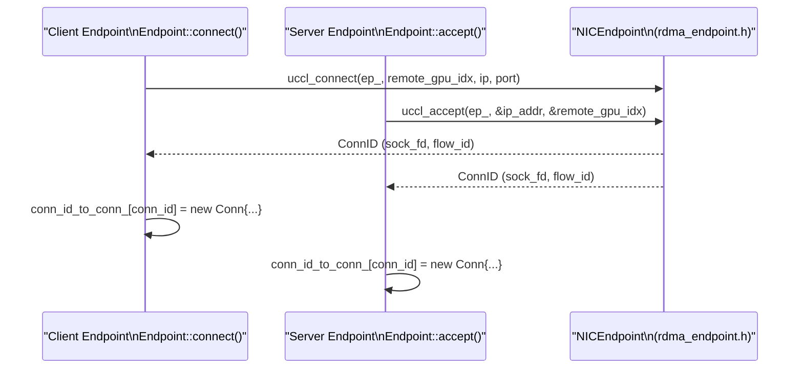
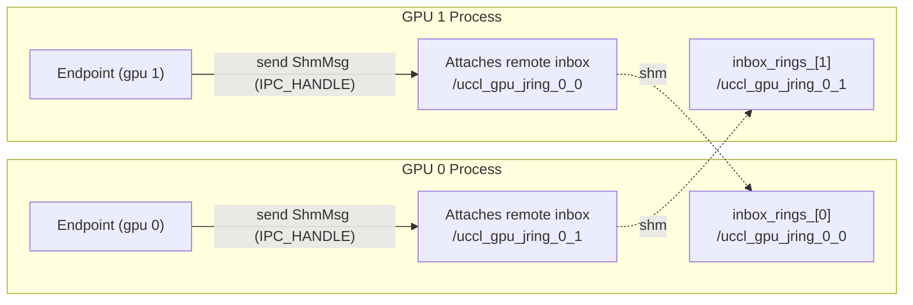
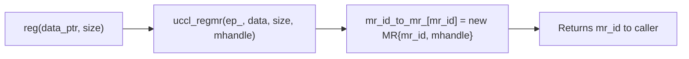

<!-- source: DeepWiki mcp.deepwiki.com · repo uccl-project/uccl · page 3.1 P2P Engine Architecture · fetched 2026-11-11 -->

# P2P Engine Architecture

Relevant source files

The following files were used as context for generating this wiki page:

- [include/util/gpu_rt.h](include/util/gpu_rt.h)
- [include/util/util.h](include/util/util.h)
- [p2p/Makefile](p2p/Makefile)
- [p2p/README.md](p2p/README.md)
- [p2p/benchmarks/benchmark_nccl.py](p2p/benchmarks/benchmark_nccl.py)
- [p2p/benchmarks/benchmark_nixl.py](p2p/benchmarks/benchmark_nixl.py)
- [p2p/benchmarks/benchmark_uccl.py](p2p/benchmarks/benchmark_uccl.py)
- [p2p/benchmarks/benchmark_uccl_readwrite.py](p2p/benchmarks/benchmark_uccl_readwrite.py)
- [p2p/engine.cc](p2p/engine.cc)
- [p2p/engine.h](p2p/engine.h)
- [p2p/tests/test_engine_onesided_ipc.py](p2p/tests/test_engine_onesided_ipc.py)
- [p2p/uccl_engine.cc](p2p/uccl_engine.cc)
- [p2p/uccl_engine.h](p2p/uccl_engine.h)

This page documents the internal design of the UCCL-P2P engine: how the `Endpoint` C++ class is structured, its threading model, how connections are established, and the full set of operations it supports. This page focuses on the C++ core and the C API shim.

For the RDMA transport abstraction beneath the engine (channel groups, QP management, device selection), see [3.2](#3.2). For the Python `CollectiveContext` that sits above it, see [3.4](#3.4). For memory registration internals, see [3.3](#3.3).

---

## Overview

The `Endpoint` class ([p2p/engine.h:246-543]()) is the central object of the P2P subsystem. A single `Endpoint` instance:

- Owns one or two RDMA/TCP connections to remote or local peers.
- Maintains three background threads that handle send, receive, and intra-node GPU-copy operations.
- Exposes both blocking and asynchronous variants of every operation.
- Bridges to a C API (`uccl_engine_t`) for use outside Python, and to Python via nanobind.

The table below summarises the major types in the engine layer.

| Type | File | Role |
|---|---|---|
| `Endpoint` | `engine.h` | Top-level class; owns threads, rings, connections, MR table |
| `UnifiedTask` | `engine.h` | Polymorphic work item passed through task rings |
| `TaskBatch` | `engine.h` | Vectorised (scatter-gather) sub-task descriptor |
| `Conn` | `engine.h` | Per-connection state (conn ID, RDMA conn ID, shm ring handle) |
| `ShmRingHandle` | `engine.h` | Shared-memory `jring_t` used for intra-node signalling |
| `ShmMsg` | `engine.h` | Message type sent over a `ShmRingHandle` |
| `IpcTransferInfo` | `engine.h` | GPU IPC handle + offset for one-sided IPC transfers |
| `IpcInflightOp` | `engine.h` | Tracks in-flight async GPU copy events for polling |
| `MR` / `P2PMhandle` | `engine.h` | Memory registration bookkeeping |
| `uccl_engine_t` | `uccl_engine.h` | Opaque C wrapper around `Endpoint` |
| `uccl_conn_t` | `uccl_engine.h` | Opaque C wrapper around a `conn_id` |

Sources: [p2p/engine.h:49-242](), [p2p/uccl_engine.h:1-50]()

---

## Threading Model

The `Endpoint` constructor ([p2p/engine.cc:180-245]()) spawns exactly three background threads and allocates `jring_t`-backed task rings for inter-thread communication.

**Task rings** (capacity `kTaskRingSize = 1024` elements):

| Ring | Producer | Consumer |
|---|---|---|
| `send_unified_task_ring_` | Application threads (any) | `send_proxy_thread_` |
| `recv_unified_task_ring_` | Application threads (any) | `recv_proxy_thread_` |
| `ipc_inflight_ring_` | `send_proxy_thread_` / `recv_proxy_thread_` | `ipc_poller_thread_` |

**Threading diagram — `Endpoint` internal threads**

Sources: [p2p/engine.h:488-500](), [p2p/engine.cc:219-232]()

---

## Task Type System

Every operation is encoded as a `UnifiedTask` ([p2p/engine.h:184-229]()). The `TaskType` enum determines which thread processes it and how the `specific` union is interpreted.

| `TaskType` | Thread | Notes |
|---|---|---|
| `SEND_NET` | send | Two-sided send |
| `RECV_NET` | recv | Two-sided receive |
| `WRITE_NET` | send | One-sided RDMA WRITE |
| `READ_NET` | recv | One-sided RDMA READ |
| `SEND_IPC` | send | Intra-node GPU IPC send |
| `RECV_IPC` | recv | Intra-node GPU IPC receive |
| `WRITE_IPC` | send | One-sided IPC write |
| `READ_IPC` | recv | One-sided IPC read |
| `SENDV` | send | Vectorised send (uses `TaskBatch`) |
| `RECVV` | recv | Vectorised receive |
| `WRITEV` | send | Vectorised RDMA WRITE |
| `READV` | recv | Vectorised RDMA READ |

Sources: [p2p/engine.h:111-145](), [p2p/engine.h:184-229]()

---

## Connection Lifecycle

### Remote Connections (RDMA)

Remote connections are established over TCP and then promoted to RDMA queue pairs. The `Endpoint` uses `NICEndpoint` internally (unless compiled with `UCCL_P2P_USE_NCCL` or `UCCL_P2P_USE_TCPX`).

**Connection establishment sequence**

The returned `conn_id` is a monotonically increasing integer from `next_conn_id_` and is stored in `conn_id_to_conn_` under a `std::shared_mutex` (`conn_mu_`).

Metadata exchange for `connect()` without a prior handshake uses `get_metadata()` / `parse_metadata()` ([p2p/engine.cc:380-486]()), which serialise the local IP, port, and GPU index into a compact byte vector that callers can distribute via any side channel (e.g., `torch.distributed.all_gather`).

### Local Connections (Intra-Node IPC)

Intra-node connections bypass RDMA and use POSIX shared memory rings (`jring_t`) for signalling GPU IPC handles. Each `Endpoint` pre-creates one `ShmRingHandle` (its "inbox") per possible GPU ([p2p/engine.cc:234-242]()).

The shm ring names follow the pattern `/uccl_gpu_jring_<from>_<to>` ([p2p/engine.cc:131-134]()). Messages sent over these rings are `ShmMsg` structs whose `type` field is one of `CONNECT`, `IPC_HANDLE`, or `COMPLETION`.

`connect_local()` and `accept_local()` set up these associations; the `ipc_poller_thread_func` polls GPU events and signals completion via the same `ShmRingHandle` back-channel.

Sources: [p2p/engine.h:62-109](), [p2p/engine.cc:131-152](), [p2p/engine.cc:234-242]()

---

## Supported Operations

All public methods follow the same pattern: validate `conn_id` and `mr_id`, create (or directly execute) a `UnifiedTask`, and either block on completion or return a `transfer_id` for later polling.

### Two-Sided (Send/Receive)

| Blocking | Async | Vectorised (Blocking) | Vectorised (Async) |
|---|---|---|---|
| `send()` | `send_async()` | `sendv()` | `sendv_async()` |
| `recv()` | `recv_async()` | `recvv()` | `recvv_async()` |

The blocking variants spin on `uccl_poll_ureq_once` in a loop, periodically checking Python signals via `check_python_signals()` ([p2p/engine.cc:121-128]()).

Async variants enqueue a `UnifiedTask*` to the appropriate ring and return a `transfer_id` that is actually a pointer to a heap-allocated `TransferStatus`. The caller polls with `poll_async(transfer_id)`.

Sources: [p2p/engine.h:298-330](), [p2p/engine.cc:629-891]()

### One-Sided (Read/Write over RDMA)

One-sided operations require the remote side to first call `advertise()` or `advertisev()` to produce a `FifoItem` blob, which encodes the remote virtual address and RDMA key. This blob is distributed out-of-band (e.g., via `torch.distributed.send`).

| Blocking | Async | Vectorised (Blocking) | Vectorised (Async) |
|---|---|---|---|
| `read()` | `read_async()` | `readv()` | `readv_async()` |
| `write()` | `write_async()` | `writev()` | `writev_async()` |

`advertise()` calls `prepare_fifo_metadata()` to fill the `FifoItem` with the RDMA rkey and virtual address ([p2p/engine.cc:1158-1173]()). `prepare_fifo()` is a connection-free variant that pre-computes the `FifoItem` at registration time.

Sources: [p2p/engine.h:332-369](), [p2p/engine.cc:894-1155]()

### IPC Operations (Intra-Node)

IPC operations transfer data between GPUs on the same host using `gpuIpcMemHandle_t` (CUDA IPC) or the HIP equivalent. There are two models:

1. **Two-sided IPC** (`send_ipc` / `recv_ipc`): the receiver sends its IPC handle to the sender over the `ShmRingHandle` inbox ring; the sender opens the handle and copies into the remote buffer.
2. **One-sided IPC** (`write_ipc` / `read_ipc` / vectorised variants): the advertising side calls `advertise_ipc()` to produce an `IpcTransferInfo` blob; the initiator passes this blob into the write/read call directly.

All IPC variants support async forms and use `gpuEvent_t` for completion tracking via `IpcInflightOp` ([p2p/engine.h:232-240]()).

Sources: [p2p/engine.h:371-431](), [p2p/engine.h:86-92]()

---

## Memory Registration

Memory regions must be registered before use. The `Endpoint` assigns each registration a monotonically increasing `mr_id` from `next_mr_id_` and stores a `MR*` in `mr_id_to_mr_` under `mr_mu_`.

`P2PMhandle` wraps an `MRArray` which holds one or more `ibv_mr*` handles across potentially multiple NICs ([p2p/engine.h:49-59]()). Deregistration via `dereg(mr_id)` calls `uccl_deregmr` and removes the entry from the map.

Bulk registration (`regv`) registers multiple memory regions in a single call, returning a vector of `mr_id` values.

For lazy initialisation: the no-GPU-index constructor ([p2p/engine.cc:247-277]()) defers `NICEndpoint` creation until the first `reg()` call, at which point the GPU index is inferred from the pointer's device.

Sources: [p2p/engine.h:465-480](), [p2p/engine.cc:532-627]()

---

## C API Shim

`uccl_engine.cc` wraps the `Endpoint` class in a C-callable API for use outside Python. The key types and their mappings are:

| C type | C++ backing |
|---|---|
| `uccl_engine_t*` | `struct uccl_engine { unique_ptr<Endpoint> endpoint; }` |
| `uccl_conn_t*` | `struct uccl_conn { uint64_t conn_id; uccl_engine* engine; ... }` |
| `uccl_mr_t` | `uint64_t` (the `mr_id`) |

**C API function to `Endpoint` method mapping**

```mermaid
flowchart TD
    CE["uccl_engine_create()"] --> EP["new Endpoint(num_cpus)"]
    CC["uccl_engine_connect()"] --> EC["Endpoint::connect()"]
    CA["uccl_engine_accept()"] --> EA["Endpoint::accept()"]
    CR["uccl_engine_reg()"] --> ER["Endpoint::reg()"]
    CS["uccl_engine_send()"] --> ESA["Endpoint::send_async()"]
    CRV["uccl_engine_recv()"] --> ERV["Endpoint::recv()"]
    CRD["uccl_engine_read()"] --> ERA["Endpoint::read_async()"]
    CW["uccl_engine_write()"] --> EWA["Endpoint::write_async()"]
    CX["uccl_engine_xfer_status()"] --> EP2["Endpoint::poll_async()"]
    CMD["uccl_engine_get_metadata()"] --> EGM["Endpoint::get_unified_metadata()"]
    CPF["uccl_engine_prepare_fifo()"] --> EPF["Endpoint::prepare_fifo()"]
```

The C API also manages a global `mem_reg_info` map (`unordered_map<uintptr_t, mem_reg_entry_t>`) that associates base addresses to `mr_id` values, enabling address-based lookup without exposing `mr_id` to callers ([p2p/uccl_engine.cc:65-80]()).

Sources: [p2p/uccl_engine.h:1-240](), [p2p/uccl_engine.cc:41-502]()

---

## Construction and Teardown

**Constructor sequence (primary form)**

[p2p/engine.cc:180-245]()

1. Enumerate all GPU devices; create non-blocking CUDA/HIP streams for IPC (`ipc_streams_`).
2. Initialise Google logging (once, via `std::call_once`).
3. Create `NICEndpoint` (or `TCPEndpoint` if `UCCL_P2P_USE_NCCL`).
4. Allocate `send_unified_task_ring_` and `recv_unified_task_ring_`.
5. Start `send_proxy_thread_` and `recv_proxy_thread_`.
6. Allocate `ipc_inflight_ring_`; start `ipc_poller_thread_`.
7. Create POSIX shm rings for each possible GPU (up to `kMaxNumGPUs = 8`).

**Destructor sequence**

[p2p/engine.cc:279-345]()

1. Set `stop_` flag; optionally signal and join passive-accept threads.
2. Join send/recv/IPC proxy threads.
3. Free task rings.
4. Detach or destroy all `ShmRingHandle` entries.
5. Deregister and delete all `MR*` entries.

---

## Environment Variables

| Variable | Effect | Default |
|---|---|---|
| `UCCL_P2P_LOG_LEVEL` | Sets `FLAGS_minloglevel` for glog | `WARNING` |
| `UCCL_P2P_RDMA_GID_INDEX` | GID index used by RDMA transport | `0` (EFA) / `3` (IB) |
| `UCCL_P2P_RDMA_SL` | RDMA service level | `8` (EFA) / `3` (IB) |
| `UCCL_P2P_RDMA_TC` | RDMA traffic class | `104` (IB) |
| `UCCL_RCMODE` | Enable RC (reliable connected) mode for one-sided ops | unset |

Sources: [p2p/engine.cc:156-174](), [p2p/README.md:98-103]()

---

