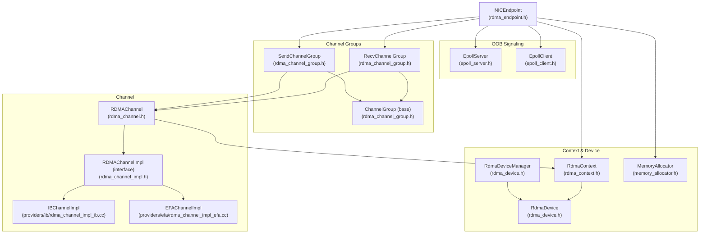
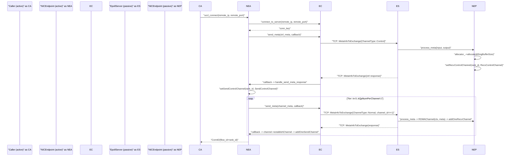
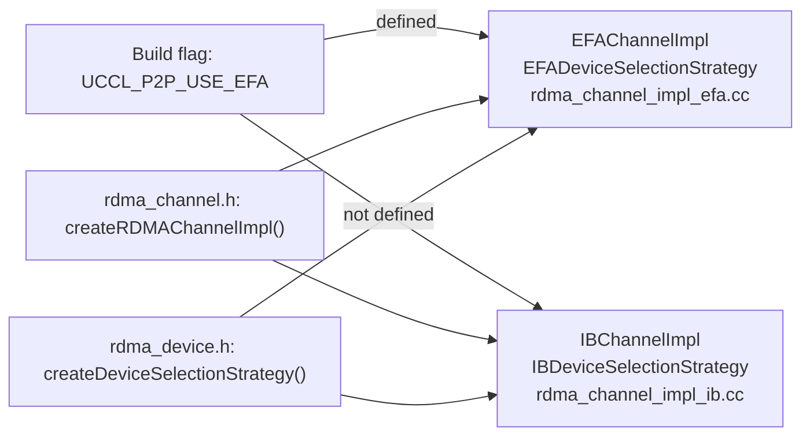

<!-- source: DeepWiki mcp.deepwiki.com · repo uccl-project/uccl · page 3.2 RDMA Transport Layer · fetched 2026-11-11 -->

# RDMA Transport Layer

<details>
<summary>Relevant source files</summary>

The following files were used as context for generating this wiki page:

- [p2p/endpoint_wrapper.h](p2p/endpoint_wrapper.h)
- [p2p/include/common.h](p2p/include/common.h)
- [p2p/rdma/define.h](p2p/rdma/define.h)
- [p2p/rdma/epoll_client.h](p2p/rdma/epoll_client.h)
- [p2p/rdma/epoll_server.h](p2p/rdma/epoll_server.h)
- [p2p/rdma/memory_allocator.h](p2p/rdma/memory_allocator.h)
- [p2p/rdma/providers/efa/rdma_channel_impl_efa.cc](p2p/rdma/providers/efa/rdma_channel_impl_efa.cc)
- [p2p/rdma/providers/efa/rdma_device_selection_efa.h](p2p/rdma/providers/efa/rdma_device_selection_efa.h)
- [p2p/rdma/providers/ib/rdma_channel_impl_ib.cc](p2p/rdma/providers/ib/rdma_channel_impl_ib.cc)
- [p2p/rdma/providers/ib/rdma_device_selection_ib.h](p2p/rdma/providers/ib/rdma_device_selection_ib.h)
- [p2p/rdma/rdma_channel.h](p2p/rdma/rdma_channel.h)
- [p2p/rdma/rdma_channel_group.h](p2p/rdma/rdma_channel_group.h)
- [p2p/rdma/rdma_channel_impl.h](p2p/rdma/rdma_channel_impl.h)
- [p2p/rdma/rdma_context.h](p2p/rdma/rdma_context.h)
- [p2p/rdma/rdma_device.h](p2p/rdma/rdma_device.h)
- [p2p/rdma/rdma_endpoint.h](p2p/rdma/rdma_endpoint.h)
- [p2p/rdma/tests/Makefile](p2p/rdma/tests/Makefile)

</details>


This page documents the RDMA transport abstraction inside the UCCL-P2P subsystem: how RDMA devices are discovered, how channels are created and connected, and how sends and receives are dispatched across those channels. The scope is the `p2p/rdma/` directory and its sub-providers.

For the higher-level `Endpoint` class that calls into this layer, see [P2P Engine Architecture](#3.1). For how GPU memory is registered and tracked, see [Memory Registration and Buffer Management](#3.3). For the Python-facing API built on top of this layer, see [CollectiveContext Python API](#3.4).

---

## Component Overview

The RDMA transport layer is organized in four concerns: device discovery, context management, channel implementation (provider-specific), and endpoint coordination.

**Component hierarchy diagram:**



Sources: [p2p/rdma/rdma_endpoint.h:1-50](), [p2p/rdma/rdma_channel.h:1-50](), [p2p/rdma/rdma_channel_impl.h:1-103](), [p2p/rdma/rdma_channel_group.h:1-102](), [p2p/rdma/rdma_context.h:1-30](), [p2p/rdma/rdma_device.h:1-35](), [p2p/rdma/memory_allocator.h:1-20]()

---

## Device Discovery and Selection

### RdmaDeviceManager

`RdmaDeviceManager` ([p2p/rdma/rdma_device.h:62-178]()) is a thread-safe singleton. On first access it calls `ibv_get_device_list` and wraps each result in an `RdmaDevice`. It exposes:

| Method | Purpose |
|---|---|
| `instance()` | Returns the singleton |
| `getDevice(size_t id)` | Returns `shared_ptr<RdmaDevice>` by index |
| `get_best_dev_idx(int gpu_idx)` | Returns a ranked list of device indices closest to a given GPU |
| `get_numa_node(size_t id)` | Returns the NUMA node of a device for thread pinning |

`get_best_dev_idx` computes PCIe distances between the GPU and each NIC using `uccl::safe_pcie_distance`, then delegates NIC selection to a pluggable strategy.

### Device Selection Strategies

Selection is done through the `RDMADeviceSelectionStrategy` interface ([p2p/rdma/rdma_device.h:9-18]()):

```
virtual selectNICs(dist, gpu_idx) → vector<string>
```

Two concrete strategies exist, chosen at compile time by the `UCCL_P2P_USE_EFA` preprocessor flag:

| Strategy | File | Behavior |
|---|---|---|
| `IBDeviceSelectionStrategy` | `providers/ib/rdma_device_selection_ib.h` | Selects the single NIC with minimum PCIe distance |
| `EFADeviceSelectionStrategy` | `providers/efa/rdma_device_selection_efa.h` | Selects 1–4 EFA NICs (`rdmap*`) based on instance type and GPU index |

The EFA strategy handles specific AWS instance families:

| Instance type | Total EFA NICs | NICs per GPU |
|---|---|---|
| p5 | 32 | 4 (shared, all with min distance) |
| p5e / p5en | 16 | 2 (GPU-affine pair) |
| p6-b200 | 8 | 1 |

Sources: [p2p/rdma/rdma_device.h:85-143](), [p2p/rdma/providers/efa/rdma_device_selection_efa.h:1-59](), [p2p/rdma/providers/ib/rdma_device_selection_ib.h:1-38]()

---

## RdmaContext

`RdmaContext` ([p2p/rdma/rdma_context.h:6-170]()) wraps a single `ibv_context` and its associated `ibv_pd` (protection domain). It is constructed from an `RdmaDevice`.

Key responsibilities:

- Opens the device via `ibv_open_device`
- Allocates a protection domain via `ibv_alloc_pd`
- Detects and caches the appropriate GID index via `detectGid`, supporting InfiniBand (GID 0), RoCE v2 (scans sysfs for `RoCE v2` type), and EFA (GID 0)
- Reads the GID index from environment variable `UCCL_P2P_RDMA_GID_INDEX` if set
- Registers memory via `regMem` (wraps `ibv_reg_mr` with local+remote read/write access flags)
- Deregisters memory via the static `deregMem`
- Creates address handles via `createAH` (used by EFA for UD addressing)

Each `NICEndpoint` holds a fixed-size array of `kNICContextNumber` (= 4) `RdmaContext` instances, one per physical NIC context slot.

Sources: [p2p/rdma/rdma_context.h:1-170](), [p2p/rdma/define.h:47-48]()

---

## Channel Abstraction

### RDMAChannelImpl Interface

`RDMAChannelImpl` ([p2p/rdma/rdma_channel_impl.h:57-91]()) is an abstract base defining:

| Method | Purpose |
|---|---|
| `initQP(ctx, &cq_ex, &qp, local_meta)` | Creates CQ and QP, fills local `ChannelMetaData` |
| `connectQP(qp, ctx, remote_meta)` | Transitions QP to RTR then RTS using remote metadata |
| `poll_once(cq_ex, cq_datas, channel_id, nb_post_recv)` | Drains the CQ into a list of `CQMeta` |
| `lazy_post_recv_wrs_n(qp, n, force)` | Batched posting of receive work requests |
| `setDstAddress(qpx, ah, remote_qpn)` | Sets destination address (no-op for RC, sets UD addr for EFA) |
| `getMaxInlineData()` | Returns max inline send size |
| `initPreAllocResources()` | Pre-allocates receive WR arrays |

Two environment variables tune the IB provider at connection time:
- `UCCL_P2P_RDMA_SL` — service level (default 3)
- `UCCL_P2P_RDMA_TC` — traffic class (default 104)

### IBChannelImpl (InfiniBand / RoCE)

File: [p2p/rdma/providers/ib/rdma_channel_impl_ib.cc]()

Uses **RC (Reliable Connected) QPs**. `initQP` creates the CQ with `ibv_create_cq`, creates the QP via `ibv_create_qp_ex` with `IBV_QPT_RC`, and transitions it to `INIT`. `connectQP` calls `ibrcQP_rtr_rts` which:
1. Reads `port_attr.link_layer` to distinguish RoCE (Ethernet) from native IB
2. On RoCE: sets GRH with remote GID and traffic class
3. On IB: sets `dlid` from remote LID, no GRH
4. Transitions QP to RTR, pre-posts `kMaxRecvWr` receive WRs, then transitions to RTS

Key constants:

| Constant | Value | Role |
|---|---|---|
| `MAX_INLINE_DATA` | 128 bytes | Inline send threshold |
| `TIMEOUT` | 14 | QP timeout exponent |
| `RETRY_CNT` | 7 | Retry count |
| `RNR_RETRY` | 7 | RNR retry count |
| `MAX_CQE` | 1024 | CQ depth |
| `kMaxSendWr` | 1024 | Send queue depth |
| `kMaxRecvWr` | 1024 | Recv queue depth |

### EFAChannelImpl (AWS EFA)

File: [p2p/rdma/providers/efa/rdma_channel_impl_efa.cc]()

Uses **SRD (Scalable Reliable Datagram) QPs** via the `efadv` vendor extension. `initQP` creates the QP with `efadv_create_qp_ex` using `EFADV_QP_DRIVER_TYPE_SRD` and the flag `EFADV_QP_FLAGS_UNSOLICITED_WRITE_RECV` (receive WRs are not consumed on RDMA write with immediate). The QP transitions directly to RTR and RTS without peer info. `connectQP` is a no-op since SRD is connectionless. `setDstAddress` calls `ibv_wr_set_ud_addr` with the pre-created address handle and remote QPN.

Key differences from IBChannelImpl:

| Property | IBChannelImpl | EFAChannelImpl |
|---|---|---|
| QP type | `IBV_QPT_RC` | `IBV_QPT_DRIVER` / SRD |
| Max inline data | 128 bytes | 0 bytes |
| `connectQP` | RTR+RTS transition | No-op |
| Recv WR management | Lazy batch posting | No-op |
| Address setup | No-op (RC is connected) | `ibv_wr_set_ud_addr` |

Sources: [p2p/rdma/providers/ib/rdma_channel_impl_ib.cc](), [p2p/rdma/providers/efa/rdma_channel_impl_efa.cc]()

### RDMAChannel

`RDMAChannel` ([p2p/rdma/rdma_channel.h:25-306]()) composes one `RdmaContext`, one `ibv_qp`, one `ibv_cq_ex`, and a concrete `RDMAChannelImpl` (selected by compile-time flag). The factory function `createRDMAChannelImpl()` returns either `IBChannelImpl` or `EFAChannelImpl`.

Each channel has a numeric `channel_id` (1-based) and maps to a `RdmaContext` via `channelIdToContextId(channel_id)`.

Operations:
- `submitRequest(req)` / `send(req)` / `read(req)` — posts a send/write/read WR via `postRequest`
- `recv(req)` — calls `ibv_post_recv`
- `poll_once(cq_datas)` — drains CQ, fills `CQMeta` vector
- `establishChannel(remote_meta)` — calls `impl_->connectQP`

`postRequest` selects between two internal paths based on vendor ID: `__postRequest_ex` (using the `ibv_wr_*` extended API) and `__postRequest` (using the legacy `ibv_post_send`). Vendor `0x1dd8` uses the legacy path.

**Request type mapping:**

| `SendType` | Verb opcode |
|---|---|
| `Send` | `IBV_WR_RDMA_WRITE_WITH_IMM` |
| `Write` | `IBV_WR_RDMA_WRITE` |
| `Read` | `IBV_WR_RDMA_READ` |

Sources: [p2p/rdma/rdma_channel.h:1-306](), [p2p/rdma/rdma_channel_impl.h:57-103]()

---

## Channel Groups

### ChannelGroup (base)

`ChannelGroup` ([p2p/rdma/rdma_channel_group.h:7-101]()) is a thread-safe map from `channel_id` to `shared_ptr<RDMAChannel>`. It provides two selection algorithms:

- `selectNextChannelRoundRobin()` — increments `last_channel_id_` atomically, wraps at `num_channels`
- `selectNextChannelRandom()` — uses a thread-local `std::mt19937` to pick uniformly

Both return a `pair<channel_id, context_id>`.

### SendChannelGroup

`SendChannelGroup` ([p2p/rdma/rdma_channel_group.h:103-424]()) extends `ChannelGroup` with:

- A `SendControlChannel` that carries back-channel metadata (receive-side buffer info)
- A `RingBuffer` of pending `RDMASendRequest` pointers
- An `AtomicBitmapPacketTrackerMultiAck` for per-`wr_id` completion tracking
- A background `poll_thread_` running `pollingLoop`, started when `setControlChannel` is called (when `auto_start_polling_` is true)

The polling loop does three things each iteration:
1. `pollControlChannel` — drains the control channel for new send-request metadata
2. `processSendRequests` — dequeues from `request_queue_`, pairs with metadata, calls `postChunkedRequest`
3. `pollDataChannels` — polls all data channel CQs, calls `tracker_->acknowledge(wr_id)` on completions

`postChunkedRequest` splits large messages into chunks using `splitMessageToChunks` (chunk size: `kMessageChunkSizeKB` = 256 KB, max `kMaxSplitNum` = 16 chunks) and distributes chunks across channels with round-robin assignment.

### RecvChannelGroup

`RecvChannelGroup` ([p2p/rdma/rdma_channel_group.h:426-599]()) extends `ChannelGroup` with:

- A `RecvControlChannel` for advertising receive buffer info to the sender
- A background `poll_thread_` running `pollingLoop`
- `recv(req)` — selects a channel round-robin, posts recv-buffer info via the control channel
- `check(index)` — non-blocking poll on the control channel for completion

**Channel group polling flow:**

```mermaid
sequenceDiagram
    participant "SendChannelGroup::pollingLoop" as SL
    participant "SendControlChannel" as SCC
    participant "RDMAChannel (data)" as DC
    participant "AtomicBitmapPacketTrackerMultiAck" as TR

    SL->>SCC: "pollControlChannel() - noblockingPoll()"
    SCC-->>SL: "SendReqMeta (remote addr, rkey)"
    SL->>SL: "processSendRequests() - pop from request_queue_"
    SL->>DC: "postChunkedRequest() - ibv_wr_rdma_write / ibv_post_send"
    SL->>DC: "pollDataChannels() - poll_once(cq_datas)"
    DC-->>SL: "CQMeta{wr_id, opcode}"
    SL->>TR: "acknowledge(wr_id)"
```

Sources: [p2p/rdma/rdma_channel_group.h:1-600]()

---

## NICEndpoint

`NICEndpoint` ([p2p/rdma/rdma_endpoint.h:13-827]()) is the top-level class used by the `Endpoint` engine. It holds:

| Member | Type | Role |
|---|---|---|
| `contexts_` | `vector<shared_ptr<RdmaContext>>` | Per-context RDMA state (size = `kNICContextNumber` = 4) |
| `send_channel_groups_` | `unordered_map<uint64_t, SendChannelGroup>` | Per-peer send groups |
| `recv_channel_groups_` | `unordered_map<uint64_t, RecvChannelGroup>` | Per-peer recv groups |
| `oob_server_` | `shared_ptr<EpollServer>` | Listens for incoming channel metadata |
| `oob_client_` | `shared_ptr<EpollClient>` | Sends outgoing channel metadata |
| `allocator_` | `shared_ptr<MemoryAllocator>` | Allocates control channel ring buffers |
| `rank_oob_meta_` | `unordered_map<uint64_t, OOBMetaData>` | Remote IP/port per peer rank |

### Initialization

`NICEndpoint` constructor ([p2p/rdma/rdma_endpoint.h:15-38]()):
1. Calls `initialize_rdma_ctx_for_gpu(gpu_index, device_ids)` which queries `RdmaDeviceManager::instance().get_best_dev_idx(gpu_index)` and constructs `kNICContextNumber` `RdmaContext` objects (cycling across available devices)
2. Starts `EpollServer` on the given port (0 = OS-assigned)
3. Starts `EpollClient`
4. Creates a `MemoryAllocator`

### Connection Setup

Connection setup is initiated by `uccl_connect` (active side) or `uccl_accept` (passive side) and is built on TCP-based out-of-band signaling.

**Connection setup sequence diagram:**



The two phases of `build_connect` ([p2p/rdma/rdma_endpoint.h:96-108]()):
1. `build_control_channel` — sends one `ChannelType::Control` message carrying `SendControlChannel` metadata and the local OOB server port. The passive side creates a `RecvControlChannel` with a ring buffer and establishes a back-connection.
2. `build_normal_channels` — sends `kQpNumPerChannel` (= 4) `ChannelType::Normal` messages in parallel, each establishing one `RDMAChannel` QP pair.

`MetaInfoToExchange` ([p2p/rdma/define.h:606-677]()) is the structure serialized over TCP. It carries `rank_id`, `channel_id`, `ChannelMetaData` (QPN, GID, LID), `RemoteMemInfo` (for control ring buffer), `gpu_id`, and `oob_port`.

### Operations

| Method | Behavior |
|---|---|
| `writeOrRead(req)` | Selects send group by `to_rank_id`, calls `postWriteOrRead` (round-robin channel, chunked) |
| `send(rank_id, req)` | Enqueues into send group's `request_queue_` |
| `recv(rank_id, req)` | Enqueues into recv group, which notifies sender via control channel |
| `checkSendComplete_once(rank_id, wr_id)` | Non-blocking query of `AtomicBitmapPacketTrackerMultiAck` |
| `checkRecvComplete_once(rank_id, index)` | Non-blocking query of `RecvControlChannel` |
| `uccl_regmr(data, len, mr_array)` | Calls `context->regMem` for each context, stores `ibv_mr*` in `MRArray` |
| `uccl_deregmr(mr_array)` | Calls `RdmaContext::deregMem` for each `ibv_mr*` |

Sources: [p2p/rdma/rdma_endpoint.h:96-801]()

---

## Out-of-Band Signaling: EpollServer and EpollClient

Both classes live in `p2p/rdma/epoll_server.h` and `p2p/rdma/epoll_client.h`. They use Linux `epoll` in **edge-triggered** mode.

### EpollServer

`EpollServer` ([p2p/rdma/epoll_server.h:111-464]()) runs a background thread (`event_loop`) that accepts connections, reads length-prefixed frames (`uint32_t len` then payload), calls the registered `MetaHandler`, and writes the response back. Callbacks are invoked synchronously in the event loop. Port 0 triggers OS port assignment, with the actual port retrievable via `get_port()`.

### EpollClient

`EpollClient` ([p2p/rdma/epoll_client.h:26-341]()) maintains persistent connections keyed by `"ip:port"` strings. `connect_to_server` returns a `conn_key`. `send_meta(conn_key, payload, callback)` enqueues a length-framed payload; the `callback` is invoked when the server's response arrives. Multiple requests can be pipelined on one connection using a `queue<ResponseCallback>`.

---

## Key Data Structures

The following structures are defined in [p2p/rdma/define.h]() and [p2p/include/common.h]():

| Structure | Purpose |
|---|---|
| `ChannelMetaData` | QPN + GID (RoCE) + LID (IB) exchanged at QP connect time |
| `RDMASendRequest` | Describes one RDMA operation: local `RegMemBlock`, remote `RemoteMemInfo`, `SendType`, `wr_id`, `imm_data` |
| `RDMARecvRequest` | Describes one receive posting: local `RegMemBlock`, `wr_id` |
| `RegMemBlock` | Local memory region: `addr`, `size`, `MemoryType`, `MRArray` (per-context `ibv_mr*`) |
| `RemoteMemInfo` | Peer's memory: `addr`, `length`, `RKeyArray` (per-context rkeys), `MemoryType` |
| `MRArray` / `RKeyArray` | `ContextArrayT<T>` — fixed array of size `kNICContextNumber` indexed by context ID |
| `CQMeta` | Completion event: `wr_id`, `op_code`, `len`, `imm` |
| `MetaInfoToExchange` | TCP payload for QP handshake: rank, channel type, `ChannelMetaData`, `RemoteMemInfo`, gpu_id, oob_port |
| `SendReqMeta` / `SendReqMetaOnRing` | Ring buffer entries for the control channel carrying remote buffer info |
| `ConnID` | Opaque connection identifier: `context` (pointer cast to rank_id), `flow_id` |
| `FifoItem` | 64-byte descriptor for one-sided read/write operations (addr, size, rkeys in padding bytes) |

**Context ID mapping:**

The helper `channelIdToContextId(channel_id)` ([p2p/rdma/define.h:69-71]()) maps:
- `channel_id == 0` (control) → context 0
- `channel_id >= 1` → `(channel_id - 1) % kNICContextNumber`

This means `kQpNumPerChannel` = 4 normal channels spread evenly across `kNICContextNumber` = 4 contexts.

Sources: [p2p/rdma/define.h:39-712](), [p2p/include/common.h:1-72]()

---

## Configuration Constants

Defined in [p2p/rdma/define.h:39-71]():

| Constant | Value | Role |
|---|---|---|
| `kQpNumPerChannel` | 4 | Normal QPs per peer connection |
| `kNICContextNumber` | 4 | Max RDMA contexts per NICEndpoint |
| `kControlChannelID` | 0 | ID reserved for control QP |
| `kMaxSendWr` | 1024 | Send queue depth per QP |
| `kMaxRecvWr` | 1024 | Recv queue depth per QP |
| `kBatchPostRecvWr` | 32 | Receive WRs posted per batch |
| `kBatchPollCqe` | 32 | CQEs drained per `ibv_poll_cq` call |
| `kMessageChunkSizeKB` | 256 KB | Target chunk size for large messages |
| `kMaxSplitNum` | 16 | Max chunks per message |
| `kRingCapacity` | 16384 | Control channel ring buffer entry count |
| `kInFlightMaxSizeKB` | ~10 GB | Max in-flight bytes before back-pressure |

---

## Provider Selection at Build Time

The compile-time flag `UCCL_P2P_USE_EFA` determines which implementations are compiled in:



The `RdmaContext::detectGid` method also adapts based on the detected link layer: on `IBV_LINK_LAYER_INFINIBAND` it uses GID 0; on `IBV_LINK_LAYER_ETHERNET` it scans sysfs for a RoCE v2 entry; otherwise it uses `UCCL_P2P_RDMA_GID_INDEX` from the environment or falls back to the provided default.

Sources: [p2p/rdma/rdma_channel.h:9-23](), [p2p/rdma/rdma_device.h:21-34](), [p2p/rdma/rdma_context.h:56-122]()

---

