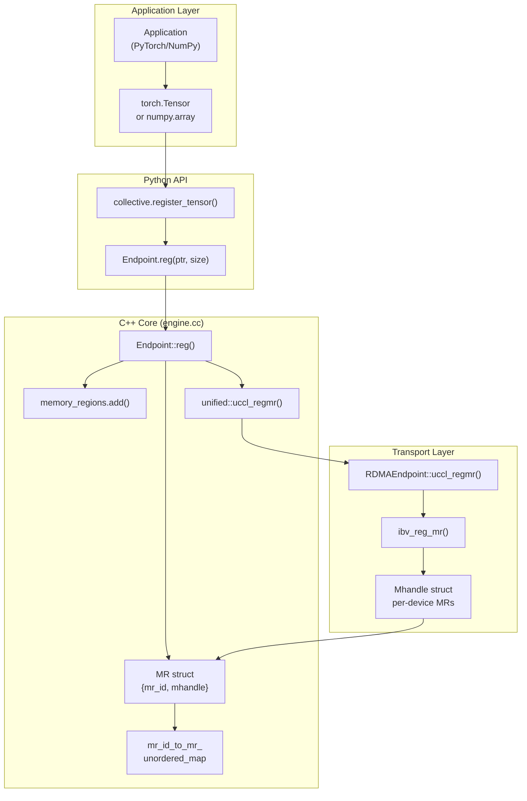
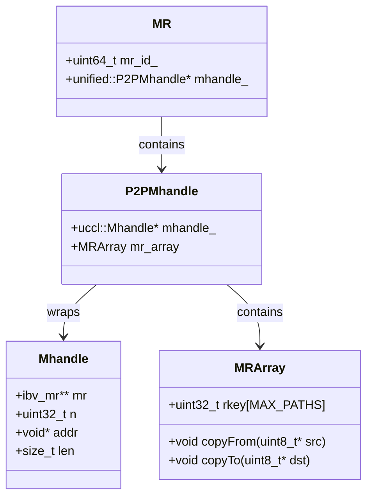
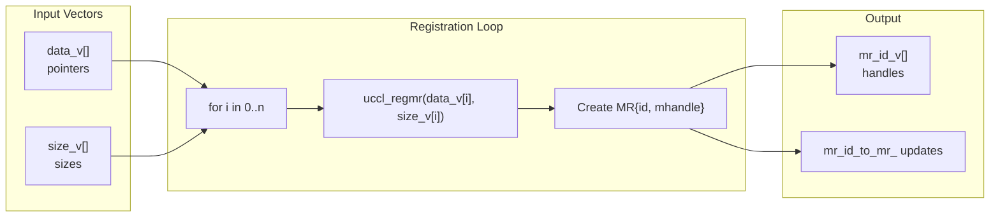
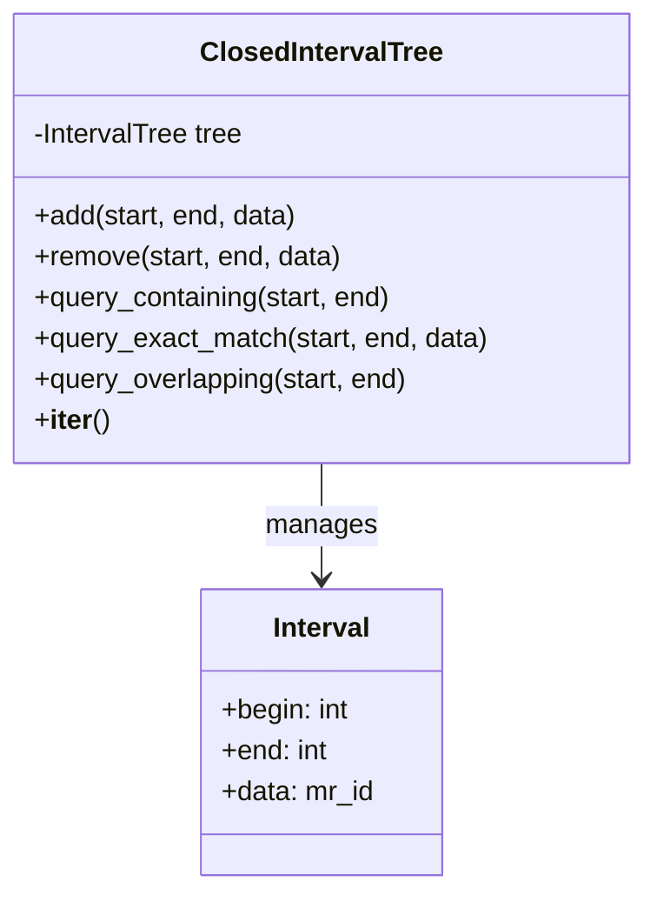
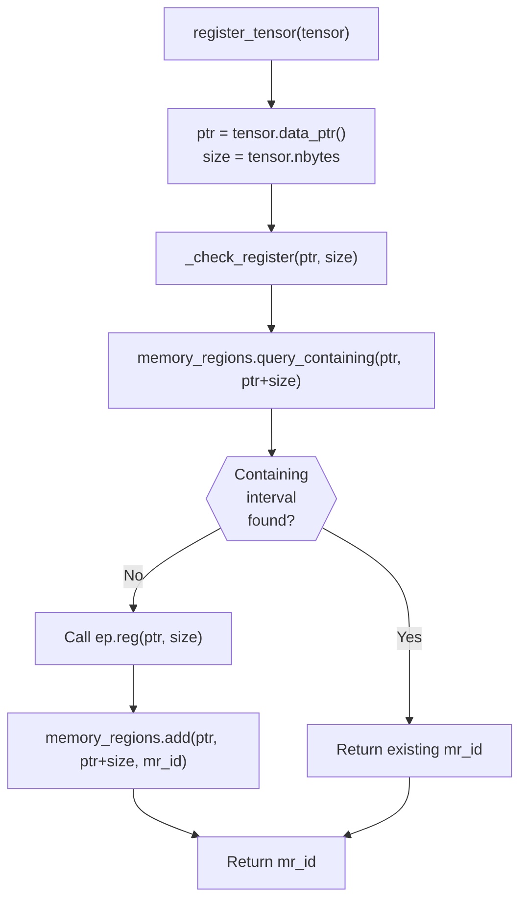
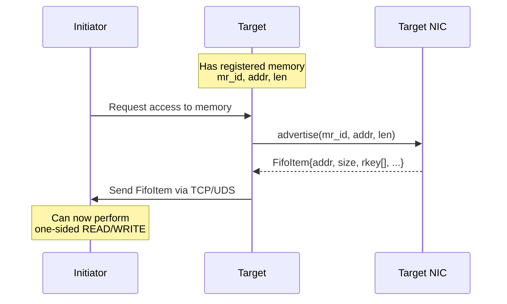
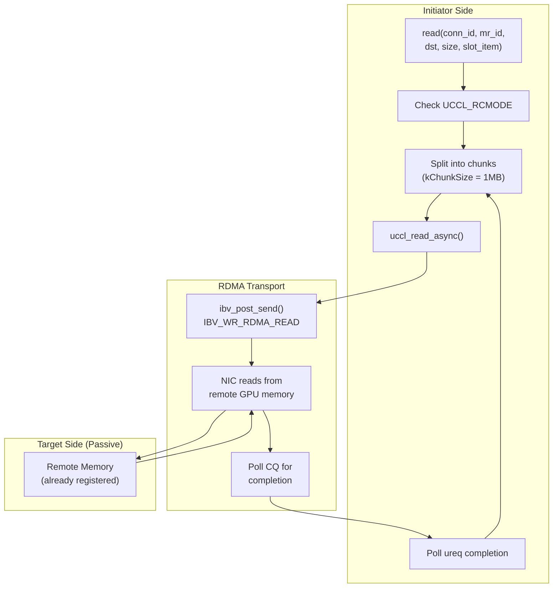
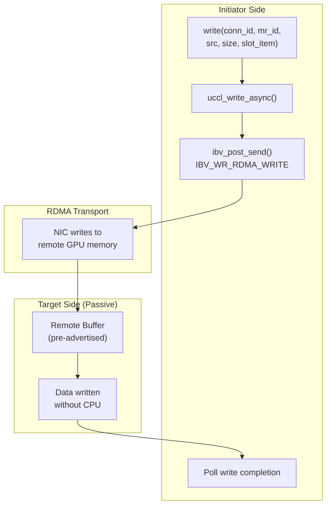
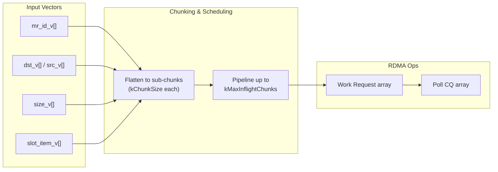
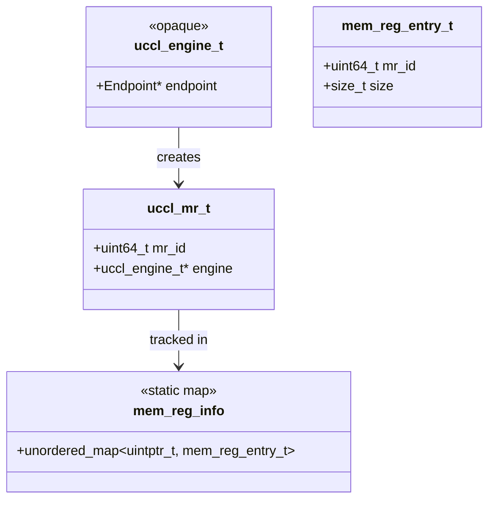

<!-- source: DeepWiki mcp.deepwiki.com · repo uccl-project/uccl · page 3.3 Memory Registration and Buffer Management · fetched 2026-11-11 -->

# Memory Registration and Buffer Management

<details>
<summary>Relevant source files</summary>

The following files were used as context for generating this wiki page:

- [include/util/gpu_rt.h](include/util/gpu_rt.h)
- [include/util/util.h](include/util/util.h)
- [p2p/Makefile](p2p/Makefile)
- [p2p/README.md](p2p/README.md)
- [p2p/benchmarks/benchmark_nccl.py](p2p/benchmarks/benchmark_nccl.py)
- [p2p/benchmarks/benchmark_nixl.py](p2p/benchmarks/benchmark_nixl.py)
- [p2p/benchmarks/benchmark_uccl.py](p2p/benchmarks/benchmark_uccl.py)
- [p2p/benchmarks/benchmark_uccl_readwrite.py](p2p/benchmarks/benchmark_uccl_readwrite.py)
- [p2p/endpoint_wrapper.h](p2p/endpoint_wrapper.h)
- [p2p/engine.cc](p2p/engine.cc)
- [p2p/engine.h](p2p/engine.h)
- [p2p/include/common.h](p2p/include/common.h)
- [p2p/rdma/define.h](p2p/rdma/define.h)
- [p2p/rdma/epoll_client.h](p2p/rdma/epoll_client.h)
- [p2p/rdma/epoll_server.h](p2p/rdma/epoll_server.h)
- [p2p/rdma/memory_allocator.h](p2p/rdma/memory_allocator.h)
- [p2p/rdma/rdma_endpoint.h](p2p/rdma/rdma_endpoint.h)
- [p2p/tests/test_engine_onesided_ipc.py](p2p/tests/test_engine_onesided_ipc.py)
- [p2p/uccl_engine.cc](p2p/uccl_engine.cc)
- [p2p/uccl_engine.h](p2p/uccl_engine.h)

</details>


This page documents the memory registration system for RDMA transfers in UCCL P2P Engine, including buffer tracking via interval trees and support for one-sided READ/WRITE operations. Memory registration is a prerequisite for all RDMA communication, pinning memory buffers in physical RAM to enable direct NIC access without CPU involvement.

For the overall P2P Engine architecture and connection management, see [P2P Engine Architecture](#3.1). For the high-level Python API that uses these primitives, see [P2P Python API](#3.3).

---

## Memory Registration Overview

Memory registration is the process of pinning host or device memory and registering it with the RDMA NIC, producing a memory region handle (`mr_id`) that can be used in subsequent data transfer operations. Registered memory remains valid until explicitly deregistered.

### Registration Flow



**Registration Process**:
1. Application obtains memory pointer and size
2. Python API extracts `data_ptr()` and size in bytes
3. C++ `Endpoint::reg()` checks for existing registration via interval tree
4. If not registered, calls `unified::uccl_regmr()` to pin memory
5. Transport layer registers with each RDMA device using `ibv_reg_mr()`
6. Returns `mr_id` handle and stores mapping in `mr_id_to_mr_`
7. Adds interval to tracking tree for future lookups

Sources: [p2p/engine.cc:402-429](), [p2p/engine.h:42-45](), [p2p/collective.py:327-343]()

---

## Memory Region Data Structures

### MR Structure

The `MR` struct represents a registered memory region at the endpoint level:



| Structure | Purpose | Key Fields |
|-----------|---------|------------|
| `MR` | User-facing memory region handle | `mr_id_`: unique identifier<br/>`mhandle_`: pointer to underlying handle |
| `P2PMhandle` | Unified handle wrapping transport-specific MRs | `mhandle_`: RDMA backend handle<br/>`mr_array`: remote keys for RDMA |
| `Mhandle` | RDMA-specific memory region | `mr`: array of `ibv_mr` pointers (one per device)<br/>`n`: number of memory regions<br/>`addr`, `len`: registered memory range |
| `MRArray` | Remote key array for multi-path RDMA | `rkey[]`: remote keys indexed by path/QP<br/>Serialization helpers for advertisement |

Sources: [p2p/engine.h:42-45](), [p2p/endpoint_wrapper.h:29-32]()

---

## Registration API

### Single Buffer Registration

The `Endpoint::reg()` method registers a contiguous memory buffer:

**C++ API** ([p2p/engine.cc:402-429]()):
```cpp
bool Endpoint::reg(void const* data, size_t size, uint64_t& mr_id)
```

**Key Steps**:
1. Check if engine is initialized; if not, determine GPU index from pointer
2. Call `unified::uccl_regmr()` to register with transport layer
3. Create `MR` struct with allocated `mr_id`
4. Store in `mr_id_to_mr_` map (protected by `mr_mu_` shared_mutex)

**Python API** ([p2p/collective.py:327-336]()):
```python
def _register_memory(self, ptr: int, size: int) -> int
```

Includes interval tree checking to avoid duplicate registrations for overlapping buffers.

### Vectorized Registration

The `Endpoint::regv()` method efficiently registers multiple buffers in one call:



**Benefits**:
- Amortizes lock acquisition overhead
- Pre-reserves map capacity to avoid rehashing
- Suitable for bulk tensor registration

Sources: [p2p/engine.cc:431-464](), [p2p/engine.h:147-148]()

### Deregistration

The `Endpoint::dereg()` method unpins memory and releases resources:

```cpp
bool Endpoint::dereg(uint64_t mr_id)
```

**Process** ([p2p/engine.cc:466-475]()):
1. Acquire exclusive lock on `mr_mu_`
2. Lookup `MR*` in `mr_id_to_mr_`
3. Call `unified::uccl_deregmr()` to unregister from transport
4. Delete `MR` object
5. Erase from map

**Important**: Applications must not deregister memory while transfers using that `mr_id` are in progress.

---

## Interval Tree Tracking

The Python `CollectiveContext` uses a closed interval tree to efficiently track registered memory regions, enabling detection of overlapping registrations and preventing redundant `reg()` calls.

### ClosedIntervalTree Implementation



**Key Operations** ([p2p/utils.py:114-219]()):

| Method | Complexity | Purpose |
|--------|------------|---------|
| `add(start, end, mr_id)` | O(log n) | Insert closed interval `[start, end]` with associated `mr_id` |
| `query_containing(start, end)` | O(log n + k) | Find all intervals that fully contain `[start, end]` |
| `query_exact_match(start, end, data)` | O(log n + k) | Find intervals with exact boundaries and optional data filter |
| `remove(start, end, data)` | O(log n + k) | Remove specific interval(s) |

### Registration Check Flow



**Example**: Registering a 1GB tensor at address `0x7f0000000000`:
1. Query: `query_containing(0x7f0000000000, 0x7f0040000000)`
2. If no containing interval exists, call `ep.reg()`
3. Add interval: `add(0x7f0000000000, 0x7f003fffffff, mr_id=42)`
4. Future registrations of sub-regions (e.g., tensor slices) reuse `mr_id=42`

**Benefit**: Avoids expensive redundant `ibv_reg_mr()` calls for the same physical pages.

Sources: [p2p/collective.py:327-343](), [p2p/utils.py:114-219](), [p2p/tests/test_util_interval_tree.py:1-219]()

---

## One-Sided RDMA Operations

One-sided RDMA operations (READ/WRITE) allow direct memory access without involving the remote CPU. The remote side must first "advertise" its memory region to provide the necessary metadata.

### Advertisement Mechanism

Before a one-sided operation, the target must advertise its memory region using the `advertise()` method:



**FifoItem Structure** ([p2p/engine.h:62-64]()):
- `addr`: Remote memory address
- `size`: Buffer length
- `rkey`: Remote key for RDMA access (copied from `MRArray`)
- `engine_offset`: Target engine/QP to use
- Additional metadata for multi-path/multi-QP setups

**API** ([p2p/engine.cc:1084-1135]()):
```cpp
bool Endpoint::advertise(uint64_t conn_id, uint64_t mr_id, 
                        void* addr, size_t len, char* out_buf)
```

Serializes remote memory metadata into `out_buf` (size: `sizeof(FifoItem)`) which must be communicated to the initiator out-of-band.

### RDMA READ Operation



**Chunking**: Large transfers are split into `kChunkSize` (1MB for RDMA, 1GB for EFA) chunks with pipelined reads. Up to `kMaxInflightChunks` (8) chunks can be in-flight simultaneously ([p2p/engine.cc:823-888]()).

**RC Mode Requirement**: One-sided operations require Reliable Connection (RC) mode, checked via `ucclParamRCMode()`.

### RDMA WRITE Operation



**Write Process**:
1. Initiator has `slot_item` from target's `advertise()` call
2. Posts RDMA WRITE work request with local `src` buffer and remote metadata
3. NIC performs DMA directly to remote GPU memory
4. Polls local completion queue; no remote-side notification

Sources: [p2p/engine.cc:823-888](), [p2p/engine.cc:889-1082](), [p2p/engine.h:186-221]()

### Vectorized One-Sided Operations

Vectorized variants (`readv`, `writev`) enable batching multiple READ/WRITE operations:



**Use Case**: Scatter/gather operations for distributed KV cache management, where multiple discontiguous regions must be read/written atomically.

**API Methods**:
- `readv(conn_id, mr_id_v, dst_v, size_v, slot_item_v, num_iovs)` ([p2p/engine.cc:953-1035]())
- `writev(conn_id, mr_id_v, src_v, size_v, slot_item_v, num_iovs)` ([p2p/engine.cc:1137-1220]())

Sources: [p2p/engine.cc:953-1082](), [p2p/engine.h:194-221]()

---

## Memory Registration in C API

The UCCL Engine also exposes a C API for integration with non-Python applications:

### C API Structure



### C API Functions

| Function | Purpose | Reference |
|----------|---------|-----------|
| `uccl_engine_reg(engine, data, size)` | Register memory, returns `uccl_mr_t*` | [p2p/uccl_engine.cc:447-463]() |
| `uccl_engine_mr_destroy(mr)` | Deregister and free `uccl_mr_t` | [p2p/uccl_engine.cc:598-607]() |
| `find_mem_reg(addr, &base_addr, &mr_id)` | Lookup containing memory region | [p2p/uccl_engine.cc:81-90]() |

**Global Tracking**: The C API maintains a global `mem_reg_info` map ([p2p/uccl_engine.cc:72]()) that maps base addresses to `mem_reg_entry_t` structures. The `find_mem_reg()` helper function searches this map to find the registered region containing any given address, enabling address-to-mr_id resolution.

Sources: [p2p/uccl_engine.cc:81-90](), [p2p/uccl_engine.cc:447-463](), [p2p/uccl_engine.h:106-113]()

---

## Summary

Memory registration in UCCL P2P Engine provides:

1. **Efficient buffer pinning**: Memory regions registered once, reused for multiple transfers
2. **Interval tree tracking**: Avoids redundant registrations for overlapping buffers
3. **One-sided RDMA**: READ/WRITE operations without remote CPU involvement
4. **Vectorized operations**: Batch registration and transfer for improved performance
5. **Multi-API support**: C++ Endpoint API, Python CollectiveContext API, and C API for flexibility

All RDMA transfers require prior memory registration. The interval tree optimization in the Python API significantly reduces registration overhead for applications with dynamic buffer patterns (e.g., PyTorch training with varying batch sizes).

Sources: [p2p/engine.cc:402-1220](), [p2p/engine.h:144-233](), [p2p/collective.py:91-343](), [p2p/utils.py:114-219]()

---

