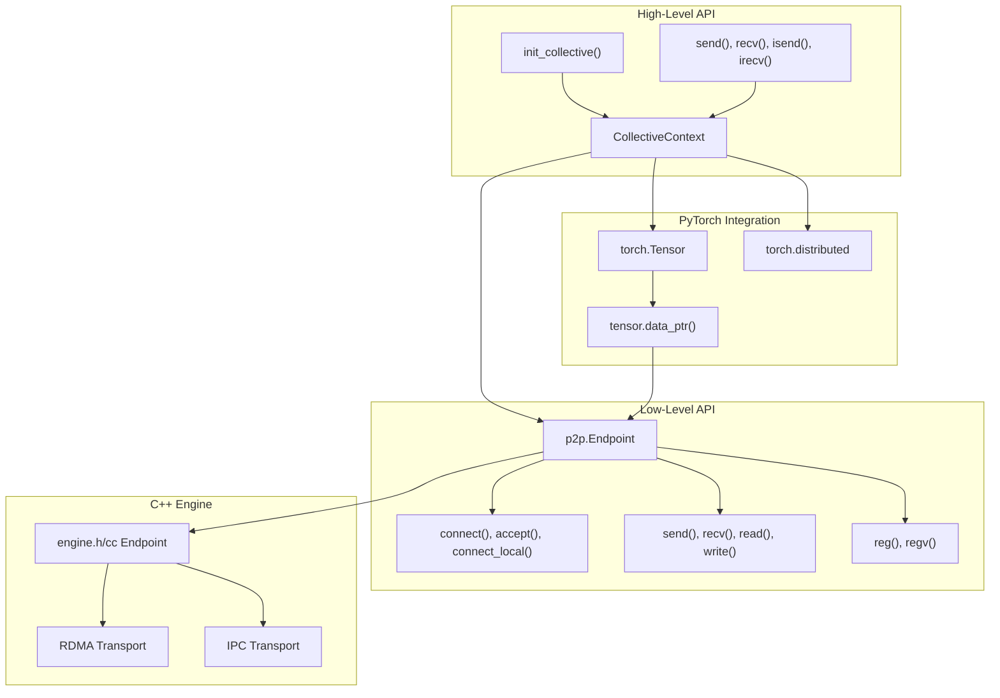
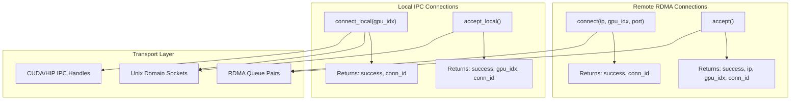
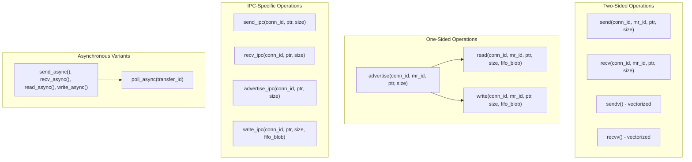
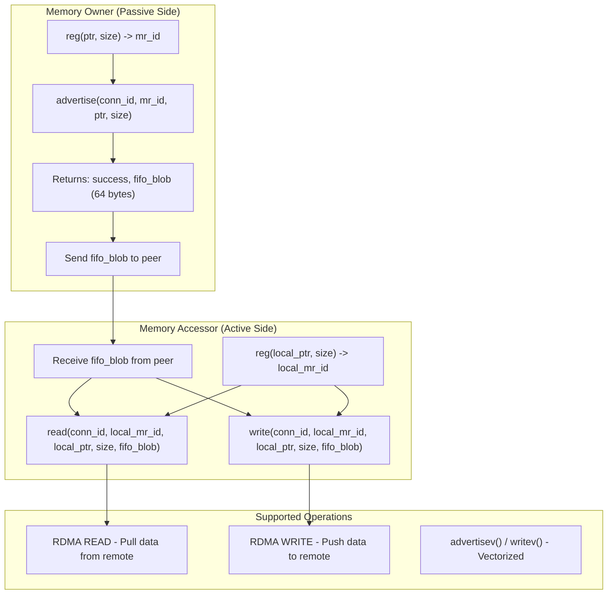
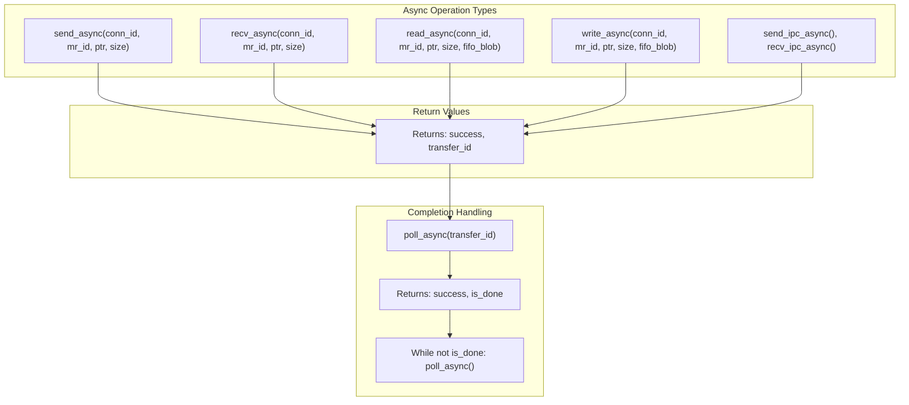
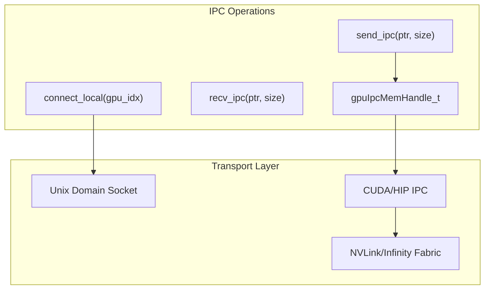
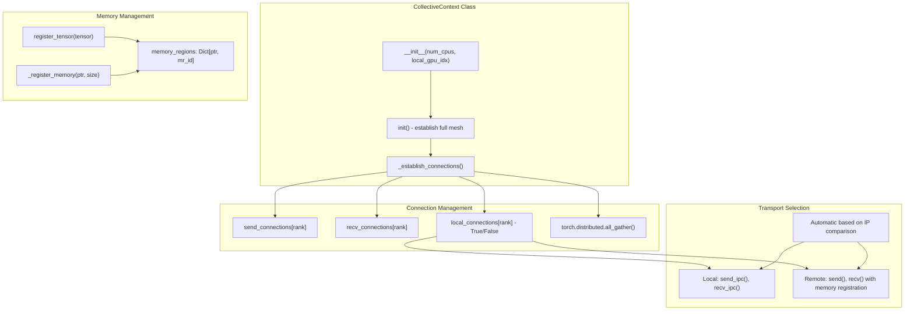

<!-- source: DeepWiki mcp.deepwiki.com · repo uccl-project/uccl · page 3.4 CollectiveContext Python API · fetched 2026-11-11 -->

# P2P Python API

<details>
<summary>Relevant source files</summary>

The following files were used as context for generating this wiki page:

- [p2p/Makefile.rocm](p2p/Makefile.rocm)
- [p2p/Makefile.therock](p2p/Makefile.therock)
- [p2p/benchmarks/benchmark_nccl_allgather.py](p2p/benchmarks/benchmark_nccl_allgather.py)
- [p2p/benchmarks/benchmark_ray_p2p.py](p2p/benchmarks/benchmark_ray_p2p.py)
- [p2p/benchmarks/benchmark_uccl_allgather.py](p2p/benchmarks/benchmark_uccl_allgather.py)
- [p2p/benchmarks/benchmark_uccl_alltoall.py](p2p/benchmarks/benchmark_uccl_alltoall.py)
- [p2p/benchmarks/benchmark_uccl_collective.py](p2p/benchmarks/benchmark_uccl_collective.py)
- [p2p/collective.py](p2p/collective.py)
- [p2p/engine_api.cc](p2p/engine_api.cc)
- [p2p/tests/test_util_interval_tree.py](p2p/tests/test_util_interval_tree.py)
- [p2p/utils.py](p2p/utils.py)
- [setup.py](setup.py)
- [shared.sh](shared.sh)
- [uccl/.gitignore](uccl/.gitignore)
- [uccl/__init__.py](uccl/__init__.py)

</details>


This document covers the Python API for UCCL's P2P communication engine, which provides direct GPU-to-GPU communication with PyTorch tensor integration. The Python API is built on top of the C++ P2P engine using pybind11 bindings and offers both low-level RDMA operations and high-level collective communication patterns.

For information about the underlying C++ architecture and RDMA transport implementation, see page 3.1.

## API Architecture Overview

The P2P Python API consists of two main layers: a low-level `p2p.Endpoint` class for direct RDMA operations, and a high-level `collective.CollectiveContext` class that provides NCCL-like collective operations with automatic connection management.

### API Layer Architecture



The architecture automatically selects between RDMA (remote) and IPC (local) transport based on peer IP addresses, providing transparent high-performance communication across both intra-node and inter-node scenarios.

Sources: [p2p/collective.py:32-84](), [p2p/tests/test_engine_metadata.py:16-24]()

## Low-Level p2p.Endpoint Class

The `p2p.Endpoint` class provides the low-level interface for P2P communication, exposing direct control over RDMA connections, memory registration, and data transfer operations.

### Constructor and Initialization

```python
endpoint = p2p.Endpoint(local_gpu_idx=0, num_cpus=4)
```

The constructor creates an RDMA endpoint with the specified GPU index and CPU thread count. The underlying C++ implementation initializes GPU streams, RDMA devices, and proxy threads for handling asynchronous operations.

| Parameter | Type | Description |
|-----------|------|-------------|
| `local_gpu_idx` | int | GPU device index for this endpoint |
| `num_cpus` | int | Number of CPU threads for RDMA operations |

Sources: [p2p/tests/test_engine_metadata.py:35-41](), [p2p/benchmarks/benchmark_uccl_write.py:185]()

## Connection Management

The API supports two connection types with automatic protocol selection: remote RDMA connections for inter-node communication and local IPC connections for intra-node GPU-to-GPU transfers.

### Connection Establishment Methods



### Connection API Reference

| Method | Parameters | Returns | Purpose |
|--------|------------|---------|---------|
| `connect()` | `ip, gpu_idx, remote_port` | `success, conn_id` | Establish remote RDMA connection |
| `accept()` | None | `success, ip, gpu_idx, conn_id` | Accept remote RDMA connection |
| `connect_local()` | `gpu_idx` | `success, conn_id` | Establish local IPC connection |
| `accept_local()` | None | `success, gpu_idx, conn_id` | Accept local IPC connection |

Sources: [p2p/tests/test_engine_send.py:75-77](), [p2p/tests/test_engine_nvlink.py:116-117](), [p2p/tests/test_engine_metadata.py:71-74]()

### Metadata Exchange

Endpoints exchange connection metadata for peer discovery using a compact binary format:

```python
# Get local metadata  
metadata = endpoint.get_metadata()

# Parse peer metadata
ip, port, gpu_idx = p2p.Endpoint.parse_metadata(peer_metadata)

# Connect using parsed metadata
success, conn_id = endpoint.connect(ip, gpu_idx, remote_port=port)
```

The metadata contains IP address (4 bytes for IPv4, 16 bytes for IPv6), port (2 bytes), and GPU index (4 bytes) in network byte order.

| Metadata Format | IPv4 | IPv6 |
|-----------------|------|------|
| Total Size | 10 bytes | 22 bytes |
| IP Address | 4 bytes | 16 bytes |
| Port | 2 bytes | 2 bytes |
| GPU Index | 4 bytes | 4 bytes |

Sources: [p2p/tests/test_engine_metadata.py:37-40](), [p2p/tests/test_engine_send.py:26-38]()

## Memory Registration

Before transferring data, memory regions must be registered with the RDMA subsystem. The API supports both single and vectorized registration:

```python
# Single registration
success, mr_id = endpoint.reg(tensor.data_ptr(), tensor.numel() * 4)

# Vectorized registration
success, mr_id_list = endpoint.regv(ptr_list, size_list)
```

Registration creates `uccl::Mhandle` objects that enable zero-copy RDMA transfers.

Sources: [p2p/pybind_engine.cc:48-74](), [p2p/engine.cc:259-318]()

## Data Transfer Operations

The API provides multiple data transfer patterns supporting both two-sided (send/recv) and one-sided (read/write) operations with synchronous and asynchronous variants.

### Transfer Operation Categories



### Operation Comparison

| Operation Type | Memory Registration | Remote CPU | Use Case |
|----------------|-------------------|------------|----------|
| `send()/recv()` | Required | Required | Traditional message passing |
| `read()` | Required | Not Required | One-sided data pull |
| `write()` | Required | Not Required | One-sided data push |
| `send_ipc()` | Not Required | Required | Local GPU-to-GPU |

Sources: [p2p/tests/test_engine_send.py:83-87](), [p2p/tests/test_engine_read.py:59-60](), [p2p/tests/test_engine_write.py:59-60](), [p2p/tests/test_engine_nvlink.py:128-130]()

### PyTorch Tensor Integration

The API provides seamless PyTorch tensor integration through direct data pointer access and automatic buffer management:

```python
# Tensor requirements and data pointer access
tensor = torch.ones(1024, dtype=torch.float32).cuda()
assert tensor.is_contiguous()  # Required for efficient RDMA

ptr = tensor.data_ptr()  # Get raw memory pointer
size = tensor.numel() * tensor.element_size()  # Calculate byte size

# Low-level registration and transfer
success, mr_id = endpoint.reg(ptr, size)
success = endpoint.send(conn_id, mr_id, ptr, size)
```

### Buffer Management in CollectiveContext

The high-level API provides automatic buffer management:

```python
def _get_buffer_info(self, tensor: torch.Tensor) -> Tuple[int, int]:
    """Get buffer pointer and size from tensor."""
    if not tensor.is_contiguous():
        raise ValueError("Tensor must be contiguous")
    ptr = tensor.data_ptr()
    size = tensor.numel() * tensor.element_size()
    return ptr, size

def _register_memory(self, ptr: int, size: int) -> int:
    """Register memory and cache the memory region ID."""
    if ptr in self.memory_regions:
        return self.memory_regions[ptr]  # Return cached MR
    
    ok, mr_id = self.ep.reg(ptr, size)
    if not ok:
        raise RuntimeError("Failed to register memory")
    self.memory_regions[ptr] = mr_id  # Cache for reuse
    return mr_id
```

### Supported Tensor Types

| Tensor Location | Memory Registration | Transport | Use Case |
|----------------|-------------------|-----------|----------|
| CPU (`pin_memory=True`) | Required for RDMA | RDMA/IPC | Host memory transfers |
| GPU (`device="cuda:N"`) | Required for RDMA | RDMA/IPC/NVLink | GPU memory transfers |
| GPU (contiguous) | Automatic caching | Optimal performance | Default recommendation |

Sources: [p2p/collective.py:314-331](), [p2p/tests/test_engine_metadata.py:49-53](), [p2p/benchmarks/benchmark_uccl_write.py:22-30]()

## One-Sided RDMA Operations

The API supports one-sided RDMA READ and WRITE operations that bypass remote CPU involvement using advertised memory metadata. These operations use 64-byte `fifo_blob` structures for remote memory addressing.

### One-Sided Operation Flow



### One-Sided Operation Examples

```python
# Memory owner side - advertise buffer for remote access
tensor = torch.ones(1024, dtype=torch.float32).cuda()
success, mr_id = endpoint.reg(tensor.data_ptr(), tensor.numel() * 4)
success, fifo_blob = endpoint.advertise(conn_id, mr_id, tensor.data_ptr(), tensor.numel() * 4)

# Send fifo_blob to remote peer (e.g., via torch.distributed)
# ...

# Remote accessor side - perform one-sided operations
local_tensor = torch.zeros(1024, dtype=torch.float32).cuda()  
success, local_mr_id = endpoint.reg(local_tensor.data_ptr(), local_tensor.numel() * 4)

# RDMA READ - pull data from remote buffer
success = endpoint.read(conn_id, local_mr_id, local_tensor.data_ptr(), local_tensor.numel() * 4, fifo_blob)

# RDMA WRITE - push data to remote buffer  
success = endpoint.write(conn_id, local_mr_id, local_tensor.data_ptr(), local_tensor.numel() * 4, fifo_blob)
```

Sources: [p2p/tests/test_engine_read.py:83-85](), [p2p/tests/test_engine_write.py:83-85](), [p2p/benchmarks/benchmark_uccl_write.py:62-66]()

## Asynchronous Operations

All transfer operations have asynchronous variants that return immediately with a transfer ID for completion polling, enabling computation-communication overlap and pipelined transfers.

### Asynchronous Operation Pattern



### Asynchronous Usage Example

```python
# Start multiple async operations
transfer_ids = []
for i in range(num_operations):
    success, transfer_id = endpoint.send_async(conn_id, mr_id, ptr, size)
    if success:
        transfer_ids.append(transfer_id)

# Poll for completion
for transfer_id in transfer_ids:
    while True:
        success, is_done = endpoint.poll_async(transfer_id)
        if not success:
            raise RuntimeError(f"Error polling transfer {transfer_id}")
        if is_done:
            break
```

Sources: [p2p/benchmarks/benchmark_uccl_write.py:99-106](), [p2p/benchmarks/benchmark_uccl_write.py:113-120]()

## Local vs Remote Connection Handling

The API automatically detects whether peers are local or remote based on IP addresses and selects the appropriate transport:

- **Remote connections**: Use RDMA over InfiniBand/RoCE with memory registration
- **Local connections**: Use CUDA/HIP IPC for direct GPU memory access within nodes

### IPC Connection Flow



Sources: [p2p/pybind_engine.cc:391-439](), [p2p/engine.cc:446-483]()

## High-Level Collective API

The `collective` module provides a NCCL-like interface that wraps the low-level P2P engine with automatic connection management, local/remote detection, and seamless PyTorch integration.

### CollectiveContext Architecture



### Collective API Methods

| Method | Parameters | Description | Memory Registration |
|--------|------------|-------------|-------------------|
| `send()` | `tensor, dst` | Synchronous send | Auto for remote |
| `recv()` | `tensor, src` | Synchronous receive | Auto for remote |
| `isend()` | `tensor, dst` | Asynchronous send | Auto for remote |  
| `irecv()` | `tensor, src` | Asynchronous receive | Auto for remote |
| `wait()` | `transfer_id` | Wait for completion | N/A |
| `test()` | `transfer_id` | Test completion | N/A |
| `register_tensor()` | `tensor` | Manual registration | Forces registration |

### Automatic Local/Remote Detection

The collective API automatically detects peer locality by comparing IP addresses:

```python
# Initialization with automatic GPU index detection
ctx = CollectiveContext(num_cpus=4)  # Derives GPU idx from LOCAL_RANK
ctx.init()  # Establishes full mesh connections

# Automatic transport selection based on peer IP
local_ip, _, _ = p2p.Endpoint.parse_metadata(all_metadata[self.rank])
for peer_rank in range(world_size):
    if peer_rank != self.rank:
        peer_ip, _, _ = p2p.Endpoint.parse_metadata(all_metadata[peer_rank])
        self.local_connections[peer_rank] = peer_ip == local_ip
```

### Usage Examples

```python
import torch
import torch.distributed as dist
from uccl import collective

# Initialize distributed and collective
dist.init_process_group(backend="gloo")
collective.init_collective(num_cpus=4)

# Prepare tensors
send_tensor = torch.ones(1024, dtype=torch.float32).cuda()
recv_tensor = torch.zeros(1024, dtype=torch.float32).cuda()

# Register tensors for remote communication (automatic for local)
collective.register_tensor(send_tensor)
collective.register_tensor(recv_tensor)

# Synchronous point-to-point
if dist.get_rank() == 0:
    collective.send(send_tensor, dst=1)
else:
    collective.recv(recv_tensor, src=0)

# Asynchronous operations
transfer_ids = []
transfer_ids.append(collective.isend(send_tensor, dst=1))
transfer_ids.append(collective.irecv(recv_tensor, src=0))

# Wait for completion
collective.wait_all(transfer_ids)
```

### Global Function Interface

The module provides global functions that operate on a default context:

```python
# Global initialization
collective.init_collective(num_cpus=4)

# Global operations
collective.send(tensor, dst)
collective.recv(tensor, src)
req = collective.isend(tensor, dst)
collective.wait(req)

# Cleanup
collective.finalize_collective()
```

Sources: [p2p/collective.py:32-159](), [p2p/collective.py:160-312](), [p2p/collective.py:349-507](), [p2p/collective.py:563-629]()

## Usage Patterns and Examples

### Basic Point-to-Point Transfer

```python
import torch
from uccl import p2p

# Create endpoints
endpoint = p2p.Endpoint(local_gpu_idx=0, num_cpus=4)

# Server side
success, remote_ip, remote_gpu_idx, conn_id = endpoint.accept()

# Client side  
success, conn_id = endpoint.connect("192.168.1.100", remote_gpu_idx=1)

# Prepare tensor
tensor = torch.ones(1024, dtype=torch.float32).cuda()
success, mr_id = endpoint.reg(tensor.data_ptr(), tensor.numel() * 4)

# Transfer data
success = endpoint.send(conn_id, mr_id, tensor.data_ptr(), tensor.numel() * 4)
```

### Vectorized Multi-Tensor Transfer

The API supports efficient transfer of multiple tensors in a single operation:

```python
# Prepare multiple tensors
tensors = [torch.ones(512), torch.ones(1024), torch.ones(256)]
ptr_list = [t.data_ptr() for t in tensors]
size_list = [t.numel() * 4 for t in tensors]

# Register all tensors
success, mr_id_list = endpoint.regv(ptr_list, size_list)

# Transfer all tensors at once
success = endpoint.sendv(conn_id, mr_id_list, ptr_list, size_list, len(tensors))
```

Sources: [p2p/README.md:372-423](), [p2p/pybind_engine.cc:130-159]()

### Benchmark Integration

The benchmarking infrastructure demonstrates real-world usage patterns with performance measurement:

```python
# Throughput measurement
start = time.perf_counter()
for _ in range(iters):
    endpoint.send(conn_id, mr_id, ptr, size)
elapsed = time.perf_counter() - start

throughput_gbps = (total_bytes * 8) / elapsed / 1e9
```

Sources: [p2p/benchmarks/benchmark_uccl_read.py:95-131](), [p2p/benchmarks/benchmark_uccl_collective.py:58-78]()

---

