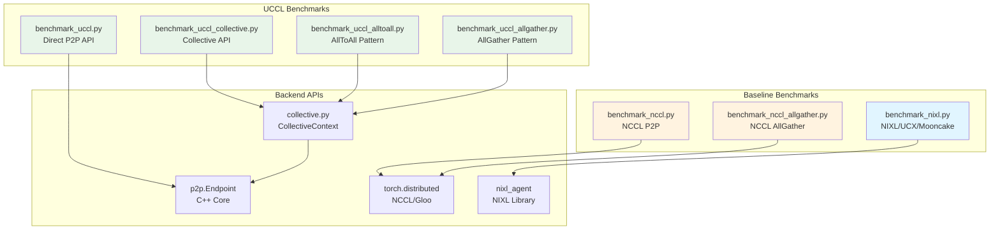
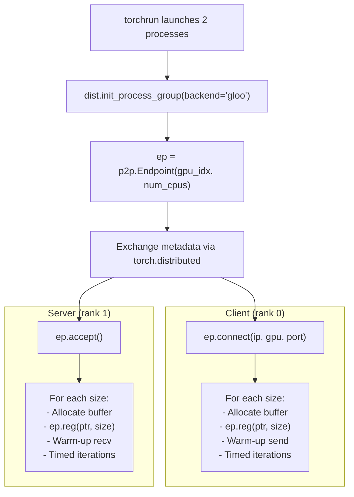
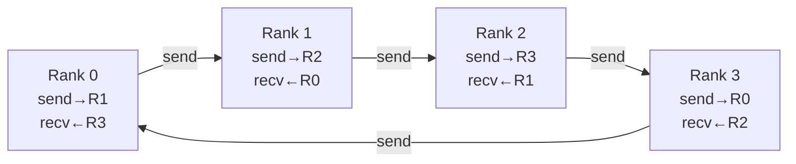
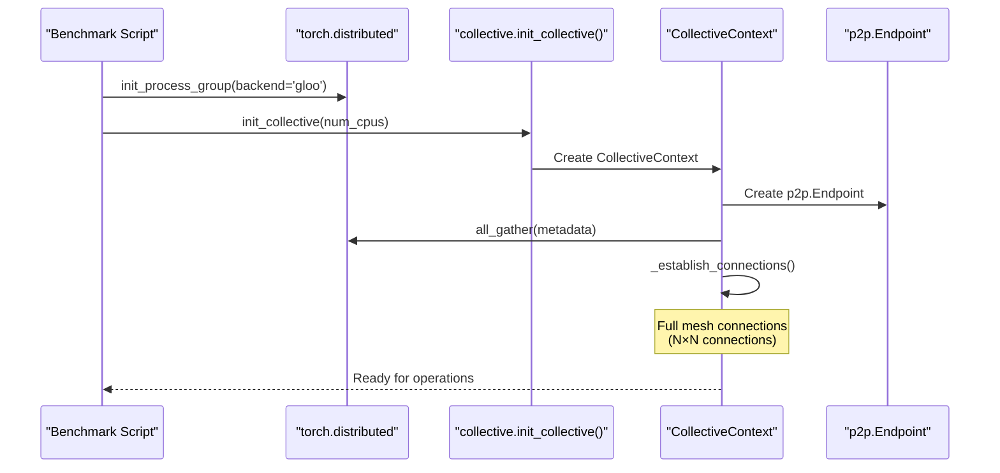
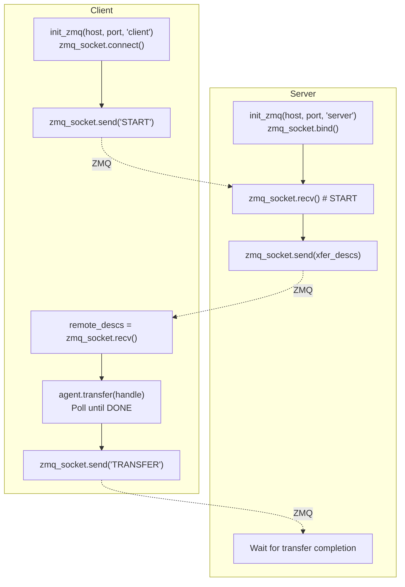
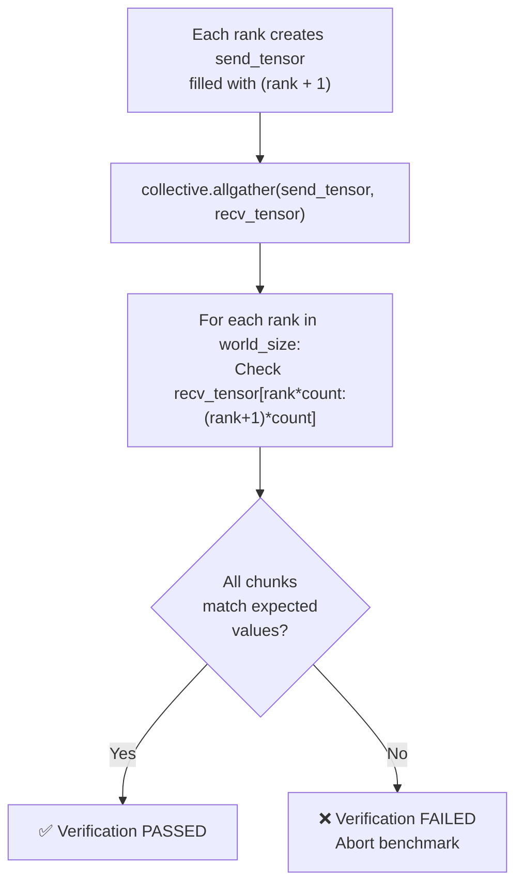
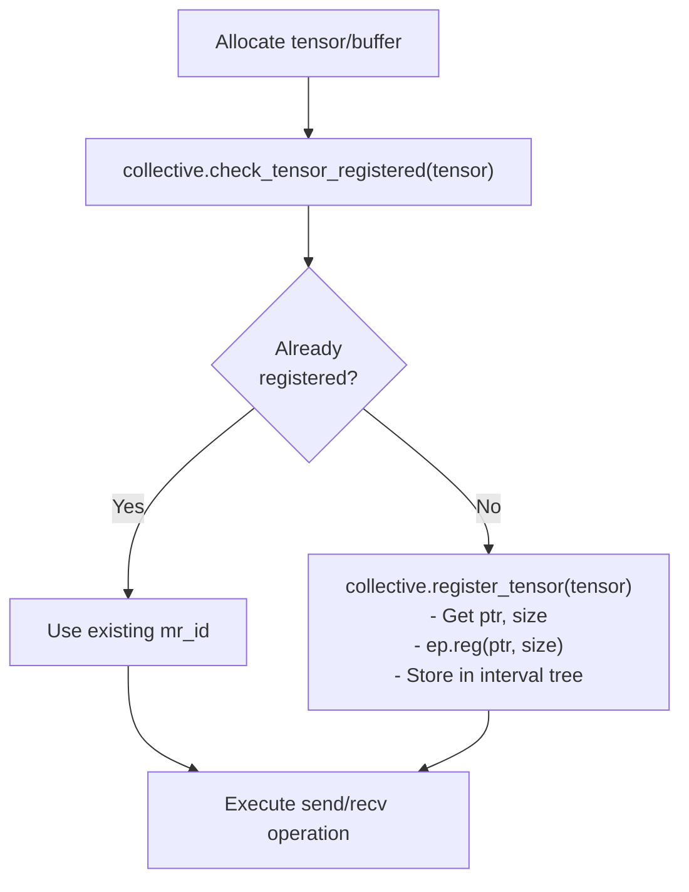
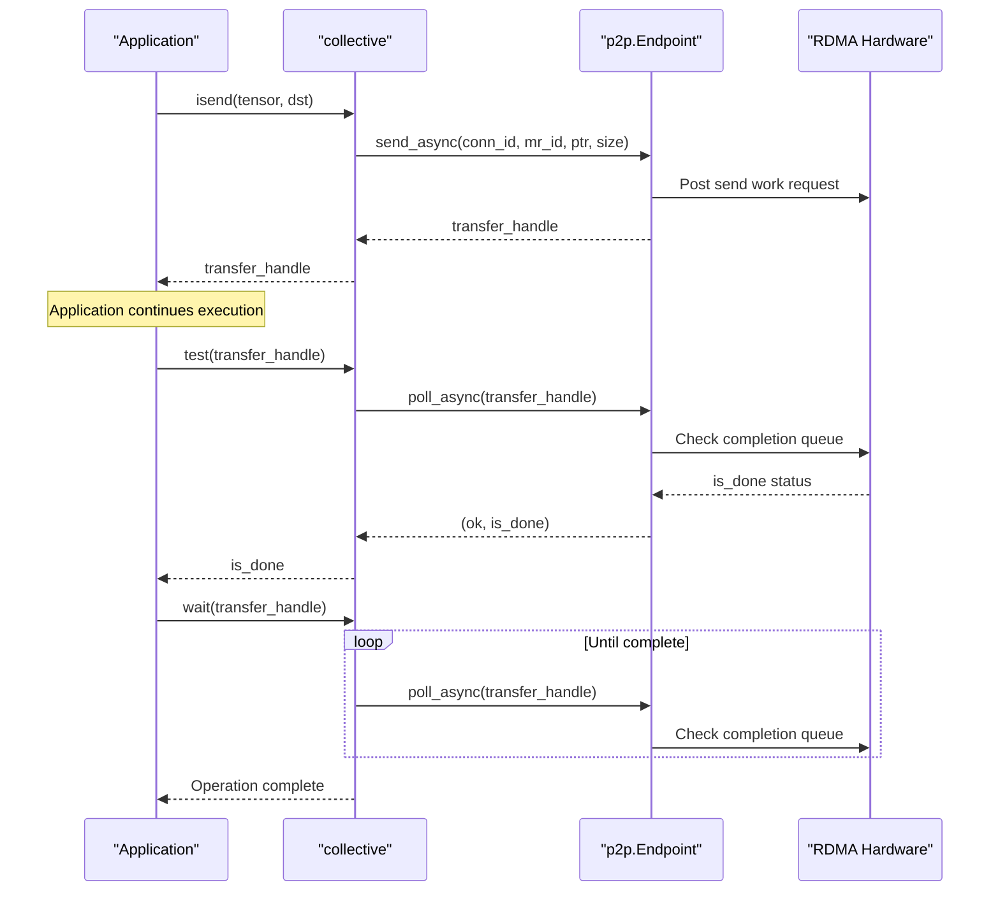

<!-- source: DeepWiki mcp.deepwiki.com · repo uccl-project/uccl · page 3.5 P2P Benchmarks · fetched 2026-11-11 -->

# P2P Benchmarks

<details>
<summary>Relevant source files</summary>

The following files were used as context for generating this wiki page:

- [include/util/gpu_rt.h](include/util/gpu_rt.h)
- [include/util/util.h](include/util/util.h)
- [p2p/Makefile](p2p/Makefile)
- [p2p/README.md](p2p/README.md)
- [p2p/benchmarks/benchmark_nccl.py](p2p/benchmarks/benchmark_nccl.py)
- [p2p/benchmarks/benchmark_nccl_allgather.py](p2p/benchmarks/benchmark_nccl_allgather.py)
- [p2p/benchmarks/benchmark_nixl.py](p2p/benchmarks/benchmark_nixl.py)
- [p2p/benchmarks/benchmark_uccl.py](p2p/benchmarks/benchmark_uccl.py)
- [p2p/benchmarks/benchmark_uccl_allgather.py](p2p/benchmarks/benchmark_uccl_allgather.py)
- [p2p/benchmarks/benchmark_uccl_alltoall.py](p2p/benchmarks/benchmark_uccl_alltoall.py)
- [p2p/benchmarks/benchmark_uccl_collective.py](p2p/benchmarks/benchmark_uccl_collective.py)
- [p2p/benchmarks/benchmark_uccl_readwrite.py](p2p/benchmarks/benchmark_uccl_readwrite.py)
- [p2p/collective.py](p2p/collective.py)
- [p2p/engine.cc](p2p/engine.cc)
- [p2p/engine.h](p2p/engine.h)
- [p2p/tests/test_engine_onesided_ipc.py](p2p/tests/test_engine_onesided_ipc.py)
- [p2p/tests/test_util_interval_tree.py](p2p/tests/test_util_interval_tree.py)
- [p2p/uccl_engine.cc](p2p/uccl_engine.cc)
- [p2p/uccl_engine.h](p2p/uccl_engine.h)
- [p2p/utils.py](p2p/utils.py)

</details>


This page documents the benchmarking suite for UCCL's point-to-point communication engine. These benchmarks measure bandwidth, latency, and throughput across various communication patterns and backends, providing performance validation and comparison against baseline implementations like NCCL and NIXL.

For information about the P2P Engine architecture itself, see [3.1](#3.1). For the Python API documentation, see [3.3](#3.3).

## Overview

The P2P benchmark suite consists of multiple benchmark scripts that test different aspects of the communication engine:

- **Core P2P benchmarks**: Direct send/recv performance (UCCL, NCCL, NIXL)
- **Collective operation benchmarks**: High-level API performance (send, recv, isend, irecv, batch operations)
- **Pattern-specific benchmarks**: AllGather, AllToAll communication patterns
- **IPC benchmarks**: Local intra-node GPU-to-GPU communication

All benchmarks support multiple operation modes (synchronous, asynchronous, dual-direction) and can measure performance on both RDMA (remote) and IPC (local) transports.

Sources: [p2p/benchmarks/benchmark_uccl.py:1-594](), [p2p/benchmarks/benchmark_nixl.py:1-653](), [p2p/benchmarks/benchmark_uccl_collective.py:1-464]()

---

## Benchmark Ecosystem



**Benchmark Ecosystem Architecture**

This diagram shows the relationship between benchmark scripts and the underlying APIs they test. UCCL benchmarks (green) test the UCCL P2P engine through either the direct C++ API or the Python collective API. Baseline benchmarks (orange/blue) test NCCL and NIXL for comparison.

Sources: [p2p/benchmarks/benchmark_uccl.py:1-30](), [p2p/benchmarks/benchmark_uccl_collective.py:1-30](), [p2p/benchmarks/benchmark_nccl.py:1-30](), [p2p/benchmarks/benchmark_nixl.py:1-30]()

---

## Core Benchmark Scripts

### benchmark_uccl.py

The primary benchmark for UCCL's P2P engine, testing direct usage of the `p2p.Endpoint` API.

**Key Features:**
- Tests `send`, `recv`, `send_async`, `recv_async` operations
- Tests vectorized operations: `sendv`, `recvv`, `sendv_async`, `recvv_async`
- Supports IPC mode for local GPU-to-GPU communication
- Dual-direction mode for simultaneous bidirectional transfers
- Configurable message sizes and iteration counts

**Command-line Interface:**

| Argument | Type | Default | Description |
|----------|------|---------|-------------|
| `--local-gpu-idx` | int | 0 | GPU index for buffer allocation |
| `--num-cpus` | int | 4 | Number of CPU threads for RDMA operations |
| `--device` | choice | gpu | Buffer location (cpu/gpu) |
| `--sizes` | list | [256, 1024, ...] | Message sizes in bytes |
| `--iters` | int | 1000 | Iterations per size (excluding warm-up) |
| `--num-kvblocks` | int | 1 | Number of blocks for vectorized operations |
| `--async-api` | flag | false | Use async operations |
| `--dual` | flag | false | Bidirectional simultaneous transfers |
| `--ipc` | flag | false | Use IPC for local GPU communication |

**Execution Flow:**



**Benchmark Execution Flow for benchmark_uccl.py**

This diagram shows the initialization and execution sequence. Both client and server create endpoints, exchange metadata through torch.distributed, establish RDMA connections, then execute timed benchmark iterations.

Sources: [p2p/benchmarks/benchmark_uccl.py:463-594](), [p2p/benchmarks/benchmark_uccl.py:51-148](), [p2p/benchmarks/benchmark_uccl.py:150-244]()

**IPC Mode:**

IPC mode tests local GPU-to-GPU communication using Unix Domain Sockets and GPU memory handles. This mode:
- Uses `connect_local(gpu_idx)` and `accept_local()` instead of RDMA
- Uses `send_ipc`, `recv_ipc`, `send_ipc_async`, `recv_ipc_async` operations
- Does not require memory registration
- Provides baseline for intra-node communication performance

Sources: [p2p/benchmarks/benchmark_uccl.py:362-454](), [p2p/benchmarks/benchmark_uccl.py:518-522]()

**Dual Mode:**

Dual mode tests simultaneous bidirectional transfers:
- Both endpoints act as client and server concurrently
- Uses async operations for overlapping send/recv
- Measures aggregate bidirectional bandwidth

Sources: [p2p/benchmarks/benchmark_uccl.py:247-360](), [p2p/benchmarks/benchmark_uccl.py:513-516]()

---

### benchmark_uccl_collective.py

Benchmarks the high-level `collective.py` API that provides NCCL-like send/recv interface.

**Key Features:**
- Tests `send`, `recv`, `isend`, `irecv` operations
- Tests `batch_isend_irecv` for efficient batch operations
- Ring communication pattern across multiple ranks
- Dual-direction mode for simultaneous send/recv
- Automatic memory registration and connection management

**Usage Modes:**

| Mode | Description | Command Flag |
|------|-------------|--------------|
| Synchronous | Blocking send/recv | Default |
| Asynchronous | Non-blocking isend/irecv | `--async-api` |
| Dual | Simultaneous bidirectional | `--dual` |
| Ring | Ring pattern (N ranks) | `--ring` |

**Ring Benchmark Pattern:**



**Ring Communication Pattern**

Each rank sends to the next rank in a ring (rank i → rank (i+1) % world_size) while simultaneously receiving from the previous rank. This tests multi-rank coordination and full-duplex communication.

Sources: [p2p/benchmarks/benchmark_uccl_collective.py:231-327](), [p2p/benchmarks/benchmark_uccl_collective.py:368-373]()

**Initialization Sequence:**



**CollectiveContext Initialization Sequence**

The collective API automatically handles distributed initialization, metadata exchange, and connection establishment. Once `init_collective()` returns, all ranks have full mesh connectivity.

Sources: [p2p/benchmarks/benchmark_uccl_collective.py:402-410](), [p2p/collective.py:138-180]()

---

### benchmark_nixl.py

Benchmarks NIXL library with multiple backend support (UCX, Mooncake, UCCL).

**Supported Backends:**

| Backend | Description | Use Case |
|---------|-------------|----------|
| ucx | UCX communication library | General RDMA |
| mooncake | Mooncake backend | Specialized workloads |
| uccl | UCCL through NIXL | Comparison testing |

**Operation Types:**
- `WRITE`: Client writes to server's memory
- `READ`: Client reads from server's memory

**ZMQ Metadata Exchange:**

For Mooncake and UCCL backends, metadata exchange uses ZMQ sockets instead of UCX's built-in mechanism:



**NIXL Metadata Exchange Flow**

NIXL benchmarks use ZMQ for coordination when using Mooncake/UCCL backends. The server waits for a START signal, sends transfer descriptors, then waits for completion notification.

Sources: [p2p/benchmarks/benchmark_nixl.py:118-170](), [p2p/benchmarks/benchmark_nixl.py:218-235]()

---

### benchmark_uccl_allgather.py

Benchmarks AllGather collective operation using the `collective.py` API.

**AllGather Operation:**

Each rank contributes a tensor of size N, and all ranks receive a concatenated tensor of size N×world_size containing data from all ranks.

**API Variants:**

| API | Operation | Blocking |
|-----|-----------|----------|
| `allgather(send, recv)` | Synchronous allgather | Yes |
| `iallgather(send, recv)` | Asynchronous allgather | No, returns handles |

**Verification Logic:**



**AllGather Verification Flow**

The warmup phase performs correctness verification: each rank fills its send buffer with a rank-specific value, then verifies that the received buffer contains the expected value from each rank.

Sources: [p2p/benchmarks/benchmark_uccl_allgather.py:35-108]()

**Performance Metrics:**

The benchmark reports two bandwidth metrics:

1. **Algorithm Bandwidth (AlgBW)**: Total data output / time
   - Formula: `(world_size × send_bytes) / time`
   - Represents the effective application-level bandwidth

2. **Bus Bandwidth (BusBW)**: Algorithm bandwidth adjusted for ring efficiency
   - Formula: `AlgBW × (world_size - 1) / world_size`
   - Accounts for the ring algorithm's communication pattern

Sources: [p2p/benchmarks/benchmark_uccl_allgather.py:145-188](), [p2p/benchmarks/benchmark_uccl_allgather.py:229-270]()

---

### benchmark_uccl_alltoall.py

Benchmarks AllToAll communication pattern using ring and FCP (Full Connection Pattern) strategies.

**Communication Patterns:**

1. **Ring AllToAll**: Each rank sends to next, receives from previous
2. **FCP AllToAll**: Full connection pattern with randomized communication pairs

**Key Functions:**

| Function | Description | Usage |
|----------|-------------|-------|
| `warmup_all2all_check()` | Verification warmup with correctness check | Pre-benchmark validation |
| `run_ring_p2p()` | Ring pattern benchmark | Fixed neighbor communication |
| `run_fcp_p2p()` | Full connection pattern benchmark | Dynamic pair selection |

**FCP Communication Plans:**

```python
# From p2p/benchmarks/util.py (referenced but not shown)
# get_fcp_comm_plans(world_size, num_iters) returns:
# plans[iteration] = (send_ranks, recv_ranks)
# where send_ranks[my_rank] = target rank to send to
#       recv_ranks[my_rank] = target rank to receive from
```

Sources: [p2p/benchmarks/benchmark_uccl_alltoall.py:113-180](), [p2p/benchmarks/benchmark_uccl_alltoall.py:182-256]()

---

## Benchmark Execution Details

### Memory Registration Flow



**Memory Registration and Caching**

The collective API tracks registered memory regions using an interval tree. When a tensor is used for communication, the API checks if the memory region is already registered to avoid redundant registration calls.

Sources: [p2p/collective.py:319-357](), [p2p/collective.py:406-414](), [p2p/utils.py:114-207]()

### Async Operation Flow



**Asynchronous Operation Lifecycle**

Async operations return a handle immediately, allowing the application to continue execution. The application can test for completion non-blocking or wait for completion. The endpoint polls RDMA completion queues to determine when transfers finish.

Sources: [p2p/collective.py:450-490](), [p2p/collective.py:536-564](), [p2p/benchmarks/benchmark_uccl.py:73-97]()

---

## Performance Metrics

### Standard Metrics

All benchmarks report the following metrics:

| Metric | Unit | Formula | Description |
|--------|------|---------|-------------|
| Bandwidth (Gbps) | Gigabits/sec | `(bytes × 8) / time / 1e9` | Network throughput in bits |
| Bandwidth (GB/s) | Gigabytes/sec | `bytes / time / 1e9` | Network throughput in bytes |
| Latency | seconds | `total_time / iterations` | Average transfer time |

### Message Size Formatting

Benchmarks use human-readable size formatting:

```python
def _pretty_size(num_bytes: int) -> str:
    units = ["B", "KB", "MB", "GB"]
    val = float(num_bytes)
    for u in units:
        if val < 1024 or u == units[-1]:
            return f"{val:.0f} {u}" if u == "B" else f"{val:.1f} {u}"
        val /= 1024
```

Example outputs: `256 B`, `1.0 KB`, `1.0 MB`, `100.9 MB`

Sources: [p2p/benchmarks/benchmark_uccl.py:41-49](), [p2p/benchmarks/benchmark_uccl_collective.py:32-39]()

### Default Test Sizes

Standard message sizes tested (in bytes):

```python
[256, 1024, 4096, 16384, 65536, 262144, 1048576, 10485760, 16777216, 104857600]
```

This progression covers small messages (256 B) to large messages (~100 MB), testing both latency-bound and bandwidth-bound regimes.

Sources: [p2p/benchmarks/benchmark_uccl.py:479-492]()

---

## Usage Examples

### Basic P2P Benchmark

```bash
# Run UCCL P2P benchmark between 2 GPUs
torchrun --nproc_per_node=2 benchmark_uccl.py \
  --local-gpu-idx 0 \
  --device gpu \
  --sizes 1048576,10485760,104857600 \
  --iters 1000
```

### Async API Benchmark

```bash
# Test async operations
torchrun --nproc_per_node=2 benchmark_uccl.py \
  --async-api \
  --sizes 1048576,104857600 \
  --iters 500
```

### IPC (Local GPU) Benchmark

```bash
# Test intra-node GPU-to-GPU communication
torchrun --nproc_per_node=2 benchmark_uccl.py \
  --ipc \
  --sizes 1048576,10485760,104857600 \
  --iters 1000
```

### Dual Direction Benchmark

```bash
# Test simultaneous bidirectional transfers
torchrun --nproc_per_node=2 benchmark_uccl.py \
  --dual \
  --async-api \
  --sizes 1048576,104857600
```

### Collective API Benchmark

```bash
# Test high-level collective API
torchrun --nproc_per_node=2 benchmark_uccl_collective.py \
  --num-cpus 4 \
  --sizes 1048576,10485760,104857600 \
  --iters 100
```

### Ring Benchmark (Multi-rank)

```bash
# Test ring pattern across 4 ranks
torchrun --nproc_per_node=4 benchmark_uccl_collective.py \
  --ring \
  --sizes 1048576,104857600 \
  --iters 100
```

### AllGather Benchmark (Multi-node)

```bash
# Node 0
torchrun --nnodes=2 --nproc_per_node=1 --node-rank=0 \
  --master_addr=<IP> --master_port=19999 \
  benchmark_uccl_allgather.py \
  --sizes 1024,4096,16384,65536,262144,1048576 \
  --num-iters 100

# Node 1
torchrun --nnodes=2 --nproc_per_node=1 --node-rank=1 \
  --master_addr=<IP> --master_port=19999 \
  benchmark_uccl_allgather.py \
  --sizes 1024,4096,16384,65536,262144,1048576 \
  --num-iters 100
```

### NCCL Baseline Comparison

```bash
# Run NCCL benchmark for comparison
torchrun --nproc_per_node=2 benchmark_nccl.py \
  --device gpu \
  --sizes 1048576,10485760,104857600 \
  --iters 1000
```

### NIXL Benchmark with UCCL Backend

```bash
# Server (rank 1)
python benchmark_nixl.py --role server --backend uccl \
  --remote-ip <client_ip> --local-gpu-idx 0 \
  --sizes 1048576,10485760,104857600 --iters 100

# Client (rank 0)
python benchmark_nixl.py --role client --backend uccl \
  --remote-ip <server_ip> --local-gpu-idx 0 \
  --sizes 1048576,10485760,104857600 --iters 100
```

Sources: [p2p/benchmarks/benchmark_uccl.py:463-594](), [p2p/benchmarks/benchmark_uccl_collective.py:336-464](), [p2p/benchmarks/benchmark_uccl_allgather.py:1-10](), [p2p/benchmarks/benchmark_nixl.py:1-16]()

---

## Benchmark Output Format

### Standard Output

Benchmarks produce formatted output with per-size results:

```
[Client] 1.0 MB    :  95.23 Gbps |  11.90 GB/s  | 0.000084 s
[Client] 10.0 MB   : 112.45 Gbps |  14.06 GB/s  | 0.000711 s
[Client] 100.9 MB  : 118.67 Gbps |  14.83 GB/s  | 0.006803 s
```

### CSV Output

AllGather benchmarks save results to CSV files with aligned columns:

```csv
world_size,   dtype,num_iters,  mode,  send_bytes,  recv_bytes, avg_time_ms,algbw_gbps,busbw_gbps
         2, float32,      100,  sync,     1048576,     2097152,      0.1234,   17.0234,   8.5117
         2, float32,      100,  sync,    10485760,    20971520,      0.9876,   21.2345,  10.6172
```

Sources: [p2p/benchmarks/benchmark_uccl.py:144-146](), [p2p/benchmarks/benchmark_uccl_allgather.py:426-485]()

---

## Implementation Details

### Connection Management

The collective API maintains separate connection arrays for send and receive operations:

```python
self.send_connections = [None] * world_size  # indexed by rank
self.recv_connections = [None] * world_size  # indexed by rank
self.local_connections = [False] * world_size  # indexed by rank
```

For each peer, the context establishes:
- One send connection (for sending TO that peer)
- One recv connection (for receiving FROM that peer)

This allows full-duplex communication with proper flow control.

Sources: [p2p/collective.py:84-90](), [p2p/collective.py:149-179]()

### Local vs Remote Connection Detection

The context determines whether a peer is local or remote by comparing IP addresses:

```python
local_ip, _, _ = p2p.Endpoint.parse_metadata(all_metadata[self.rank])
for peer_rank in range(self.world_size):
    if peer_rank != self.rank:
        peer_ip, _, _ = p2p.Endpoint.parse_metadata(all_metadata[peer_rank])
        self.local_connections[peer_rank] = peer_ip == local_ip
```

Local connections use IPC (Unix Domain Sockets + GPU memory handles), while remote connections use RDMA.

Sources: [p2p/collective.py:181-198]()

### Batch Operations Optimization

The `batch_isend_irecv()` function optimizes multiple operations by:

1. Separating local (IPC) and remote (RDMA) operations
2. Batching NCCL operations together when using NCCL fallback
3. Returning mixed handle types (int for UCCL, dist.Work for NCCL)

```python
int_handles = []  # UCCL transfer handles
work_handles = [] # NCCL Work objects

# Process each operation
for op in ops:
    if local_connection and use_copy_engine:
        # UCCL IPC async
        handle = ep.send_ipc_async(...)
        int_handles.append(handle)
    elif local_connection:
        # NCCL local
        p2p_ops.append(dist.P2POp(...))
    else:
        # UCCL RDMA async
        handle = ep.send_async(...)
        int_handles.append(handle)

# Batch NCCL operations
if p2p_ops:
    work_handles = dist.batch_isend_irecv(p2p_ops)

return int_handles + work_handles
```

Sources: [p2p/collective.py:622-697]()

### Warm-up Strategy

All benchmarks perform at least one warm-up iteration before timing:

1. **Purpose**: Eliminate first-call overhead (connection setup, buffer allocation, cache warming)
2. **Implementation**: Execute one transfer before starting the timer
3. **Verification**: Some benchmarks use warm-up for correctness checking

Sources: [p2p/benchmarks/benchmark_uccl.py:82-84](), [p2p/benchmarks/benchmark_uccl_collective.py:55-56](), [p2p/benchmarks/benchmark_uccl_allgather.py:144-147]()

---

## Comparison with Baselines

### UCCL vs NCCL

| Aspect | UCCL P2P | NCCL |
|--------|----------|------|
| API Style | Direct endpoint management | Collective-focused |
| Memory Registration | Explicit `reg()` calls | Automatic |
| Connection Model | Peer-to-peer connections | Collective communicator |
| Async Model | Handle-based polling | Work object with `wait()` |
| Multi-rail | Supported via multiple NICs | Backend-dependent |
| IPC Path | Unix sockets + GPU handles | CUDA IPC |

### UCCL vs NIXL

| Aspect | UCCL P2P | NIXL |
|--------|----------|------|
| Backend Support | RDMA, EFA, TCPX | UCX, Mooncake, UCCL |
| Operation Model | Send/Recv | WRITE/READ |
| Descriptor Management | Implicit in endpoints | Explicit register/deserialize |
| Coordination | torch.distributed | ZMQ or UCX metadata |
| Use Case | PyTorch-native | Multi-framework |

Sources: [p2p/benchmarks/benchmark_nccl.py:35-62](), [p2p/benchmarks/benchmark_nixl.py:77-102]()

---

## Troubleshooting

### Common Issues

1. **"No recv connection from rank X"**: Connection not established
   - Check that `init_collective()` completed successfully
   - Verify torch.distributed is initialized
   - Check network connectivity between nodes

2. **Low bandwidth on first iteration**: Warm-up not performed
   - All benchmarks include warm-up iterations
   - First reported result should already be warmed up

3. **"Tensor memory not registered"**: Missing registration for remote peer
   - Call `collective.register_tensor()` for all tensors used with remote ranks
   - Local peers don't require registration (IPC path)

4. **High variance in measurements**: System noise or contention
   - Increase `--iters` for more stable averages
   - Isolate CPU cores for RDMA threads
   - Check for competing network traffic

Sources: [p2p/collective.py:384-414](), [p2p/collective.py:417-448]()

### Debug Environment Variables

While not documented in the benchmark scripts themselves, UCCL respects several environment variables that can be set for debugging:

- `UCCL_ENTROPY`: Control packet spraying entropy
- `UCCL_CHUNK_SIZE_KB`: Set chunk size for transfers
- `NCCL_IB_GID_INDEX`: Select InfiniBand GID index

Sources: [p2p/benchmarks/benchmark_uccl_alltoall.py:15-16]()

---

