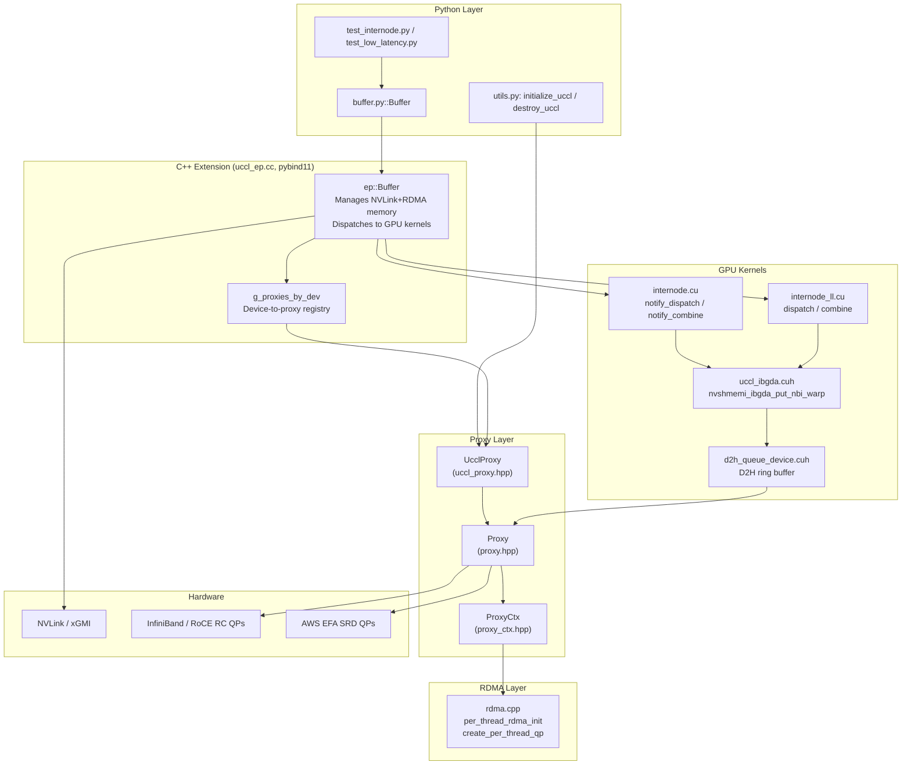
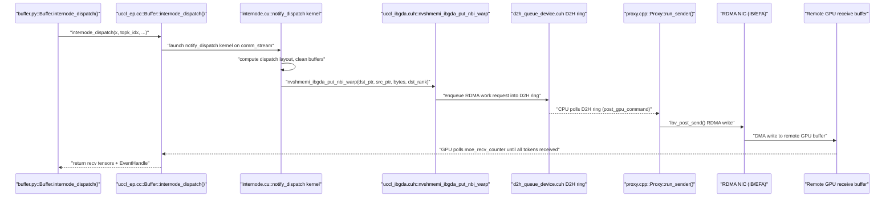
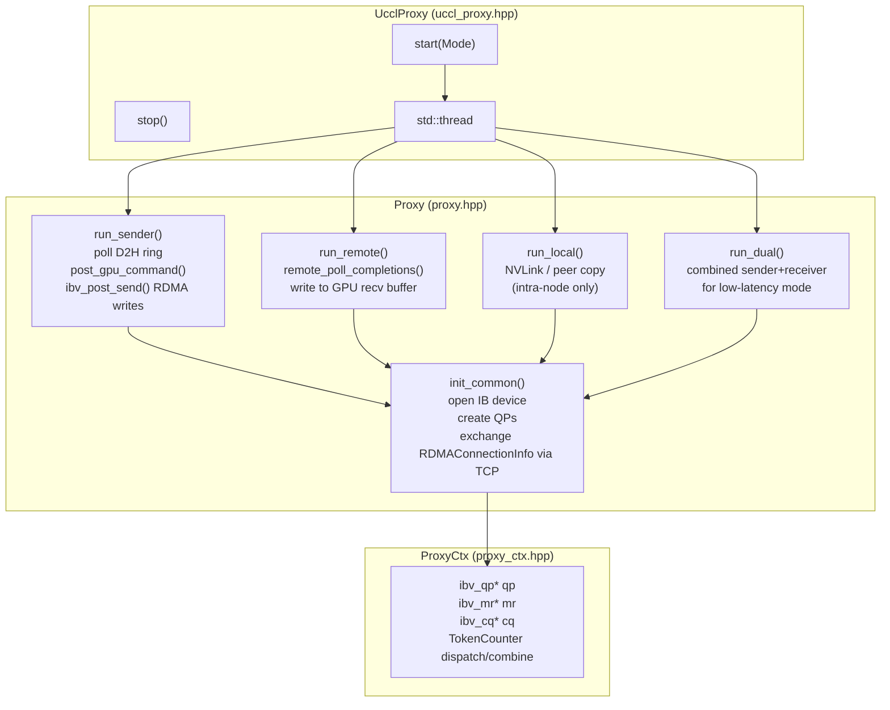

<!-- source: DeepWiki mcp.deepwiki.com · repo uccl-project/uccl · page 4 UCCL-EP Expert Parallelism · fetched 2026-11-11 -->

# UCCL-EP Expert Parallelism

<details>
<summary>Relevant source files</summary>

The following files were used as context for generating this wiki page:

- [.github/PULL_REQUEST_TEMPLATE.md](.github/PULL_REQUEST_TEMPLATE.md)
- [.github/workflows/uccl-build-test.yml](.github/workflows/uccl-build-test.yml)
- [README.md](README.md)
- [build.sh](build.sh)
- [collective/efa/README.md](collective/efa/README.md)
- [collective/rdma/README.md](collective/rdma/README.md)
- [docs/wheels.md](docs/wheels.md)
- [ep/Makefile](ep/Makefile)
- [ep/README.md](ep/README.md)
- [ep/bench/buffer.py](ep/bench/buffer.py)
- [ep/bench/run_ep.sh](ep/bench/run_ep.sh)
- [ep/bench/test_internode.py](ep/bench/test_internode.py)
- [ep/bench/test_low_latency.py](ep/bench/test_low_latency.py)
- [ep/bench/utils.py](ep/bench/utils.py)
- [ep/include/common.hpp](ep/include/common.hpp)
- [ep/include/ep_configs.cuh](ep/include/ep_configs.cuh)
- [ep/include/ep_utils.cuh](ep/include/ep_utils.cuh)
- [ep/include/proxy.hpp](ep/include/proxy.hpp)
- [ep/include/proxy_ctx.hpp](ep/include/proxy_ctx.hpp)
- [ep/include/rdma.hpp](ep/include/rdma.hpp)
- [ep/include/uccl_ibgda.cuh](ep/include/uccl_ibgda.cuh)
- [ep/include/uccl_proxy.hpp](ep/include/uccl_proxy.hpp)
- [ep/setup.py](ep/setup.py)
- [ep/src/common.cpp](ep/src/common.cpp)
- [ep/src/internode.cu](ep/src/internode.cu)
- [ep/src/internode_ll.cu](ep/src/internode_ll.cu)
- [ep/src/proxy.cpp](ep/src/proxy.cpp)
- [ep/src/rdma.cpp](ep/src/rdma.cpp)
- [ep/src/uccl_ep.cc](ep/src/uccl_ep.cc)
- [ep/src/uccl_proxy.cpp](ep/src/uccl_proxy.cpp)
- [scripts/efa_monitor.sh](scripts/efa_monitor.sh)

</details>


This page provides an overview of the UCCL-EP subsystem: its purpose, hardware support, operational modes, and top-level component architecture. It covers what a caller needs to understand to integrate and reason about UCCL-EP as a whole.

For detailed documentation of sub-components, see:
- [EP Architecture and Buffer API](#4.1) — `Buffer` class internals, memory layout, `EventHandle`
- [Proxy and RDMA System](#4.2) — `Proxy`, `UcclProxy`, `ProxyCtx`, QP lifecycle
- [GPU Kernels and Internode Communication](#4.3) — CUDA kernels, `uccl_ibgda.cuh`, D2H ring design
- [EP Benchmarks and AllToAll](#4.4) — benchmark harnesses, EFA results
- [vLLM Integration](#4.5) — `deep_ep_wrapper`, `launch_vllm.sh`, environment variables

---

## Purpose

UCCL-EP is a portable, hardware-agnostic implementation of **expert-parallel (EP) communication** for Mixture-of-Experts (MoE) models. It provides the same API as [DeepEP](https://github.com/deepseek-ai/DeepEP) and is a drop-in replacement for it, while supporting heterogeneous hardware combinations that DeepEP cannot (e.g., AMD GPUs, AWS EFA NICs, Broadcom NICs).

The two primary operations are **dispatch** (routing tokens from all ranks to their assigned experts) and **combine** (aggregating expert outputs back to the originating ranks). These map onto all-to-all communication patterns at high scale.

---

## Hardware Support

| Dimension | Supported Options |
|---|---|
| GPU vendors | NVIDIA (H100, H200, B200, GH200), AMD (MI300X, MI325X, MI355X) |
| NIC types | NVIDIA ConnectX-7 (InfiniBand/RoCE), AWS EFA (p5, p5e, p5en, p6-b200), Broadcom Thor-2 |
| Intra-node transport | NVLink (NVIDIA), xGMI (AMD) |
| Inter-node transport | RDMA (RC QPs for IB/RoCE, SRD QPs for EFA) |

EFA support is detected at build time by checking for `EFA_HOME=/opt/amazon/efa`. SRD QPs are used for EFA; RC QPs are used for InfiniBand/RoCE.

Sources: [ep/README.md:1-10](), [ep/Makefile:1-15](), [ep/src/rdma.cpp:443-490]()

---

## Operational Modes

UCCL-EP provides two distinct communication modes selected at `Buffer` construction time:

**High-throughput mode** (`low_latency_mode=False`)
- Uses **NVLink for intra-node** transfers and **RDMA for inter-node** transfers
- Targets large batch sizes (e.g., 4096 tokens, 7168 hidden dimension)
- Implemented in [ep/src/internode.cu]()
- Proxy uses `run_sender()` and `run_remote()` as separate threads per proxy

**Low-latency mode** (`low_latency_mode=True`)
- Uses **pure RDMA** for all transfers (both intra- and inter-node)
- Targets inference-time small batches (e.g., 128 tokens)
- Implemented in [ep/src/internode_ll.cu]()
- Proxy uses `run_dual()` — a single thread handling both send and receive

The mode is set in the `Buffer` constructor in [ep/src/uccl_ep.cc:86-94]() and is propagated into the proxy thread selection in [ep/src/uccl_proxy.cpp:151-181]().

---

## Top-Level Architecture

**UCCL-EP Component Architecture**



Sources: [ep/src/uccl_ep.cc:36-82](), [ep/include/uccl_proxy.hpp](), [ep/include/proxy.hpp](), [ep/include/proxy_ctx.hpp](), [ep/src/internode.cu:1-15](), [ep/src/internode_ll.cu:1-15](), [ep/include/uccl_ibgda.cuh:1-50]()

---

## Dispatch Data Flow

**High-Throughput Dispatch: Token Routing Path**



Sources: [ep/src/uccl_ep.cc:423-620](), [ep/src/internode.cu:92-225](), [ep/include/uccl_ibgda.cuh:26-80](), [ep/src/proxy.cpp:464-474]()

---

## Component Roles

### `Buffer` — Python Wrapper

`buffer.py::Buffer` is the primary user-facing class. It:
- Accepts a `dist.ProcessGroup`, `num_nvl_bytes`, `num_rdma_bytes`, and `low_latency_mode`
- Calls `initialize_uccl()` from `utils.py` to construct and register `UcclProxy` instances
- Exposes four main operations: `internode_dispatch()`, `internode_combine()`, `low_latency_dispatch()`, `low_latency_combine()`
- Wraps the C++ `ep::Buffer` with Python-friendly tensor types and `EventOverlap` handles

[ep/bench/buffer.py:35-100]()

### `ep::Buffer` — C++ Core

`ep::Buffer` in [ep/src/uccl_ep.cc:84-414]() manages:
- RDMA buffer (`rdma_buffer_ptr`) and NVLink buffers (`buffer_ptrs[]`) via `cudaMalloc` / `hipExtMallocWithFlags`
- IPC handles for NVLink peer access (`cudaIpcGetMemHandle` / `cudaIpcOpenMemHandle`)
- D2H channel handle arrays (`d_handles`, `d_handle_objs`) for GPU-to-CPU signaling
- Stream synchronization through `EventHandle`
- Ranks are split into `rdma_rank = rank / max_nvl_peers` and `nvl_rank = rank % max_nvl_peers`

### `UcclProxy` — Thread Manager

`UcclProxy` in [ep/include/uccl_proxy.hpp]() wraps a `Proxy` instance and:
- Allocates `kChannelPerProxy = 8` D2H ring buffers (one per proxy channel)
- Allocates an atomic buffer (`kAtomicBufferSize = 81960` bytes) for counter synchronization
- Manages a single `std::thread` running one of: `run_sender`, `run_remote`, `run_local`, `run_dual`

### `Proxy` — RDMA Execution

`Proxy` in [ep/include/proxy.hpp]() holds the per-proxy execution logic:
- `init_common()` — opens IB device, registers GPU MR, creates QPs, exchanges `RDMAConnectionInfo` over TCP
- `run_sender()` — polls D2H ring and calls `post_gpu_command()`, then posts RDMA writes via `ibv_post_send()`
- `run_remote()` — polls CQ for incoming RDMA writes, calls `remote_poll_completions()`
- `run_dual()` — combined sender + receiver for low-latency mode
- `run_local()` — handles intra-node peer copies without RDMA

### `ProxyCtx` — Per-Peer RDMA State

`ProxyCtx` in [ep/include/proxy_ctx.hpp]() holds the verbs objects for one peer connection:
- `ibv_context*`, `ibv_pd*`, `ibv_mr*` — device, protection domain, memory region
- `ibv_qp*` (main QP), `ack_qp`, `recv_ack_qp`, `data_qps_by_channel[]`
- `TokenCounter<DispatchTokenKey>` and `TokenCounter<CombineTokenKey>` — per-expert/rank flow tracking
- `remote_addr`, `remote_rkey`, `remote_atomic_buffer_addr`

---

## Proxy Thread Model

**Proxy Threading Model**



The mode dispatched to is determined by `UcclProxy::Mode`: `Sender`, `Remote`, `Local`, or `Dual`. In normal high-throughput mode, paired ranks use one `Sender` thread and one `Remote` thread. In low-latency mode, each rank runs a single `Dual` thread.

Sources: [ep/src/uccl_proxy.cpp:133-181](), [ep/src/proxy.cpp:445-520](), [ep/include/proxy.hpp:35-100]()

---

## GPU Kernel Files

| File | Mode | Key Kernels |
|---|---|---|
| `ep/src/internode.cu` | High-throughput | `notify_dispatch`, `cached_notify`, `notify_combine` |
| `ep/src/internode_ll.cu` | Low-latency | `dispatch`, `combine`, `clean_low_latency_buffer` |
| `ep/src/intranode.cu` | Intra-node | NVLink barrier and copy operations |
| `ep/include/uccl_ibgda.cuh` | Both | `nvshmemi_ibgda_put_nbi_warp` — GPU-initiated RDMA put |
| `ep/include/ep_utils.cuh` | Both | Warp-level copy, barrier, load/store helpers |
| `ep/include/ep_configs.cuh` | Both | Compile-time constants (`NUM_MAX_NVL_PEERS=8`, `NUM_MAX_RDMA_PEERS=20`) |

`nvshmemi_ibgda_put_nbi_warp` in [ep/include/uccl_ibgda.cuh:26-80]() is the GPU-side function that enqueues an RDMA put request into the D2H ring buffer, which a CPU proxy thread then processes. This is the key abstraction enabling GPU-initiated RDMA without tight coupling to NVSHMEM's IBGDA implementation.

Sources: [ep/src/internode.cu:1-15](), [ep/src/internode_ll.cu:1-50](), [ep/include/ep_configs.cuh]()

---

## Key Compile-Time Constants

From [ep/include/common.hpp]() and [ep/include/ep_configs.cuh]():

| Constant | Value | Meaning |
|---|---|---|
| `kChannelPerProxy` | 8 | D2H ring buffers per `UcclProxy` instance |
| `kNumProxyThs` | 4 | Proxy threads per GPU |
| `kMaxInflightNormal` | 8 | Max outstanding RDMA writes in high-throughput mode |
| `kMaxInflightLowLatency` | 32 | Max outstanding RDMA writes in low-latency mode |
| `NUM_MAX_NVL_PEERS` | 8 | Max GPUs per node connected via NVLink |
| `NUM_MAX_RDMA_PEERS` | 20 | Max remote nodes reachable via RDMA |
| `kAtomicBufferSize` | 81960 bytes | Atomic counter buffer for token counting |
| `NUM_WORKSPACE_BYTES` | 32 MB | Per-GPU workspace for kernel temporaries |

---

## Environment Variables

| Variable | Default | Description |
|---|---|---|
| `UCCL_SOCKET_IFNAME` | *(none)* | Network interface for bootstrapping (TCP metadata exchange) |
| `UCCL_IB_GID_INDEX` | `-1` (auto) | GID index for RDMA; set to same value as `NCCL_IB_GID_INDEX` |
| `UCCL_IB_HCA` | *(none)* | Filter RDMA NICs by name (same syntax as `NCCL_IB_HCA`) |
| `UCCL_IB_MAX_INFLIGHT_BYTES` | `SIZE_MAX` | Max bytes in-flight per GPU/NIC |
| `UCCL_IB_MAX_INFLIGHT_NORMAL` | `8` | Max outstanding writes per NIC in high-throughput mode |
| `UCCL_IB_MAX_INFLIGHT_LOW_LATENCY` | `32` | Max outstanding writes per NIC in low-latency mode |
| `UCCL_IB_SL` | `3` (IB) / `8` (EFA) | Service level in RDMA fabric |
| `UCCL_IB_TC` | `104` (IB) / `0` (EFA) | Traffic class in RDMA fabric |
| `UCCL_ATOMICS_USE_HOST_MEMORY` | *(auto)* | Force atomic buffer to pinned host memory (set `1` for Intel irdma NICs) |

For Broadcom Thor-2: set `UCCL_IB_MAX_INFLIGHT_BYTES=1572864 UCCL_IB_MAX_INFLIGHT_NORMAL=1` to avoid CQE error 12.

Sources: [ep/README.md:118-135](), [ep/include/common.hpp:119-142](), [ep/src/rdma.cpp:409-490]()

---

## Performance Characteristics

Measured results from [ep/README.md:139-210]():

**High-throughput mode on AWS p5en (8x H200 + 16x 200 Gb/s EFA)**

| Type | EP Scale | Dispatch BW | Dispatch Latency | Combine BW | Combine Latency |
|---|---|---|---|---|---|
| Intranode | EP8 | 320 GB/s (NVLink) | 500 µs | 319 GB/s (NVLink) | 973 µs |
| Internode | EP16 | 50 GB/s (RDMA) | 1196 µs | 18 GB/s (RDMA) | 6379 µs |
| Internode | EP32 | 54 GB/s (RDMA) | 2022 µs | 43 GB/s (RDMA) | 4899 µs |

**Low-latency mode on AWS p5en (DeepSeek-V3 inference settings: 128 tokens, 7168 hidden, top-8)**

| EP Scale | Dispatch Latency | Dispatch BW | Combine Latency | Combine BW |
|---|---|---|---|---|
| EP16 | 226 µs | 36 GB/s | 293 µs | 48 GB/s |
| EP24 | 386 µs | 20 GB/s | 580 µs | 26 GB/s |
| EP32 | 465 µs | 16 GB/s | 694 µs | 25 GB/s |

---

## Quick Start

Build and install:
```bash
# From the repo root
bash build.sh cuda ep --install

# Or directly from the ep/ directory
cd ep && python setup.py install
```

Verify the import:
```bash
python -c "import torch; import uccl.ep"
```

Run the internode benchmark (2 nodes, 8 GPUs each):
```bash
# Node 0
torchrun --nnodes=2 --nproc_per_node=8 --node_rank=0 \
  --master_addr=<ip> --master_port=12355 \
  bench/test_internode.py --num-tokens=4096 \
  --hidden=7168 --num-topk=8 --num-experts=256

# Node 1
torchrun --nnodes=2 --nproc_per_node=8 --node_rank=1 \
  --master_addr=<ip> --master_port=12355 \
  bench/test_internode.py --num-tokens=4096 \
  --hidden=7168 --num-topk=8 --num-experts=256
```

The `run_ep.sh` script in [ep/bench/run_ep.sh]() wraps these invocations with `ll` (low-latency) and `ht` (high-throughput) modes.

Sources: [ep/README.md:12-50](), [ep/bench/run_ep.sh](), [ep/setup.py:1-50]()

---

