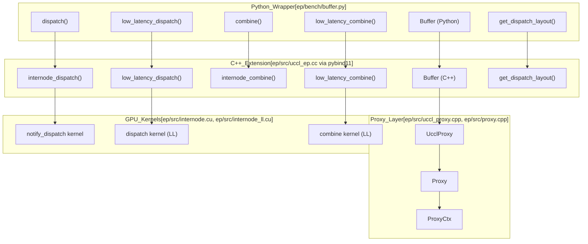
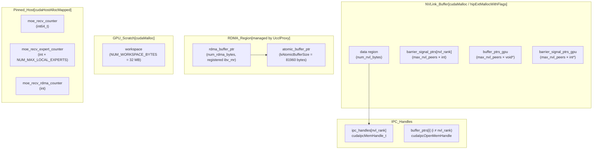
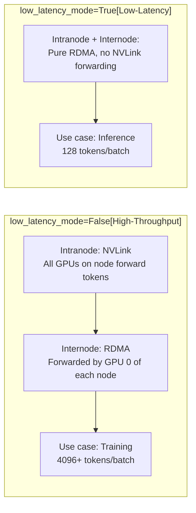
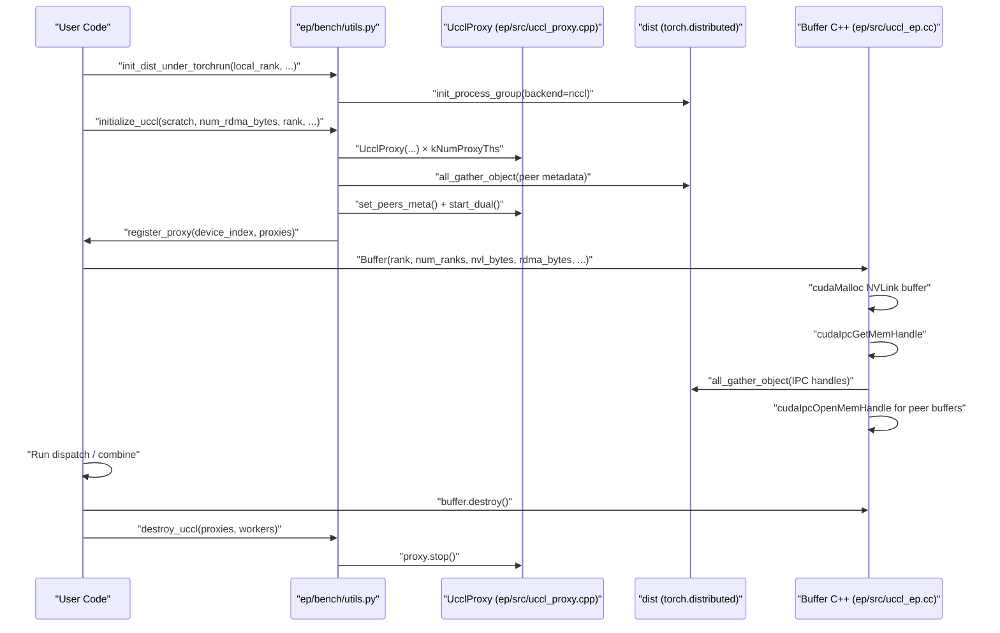
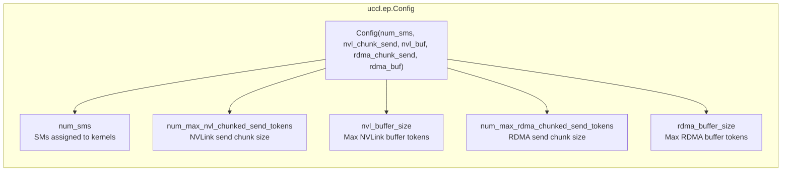
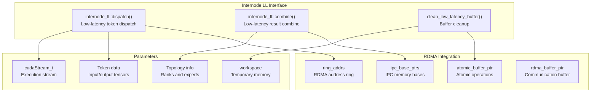

<!-- source: DeepWiki mcp.deepwiki.com · repo uccl-project/uccl · page 4.1 EP Architecture and Buffer API · fetched 2026-11-11 -->

# EP Architecture and Buffer API

<details>
<summary>Relevant source files</summary>

The following files were used as context for generating this wiki page:

- [.github/PULL_REQUEST_TEMPLATE.md](.github/PULL_REQUEST_TEMPLATE.md)
- [.github/workflows/uccl-build-test.yml](.github/workflows/uccl-build-test.yml)
- [README.md](README.md)
- [build.sh](build.sh)
- [collective/efa/README.md](collective/efa/README.md)
- [collective/rdma/README.md](collective/rdma/README.md)
- [docs/wheels.md](docs/wheels.md)
- [ep/Makefile](ep/Makefile)
- [ep/README.md](ep/README.md)
- [ep/bench/buffer.py](ep/bench/buffer.py)
- [ep/bench/run_ep.sh](ep/bench/run_ep.sh)
- [ep/bench/test_internode.py](ep/bench/test_internode.py)
- [ep/bench/test_low_latency.py](ep/bench/test_low_latency.py)
- [ep/bench/utils.py](ep/bench/utils.py)
- [ep/include/common.hpp](ep/include/common.hpp)
- [ep/include/ep_configs.cuh](ep/include/ep_configs.cuh)
- [ep/include/ep_utils.cuh](ep/include/ep_utils.cuh)
- [ep/include/proxy.hpp](ep/include/proxy.hpp)
- [ep/include/proxy_ctx.hpp](ep/include/proxy_ctx.hpp)
- [ep/include/rdma.hpp](ep/include/rdma.hpp)
- [ep/include/uccl_ibgda.cuh](ep/include/uccl_ibgda.cuh)
- [ep/include/uccl_proxy.hpp](ep/include/uccl_proxy.hpp)
- [ep/setup.py](ep/setup.py)
- [ep/src/common.cpp](ep/src/common.cpp)
- [ep/src/internode.cu](ep/src/internode.cu)
- [ep/src/internode_ll.cu](ep/src/internode_ll.cu)
- [ep/src/proxy.cpp](ep/src/proxy.cpp)
- [ep/src/rdma.cpp](ep/src/rdma.cpp)
- [ep/src/uccl_ep.cc](ep/src/uccl_ep.cc)
- [ep/src/uccl_proxy.cpp](ep/src/uccl_proxy.cpp)
- [scripts/efa_monitor.sh](scripts/efa_monitor.sh)

</details>


UCCL-EP provides GPU-initiated communication infrastructure for Mixture of Experts (MoE) models, compatible with the DeepEP interface. It enables token dispatch and expert result combining operations across heterogeneous GPUs (NVIDIA, AMD) and NICs (EFA, InfiniBand, Broadcom). The system supports both high-throughput (normal) and low-latency modes, utilizing NVLink for intranode communication and RDMA for internode communication.

The core component is the C++ `Buffer` class in `ep/src/uccl_ep.cc`, exposed to Python via pybind11 as `uccl.ep.Buffer`. A higher-level Python wrapper, `Buffer` in `ep/bench/buffer.py`, is the primary user-facing interface. For the underlying proxy thread and RDMA system, see page 4.2. For GPU kernel details, see page 4.3.

Sources: [ep/README.md:1-4](), [ep/src/uccl_ep.cc:84-281](), [ep/bench/buffer.py:35-70]()

## System Architecture

UCCL-EP is organized into three layers: the Python wrapper (`ep/bench/buffer.py`), the C++ pybind11 extension (`uccl.ep`, implemented in `ep/src/uccl_ep.cc`), and the CUDA kernel layer. The two operation modes are:

- **High-Throughput Mode** (`low_latency_mode=False`): Uses NVLink for intranode forwarding plus RDMA for internode transfer. Optimized for training (4096+ tokens/batch). Achieves 50–70 GB/s internode.
- **Low-Latency Mode** (`low_latency_mode=True`): Pure RDMA without NVLink forwarding. Optimized for inference (128 tokens/batch). Achieves 136–465 µs RTT.

### Layer and Class Diagram



Sources: [ep/src/uccl_ep.cc:36-84](), [ep/bench/buffer.py:35-70](), [ep/src/uccl_proxy.cpp:13-88](), [ep/src/proxy.cpp:81-443]()

## C++ Buffer Class

The `Buffer` class in `ep/src/uccl_ep.cc` is the core C++ component, exposed to Python via pybind11 as part of the `uccl.ep` extension module. It is instantiated only after `UcclProxy` instances have been registered for the current device via `uccl.ep.register_proxy(device_index, proxies)`.

### Constructor Parameters

[ep/src/uccl_ep.cc:86-94]()

| Parameter | Type | Description |
|-----------|------|-------------|
| `rank` | `int` | Global rank of this process |
| `num_ranks` | `int` | Total number of ranks |
| `num_nvl_bytes` | `long` | NVLink buffer size in bytes (set to 0 for LL-only) |
| `num_rdma_bytes` | `long` | RDMA buffer size in bytes |
| `low_latency_mode` | `bool` | Enable low-latency (pure RDMA) mode |
| `explicitly_destroy` | `bool` | If true, user must call `destroy()` before GC |
| `num_local_ranks` | `int` | Number of GPUs per node; -1 auto-detects via `get_num_max_nvl_peers()` |

### Memory Region Layout

The constructor allocates and arranges several distinct memory regions:

**NVLink Buffer** (when `num_nvl_bytes > 0`): A single `cudaMalloc` (or `hipExtMallocWithFlags` on AMD) covers all intranode communication fields laid out contiguously:

```
[ data buffer (num_nvl_bytes) ]
[ barrier signals (max_nvl_peers × sizeof(int)) ]
[ GPU buffer pointer array (max_nvl_peers × sizeof(void*)) ]
[ GPU barrier signal pointer array (max_nvl_peers × sizeof(int*)) ]
```

[ep/src/uccl_ep.cc:215-248]()

A `cudaIpcGetMemHandle` is obtained for this allocation so that peer GPUs on the same node can map it via CUDA IPC. `ipc_handles[nvl_rank]` stores the local handle; peer handles are exchanged during `init_dist`.

**RDMA Buffer**: Allocated by the registered `UcclProxy` instances. The `Buffer` constructor collects D2H channel ring-buffer addresses from each proxy via `get_d2h_channel_addrs()` and stores GPU-accessible handles as `d_handle_objs` / `d_handles` (managed memory prefetched to device).

[ep/src/uccl_ep.cc:113-165]()

**Workspace**: `NUM_WORKSPACE_BYTES` (32 MB, defined in `ep/include/ep_configs.cuh`) allocated with `cudaMalloc`, used as GPU-side scratch.

**Pinned Host Counters**: `moe_recv_counter`, `moe_recv_expert_counter`, and `moe_recv_rdma_counter` are allocated with `cudaHostAllocMapped` so that both CPU proxy threads and GPU kernels can read/write them.

[ep/src/uccl_ep.cc:257-280]()

### Memory Layout Diagram



Sources: [ep/src/uccl_ep.cc:173-281](), [ep/include/ep_configs.cuh:1-7](), [ep/include/common.hpp:59-60]()

### Key Derived Fields

After construction, the `Buffer` computes node-topology fields used throughout the kernel calls:

| Field | Formula | Description |
|-------|---------|-------------|
| `rdma_rank` | `rank / max_nvl_peers` | Which RDMA node this rank belongs to |
| `nvl_rank` | `rank % max_nvl_peers` | Local GPU index within the node |
| `num_rdma_ranks` | `max(1, num_ranks / max_nvl_peers)` | Number of RDMA-connected nodes |
| `num_nvl_ranks` | `min(num_ranks, max_nvl_peers)` | GPUs in intranode group |
| `num_device_sms` | from `cudaGetDeviceProperties` | Total SM count on device |

[ep/src/uccl_ep.cc:202-209]()

---

## Python Buffer Wrapper

`ep/bench/buffer.py` provides the `Buffer` Python class, which is the primary user-facing interface. It wraps the C++ `ep.Buffer` object and handles initialization of the proxy system via `initialize_uccl`.

### Constructor Parameters

[ep/bench/buffer.py:55-90]()

| Parameter | Type | Default | Description |
|-----------|------|---------|-------------|
| `group` | `dist.ProcessGroup` | — | Torch distributed process group |
| `num_nvl_bytes` | `int` | `0` | NVLink buffer size |
| `num_rdma_bytes` | `int` | `0` | RDMA buffer size |
| `low_latency_mode` | `bool` | `False` | Enables low-latency (pure RDMA) mode |
| `num_qps_per_rank` | `int` | `24` | RDMA QPs per rank; for LL mode, set to `num_local_experts` |
| `allow_nvlink_for_low_latency_mode` | `bool` | `True` | Allow NVLink in LL mode (incompatible with hook-based overlap) |
| `allow_mnnvl` | `bool` | `False` | Allow Multi-Node NVLink |
| `explicitly_destroy` | `bool` | `False` | Require explicit `destroy()` call |
| `is_intranode` | `bool` | `False` | Intranode-only mode (no RDMA) |

The class attribute `num_sms = 20` defines the default SM count for high-throughput kernel launches.

### Buffer API Methods

The Python `Buffer` class exposes the following main operations:

**Layout computation (runs before dispatch):**

`get_dispatch_layout(topk_idx, num_experts, previous_event, async, allocate_on_comm_stream)` — returns `(num_tokens_per_rank, num_tokens_per_rdma_rank, num_tokens_per_expert, is_token_in_rank, event)`.

**Low-latency dispatch:**

`low_latency_dispatch(x, topk_idx, num_tokens, num_experts, use_fp8, round_scale, use_ue8m0, cumulative_local_expert_recv_stats, async_finish, return_recv_hook)` — returns `(packed_recv_x, packed_recv_count, handle, event, hook)`.

When `use_fp8=True`, `packed_recv_x` is a tuple `(fp8_tensor, scale_tensor)`.

**Low-latency combine:**

`low_latency_combine(x, topk_idx, topk_weights, handle, use_logfmt, async_finish, zero_copy, return_recv_hook, out)` — returns `(combined_x, event, hook)`.

**High-throughput dispatch/combine:**

`dispatch(x, x_scales, topk_idx, topk_weights, num_tokens_per_rank, num_tokens_per_rdma_rank, is_token_in_rank, num_tokens_per_expert, ...)` — calls `ep.Buffer.internode_dispatch()`.

`combine(x, ...)` — calls `ep.Buffer.internode_combine()`.

Sources: [ep/bench/buffer.py:35-200](), [ep/src/uccl_ep.cc:283-700]()

### Mode Comparison



Sources: [ep/bench/buffer.py:42-50](), [ep/README.md:118-210]()

## Performance Characteristics

UCCL-EP achieves different performance profiles depending on mode and hardware platform.

### Normal Mode Performance

Normal mode prioritizes throughput with NVLink forwarding and RDMA for internode communication:

**p5en (H200 + 200Gb/s EFA) - DeepSeek-V3 Training Config (4096 tokens/batch, FP8 dispatch, BF16 combine)**

| Type | Dispatch #EP | Dispatch BW & Latency | Combine #EP | Combine BW & Latency |
|------|--------------|------------------------|-------------|----------------------|
| Intranode | 8 | 320 GB/s, 500 µs | 8 | 319 GB/s, 973 µs |
| Internode | 16 | 50 GB/s, 1196 µs | 16 | 18 GB/s, 6379 µs |
| Internode | 32 | 54 GB/s, 2022 µs | 32 | 43 GB/s, 4899 µs |

**p6-b200 (B200 + 400Gb/s EFA)**

| Type | Dispatch #EP | Dispatch BW & Latency | Combine #EP | Combine BW & Latency |
|------|--------------|------------------------|-------------|----------------------|
| Intranode | 8 | 280 GB/s, 571 µs | 8 | 426 GB/s, 727 µs |
| Internode | 16 | 53 GB/s, 1141 µs | 16 | 60 GB/s, 1965 µs |
| Internode | 32 | 53 GB/s, 2072 µs | 32 | 57 GB/s, 3724 µs |

**AMD MI300X with CX7 InfiniBand**

| Type | FP8 Dispatch #EP | FP8 Dispatch BW | BF16 Dispatch #EP | BF16 Dispatch BW | Combine #EP | Combine BW |
|------|------------------|-----------------|-------------------|------------------|-------------|------------|
| Internode | 16 | 71 GB/s | 16 | 81 GB/s | 16 | 54 GB/s |
| Internode | 32 | 57 GB/s | 32 | 60 GB/s | 32 | 57 GB/s |

Sources: [ep/README.md:118-156]()

### Low-Latency Mode Performance

Low-latency mode uses pure RDMA without NVLink forwarding, optimized for inference (128 tokens/batch, FP8 dispatch, BF16 combine):

**AMD MI300X with CX7 InfiniBand**

| Dispatch #EP | Latency | RDMA BW | Combine #EP | Latency | RDMA BW |
|--------------|---------|---------|-------------|---------|---------|
| 8 | 65 µs | 114 GB/s | 8 | 92 µs | 157 GB/s |
| 16 | 136 µs | 55 GB/s | 16 | 207 µs | 70 GB/s |
| 32 | 224 µs | 30 GB/s | 32 | 341 µs | 42 GB/s |

**p6-b200 (B200 + 400Gb/s EFA)**

| Dispatch #EP | Latency | RDMA BW | Combine #EP | Latency | RDMA BW |
|--------------|---------|---------|-------------|---------|---------|
| 16 | 228 µs | 33 GB/s | 16 | 318 µs | 46 GB/s |
| 32 | 406 µs | 19 GB/s | 32 | 617 µs | 24 GB/s |

**p5en (H200 + 200Gb/s EFA)**

| Dispatch #EP | Latency | RDMA BW | Combine #EP | Latency | RDMA BW |
|--------------|---------|---------|-------------|---------|---------|
| 16 | 226 µs | 36 GB/s | 16 | 293 µs | 48 GB/s |
| 32 | 465 µs | 16 GB/s | 32 | 694 µs | 25 GB/s |

Sources: [ep/README.md:158-187]()

## Initialization Flow

Before constructing a `Buffer`, proxies must be started and registered, and distributed group metadata must be exchanged across all ranks.

### `init_dist` and `init_dist_under_torchrun`

Two utility functions in `ep/bench/utils.py` handle distributed process group setup:

| Function | When to use |
|----------|-------------|
| `init_dist(local_rank, num_local_ranks)` | Manual multi-node launch; reads `MASTER_ADDR`, `MASTER_PORT`, `WORLD_SIZE`, `RANK` env vars |
| `init_dist_under_torchrun(local_rank, num_local_ranks)` | Managed by `torchrun`; env vars are set automatically |

Both functions call `dist.init_process_group(backend="nccl", ...)`, set `torch.set_default_dtype(torch.bfloat16)`, and return `(rank, world_size, group)`.

[ep/bench/utils.py:46-89]()

### `initialize_uccl` and `destroy_uccl`

These functions (defined in `ep/bench/utils.py` and re-exported from `ep/bench/buffer.py`) handle the proxy lifecycle. Internally they:

1. Allocate the RDMA scratch buffer (`cudaMalloc` for `num_rdma_bytes`)
2. Create `UcclProxy` instances (one per NIC thread, as configured by `kNumProxyThs`)
3. Exchange peer metadata (rank, IP, RDMA buffer pointer, listen ports) via `dist.all_gather_object`
4. Call `proxy.set_peers_meta()` and start the appropriate proxy thread mode (`start_dual()` for internode, `start_local()` for intranode)
5. Register the proxy list with `uccl.ep.register_proxy(device_index, proxies)`

[ep/bench/utils.py:113-142](), [ep/src/uccl_proxy.cpp:128-181]()

### Full Initialization Sequence



Sources: [ep/bench/utils.py:75-142](), [ep/src/uccl_ep.cc:94-172](), [ep/src/uccl_proxy.cpp:128-181]()

---

## EventHandle Synchronization

`EventHandle` is a C++ CUDA event wrapper exposed via pybind11 in `uccl.ep`. It is the primary mechanism for stream synchronization between the communication stream (`comm_stream`) and the compute stream.

The `Buffer` C++ constructor creates a dedicated high-priority `comm_stream` via `at::cuda::getStreamFromPool(/*isHighPriority=*/true)`. All dispatch and combine kernels launch on this stream, and an `EventHandle` is returned to the caller to synchronize with the default compute stream.

[ep/src/uccl_ep.cc:92-94]()

### EventOverlap Wrapper

`ep/bench/utils.py` wraps `EventHandle` in the `EventOverlap` class, which supports Python `with` syntax for convenient stream waiting:

[ep/bench/utils.py:195-250]()

| Method | Description |
|--------|-------------|
| `EventOverlap(event, extra_tensors)` | Stores an `EventHandle` and optional tensors for stream recording |
| `current_stream_wait()` | Calls `event.current_stream_wait()` on the stored handle |
| `__exit__()` | Automatically calls `current_stream_wait()` when exiting a `with` block |

### Async Operation Pattern

When `async_finish=True` is passed to dispatch or combine:

1. The operation launches on `comm_stream` and returns immediately with an `EventHandle`.
2. The caller performs other GPU work on the compute stream.
3. Before consuming the results, the caller calls `event.current_stream_wait()` or enters an `EventOverlap` context.

When `return_recv_hook=True`, a Python callable `hook` is returned instead. Calling `hook()` internally calls `current_stream_wait()` and can be used with CUDA graph capture.

Sources: [ep/bench/utils.py:195-250](), [ep/bench/buffer.py:14-16](), [ep/src/uccl_ep.cc:283-353]()

## Configuration and Performance Tuning

The `uccl.ep.Config` class (exposed from C++) controls chunking and SM allocation for high-throughput (normal) mode operations.

### Config Parameters



| Parameter | Typical Value | Description |
|-----------|--------------|-------------|
| `num_sms` | 20–24 | SMs allocated to communication kernels |
| `num_max_nvl_chunked_send_tokens` | 8–44 | NVLink send chunk size in tokens |
| `nvl_buffer_size` | 512–720 | NVLink buffer capacity in tokens |
| `num_max_rdma_chunked_send_tokens` | 8–32 | RDMA send chunk size in tokens |
| `rdma_buffer_size` | 128–512 | RDMA buffer capacity in tokens |

The `Config` object also provides helper methods:
- `get_nvl_buffer_size_hint(hidden_bytes, num_ranks)` — returns required NVLink buffer bytes
- `get_rdma_buffer_size_hint(hidden_bytes, num_ranks)` — returns required RDMA buffer bytes
- `get_low_latency_rdma_size_hint(num_tokens, hidden, num_ranks, num_experts)` — returns RDMA buffer bytes for LL mode

Example usage from `ep/bench/test_internode.py`:

```python
config = Config(num_sms, 8, 512, 16, 512)
num_nvlink_bytes = align_buffer(config.get_nvl_buffer_size_hint(hidden_bytes, num_ranks))
num_rdma_bytes   = align_buffer(config.get_rdma_buffer_size_hint(hidden_bytes, num_ranks))
```

[ep/bench/test_internode.py:62-77]()

### Compile-Time Constants (`ep_configs.cuh`)

Key limits defined at compile time in `ep/include/ep_configs.cuh`:

| Constant | Value | Description |
|----------|-------|-------------|
| `NUM_MAX_NVL_PEERS` | 8 | Maximum GPUs per node for NVLink |
| `NUM_MAX_RDMA_PEERS` | 20 | Maximum RDMA peer nodes |
| `NUM_WORKSPACE_BYTES` | 32 MB | GPU scratch workspace size |
| `NUM_BUFFER_ALIGNMENT_BYTES` | 128 | Required buffer alignment |

[ep/include/ep_configs.cuh:1-7]()

Sources: [ep/bench/test_internode.py:62-77](), [ep/include/ep_configs.cuh:1-7](), [ep/bench/buffer.py:52-54]()

## Internode Low-Latency Operations

For multi-node deployments, the system provides specialized internode low-latency operations that minimize communication overhead across RDMA networks.

### Low-Latency Kernel Interface

The internode low-latency module exposes dispatch and combine operations optimized for RDMA communication:



The internode operations integrate with RDMA ring buffers and IPC memory management to provide efficient cross-node communication.

Sources: [ep/include/internode_ll.cuh:9-41]()

### Buffer Management and Cleanup

The system includes sophisticated buffer management with automatic cleanup and resource reclamation:

| Operation | Purpose | Key Parameters |
|-----------|---------|----------------|
| `clean_low_latency_buffer` | Clean atomic counters | `clean_0`, `num_clean_int_0`, `clean_1`, `num_clean_int_1` |
| `reset_rdma_buffer` | Reset communication buffers | Buffer state reset |
| `destroy` | Release all resources | Complete cleanup |

The cleanup operations ensure proper resource management across GPU memory, RDMA buffers, and IPC handles.

Sources: [ep/bench/buffer.py:146-165](), [ep/include/internode_ll.cuh:11-12]()

---

