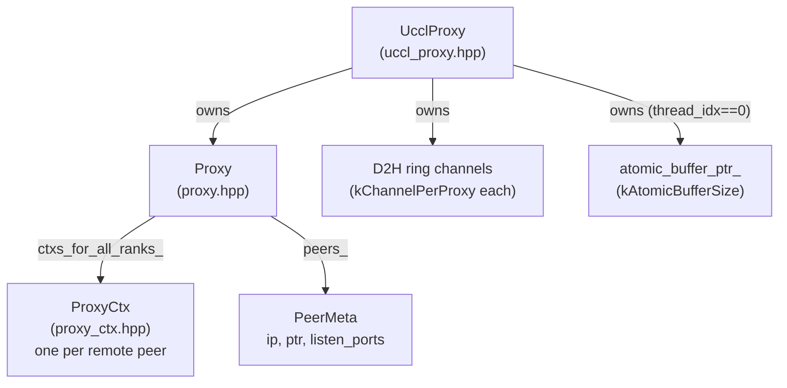
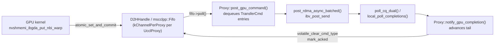
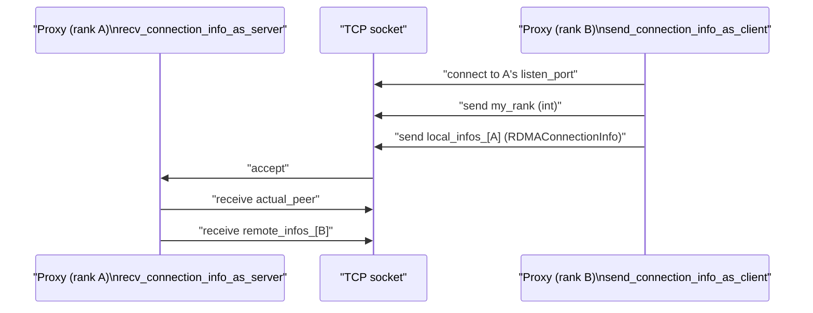
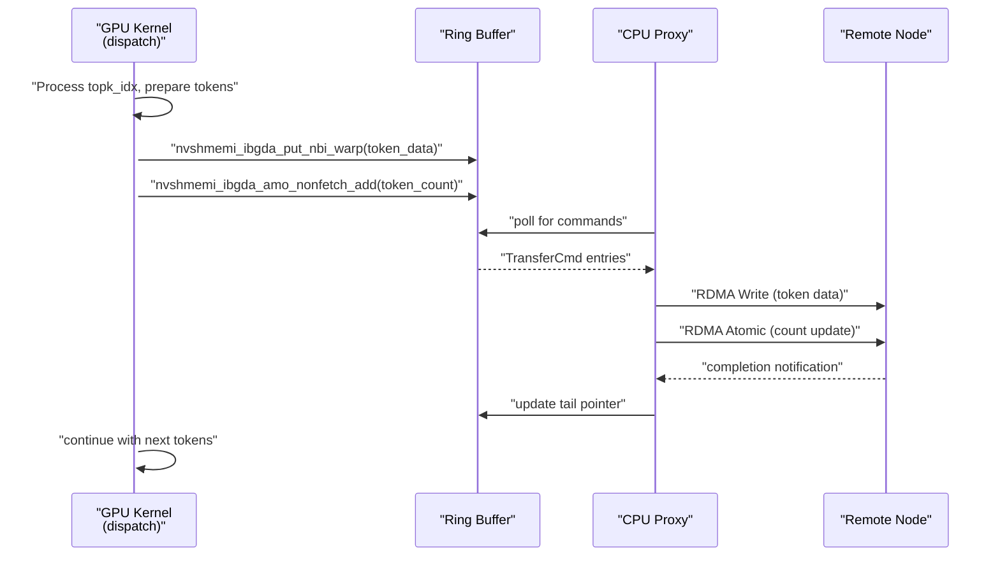

<!-- source: DeepWiki mcp.deepwiki.com · repo uccl-project/uccl · page 4.2 Proxy and RDMA System · fetched 2026-11-11 -->

# Proxy and RDMA System

<details>
<summary>Relevant source files</summary>

The following files were used as context for generating this wiki page:

- [ep/bench/buffer.py](ep/bench/buffer.py)
- [ep/bench/test_internode.py](ep/bench/test_internode.py)
- [ep/bench/test_low_latency.py](ep/bench/test_low_latency.py)
- [ep/bench/utils.py](ep/bench/utils.py)
- [ep/include/common.hpp](ep/include/common.hpp)
- [ep/include/ep_configs.cuh](ep/include/ep_configs.cuh)
- [ep/include/ep_utils.cuh](ep/include/ep_utils.cuh)
- [ep/include/proxy.hpp](ep/include/proxy.hpp)
- [ep/include/proxy_ctx.hpp](ep/include/proxy_ctx.hpp)
- [ep/include/rdma.hpp](ep/include/rdma.hpp)
- [ep/include/uccl_ibgda.cuh](ep/include/uccl_ibgda.cuh)
- [ep/include/uccl_proxy.hpp](ep/include/uccl_proxy.hpp)
- [ep/src/internode.cu](ep/src/internode.cu)
- [ep/src/internode_ll.cu](ep/src/internode_ll.cu)
- [ep/src/proxy.cpp](ep/src/proxy.cpp)
- [ep/src/rdma.cpp](ep/src/rdma.cpp)
- [ep/src/uccl_ep.cc](ep/src/uccl_ep.cc)
- [ep/src/uccl_proxy.cpp](ep/src/uccl_proxy.cpp)

</details>


The EP subsystem's proxy layer bridges GPU kernels and the RDMA network. GPU dispatch/combine kernels write transfer commands into D2H ring buffers; CPU proxy threads drain those rings and post InfiniBand verbs calls. This page covers the `UcclProxy` and `Proxy` classes, the `ProxyCtx` context structure, the four proxy thread modes, and how RDMA connections are established via TCP-based `RDMAConnectionInfo` exchange.

Related pages: see page 4.1 for the `Buffer` API that creates proxies, and page 4.3 for the GPU kernels that enqueue commands into the D2H rings.

## Class Hierarchy and Ownership

Two classes manage proxy lifecycle: `UcclProxy` and its inner `Proxy`.

- **`UcclProxy`** ([ep/include/uccl_proxy.hpp:15-75](), [ep/src/uccl_proxy.cpp:13-181]()) — the pybind11-exposed object. It owns one `Proxy`, one or more D2H ring-buffer channels (`d2h_channel_addrs_`), and an `atomic_buffer_ptr_`. It exposes `start_sender()`, `start_remote()`, `start_local()`, `start_dual()`, and `stop()`.
- **`Proxy`** ([ep/include/proxy.hpp:35-110](), [ep/src/proxy.cpp:81-543]()) — owns the per-peer `ProxyCtx` instances, the RDMA lifecycle, and the `run_*` thread bodies. Configuration is passed via `Proxy::Config`.

Each `UcclProxy` allocates `kChannelPerProxy` (8) D2H queue slots ([ep/include/common.hpp:66]()). In normal mode, `kNumProxyThs` (4) `UcclProxy` instances are created per GPU, giving 4×8 = 32 D2H channels total.

**Class hierarchy diagram:**



Sources: [ep/include/uccl_proxy.hpp:15-75](), [ep/include/proxy.hpp:35-110](), [ep/src/uccl_proxy.cpp:13-88]()

## ProxyCtx Structure

`ProxyCtx` ([ep/include/proxy_ctx.hpp:63-180]()) is the per-peer RDMA context. One instance lives in `Proxy::ctx_` (the main context) and one per peer in `Proxy::ctxs_for_all_ranks_`. All per-peer contexts share the same `ibv_context`, `ibv_pd`, and `ibv_mr` but have distinct Queue Pairs.

| Field | Type | Purpose |
|---|---|---|
| `context` | `ibv_context*` | Open IB device handle |
| `pd` | `ibv_pd*` | Protection domain |
| `mr` | `ibv_mr*` | GPU buffer memory region |
| `cq` / `cq_ex` | `ibv_cq*` / `ibv_cq_ex*` | Completion queue (shared per proxy) |
| `qp` | `ibv_qp*` | Main data Queue Pair |
| `ack_qp` / `recv_ack_qp` | `ibv_qp*` | Acknowledgement Queue Pairs |
| `data_qps_by_channel` | `vector<ibv_qp*>` | Per-channel QPs (normal mode) |
| `rkey` / `remote_rkey` | `uint32_t` | Local and remote memory region keys |
| `remote_addr` / `remote_len` | `uintptr_t` / `uint64_t` | Remote GPU buffer base and size |
| `atomic_buffer_mr` | `ibv_mr*` | MR for `atomic_buffer_ptr_` |
| `atomic_old_values_buf` / `_mr` | `uint64_t*` / `ibv_mr*` | Scratch buffer for native RDMA atomics |
| `gpu_mr_chunks` | `vector<MRChunk>` | Chunked MR entries (DMA-BUF path) |
| `numa_node` | `int` | NUMA node of selected NIC |
| `progress_run` | `atomic<bool>` | Proxy thread run flag |

`TokenCounter<Key>` ([ep/include/proxy_ctx.hpp:10-24]()) is a lightweight `map<Key, size_t>` wrapper used to track dispatch and combine token counts per (rank, expert, buffer_idx) tuple.

Sources: [ep/include/proxy_ctx.hpp:10-180]()

## D2H Channel Ring Buffers

GPU kernels communicate transfer commands to CPU proxies through D2H (Device-to-Host) channels. When `USE_MSCCLPP_FIFO_BACKEND` is defined (the default, [ep/include/common.hpp:32]()), each channel is a `mscclpp::Fifo`; otherwise it is a custom `HostD2HHandle` ring.

Each `TransferCmd` entry carries:

| Field | Purpose |
|---|---|
| `cmd_type` | `CmdType::WRITE`, `BARRIER`, or `QUIET` with combine/buffer_idx flags |
| `req_rptr` | Remote GPU buffer address (offset from base) |
| `req_lptr` | Local GPU buffer address |
| `bytes` | Transfer size |
| `dst_rank` | Destination global rank |
| `expert_idx` | Expert index (low-latency mode) |
| `atomic_offset` / `atomic_val` | Atomic operation parameters (normal mode) |

**D2H channel selection from GPU:** `nvshmemi_ibgda_put_nbi_warp` maps `expert_idx % num_d2h_channel_addrs` to a specific proxy thread and per-thread channel slot [ep/include/uccl_ibgda.cuh:36-42]().

**D2H channel flow diagram:**



Sources: [ep/include/uccl_ibgda.cuh:26-75](), [ep/src/proxy.cpp:603-601](), [ep/src/proxy.cpp:545-601](), [ep/src/uccl_proxy.cpp:28-41]()

## Proxy Thread Modes

`UcclProxy::start_*()` launches a background `std::thread` that calls one of four `Proxy::run_*()` methods. The mode is determined at startup and does not change.

**Thread mode summary:**

| Mode | Method | Init Called | Primary Loop Work |
|---|---|---|---|
| `Sender` | `run_sender()` | `init_sender()` | `local_poll_completions`, `notify_gpu_completion`, `post_gpu_command` |
| `Remote` | `run_remote()` | `init_remote()` | `remote_poll_completions`, `apply_pending_updates` |
| `Local` | `run_local()` | `init_common()` | NVLink-only intra-node transfers |
| `Dual` | `run_dual()` | `init_common()` | Combined send+recv: `poll_cq_dual`, `notify_gpu_completion`, `post_gpu_command`, `barrier_check` |

In production EP deployments, **Dual mode** is most commonly used for inter-node peers. **Local mode** is activated for intra-node peers when `is_intranode_` is set ([ep/src/uccl_proxy.cpp:158-163]()).

**Proxy thread lifecycle diagram:**

```mermaid
stateDiagram-v2
    [*] --> "init_common()"
    "init_common()" --> "per_thread_rdma_init": "open IB device, reg GPU MR"
    "per_thread_rdma_init" --> "create_per_thread_qp": "create ibv_qp per peer"
    "create_per_thread_qp" --> "TCP exchange": "RDMAConnectionInfo"
    "TCP exchange" --> "modify_qp_to_rtr / rts": "bring QPs to RTS"
    "modify_qp_to_rtr / rts" --> "run loop"

    "run loop" --> "post_gpu_command": "dequeue D2H cmds"
    "post_gpu_command" --> "post_rdma_async_batched / post_atomic_operations"
    "post_rdma_async_batched / post_atomic_operations" --> "poll_cq_dual"
    "poll_cq_dual" --> "notify_gpu_completion": "advance D2H tail"
    "notify_gpu_completion" --> "run loop"

    "run loop" --> "stop": "progress_run=false"
    "stop" --> [*]
```

Sources: [ep/src/proxy.cpp:464-543](), [ep/src/uccl_proxy.cpp:133-181]()

### `run_sender` and `run_remote` Details

`init_sender()` calls `init_common()` then posts acknowledgement receive buffers via `local_post_ack_buf`. `init_remote()` additionally calls `remote_reg_ack_buf` and `post_receive_buffer_for_imm` (non-EFA path) to pre-post receive WRs for immediate-data notifications from the sender side ([ep/src/proxy.cpp:445-462]()).

### `run_dual` Details

`run_dual` merges the sender and remote roles into a single thread. It calls both `post_gpu_command` (send path) and `remote_poll_completions` / `apply_pending_updates` (receive path) inside the same loop iteration. In normal mode it also calls `barrier_check()` to coordinate local GPUs ([ep/src/proxy.cpp:494-543]()).

Sources: [ep/src/proxy.cpp:445-543]()

## RDMA Connection Setup

RDMA connections are established inside `Proxy::init_common()` ([ep/src/proxy.cpp:172-443]()). The steps are:

1. **NIC selection** — `per_thread_rdma_init` ([ep/src/rdma.cpp:384-658]()) enumerates `ibv_get_device_list`, computes PCIe distances between GPUs and NICs via `safe_pcie_distance`, applies the `UCCL_IB_HCA` / `NCCL_IB_HCA` filter, and picks the NIC closest to the GPU. On EFA with 32 NICs (p5) it spreads proxies across 4 NICs by `thread_idx % 4`. The selected NIC is opened with `ibv_open_device` and a PD is allocated.

2. **GPU memory registration** — the RDMA buffer (`cfg_.gpu_buffer`, size `cfg_.total_size`) is registered as an MR. With `USE_DMABUF` the path uses `reg_mr_gpu_dmabuf` (DMA-BUF fd via `cuMemGetHandleForAddressRange`) with a chunked fallback via `reg_mr_gpu_dmabuf_chunked` for buffers exceeding `kMaxDmabufChunkSize` (1 GiB). Without DMA-BUF it uses `ibv_reg_mr_iova2`. The resulting `rkey` is stored in `ProxyCtx::rkey` [ep/src/rdma.cpp:561-658]().

3. **QP creation** — `create_per_thread_qp` ([ep/src/rdma.cpp:840-960]()) creates:
   - One main `qp` (RC on IB, SRD on EFA)
   - One `ack_qp` and one `recv_ack_qp`
   - Up to `kChannelPerProxy` `data_qps_by_channel` entries (normal mode)
   - EFA QPs go INIT→RTR→RTS immediately inside `create_srd_qp_ex` ([ep/src/rdma.cpp:770-837]())
   - IB RC QPs are brought to INIT via `modify_qp_to_init`, then RTR/RTS after the TCP exchange

4. **TCP exchange** — `RDMAConnectionInfo` structs are exchanged between peers out-of-band using TCP sockets (see next section).

5. **QP state transitions** — `modify_qp_to_rtr` sets the remote QPN/LID/GID, `modify_qp_to_rts` completes the transition [ep/src/proxy.cpp:327-389]().

**QP state transition diagram:**

```mermaid
stateDiagram-v2
    [*] --> "RESET"
    "RESET" --> "INIT": "modify_qp_to_init()\nIBV_QPS_INIT"
    "INIT" --> "RTR": "modify_qp_to_rtr()\nset remote QPN, LID, GID"
    "RTR" --> "RTS": "modify_qp_to_rts()\nset SQ_PSN"
    "RTS" --> "Ready for RDMA writes"
```

Sources: [ep/src/rdma.cpp:962-1009](), [ep/src/rdma.cpp:1029-1120](), [ep/src/proxy.cpp:172-443]()

## TCP-Based RDMAConnectionInfo Exchange

`RDMAConnectionInfo` ([ep/include/rdma.hpp:24-57]()) carries everything the remote side needs to target this proxy's QP and memory region:

| Field | Purpose |
|---|---|
| `qp_num` / `ack_qp_num` / `recv_ack_qp_num` | Queue Pair numbers |
| `data_qp_num[kChannelPerProxy]` | Per-channel QP numbers (normal mode) |
| `psn` / `ack_psn` | Packet sequence numbers |
| `rkey` | Memory region remote key |
| `addr` / `len` | Remote GPU buffer base address and size |
| `lid` / `gid[16]` | LID (IB) and GID (RoCE/EFA) for AH creation |
| `atomic_buffer_rkey` / `atomic_buffer_addr` / `_len` | Atomic scratch buffer info |
| `num_mr_chunks` / `mr_chunk_info[]` | Chunked MR entries (DMA-BUF path) |

The exchange happens in `init_common()` using a concurrent client/server pattern:
- A receiver thread calls `recv_connection_info_as_server` on `listen_fd_` (created at `Proxy` construction via `create_listen_socket`).
- The main thread calls `send_connection_info_as_client` to each peer's listen port.
- The listener port of each proxy is communicated to peers via `dist.all_gather_object` at the Python layer (see `get_cpu_proxies_meta` in [ep/bench/utils.py:113-142]()).

**TCP exchange sequence:**



Sources: [ep/include/rdma.hpp:24-57](), [ep/src/rdma.cpp:329-382](), [ep/src/proxy.cpp:284-310]()

## post_receive_buffer_for_imm

On non-EFA IB paths, the remote proxy thread must pre-post receive Work Requests before the sender can use `IBV_WR_SEND_WITH_IMM`. `post_receive_buffer_for_imm` ([ep/include/rdma.hpp:332]()) posts a batch of receive WRs on `ProxyCtx::qp` so that incoming immediate-data messages from the sender side can be matched.

It is called in:
- `Proxy::init_remote()` [ep/src/proxy.cpp:460]()
- `Proxy::run_dual()` (for each inter-node peer) [ep/src/proxy.cpp:507]()

On EFA, SRD QPs with `EFADV_QP_FLAGS_UNSOLICITED_WRITE_RECV` set ([ep/src/rdma.cpp:799]()) do not consume receive WRs for RDMA-write-with-imm, so this call is skipped under `#ifndef EFA`.

Sources: [ep/include/rdma.hpp:332](), [ep/src/proxy.cpp:459-461](), [ep/src/proxy.cpp:504-508]()

## Integration with Expert-Parallel Workloads

The GPU-Driven RDMA Proxy is specifically designed for expert-parallel communication patterns where GPU kernels need to dispatch tokens to remote experts and combine results.

### Dispatch Phase Flow



### Buffer Management

The system manages multiple buffer types for different communication phases:

| Buffer Type | Purpose | GPU Access | CPU Proxy Role |
|-------------|---------|------------|----------------|
| `rdma_x` | Send buffer for token data | Write token data | Read for RDMA transfer |
| `rdma_recv_x` | Receive buffer for tokens | Read received tokens | Target of remote writes |
| `rdma_recv_count` | Token count per expert | Read counts | Target of atomic updates |
| `atomic_buffer_ptr` | Atomic operation workspace | N/A | Source for atomic values |

**Sources:** [ep/src/internode_ll.cu:177-183](), [ep/src/internode_ll.cu:285-290](), [ep/src/uccl_ep.cc:641-649]()

## Performance Characteristics

The GPU-Driven RDMA Proxy system achieves low-latency communication by eliminating GPU-CPU synchronization overhead and enabling overlapped computation and communication.

### Key Performance Features

- **Asynchronous Operation**: GPU kernels continue execution while RDMA operations are processed by CPU proxies
- **Batched Processing**: CPU proxies can batch multiple RDMA operations for improved efficiency  
- **Lock-Free Design**: Ring buffer communication avoids synchronization overhead
- **Warp-Level Parallelism**: Multiple GPU warps can issue concurrent RDMA operations

The system is optimized for expert-parallel workloads where communication patterns are predictable and can benefit from pipelined execution.

**Sources:** [ep/bench/test_low_latency.py:1-540](), [ep/bench/utils.py:314-342]()

---

