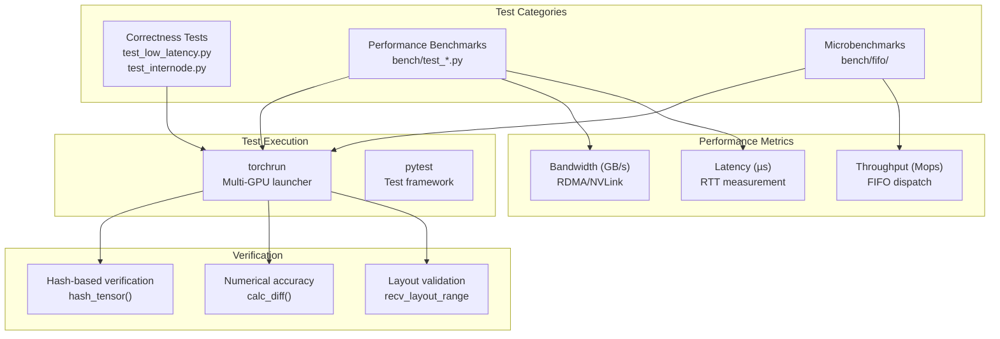
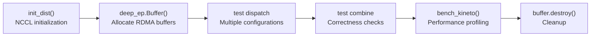
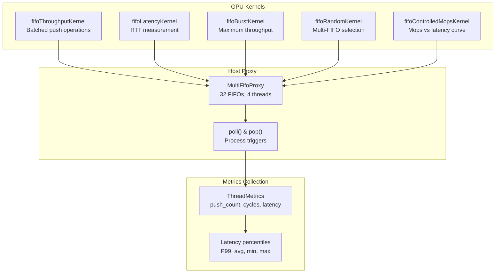
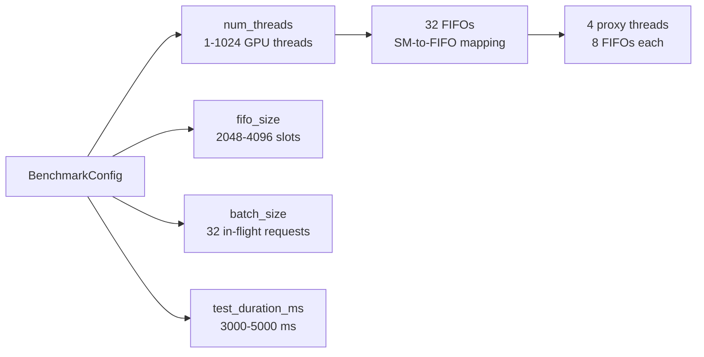
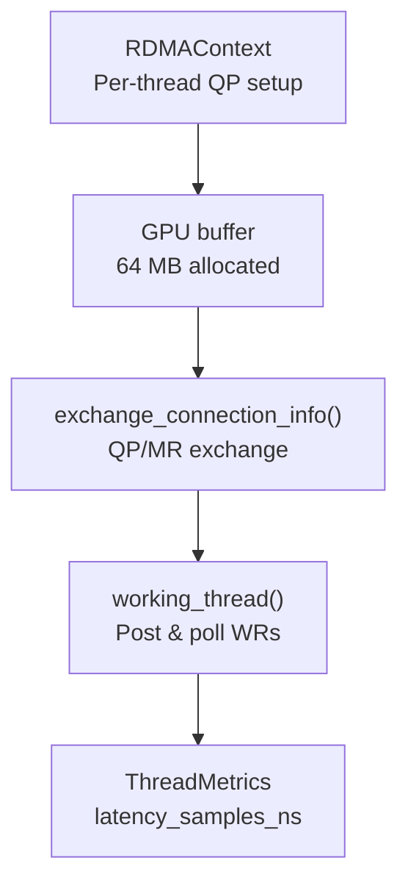
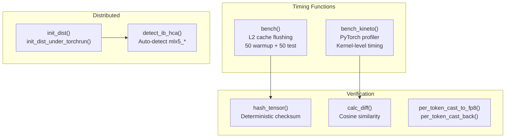
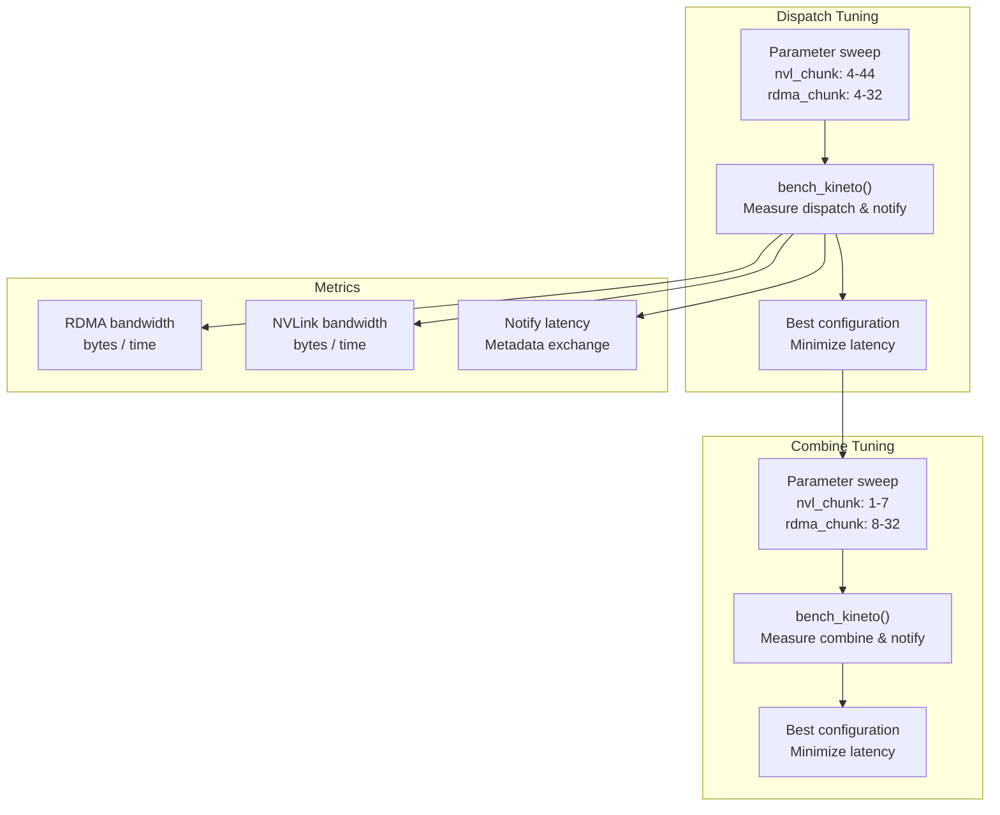
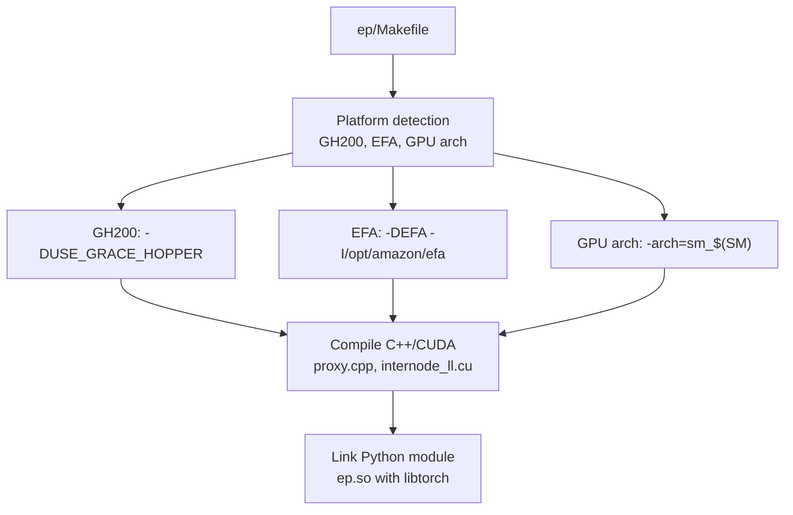
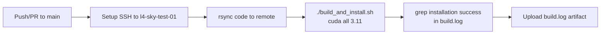
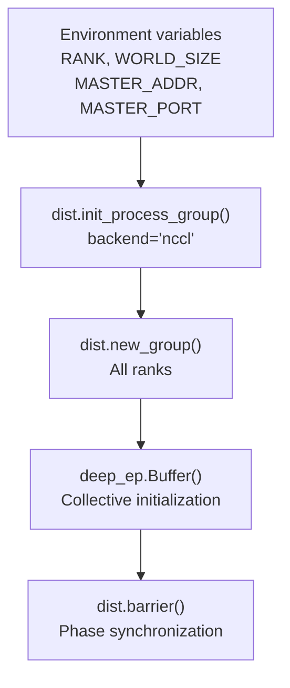

<!-- source: DeepWiki mcp.deepwiki.com · repo uccl-project/uccl · page 4.4 EP Benchmarks and AllToAll · fetched 2026-11-11 -->

# EP Testing and Performance

<details>
<summary>Relevant source files</summary>

The following files were used as context for generating this wiki page:

- [ep/bench/alltoall/.gitignore](ep/bench/alltoall/.gitignore)
- [ep/bench/alltoall/Makefile](ep/bench/alltoall/Makefile)
- [ep/bench/alltoall/benchmark.cpp](ep/bench/alltoall/benchmark.cpp)
- [ep/bench/alltoall/efa_alltoall_results.md](ep/bench/alltoall/efa_alltoall_results.md)
- [ep/bench/alltoall/launch_bench.py](ep/bench/alltoall/launch_bench.py)
- [ep/bench/alltoall/test_alltoall.cpp](ep/bench/alltoall/test_alltoall.cpp)
- [ep/bench/alltoall/test_alltoall_rail.cpp](ep/bench/alltoall/test_alltoall_rail.cpp)
- [ep/bench/buffer.py](ep/bench/buffer.py)
- [ep/bench/test_internode.py](ep/bench/test_internode.py)
- [ep/bench/test_low_latency.py](ep/bench/test_low_latency.py)
- [ep/bench/utils.py](ep/bench/utils.py)
- [ep/include/common.hpp](ep/include/common.hpp)
- [ep/include/ep_configs.cuh](ep/include/ep_configs.cuh)
- [ep/include/ep_utils.cuh](ep/include/ep_utils.cuh)
- [ep/include/proxy.hpp](ep/include/proxy.hpp)
- [ep/include/proxy_ctx.hpp](ep/include/proxy_ctx.hpp)
- [ep/include/rdma.hpp](ep/include/rdma.hpp)
- [ep/include/uccl_ibgda.cuh](ep/include/uccl_ibgda.cuh)
- [ep/include/uccl_proxy.hpp](ep/include/uccl_proxy.hpp)
- [ep/src/internode.cu](ep/src/internode.cu)
- [ep/src/internode_ll.cu](ep/src/internode_ll.cu)
- [ep/src/proxy.cpp](ep/src/proxy.cpp)
- [ep/src/rdma.cpp](ep/src/rdma.cpp)
- [ep/src/uccl_ep.cc](ep/src/uccl_ep.cc)
- [ep/src/uccl_proxy.cpp](ep/src/uccl_proxy.cpp)
- [p2p/rdma/tests/test_efa_endpoint.cpp](p2p/rdma/tests/test_efa_endpoint.cpp)

</details>


## Purpose and Scope

This page documents the testing infrastructure, benchmark suite, and performance characteristics of the UCCL-EP (Expert Parallelism) system. It covers correctness testing, performance benchmarking across platforms, and continuous integration workflows. For information about EP architecture and API details, see [EP Architecture and Buffer API](#4.1). For details on GPU kernels and communication primitives, see [GPU Kernels and Internode Communication](#4.3).

---

## Test Suite Architecture

The EP testing infrastructure consists of correctness tests, performance benchmarks, and specialized microbenchmarks organized into distinct categories:



**Sources:** [thirdparty/DeepEP/tests/test_low_latency.py:1-229](), [thirdparty/DeepEP/tests/test_internode.py:1-296](), [ep/bench/fifo/benchmark.cpp:1-443]()

### Correctness Test Files

| Test File | Purpose | Key Operations |
|-----------|---------|----------------|
| `test_low_latency.py` | Validates low-latency dispatch/combine kernels | `low_latency_dispatch()`, `low_latency_combine()` with FP8/BF16 |
| `test_internode.py` | Tests normal mode internode communication | `dispatch()`, `combine()`, `get_dispatch_layout()` |
| `test_intranode.py` | Verifies intra-node NVLink forwarding | NVLink-only data paths |

**Sources:** [thirdparty/DeepEP/tests/test_low_latency.py:15-160](), [thirdparty/DeepEP/tests/test_internode.py:16-257]()

### Test Execution Pattern

Tests use `torchrun` for multi-GPU/multi-node execution with the following pattern:



**Sources:** [thirdparty/DeepEP/tests/test_low_latency.py:163-194](), [thirdparty/DeepEP/tests/test_internode.py:228-257]()

---

## FIFO Microbenchmark Suite

The FIFO benchmark measures the performance of the Device-to-Host (D2H) command queue used by the EP proxy system. This microbenchmark isolates FIFO dispatch throughput and latency independent of RDMA operations.

### FIFO Test Architecture



**Sources:** [ep/bench/fifo/benchmark.cpp:56-98](), [ep/bench/fifo/fifo_kernel.cuh:16-115]()

### FIFO Test Modes

The benchmark implements five distinct testing modes:

| Mode | Flag | Kernel | Metric Focus |
|------|------|--------|--------------|
| Throughput | (default) | `fifoThroughputKernel` | Maximum sustained Mops with batching |
| RTT Latency | `-l` | `fifoLatencyKernel` | Round-trip time with immediate polling |
| Burst | `-b` | `fifoBurstKernel` | Maximum push rate without polling |
| Random | `-r` | `fifoRandomKernel` | Multi-FIFO contention |
| Controlled Mops | `-c` | `fifoControlledMopsKernel` | Latency vs throughput trade-off |

**Sources:** [ep/bench/fifo/benchmark.cpp:356-425](), [ep/bench/fifo/fifo_kernel.cuh:1-425]()

### FIFO Configuration



**Sources:** [ep/bench/fifo/benchmark.cpp:31-43](), [ep/bench/fifo/benchmark.cpp:176-180]()

### Network Latency Benchmark

A complementary benchmark (`network_latency_bench.cpp`) measures raw RDMA/RoCE network latency without GPU involvement:



**Sources:** [ep/bench/fifo/network_latency_bench.cpp:51-68](), [ep/bench/fifo/network_latency_bench.cpp:498-661]()

---

## Performance Benchmarking

### Benchmark Execution Commands

#### Intranode Test (NVLink-only)
```bash
torchrun --standalone --nproc_per_node=8 \
  bench/test_intranode.py --num-tokens 4096 \
  --hidden 7168 --num-topk 8 --num-experts 256
```

#### Internode Low-Latency Test
```bash
torchrun --nnodes=4 --nproc_per_node=8 --node_rank=<rank> \
  --master_addr=<ip> --master_port=12355 \
  bench/test_low_latency.py --num-tokens=128 \
  --hidden=7168 --num-topk=8 --num-experts=288
```

#### Internode Normal Mode (Throughput)
```bash
torchrun --nnodes=4 --nproc_per_node=8 --node_rank=<rank> \
  --master_addr=<ip> --master_port=12355 \
  bench/test_internode.py --num-tokens=4096 \
  --hidden=7168 --num-topk=8 --num-experts=288 --test-ll-compatibility
```

**Sources:** [ep/README.md:86-113]()

### Benchmark Utility Functions

The test suite provides reusable benchmarking utilities:



**Sources:** [thirdparty/DeepEP/tests/utils.py:109-243]()

---

## Performance Results

### Normal Mode (Throughput-Optimized)

Normal mode kernels use NVLink forwarding for intra-node communication and RDMA for inter-node transfers, optimized for training workloads with large batch sizes (4096 tokens).

#### AWS p5en (H200 + 16x 200Gb/s EFA)

| Type | Dispatch #EP | Bottleneck bandwidth & latency | Combine #EP | Bottleneck bandwidth & latency |
|:----:|:------------:|:------------------------------:|:-----------:|:------------------------------:|
| Intranode | 8  | 320 GB/s (NVLink), 500 µs | 8  | 319 GB/s (NVLink), 973 µs |
| Internode | 16 | 50 GB/s (RDMA), 1196 µs   | 16 | 18 GB/s (RDMA), 6379 µs    |
| Internode | 24 | 53 GB/s (RDMA), 1633 µs   | 24 | 26 GB/s (RDMA), 6365 µs    |
| Internode | 32 | 54 GB/s (RDMA), 2022 µs   | 32 | 43 GB/s (RDMA), 4899 µs    |

**Configuration:** 4096 tokens/batch, 7168 hidden, top-4 groups, top-8 experts, FP8 dispatch, BF16 combine

**Sources:** [ep/README.md:118-131]()

#### AWS p6-b200 (B200 + 8x 400Gb/s EFA)

| Type | Dispatch #EP | Bottleneck bandwidth & latency | Combine #EP | Bottleneck bandwidth & latency |
|:----:|:------------:|:------------------------------:|:-----------:|:------------------------------:|
| Intranode | 8  | 280 GB/s (NVLink), 571 µs | 8  | 426 GB/s (NVLink), 727 µs |
| Internode | 16 | 53 GB/s (RDMA), 1141 µs   | 16 | 60 GB/s (RDMA), 1965 µs    |
| Internode | 24 | 53 GB/s (RDMA), 1637 µs   | 24 | 59 GB/s (RDMA), 2887 µs    |
| Internode | 32 | 53 GB/s (RDMA), 2072 µs   | 32 | 57 GB/s (RDMA), 3724 µs    |

**Sources:** [ep/README.md:133-142]()

#### AMD MI300X with CX7 InfiniBand

| Type | FP8 Dispatch #EP | Bottleneck bandwidth | BF16 Dispatch #EP | Bottleneck bandwidth | Combine #EP | Bottleneck bandwidth |
|:----:|:----------------:|:--------------------:|:-----------------:|:--------------------:|:-----------:|:--------------------:|
| Internode | 16 | 71 GB/s (RDMA) | 16 | 81 GB/s (RDMA) | 16 | 54 GB/s (RDMA) |
| Internode | 32 | 57 GB/s (RDMA) | 32 | 60 GB/s (RDMA) | 32 | 57 GB/s (RDMA) |

**Sources:** [ep/README.md:144-149]()

#### AMD MI300X with Broadcom Thor2

| Type | FP8 Dispatch #EP | Bottleneck bandwidth | BF16 Dispatch #EP | Bottleneck bandwidth | Combine #EP | Bottleneck bandwidth |
|:----:|:----------------:|:--------------------:|:-----------------:|:--------------------:|:-----------:|:--------------------:|
| Internode | 16 | 71 GB/s (RDMA) | 16 | 81 GB/s (RDMA) | 16 | 45 GB/s (RDMA) |
| Internode | 32 | 49 GB/s (RDMA) | 32 | 55 GB/s (RDMA) | 32 | 50 GB/s (RDMA) |

**Sources:** [ep/README.md:151-156]()

---

### Low-Latency Mode (Inference-Optimized)

Low-latency mode bypasses NVLink forwarding and uses pure RDMA for minimal end-to-end latency, optimized for inference with small batch sizes (128 tokens).

#### AMD MI300X with CX7 InfiniBand

| Dispatch #EP | Latency | RDMA bandwidth | Combine #EP | Latency | RDMA bandwidth |
|:------------:|:-------:|:--------------:|:-----------:|:-------:|:--------------:|
| 8  | 65 µs  | 114 GB/s | 8  | 92 µs  | 157 GB/s |
| 16 | 136 µs | 55 GB/s  | 16 | 207 µs | 70 GB/s  |
| 32 | 224 µs | 30 GB/s  | 32 | 341 µs | 42 GB/s  |

**Sources:** [ep/README.md:160-167]()

#### AWS p6-b200 (B200 + 8x 400Gb/s EFA)

| Dispatch #EP | Latency | RDMA bandwidth | Combine #EP | Latency | RDMA bandwidth |
|:------------:|:-------:|:--------------:|:-----------:|:-------:|:--------------:|
| 16 | 228 µs | 33 GB/s | 16 | 318 µs | 46 GB/s |
| 24 | 448 µs | 17 GB/s | 24 | 566 µs | 26 GB/s |
| 32 | 406 µs | 19 GB/s | 32 | 617 µs | 24 GB/s |

**Sources:** [ep/README.md:169-177]()

#### AWS p5en (H200 + 16x 200Gb/s EFA)

| Dispatch #EP | Latency | RDMA bandwidth | Combine #EP | Latency | RDMA bandwidth |
|:------------:|:-------:|:--------------:|:-----------:|:-------:|:--------------:|
| 16 | 226 µs | 36 GB/s | 16 | 293 µs | 48 GB/s |
| 24 | 386 µs | 20 GB/s | 24 | 580 µs | 26 GB/s |
| 32 | 465 µs | 16 GB/s | 32 | 694 µs | 25 GB/s |

**Configuration:** 128 tokens/batch, 7168 hidden, top-8 experts, FP8 dispatch, BF16 combine (DeepSeek-V3 inference setting)

**Sources:** [ep/README.md:179-187]()

---

## Performance Analysis Workflow

The test suite implements automated performance tuning by sweeping configuration parameters:



**Sources:** [thirdparty/DeepEP/tests/test_internode.py:177-224]()

### Tuning Example Output

```
[tuning] SMs 24, NVL chunk 8, RDMA chunk 16, transmit: 1196.23 us, notify: 45.67 us, 
         BW: 50.12 GB/s (RDMA), 280.45 GB/s (NVL)
[tuning] Best dispatch (FP8): SMs 24, NVL chunk 8, RDMA chunk 16, 
         transmit: 1141.45 us, notify: 42.31 us, 
         BW: 53.22 GB/s (RDMA), 295.67 GB/s (NVL)
```

**Sources:** [thirdparty/DeepEP/tests/test_internode.py:186-195]()

---

## Build and Test Environments

### Platform-Specific Docker Images

Each platform requires specialized build environments with correct CUDA/ROCm versions and network libraries:

| Platform | Dockerfile | Base Image | Key Dependencies |
|----------|-----------|------------|------------------|
| CUDA (H200/B200) | `docker/Dockerfile.cuda` | `nvidia/cuda:12.8.0-devel` | PyTorch, libibverbs, libefa |
| ROCm (MI300X) | `docker/Dockerfile.rocm` | `rocm/dev-ubuntu-22.04` | PyTorch ROCm7.0, hiredis, hipblas |
| Grace Hopper | `docker/Dockerfile.gh` | `nvidia/cuda:12.4.1-devel` | PyTorch 2.6.0+cu126, ARM64 |
| EFA | `docker/Dockerfile.efa` | `nvidia/cuda:12.8.0-devel` | AWS EFA installer 1.42.0, libfabric |
| TheRock | `docker/Dockerfile.therock` | `ghcr.io/rocm/therock_build` | manylinux + ROCm wheel build |

**Sources:** [docker/Dockerfile.cuda:1-52](), [docker/Dockerfile.rocm:1-54](), [docker/Dockerfile.gh:1-51](), [docker/Dockerfile.efa:1-76](), [docker/Dockerfile.therock:1-17]()

### Build Configuration

The EP Makefile detects platform features and configures builds accordingly:



**Sources:** [ep/Makefile:1-114]()

---

## Continuous Integration

### GitHub Actions Workflow

The CI pipeline performs remote builds and verification on GPU instances:



**Workflow file:** `.github/workflows/uccl-build-test.yml`

**Key steps:**
1. Checkout code and initialize submodules
2. Setup SSH key for remote GPU host
3. Sync source files (ep, collective/rdma, p2p)
4. Execute build script in conda environment
5. Verify successful installation string in logs
6. Upload build.log as artifact

**Sources:** [.github/workflows/uccl-build-test.yml:1-96]()

---

## Testing Best Practices

### Correctness Verification Methods

The test suite employs multiple verification strategies:

| Method | Implementation | Use Case |
|--------|---------------|----------|
| Hash-based | `hash_tensor()` - XOR of int64 view | Deterministic repeatability |
| Numerical diff | `calc_diff()` - Cosine similarity | FP8/BF16 precision validation |
| Layout checks | `recv_layout_range` validation | Expert routing correctness |
| Token counting | `cumulative_local_expert_recv_stats` | Message count verification |

**Sources:** [thirdparty/DeepEP/tests/utils.py:62-66](), [thirdparty/DeepEP/tests/utils.py:245-247](), [thirdparty/DeepEP/tests/test_low_latency.py:38-93]()

### Multi-Node Testing Setup

Tests coordinate distributed execution using PyTorch distributed primitives:



**Example:**
```python
rank, num_ranks, group = init_dist_under_torchrun(local_rank, num_local_ranks)
buffer = deep_ep.Buffer(group, num_rdma_bytes=int(2e9), 
                       low_latency_mode=True,
                       num_qps_per_rank=num_experts // num_ranks)
```

**Sources:** [thirdparty/DeepEP/tests/test_low_latency.py:163-176](), [thirdparty/DeepEP/tests/test_internode.py:228-241]()

---

## Running Tests Locally

### Prerequisites

1. Install dependencies:
```bash
./install_deps.sh  # Tested on p5en, p6-b200, MI300X
```

2. Build and install:
```bash
python setup.py install  # Direct installation
# OR
bash build_and_install.sh cuda ep  # Docker-based build
```

3. Verify installation:
```bash
python -c "import torch; import uccl.ep"
```

**Sources:** [ep/README.md:5-48]()

### Test Execution Examples

#### Single-Node Intranode Test
```bash
torchrun --standalone --nproc_per_node=8 \
  bench/test_intranode.py \
  --num-tokens 4096 --hidden 7168 \
  --num-topk 8 --num-experts 256
```

#### Multi-Node Low-Latency Test
```bash
# Node 0 (rank 0)
torchrun --nnodes=2 --nproc_per_node=8 --node_rank=0 \
  --master_addr=10.0.0.1 --master_port=12355 \
  bench/test_low_latency.py \
  --num-tokens=128 --hidden=7168 \
  --num-topk=8 --num-experts=288

# Node 1 (rank 1)
torchrun --nnodes=2 --nproc_per_node=8 --node_rank=1 \
  --master_addr=10.0.0.1 --master_port=12355 \
  bench/test_low_latency.py \
  --num-tokens=128 --hidden=7168 \
  --num-topk=8 --num-experts=288
```

#### FIFO Microbenchmark
```bash
# Throughput mode (default)
torchrun --nproc_per_node=8 --standalone \
  bench/fifo/benchmark.py

# Latency mode
torchrun --nproc_per_node=8 --standalone \
  bench/fifo/benchmark.py -l

# Controlled Mops mode
torchrun --nproc_per_node=8 --standalone \
  bench/fifo/benchmark.py -c
```

**Sources:** [ep/README.md:86-113](), [ep/bench/fifo/benchmark.py:1-33]()

---

