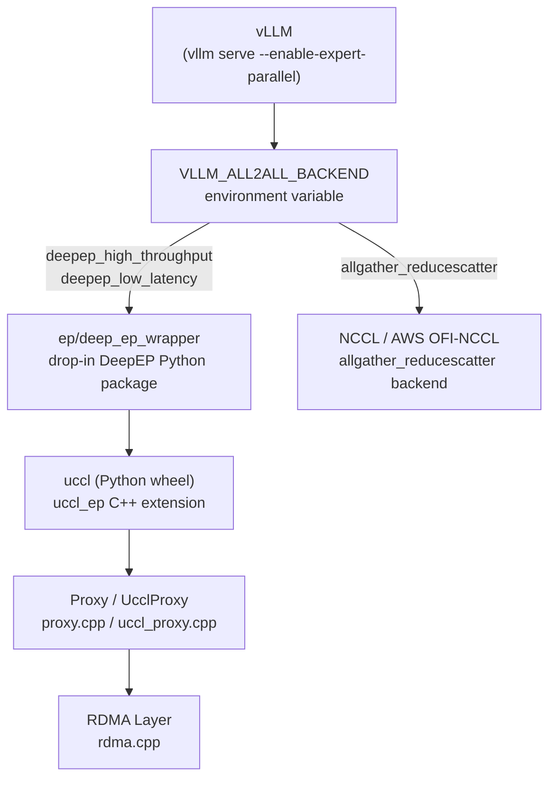
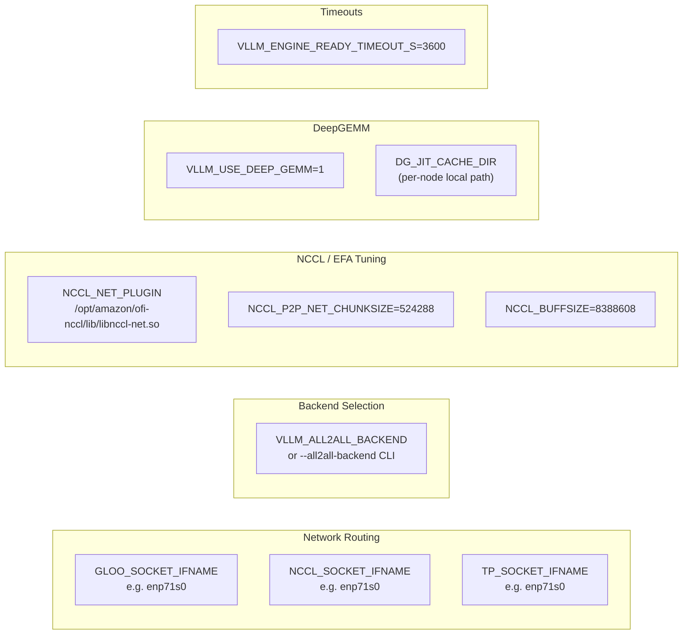
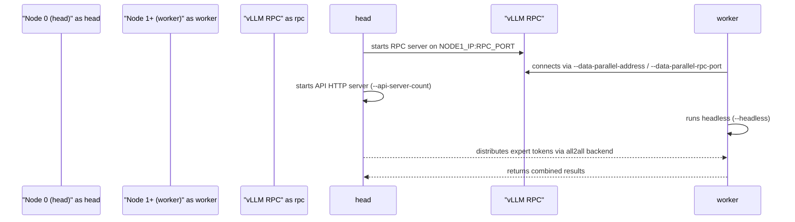
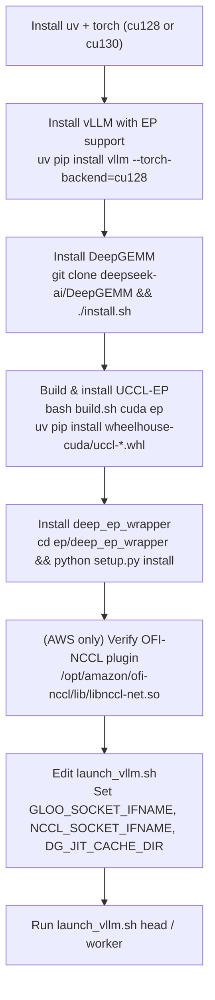

<!-- source: DeepWiki mcp.deepwiki.com · repo uccl-project/uccl · page 4.5 vLLM Integration · fetched 2026-11-11 -->

# vLLM Integration

<details>
<summary>Relevant source files</summary>

The following files were used as context for generating this wiki page:

- [ep/bench/vllm/README.md](ep/bench/vllm/README.md)
- [ep/bench/vllm/launch_vllm.sh](ep/bench/vllm/launch_vllm.sh)
- [ep/deep_ep_wrapper/README.md](ep/deep_ep_wrapper/README.md)

</details>


This page covers how UCCL-EP integrates with [vLLM](https://github.com/vllm-project/vllm) to serve large Mixture-of-Experts (MoE) models such as DeepSeek-V3 across multiple nodes using Expert Parallelism (EP). The integration replaces DeepEP's communication kernels with UCCL-EP's drop-in wrapper and provides a launch script for multi-node deployments.

For background on the UCCL-EP system itself, see [EP Architecture and Buffer API](#4.1) and [Proxy and RDMA System](#4.2). For EP benchmarking outside of vLLM, see [EP Benchmarks and AllToAll](#4.4).

---

## Integration Overview

UCCL-EP plugs into vLLM's expert-parallel all-to-all communication path via the `VLLM_ALL2ALL_BACKEND` environment variable. vLLM selects its all-to-all communication implementation at startup; UCCL-EP's `deep_ep_wrapper` package presents the same Python interface as DeepEP so that vLLM needs no code changes.

**Component map:**



Sources: [ep/bench/vllm/README.md:88-95](), [ep/deep_ep_wrapper/README.md:1-15]()

---

## Components

### `deep_ep_wrapper` — DeepEP Drop-In Replacement

Located at `ep/deep_ep_wrapper/`, this Python package wraps the UCCL-EP C++ extension and exposes the same API surface that vLLM expects from DeepEP. It is installed separately from the core UCCL wheel.

**Build and install order:**

| Step | Command | Location |
|------|---------|----------|
| 1. Build UCCL-EP | `bash build.sh cuda ep` | repo root |
| 2. Install UCCL wheel | `uv pip install wheelhouse-cuda/uccl-*.whl` | repo root |
| 3. Install wrapper | `python setup.py install` | `ep/deep_ep_wrapper/` |

Sources: [ep/deep_ep_wrapper/README.md:1-15]()

### `launch_vllm.sh` — Multi-Node Launch Script

[ep/bench/vllm/launch_vllm.sh:1-136]() is a unified Bash script that handles both the primary (head) node and secondary (worker) nodes. It exports all required environment variables and invokes `vllm serve` with the appropriate flags.

**Signature:**
```
launch_vllm.sh <head|worker> <NODE1_IP> [RPC_PORT] [MODEL] [BACKEND]
               [TOTAL_DP_SIZE] [LOCAL_DP_SIZE] [LOCAL_TP_SIZE]
               [API_SERVERS_or_START_RANK]
```

**Role difference:**

| Argument/Flag | `head` | `worker` |
|---|---|---|
| 9th positional | `API_SERVERS` | `START_RANK` |
| `--data-parallel-start-rank` | not set (defaults to 0) | set to `START_RANK` |
| `--api-server-count` | set to `API_SERVERS` | not set |
| `--headless` | not set | set |

Sources: [ep/bench/vllm/launch_vllm.sh:37-48](), [ep/bench/vllm/launch_vllm.sh:113-136]()

### DeepGEMM — Optional JIT Kernel Library

DeepGEMM provides JIT-compiled GEMM kernels for MoE expert computation. It is enabled by setting `VLLM_USE_DEEP_GEMM=1` and pointing `DG_JIT_CACHE_DIR` at a per-node local directory (not a shared NFS path). Without DeepGEMM, vLLM falls back to standard CUDA GEMM kernels.

Sources: [ep/bench/vllm/launch_vllm.sh:55-56](), [ep/bench/vllm/launch_vllm.sh:75-76](), [ep/bench/vllm/README.md:42-57]()

---

## All-to-All Backends

vLLM selects a backend via `--all2all-backend` (or `VLLM_ALL2ALL_BACKEND`). The four supported backends and their characteristics:

| Backend | Transport | Use Case | Notes |
|---|---|---|---|
| `deepep_high_throughput` | UCCL-EP RDMA | Multi-node prefill | Grouped GEMM, high batch throughput |
| `deepep_low_latency` | UCCL-EP RDMA | Multi-node decode | CUDA graph compatible |
| `pplx` | pplx-kernels | Single-node or intra-node | Chunked prefill support |
| `allgather_reducescatter` | NCCL / OFI-NCCL | Multi-node fallback | Works on IB and EFA networks |

The `deepep_high_throughput` and `deepep_low_latency` backends route through `deep_ep_wrapper` → UCCL-EP C++ extension → `Proxy` threads → RDMA QPs. The `allgather_reducescatter` backend bypasses UCCL-EP entirely and uses NCCL.

Sources: [ep/bench/vllm/README.md:88-95]()

---

## Environment Variables

The following variables must be set before calling `launch_vllm.sh`. The script sets several of them internally; others must be edited in the script before running.

**Diagram: environment variable routing**



| Variable | Description | Set By |
|---|---|---|
| `GLOO_SOCKET_IFNAME` | Interface for PyTorch `gloo` backend (rank discovery) | User (edit script) |
| `NCCL_SOCKET_IFNAME` | Interface for NCCL TCP bootstrap | User (edit script) |
| `TP_SOCKET_IFNAME` | Interface for tensor-parallel communication | User (edit script) |
| `VLLM_ALL2ALL_BACKEND` | Selects all-to-all communication backend | CLI `--all2all-backend` or env |
| `NCCL_NET_PLUGIN` | Path to AWS OFI-NCCL plugin `.so` | Script (auto-detected) |
| `NCCL_P2P_NET_CHUNKSIZE` | NCCL inter-node chunk size (bytes) | Script |
| `NCCL_BUFFSIZE` | NCCL buffer size (bytes) | Script |
| `VLLM_USE_DEEP_GEMM` | Enable DeepGEMM JIT kernels | Script |
| `DG_JIT_CACHE_DIR` | Per-node directory for DeepGEMM kernel cache | User (edit script) |
| `VLLM_ENGINE_READY_TIMEOUT_S` | Startup timeout in seconds | Script |

Sources: [ep/bench/vllm/launch_vllm.sh:54-76](), [ep/bench/vllm/README.md:98-104]()

---

## Deployment

### Node Roles and Data Flow



Sources: [ep/bench/vllm/launch_vllm.sh:113-136](), [ep/bench/vllm/README.md:109-140]()

### Example: 2-Node, 8-GPU-per-Node DeepSeek-V3

**Node 0 (head):**
```
bash launch_vllm.sh head 172.31.41.55 13345 deepseek-ai/DeepSeek-V3-0324 deepep_high_throughput 2 1 8 1
```

**Node 1 (worker):**
```
bash launch_vllm.sh worker 172.31.41.55 13345 deepseek-ai/DeepSeek-V3-0324 deepep_high_throughput 2 1 8 1
```

**Key vLLM flags used:**

| Flag | Head | Worker |
|---|---|---|
| `--enable-expert-parallel` | ✓ | ✓ |
| `--all2all-backend` | `BACKEND` | `BACKEND` |
| `--tensor-parallel-size` | `LOCAL_TP_SIZE` | `LOCAL_TP_SIZE` |
| `--data-parallel-size` | `TOTAL_DP_SIZE` | `TOTAL_DP_SIZE` |
| `--data-parallel-size-local` | `LOCAL_DP_SIZE` | `LOCAL_DP_SIZE` |
| `--data-parallel-address` | `NODE1_IP` | `NODE1_IP` |
| `--data-parallel-rpc-port` | `RPC_PORT` | `RPC_PORT` |
| `--data-parallel-start-rank` | — | `START_RANK` |
| `--api-server-count` | `API_SERVERS` | — |
| `--headless` | — | ✓ |
| `--gpu-memory-utilization` | `0.85` | `0.85` |

Sources: [ep/bench/vllm/launch_vllm.sh:113-136](), [ep/bench/vllm/README.md:119-140]()

---

## Performance Results

The following results were measured on AWS p5en instances running `deepseek-ai/DeepSeek-V3-0324` with 1024 input tokens, 256 output tokens, 10 RPS, and 1000 prompts.

| Backend | Req Throughput (req/s) | Output Tok/s | Mean TTFT (ms) | P99 TTFT (ms) | Mean TPOT (ms) | P99 TPOT (ms) |
|---|---|---|---|---|---|---|
| `allgather_reducescatter` | 8.93 | 2285.11 | 303.50 | 655.98 | 81.11 | 95.55 |
| `deepep_low_latency` (UCCL-EP) | 9.22 | 2359.13 | 278.52 | 775.17 | 59.35 | 78.61 |

UCCL-EP low-latency mode reduces mean TPOT by ~27% compared to the NCCL-based `allgather_reducescatter` backend.

Sources: [ep/bench/vllm/README.md:171-175]()

---

## Installation Checklist



Sources: [ep/bench/vllm/README.md:13-67](), [ep/deep_ep_wrapper/README.md:1-15]()

---

