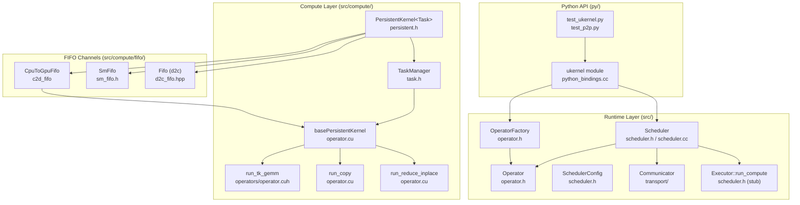
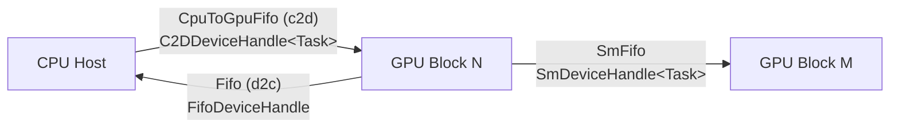
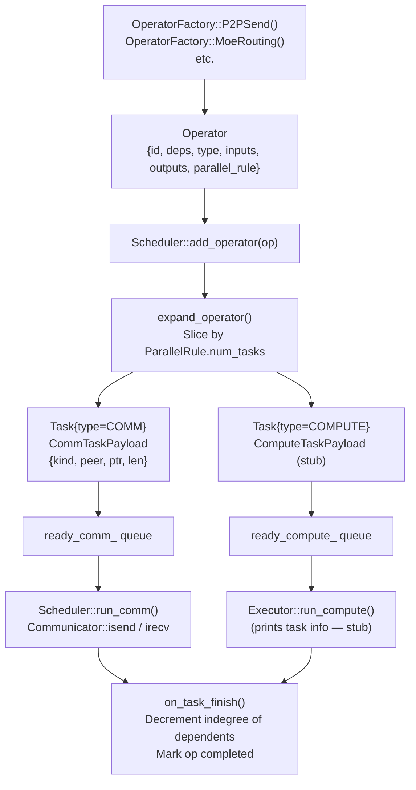

<!-- source: DeepWiki mcp.deepwiki.com · repo uccl-project/uccl · page 5 Experimental: UKernel · fetched 2026-11-11 -->

# Experimental: UKernel

<details>
<summary>Relevant source files</summary>

The following files were used as context for generating this wiki page:

- [experimental/ukernel/Makefile.rocm](experimental/ukernel/Makefile.rocm)
- [experimental/ukernel/README.md](experimental/ukernel/README.md)
- [experimental/ukernel/py/test_p2p.py](experimental/ukernel/py/test_p2p.py)
- [experimental/ukernel/py/test_ukernel.py](experimental/ukernel/py/test_ukernel.py)
- [experimental/ukernel/src/compute/Makefile](experimental/ukernel/src/compute/Makefile)
- [experimental/ukernel/src/compute/benchmarks/bench_result.txt](experimental/ukernel/src/compute/benchmarks/bench_result.txt)
- [experimental/ukernel/src/compute/benchmarks/bench_sm_fifo.cu](experimental/ukernel/src/compute/benchmarks/bench_sm_fifo.cu)
- [experimental/ukernel/src/compute/benchmarks/bench_tk_gemm.cu](experimental/ukernel/src/compute/benchmarks/bench_tk_gemm.cu)
- [experimental/ukernel/src/compute/fifo/d2c_fifo.hpp](experimental/ukernel/src/compute/fifo/d2c_fifo.hpp)
- [experimental/ukernel/src/compute/fifo/fifo_util.hpp](experimental/ukernel/src/compute/fifo/fifo_util.hpp)
- [experimental/ukernel/src/compute/fifo/sm_fifo.cc](experimental/ukernel/src/compute/fifo/sm_fifo.cc)
- [experimental/ukernel/src/compute/fifo/sm_fifo.h](experimental/ukernel/src/compute/fifo/sm_fifo.h)
- [experimental/ukernel/src/compute/fifo/sm_fifo_device.h](experimental/ukernel/src/compute/fifo/sm_fifo_device.h)
- [experimental/ukernel/src/compute/operator.cu](experimental/ukernel/src/compute/operator.cu)
- [experimental/ukernel/src/compute/operator.h](experimental/ukernel/src/compute/operator.h)
- [experimental/ukernel/src/compute/operators/operator.cuh](experimental/ukernel/src/compute/operators/operator.cuh)
- [experimental/ukernel/src/compute/persistent.h](experimental/ukernel/src/compute/persistent.h)
- [experimental/ukernel/src/compute/task.h](experimental/ukernel/src/compute/task.h)
- [experimental/ukernel/src/operator.h](experimental/ukernel/src/operator.h)
- [experimental/ukernel/src/python_bindings.cc](experimental/ukernel/src/python_bindings.cc)
- [experimental/ukernel/src/scheduler.cc](experimental/ukernel/src/scheduler.cc)
- [experimental/ukernel/src/scheduler.h](experimental/ukernel/src/scheduler.h)
- [experimental/ukernel/src/transport/oob.h](experimental/ukernel/src/transport/oob.h)
- [experimental/ukernel/tests/test_main.cc](experimental/ukernel/tests/test_main.cc)

</details>


## Purpose and Scope

UKernel (`experimental/ukernel/`) is an experimental UCCL subsystem whose goal is to **co-schedule communication and compute inside a single persistent GPU kernel**. Rather than launching separate kernels for each collective operation or matrix multiplication, UKernel keeps SMs occupied with a long-lived kernel that polls per-block task queues submitted by the CPU. This eliminates per-launch overhead and creates a framework for overlapping communication and compute at fine granularity.

This page covers the goals, structure, platforms, build instructions, and observed benchmark numbers for the subsystem as a whole. For the GPU-side kernel design, FIFO primitives, and `TaskManager`, see page [5.1](). For the `Operator`/`Scheduler` DAG model, `OperatorFactory`, and Python bindings, see page [5.2]().

UKernel uses the UCCL P2P transport for inter-node communication (see page [3]()) and **ThunderKittens** (`kittens.cuh`) for tile-level GEMM compute primitives.

---

## Design Goals

| Goal | Mechanism |
|---|---|
| Eliminate kernel launch overhead | Single persistent kernel per GPU stays resident |
| Overlap communication and compute | CPU submits COMM and COMPUTE tasks to concurrent queues |
| Support MoE model workflows | Operators for `MoeRouting`, `MoeDispatch`, `MoeExpertGemm`, `MoeCombine` |
| High-performance GEMM | ThunderKittens TK-level-8 tiled matmul via `run_tk_gemm` |
| Cross-platform | CUDA (NVIDIA) and HIP/ROCm (AMD) backends |

---

## Subsystem Layout

```
experimental/ukernel/
├── src/
│   ├── compute/               # GPU kernel, FIFO channels, TaskManager
│   │   ├── operator.cu        # basePersistentKernel, run_copy, run_reduce_inplace
│   │   ├── persistent.h       # PersistentKernel<T> host-side manager
│   │   ├── task.h             # Task, TaskType, CollArgs, GemmArgs, TaskManager
│   │   ├── operators/
│   │   │   └── operator.cuh   # TkMatmulGlobals, run_tk_gemm (ThunderKittens)
│   │   └── fifo/              # c2d_fifo, sm_fifo, d2c_fifo
│   ├── operator.h             # Operator struct, OperatorFactory
│   ├── scheduler.h / .cc      # Scheduler (DAG execution)
│   ├── python_bindings.cc     # pybind11 module "ukernel"
│   └── transport/             # Communicator, oob.h (out-of-band exchange)
├── py/
│   ├── test_ukernel.py        # MoE DAG demo
│   └── test_p2p.py            # P2P send/recv demo
├── tests/
│   └── test_main.cc           # C++ transport test
├── Makefile                   # CUDA build
└── Makefile.rocm              # ROCm/HIP build
```

Sources: [experimental/ukernel/README.md:1-59](), [experimental/ukernel/src/compute/Makefile:1-64](), [experimental/ukernel/Makefile.rocm:1-130]()

---

## Architecture Overview

UKernel has two distinct but related layers. The **Compute Layer** runs on the GPU and manages task execution. The **Runtime Layer** runs on the CPU and manages operator DAGs, scheduling, and transport.

**Component Architecture**



Sources: [experimental/ukernel/src/compute/operator.cu:82-167](), [experimental/ukernel/src/compute/persistent.h:29-308](), [experimental/ukernel/src/scheduler.h:1-152](), [experimental/ukernel/src/operator.h:1-266](), [experimental/ukernel/src/python_bindings.cc:1-163]()

---

## Compute Layer

The compute layer (`src/compute/`) provides the GPU-side infrastructure.

### `PersistentKernel<T>`

`PersistentKernel<T>` ([experimental/ukernel/src/compute/persistent.h:29-308]()) is the host-side manager for one launch of `basePersistentKernel`. It:

- Allocates one `CpuToGpuFifo` per GPU block (CPU → GPU task delivery).
- Allocates one `SmFifo` per GPU block (intra-GPU SM-to-SM communication).
- Allocates one `Fifo` (device-to-CPU) for completion signals.
- Launches `basePersistentKernel` via `gpuLaunchKernel` on `launch()`.
- Accepts tasks via `submit(const T& task)`, which pushes to the per-block FIFO.
- Checks completion with `is_done(blockId, taskId)`.
- Stops the kernel by setting a mapped boolean `d_stopFlag_` / `h_stopFlag_`.

Configuration is through `PersistentKernelConfig`:

| Field | Default | Purpose |
|---|---|---|
| `numBlocks` | 1 | Number of GPU blocks (one FIFO per block) |
| `threadsPerBlock` | 64 | Threads per block |
| `fifoCapacity` | 16 | Depth of each per-block FIFO |
| `smemSize` | 0 | Dynamic shared memory (set higher for TK GEMM) |
| `stream` | `nullptr` | Optionally user-managed stream |

### `basePersistentKernel`

`basePersistentKernel` ([experimental/ukernel/src/compute/operator.cu:82-167]()) is the GPU kernel function. Each block polls its assigned `C2DDeviceHandle` for a `Task`. On receipt, the block dispatches based on `TaskType`:

| `TaskType` | Handler |
|---|---|
| `CollCopy` | `run_copy()` — byte-granularity copy across threads |
| `CollReduce` | `run_reduce_inplace<float>()` or `<__half>()` — element-wise reduction |
| `TkGemm` | `run_tk_gemm()` — ThunderKittens tiled BF16 GEMM |

### `TaskManager`

`TaskManager` ([experimental/ukernel/src/compute/task.h:124-307]()) is a singleton that manages pools of argument descriptors on device memory:

- `CollArgs`: source/destination pointers, byte count, `ReduceType`.
- `MoeArgs`: placeholder (not yet implemented beyond `dummy` field).
- `GemmArgs`: pointer to a device-side `TkMatmulGlobals`, tile row/col counts.

The CPU calls `create_coll_task()`, `create_gemm_task()`, etc., which copy args to device and return a `Task` token. After the kernel finishes, args are returned to the free pool via `free_coll_args()`, `free_gemm_args()`, etc.

### FIFO Channels

Three FIFO types exist for different communication directions:

**FIFO Channel Types**



| FIFO Type | Class (Host) | Device Handle | Direction |
|---|---|---|---|
| CPU→GPU | `CpuToGpuFifo<T>` | `C2DDeviceHandle<T>` | Task submission per block |
| SM→SM | `SmFifo<T>` | `SmDeviceHandle<T>` | Inter-block task broadcasting |
| GPU→CPU | `mscclpp::Fifo` | `FifoDeviceHandle` | Completion notification |

`SmFifo` ([experimental/ukernel/src/compute/fifo/sm_fifo.h:1-38]()) allocates all ring buffers on GPU memory and exposes `poll()` / `pop()` / `push()` / `sync()` device-side methods in `SmDeviceHandle` ([experimental/ukernel/src/compute/fifo/sm_fifo_device.h:1-88]()).

Sources: [experimental/ukernel/src/compute/task.h:1-307](), [experimental/ukernel/src/compute/fifo/sm_fifo.h:1-38](), [experimental/ukernel/src/compute/fifo/sm_fifo_device.h:1-88](), [experimental/ukernel/src/compute/fifo/d2c_fifo.hpp:1-47]()

---

## Runtime Layer

The runtime layer (`src/`) manages the operator DAG from the CPU side.

### Operators and `OperatorFactory`

An `Operator` ([experimental/ukernel/src/operator.h:74-96]()) is a descriptor holding:
- Unique `id` and a `deps` vector of dependency `id` values.
- `OpType`: `P2P`, `Collective`, `Compute`, or `Moe`.
- Optional `p2p_kind`, `collective_kind`, `moe_kind`.
- Input/output `torch::Tensor` vectors.
- `ParallelRule` specifying `num_tasks` (partitions) and `tiles_per_task`.
- String `attrs` map for operation-specific parameters (e.g., `"peer"`, `"offset"`).

`OperatorFactory` ([experimental/ukernel/src/operator.h:98-266]()) provides static factory methods:

| Method | OpType | Kind |
|---|---|---|
| `P2PSend(src, rule, peer_rank, ...)` | `P2P` | `P2PKind::Send` |
| `P2PRecv(dst, rule, peer_rank, ...)` | `P2P` | `P2PKind::Recv` |
| `AllReduce(src, dst, kind, rule)` | `Collective` | `AllReduce` |
| `AllToAll(src, dst, rule)` | `Collective` | `AllToAll` |
| `Gemm(src, dst, rule)` | `Compute` | — |
| `MoeRouting(src, dst, rule)` | `Moe` | `MoeKind::Routing` |
| `MoeDispatch(src, dst, rule)` | `Moe` | `MoeKind::Dispatch` |
| `MoeExpertGemm(src, dst, rule)` | `Moe` | `MoeKind::ExpertGemm` |
| `MoeCombine(src, dst, rule)` | `Moe` | `MoeKind::Combine` |

### `Scheduler`

`Scheduler` ([experimental/ukernel/src/scheduler.h:69-149]()) is a singleton that:

1. **`init(SchedulerConfig)`** — initializes with `gpu_id`, `rank`, `world_size`, and creates a `Communicator`.
2. **`add_operator(op)`** — calls `expand_operator()`, which partitions the `Operator` into `Task` objects according to `ParallelRule` and attaches dependency edges.
3. **`run()`** — drives a `step_one()` loop. Each step dequeues one ready task from `ready_compute_` or `ready_comm_` and executes it.
4. **`sync(op_id)` / `sync_all()`** — block until a specific operator or all operators complete.
5. **`connect_to(peer_rank)` / `accept_from(peer_rank)`** — set up P2P connections via `Communicator`.

**Scheduler Task Lifecycle**



> **Note:** The `Executor::run_compute()` path is currently a stub (prints task info). GPU-side compute tasks are exercised directly through `PersistentKernel` in the compute layer benchmarks. Integration of the two layers is in progress.

Sources: [experimental/ukernel/src/scheduler.h:1-152](), [experimental/ukernel/src/scheduler.cc:1-410](), [experimental/ukernel/src/operator.h:1-266]()

---

## Python Bindings

The `ukernel` Python module is built via pybind11 in [experimental/ukernel/src/python_bindings.cc:1-163](). It exposes:

| Python symbol | Backs |
|---|---|
| `ukernel.ReduceKind` | `ur::ReduceKind` enum |
| `ukernel.ParallelRule(num_tasks, tiles_per_task)` | `ur::ParallelRule` |
| `ukernel.Operator` | `ur::Operator` (read-only properties) |
| `ukernel.SchedulerConfig` | `ur::SchedulerConfig` |
| `ukernel.init(cfg)` | `Scheduler::instance().init(cfg)` |
| `ukernel.reset()` | `Scheduler::instance().reset()` |
| `ukernel.add(op)` | `Scheduler::instance().add_operator(op)` |
| `ukernel.run()` | `Scheduler::instance().run()` (GIL released) |
| `ukernel.sync(op_id)` | `Scheduler::instance().sync(op_id)` (GIL released) |
| `ukernel.sync_all()` | `Scheduler::instance().sync_all()` (GIL released) |
| `ukernel.poll(op_id)` | `Scheduler::instance().poll(op_id)` |
| `ukernel.connect_to(peer_rank)` | `Scheduler::instance().connect_to(peer_rank)` |
| `ukernel.accept_from(peer_rank)` | `Scheduler::instance().accept_from(peer_rank)` |
| `ukernel.p2p_send(...)` | `OperatorFactory::P2PSend(...)` |
| `ukernel.p2p_recv(...)` | `OperatorFactory::P2PRecv(...)` |
| `ukernel.all_reduce(...)` | `OperatorFactory::AllReduce(...)` |
| `ukernel.all_to_all(...)` | `OperatorFactory::AllToAll(...)` |
| `ukernel.gemm(...)` | `OperatorFactory::Gemm(...)` |
| `ukernel.moe_routing(...)` | `OperatorFactory::MoeRouting(...)` |
| `ukernel.moe_dispatch(...)` | `OperatorFactory::MoeDispatch(...)` |
| `ukernel.moe_expert_gemm(...)` | `OperatorFactory::MoeExpertGemm(...)` |
| `ukernel.moe_combine(...)` | `OperatorFactory::MoeCombine(...)` |

A typical MoE DAG construction in Python follows the pattern in [experimental/ukernel/py/test_ukernel.py:6-77]():

```python
rule = ukernel.ParallelRule(num_tasks=2, tiles_per_task=4)
router_op   = ukernel.moe_routing(tokens, tokens_expert, rule)
dispatch_op = ukernel.moe_dispatch(tokens_expert, expert_output, rule, deps=[router_op.id])
ffn_op      = ukernel.moe_expert_gemm(expert_output, gathered_output, rule, deps=[dispatch_op.id])
combine_op  = ukernel.moe_combine(gathered_output, output, rule, deps=[ffn_op.id])

ukernel.init(cfg)
for op in [router_op, dispatch_op, ffn_op, combine_op]:
    ukernel.add(op)
ukernel.run()
ukernel.sync_all()
```

Out-of-band peer setup uses environment variables `UHM_EXCHANGER_SERVER_IP` and `UHM_EXCHANGER_SERVER_PORT` (see `SockExchanger` in [experimental/ukernel/src/transport/oob.h:199-241]()).

Sources: [experimental/ukernel/src/python_bindings.cc:1-163](), [experimental/ukernel/py/test_ukernel.py:1-107](), [experimental/ukernel/py/test_p2p.py:1-144]()

---

## Platform Support

| Platform | Kernel Compiler | Build File | Target Arch |
|---|---|---|---|
| NVIDIA CUDA | `nvcc` | `src/compute/Makefile` | `sm_80` (A100/A40) |
| AMD ROCm/HIP | `hipcc` | `Makefile.rocm` | `gfx942` |

The ROCm build uses `__HIP_PLATFORM_AMD__` preprocessor guards throughout the FIFO atomics layer ([experimental/ukernel/src/compute/fifo/fifo_util.hpp:23-41]()). The `SmFifo` push path uses different inline assembly depending on compile target ([experimental/ukernel/src/compute/fifo/sm_fifo_device.h:52-59]()).

Sources: [experimental/ukernel/src/compute/Makefile:1-64](), [experimental/ukernel/Makefile.rocm:1-130](), [experimental/ukernel/src/compute/fifo/fifo_util.hpp:23-41]()

---

## Build Instructions

**Prerequisites**

```bash
sudo apt-get install -y libelf-dev
```

**NVIDIA (transport + runtime):**

```bash
cd experimental/ukernel
make clean -f Makefile && make -j$(nproc) -f Makefile
```

**AMD (transport + runtime):**

```bash
cd experimental/ukernel
make clean -f Makefile.rocm && make -j$(nproc) -f Makefile.rocm
```

**Compute layer only (NVIDIA):**

```bash
cd experimental/ukernel/src/compute
make clean -f Makefile && make -j$(nproc) -f Makefile
```

> The CUDA build container uses glog 0.5 (`libglog.so.0`). Host systems with glog 0.6 (`libglog.so.1`) may encounter runtime linking errors.

**Running tests:**

```bash
# Transport communicator test
CUDA_VISIBLE_DEVICES=5 ./test_main --role=server
CUDA_VISIBLE_DEVICES=5 ./test_main --role=client

# Python P2P test
CUDA_VISIBLE_DEVICES=5 python py/test_p2p.py

# Compute benchmarks
CUDA_VISIBLE_DEVICES=5 ./test_persistent
CUDA_VISIBLE_DEVICES=5 ./benchmarks/bench_fifo
CUDA_VISIBLE_DEVICES=5 ./benchmarks/bench_sm_fifo 83
```

Sources: [experimental/ukernel/README.md:1-59]()

---

## Benchmark Results

The following results are from `bench_fifo`, `bench_full_fifo`, and `bench_sm_fifo` on NVIDIA A40 and L40S GPUs.

**CPU→GPU FIFO (`bench_fifo` / `bench_full_fifo`)**

| GPU | Mode | p50 Latency | Throughput |
|---|---|---|---|
| NVIDIA A40 | Single FIFO (1 block) | 31.36 µs | 31.58 K tasks/s |
| NVIDIA L40S | Single FIFO (1 block) | 22.46 µs | 43.53 K tasks/s |
| NVIDIA A40 | All SMs (84 blocks) | 6.64 µs | 153.77 K tasks/s |
| NVIDIA L40S | All SMs (142 blocks) | 6.84 µs | 141.28 K tasks/s |

**SM FIFO (`bench_sm_fifo`, NVIDIA A40)**

| Producers | Tasks/producer | Total tasks | Throughput |
|---|---|---|---|
| 1 | 100 000 | 100 000 | 26.18 K tasks/s |
| 8 | 100 000 | 800 000 | 37.96 K tasks/s |
| 83 | 1 000 | 83 000 | 37.90 K tasks/s |

Sources: [experimental/ukernel/src/compute/benchmarks/bench_result.txt:1-110]()

---

## Current Development Status

UKernel is explicitly experimental. Key items that are complete vs. in progress:

| Component | Status |
|---|---|
| `PersistentKernel` + CPU→GPU FIFO | Functional, benchmarked |
| SM-to-SM `SmFifo` | Functional, benchmarked |
| `basePersistentKernel` dispatch (`CollCopy`, `CollReduce`) | Functional |
| ThunderKittens `TkGemm` integration | Functional, validated against CPU reference |
| `MoeArgs` / MoE kernel ops | Placeholder (`dummy` field only) |
| `Operator` DAG + `Scheduler` | Functional for P2P COMM tasks |
| `Executor::run_compute` | Stub (prints task info, no GPU dispatch) |
| Scheduler ↔ PersistentKernel integration | Not yet connected |
| ROCm port | Build system in place; device-level parity ongoing |

The `// TODO: ThunderKitten/Tilelang? based operators` comment in [experimental/ukernel/src/compute/operator.cu:5]() reflects the open design question for the full compute operator set.

---

