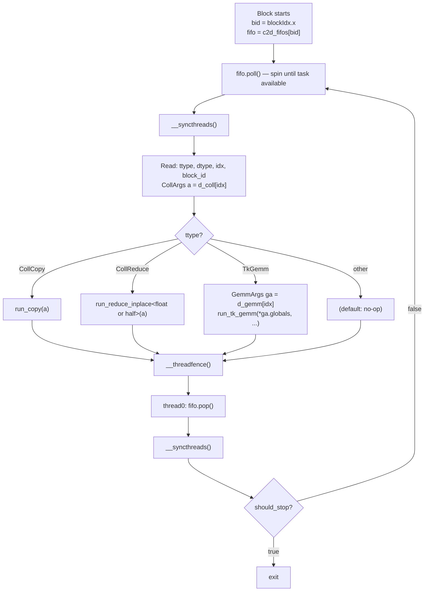
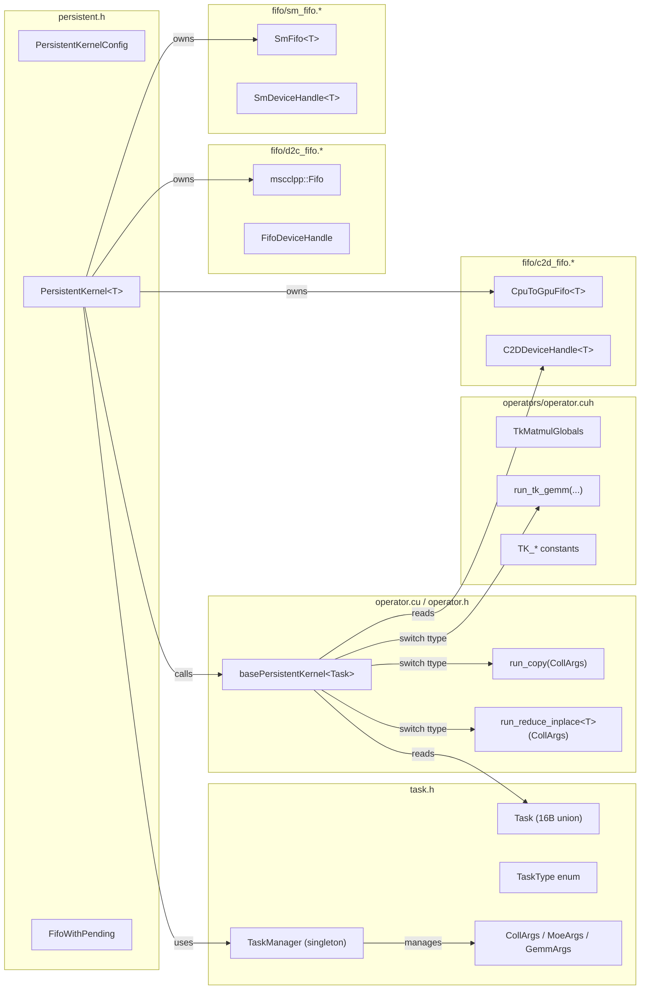

<!-- source: DeepWiki mcp.deepwiki.com · repo uccl-project/uccl · page 5.1 UKernel Architecture and Compute Primitives · fetched 2026-11-11 -->

# UKernel Architecture and Compute Primitives

<details>
<summary>Relevant source files</summary>

The following files were used as context for generating this wiki page:

- [experimental/ukernel/README.md](experimental/ukernel/README.md)
- [experimental/ukernel/src/compute/Makefile](experimental/ukernel/src/compute/Makefile)
- [experimental/ukernel/src/compute/benchmarks/bench_result.txt](experimental/ukernel/src/compute/benchmarks/bench_result.txt)
- [experimental/ukernel/src/compute/benchmarks/bench_sm_fifo.cu](experimental/ukernel/src/compute/benchmarks/bench_sm_fifo.cu)
- [experimental/ukernel/src/compute/benchmarks/bench_tk_gemm.cu](experimental/ukernel/src/compute/benchmarks/bench_tk_gemm.cu)
- [experimental/ukernel/src/compute/fifo/d2c_fifo.hpp](experimental/ukernel/src/compute/fifo/d2c_fifo.hpp)
- [experimental/ukernel/src/compute/fifo/fifo_util.hpp](experimental/ukernel/src/compute/fifo/fifo_util.hpp)
- [experimental/ukernel/src/compute/fifo/sm_fifo.cc](experimental/ukernel/src/compute/fifo/sm_fifo.cc)
- [experimental/ukernel/src/compute/fifo/sm_fifo.h](experimental/ukernel/src/compute/fifo/sm_fifo.h)
- [experimental/ukernel/src/compute/fifo/sm_fifo_device.h](experimental/ukernel/src/compute/fifo/sm_fifo_device.h)
- [experimental/ukernel/src/compute/operator.cu](experimental/ukernel/src/compute/operator.cu)
- [experimental/ukernel/src/compute/operator.h](experimental/ukernel/src/compute/operator.h)
- [experimental/ukernel/src/compute/operators/operator.cuh](experimental/ukernel/src/compute/operators/operator.cuh)
- [experimental/ukernel/src/compute/persistent.h](experimental/ukernel/src/compute/persistent.h)
- [experimental/ukernel/src/compute/task.h](experimental/ukernel/src/compute/task.h)

</details>


This page documents the internal architecture of the UKernel compute subsystem located in `experimental/ukernel/src/compute/`. It covers the persistent GPU kernel design, FIFO communication structures for CPU-GPU and inter-SM task delivery, the `Task` and argument types, the `TaskManager` singleton, and the ThunderKittens GEMM integration.

For the higher-level operator and scheduler layer built on top of these primitives (operators, DAG execution, Python bindings), see [5.2](#5.2). For how UKernel fits into the broader UCCL architecture and its relationship to the P2P subsystem, see [5](#5).

---

## Overview

UKernel's compute subsystem implements a **persistent kernel** model: a single GPU kernel occupies a fixed number of SMs for the lifetime of a session and processes a stream of tasks dispatched from the CPU via lock-free FIFOs. This avoids kernel launch overhead and enables fine-grained co-scheduling of communication and compute work.

The subsystem is organized around three concerns:

| Concern | Key Components |
|---|---|
| CPU→GPU task delivery | `CpuToGpuFifo<T>`, `C2DDeviceHandle<T>` |
| GPU→CPU completion notification | `Fifo` (d2c), `FifoDeviceHandle` |
| Inter-SM task delivery | `SmFifo<T>`, `SmDeviceHandle<T>` |
| Task encoding | `Task`, `TaskType`, `CollArgs`, `GemmArgs`, `MoeArgs` |
| Args lifetime management | `TaskManager` (singleton) |
| Kernel lifecycle | `PersistentKernel<T>`, `PersistentKernelConfig` |
| GPU-side dispatch | `basePersistentKernel<T>` |
| Compute primitives | `run_copy`, `run_reduce_inplace<T>`, `run_tk_gemm` |

Sources: [experimental/ukernel/src/compute/persistent.h:1-10](), [experimental/ukernel/src/compute/task.h:1-30](), [experimental/ukernel/src/compute/operator.h:1-32]()

---

## System Architecture Diagram

**Diagram: UKernel Compute Subsystem — Component Overview**

```mermaid
graph TD
    subgraph "Host (CPU)"
        PK["PersistentKernel&lt;Task&gt;\npersistent.h"]
        TM["TaskManager::instance()\ntask.h (singleton)"]
        C2D_HOST["CpuToGpuFifo&lt;Task&gt;\nc2d_fifo.h"]
        D2C_HOST["mscclpp::Fifo\nd2c_fifo.hpp"]
        SM_HOST["mscclpp::SmFifo&lt;Task&gt;\nsm_fifo.h"]
        RT["reclaim_thread_\npersistent.h"]
    end

    subgraph "Device (GPU)"
        KERNEL["basePersistentKernel&lt;Task&gt;\noperator.cu"]
        C2D_DEV["C2DDeviceHandle&lt;Task&gt;\nc2d_fifo_device.h"]
        D2C_DEV["FifoDeviceHandle\nd2c_fifo_device.hpp"]
        SM_DEV["SmDeviceHandle&lt;Task&gt;\nsm_fifo_device.h"]
        subgraph "Compute Primitives"
            COPY["run_copy(CollArgs)\noperator.cu"]
            REDUCE["run_reduce_inplace&lt;T&gt;(CollArgs)\noperator.cu"]
            GEMM["run_tk_gemm(TkMatmulGlobals,...)\noperators/operator.cuh"]
        end
        D_COLL["d_coll CollArgs[]\ndevice memory"]
        D_GEMM["d_gemm GemmArgs[]\ndevice memory"]
        D_MOE["d_moe MoeArgs[]\ndevice memory"]
    end

    PK -->|"manages"| C2D_HOST
    PK -->|"manages"| D2C_HOST
    PK -->|"manages"| SM_HOST
    PK -->|"launch()"| KERNEL
    TM -->|"d_coll(), d_moe(), d_gemm()"| D_COLL
    TM -->|""| D_GEMM
    TM -->|""| D_MOE

    C2D_HOST -->|"deviceHandle()"| C2D_DEV
    D2C_HOST -->|"deviceHandle()"| D2C_DEV
    SM_HOST -->|"deviceHandle()"| SM_DEV

    KERNEL -->|"polls"| C2D_DEV
    KERNEL -->|"dispatches"| COPY
    KERNEL -->|"dispatches"| REDUCE
    KERNEL -->|"dispatches"| GEMM
    KERNEL -->|"reads"| D_COLL
    KERNEL -->|"reads"| D_GEMM
    KERNEL -->|"signals"| D2C_DEV

    D2C_HOST -->|"poll/pop"| RT
    RT -->|"free_coll_args / free_gemm_args"| TM
```

Sources: [experimental/ukernel/src/compute/persistent.h:28-310](), [experimental/ukernel/src/compute/operator.cu:82-164](), [experimental/ukernel/src/compute/task.h:124-307]()

---

## FIFO Communication Structures

Three distinct FIFO types handle different communication directions. All are adapted from the MSCCL++ FIFO design and re-implemented locally in the `fifo/` subdirectory.

### CPU-to-GPU FIFO (`c2d_fifo`)

Carries `Task` elements from host threads to specific GPU blocks. There is one `CpuToGpuFifo<Task>` per GPU block, held in a `FifoWithPending` struct inside `PersistentKernel`.

- **Host side**: `CpuToGpuFifo<T>` — `push(task)` enqueues; `currentId()` / `head()` check occupancy.
- **Device side**: `C2DDeviceHandle<T>` — `poll()` returns a pointer to the next task, `pop()` advances the tail.

[experimental/ukernel/src/compute/persistent.h:33-37]()

The `FifoWithPending` inner struct tracks in-flight tasks:

```
struct FifoWithPending {
    CpuToGpuFifo<T> fifo;
    std::mutex pending_mu_;
    std::unordered_map<uint64_t, Pending> pending;
};
```

[experimental/ukernel/src/compute/persistent.h:280-286]()

### Device-to-CPU FIFO (`d2c_fifo`)

`mscclpp::Fifo` (host side) / `FifoDeviceHandle` (device side) — the GPU pushes `ProxyTrigger` completion records back to the CPU after a task finishes. The `reclaim_thread_` in `PersistentKernel` continuously polls this FIFO and calls `freeArgs()` to return args slots to `TaskManager`.

[experimental/ukernel/src/compute/fifo/d2c_fifo.hpp:1-47](), [experimental/ukernel/src/compute/persistent.h:89-105]()

> **Note**: The d2c_fifo completion push is currently commented out in `basePersistentKernel`. Completion is instead detected by polling `fifo.currentId()` on the CPU side via `is_done()`.

[experimental/ukernel/src/compute/operator.cu:146-154]()

### SM-to-SM FIFO (`sm_fifo`)

`mscclpp::SmFifo<T>` (host side) / `SmDeviceHandle<T>` (device side) — enables one GPU block (SM) to push tasks to another block. Supports multi-producer / single-consumer patterns on-device with two-phase head publication (`head_reserve` + `head_publish`) to maintain ordering.

[experimental/ukernel/src/compute/fifo/sm_fifo_device.h:1-87](), [experimental/ukernel/src/compute/fifo/sm_fifo.h:1-38]()

**FIFO Type Comparison**

| FIFO | Producer | Consumer | Direction | Host type | Device type |
|---|---|---|---|---|---|
| `c2d_fifo` | CPU thread | GPU block | CPU → GPU | `CpuToGpuFifo<T>` | `C2DDeviceHandle<T>` |
| `d2c_fifo` | GPU block | CPU thread | GPU → CPU | `mscclpp::Fifo` | `FifoDeviceHandle` |
| `sm_fifo` | GPU block | GPU block | GPU ↔ GPU | `mscclpp::SmFifo<T>` | `SmDeviceHandle<T>` |

Sources: [experimental/ukernel/src/compute/persistent.h:289-294](), [experimental/ukernel/src/compute/fifo/sm_fifo_device.h:10-87]()

---

## Task Encoding

### `Task` (16-byte union)

`Task` is a 128-bit packed union stored in FIFO buffers. It encodes all routing and dispatch information in two `uint64_t` fields.

[experimental/ukernel/src/compute/task.h:36-93]()

| Field | Bits | Description |
|---|---|---|
| `type` | 8 | `TaskType` enum value |
| `dataType` | 8 | `DataType` enum value |
| `blockId` | 8 | Target GPU block index |
| (padding) | 40 | Unused in `fst` |
| `argsId` | 32 | Index into the appropriate device args array |
| (padding) | 32 | Unused in `snd` |

Accessor methods: `type_u8()`, `dtype_u8()`, `block_index()`, `args_index()`.

### `TaskType` Enum

[experimental/ukernel/src/compute/task.h:13-25]()

| Value | Description |
|---|---|
| `CollCopy` | Memory copy across device buffers |
| `CollReduce` | In-place element-wise reduction |
| `MoePreGemm` | MoE pre-GEMM (stub) |
| `MoePostGemm` | MoE post-GEMM (stub) |
| `MoeCombine` | MoE combine (stub) |
| `TkGemm` | ThunderKittens tiled GEMM |
| `BenchNop` | No-op used in FIFO benchmarks |

### Argument Structures

Each `TaskType` group has a corresponding device-side arguments struct.

**`CollArgs`** — used by `CollCopy` and `CollReduce`:

| Field | Type | Description |
|---|---|---|
| `src` | `void*` | Source buffer pointer |
| `src2` | `void*` | Secondary source (unused currently) |
| `dst` | `void*` | Destination buffer pointer |
| `bytes` | `uint32_t` | Transfer size in bytes |
| `redType` | `ReduceType` | `Sum`, `Max`, or `None` |

[experimental/ukernel/src/compute/task.h:98-108]()

**`GemmArgs`** — used by `TkGemm`:

| Field | Type | Description |
|---|---|---|
| `globals` | `void*` | Device pointer to `TkMatmulGlobals` |
| `num_tile_rows` | `uint32_t` | Tile rows for multi-block dispatch |
| `num_tile_cols` | `uint32_t` | Tile cols for multi-block dispatch |

[experimental/ukernel/src/compute/task.h:118-122]()

**`MoeArgs`** — currently a stub with a single `dummy` field.

[experimental/ukernel/src/compute/task.h:109-113]()

---

## TaskManager

`TaskManager` is a process-global singleton (accessed via `TaskManager::instance()`) that owns three device-side args pools: one for `CollArgs`, one for `MoeArgs`, and one for `GemmArgs`.

[experimental/ukernel/src/compute/task.h:124-307]()

**Diagram: TaskManager Lifecycle**

```mermaid
sequenceDiagram
    participant "Host Thread" as H
    participant "TaskManager" as TM
    participant "PersistentKernel&lt;Task&gt;" as PK
    participant "basePersistentKernel (GPU)" as GPU
    participant "reclaim_thread_" as RT

    H->>TM: "init(collCap, moeCap, gemmCap)"
    Note over TM: "gpuMalloc d_coll_, d_moe_, d_gemm_"
    H->>TM: "create_coll_task(CollArgs, type, dtype, blockId)"
    Note over TM: "pop free_coll_ idx\ngpuMemcpy args to d_coll_[idx]\nreturn Task(type, dtype, blockId, idx)"
    H->>PK: "submit(task)"
    PK->>GPU: "CpuToGpuFifo::push(task)"
    GPU->>GPU: "run_copy / run_reduce_inplace"
    GPU->>GPU: "fifo.pop()"
    RT->>PK: "is_done() polls currentId()"
    PK->>TM: "free_coll_args(idx)"
    Note over TM: "push idx back to free_coll_"
```

Sources: [experimental/ukernel/src/compute/task.h:139-253](), [experimental/ukernel/src/compute/persistent.h:167-224]()

**Key methods:**

| Method | Description |
|---|---|
| `init(collCap, moeCap, gemmCap)` | Allocates device pools; must be called before use |
| `create_coll_task(h, tt, dt, blockId)` | Copies `CollArgs` to device, returns `Task` |
| `create_moe_task(h, tt, dt, blockId)` | Copies `MoeArgs` to device, returns `Task` |
| `create_gemm_task(h, dt, blockId)` | Copies `GemmArgs` to device, returns `Task` |
| `free_coll_args(idx)` | Returns a slot to the free pool |
| `free_moe_args(idx)` | Returns a slot to the free pool |
| `free_gemm_args(idx)` | Returns a slot to the free pool |
| `d_coll()`, `d_moe()`, `d_gemm()` | Returns device pointer to the array base |

---

## PersistentKernel Host Class

`PersistentKernel<T>` (in `persistent.h`) manages the kernel lifecycle from the CPU side.

[experimental/ukernel/src/compute/persistent.h:29-310]()

**Configuration via `PersistentKernelConfig`:**

| Field | Default | Description |
|---|---|---|
| `numBlocks` | 1 | Number of GPU blocks (SMs) to occupy |
| `threadsPerBlock` | 64 | Threads per block (must be a multiple of warp size) |
| `fifoCapacity` | 16 | Depth of each per-block C2D FIFO |
| `smemSize` | 0 | Dynamic shared memory bytes per block |
| `stream` | nullptr | Optional user-managed CUDA stream |

**Public API:**

| Method | Description |
|---|---|
| `PersistentKernel(config)` | Allocates FIFOs, stop flag, streams |
| `launch()` | Copies handles to device, calls `gpuLaunchKernel(basePersistentKernel<T>, ...)`, starts reclaim thread |
| `submit(task)` | Enqueues task into the C2D FIFO for `task.block_index()` |
| `is_done(blockId, taskId)` | Polls `currentId()` of the block's FIFO for completion; frees pending args |
| `stop()` | Sets `d_stopFlag_` on device via `copy_stream_`, joins reclaim thread |
| `compute_stream()` | Returns the persistent kernel's CUDA stream |
| `copy_stream()` | Returns the auxiliary copy stream used for pushes and stop |

Two CUDA streams are maintained:
- `stream_` — the stream on which `basePersistentKernel` runs
- `copy_stream_` — used for `gpuMemcpyAsync` pushes of handles and the stop flag

[experimental/ukernel/src/compute/persistent.h:303-307]()

---

## `basePersistentKernel` GPU Function

The `__global__` function `basePersistentKernel<T>` is the core of the system. Each GPU block runs an infinite poll loop.

[experimental/ukernel/src/compute/operator.cu:82-164]()

**Signature:**

```
template <typename T>
__global__ void basePersistentKernel(
    mscclpp::C2DDeviceHandle<T>* c2d_fifos,
    mscclpp::SmDeviceHandle<T>*  sm_fifos,
    mscclpp::FifoDeviceHandle*   d2c_fifo,
    CollArgs*   d_coll,
    MoeArgs*    d_moe,
    GemmArgs*   d_gemm,
    bool*       should_stop
)
```

**Per-block execution flow:**



Sources: [experimental/ukernel/src/compute/operator.cu:93-157]()

Only `thread0` in each block calls `fifo.pop()`, ensuring exactly-once consumption. The `__threadfence()` before `pop()` makes compute results visible before the slot is released.

---

## Compute Primitives

### `run_copy`

A parallel byte-level copy across all threads in the block. Each thread handles a contiguous chunk of `CollArgs.bytes` bytes.

[experimental/ukernel/src/compute/operator.cu:32-49]()

### `run_reduce_inplace<T>`

In-place element-wise reduction: `dst[i] = op(dst[i], src[i])`. Supports `ReduceType::Sum` and `ReduceType::Max`. Dispatched for `float` and `__half` (with `__half` converting through `float` for the operation).

[experimental/ukernel/src/compute/operator.cu:51-76]()

`apply_red<T>` is a device-inline helper that handles the `ReduceType` switch:

[experimental/ukernel/src/compute/operator.cu:10-30]()

---

## ThunderKittens GEMM Integration

The `TkGemm` task type invokes a warp-specialized, TMA-driven tiled GEMM implemented using the ThunderKittens (kittens) library.

[experimental/ukernel/src/compute/operators/operator.cuh:1-131]()

### Key Constants

| Constant | Value | Description |
|---|---|---|
| `TK_BLOCK_SIZE` | 64 | Tile dimension (rows and cols) |
| `TK_M_BLOCK` | 2 | Output tiles per row per block |
| `TK_N_BLOCK` | 4 | Output tiles per col per block |
| `TK_NUM_PRODUCER_WARPS` | 4 | Warps dedicated to TMA loads |
| `TK_NUM_CONSUMER_WARPS` | 8 | Warps dedicated to MMA compute |
| `TK_NUM_THREADS` | 384 | Total threads per block |

### `TkMatmulGlobals`

A struct holding pre-constructed TMA descriptors for matrices A, B, and C. Constructed on the host (with `bf16*` pointers and dimensions), then copied to device memory and referenced via `GemmArgs.globals`.

[experimental/ukernel/src/compute/operators/operator.cuh:27-39]()

### `run_tk_gemm`

Implements round-robin tile distribution across blocks. Each block processes tiles `t = blockIdx.x, blockIdx.x + gridDim.x, ...` up to `num_tile_rows * num_tile_cols`.

Warp roles within the block:

| `warpgroupid` | Role |
|---|---|
| 0 | Producer — issues `tma::load_async` for next A/B tiles |
| 1 | Consumer 0 — computes MMA for `C[row+0, :]` |
| 2 | Consumer 1 — computes MMA for `C[row+1, :]` |

Double-buffering (`tic`/`toc`) overlaps TMA load of the next K-tile with MMA on the current tile. Results are written back via `tma::store_async`.

[experimental/ukernel/src/compute/operators/operator.cuh:42-128]()

---

## Benchmarks

Three micro-benchmarks are provided in `experimental/ukernel/src/compute/benchmarks/`.

### `bench_fifo` and `bench_full_fifo`

Test C2D FIFO latency and throughput using `BenchNop` tasks through `PersistentKernel`.

**Sample results from `bench_result.txt`:**

| GPU | Mode | p50 Latency | Throughput |
|---|---|---|---|
| NVIDIA A40 | Single FIFO | 31.36 µs | 31.58 K tasks/s |
| NVIDIA L40S | Single FIFO | 22.46 µs | 43.53 K tasks/s |
| NVIDIA A40 | All-SM (84 FIFOs) | 6.64 µs | 153.77 K tasks/s |
| NVIDIA L40S | All-SM (142 FIFOs) | 6.84 µs | 141.28 K tasks/s |

[experimental/ukernel/src/compute/benchmarks/bench_result.txt:1-38]()

### `bench_sm_fifo`

Tests `SmFifo` throughput with configurable producer count (`num_producers`) and tasks per producer (`iters`). Runs directly on-device without the persistent kernel.

**Usage:**
```
CUDA_VISIBLE_DEVICES=5 ./benchmarks/bench_sm_fifo <num_producers> <iters_per_producer>
```

[experimental/ukernel/src/compute/benchmarks/bench_sm_fifo.cu:54-118]()

**Sample results (NVIDIA A40):**

| Producers | Tasks/prod | Throughput |
|---|---|---|
| 1 | 100 000 | 26.18 K tasks/s |
| 8 | 100 000 | 37.96 K tasks/s |
| 83 | 10 000 | 38.04 K tasks/s |

[experimental/ukernel/src/compute/benchmarks/bench_result.txt:41-110]()

### `bench_tk_gemm`

Validates correctness and measures end-to-end GEMM latency for a 1024×1024×1024 `bf16` matrix multiply dispatched through the persistent kernel.

**Flow:**
1. Allocate host/device matrices A, B, C.
2. Construct `TkMatmulGlobals` and copy to device.
3. Call `TaskManager::instance().init(1, 1, 64)`.
4. Instantiate `PersistentKernel<Task>` with `threadsPerBlock = TK_NUM_THREADS` and `smemSize = 200000`.
5. Set `cudaFuncAttributeMaxDynamicSharedMemorySize` on `basePersistentKernel<Task>`.
6. `kernel.launch()`, then `create_gemm_task()` → `submit()` → poll `is_done()`.
7. Compare result against CPU reference.

[experimental/ukernel/src/compute/benchmarks/bench_tk_gemm.cu:46-133]()

---

## Build

The compute subsystem builds independently from the rest of UKernel.

**NVIDIA (CUDA):**
```
cd experimental/ukernel/src/compute
make clean -f Makefile && make -j$(nproc) -f Makefile
```

**AMD (ROCm):**
```
cd experimental/ukernel/src/compute
make clean -f Makefile.rocm && make -j$(nproc) -f Makefile.rocm
```

Build targets:

| Target | Binary | Description |
|---|---|---|
| `test_persistent` | `test_persistent` | Functional test of the persistent kernel |
| `bench_fifo` | `benchmarks/bench_fifo` | C2D FIFO single-block benchmark |
| `bench_full_fifo` | `benchmarks/bench_full_fifo` | C2D FIFO all-SM benchmark |
| `bench_sm_fifo` | `benchmarks/bench_sm_fifo` | SM FIFO multi-producer benchmark |

The build links against `libcudart`, `libcuda`, `libnuma`, and a local `libgdrapi` from `thirdparty/gdrcopy/src`.

[experimental/ukernel/src/compute/Makefile:1-63](), [experimental/ukernel/README.md:38-58]()

---

## File Map

**Diagram: Source File Responsibilities**



Sources: [experimental/ukernel/src/compute/task.h:1-307](), [experimental/ukernel/src/compute/persistent.h:1-310](), [experimental/ukernel/src/compute/operator.cu:1-167](), [experimental/ukernel/src/compute/operators/operator.cuh:1-131]()

---

