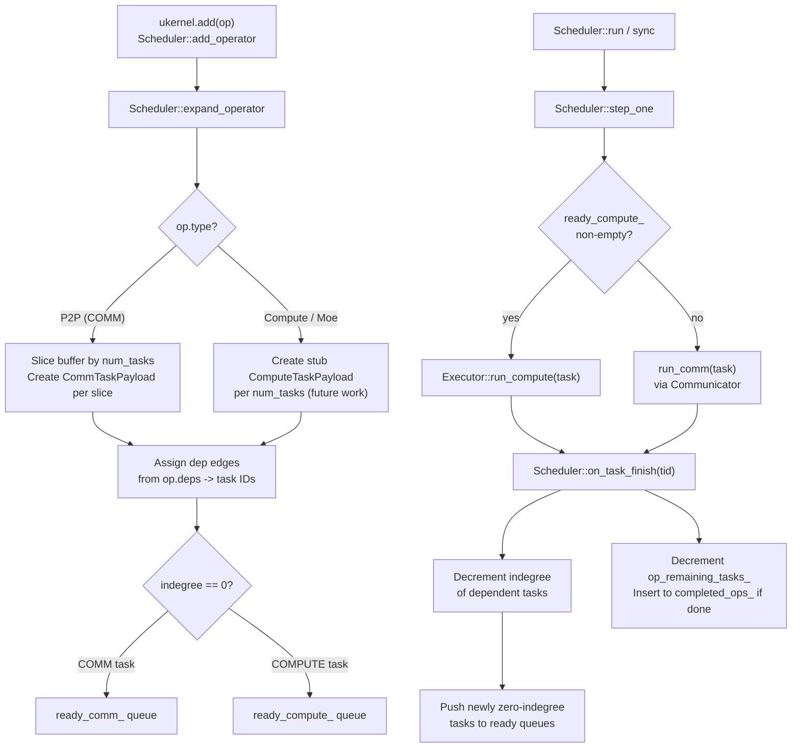
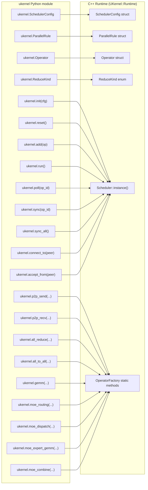

<!-- source: DeepWiki mcp.deepwiki.com · repo uccl-project/uccl · page 5.2 UKernel Operators and Scheduler · fetched 2026-11-11 -->

# UKernel Operators and Scheduler

<details>
<summary>Relevant source files</summary>

The following files were used as context for generating this wiki page:

- [experimental/ukernel/Makefile.rocm](experimental/ukernel/Makefile.rocm)
- [experimental/ukernel/README.md](experimental/ukernel/README.md)
- [experimental/ukernel/py/test_p2p.py](experimental/ukernel/py/test_p2p.py)
- [experimental/ukernel/py/test_ukernel.py](experimental/ukernel/py/test_ukernel.py)
- [experimental/ukernel/src/compute/Makefile](experimental/ukernel/src/compute/Makefile)
- [experimental/ukernel/src/compute/benchmarks/bench_result.txt](experimental/ukernel/src/compute/benchmarks/bench_result.txt)
- [experimental/ukernel/src/compute/benchmarks/bench_sm_fifo.cu](experimental/ukernel/src/compute/benchmarks/bench_sm_fifo.cu)
- [experimental/ukernel/src/compute/benchmarks/bench_tk_gemm.cu](experimental/ukernel/src/compute/benchmarks/bench_tk_gemm.cu)
- [experimental/ukernel/src/compute/fifo/d2c_fifo.hpp](experimental/ukernel/src/compute/fifo/d2c_fifo.hpp)
- [experimental/ukernel/src/compute/fifo/fifo_util.hpp](experimental/ukernel/src/compute/fifo/fifo_util.hpp)
- [experimental/ukernel/src/compute/fifo/sm_fifo.cc](experimental/ukernel/src/compute/fifo/sm_fifo.cc)
- [experimental/ukernel/src/compute/fifo/sm_fifo.h](experimental/ukernel/src/compute/fifo/sm_fifo.h)
- [experimental/ukernel/src/compute/fifo/sm_fifo_device.h](experimental/ukernel/src/compute/fifo/sm_fifo_device.h)
- [experimental/ukernel/src/compute/operator.cu](experimental/ukernel/src/compute/operator.cu)
- [experimental/ukernel/src/compute/operator.h](experimental/ukernel/src/compute/operator.h)
- [experimental/ukernel/src/compute/operators/operator.cuh](experimental/ukernel/src/compute/operators/operator.cuh)
- [experimental/ukernel/src/compute/persistent.h](experimental/ukernel/src/compute/persistent.h)
- [experimental/ukernel/src/compute/task.h](experimental/ukernel/src/compute/task.h)
- [experimental/ukernel/src/operator.h](experimental/ukernel/src/operator.h)
- [experimental/ukernel/src/python_bindings.cc](experimental/ukernel/src/python_bindings.cc)
- [experimental/ukernel/src/scheduler.cc](experimental/ukernel/src/scheduler.cc)
- [experimental/ukernel/src/scheduler.h](experimental/ukernel/src/scheduler.h)
- [experimental/ukernel/src/transport/oob.h](experimental/ukernel/src/transport/oob.h)
- [experimental/ukernel/tests/test_main.cc](experimental/ukernel/tests/test_main.cc)

</details>


## Purpose and Scope

This page documents the **Runtime layer** of the UKernel subsystem: the `Operator` abstraction, the `OperatorFactory` for constructing typed operators, the `Scheduler` DAG execution engine, the pybind11 Python bindings, and the MoE DAG construction pattern shown in the test scripts. It covers `experimental/ukernel/src/operator.h`, `experimental/ukernel/src/scheduler.h`, `experimental/ukernel/src/scheduler.cc`, and `experimental/ukernel/src/python_bindings.cc`.

For the lower-level GPU compute primitives (`PersistentKernel`, `TaskManager`, `CollArgs`, `GemmArgs`, FIFO structures) that the scheduler dispatches into, see [UKernel Architecture and Compute Primitives](#5.1). For the overall UKernel subsystem introduction, see [Experimental: UKernel](#5).

---

## Operator Structure

An `Operator` is the unit of work submitted to the scheduler. It is defined in `experimental/ukernel/src/operator.h`.

**Operator fields:**

| Field | Type | Description |
|---|---|---|
| `id` | `uint64_t` | Unique auto-assigned ID (via `OperatorFactory`) |
| `type` | `OpType` | Top-level type: P2P, Collective, Compute, or Moe |
| `deps` | `vector<uint64_t>` | IDs of operators this one depends on |
| `p2p_kind` | `optional<P2PKind>` | Send or Recv (for P2P ops) |
| `collective_kind` | `optional<CollectiveKind>` | AllReduce, AllToAll, etc. |
| `moe_kind` | `optional<MoeKind>` | Routing, Dispatch, ExpertGemm, Combine |
| `parallel_rule` | `ParallelRule` | Tiling: `num_tasks` and `tiles_per_task` |
| `inputs` | `vector<torch::Tensor>` | Input tensors |
| `outputs` | `vector<torch::Tensor>` | Output tensors |
| `attrs` | `unordered_map<string,string>` | Key-value metadata (e.g., `peer`, `offset`, `len`) |
| `shape` / `numel` | `vector<int64_t>` / `int64_t` | Inferred from first input or output tensor |

[experimental/ukernel/src/operator.h:74-96]()

### OpType Hierarchy

**Operator type and subtype hierarchy:**

```mermaid
graph TD
  OpType["OpType enum"] --> P2P["OpType::P2P"]
  OpType --> Collective["OpType::Collective"]
  OpType --> Compute["OpType::Compute"]
  OpType --> Moe["OpType::Moe"]

  P2P --> P2PSend["P2PKind::Send\n(OperatorFactory::P2PSend)"]
  P2P --> P2PRecv["P2PKind::Recv\n(OperatorFactory::P2PRecv)"]

  Collective --> AllReduce["CollectiveKind::AllReduce\n(OperatorFactory::AllReduce)"]
  Collective --> AllToAll["CollectiveKind::AllToAll\n(OperatorFactory::AllToAll)"]
  Collective --> ReduceScatter["CollectiveKind::ReduceScatter"]
  Collective --> AllGather["CollectiveKind::AllGather"]

  Compute --> Gemm["ComputeKind::Gemm\n(OperatorFactory::Gemm)"]

  Moe --> MoeRouting["MoeKind::Routing\n(OperatorFactory::MoeRouting)"]
  Moe --> MoeDispatch["MoeKind::Dispatch\n(OperatorFactory::MoeDispatch)"]
  Moe --> MoeExpertGemm["MoeKind::ExpertGemm\n(OperatorFactory::MoeExpertGemm)"]
  Moe --> MoeCombine["MoeKind::Combine\n(OperatorFactory::MoeCombine)"]
```



Sources: [experimental/ukernel/src/operator.h:11-67]()

---

## OperatorFactory

`OperatorFactory` is a static-only factory class with no instances. It maintains a global atomic ID counter (`g_next_id`) and assigns each operator a unique monotonically increasing `id`. The `ResetId()` method resets the counter, which is useful between test runs.

All factory methods follow the same pattern:
1. Validate that required tensors are defined.
2. Call the private `base()` helper to create an `Operator` with type, inputs, outputs, `ParallelRule`, and deps.
3. Set the type-specific optional field (`p2p_kind`, `collective_kind`, `moe_kind`).
4. Set `attrs` for any additional parameters (e.g., `peer`, `offset`, `len`, `on_gpu`).

### Factory Methods Summary

| Method | OpType | Subtype | Key attrs |
|---|---|---|---|
| `P2PSend(src, rule, peer_rank, offset, len, on_gpu, deps)` | P2P | `P2PKind::Send` | `peer`, `offset`, `len`, `on_gpu` |
| `P2PRecv(dst, rule, peer_rank, offset, len, on_gpu, deps)` | P2P | `P2PKind::Recv` | `peer`, `offset`, `len`, `on_gpu` |
| `AllReduce(src, dst, kind, rule, deps)` | Collective | `CollectiveKind::AllReduce` | — |
| `AllToAll(src, dst, rule, deps)` | Collective | `CollectiveKind::AllToAll` | — |
| `Gemm(src, dst, rule, deps)` | Compute | — | — |
| `MoeRouting(src, dst, rule, deps)` | Moe | `MoeKind::Routing` | — |
| `MoeDispatch(src, dst, rule, deps)` | Moe | `MoeKind::Dispatch` | — |
| `MoeExpertGemm(src, dst, rule, deps)` | Moe | `MoeKind::ExpertGemm` | — |
| `MoeCombine(src, dst, rule, deps)` | Moe | `MoeKind::Combine` | — |

[experimental/ukernel/src/operator.h:98-266]()

### ParallelRule

`ParallelRule` controls how an operator is tiled into sub-tasks:

- `num_tasks` — number of parallel task slices to create for this operator
- `tiles_per_task` — number of tile units each task claims (`tile_offset` and `tile_count` are propagated to each `Task`)

For P2P operators, `num_tasks` controls how the data buffer is chunked across multiple `Task` instances. For compute operators, the tiling is a placeholder for future fine-grained dispatch.

[experimental/ukernel/src/operator.h:69-72]()

---

## Scheduler

The `Scheduler` is a singleton (`Scheduler::instance()`) defined in `experimental/ukernel/src/scheduler.h` and implemented in `experimental/ukernel/src/scheduler.cc`. It manages a DAG of `Operator` objects, expands them into fine-grained `Task` objects, and executes them using indegree-based topological ordering.

### SchedulerConfig

```
SchedulerConfig {
  int gpu_id      // GPU device index
  int rank        // process rank
  int world_size  // total process count
  shared_ptr<CommunicatorConfig> comm_cfg
}
```

[experimental/ukernel/src/scheduler.h:61-67]()

### Internal Task Representation

After `add_operator` is called, the scheduler internally converts each `Operator` into one or more `Task` objects (in `scheduler.h`, distinct from the GPU-side `Task` in `compute/task.h`):

| Field | Type | Description |
|---|---|---|
| `id` | `uint64_t` | Unique task ID (`next_task_id_++`) |
| `type` | `TaskType` | COMM or COMPUTE |
| `deps` | `vector<uint64_t>` | IDs of other tasks this one depends on |
| `indegree` | `int` | Number of unfinished dependencies |
| `tile_offset` / `tile_count` | `int` | Tiling metadata from `ParallelRule` |
| `op_id` | `uint64_t` | Back-reference to parent `Operator` |
| `payload` | `variant<monostate, CommTaskPayload, ComputeTaskPayload>` | Execution arguments |

`CommTaskPayload` holds: `kind` (SEND/RECV), `peer`, `on_gpu`, `ptr`, `offset`, `len`, `mr_base_ptr`, `mr_base_len`.

[experimental/ukernel/src/scheduler.h:18-49]()

### DAG Execution Model

**Operator-to-Task expansion and scheduling flow:**



Sources: [experimental/ukernel/src/scheduler.cc:60-278]()

### Execution Control

| Method | Behavior |
|---|---|
| `init(cfg)` | Creates `Communicator`, sets `initialized_` flag |
| `reset()` | Clears all ops/tasks/queues; does **not** reset communicator or connections |
| `add_operator(op)` | Validates deps exist, stores op, calls `expand_operator` |
| `run()` | Loops `step_one()` until no ready tasks; throws if pending tasks remain with no ready work |
| `sync(op_id)` | Drives `step_one()` until `completed_ops_` contains `op_id` |
| `sync_all()` | Drives `step_one()` until `idle()` (no pending or ready tasks) |
| `poll(op_id)` | Non-blocking: returns `true` if `op_id ∈ completed_ops_` |
| `connect_to(peer)` | Delegates to `Communicator::connect_to` |
| `accept_from(peer)` | Delegates to `Communicator::accept_from` |

[experimental/ukernel/src/scheduler.h:76-92]()

### Communication Execution Path

For COMM tasks, `run_comm` performs:
1. **Memory registration**: `get_or_reg_local_mr_for_buffer_` calls `Communicator::get_local_mr` (cache hit) or `Communicator::reg_mr` (miss).
2. **MR notification**: `notify_local_mr_once_` calls `Communicator::notify_mr` per peer–MR pair, deduplicating with `notified_local_mr_`.
3. **For SEND**: `get_remote_default_mr_` blocks on `Communicator::wait_mr_notify` on first access, caches in `peer_default_remote_mr_id_`. Then calls `comm_->isend(...)` and `wait_finish`.
4. **For RECV**: calls `comm_->irecv(...)` and `wait_finish`.

[experimental/ukernel/src/scheduler.cc:365-406]()

---

## Python Bindings

The Python module is named `ukernel` and compiled as `py/ukernel.so`. The binding entry point is `PYBIND11_MODULE(ukernel, m)` in `experimental/ukernel/src/python_bindings.cc`.

### Python API to C++ Mapping

**Python API → C++ entity mapping:**



Sources: [experimental/ukernel/src/python_bindings.cc:1-163]()

### GIL Handling

`run()`, `sync()`, `sync_all()`, `connect_to()`, and `accept_from()` all call `py::gil_scoped_release` before entering the C++ blocking call. This allows other Python threads to proceed while the scheduler drives communication or waits for completions.

[experimental/ukernel/src/python_bindings.cc:115-152]()

---

## MoE DAG Construction Pattern

`experimental/ukernel/py/test_ukernel.py` demonstrates the canonical four-stage MoE pipeline as a DAG:

```
MoeRouting → MoeDispatch → MoeExpertGemm → MoeCombine
```

Each stage depends on the previous stage's `op.id`, passed via the `deps` argument:

```python
router_op   = ukernel.moe_routing(tokens, tokens_expert, rule)
dispatch_op = ukernel.moe_dispatch(tokens_expert, expert_output, rule, deps=[router_op.id])
ffn_op      = ukernel.moe_expert_gemm(expert_output, gathered_output, rule, deps=[dispatch_op.id])
combine_op  = ukernel.moe_combine(gathered_output, output, rule, deps=[ffn_op.id])
```

The scheduler validates that all referenced dep IDs are already registered before expanding. After all operators are added, `ukernel.run()` executes the DAG in topological order and `ukernel.sync_all()` blocks until completion.

[experimental/ukernel/py/test_ukernel.py:6-107]()

**MoE DAG and operator lifecycle:**

```mermaid
sequenceDiagram
  participant "Python (test_ukernel.py)" as PY
  participant "Scheduler::add_operator" as ADD
  participant "expand_operator" as EXP
  participant "ready_compute_ / ready_comm_" as Q
  participant "Scheduler::run / sync_all" as RUN

  PY ->> ADD: add(router_op)
  ADD ->> EXP: expand_operator(router_op)
  EXP ->> Q: push Task(indegree=0)

  PY ->> ADD: add(dispatch_op, deps=[router_op.id])
  ADD ->> EXP: expand_operator(dispatch_op)
  EXP ->> Q: push Task(indegree=N, blocked on router tasks)

  PY ->> ADD: add(ffn_op, deps=[dispatch_op.id])
  PY ->> ADD: add(combine_op, deps=[ffn_op.id])

  PY ->> RUN: ukernel.run()
  RUN ->> Q: step_one() — dequeue router tasks (indegree=0)
  RUN ->> Q: on_task_finish → dispatch tasks become ready
  RUN ->> Q: step_one() — dequeue dispatch tasks
  RUN ->> Q: on_task_finish → ffn tasks become ready
  RUN ->> Q: step_one() — dequeue ffn, then combine
  RUN -->> PY: all tasks complete, sync_all() returns
```

Sources: [experimental/ukernel/py/test_ukernel.py:46-103](), [experimental/ukernel/src/scheduler.cc:73-205]()

---

## P2P DAG Pattern

`experimental/ukernel/py/test_p2p.py` shows the simpler P2P case. A server process (rank 0) issues a `p2p_recv` and a client process (rank 1) issues a `p2p_send`. Connection setup (`accept_from` / `connect_to`) must happen before operators are added.

```python
# Server (rank=0)
ukernel.init(cfg)
ukernel.accept_from(1)
recv_op = ukernel.p2p_recv(recv_tokens, rule, peer_rank=1)
ukernel.add(recv_op)
ukernel.run(); ukernel.sync_all()

# Client (rank=1)
ukernel.init(cfg)
ukernel.connect_to(0)
send_op = ukernel.p2p_send(tokens, rule, peer_rank=0)
ukernel.add(send_op)
ukernel.run(); ukernel.sync_all()
```

[experimental/ukernel/py/test_p2p.py:55-123]()

Connection setup uses a `SockExchanger` server at the address set by the `UHM_EXCHANGER_SERVER_IP` and `UHM_EXCHANGER_SERVER_PORT` environment variables.

---

## Dependency Validation

`add_operator` enforces that all declared `deps` reference operator IDs already present in `ops_`. Adding an operator whose dep hasn't been registered yet raises `std::runtime_error("add_operator order violation: missing dep op ...")`. This means operators must be submitted in topological order.

[experimental/ukernel/src/scheduler.cc:73-88]()

---

## Current Limitations

| Area | Status |
|---|---|
| Collective ops (AllReduce, AllToAll) | Defined in `OperatorFactory` but `expand_operator` only supports `P2P` COMM today — other collective ops throw `"Only P2P comm supported for now"` |
| Compute / Moe task execution | `Executor::run_compute` is a stub that prints task info; real GPU dispatch into `PersistentKernel` is not yet wired through the scheduler |
| Parallel COMM task dispatch | Tasks are executed serially in `step_one()`; parallel dispatch is a future work item noted in comments |

[experimental/ukernel/src/scheduler.cc:96-105](), [experimental/ukernel/src/scheduler.h:52-58]()

---

