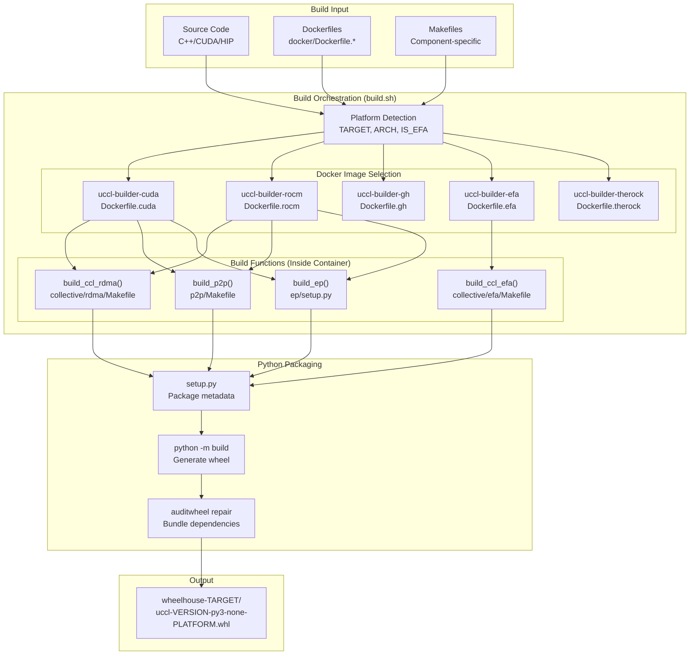
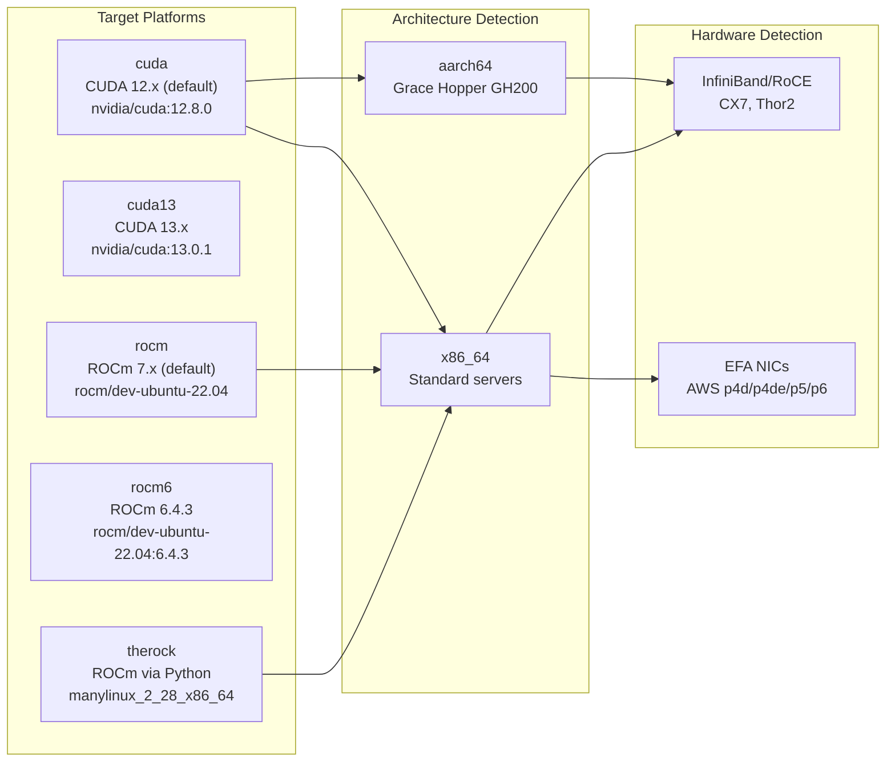
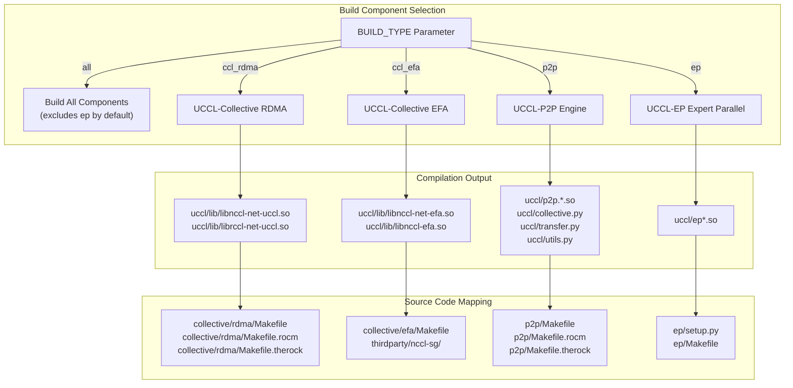
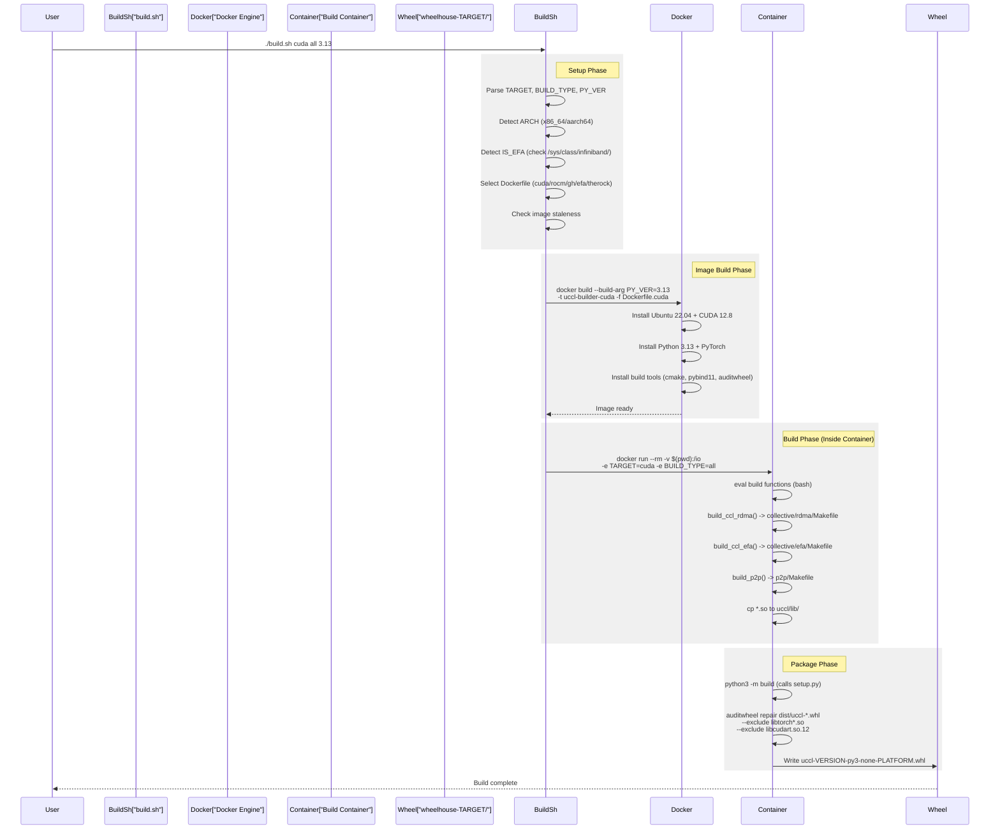
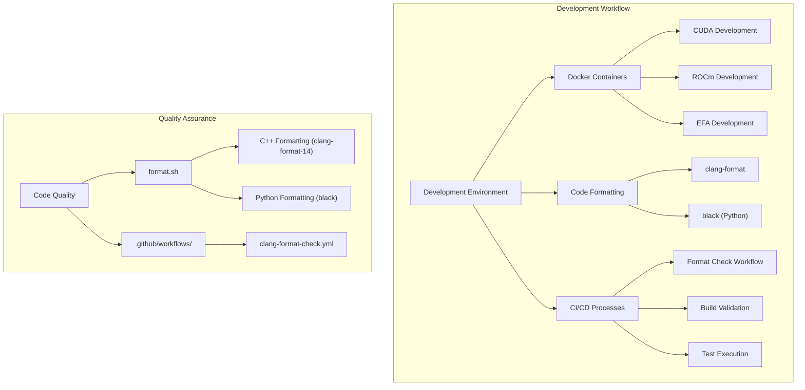
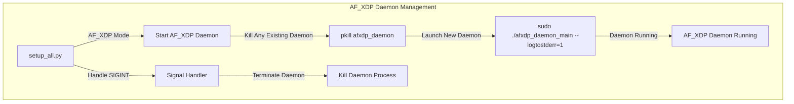

<!-- source: DeepWiki mcp.deepwiki.com · repo uccl-project/uccl · page 6 Build System and Deployment · fetched 2026-11-11 -->

# Build System and Deployment

<details>
<summary>Relevant source files</summary>

The following files were used as context for generating this wiki page:

- [.github/PULL_REQUEST_TEMPLATE.md](.github/PULL_REQUEST_TEMPLATE.md)
- [.github/workflows/uccl-build-test.yml](.github/workflows/uccl-build-test.yml)
- [README.md](README.md)
- [build.sh](build.sh)
- [collective/efa/README.md](collective/efa/README.md)
- [collective/rdma/README.md](collective/rdma/README.md)
- [docs/wheels.md](docs/wheels.md)
- [ep/Makefile](ep/Makefile)
- [ep/README.md](ep/README.md)
- [ep/bench/run_ep.sh](ep/bench/run_ep.sh)
- [ep/setup.py](ep/setup.py)
- [ep/src/common.cpp](ep/src/common.cpp)
- [p2p/Makefile.rocm](p2p/Makefile.rocm)
- [p2p/Makefile.therock](p2p/Makefile.therock)
- [p2p/benchmarks/benchmark_ray_p2p.py](p2p/benchmarks/benchmark_ray_p2p.py)
- [p2p/engine_api.cc](p2p/engine_api.cc)
- [scripts/efa_monitor.sh](scripts/efa_monitor.sh)
- [setup.py](setup.py)
- [shared.sh](shared.sh)
- [uccl/.gitignore](uccl/.gitignore)
- [uccl/__init__.py](uccl/__init__.py)

</details>


This document provides an overview of the UCCL build infrastructure and deployment process. UCCL uses a Docker-based build system to ensure reproducible, portable builds across multiple GPU platforms (CUDA, ROCm, TheRock) and architectures (x86_64, aarch64). The system produces Python wheels that bundle platform-specific shared libraries and can be deployed to diverse runtime environments.

For detailed information on specific aspects of the build system:
- Build scripts and Docker environments: see page 5.1
- Platform-specific compilation flags and dependencies: see page 5.2  
- Development environment setup and CI/CD: see page 5.3

For testing built packages, see page 7.

## Build System Overview

UCCL's build infrastructure is centered around [build.sh:1-437]() and uses Docker containers to isolate build dependencies and ensure reproducibility. The system supports three primary target backends (`cuda`, `rocm`, `therock`) and can build different component subsets (`ccl_rdma`, `ccl_efa`, `p2p`, `ep`, or `all`).

### High-Level Build Architecture



The build process:
1. **Detection**: [build.sh:15-23]() detects target platform, architecture, and available hardware (EFA)
2. **Docker Image Selection**: [build.sh:193-230]() chooses appropriate Dockerfile based on detected parameters
3. **Container Execution**: [build.sh:270-432]() runs build functions inside Docker with mounted source directory
4. **Component Compilation**: Individual build functions ([build.sh:53-170]()) compile C++/CUDA/HIP code and generate `.so` files
5. **Python Packaging**: [setup.py:1-48]() packages compiled libraries with [pyproject.toml:1-3]() build backend
6. **Wheel Repair**: `auditwheel` ([build.sh:393-400]()) bundles dependencies while excluding large runtime libraries

Sources: [build.sh:1-437](), [setup.py:1-48](), [pyproject.toml:1-3]()

## Supported Platforms and Components

UCCL supports multiple target platforms with varying component availability. The build system automatically detects platform constraints and skips unsupported combinations.

### Platform Targets



Platform selection logic in [build.sh:26-34]():
```bash
if [[ $TARGET != cuda* && $TARGET != rocm* && $TARGET != "therock" ]]; then
  echo "Usage: $0 [cuda|rocm|therock] ..." >&2
  exit 1
fi

if [[ $ARCH == "aarch64" && ( $TARGET == rocm* || $TARGET == "therock" ) ]]; then
  echo "Skipping ROCm build on Arm64 (no ROCm toolchain)."
  exit 1
fi
```

Sources: [build.sh:26-34](), [build.sh:194-230]()

### Component Support Matrix

| Platform/Feature | ccl_rdma | ccl_efa | p2p | ep |
|------------------|----------|---------|-----|-----|
| cuda + x86_64 | ✓ | ✓ | ✓ | ✓ |
| cuda + aarch64 (GH200) | ✓ | ✗ | ✓ | ✓ |
| rocm + x86_64 | ✓ | ✗ | ✓ | ✓ |
| therock + x86_64 | ✓ | ✗ | ✓ | ✗ |

Component build functions skip unsupported combinations automatically:
- **EFA**: [build.sh:100-103]() skips on ARM64 and ROCm (CUDA-only)
- **EP**: [build.sh:158-160]() skips on TheRock (no GPU support in manylinux)
- **ROCm**: [build.sh:31-34]() entirely unsupported on ARM64

Sources: [build.sh:53-91](), [build.sh:92-115](), [build.sh:117-148](), [build.sh:150-170](), [README.md:179-185]()

## Build Components and Output Files

### Component Build Targets

The build system supports five component targets specified via the `BUILD_TYPE` parameter:



Build function mapping in [build.sh:311-351]():

| `BUILD_TYPE` | Build Function | Source Directory | Primary Output |
|--------------|---------------|------------------|----------------|
| `ccl_rdma` | `build_ccl_rdma()` | `collective/rdma/` | `libnccl-net-uccl.so` / `librccl-net-uccl.so` |
| `ccl_efa` | `build_ccl_efa()` | `collective/efa/` + `thirdparty/nccl-sg/` | `libnccl-net-efa.so` + `libnccl-efa.so` |
| `p2p` | `build_p2p()` | `p2p/` | `p2p.*.so` + Python files |
| `ep` | `build_ep()` | `ep/` | `ep*.so` |
| `all` | All except `ep` | Multiple | All `.so` files |

Sources: [build.sh:311-351](), [build.sh:53-170]()

### Package Structure

The final Python wheel contains compiled libraries organized in the `uccl/` package:

```
uccl-VERSION-py3-none-PLATFORM.whl
├── uccl/
│   ├── __init__.py              # Plugin path helpers
│   ├── lib/
│   │   ├── libnccl-net-uccl.so  # NCCL RDMA plugin (CUDA)
│   │   ├── librccl-net-uccl.so  # RCCL RDMA plugin (ROCm)
│   │   ├── libnccl-net-efa.so   # NCCL EFA plugin
│   │   ├── libnccl-efa.so       # Custom NCCL for EFA
│   │   ├── libuccl_p2p.so       # P2P core library
│   │   └── librdma_plugin.a     # RDMA plugin static lib
│   ├── p2p.*.so                 # P2P Python binding
│   ├── ep*.so                   # EP Python binding
│   ├── collective.py            # P2P high-level API
│   ├── transfer.py              # P2P transfer helpers
│   └── utils.py                 # P2P utilities
```

Package data specification in [setup.py:27-36]():
```python
package_data={
    "uccl": [
        "lib/*.so",
        "p2p*.so",
        "ep*.so",
        "lib/*.a",
        "collective.py",
        "transfer.py",
        "utils.py",
    ],
}
```

Sources: [setup.py:18-48](), [uccl/__init__.py:1-55]()

## Quick Start: Building and Installing

### Basic Build and Install

The simplest way to build and install UCCL is using [build_and_install.sh:1-40]():

```bash
git clone https://github.com/uccl-project/uccl.git --recursive
cd uccl

# Build and install for CUDA (all components)
bash build_and_install.sh cuda all

# Build and install for ROCm (EP component only)
bash build_and_install.sh rocm ep

# Build for specific Python version
bash build_and_install.sh cuda all 3.11
```

This script:
1. Calls [build.sh:1-437]() to build the wheel
2. Installs Python dependencies from [requirements.txt]()
3. Uninstalls existing UCCL installations
4. Installs the newly built wheel
5. Displays the installation path

Sources: [build_and_install.sh:1-40](), [README.md:92-101]()

### Manual Build Process

For more control, build and install separately:

```bash
# Step 1: Build wheel
./build.sh cuda all

# Step 2: Install dependencies
pip install -r requirements.txt

# Step 3: Install wheel
pip uninstall uccl -y
pip install wheelhouse-cuda/uccl-*.whl
```

For TheRock installations, specify ROCm dependencies:
```bash
pip install --extra-index-url https://rocm.prereleases.amd.com/whl/gfx94X-dcgpu \
    wheelhouse-therock/uccl-*.whl[rocm]
```

Sources: [build_and_install.sh:16-26](), [README.md:100]()

### Verifying Installation

After installation, verify the package and locate plugin libraries:

```python
import uccl

# Get plugin library paths
print(uccl.nccl_plugin_path())  # /path/to/uccl/lib/libnccl-net-uccl.so
print(uccl.rccl_plugin_path())  # /path/to/uccl/lib/librccl-net-uccl.so
print(uccl.efa_plugin_path())   # /path/to/uccl/lib/libnccl-net-efa.so

# Check version
print(uccl.__version__)  # e.g., "0.0.1.post4"
```

Use these paths to configure NCCL/RCCL to use UCCL plugins (see page 6.1 for integration details).

Sources: [uccl/__init__.py:30-55](), [README.md:103-114]()

## Build Execution Workflow



Key execution steps:

1. **Setup** ([build.sh:15-23]()): Parse arguments and detect platform
2. **Image Build** ([build.sh:255-268]()): Build or reuse Docker image with toolchain
3. **Build Functions** ([build.sh:295-351]()): Execute component-specific build functions
4. **Packaging** ([build.sh:386-401]()): Generate wheel with `python -m build` and repair with `auditwheel`
5. **Output** ([build.sh:435-436]()): Store wheel in `wheelhouse-TARGET/` directory

Sources: [build.sh:1-437]()

## Development Environment and CI/CD

UCCL uses Docker-based development environments and automated CI/CD processes to ensure code quality and consistent builds across platforms.



The development environment emphasizes reproducible builds and consistent code quality through automated tooling.

Sources: [format.sh:1-72](), [.github/workflows/clang-format-check.yml:1-91]()

### Code Formatting Standards

UCCL enforces consistent code formatting across the codebase using automated tools:

#### C++ Code Formatting

Uses `clang-format-14` to format C++ source files across multiple directories:

```bash
# Directories formatted
DIRECTORIES=("afxdp" "efa" "gpu_driven" "rdma" "misc" "p2p" "include")
# File extensions
EXTENSIONS=("cpp" "cxx" "cc" "h" "hpp" "cu" "cuh")
# Excluded directories
EXCLUDE=("afxdp/lib")
```

Run formatting manually:
```bash
./format.sh
```

Sources: [format.sh:7-9](), [format.sh:28-55]()

#### Python Code Formatting

Uses `black` to format Python code in specific directories:

```bash
# Python directories formatted
PYTHON_DIRS=("p2p" "gpu_driven")
# Excluded patterns
EXCLUDES="thirdparty|doc|build"
```

Sources: [format.sh:59-70](), [.github/workflows/clang-format-check.yml:83-90]()

### CI/CD Workflows

The CI system automatically validates code formatting and build integrity:

#### Automated Format Checking

The GitHub Actions workflow `clang-format-check.yml` runs on every push and pull request:

```yaml
# C++ format validation
- name: Check C++ formatting
  run: clang-format --dry-run --Werror "${FILES[@]}"

# Python format validation  
- name: Check Python formatting
  run: black "$DIR" --exclude "$EXCLUDES" --check
```

The workflow fails if any files don't conform to the formatting standards, ensuring consistent code style.

Sources: [.github/workflows/clang-format-check.yml:28-64](), [.github/workflows/clang-format-check.yml:82-90]()

### Development Dependencies

For local development without Docker, install these dependencies:

```bash
sudo apt update
sudo apt install linux-tools-$(uname -r) clang llvm cmake m4 build-essential \
                 net-tools libgoogle-glog-dev libgtest-dev libgflags-dev \
                 libelf-dev libpcap-dev libc6-dev-i386 \
                 libopenmpi-dev libibverbs-dev libpci-dev -y

# Install Anaconda for Python environment management
wget https://repo.anaconda.com/archive/Anaconda3-2025.06-1-Linux-x86_64.sh
bash ./Anaconda3-2025.06-1-Linux-x86_64.sh -b
```

However, the recommended approach is to use the Docker-based build system which handles all dependencies automatically.

Sources: [doc/dev.md:14-29]()

## Running the AF_XDP Daemon

For AF_XDP mode, UCCL requires the AF_XDP daemon to be running. This daemon handles the privileged operations related to AF_XDP sockets.



The AF_XDP daemon is started with elevated privileges (using `sudo`) and runs until the `setup_all.py` script is terminated. The script sets up a signal handler to properly terminate the daemon when the script is interrupted.

Sources: [setup_all.py:132-149]()

## Verifying the Setup

After deploying UCCL, you can verify the setup using the transport test utility:

```
cd $UCCL_HOME/afxdp/
./transport_test --logtostderr=1 --clientip=<peer_ip> --test=bimq
```

On the peer node:
```
./transport_test --logtostderr=1 --client --serverip=<server_ip> --test=bimq
```

A successful test will show performance metrics like median RTT, tail RTT, and bandwidth.

Sources: [README.md:120-132]()

## Running NCCL Tests

To run NCCL tests with UCCL:

```
python setup_all.py --target aws_g4_afxdp
cd $UCCL_HOME/afxdp/
./run_nccl_test.sh afxdp 2 <nic>
```

This will run NCCL collective communication tests using the UCCL transport.

Sources: [README.md:134-138]()

## Network RSS Configuration (Optional)

For advanced users, UCCL provides utilities to work with the Receive Side Scaling (RSS) configuration of network interfaces. This can be useful for optimizing multi-path communications.

The `get_rss_config` function retrieves the RSS key and redirection table from a network interface:

```
bool get_rss_config(const std::string& interface_name,
                   std::vector<uint32_t>& redir_table,
                   std::vector<uint8_t>& rss_key)
```

The `calculate_queue_id` function determines which queue a packet will be directed to based on its 4-tuple (source IP, destination IP, source port, destination port):

```
uint32_t calculate_queue_id(uint32_t src_ip, uint32_t dst_ip,
                           uint16_t src_port, uint16_t dst_port,
                           const std::vector<uint8_t>& rss_key,
                           const std::vector<uint32_t>& redir_table)
```

These utilities can be used to tune the packet distribution across multiple queues.

Sources: [util_rss.h:20-163](), [rss_hash_test.cc:1-84]()

---

