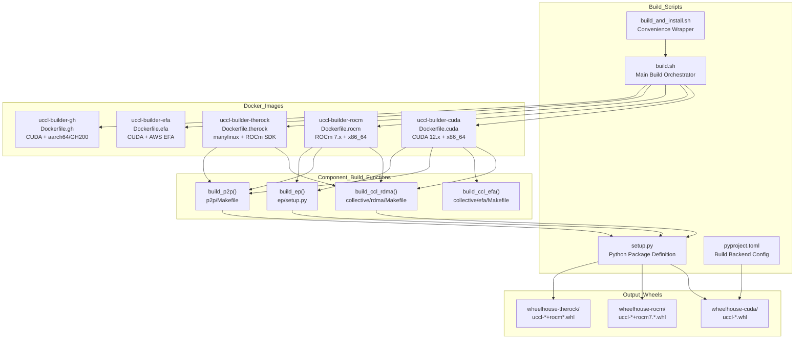
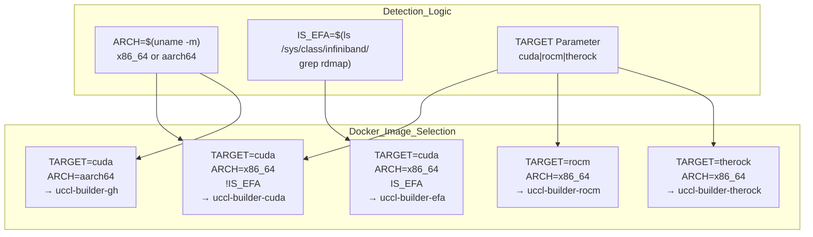
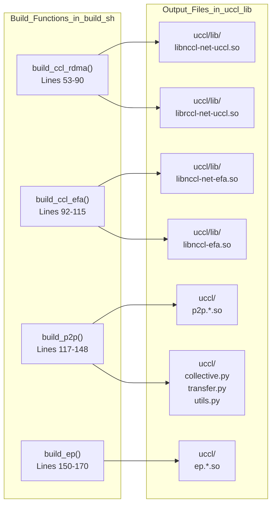
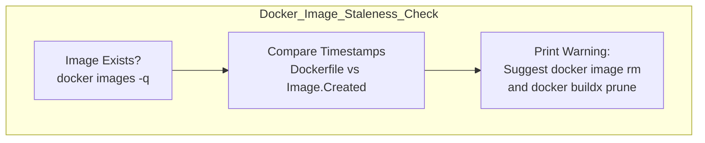
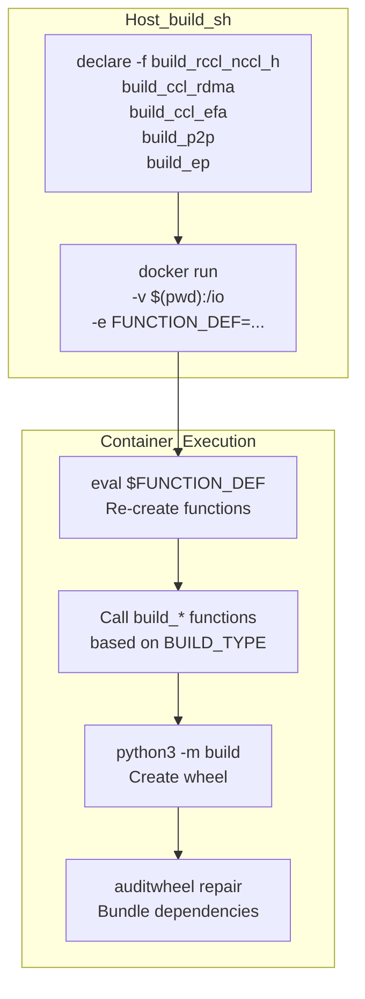
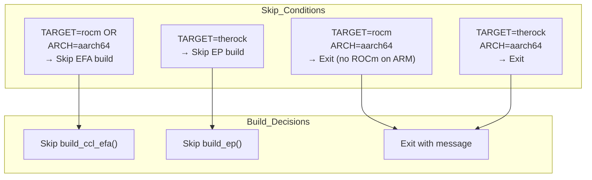
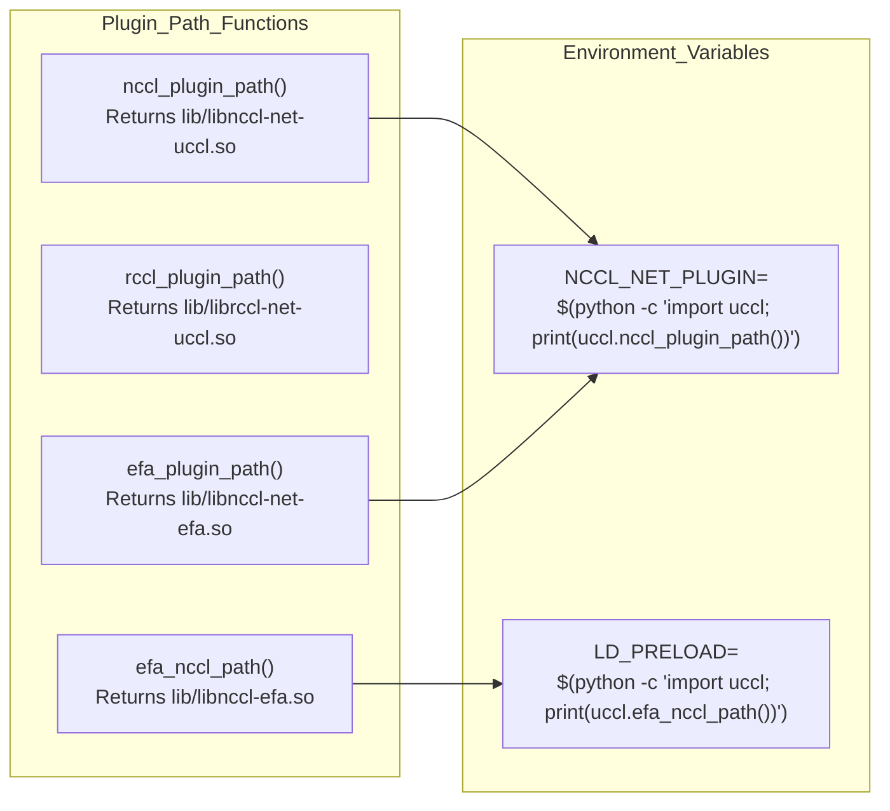
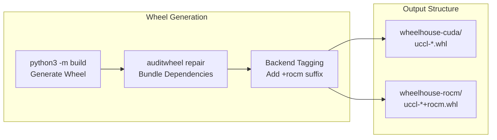

<!-- source: DeepWiki mcp.deepwiki.com · repo uccl-project/uccl · page 6.1 Build Scripts and Docker Environments · fetched 2026-11-11 -->

# Build Scripts and Docker Environments

<details>
<summary>Relevant source files</summary>

The following files were used as context for generating this wiki page:

- [.github/PULL_REQUEST_TEMPLATE.md](.github/PULL_REQUEST_TEMPLATE.md)
- [.github/workflows/uccl-build-test.yml](.github/workflows/uccl-build-test.yml)
- [README.md](README.md)
- [build.sh](build.sh)
- [collective/efa/README.md](collective/efa/README.md)
- [collective/rdma/README.md](collective/rdma/README.md)
- [docker/Dockerfile.cuda](docker/Dockerfile.cuda)
- [docker/Dockerfile.efa](docker/Dockerfile.efa)
- [docker/Dockerfile.gh](docker/Dockerfile.gh)
- [docker/Dockerfile.rocm](docker/Dockerfile.rocm)
- [docs/wheels.md](docs/wheels.md)
- [ep/Makefile](ep/Makefile)
- [ep/README.md](ep/README.md)
- [ep/bench/run_ep.sh](ep/bench/run_ep.sh)
- [ep/install_deps.sh](ep/install_deps.sh)
- [ep/setup.py](ep/setup.py)
- [ep/src/common.cpp](ep/src/common.cpp)
- [p2p/Makefile.rocm](p2p/Makefile.rocm)
- [p2p/Makefile.therock](p2p/Makefile.therock)
- [p2p/benchmarks/benchmark_ray_p2p.py](p2p/benchmarks/benchmark_ray_p2p.py)
- [p2p/engine_api.cc](p2p/engine_api.cc)
- [scripts/efa_monitor.sh](scripts/efa_monitor.sh)
- [setup.py](setup.py)
- [shared.sh](shared.sh)
- [uccl/.gitignore](uccl/.gitignore)
- [uccl/__init__.py](uccl/__init__.py)

</details>


This document covers UCCL's Docker-based build system, including the main build orchestrator (`build.sh`), platform-specific Docker environments, and Python wheel packaging. The build system uses containerized environments to ensure reproducible builds across different GPU backends (CUDA, ROCm, TheRock) and architectures (x86_64, aarch64), producing installable Python wheels containing native shared libraries for each transport backend.

For installation instructions using pre-built wheels, see [Installation and Setup](#1.2). For platform-specific compilation flags and dependency management, see [Platform-Specific Configuration](#5.2).

## Build System Architecture

The UCCL build system follows a Docker-based approach where specialized container images provide complete toolchains for each target platform. The `build.sh` script orchestrates the entire build process: detecting the target platform, spawning the appropriate Docker container, compiling C++/CUDA/HIP code for multiple transport backends, and packaging everything into Python wheels.

### Build System Overview



Sources: [build.sh:1-437](), [build_and_install.sh:1-40](), [setup.py:1-49](), [pyproject.toml:1-3]()

## build.sh: Main Build Orchestrator

The `build.sh` script is the primary entry point for building UCCL. It performs platform detection, selects the appropriate Docker image, executes builds inside containers, and produces Python wheels in `wheelhouse-{target}/` directories.

### Build Script Parameters

| Parameter | Values | Description | Default |
|-----------|---------|-------------|---------|
| `TARGET` | `cuda`, `cuda13`, `rocm`, `rocm6`, `therock` | GPU backend to build for | `cuda` |
| `BUILD_TYPE` | `all`, `ccl_rdma`, `ccl_efa`, `p2p`, `ep` | Components to build | `all` |
| `PY_VER` | `3.8` - `3.13` | Python version for wheel | Auto-detected |
| `ROCM_IDX_URL` | URL | ROCm index URL for TheRock builds | `https://rocm.prereleases.amd.com/whl/gfx94X-dcgpu` |
| `THEROCK_BASE_IMAGE` | Docker image | Base manylinux image for TheRock | `quay.io/pypa/manylinux_2_28_x86_64@sha256:...` |

### Platform Detection and Docker Image Selection

The script detects the target platform using architecture checks and EFA device presence, then selects the corresponding Docker image:



Sources: [build.sh:15-23](), [build.sh:194-230]()

### Build Functions and Output Libraries

The script defines separate build functions for each component, invoked inside Docker containers:



Each build function compiles native code using component-specific Makefiles:

- **`build_ccl_rdma()`**: Compiles collective RDMA transport using `collective/rdma/Makefile` (CUDA) or `Makefile.rocm` (ROCm) or `Makefile.therock` (TheRock)
- **`build_ccl_efa()`**: Compiles AWS EFA transport using `collective/efa/Makefile` and custom NCCL from `thirdparty/nccl-sg`
- **`build_p2p()`**: Compiles P2P engine using `p2p/Makefile`, `Makefile.rocm`, or `Makefile.therock`
- **`build_ep()`**: Compiles Expert Parallelism system using `ep/setup.py` (Python-based build)

Sources: [build.sh:53-170](), [build.sh:335-351]()

## Docker Build Environments

UCCL provides five specialized Docker images, each containing the complete toolchain for a specific target platform. These images are defined in `docker/Dockerfile.*` and built as `uccl-builder-*`.

### Dockerfile.cuda: Standard CUDA x86_64 Builds

**Base Image**: `nvidia/cuda:12.8.0-devel-ubuntu22.04`

**Purpose**: Builds UCCL for standard NVIDIA GPUs on x86_64 with InfiniBand/RoCE NICs.

**Key Components**:
- CUDA Toolkit 12.8 (or configurable via `BASE_IMAGE`)
- Python 3.13 (default, configurable via `PY_VER`)
- Build tools: `cmake`, `ninja`, `g++`, `make`, `patchelf`
- RDMA libraries: `libibverbs-dev`, `rdma-core`
- Additional dependencies: `libgoogle-glog-dev`, `libgflags-dev`, `libgtest-dev`, `libnuma-dev`
- PyTorch with CUDA support from `https://download.pytorch.org/whl/cu128`
- Python build backends: `build`, `auditwheel`, `pybind11`

Sources: [docker/Dockerfile.cuda:1-52]()

### Dockerfile.rocm: AMD ROCm x86_64 Builds

**Base Image**: `rocm/dev-ubuntu-22.04` (ROCm 7.x default)

**Purpose**: Builds UCCL for AMD GPUs with HIP/ROCm on x86_64.

**Key Components**:
- ROCm SDK with HIP compiler (`hipcc`)
- HIP libraries: `hipsolver`, `hipblas`, `hipsparse`, `rocthrust`, `hipblaslt`
- Python 3.13 via deadsnakes PPA
- RDMA libraries: `libibverbs-dev`, `rdma-core`
- Redis for OOB backend: `libhiredis-dev`
- PyTorch nightly with ROCm 7.0 support from `https://download.pytorch.org/whl/nightly/rocm7.0`

**Special Note**: ROCm does not include `nccl.h`, so the build process compiles RCCL headers by running `CXX=/opt/rocm/bin/hipcc cmake` on `thirdparty/rccl` to generate `nccl.h`.

Sources: [docker/Dockerfile.rocm:1-54](), [build.sh:44-50]()

### Dockerfile.therock: TheRock Manylinux Builds

**Base Image**: `ghcr.io/rocm/therock_build_manylinux_x86_64` or configurable via parameter

**Purpose**: Builds portable UCCL wheels with Python-packaged ROCm dependencies for TheRock ecosystem.

**Key Components**:
- Manylinux 2.28 base with all Python versions pre-installed
- Python virtual environment with ROCm SDK installed via `pip install rocm[libraries,devel]`
- Uses `rocm-sdk` CLI tool for path resolution: `$(rocm-sdk path --root)`, `$(rocm-sdk path --cmake)`
- RDMA libraries: `rdma-core-devel`
- Minimal system dependencies (no ROCm system packages)

**TheRock-Specific Build Process**:
1. Select Python version from PyPA multi-python environment
2. Create temporary venv and install ROCm SDK via pip with `ROCM_IDX_URL`
3. Compile with `HIP_HOME=$(rocm-sdk path --root)`
4. Generate `uccl/_rocm_init.py` to initialize ROCm SDK at import time
5. Modify `setup.py` to add ROCm wheel dependency, then restore after build

Sources: [docker/Dockerfile.therock:1-17](), [build.sh:316-391]()

### Dockerfile.efa: AWS EFA CUDA Builds

**Base Image**: `nvidia/cuda:12.8.0-devel-ubuntu22.04`

**Purpose**: Builds UCCL with AWS EFA NIC support on p4d/p4de/p5 instances.

**Key Components**:
- CUDA Toolkit 12.8
- AWS EFA installer v1.42.0 (installed with `--skip-kmod --no-verify` for container environment)
- EFA libraries in `/opt/amazon/efa/lib64`
- Event libraries: `libevent-dev`, `libhwloc-dev` with symlinks for version compatibility
- Python 3.13 and PyTorch with CUDA 12.8 support

**EFA Installation Process**:
```bash
curl -O https://efa-installer.amazonaws.com/aws-efa-installer-${EFA_VER}.tar.gz
./efa_installer.sh -y --skip-kmod -g --no-verify
```

Sources: [docker/Dockerfile.efa:1-76]()

### Dockerfile.gh: Grace Hopper ARM64 Builds

**Base Image**: `nvidia/cuda:12.4.1-devel-ubuntu22.04`

**Purpose**: Builds UCCL for NVIDIA Grace Hopper (GH200) ARM64 superchips.

**Key Components**:
- CUDA Toolkit 12.4 for aarch64 architecture
- ARM64-compatible build tools and libraries
- Python 3.13 for aarch64
- Environment variable `GPU_NAME=GH200` set for Makefile detection
- PyTorch 2.6.0 with CUDA 12.6 support

**Architecture Detection**: The container sets `GPU_NAME=GH200` which triggers Grace Hopper-specific compilation flags in Makefiles, such as `-DUSE_GRACE_HOPPER` in EP builds.

Sources: [docker/Dockerfile.gh:1-51](), [ep/Makefile:16-32]()

### Docker Image Build and Caching

The `build.sh` script includes staleness detection to warn users when Dockerfiles are newer than built images:



The Docker build command supports custom base images and Python versions:

```bash
BUILD_ARGS="--build-arg PY_VER=${PY_VER}"
if [[ -n "${BASE_IMAGE:-}" ]]; then
  BUILD_ARGS+=" --build-arg BASE_IMAGE=${BASE_IMAGE}"
fi
docker build $BUILD_ARGS -t "$IMAGE_NAME" -f "$DOCKERFILE" .
```

Sources: [build.sh:232-268]()

## Build Functions and Container Execution

The `build.sh` script defines shell functions that are serialized and executed inside Docker containers via the `FUNCTION_DEF` environment variable. This approach allows complex build logic to run in isolated environments.

### Container Execution Pattern



Sources: [build.sh:295-311](), [build.sh:313-432]()

### build_ccl_rdma(): Collective RDMA Transport

Compiles the NCCL/RCCL plugin for InfiniBand/RoCE NICs.

**Input Parameters**: `TARGET`, `ARCH`, `IS_EFA`

**Build Process**:
1. For CUDA: `cd collective/rdma && make -j$(nproc)`
2. For ROCm: `cd collective/rdma && make -j$(nproc) -f Makefile.rocm`
3. For TheRock: `make -j$(nproc) -f Makefile.therock HIP_HOME=$(rocm-sdk path --root)`
4. Copy output to `uccl/lib/libnccl-net-uccl.so` or `librccl-net-uccl.so`

**Special Handling**: ROCm and TheRock builds must first generate `nccl.h` by building RCCL headers:
```bash
cd thirdparty/rccl
CXX=hipcc cmake -B build/release -S . -DCMAKE_EXPORT_COMPILE_COMMANDS=OFF
```

Sources: [build.sh:53-90](), [build.sh:44-51]()

### build_ccl_efa(): Collective EFA Transport

Compiles the AWS EFA plugin and custom NCCL library.

**Build Process**:
1. Skip on ARM64 or ROCm targets (EFA requires CUDA on x86_64)
2. `cd collective/efa && make -j$(nproc)`
3. Build custom NCCL: `cd thirdparty/nccl-sg && make src.build -j$(nproc) NVCC_GENCODE="-gencode=arch=compute_90,code=sm_90"`
4. Copy `libnccl-net-efa.so` and `libnccl-efa.so` to `uccl/lib/`

Sources: [build.sh:92-115]()

### build_p2p(): P2P Communication Engine

Compiles the point-to-point transfer engine with pybind11 Python bindings.

**Build Process**:
1. For CUDA: `cd p2p && make -j$(nproc)`
2. For ROCm: `make -j$(nproc) -f Makefile.rocm`
3. For TheRock: `make -j$(nproc) -f Makefile.therock HIP_HOME=$(rocm-sdk path --root) CONDA_LIB_HOME=$VIRTUAL_ENV/lib`
4. Copy outputs to `uccl/lib/` and `uccl/`:
   - `libuccl_p2p.so` (shared library)
   - `librdma_plugin.a` (static archive)
   - `p2p.*.so` (Python extension)
   - `collective.py`, `transfer.py`, `utils.py` (Python modules)

**Special Case**: When `USE_TCPX=1`, skips copying runtime files.

Sources: [build.sh:117-148]()

### build_ep(): Expert Parallelism System

Compiles GPU-initiated communication for MoE models using Python's build system.

**Build Process**:
1. Skip on TheRock (no GPU-driven support yet)
2. For CUDA/ROCm: `cd ep && python3 setup.py build`
3. Copy `ep/build/**/*.so` to `uccl/`

The EP build uses its own `setup.py` which detects GPU architecture and configures compilation flags automatically.

Sources: [build.sh:150-170](), [ep/Makefile:1-114]()

## Platform-Specific Build Logic

The build system includes conditional compilation logic to handle platform-specific constraints and capabilities.

### Cross-Platform Compilation Matrix

| Platform | ccl_rdma | ccl_efa | p2p | ep | Docker Image |
|----------|----------|---------|-----|-----|--------------|
| x86_64 + CUDA | ✓ | ✓ | ✓ | ✓ | `uccl-builder-cuda` |
| x86_64 + CUDA + EFA | ✓ | ✓ | ✓ | ✓ | `uccl-builder-efa` |
| x86_64 + ROCm | ✓ | ✗ | ✓ | ✓ | `uccl-builder-rocm` |
| x86_64 + TheRock | ✓ | ✗ | ✓ | ✗ | `uccl-builder-therock` |
| aarch64 + CUDA (GH200) | ✓ | ✗ | ✓ | ✓ | `uccl-builder-gh` |

### Architecture Detection and Skip Logic

The build script detects architecture constraints and skips incompatible builds:



**Key Skip Conditions**:

1. **ROCm on ARM64**: Entire build exits because no ROCm toolchain exists for aarch64
   ```bash
   if [[ $ARCH == "aarch64" && ( $TARGET == rocm* || $TARGET == "therock" ) ]]; then
     echo "Skipping ROCm build on Arm64 (no ROCm toolchain)."
     exit 1
   fi
   ```

2. **EFA builds**: Skipped on ROCm (no CUDA) or ARM64 (no EFA installer)
   ```bash
   if [[ "$ARCH" == "aarch64" || "$TARGET" == rocm* || "$TARGET" == "therock" ]]; then
     echo "Skipping EFA build..."
     return
   fi
   ```

3. **EP on TheRock**: GPU-driven builds not yet supported on TheRock
   ```bash
   if [[ "$TARGET" == "therock" ]]; then
     echo "Skipping GPU-driven build on therock (no GPU-driven support yet)."
   fi
   ```

Sources: [build.sh:31-34](), [build.sh:100-103](), [build.sh:158-159]()

### GPU Architecture Auto-Detection

For EP builds, the script auto-detects GPU compute capability:

**CUDA Detection**:
```bash
DETECTED_GPU_ARCH=$(nvidia-smi --query-gpu=compute_cap --format=csv,noheader 2>/dev/null | head -n1 | tr -d ' ')
export TORCH_CUDA_ARCH_LIST="${TORCH_CUDA_ARCH_LIST:-${DETECTED_GPU_ARCH}}"
```

**ROCm Detection**:
```bash
DETECTED_GPU_ARCH=$(amd-smi static -g 0 --asic --json | jq -r '.[].asic.target_graphics_version')
```

Sources: [build.sh:272-294]()

## Python Packaging with setup.py

The `setup.py` file defines the Python package structure and specifies which compiled artifacts to include in the wheel.

### Package Data Specification

```python
package_data={
    "uccl": [
        "lib/*.so",      # NCCL/RCCL plugins, EFA libraries
        "p2p*.so",       # P2P Python extension
        "ep*.so",        # EP Python extension
        "lib/*.a",       # Static archives (librdma_plugin.a)
        "collective.py", # P2P high-level API
        "transfer.py",   # Transfer utilities
        "utils.py",      # P2P utilities
    ],
}
```

### Plugin Path Resolution

The `uccl/__init__.py` module provides helper functions to locate plugin shared libraries at runtime:



**TheRock-Specific Initialization**: For TheRock builds, an additional `uccl/_rocm_init.py` module is generated during the build to initialize the ROCm SDK:

```python
def initialize():
  import rocm_sdk
  rocm_sdk.initialize_process(preload_shortnames=[
    "amdhip64", "roctx64", "hiprtc", "hipblas", "rccl", ...
  ], check_version="7.0.0")
```

This module is automatically imported by `uccl/__init__.py` if present.

Sources: [setup.py:18-48](), [uccl/__init__.py:1-55](), [build.sh:358-376]()

### Version Management

The package version is read from `uccl/__init__.py` by `setup.py`:

```python
def get_version():
    with open("uccl/__init__.py", "r") as f:
        content = f.read()
    match = re.search(r'^__version__\s*=\s*["\']([^"\']+)["\']', content, re.MULTILINE)
    return match.group(1)
```

Sources: [setup.py:6-16](), [uccl/__init__.py:30]()

## Wheel Generation and Distribution

The final step produces platform-specific Python wheels with embedded native libraries.

### Wheel Building Process



### Library Bundling

The `auditwheel` tool repairs wheels by bundling dependencies while excluding system libraries:

```bash
auditwheel repair dist/uccl-*.whl \
  --exclude "libtorch*.so" \
  --exclude "libc10*.so" \
  --exclude "libibverbs.so.1" \
  --exclude "libcudart.so.12" \
  --exclude "libamdhip64.so.6" \
  -w /io/${WHEEL_DIR}
```

### Backend Tagging

ROCm wheels receive special naming to distinguish from CUDA builds:

- CUDA wheels: `uccl-0.0.1.post4-py3-none-linux_x86_64.whl`
- ROCm wheels: `uccl-0.0.1.post4+rocm-py3-none-linux_x86_64.whl`

Sources: [build.sh:197-225](), [build.sh:200-223]()

---

