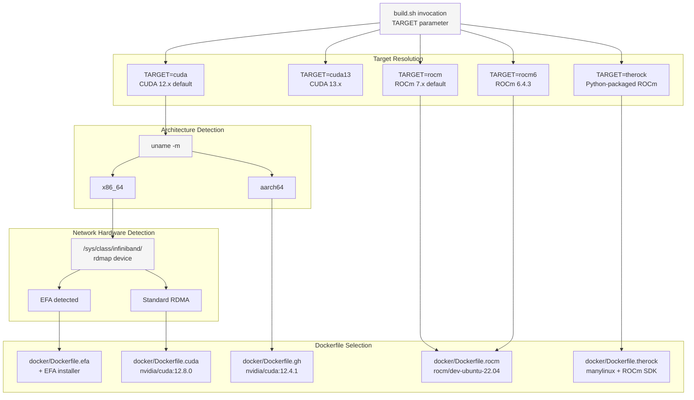
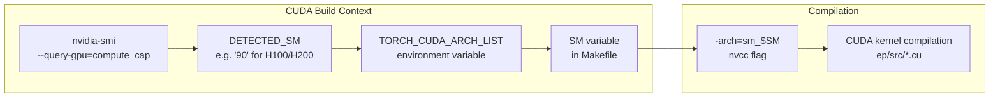
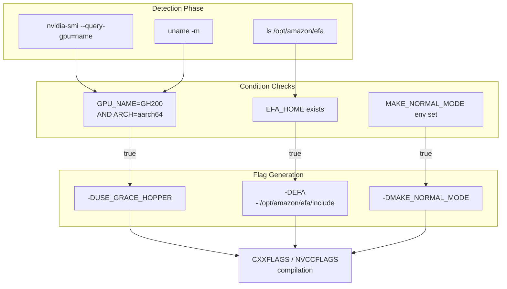
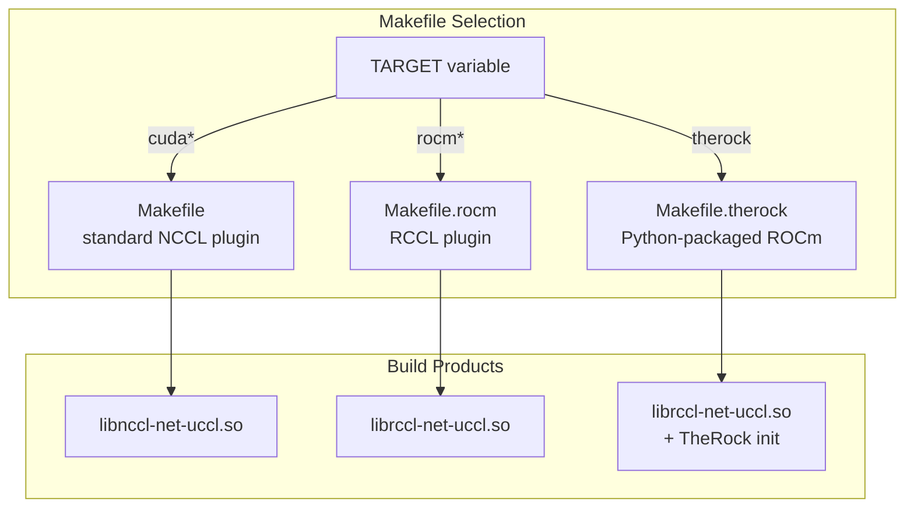
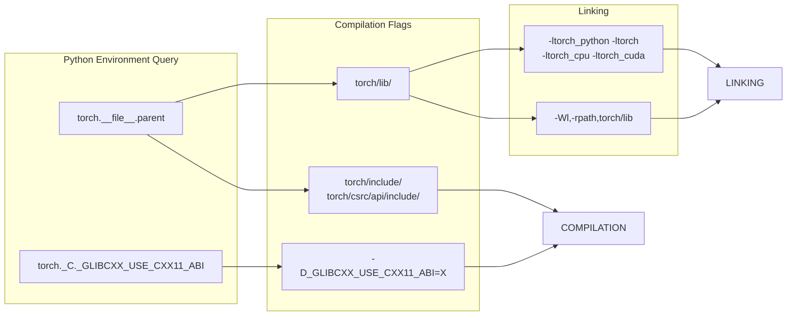
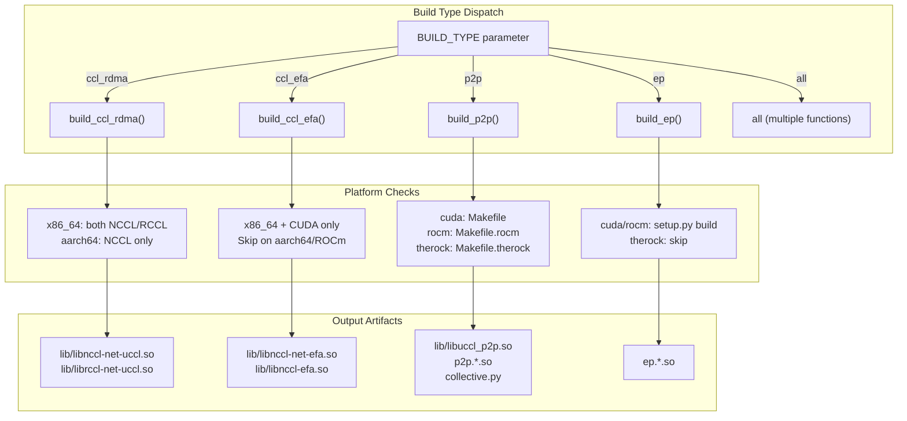
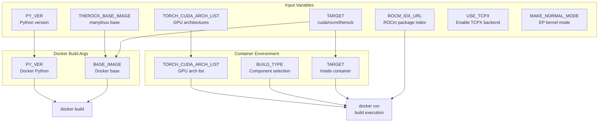

<!-- source: DeepWiki mcp.deepwiki.com · repo uccl-project/uccl · page 6.2 Platform-Specific Configuration · fetched 2026-11-11 -->

# Platform-Specific Configuration

<details>
<summary>Relevant source files</summary>

The following files were used as context for generating this wiki page:

- [.github/workflows/clang-format-check.yml](.github/workflows/clang-format-check.yml)
- [docker/Dockerfile.cuda](docker/Dockerfile.cuda)
- [docker/Dockerfile.efa](docker/Dockerfile.efa)
- [docker/Dockerfile.gh](docker/Dockerfile.gh)
- [docker/Dockerfile.rocm](docker/Dockerfile.rocm)
- [ep/install_deps.sh](ep/install_deps.sh)
- [format.sh](format.sh)
- [scripts/node_ips/amd.txt](scripts/node_ips/amd.txt)
- [scripts/node_ips/tpu_2.txt](scripts/node_ips/tpu_2.txt)
- [scripts/setup_all.py](scripts/setup_all.py)
- [scripts/setup_nic.sh](scripts/setup_nic.sh)

</details>


This page documents UCCL's platform detection logic, compilation flags, and dependency management across different hardware and software configurations. UCCL supports five primary platform targets: CUDA (NVIDIA GPUs on x86_64), ROCm (AMD GPUs on x86_64), GH200 (NVIDIA GPUs on ARM64), EFA (AWS-specific networking), and TheRock (Python-packaged ROCm).

For general build system overview and Docker environments, see [Build Scripts and Docker Environments](#5.1). For development environment setup, see [Development Environment](#5.3).

---

## Platform Detection and Target Selection

UCCL's build system performs multi-stage detection to determine the appropriate build configuration. The detection process occurs in [build.sh:14-230]() and determines three key dimensions: target platform, CPU architecture, and network hardware.

### Platform Target Detection



**Platform Target Selection Logic**

Sources: [build.sh:14-30](), [build.sh:194-230]()

The `TARGET` parameter determines the base Docker image and toolchain. Key detection points:

| Target | Base Image | Toolchain | Python Version | Build Constraints |
|--------|------------|-----------|----------------|-------------------|
| `cuda` | `nvidia/cuda:12.8.0-devel-ubuntu22.04` | NVCC, G++ | Parameterized (default: host) | x86_64 or aarch64 |
| `cuda13` | `nvidia/cuda:13.0.1-cudnn-devel-ubuntu22.04` | NVCC, G++ | Parameterized | x86_64 or aarch64 |
| `rocm` | `rocm/dev-ubuntu-22.04:latest` | HIP, G++ | Parameterized | x86_64 only |
| `rocm6` | `rocm/dev-ubuntu-22.04:6.4.3-complete` | HIP, G++ | Parameterized | x86_64 only |
| `therock` | `quay.io/pypa/manylinux_2_28_x86_64` | HIP (from Python pkg) | Multi-version | x86_64 only |
| `gh` (auto) | `nvidia/cuda:12.4.1-devel-ubuntu22.04` | NVCC, G++ | Parameterized | aarch64 only |
| `efa` (auto) | CUDA base + EFA installer | NVCC, G++ | Parameterized | x86_64 with EFA NICs |

Sources: [build.sh:194-230](), [docker/Dockerfile.cuda:1-2](), [docker/Dockerfile.rocm:1-2](), [docker/Dockerfile.therock:1-2](), [docker/Dockerfile.gh:1-2](), [docker/Dockerfile.efa:1-2]()

### Architecture Detection

Architecture detection occurs at [build.sh:18]() using `uname -m`:

```bash
ARCH="$(uname -m)"  # Returns "x86_64" or "aarch64"
```

**Architecture-Specific Constraints:**

- **x86_64**: All platforms supported
- **aarch64**: Only CUDA builds supported (Grace Hopper systems)
- ROCm and TheRock builds explicitly skip on ARM at [build.sh:31-34]()

Sources: [build.sh:18](), [build.sh:31-34]()

### Network Hardware Detection

EFA (Elastic Fabric Adapter) detection determines networking capabilities at [build.sh:23]():

```bash
IS_EFA=$( [ -d "/sys/class/infiniband/" ] && ls /sys/class/infiniband/ 2>/dev/null | grep -q rdmap && echo "EFA support: true" ) || echo "EFA support: false"
```

Runtime EFA detection also occurs in [uccl/__init__.py:12-20]():

```python
def has_efa():
    infiniband = Path("/sys/class/infiniband/")
    try:
        if infiniband.is_dir():
            return any("rdmap" in child.name for child in infiniband.iterdir())
        return False
    except (OSError, PermissionError):
        return False
```

EFA presence affects:
- Dockerfile selection (EFA-specific image with libefa)
- Build flags passed to component builds
- Runtime module loading behavior

Sources: [build.sh:23](), [uccl/__init__.py:12-20]()

---

## Compilation Flags and Preprocessor Definitions

### GPU Architecture-Specific Flags

**CUDA Architecture Detection**



Sources: [build.sh:273-293](), [ep/Makefile:49-51]()

At build time, [build.sh:275-279]() auto-detects GPU compute capability:

```bash
if [[ "$TARGET" == cuda* ]] && command -v nvidia-smi &> /dev/null; then
    DETECTED_GPU_ARCH=$(nvidia-smi --query-gpu=compute_cap --format=csv,noheader 2>/dev/null | head -n1 | tr -d ' ')
    # Result: "9.0" for H100/H200, "10.0" for B200
fi
```

This is passed to the EP Makefile at [ep/Makefile:49-51]():

```makefile
DETECTED_SM := $(shell nvidia-smi --query-gpu=compute_cap --format=csv,noheader | head -n1 | tr -d '.')
SM ?= $(DETECTED_SM)  # Can be overridden: make SM=90
```

The `SM` variable controls NVCC architecture flags at [ep/Makefile:83]():

```makefile
%.o: %.cu
	$(NVCC) -arch=sm_$(SM) $(NVCCFLAGS) $(TORCH_INCS) $(INCLUDES) -MMD -MP -c $< -o $@
```

**ROCm Architecture Detection**

For ROCm builds, GPU architecture detection uses `amd-smi` at [build.sh:280-289]():

```bash
elif [[ "$TARGET" == rocm* ]] && command -v amd-smi &> /dev/null; then
    DETECTED_GPU_ARCH=$(amd-smi static -g 0 --asic --json | jq -r '.[].asic.target_graphics_version')
    # Result: "gfx942" for MI300X
fi
```

Sources: [build.sh:273-293](), [ep/Makefile:49-51](), [ep/Makefile:83]()

### Platform-Specific Preprocessor Definitions

**EP Component Platform Flags**



Sources: [ep/Makefile:5-62]()

The EP Makefile performs runtime detection at [ep/Makefile:16-32]():

```makefile
ARCH := $(shell uname -m)
GPU_NAME ?= $(shell nvidia-smi --query-gpu=name --format=csv,noheader | head -n1)
CPU_IS_ARM64 := 0
GPU_IS_HOPPER := 0

ifeq ($(ARCH),aarch64)
  CPU_IS_ARM64 := 1
endif
ifneq (,$(findstring GH200,$(GPU_NAME)))
  GPU_IS_HOPPER := 1
endif

ifeq ($(and $(CPU_IS_ARM64),$(GPU_IS_HOPPER)),0)
  GH_CFLAGS :=
else
  GH_CFLAGS := -DUSE_GRACE_HOPPER
endif
```

EFA detection at [ep/Makefile:5-14]():

```makefile
EFA_HOME?=/opt/amazon/efa
ifeq ($(wildcard $(EFA_HOME)),)
  EFA_CFLAGS :=
  EFA_LDFLAGS :=
else
  EFA_CFLAGS := -DEFA -I$(EFA_HOME)/include
  EFA_LDFLAGS := -L$(EFA_HOME)/lib -lefa
endif
```

These flags are aggregated into compilation at [ep/Makefile:58-61]():

```makefile
CXXFLAGS  += $(EFA_CFLAGS) $(GH_CFLAGS) $(NORMAL_CFLAGS)
NVCCFLAGS += $(EFA_CFLAGS) $(GH_CFLAGS) $(NORMAL_CFLAGS)
LDFLAGS   += $(EFA_LDFLAGS)
INCLUDES  += $(EFA_CFLAGS) $(GH_CFLAGS) $(NORMAL_CFLAGS)
```

**Key Preprocessor Definitions:**

| Definition | Condition | Impact |
|------------|-----------|--------|
| `-DUSE_GRACE_HOPPER` | aarch64 + GPU name contains "GH200" | Enables GH200-specific memory access patterns |
| `-DEFA` | `/opt/amazon/efa` exists | Enables EFA RDMA operations, includes libefa headers |
| `-DMAKE_NORMAL_MODE` | `MAKE_NORMAL_MODE` env var set | Builds normal-mode kernels instead of low-latency |

Sources: [ep/Makefile:5-62]()

### Collective Component Platform Flags

The collective RDMA component uses platform-specific Makefiles:



Sources: [build.sh:53-90]()

Build invocation at [build.sh:61-84]():

- **CUDA**: `make -j$(nproc)` using default Makefile
- **ROCm**: `make -j$(nproc) -f Makefile.rocm`
- **TheRock**: `make -j$(nproc) -f Makefile.therock HIP_HOME=$(rocm-sdk path --root) CONDA_LIB_HOME=$VIRTUAL_ENV/lib`

TheRock builds require special handling for RCCL headers. Since ROCm doesn't include `nccl.h` by default, the build process generates it from RCCL at [build.sh:43-51]():

```bash
build_rccl_nccl_h() {
  if [[ ! -f "thirdparty/rccl/build/release/include/nccl.h" ]]; then
    cd thirdparty/rccl
    CXX=/opt/rocm/bin/hipcc cmake -B build/release -S . -DCMAKE_EXPORT_COMPILE_COMMANDS=OFF >/dev/null 2>&1 || true
    cd ../..
  fi
}
```

Sources: [build.sh:43-90]()

---

## Dependency Management

### PyTorch Integration

**PyTorch ABI Compatibility Detection**



Sources: [ep/Makefile:38-96]()

The EP Makefile queries PyTorch paths at [ep/Makefile:38-43]():

```makefile
TORCH_ROOT        := $(shell $(PYTHON) -c "import torch, pathlib; print(pathlib.Path(torch.__file__).parent)")
TORCH_INCLUDE     := $(TORCH_ROOT)/include
TORCH_INCLUDE_API := $(TORCH_ROOT)/include/torch/csrc/api/include
TORCH_LIBDIR      := $(TORCH_ROOT)/lib
TORCH_ABI          := $(shell $(PYTHON) -c "import torch; print(int(torch._C._GLIBCXX_USE_CXX11_ABI))")
TORCH_INCS := -I$(TORCH_INCLUDE) -I$(TORCH_INCLUDE_API)
```

Linking configuration at [ep/Makefile:89-96]():

```makefile
$(EP_EXT): $(OBJ_CPP) $(OBJ_CU) $(OBJ_BIND)
	$(CXX) $(CXXFLAGS) -shared -fPIC \
	    -D_GLIBCXX_USE_CXX11_ABI=$(TORCH_ABI) \
	    $(INCLUDES) $(PYBIND11_INCLUDES) $^ \
	    -L$(TORCH_LIBDIR) -Wl,-rpath,$(TORCH_LIBDIR) \
	    -L$(CUDA_PATH)/lib64 -Wl,-rpath,$(CUDA_PATH)/lib64 \
	    -ltorch_python -ltorch -ltorch_cpu -ltorch_cuda -lc10 -lc10_cuda \
	    -lcuda -lcudart $(LDFLAGS) -o $@
```

Sources: [ep/Makefile:38-96]()

### Platform-Specific Python Dependencies

**Docker Image Python Environment Setup**

| Platform | Base Python | PyTorch Installation | Additional Dependencies |
|----------|-------------|---------------------|-------------------------|
| CUDA | Deadsnakes PPA (parameterized version) | `torch --index-url https://download.pytorch.org/whl/cu128` | pybind11, build, auditwheel |
| ROCm | Deadsnakes PPA | `torch --index-url https://download.pytorch.org/whl/nightly/rocm7.0` | hipblas, hipsparse, rocthrust, hipblaslt, hipsolver |
| TheRock | PyPA manylinux (all versions pre-installed) | Bundled via ROCm SDK | `rocm[libraries,devel]` from TheRock index |
| GH200 | Deadsnakes PPA | `torch==2.6.0+cu126 --index-url https://download.pytorch.org/whl/cu126` | Same as CUDA |
| EFA | Deadsnakes PPA | `torch --index-url https://download.pytorch.org/whl/cu128` | libefa, EFA installer |

Sources: [docker/Dockerfile.cuda:38-42](), [docker/Dockerfile.rocm:42-43](), [docker/Dockerfile.therock:11-12](), [docker/Dockerfile.gh:38-39](), [docker/Dockerfile.efa:64-66]()

**TheRock-Specific Python Packaging**

TheRock uses Python-packaged ROCm, requiring special dependency handling. The build process at [build.sh:323-384]() creates a virtual environment:

```bash
# Setup requested Python (PyPA images have all versions pre-installed)
PY_V=$(echo ${PY_VER} | tr -d .)
export PATH=/opt/python/cp${PY_V}-cp${PY_V}/bin:$PATH

# Python environment with ROCm from TheRock
python3 -m venv /tmp/venv && . /tmp/venv/bin/activate
pip3 install --no-cache-dir --upgrade pip
pip3 install --no-cache-dir build auditwheel pybind11
pip3 install --no-cache-dir rocm[libraries,devel] --index-url ${ROCM_IDX_URL}
```

TheRock packages also inject ROCm initialization code at [build.sh:358-376]():

```bash
echo "
def initialize():
  import rocm_sdk
  rocm_sdk.initialize_process(preload_shortnames=[
    \"amd_comgr\",
    \"amdhip64\",
    \"roctx64\",
    \"hiprtc\",
    \"hipblas\",
    \"hipfft\",
    \"hiprand\",
    \"hipsparse\",
    \"hipsolver\",
    \"rccl\",
    \"hipblaslt\",
    \"miopen\",
  ],
  check_version=\"$(rocm-sdk version)\")
" > uccl/_rocm_init.py
```

This initialization code is invoked at runtime in [uccl/__init__.py:4-10]():

```python
try:
    from . import _rocm_init
except ImportError:
    pass
else:
    _rocm_init.initialize()
    del _rocm_init
```

TheRock wheels also have modified dependencies in `setup.py`. The build temporarily modifies [setup.py:44-46]() at [build.sh:379-381]():

```bash
BACKUP_FN=$(mktemp -p . -t setup.py.XXXXXX)
cp ./setup.py ${BACKUP_FN}
sed -i "s/\"rocm\": \[\],/\"rocm\": \[\"rocm\[libraries\]==$(rocm-sdk version)\"\, \"torch\", \"numpy\"],/;" setup.py
```

Sources: [build.sh:323-391](), [uccl/__init__.py:4-10](), [setup.py:44-46]()

### Dependency Exclusion in Wheel Packaging

The `auditwheel` step at [build.sh:393-400]() bundles dependencies while excluding large libraries:

```bash
auditwheel repair dist/uccl-*.whl \
  --exclude "libtorch*.so" \
  --exclude "libc10*.so" \
  --exclude "libibverbs.so.1" \
  --exclude "libcudart.so.12" \
  --exclude "libamdhip64.so.*" \
  --exclude "libcuda.so.1" \
  -w /io/${WHEEL_DIR}
```

**Exclusion Rationale:**

| Excluded Library | Reason |
|------------------|--------|
| `libtorch*.so`, `libc10*.so` | PyTorch runtime (~2GB), user must install PyTorch separately |
| `libibverbs.so.1` | System-provided RDMA library, must match host kernel |
| `libcudart.so.12`, `libcuda.so.1` | CUDA runtime, provided by host CUDA installation |
| `libamdhip64.so.*` | ROCm runtime, provided by host ROCm installation or TheRock |

This ensures the wheel remains portable (<100MB) and doesn't conflict with user-installed GPU frameworks.

Sources: [build.sh:393-400]()

---

## Build Type-Specific Configuration

### Component Build Functions

Each component (ccl_rdma, ccl_efa, p2p, ep) has a dedicated build function that handles platform-specific logic:



Sources: [build.sh:53-191](), [build.sh:335-351]()

**ccl_rdma Build Function**

At [build.sh:53-90](), the RDMA collective build selects makefiles based on target:

```bash
build_ccl_rdma() {
  local TARGET="$1"
  local ARCH="$2"
  
  if [[ "$TARGET" == cuda* ]]; then
    cd collective/rdma && make clean && make -j$(nproc) && cd ../../
    TARGET_SO=collective/rdma/libnccl-net-uccl.so
  elif [[ "$TARGET" == rocm* ]]; then
    if [[ "$ARCH" == "aarch64" ]]; then
      return  # Skip ROCm on ARM
    fi
    cd collective/rdma && make clean -f Makefile.rocm && make -j$(nproc) -f Makefile.rocm && cd ../../
    TARGET_SO=collective/rdma/librccl-net-uccl.so
  elif [[ "$TARGET" == "therock" ]]; then
    # TheRock requires RCCL header generation first
    cd collective/rdma && make clean -f Makefile.therock && make -j$(nproc) -f Makefile.therock HIP_HOME=$(rocm-sdk path --root) CONDA_LIB_HOME=$VIRTUAL_ENV/lib && cd ../../
    TARGET_SO=collective/rdma/librccl-net-uccl.so
  fi
  
  mkdir -p uccl/lib
  cp ${TARGET_SO} uccl/lib/
}
```

**ccl_efa Build Function**

EFA builds at [build.sh:92-115]() are restricted to x86_64 CUDA platforms:

```bash
build_ccl_efa() {
  local TARGET="$1"
  local ARCH="$2"
  
  if [[ "$ARCH" == "aarch64" || "$TARGET" == rocm* || "$TARGET" == "therock" ]]; then
    echo "Skipping EFA build on Arm64 (no EFA installer) or ROCm (no CUDA)."
    return
  fi
  cd collective/efa && make clean && make -j$(nproc) && cd ../../
  
  # EFA requires a custom NCCL
  cd thirdparty/nccl-sg
  make src.build -j$(nproc) NVCC_GENCODE="-gencode=arch=compute_90,code=sm_90"
  cd ../..
  
  mkdir -p uccl/lib
  cp collective/efa/libnccl-net-efa.so uccl/lib/
  cp thirdparty/nccl-sg/build/lib/libnccl.so uccl/lib/libnccl-efa.so
}
```

**p2p Build Function**

P2P builds at [build.sh:117-148]() support optional TCPX mode:

```bash
build_p2p() {
  local TARGET="$1"
  
  cd p2p
  if [[ "$TARGET" == cuda* ]]; then
    make clean && make -j$(nproc)
  elif [[ "$TARGET" == rocm* ]]; then
    make clean -f Makefile.rocm && make -j$(nproc) -f Makefile.rocm
  elif [[ "$TARGET" == "therock" ]]; then
    make clean -f Makefile.therock && make -j$(nproc) -f Makefile.therock HIP_HOME=$(rocm-sdk path --root) CONDA_LIB_HOME=$VIRTUAL_ENV/lib
  fi
  cd ..
  
  mkdir -p uccl/lib
  if [[ -z "${USE_TCPX:-}" || "$USE_TCPX" != "1" ]]; then
    cp p2p/libuccl_p2p.so uccl/lib/
    cp p2p/librdma_plugin.a uccl/lib/
    cp p2p/p2p.*.so uccl/
    cp p2p/collective.py uccl/
    cp p2p/transfer.py uccl/
    cp p2p/utils.py uccl/
  fi
}
```

**ep Build Function**

EP builds at [build.sh:150-170]() use `setup.py` and skip TheRock:

```bash
build_ep() {
  local TARGET="$1"
  
  if [[ "$TARGET" == "therock" ]]; then
    echo "Skipping GPU-driven build on therock (no GPU-driven support yet)."
  elif [[ "$TARGET" == rocm* || "$TARGET" == cuda* ]]; then
    cd ep
    python3 setup.py build
    cd ..
    mkdir -p uccl/lib
    cp ep/build/**/*.so uccl/
  fi
}
```

Sources: [build.sh:53-170]()

---

## Environment Variables and Runtime Configuration

### Build-Time Environment Variables

The build system accepts multiple environment variables for customization:



Sources: [build.sh:295-311]()

**Environment Variable Reference**

| Variable | Default | Purpose | Used By |
|----------|---------|---------|---------|
| `TARGET` | `cuda` | Platform target (cuda/rocm/therock/cuda13/rocm6) | [build.sh:15]() |
| `BUILD_TYPE` | `all` | Component selection (all/ccl_rdma/ccl_efa/p2p/ep) | [build.sh:16]() |
| `PY_VER` | Host Python version | Python version for build | [build.sh:17]() |
| `ROCM_IDX_URL` | `https://rocm.prereleases.amd.com/whl/gfx94X-dcgpu` | TheRock ROCm package index | [build.sh:20]() |
| `THEROCK_BASE_IMAGE` | `quay.io/pypa/manylinux_2_28_x86_64@sha256:d632...` | manylinux base for TheRock | [build.sh:22]() |
| `TORCH_CUDA_ARCH_LIST` | Auto-detected | GPU architectures for PyTorch extensions | [build.sh:293]() |
| `USE_TCPX` | `0` | Enable TCPX backend (experimental) | [build.sh:307]() |
| `USE_EFA` | `0` | Enable EFA support | [build.sh:308]() |
| `MAKE_NORMAL_MODE` | unset | Build normal-mode EP kernels instead of low-latency | [build.sh:309]() |

Sources: [build.sh:15-22](), [build.sh:293](), [build.sh:307-309]()

### Runtime Library Path Configuration

The `setup.py` package data at [setup.py:27-36]() ensures platform-specific shared libraries are included:

```python
package_data={
    "uccl": [
        "lib/*.so",      # NCCL/RCCL plugins, libuccl_p2p.so
        "p2p*.so",       # P2P Python bindings
        "ep*.so",        # EP Python bindings
        "lib/*.a",       # librdma_plugin.a
        "collective.py", # P2P high-level API
        "transfer.py",   # P2P transfer utilities
        "utils.py",      # P2P utilities
    ],
}
```

After installation, users must set `LIBRARY_PATH` for linking against UCCL libraries, as shown in [build_and_install.sh:28-38]():

```bash
UCCL_INSTALL_PATH=$(pip show uccl 2>/dev/null | grep "^Location:" | cut -d' ' -f2 || echo "")
if [[ -n "$UCCL_INSTALL_PATH" && -d "$UCCL_INSTALL_PATH" ]]; then
  UCCL_PACKAGE_PATH="$UCCL_INSTALL_PATH/uccl"
  if [[ -d "$UCCL_PACKAGE_PATH" ]]; then
    echo "Set LIBRARY_PATH: export LIBRARY_PATH=\"$UCCL_PACKAGE_PATH/lib:\$LIBRARY_PATH\""
  fi
fi
```

Sources: [setup.py:27-36](), [build_and_install.sh:28-38]()

---

## Cross-Compilation Matrix

The following matrix shows supported build configurations:

| Host Platform | Target: rdma-cuda | rdma-rocm | rdma-arm | p2p-cuda | p2p-rocm | p2p-arm | efa |
|---------------|-------------------|-----------|----------|----------|----------|---------|-----|
| **x86_64 + CUDA** | ✓ | ✓ (requires ROCm Docker) | ✗ | ✓ | ✓ (requires ROCm Docker) | ✗ | ✓ |
| **x86_64 + ROCm** | ✓ (requires CUDA Docker) | ✓ | ✗ | ✓ (requires CUDA Docker) | ✓ | ✗ | ✗ |
| **aarch64 + CUDA (GH200)** | ✓ | ✗ | ✗ | ✓ | ✗ | ✗ | ✗ |
| **AWS p4d/p4de** | ✓ | ✓ (requires ROCm Docker) | ✗ | ✓ | ✗ | ✗ | ✓ |

**Notes:**
- ARM hosts cannot cross-compile ROCm because `qemu-user-static` cannot emulate ROCm/HIP
- EFA builds require x86_64 hosts with EFA installer support
- Cross-GPU compilation (CUDA on ROCm host, ROCm on CUDA host) works via Docker images containing both toolchains

Sources: [README.md:177-186]()

---

## Platform-Specific Build Examples

### Building for CUDA on x86_64

```bash
# Default CUDA 12.x build
./build.sh cuda all 3.10

# CUDA 13.x build with specific Python version
./build.sh cuda13 all 3.11

# Build only EP component with auto-detected GPU architecture
./build.sh cuda ep
# Alternatively, specify architecture manually:
TORCH_CUDA_ARCH_LIST="9.0" ./build.sh cuda ep

# Build with EFA support (on EFA-enabled instance)
./build.sh cuda all 3.10  # Auto-detects EFA, uses Dockerfile.efa
```

Sources: [build.sh:1-13](), [README.md:92-98]()

### Building for ROCm on x86_64

```bash
# Default ROCm 7.x build
./build.sh rocm all 3.10

# ROCm 6.4.3 build
./build.sh rocm6 all 3.10

# Build only P2P and EP components
./build.sh rocm p2p 3.10
./build.sh rocm ep 3.10
```

Sources: [build.sh:1-13]()

### Building for TheRock (Python-packaged ROCm)

```bash
# TheRock build with custom ROCm index
./build.sh therock all 3.10 https://rocm.prereleases.amd.com/whl/gfx94X-dcgpu

# Installation requires extra-index-url for ROCm dependencies
pip install --extra-index-url https://rocm.prereleases.amd.com/whl/gfx94X-dcgpu \
  wheelhouse-therock/uccl-*.whl[rocm]
```

Sources: [build.sh:1-13](), [README.md:100](), [build_and_install.sh:20-26]()

### Building for Grace Hopper (ARM64 + CUDA)

```bash
# GH200 build (automatically uses Dockerfile.gh on aarch64)
./build.sh cuda all 3.10

# EP build with Grace Hopper optimizations
MAKE_NORMAL_MODE=1 ./build.sh cuda ep 3.10
```

The GH200 Docker image sets `GPU_NAME=GH200` at [docker/Dockerfile.gh:49]() which triggers Grace Hopper-specific code paths.

Sources: [build.sh:196-198](), [docker/Dockerfile.gh:49]()

---

## Troubleshooting Platform Detection

### Stale Docker Image Detection

The build script checks for stale Docker images at [build.sh:232-252]():

```bash
# Detect stale builder image
hash_image=$(docker images -q ${IMAGE_NAME})
if [[ "${hash_image}" != "" ]]; then
  ts_dockerfile=$(date -r ${DOCKERFILE} --iso-8601=seconds)
  ts_image=$(docker inspect -f '{{ .Created }}' ${IMAGE_NAME})
  
  if [[ "${ts_dockerfile}" > "${ts_image}" ]]; then
      echo "WARNING: builder image '${IMAGE_NAME}' is older than its source (${DOCKERFILE})" >&2
      echo "Please consider removing it, pruning the builder cache, and retrying the build to regenerate it." >&2
      echo "  $ docker image rm '${IMAGE_NAME}'" >&2
      echo "  $ docker buildx prune -f" >&2
  fi
fi
```

This prevents builds from using outdated images when Dockerfiles are updated.

Sources: [build.sh:232-252]()

### GPU Architecture Detection Failures

If `nvidia-smi` or `amd-smi` is unavailable during build, GPU architecture detection fails silently. Users can manually specify architecture:

```bash
# For CUDA: Specify compute capability without decimal point
TORCH_CUDA_ARCH_LIST="90" ./build.sh cuda ep  # H100/H200
TORCH_CUDA_ARCH_LIST="100" ./build.sh cuda ep # B200

# For ROCm: Specify gfx architecture
TORCH_CUDA_ARCH_LIST="gfx942" ./build.sh rocm ep  # MI300X
```

Sources: [build.sh:273-293]()

### EFA Detection Issues

If EFA NICs are present but not detected:

1. Check `/sys/class/infiniband/` exists and contains devices with "rdmap" in name
2. Verify EFA installer is present at `/opt/amazon/efa`
3. For p5/p5e/p5en instances, use AWS-provided NCCL plugin instead (see [README.md:158]())

Sources: [build.sh:23](), [uccl/__init__.py:12-20](), [README.md:158]()

---

