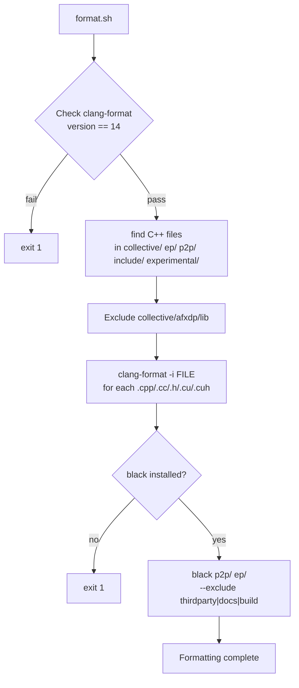
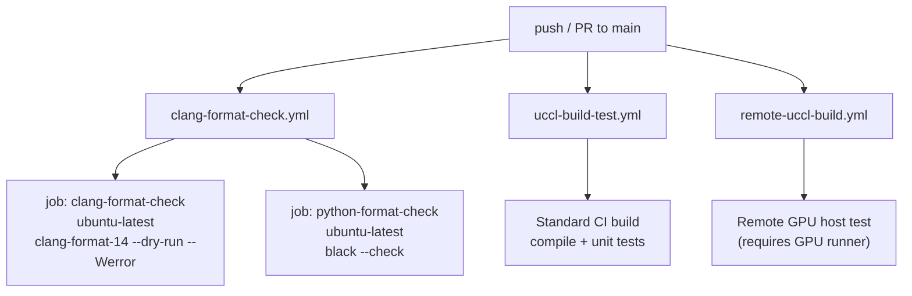
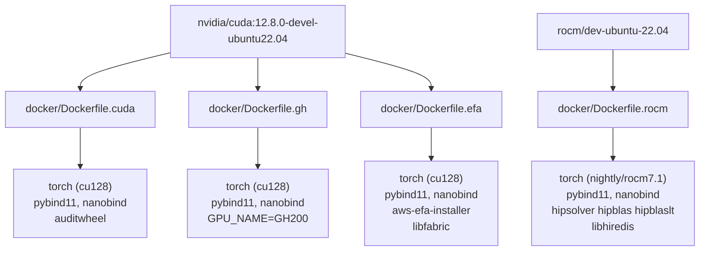
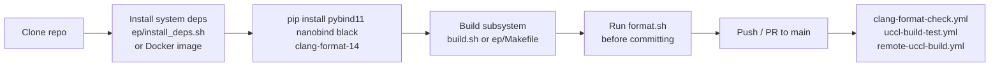

<!-- source: DeepWiki mcp.deepwiki.com · repo uccl-project/uccl · page 6.3 Development Environment · fetched 2026-11-11 -->

# Development Environment

<details>
<summary>Relevant source files</summary>

The following files were used as context for generating this wiki page:

- [.github/workflows/clang-format-check.yml](.github/workflows/clang-format-check.yml)
- [.gitignore](.gitignore)
- [docker/Dockerfile.cuda](docker/Dockerfile.cuda)
- [docker/Dockerfile.efa](docker/Dockerfile.efa)
- [docker/Dockerfile.gh](docker/Dockerfile.gh)
- [docker/Dockerfile.rocm](docker/Dockerfile.rocm)
- [ep/install_deps.sh](ep/install_deps.sh)
- [format.sh](format.sh)
- [pyproject.toml](pyproject.toml)
- [scripts/node_ips/tpu_2.txt](scripts/node_ips/tpu_2.txt)
- [scripts/setup_all.py](scripts/setup_all.py)
- [scripts/setup_nic.sh](scripts/setup_nic.sh)

</details>


This page covers the developer toolchain for the UCCL codebase: code formatting conventions, CI/CD workflows, Python build system metadata, and the artifact exclusion policy. For information on building the project and Docker environments, see [Build Scripts and Docker Environments](#6.1). For platform-specific Makefile differences, see [Platform-Specific Configuration](#6.2).

---

## Code Formatting

UCCL enforces consistent formatting for both C++ and Python source files. The entry point for local formatting is `format.sh`.

### C++ Formatting — clang-format

`format.sh` uses **clang-format version 14** to format all C++ source files. The script enforces a strict version check and will exit with an error if a different version is found.

[format.sh:13-38]()

| Property | Value |
|---|---|
| Required tool | `clang-format-14` |
| Fallback detection | `clang-format-14` → `clang-format` (via `$CLANG_FORMAT`) |
| Install via | `apt install clang-format-14` or `pip install clang-format==14` |

**Directories formatted:**

[format.sh:8]()

| Directory | Notes |
|---|---|
| `collective/` | Excluding `collective/afxdp/lib` |
| `ep/` | EP subsystem |
| `p2p/` | P2P engine |
| `include/` | Shared headers |
| `experimental/` | UKernel and experimental code |

**File extensions covered:** `.cpp`, `.cxx`, `.cc`, `.h`, `.hpp`, `.cu`, `.cuh`

### Python Formatting — black

After formatting C++, `format.sh` runs `black` on Python source directories.

[format.sh:69-87]()

| Property | Value |
|---|---|
| Required tool | `black` |
| Python directories | `p2p/`, `ep/` |
| Excluded subdirs | `thirdparty`, `docs`, `build` |

### Formatting Workflow Diagram

**Diagram: format.sh execution flow**



Sources: [format.sh:1-88]()

---

## GitHub Actions CI/CD

The repository uses three GitHub Actions workflows stored under `.github/workflows/`.

### Workflow Overview

**Diagram: CI/CD pipeline structure**



Sources: [.github/workflows/clang-format-check.yml:1-90]()

### `clang-format-check.yml`

Triggered on push and pull requests targeting `main`. Contains two independent jobs:

**`clang-format-check` job:**
- Runner: `ubuntu-latest`
- Installs `clang-format-14` via `apt`
- Runs `clang-format --dry-run --Werror` across the same directories and extensions that `format.sh` covers
- Fails the workflow if any file is not correctly formatted

**`python-format-check` job:**
- Runner: `ubuntu-latest`
- Python version: `3.10`
- Installs `black` via pip
- Runs `black --check` on `p2p/` and `ep/` with the same exclusion pattern as `format.sh`

[.github/workflows/clang-format-check.yml:1-90]()

### `uccl-build-test.yml` and `remote-uccl-build.yml`

These workflows handle compilation and test execution. `uccl-build-test.yml` runs the standard build and test suite on GitHub-hosted runners. `remote-uccl-build.yml` targets a remote GPU host for tests that require physical hardware. For details on what each test job validates, see [Test Suites and CI](#8.2).

---

## Python Build System

The root `pyproject.toml` defines the build system metadata for the `uccl` Python package.

[pyproject.toml:1-4]()

```toml
[build-system]
requires = ["setuptools>=42", "wheel", "pybind11>=2.6.0", "nanobind>=2.0.0"]
build-backend = "setuptools.build_meta"
```

| Dependency | Minimum Version | Purpose |
|---|---|---|
| `setuptools` | >=42 | Core package build machinery |
| `wheel` | latest | Binary wheel packaging |
| `pybind11` | >=2.6.0 | C++/Python bindings (P2P engine, CCL) |
| `nanobind` | >=2.0.0 | High-performance C++/Python bindings |

Both `pybind11` and `nanobind` are runtime build requirements because the package compiles C++ extension modules during `pip install`. The `ep/install_deps.sh` script also installs these directly via pip for developers setting up outside of Docker:

[ep/install_deps.sh:21-22]()

```bash
pip install pybind11 nanobind --upgrade
pip install black
```

---

## Docker Images for Development

Four Docker images provide reproducible build environments. All are located in `docker/`.

**Diagram: Docker image relationships and key differences**



| Dockerfile | Base Image | Target Use |
|---|---|---|
| `docker/Dockerfile.cuda` | `nvidia/cuda:12.8.0-devel-ubuntu22.04` | General CUDA builds |
| `docker/Dockerfile.gh` | `nvidia/cuda:12.8.0-devel-ubuntu22.04` | GitHub Actions + GH200 GPU runner |
| `docker/Dockerfile.efa` | `nvidia/cuda:12.8.0-devel-ubuntu22.04` | AWS EFA builds (includes EFA installer) |
| `docker/Dockerfile.rocm` | `rocm/dev-ubuntu-22.04` | AMD ROCm builds |

All four images:
- Use Python 3.13 (configurable via `ARG PY_VER`)
- Install `pybind11`, `nanobind`, `build`, `auditwheel` for wheel packaging
- Set `python3` and `python3-config` symlinks to the target version

The EFA image additionally runs the AWS EFA installer version `1.42.0` (configurable via `ARG EFA_VER`) in `--skip-kmod` mode and sets `LD_LIBRARY_PATH=/opt/amazon/efa/lib64`.

[docker/Dockerfile.cuda:1-51](), [docker/Dockerfile.gh:1-51](), [docker/Dockerfile.efa:1-75](), [docker/Dockerfile.rocm:1-54]()

---

## Artifact Exclusion Policy (.gitignore)

The `.gitignore` file prevents compiled and generated artifacts from being committed. The exclusions fall into distinct categories:

[.gitignore:1-102]()

| Category | Patterns | Notes |
|---|---|---|
| Object files | `*.o`, `*.ko`, `*.obj`, `*.elf`, `*.s`, `*.ll` | C/C++ and GPU compiler outputs |
| Static libraries | `*.lib`, `*.a`, `*.la`, `*.lo` | All archive formats |
| Shared libraries | `*.so`, `*.so.*`, `*.dylib`, `*.dll` | Built extension modules |
| Executables | `*.exe`, `*.out`, `*.app`, `*.x86_64` | Compiled test binaries |
| Kernel modules | `*.mod*`, `*.cmd`, `.tmp_versions/`, `modules.order`, `Module.symvers` | AF_XDP kernel build artifacts |
| XDP userspace | `xdp-loader`, `xdp_loader`, `af_xdp_user`, etc. | AF_XDP test programs |
| Test binaries | `pcie_test`, `transport_test` | Named test executables |
| Python cache | `__pycache__/`, `*.cache` | Bytecode caches |
| Python packaging | `uccl.egg-info/`, `dist/`, `wheelhouse-*/`, `build/` | Wheel and sdist output |
| Logs | `ep/*.log`, `*.log` | All log files |
| EP deep_ep | `ep/deep_ep_wrapper/deep_ep.egg-info/` | DeepEP wrapper egg info |
| Result data | `*result.jsonl`, `*.json` | Benchmark output files |
| Images | `*.png`, `ep/figs` | Generated figures |
| IDE | `.vscode/settings.json`, `.vscode/c_cpp_properties.json`, `.vscode/launch.json` | Per-user IDE configs |

The `nodes.txt` file is excluded to prevent accidental commit of node IP address inventory. Node IP files used by scripts are stored under `scripts/node_ips/` and are committed selectively (e.g. `scripts/node_ips/tpu_2.txt` is tracked).

---

## Developer Setup Summary

**Diagram: local developer setup steps (code entities)**



Sources: [format.sh:1-88](), [ep/install_deps.sh:1-84](), [pyproject.toml:1-4](), [.github/workflows/clang-format-check.yml:1-90]()

---

