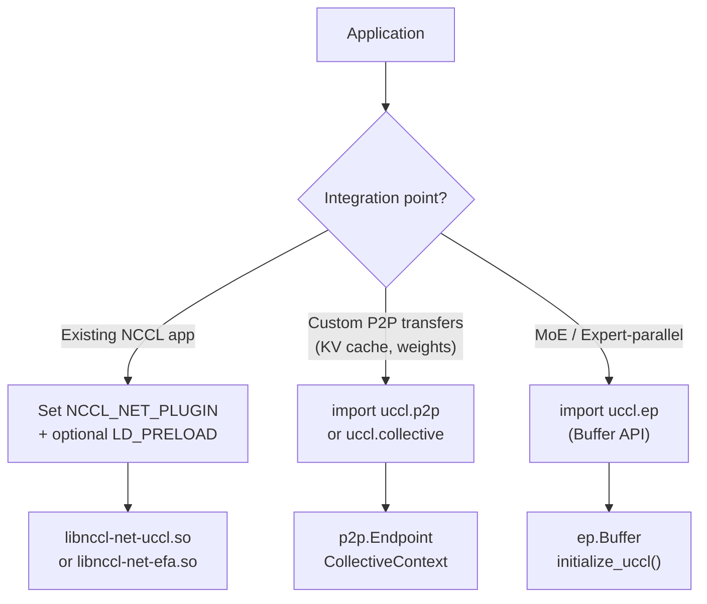
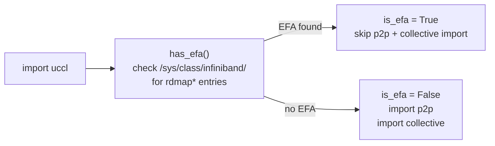
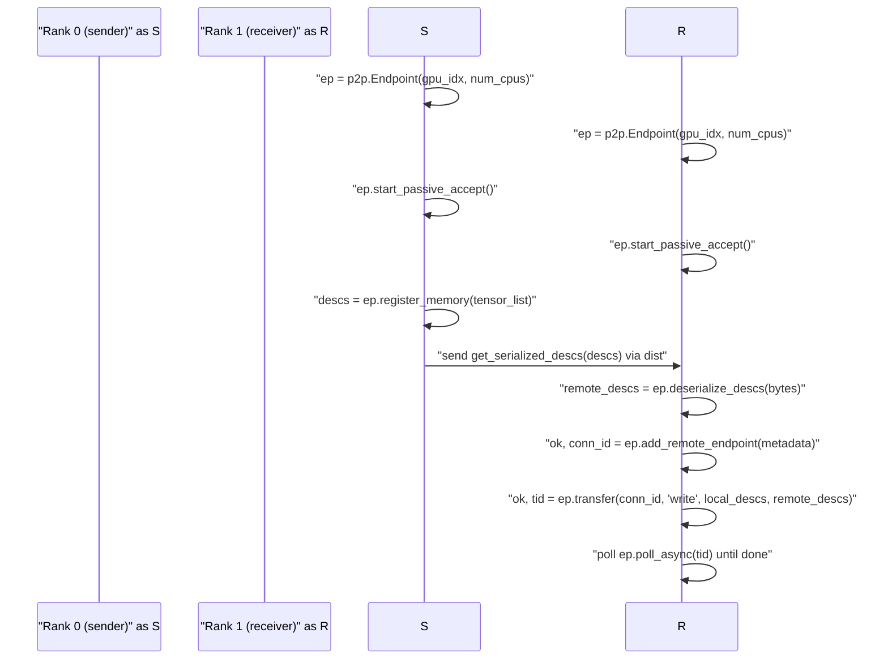
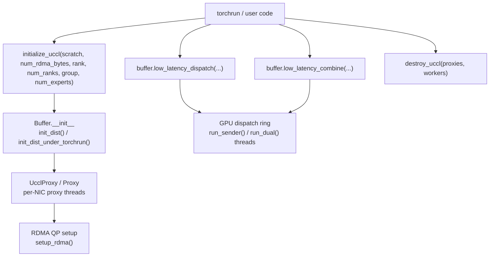
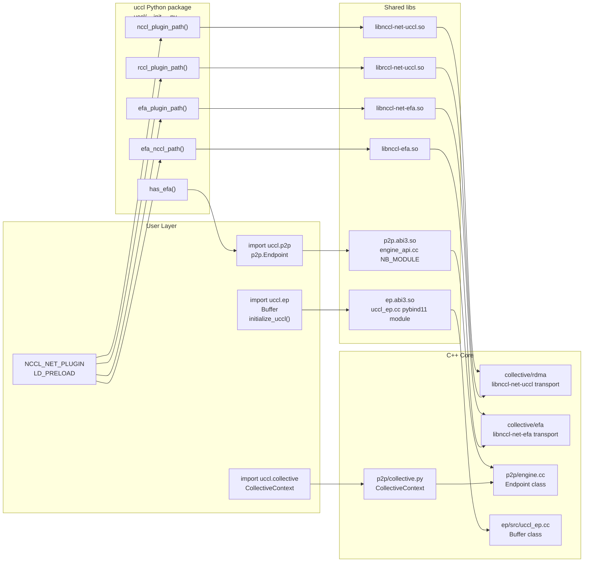

<!-- source: DeepWiki mcp.deepwiki.com · repo uccl-project/uccl · page 7 Integration and Usage · fetched 2026-11-11 -->

# Integration and Usage

<details>
<summary>Relevant source files</summary>

The following files were used as context for generating this wiki page:

- [.github/PULL_REQUEST_TEMPLATE.md](.github/PULL_REQUEST_TEMPLATE.md)
- [.github/workflows/uccl-build-test.yml](.github/workflows/uccl-build-test.yml)
- [README.md](README.md)
- [build.sh](build.sh)
- [collective/efa/README.md](collective/efa/README.md)
- [collective/rdma/README.md](collective/rdma/README.md)
- [docs/wheels.md](docs/wheels.md)
- [ep/Makefile](ep/Makefile)
- [ep/README.md](ep/README.md)
- [ep/bench/run_ep.sh](ep/bench/run_ep.sh)
- [ep/setup.py](ep/setup.py)
- [ep/src/common.cpp](ep/src/common.cpp)
- [p2p/Makefile.rocm](p2p/Makefile.rocm)
- [p2p/Makefile.therock](p2p/Makefile.therock)
- [p2p/benchmarks/benchmark_ray_p2p.py](p2p/benchmarks/benchmark_ray_p2p.py)
- [p2p/engine_api.cc](p2p/engine_api.cc)
- [scripts/efa_monitor.sh](scripts/efa_monitor.sh)
- [setup.py](setup.py)
- [shared.sh](shared.sh)
- [uccl/.gitignore](uccl/.gitignore)
- [uccl/__init__.py](uccl/__init__.py)

</details>


This page covers the patterns and entry points for integrating UCCL into real workloads. It focuses on what a user or application developer needs to wire up each subsystem. For details on internals, see: collective subsystem internals in [2](#2), P2P engine architecture in [3](#3), EP subsystem in [4](#4), and build system in [6](#6).

---

## Integration Patterns at a Glance

UCCL exposes three distinct integration surfaces, each targeting a different workload type:

| Pattern | Surface | Subsystem | Typical Use Case |
|---|---|---|---|
| NCCL/RCCL drop-in | `NCCL_NET_PLUGIN` env var | UCCL-collective | Existing PyTorch / DDP / FSDP / Megatron training jobs |
| Python P2P API | `uccl.p2p`, `uccl.collective` | UCCL-P2P | KV cache transfer, RL weight sync, custom point-to-point |
| Expert-parallel API | `uccl.ep` | UCCL-EP | MoE training and inference (DeepEP drop-in) |

**Integration flow:**



Sources: [README.md:90-118](), [uccl/__init__.py:1-53]()

---

## NCCL / RCCL Plugin Integration

The simplest integration path: point NCCL or RCCL to `libnccl-net-uccl.so` (or its EFA/RCCL variants) without changing application code.

### How the plugin is located

The `uccl` Python package exposes four helper functions in [uccl/__init__.py:32-53]() that return absolute paths to the installed `.so` files:

| Function | Returns path to | Use when |
|---|---|---|
| `nccl_plugin_path()` | `libnccl-net-uccl.so` | IB/RoCE, NVIDIA GPUs |
| `rccl_plugin_path()` | `librccl-net-uccl.so` | IB/RoCE, AMD GPUs |
| `efa_plugin_path()` | `libnccl-net-efa.so` | AWS EFA (p4d/p4de only) |
| `efa_nccl_path()` | `libnccl-efa.so` | AWS EFA, custom NCCL build |

All four functions resolve paths relative to the installed package directory ([uccl/__init__.py:34-53]()).

### Activating the plugin

Set environment variables before launching the Python process:

```bash
# IB/RoCE on NVIDIA (x86 or GH200 ARM)
export NCCL_NET_PLUGIN=$(python -c "import uccl; print(uccl.nccl_plugin_path())")

# IB/RoCE on AMD
export NCCL_NET_PLUGIN=$(python -c "import uccl; print(uccl.rccl_plugin_path())")

# AWS EFA (p4d / p4de only)
export LD_PRELOAD=$(python -c "import uccl; print(uccl.efa_nccl_path())")
export NCCL_NET_PLUGIN=$(python -c "import uccl; print(uccl.efa_plugin_path())")
```

No application code changes are required after these variables are set. PyTorch `DistributedDataParallel`, FSDP, Megatron-LM, DeepSpeed, and vLLM all pick up `NCCL_NET_PLUGIN` transparently.

### EFA-host detection and conditional import

When the `uccl` package is imported, [uccl/__init__.py:12-27]() runs `has_efa()` to check for EFA devices under `/sys/class/infiniband/`. On EFA hosts, the `p2p` and `collective` Python submodules are **not** auto-imported, because EFA preloads manage NIC access differently. On non-EFA hosts, both are imported if available.



Sources: [uccl/__init__.py:12-27](), [collective/efa/README.md:74-95](), [collective/rdma/README.md:160-180]()

### Collective-subsystem environment variables

These variables tune the UCCL-collective transport and apply whenever the NCCL plugin is loaded:

| Variable | Default | Description |
|---|---|---|
| `UCCL_IB_HCA` | (auto) | IB device name(s) to use |
| `UCCL_SOCKET_IFNAME` | (auto) | Control NIC for bootstrapping |
| `UCCL_PIN_TO_NUMA` | `1` | Pin threads to NUMA node |
| `UCCL_RCMODE` | `1` (Broadcom), `0` (others) | Use RC for data transfer |
| `UCCL_NUM_ENGINES` | `4` (NVIDIA), `1` (AMD) | Engines per device |
| `UCCL_PORT_ENTROPY` | `32` (NVIDIA), `256` (AMD) | Paths/QPs per engine |
| `UCCL_CHUNK_SIZE_KB` | `64` (NVIDIA), `128` (AMD) | Max WQE chunk size |
| `NCCL_NET_PLUGIN` | — | Path to plugin `.so` |

Sources: [collective/rdma/README.md:160-180](), [collective/efa/README.md:74-95]()

---

## PyTorch Integration Patterns

### P2P via `uccl.p2p.Endpoint`

`uccl.p2p` is a nanobind extension built from [p2p/engine_api.cc]() and exposes the `Endpoint` class. The typical two-node pattern:

**Endpoint-to-endpoint (NIXL-style transfer API):**



Key `Endpoint` methods (bound in [p2p/engine_api.cc:169-500+]()):

| Method | Purpose |
|---|---|
| `Endpoint(gpu_idx, num_cpus)` | Construct; allocates send/recv proxy threads |
| `start_passive_accept()` | Background thread listens for incoming connections |
| `register_memory(tensor_list)` | Registers GPU tensors for RDMA; returns `list[XferDesc]` |
| `get_serialized_descs(desc_list)` | Serialize `XferDesc` list to `bytes` for out-of-band exchange |
| `deserialize_descs(bytes)` | Reconstruct `XferDesc` list from `bytes` |
| `add_remote_endpoint(metadata_bytes)` | Establish connection from serialized remote metadata |
| `get_metadata()` | Return local endpoint metadata as `bytes` |
| `transfer(conn_id, op, local_descs, remote_descs)` | Issue async RDMA write or read |
| `poll_async(transfer_id)` | Check completion of a transfer |

**Pattern from benchmark_ray_p2p.py:**  
[p2p/benchmarks/benchmark_ray_p2p.py:262-335]() shows the full initialization sequence: `dist.init_process_group(backend="gloo")`, then construct `Endpoint`, call `start_passive_accept()`, exchange metadata via `dist.send`/`dist.recv`, and then perform `transfer()` + `poll_async()` in a loop.

Sources: [p2p/engine_api.cc:137-500](), [p2p/benchmarks/benchmark_ray_p2p.py:60-217]()

### Collective API via `uccl.collective`

`uccl.collective` (installed as `p2p/collective.py` into the `uccl/` package directory) provides a `CollectiveContext` that wraps `p2p.Endpoint` with collective semantics and PyTorch-compatible interfaces. See [3.4](#3.4) for a full description of `CollectiveContext`.

The typical initialization sequence:
1. Call `torch.distributed.init_process_group()` first.
2. Construct a `CollectiveContext` (it uses `torch.distributed.all_gather` internally for RDMA metadata exchange).
3. Call `register_tensor()` before using a tensor in transfers.
4. Use `send`, `recv`, `isend`, `irecv`, `allgather`, or `batch_isend_irecv` as drop-in replacements for `dist.*`.

Sources: [p2p/benchmarks/benchmark_ray_p2p.py:313-327](), [README.md:105-118]()

---

## Expert-Parallel (EP) Integration

UCCL-EP is a drop-in replacement for [DeepEP](https://github.com/deepseek-ai/DeepEP). It exposes `uccl.ep`, built from the `ep/` directory and installed to the `uccl/` package.

### Import verification

After installation:

```bash
python -c "import torch; import uccl.ep"
```

### Core API: `Buffer` and initialization helpers



The dispatch/combine calls accept standard PyTorch tensors and kwargs that mirror the DeepEP interface ([ep/README.md:55-81]()):

```python
# Dispatch
packed_recv_x, packed_recv_count, handle, event, hook = buffer.low_latency_dispatch(
    current_x, topk_idx, num_tokens, num_experts,
    use_fp8=..., async_finish=..., return_recv_hook=...
)

# Combine
combined_x, event, hook = buffer.low_latency_combine(
    simulated_gemm_x, topk_idx, topk_weights, handle,
    async_finish=..., zero_copy=..., return_recv_hook=..., out=...
)
```

### Launching EP benchmarks with `torchrun`

The `ep/bench/run_ep.sh` script ([ep/bench/run_ep.sh:1-30]()) supports four modes:

| Mode flag | Test script | Description |
|---|---|---|
| `ll` | `test_low_latency.py` | Low-latency dispatch/combine (128 tokens) |
| `ht` | `test_internode.py` | High-throughput normal mode (4096 tokens) |
| `ll-pressure` | `test_low_latency.py` | Low-latency with pressure test + hash debug |
| `ht-pressure` | `test_internode.py` | High-throughput with pressure test |

Example multi-node launch:

```bash
torchrun --nnodes=4 --nproc_per_node=8 --node_rank=<rank> \
  --master_addr=<ip> --master_port=12355 \
  bench/test_internode.py --num-tokens=4096 \
  --hidden=7168 --num-topk=8 --num-experts=288
```

### EP environment variables

These must be set before `torchrun` to avoid hangs and configure RDMA behavior:

| Variable | Default | Description |
|---|---|---|
| `UCCL_SOCKET_IFNAME` | (null) | Bootstrap NIC interface name |
| `UCCL_IB_GID_INDEX` | `-1` (auto) | GID index; must match `NCCL_IB_GID_INDEX` |
| `UCCL_IB_MAX_INFLIGHT_BYTES` | `SIZE_MAX` | Max in-flight bytes per GPU/NIC |
| `UCCL_IB_MAX_INFLIGHT_NORMAL` | `8` | Max in-flight writes per GPU/NIC (HT mode) |
| `UCCL_IB_MAX_INFLIGHT_LOW_LATENCY` | `32` | Max in-flight writes per GPU/NIC (LL mode) |
| `UCCL_IB_SL` | `3` (IB), `8` (EFA) | Service level |
| `UCCL_IB_TC` | `104` (IB), `0` (EFA) | Traffic class |

**Broadcom Thor-2:** Set `UCCL_IB_MAX_INFLIGHT_BYTES=1572864 UCCL_IB_MAX_INFLIGHT_NORMAL=1` to avoid CQE error 12.  
**AMD Pollara NIC:** Set `UCCL_IB_MAX_INFLIGHT_BYTES=2097152 UCCL_IB_MAX_INFLIGHT_NORMAL=1`.

Sources: [ep/README.md:119-134](), [ep/bench/run_ep.sh:1-30]()

---

## End-to-End Integration Map

This diagram maps each integration surface to its concrete code entities:



Sources: [uccl/__init__.py:1-53](), [p2p/engine_api.cc:137-200](), [ep/setup.py:329-349](), [shared.sh:99-163]()

---

## Installation Summary

All integration paths require the `uccl` Python package. Install via:

```bash
# Build for CUDA (IB/RoCE + P2P + EP)
bash build.sh cuda all --install

# Build for AMD ROCm
bash build.sh rocm all --install

# Build only EP
bash build.sh cuda ep --install
```

After installation, the package layout under site-packages looks like:

```
uccl/
├── __init__.py          # nccl_plugin_path(), efa_plugin_path(), has_efa(), etc.
├── collective.py        # CollectiveContext (copied from p2p/collective.py)
├── utils.py             # Transfer helpers (copied from p2p/utils.py)
├── p2p.abi3.so          # nanobind extension: p2p.Endpoint
├── ep.abi3.so           # pybind11 extension: ep.Buffer, initialize_uccl
└── lib/
    ├── libnccl-net-uccl.so
    ├── librccl-net-uccl.so
    ├── libnccl-net-efa.so
    ├── libnccl-efa.so
    └── libuccl_p2p.so
```

See [6](#6) for build system details and [1.2](#1.2) for platform-specific prerequisites.

Sources: [build.sh:396-424](), [setup.py:33-63](), [shared.sh:99-163]()

---

