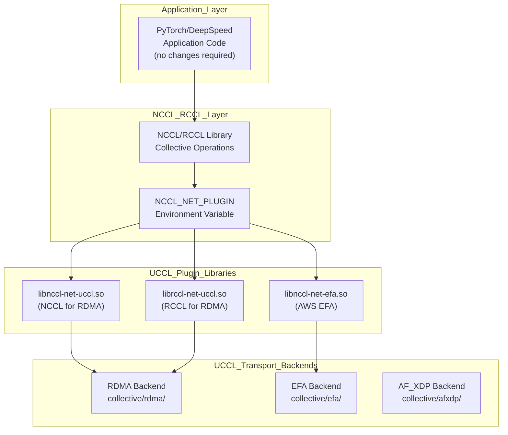
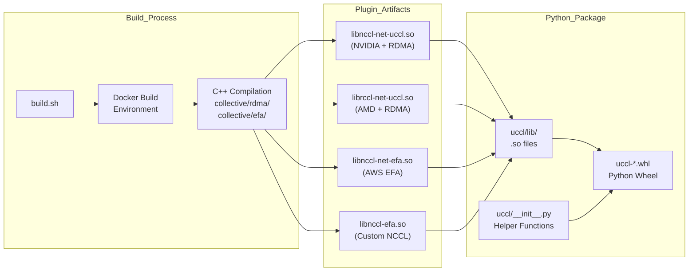
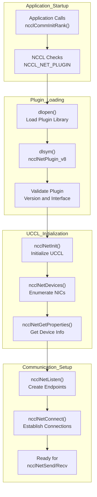

<!-- source: DeepWiki mcp.deepwiki.com · repo uccl-project/uccl · page 7.1 NCCL/RCCL Plugin Integration · fetched 2026-11-11 -->

# NCCL/RCCL Plugin Integration

<details>
<summary>Relevant source files</summary>

The following files were used as context for generating this wiki page:

- [.github/PULL_REQUEST_TEMPLATE.md](.github/PULL_REQUEST_TEMPLATE.md)
- [.github/workflows/uccl-build-test.yml](.github/workflows/uccl-build-test.yml)
- [README.md](README.md)
- [build.sh](build.sh)
- [collective/efa/README.md](collective/efa/README.md)
- [collective/rdma/README.md](collective/rdma/README.md)
- [docs/wheels.md](docs/wheels.md)
- [ep/Makefile](ep/Makefile)
- [ep/README.md](ep/README.md)
- [ep/bench/run_ep.sh](ep/bench/run_ep.sh)
- [ep/setup.py](ep/setup.py)
- [ep/src/common.cpp](ep/src/common.cpp)
- [p2p/Makefile.rocm](p2p/Makefile.rocm)
- [p2p/Makefile.therock](p2p/Makefile.therock)
- [p2p/benchmarks/benchmark_ray_p2p.py](p2p/benchmarks/benchmark_ray_p2p.py)
- [p2p/engine_api.cc](p2p/engine_api.cc)
- [scripts/efa_monitor.sh](scripts/efa_monitor.sh)
- [setup.py](setup.py)
- [shared.sh](shared.sh)
- [uccl/.gitignore](uccl/.gitignore)
- [uccl/__init__.py](uccl/__init__.py)

</details>


UCCL provides transparent integration with existing NCCL and RCCL-based applications through the standard NCCL network plugin mechanism. This enables UCCL to serve as a drop-in replacement for NCCL's built-in network transports **without requiring any changes to application code**. Users simply set environment variables to point NCCL/RCCL to UCCL's plugin libraries.

This page documents the plugin architecture, environment variable configuration, and the Python helper functions that simplify plugin path management.

## Transparent Integration via NCCL_NET_PLUGIN

UCCL integrates with NCCL/RCCL through the `NCCL_NET_PLUGIN` environment variable, which directs NCCL to load UCCL's network transport plugin instead of its built-in transports. This mechanism requires **zero application code changes** - existing PyTorch, DeepSpeed, or other NCCL-based applications work immediately with UCCL.

### Plugin Architecture Diagram



**Key Insight**: The application sees only standard NCCL APIs (`ncclAllReduce`, `ncclBcast`, etc.). NCCL dynamically loads UCCL's plugin via `NCCL_NET_PLUGIN`, which intercepts network operations and routes them through UCCL's optimized transport implementations.

Sources: [README.md:103-116](), [uccl/__init__.py:33-54]()

## Plugin Library Structure

UCCL builds multiple plugin libraries during the Docker-based build process. Each library corresponds to a specific transport backend and GPU vendor combination. The build system packages these plugins into the Python wheel for easy distribution.

### Build and Packaging Flow



### Plugin Libraries by Backend

| Plugin Library | Backend | GPU Support | Build Target | Description |
|----------------|---------|-------------|--------------|-------------|
| `libnccl-net-uccl.so` | RDMA/InfiniBand | NVIDIA | `ccl_rdma` | RDMA transport for NVIDIA GPUs |
| `librccl-net-uccl.so` | RDMA/InfiniBand | AMD | `ccl_rdma` | RDMA transport for AMD GPUs |
| `libnccl-net-efa.so` | AWS EFA | NVIDIA | `ccl_efa` | AWS EFA transport plugin |
| `libnccl-efa.so` | AWS EFA | NVIDIA | `ccl_efa` | Custom NCCL library for EFA |

Sources: [build.sh:53-115](), [setup.py:26-37](), [uccl/__init__.py:33-54]()

## Plugin Path Management with Python API

UCCL provides Python helper functions to automatically locate plugin libraries installed in the package. This eliminates the need to manually specify absolute paths, making integration more portable across different environments.

### Helper Functions

The `uccl` module exposes four main helper functions for plugin path discovery:

```python
import uccl

# For NVIDIA GPUs with RDMA/InfiniBand
nccl_plugin = uccl.nccl_plugin_path()
# Returns: /path/to/site-packages/uccl/lib/libnccl-net-uccl.so

# For AMD GPUs with RDMA/InfiniBand  
rccl_plugin = uccl.rccl_plugin_path()
# Returns: /path/to/site-packages/uccl/lib/librccl-net-uccl.so

# For AWS EFA (plugin)
efa_plugin = uccl.efa_plugin_path()
# Returns: /path/to/site-packages/uccl/lib/libnccl-net-efa.so

# For AWS EFA (custom NCCL library)
efa_nccl = uccl.efa_nccl_path()
# Returns: /path/to/site-packages/uccl/lib/libnccl-efa.so
```

### Implementation Details

These functions construct absolute paths by locating the `uccl` package installation directory and appending the library filename:

```python
# Implementation from uccl/__init__.py
def nccl_plugin_path():
    """Returns absolute path to the NCCL plugin .so file"""
    lib_dir = os.path.join(os.path.dirname(os.path.abspath(__file__)), "lib")
    return os.path.join(lib_dir, "libnccl-net-uccl.so")
```

Sources: [uccl/__init__.py:33-54](), [README.md:106-113]()

## Environment Variable Configuration

UCCL plugins are loaded and configured through environment variables. The most critical variable is `NCCL_NET_PLUGIN`, which tells NCCL/RCCL to use UCCL's network transport instead of the default.

### Quick Start Examples

#### NCCL over InfiniBand/RoCE (NVIDIA GPUs)

```bash
export NCCL_NET_PLUGIN=`python -c "import uccl; print(uccl.nccl_plugin_path())"`

# Run your PyTorch application
python your_training_script.py
```

#### RCCL over InfiniBand/RoCE (AMD GPUs)

```bash
export NCCL_NET_PLUGIN=`python -c "import uccl; print(uccl.rccl_plugin_path())"`

# Run your PyTorch application
python your_training_script.py
```

#### NCCL over AWS EFA (p4d, p4de instances)

```bash
export LD_PRELOAD=`python -c "import uccl; print(uccl.efa_nccl_path())"`
export NCCL_NET_PLUGIN=`python -c "import uccl; print(uccl.efa_plugin_path())"`

# Run your PyTorch application
python your_training_script.py
```

**Note**: The EFA backend requires both `LD_PRELOAD` (custom NCCL library) and `NCCL_NET_PLUGIN` (EFA transport) to be set.

Sources: [README.md:103-116]()

### Core Environment Variables

| Variable | Purpose | Required For | Example |
|----------|---------|--------------|---------|
| `NCCL_NET_PLUGIN` | Path to UCCL plugin library | All backends | `/path/to/libnccl-net-uccl.so` |
| `LD_PRELOAD` | Custom NCCL library to preload | EFA only | `/path/to/libnccl-efa.so` |

Sources: [README.md:103-116]()

## Integration with Distributed Training Frameworks

### PyTorch Distributed (torchrun)

UCCL works seamlessly with PyTorch's `torchrun` launcher. Simply set the environment variables before launching:

```bash
export NCCL_NET_PLUGIN=`python -c "import uccl; print(uccl.nccl_plugin_path())"`

torchrun --nproc_per_node=8 \
         --nnodes=4 \
         --master_addr=<master_ip> \
         --master_port=<port> \
         your_training_script.py
```

### Multi-Node with Shell Scripts

For multi-node setups, environment variables must be set on all nodes. A common pattern is to use a launcher script:

```bash
#!/bin/bash
# launch.sh

export NCCL_NET_PLUGIN=`python -c "import uccl; print(uccl.nccl_plugin_path())"`

# Additional NCCL tuning (optional)
export NCCL_SOCKET_IFNAME=eth0
export NCCL_IB_HCA=mlx5_0,mlx5_1

# Launch your application
python your_training_script.py
```

Execute this script on all nodes via your cluster management system (SLURM, Kubernetes, etc.).

Sources: [README.md:103-117]()

## Backend-Specific Configuration

Different UCCL transport backends support additional environment variables for fine-tuning performance. These are **optional** - the default settings work well for most use cases.

### RDMA/InfiniBand Backend

The RDMA backend (both `libnccl-net-uccl.so` and `librccl-net-uccl.so`) automatically detects InfiniBand HCAs and configures optimal settings. Advanced users can override defaults:

| Variable | Description | Default Behavior |
|----------|-------------|------------------|
| `UCCL_IB_HCA` | Comma-separated list of HCA names | Auto-detect all available HCAs |
| `UCCL_SOCKET_IFNAME` | Network interface for control traffic | Auto-detect from IB network |
| `UCCL_NUM_ENGINES` | Number of parallel engines per GPU | Platform-dependent (1-4) |
| `UCCL_CHUNK_SIZE_KB` | Data chunk size in KB | Platform-dependent (64-128) |

**Example**: Override HCA selection for multi-rail configurations:
```bash
export UCCL_IB_HCA=mlx5_0,mlx5_1,mlx5_2,mlx5_3
export NCCL_NET_PLUGIN=`python -c "import uccl; print(uccl.nccl_plugin_path())"`
```

### AWS EFA Backend

The EFA backend requires both the custom NCCL library (`LD_PRELOAD`) and the EFA plugin (`NCCL_NET_PLUGIN`). This is necessary because AWS EFA uses a modified NCCL transport layer.

**Minimal Configuration** (p4d, p4de):
```bash
export LD_PRELOAD=`python -c "import uccl; print(uccl.efa_nccl_path())"`
export NCCL_NET_PLUGIN=`python -c "import uccl; print(uccl.efa_plugin_path())"`
```

**Note**: On newer instances (p5, p5e, p5en, p6), the official AWS OFI NCCL plugin already provides excellent performance. UCCL's EFA backend primarily targets p4d/p4de instances.

Sources: [README.md:103-158]()

## Plugin Loading and Initialization Flow

When NCCL/RCCL starts up, it checks for the `NCCL_NET_PLUGIN` environment variable and dynamically loads the specified plugin library. The plugin must implement the standard NCCL network plugin interface to handle network communication.

### Runtime Loading Sequence



### Key Functions in Plugin Interface

The NCCL plugin interface defines a set of function pointers that UCCL must implement:

| Function | Purpose | UCCL Implementation |
|----------|---------|---------------------|
| `ncclNetInit()` | Initialize plugin | Probe hardware, configure transport |
| `ncclNetDevices()` | Return device count | Count available NICs/HCAs |
| `ncclNetGetProperties()` | Get device info | Return NIC speed, PCIe affinity |
| `ncclNetListen()` | Create listen endpoint | Setup RDMA/EFA listening socket |
| `ncclNetConnect()` | Connect to peer | Establish RDMA QP or EFA connection |
| `ncclNetIsend()` | Non-blocking send | Post RDMA send or EFA transmit |
| `ncclNetIrecv()` | Non-blocking receive | Post RDMA recv or EFA receive |
| `ncclNetTest()` | Test completion | Poll completion queues |

Sources: [README.md:25-47](), [uccl/__init__.py:1-54]()

## Protocol Support

UCCL currently supports the NCCL Simple protocol across all transport backends:

| Protocol | RDMA Plugin | EFA Plugin | AF_XDP Plugin | Status |
|----------|-------------|------------|---------------|---------|
| `Simple` | ✓ | ✓ | ✓ | Supported |
| `LL` | - | - | - | In Development |
| `LL128` | - | - | - | In Development |

The Simple protocol is specified via `NCCL_PROTO=Simple` and is required for all UCCL transport backends.

Sources: [doc/dev_efa.md:82](), [efa/run_p5en.sh:111]()

---

