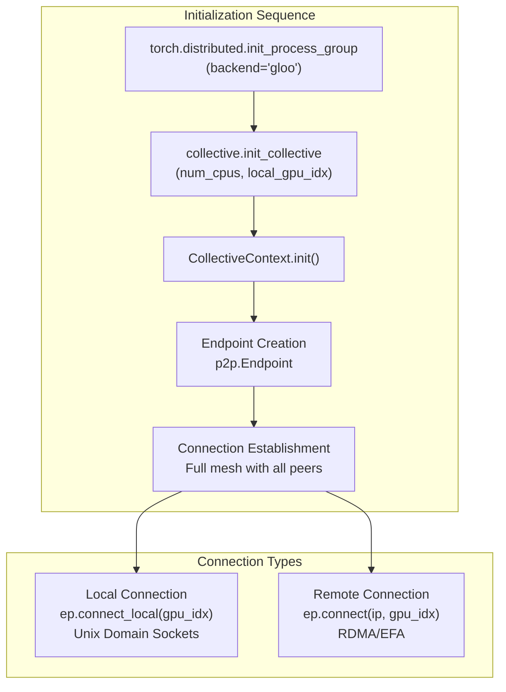
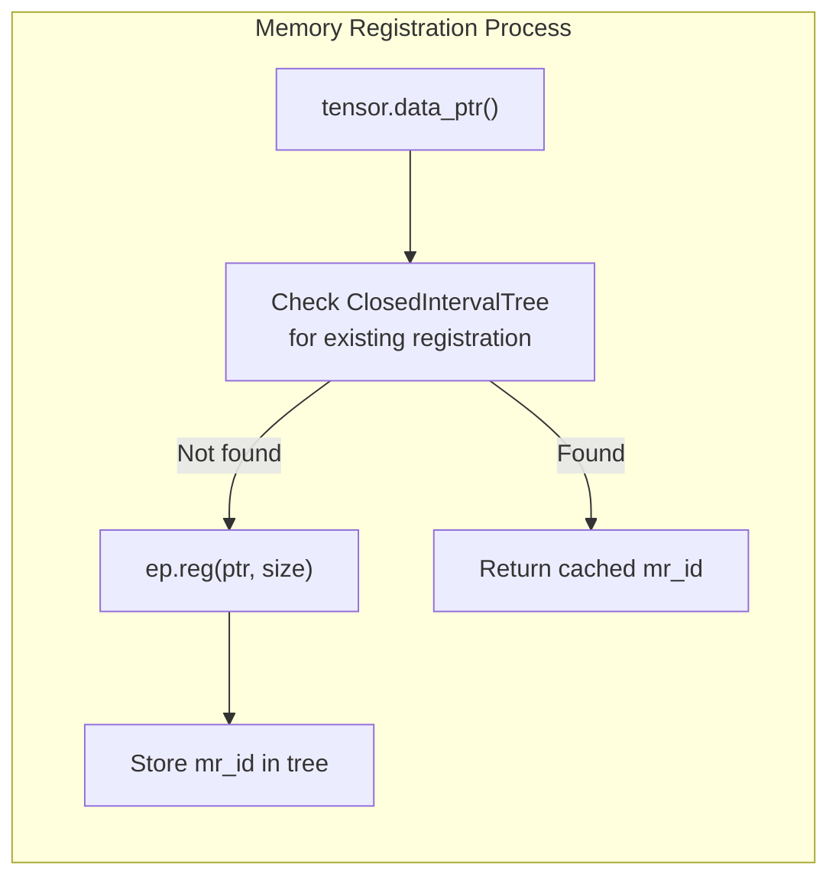
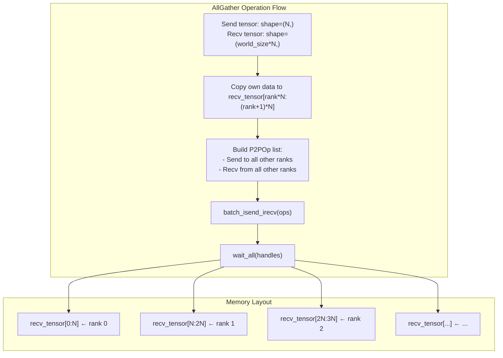
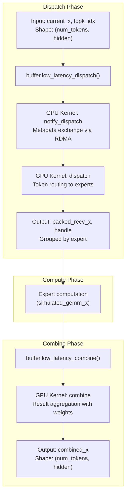
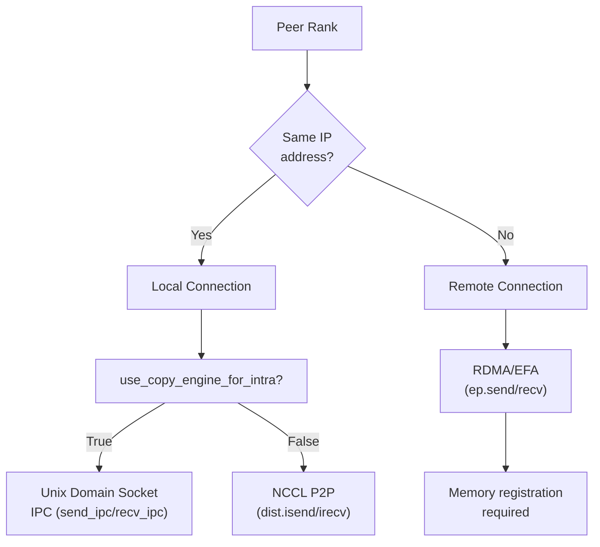

<!-- source: DeepWiki mcp.deepwiki.com · repo uccl-project/uccl · page 7.2 PyTorch Integration Patterns · fetched 2026-11-11 -->

# PyTorch Integration Patterns

<details>
<summary>Relevant source files</summary>

The following files were used as context for generating this wiki page:

- [p2p/Makefile.rocm](p2p/Makefile.rocm)
- [p2p/Makefile.therock](p2p/Makefile.therock)
- [p2p/benchmarks/benchmark_nccl_allgather.py](p2p/benchmarks/benchmark_nccl_allgather.py)
- [p2p/benchmarks/benchmark_ray_p2p.py](p2p/benchmarks/benchmark_ray_p2p.py)
- [p2p/benchmarks/benchmark_uccl_allgather.py](p2p/benchmarks/benchmark_uccl_allgather.py)
- [p2p/benchmarks/benchmark_uccl_alltoall.py](p2p/benchmarks/benchmark_uccl_alltoall.py)
- [p2p/benchmarks/benchmark_uccl_collective.py](p2p/benchmarks/benchmark_uccl_collective.py)
- [p2p/collective.py](p2p/collective.py)
- [p2p/engine_api.cc](p2p/engine_api.cc)
- [p2p/tests/test_util_interval_tree.py](p2p/tests/test_util_interval_tree.py)
- [p2p/utils.py](p2p/utils.py)
- [setup.py](setup.py)
- [shared.sh](shared.sh)
- [uccl/.gitignore](uccl/.gitignore)
- [uccl/__init__.py](uccl/__init__.py)

</details>


This page documents integration patterns for using UCCL with PyTorch applications, covering direct API usage with the P2P engine and expert parallelism (EP) for MoE models. For transparent NCCL plugin integration (requiring no code changes), see [NCCL/RCCL Plugin Integration](#6.1). For performance tuning parameters, see [Configuration and Tuning](#6.3).

---

## Integration Overview

UCCL provides two primary PyTorch integration patterns, each suited for different use cases:

| Pattern | Use Case | API Surface | Requires Code Changes |
|---------|----------|-------------|----------------------|
| **P2P Direct API** | Custom communication patterns, benchmarking, fine-grained control | `uccl.collective` Python module | Yes |
| **EP Integration** | MoE model training/inference with GPU-initiated communication | `uccl.ep` (deep_ep.Buffer) | Yes |
| **NCCL Plugin** (see [6.1](#6.1)) | Drop-in replacement for existing PyTorch code | Environment variables only | No |

Both patterns require `torch.distributed` to be initialized for process coordination, but handle data transfer through UCCL's optimized transport layers.

Sources: [p2p/collective.py:1-854](), [ep/README.md:1-187](), [p2p/benchmarks/benchmark_uccl_collective.py:1-464]()

---

## Pattern 1: P2P Direct API Integration

The P2P Direct API provides a NCCL-like interface through the `CollectiveContext` class for custom communication patterns.

### Initialization Pattern



**Basic initialization code pattern:**

```python
import torch
import torch.distributed as dist
from uccl import collective

# Initialize torch.distributed for coordination
dist.init_process_group(backend='gloo')

# Initialize UCCL collective context
collective.init_collective(
    num_cpus=4,                      # CPU threads for RDMA operations
    local_gpu_idx=None,               # Auto-detect from LOCAL_RANK
    use_copy_engine_for_intra=False   # Use NCCL for local, UCCL for remote
)

# Get context for operations
ctx = collective.get_collective()
```

The `CollectiveContext` class automatically:
- Derives local GPU index from `LOCAL_RANK` environment variable or torch.distributed context
- Establishes full mesh connections with all peers using concurrent threads
- Determines which peers are local (same node) vs remote (different nodes) based on IP addresses
- Creates separate send/receive connections for each peer

Sources: [p2p/collective.py:43-179](), [p2p/benchmarks/benchmark_uccl_collective.py:336-410]()

### Memory Registration for RDMA

**All remote (inter-node) communication requires memory registration.** Local (intra-node) communication via IPC does not require registration.

```python
# Create GPU tensor
tensor = torch.randn(1024 * 1024, dtype=torch.float32).cuda()

# Register for RDMA (required for remote peers only)
collective.register_tensor(tensor)

# Use tensor for communication...

# Deregister when done (optional, happens automatically at finalization)
collective.deregister_tensor(tensor)
```

The registration system uses an interval tree to track registered memory regions and avoid duplicate registrations:



Sources: [p2p/collective.py:327-380](), [p2p/utils.py:114-207]()

### Synchronous vs Asynchronous Operations

**Synchronous operations (blocking):**

```python
# Send tensor to rank 1
collective.send(tensor, dst=1)

# Receive tensor from rank 0
collective.recv(tensor, src=0)
```

**Asynchronous operations (non-blocking):**

```python
# Initiate async send
send_handle = collective.isend(tensor, dst=1)

# Initiate async receive
recv_handle = collective.irecv(tensor, src=0)

# Do other work...

# Wait for completion
collective.wait(send_handle)
collective.wait(recv_handle)

# Or wait for multiple operations
collective.wait_all([send_handle, recv_handle])
```

The async API returns different handle types depending on connection locality:
- **Remote connections**: Integer handle for UCCL async operation, checked via `ep.poll_async(handle)`
- **Local connections with NCCL**: `dist.Work` object, checked via `work.is_completed()`

Sources: [p2p/collective.py:382-578](), [p2p/benchmarks/benchmark_uccl_collective.py:110-168]()

### Batch Operations for Improved Performance

Batch operations reduce overhead by launching multiple sends/receives concurrently:

```python
# Create operation descriptors
ops = [
    collective.P2POp(collective.isend, send_tensor, peer_rank),
    collective.P2POp(collective.irecv, recv_tensor, peer_rank),
]

# Execute all operations in batch
handles = collective.batch_isend_irecv(ops)

# Wait for all to complete
collective.wait_all(handles)
```

This pattern is used extensively for collective operations like allgather and ring communication patterns.

Sources: [p2p/collective.py:622-697](), [p2p/benchmarks/benchmark_uccl_collective.py:189-228]()

### AllGather Implementation Example



The implementation splits the receive tensor into chunks and uses batch operations:

```python
def iallgather(send_tensor, recv_tensor):
    chunk_numel = send_tensor.numel()
    recv_chunks = [
        recv_tensor.view(-1)[i * chunk_numel : (i + 1) * chunk_numel].view(send_tensor.shape)
        for i in range(world_size)
    ]
    
    # Copy own data
    recv_chunks[rank].copy_(send_tensor)
    
    # Build batch operations
    ops = []
    for peer in range(world_size):
        if peer != rank:
            ops.append(P2POp("send", send_tensor, peer))
    for peer in range(world_size):
        if peer != rank:
            ops.append(P2POp("recv", recv_chunks[peer], peer))
    
    return batch_isend_irecv(ops)
```

Sources: [p2p/collective.py:699-753](), [p2p/benchmarks/benchmark_uccl_allgather.py:110-189]()

---

## Pattern 2: EP Integration for MoE Models

The EP (Expert Parallelism) system provides GPU-initiated communication optimized for MoE workloads, compatible with the DeepEP interface.

### Buffer Initialization and Configuration

```python
import torch.distributed as dist
import deep_ep  # Provided by uccl.ep

# Initialize torch.distributed
rank, world_size, group = init_distributed()

# Calculate required buffer size
num_rdma_bytes = deep_ep.Buffer.get_low_latency_rdma_size_hint(
    num_tokens=128,
    hidden=7168,
    num_ranks=world_size,
    num_experts=288
)

# Create buffer with configuration
buffer = deep_ep.Buffer(
    group,
    num_rdma_bytes=num_rdma_bytes,
    low_latency_mode=True,              # Enable low-latency kernels
    num_qps_per_rank=num_experts // world_size,  # QPs per rank
    allow_nvlink_for_low_latency_mode=True,      # Enable NVLink optimization
    explicitly_destroy=True              # Manual resource cleanup
)
```

The `Buffer` class encapsulates:
- **Proxy system**: C++ proxy managing RDMA queue pairs and resources
- **GPU kernel dispatch**: Launches dispatch/combine kernels with optimal configurations
- **Memory management**: Handles buffer allocation and registration
- **Connection topology**: Manages both RDMA (inter-node) and NVLink (intra-node) paths

Sources: [ep/README.md:1-48](), [thirdparty/DeepEP/tests/test_low_latency.py:163-178]()

### Low-Latency Dispatch/Combine Operations



**Dispatch operation** routes tokens to the appropriate expert ranks:

```python
# Dispatch tokens to experts
packed_recv_x, packed_recv_count, handle, event, hook = buffer.low_latency_dispatch(
    current_x,                          # Input tokens: (num_tokens, hidden)
    topk_idx,                           # Expert indices: (num_tokens, num_topk)
    num_tokens,
    num_experts,
    use_fp8=True,                       # Enable FP8 quantization
    round_scale=False,                  # Scale rounding mode
    use_ue8m0=False,                    # UE8M0 format
    cumulative_local_expert_recv_stats=stats_buffer,  # Track received tokens
    async_finish=False,                 # Synchronous completion
    return_recv_hook=False              # Return event instead of hook
)

# Wait for completion
event.current_stream_wait()

# packed_recv_x: Tuple of (tokens_fp8, scales_fp8) if use_fp8=True
#                or BF16 tensor if use_fp8=False
# handle: Contains routing metadata for combine phase
```

**Combine operation** aggregates expert outputs back to original token positions:

```python
# Combine expert outputs
combined_x, event, hook = buffer.low_latency_combine(
    simulated_gemm_x,                   # Expert outputs
    topk_idx,                           # Same indices from dispatch
    topk_weights,                       # Expert weights: (num_tokens, num_topk)
    handle,                             # Routing handle from dispatch
    use_logfmt=False,                   # LogFMT format
    async_finish=False,
    zero_copy=False,                    # Zero-copy optimization
    return_recv_hook=False,
    out=output_buffer                   # Optional pre-allocated output
)

event.current_stream_wait()
# combined_x: (num_tokens, hidden)
```

Sources: [ep/README.md:49-84](), [thirdparty/DeepEP/tests/test_low_latency.py:40-108]()

### Normal Mode (Throughput-Optimized) Operations

For training workloads with larger batch sizes, normal mode provides higher throughput:

```python
# Get dispatch layout
num_tokens_per_rank, num_tokens_per_rdma_rank, num_tokens_per_expert, is_token_in_rank, handle = \
    buffer.get_dispatch_layout(topk_idx, num_experts)

# Configure for throughput
config = deep_ep.Config(
    num_sms=24,                         # Number of SMs to use
    nvl_chunk_size=8,                   # NVLink chunk size
    nvl_buffer_size=512,                # NVLink buffer size
    rdma_chunk_size=16,                 # RDMA chunk size
    rdma_buffer_size=128                # RDMA buffer size
)

# Dispatch with configuration
recv_x, recv_topk_idx, recv_topk_weights, recv_num_tokens_per_expert_list, handle, event = \
    buffer.dispatch(
        x=current_x,                     # Can be BF16 tensor or (FP8, scales) tuple
        num_tokens_per_rank=num_tokens_per_rank,
        num_tokens_per_rdma_rank=num_tokens_per_rdma_rank,
        is_token_in_rank=is_token_in_rank,
        num_tokens_per_expert=num_tokens_per_expert,
        config=config,
        topk_idx=topk_idx,               # Optional for first dispatch
        topk_weights=topk_weights,       # Optional
        async_finish=True                # Non-blocking
    )

# Combine with configuration
combined_x, combined_topk_weights, event = buffer.combine(
    x=recv_x,
    bias=(bias_0, bias_1),               # Optional bias tensors
    handle=handle,
    config=config,
    topk_weights=recv_topk_weights,      # Optional
    async_finish=True
)
```

The normal mode uses warp-specialized kernels with distinct roles:
- **Senders**: Post RDMA write operations
- **Forwarders**: Route data via NVLink within nodes
- **Receivers**: Poll completion queues and pack incoming data

Sources: [thirdparty/DeepEP/tests/test_internode.py:15-225]()

### Performance Characteristics by Mode

| Mode | Batch Size | Latency (dispatch+combine) | Throughput (RDMA) | Use Case |
|------|-----------|---------------------------|-------------------|----------|
| **Low-Latency** | 128 tokens | 136-300 µs | 30-55 GB/s | Inference, online serving |
| **Normal (Throughput)** | 4096 tokens | 1200-7000 µs | 50-70 GB/s | Training, large batches |

Example performance on H200 with 16x 200Gb/s EFA (DeepSeek-V3 config):

```
Low-Latency (128 tokens, top-8, 7168 hidden):
- Dispatch: 226 µs, 36 GB/s (16 experts)
- Combine: 293 µs, 48 GB/s (16 experts)

Normal Mode (4096 tokens, top-8, 7168 hidden):
- Dispatch: 1196 µs, 50 GB/s (16 experts)  
- Combine: 6379 µs, 18 GB/s (16 experts)
```

Sources: [ep/README.md:116-187]()

---

## Pattern 3: Hybrid Local/Remote Communication

Both P2P and EP systems automatically optimize communication based on peer locality.

### Connection Type Selection Logic



The `CollectiveContext` determines locality during initialization:

```python
# During connection establishment
local_ip, _, _ = p2p.Endpoint.parse_metadata(all_metadata[rank])

for peer_rank in range(world_size):
    if peer_rank != rank:
        peer_ip, _, _ = p2p.Endpoint.parse_metadata(all_metadata[peer_rank])
        self.local_connections[peer_rank] = (peer_ip == local_ip)
```

### Transparent API with Locality Optimization

The send/receive API automatically selects the appropriate transport:

```python
def send(self, tensor, dst):
    if self.local_connections[dst]:
        if self.use_copy_engine_for_intra:
            # Use IPC (no registration needed)
            self.ep.send_ipc(conn_id, ptr, size)
        else:
            # Use NCCL for local
            dist.send(tensor, dst, group=self.group)
    else:
        # Use RDMA (requires registration)
        mr_id = self.check_tensor_registered(tensor)
        if mr_id is None:
            raise RuntimeError("Tensor not registered for remote communication")
        self.ep.send(conn_id, mr_id, ptr, size)
```

**Key differences:**
- **Local communication**: No memory registration required, can use NCCL or IPC
- **Remote communication**: Requires memory registration, uses RDMA/EFA transport
- **Async operations**: Return different handle types (`int` vs `dist.Work`) based on locality

Sources: [p2p/collective.py:181-318](), [p2p/collective.py:382-534]()

---

## Common Integration Patterns

### Ring Communication Pattern

Useful for reduce-scatter and similar collective operations:

```python
rank = dist.get_rank()
world_size = dist.get_world_size()

# Ring topology: each rank sends to next, receives from previous
send_rank = (rank + 1) % world_size
recv_rank = (rank - 1 + world_size) % world_size

# Register tensors
collective.register_tensor(send_tensor)
collective.register_tensor(recv_tensor)

# Execute ring step
handles = collective.batch_isend_irecv([
    collective.P2POp(collective.isend, send_tensor, send_rank),
    collective.P2POp(collective.irecv, recv_tensor, recv_rank),
])
collective.wait_all(handles)
```

Sources: [p2p/benchmarks/benchmark_uccl_collective.py:231-327](), [p2p/benchmarks/benchmark_uccl_alltoall.py:182-256]()

### FCP (Fractional Circular Permutation) All-to-All

For disaggregated attention and similar workloads:

```python
# Get communication plan for this iteration
plans = get_fcp_comm_plans(world_size, num_iters)
send_rank = plans[iter_idx][0][rank]
recv_rank = plans[iter_idx][1][rank]

# Execute planned communication
handles = collective.batch_isend_irecv([
    collective.P2POp(collective.isend, send_tensor, send_rank),
    collective.P2POp(collective.irecv, recv_tensor, recv_rank),
])
collective.wait_all(handles)
```

Sources: [p2p/benchmarks/benchmark_uccl_alltoall.py:113-180]()

### Error Handling and Cleanup

```python
try:
    # Initialize collective
    collective.init_collective(num_cpus=4)
    
    # Create and register tensors
    tensor = torch.randn(1024, 1024).cuda()
    collective.register_tensor(tensor)
    
    # Perform operations
    collective.send(tensor, dst=1)
    
finally:
    # Always finalize to clean up resources
    collective.finalize_collective()
    dist.destroy_process_group()
```

The `finalize_collective()` function:
- Deregisters all memory regions
- Closes all connections
- Frees internal data structures
- Must be called before `dist.destroy_process_group()`

Sources: [p2p/collective.py:580-592](), [p2p/benchmarks/benchmark_uccl_collective.py:453-456]()

---

## Platform-Specific Considerations

### CUDA vs ROCm

UCCL uses a unified GPU runtime abstraction layer that supports both CUDA and ROCm:

| Symbol | CUDA | ROCm |
|--------|------|------|
| Stream type | `cudaStream_t` | `hipStream_t` |
| Memory operations | `cudaMalloc`, `cudaMemcpy` | `hipMalloc`, `hipMemcpy` |
| Device management | `cudaSetDevice` | `hipSetDevice` |
| IPC handles | `cudaIpcMemHandle_t` | `hipIpcMemHandle_t` |

The abstraction is defined in `include/util/gpu_rt.h` with compile-time selection based on `__HIP_PLATFORM_AMD__`.

Sources: [include/util/gpu_rt.h:1-157]()

### Docker Build Environments

UCCL provides platform-specific Docker images for builds:

| Platform | Base Image | PyTorch Source | Network Support |
|----------|------------|----------------|-----------------|
| **CUDA** | `nvidia/cuda:12.8.0` | PyPI cu128 | InfiniBand, EFA |
| **ROCm** | `rocm/dev-ubuntu-22.04` | Nightly rocm7.0 | InfiniBand, Broadcom |
| **GH200** | `nvidia/cuda:12.4.1` (ARM64) | PyPI cu126 | InfiniBand, EFA |
| **EFA** | `nvidia/cuda:12.8.0` + EFA installer | PyPI cu128 | AWS EFA |
| **TheRock** | manylinux + ROCm | N/A (user-provided) | Generic |

Each environment installs:
- Python 3.13 (via deadsnakes PPA)
- PyTorch with matching accelerator support
- Build tools (pybind11, auditwheel)
- Network libraries (libibverbs, libefa where applicable)

Sources: [docker/Dockerfile.cuda:1-52](), [docker/Dockerfile.rocm:1-54](), [docker/Dockerfile.gh:1-51](), [docker/Dockerfile.efa:1-76](), [docker/Dockerfile.therock:1-17]()

---

## Best Practices

### Memory Management

1. **Register tensors once, use many times**: Registration is expensive, cache registered tensors
2. **Match registration lifetime to tensor lifetime**: Deregister when tensor is no longer needed
3. **Use contiguous tensors**: Non-contiguous tensors cannot be registered
4. **Pre-allocate buffers**: Reuse buffers across iterations to avoid repeated allocation/registration

### Performance Optimization

1. **Use batch operations**: `batch_isend_irecv()` reduces kernel launch overhead
2. **Overlap communication and computation**: Use async operations with `isend/irecv`
3. **Tune EP configuration parameters**: `nvl_chunk_size`, `rdma_chunk_size` significantly impact throughput
4. **Profile with CUDA events**: Use `torch.cuda.Event` to measure communication latency accurately

### Device and Process Management

1. **Set CUDA device early**: Call `torch.cuda.set_device()` before any GPU operations
2. **Use torchrun for multi-node**: Ensures correct `RANK`, `WORLD_SIZE`, `LOCAL_RANK` environment variables
3. **Synchronize before benchmarking**: Call `torch.cuda.synchronize()` and `dist.barrier()` to ensure fair timing
4. **Clean up in finally blocks**: Always call `finalize_collective()` even on exceptions

Sources: [p2p/benchmarks/benchmark_uccl_collective.py:23-463](), [thirdparty/DeepEP/tests/utils.py:109-243]()

---

