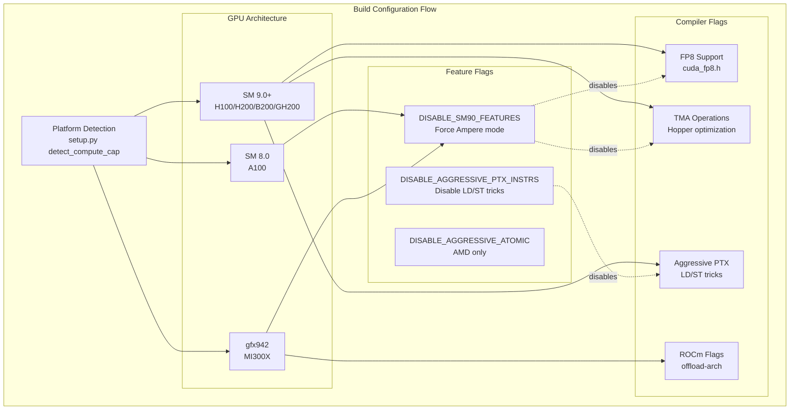
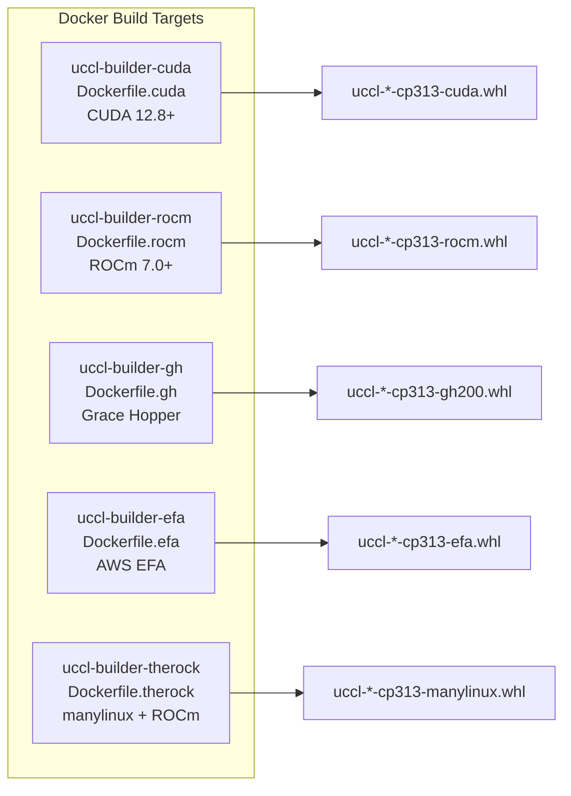
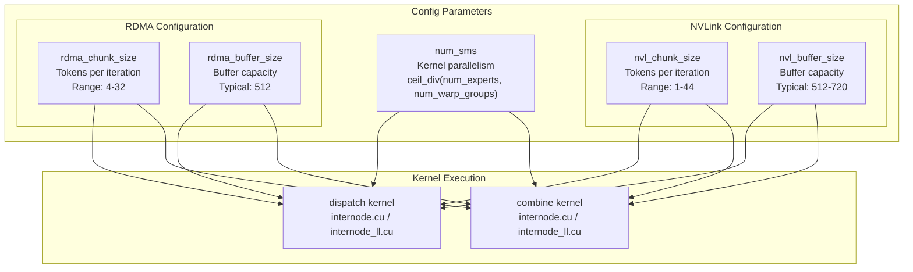
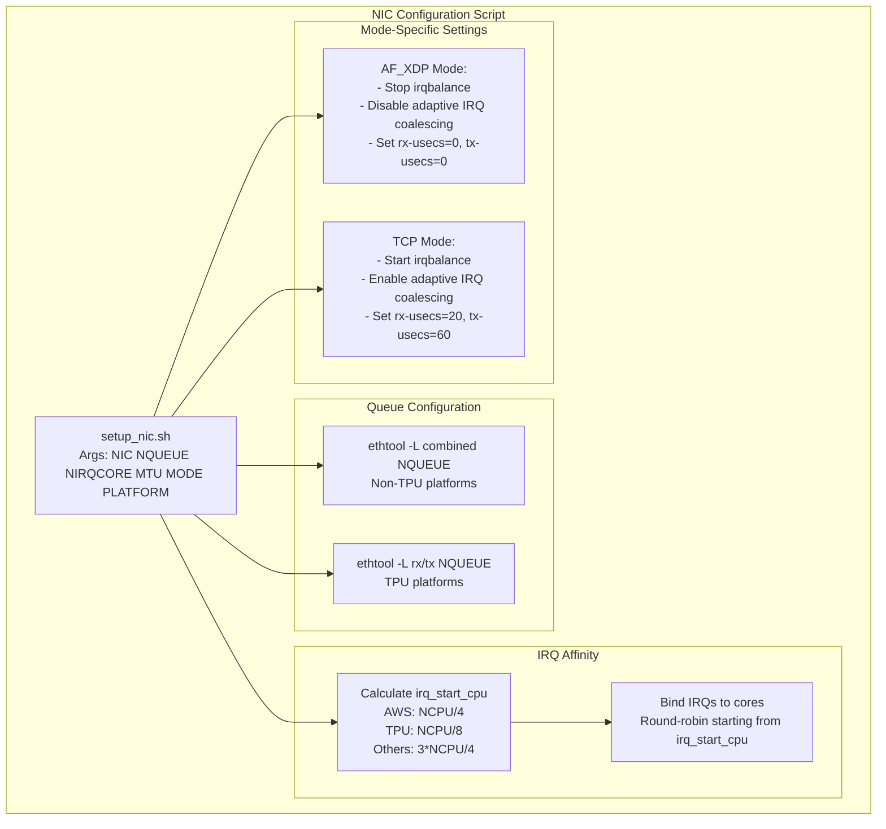
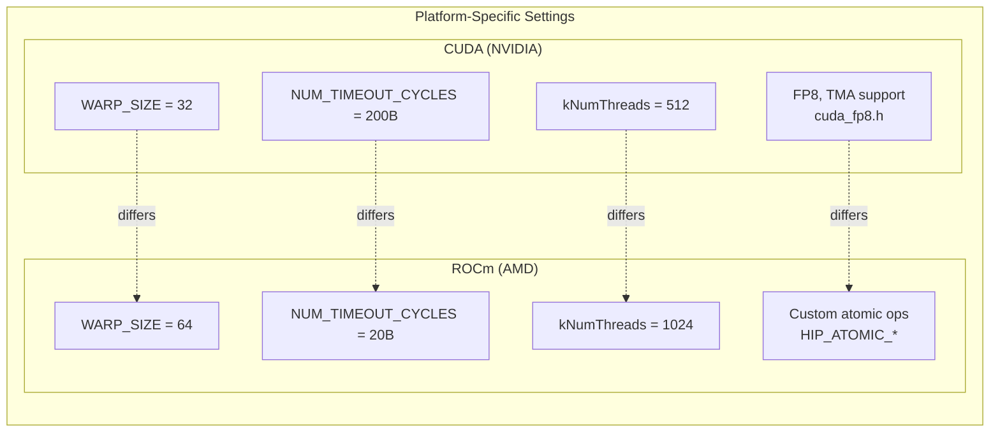

<!-- source: DeepWiki mcp.deepwiki.com · repo uccl-project/uccl · page 7.3 Configuration and Tuning · fetched 2026-11-11 -->

# Configuration and Tuning

<details>
<summary>Relevant source files</summary>

The following files were used as context for generating this wiki page:

- [.github/PULL_REQUEST_TEMPLATE.md](.github/PULL_REQUEST_TEMPLATE.md)
- [.github/workflows/clang-format-check.yml](.github/workflows/clang-format-check.yml)
- [.github/workflows/uccl-build-test.yml](.github/workflows/uccl-build-test.yml)
- [README.md](README.md)
- [build.sh](build.sh)
- [collective/efa/README.md](collective/efa/README.md)
- [collective/rdma/README.md](collective/rdma/README.md)
- [docs/wheels.md](docs/wheels.md)
- [ep/Makefile](ep/Makefile)
- [ep/README.md](ep/README.md)
- [ep/bench/buffer.py](ep/bench/buffer.py)
- [ep/bench/run_ep.sh](ep/bench/run_ep.sh)
- [ep/bench/test_internode.py](ep/bench/test_internode.py)
- [ep/bench/test_low_latency.py](ep/bench/test_low_latency.py)
- [ep/bench/utils.py](ep/bench/utils.py)
- [ep/include/common.hpp](ep/include/common.hpp)
- [ep/include/ep_configs.cuh](ep/include/ep_configs.cuh)
- [ep/include/ep_utils.cuh](ep/include/ep_utils.cuh)
- [ep/include/proxy.hpp](ep/include/proxy.hpp)
- [ep/include/proxy_ctx.hpp](ep/include/proxy_ctx.hpp)
- [ep/include/rdma.hpp](ep/include/rdma.hpp)
- [ep/include/uccl_ibgda.cuh](ep/include/uccl_ibgda.cuh)
- [ep/include/uccl_proxy.hpp](ep/include/uccl_proxy.hpp)
- [ep/setup.py](ep/setup.py)
- [ep/src/common.cpp](ep/src/common.cpp)
- [ep/src/internode.cu](ep/src/internode.cu)
- [ep/src/internode_ll.cu](ep/src/internode_ll.cu)
- [ep/src/proxy.cpp](ep/src/proxy.cpp)
- [ep/src/rdma.cpp](ep/src/rdma.cpp)
- [ep/src/uccl_ep.cc](ep/src/uccl_ep.cc)
- [ep/src/uccl_proxy.cpp](ep/src/uccl_proxy.cpp)
- [format.sh](format.sh)
- [scripts/efa_monitor.sh](scripts/efa_monitor.sh)
- [scripts/node_ips/tpu_2.txt](scripts/node_ips/tpu_2.txt)
- [scripts/setup_all.py](scripts/setup_all.py)
- [scripts/setup_nic.sh](scripts/setup_nic.sh)

</details>


This page documents performance tuning parameters, environment variables, and configuration mechanisms for UCCL components across different workloads and hardware platforms. For integration patterns and usage examples, see [PyTorch Integration Patterns](#6.2). For NCCL plugin environment variables, see [NCCL/RCCL Plugin Integration](#6.1).

## Overview

UCCL configuration occurs at three levels:

1. **Build-time configuration**: Compiler flags, architecture detection, and feature selection
2. **Runtime configuration**: Buffer sizes, chunk sizes, number of SMs, and kernel parameters
3. **System configuration**: NIC settings, IRQ affinity, and network tuning

The primary tuning interface is the `Config` class in the EP system, which controls buffer sizes and parallelism parameters. Performance tuning typically involves iterating through different configurations to find optimal chunk sizes and buffer allocations for specific workloads.

## Build-Time Configuration

### Architecture Detection and Compiler Flags

The build system automatically detects GPU architecture and sets appropriate compiler flags. Configuration is controlled through [ep/setup.py]() and [ep/Makefile]().



**Sources**: [ep/setup.py:85-190](), [ep/Makefile:16-61]()

### Key Build Flags

| Flag | Purpose | Default Behavior |
|------|---------|------------------|
| `TORCH_CUDA_ARCH_LIST` | Set GPU architecture (e.g., "9.0", "8.0") | Auto-detected via `nvidia-smi` |
| `DISABLE_SM90_FEATURES` | Force Ampere (SM 8.0) compatibility | Disabled for SM 9.0+, enabled for AMD |
| `DISABLE_AGGRESSIVE_PTX_INSTRS` | Disable `LD/ST` optimizations | Enabled for SM < 9.0 |
| `DISABLE_AGGRESSIVE_ATOMIC` | Use standard atomic operations (AMD) | Disabled |
| `EFA_HOME` | Path to AWS EFA installation | `/opt/amazon/efa` |
| `USE_GRACE_HOPPER` | Enable GH200-specific optimizations | Auto-detected |

**Sources**: [ep/setup.py:141-190](), [ep/Makefile:1-61]()

### Platform-Specific Docker Builds

UCCL provides Docker environments with pre-configured compiler settings:



**Sources**: [docker/Dockerfile.cuda](), [docker/Dockerfile.rocm](), [docker/Dockerfile.gh](), [docker/Dockerfile.efa](), [docker/Dockerfile.therock]()

## Runtime Configuration: EP System

### Config Class Structure

The primary tuning interface is the `Config` class, which controls buffer allocation and kernel parallelism:

```python
from uccl.ep import Config

config = Config(
    num_sms,                  # Number of SMs to use for kernels
    nvl_chunk_size,           # NVLink chunk size (tokens per iteration)
    nvl_buffer_size,          # NVLink buffer capacity (tokens)
    rdma_chunk_size,          # RDMA chunk size (tokens per iteration)
    rdma_buffer_size          # RDMA buffer capacity (tokens)
)
```

**Sources**: [ep/bench/test_internode.py:175-179]()

### Configuration Parameters



**Sources**: [ep/bench/test_internode.py:367-421]()

### Static Configuration Constants

Key constants are defined in [ep/include/ep_configs.cuh]():

| Constant | Value | Purpose |
|----------|-------|---------|
| `NUM_MAX_NVL_PEERS` | 8 | Maximum GPUs per node |
| `NUM_MAX_RDMA_PEERS` | 20 | Maximum RDMA-connected nodes |
| `NUM_WORKSPACE_BYTES` | 32 MB | Scratch space for kernels |
| `NUM_MAX_LOCAL_EXPERTS` | 1024 | Maximum experts per rank |
| `NUM_BUFFER_ALIGNMENT_BYTES` | 128 | Memory alignment requirement |
| `WARP_SIZE` | 32 (CUDA) / 64 (ROCm) | Warp/wavefront size |
| `NUM_TIMEOUT_CYCLES` | 200B (CUDA) / 20B (ROCm) | Kernel timeout (~100s) |

**Sources**: [ep/include/ep_configs.cuh:1-86]()

## Performance Tuning Workflow

### Automated Tuning Process

The tuning process iterates through chunk size combinations to find optimal configurations. Example from [ep/bench/test_internode.py:352-421]():

```mermaid
graph TB
    subgraph "Tuning Loop"
        START["Start with default config<br/>nvl_buffer_size=512<br/>rdma_buffer_size=512"]
        
        subgraph "Dispatch Tuning"
            DISP_LOOP["for nvl_chunk in range(4, 45, 4):<br/>  for rdma_chunk in range(4, 33, 4):"]
            DISP_BENCH["bench_kineto(dispatch)<br/>Measure transmit time"]
            DISP_CALC["Calculate bandwidth:<br/>RDMA: rdma_send_bytes / time<br/>NVLink: nvl_recv_bytes / time"]
            DISP_BEST["Track best_time, best_config"]
        end
        
        subgraph "Combine Tuning"
            COMB_LOOP["for nvl_chunk in range(1, 8, 1):<br/>  for rdma_chunk in range(8, 33, 4):"]
            COMB_BENCH["bench_kineto(combine)<br/>Measure transmit time"]
            COMB_CALC["Calculate bandwidth"]
            COMB_BEST["Select best_config"]
        end
    end
    
    START --> DISP_LOOP
    DISP_LOOP --> DISP_BENCH
    DISP_BENCH --> DISP_CALC
    DISP_CALC --> DISP_BEST
    DISP_BEST --> COMB_LOOP
    COMB_LOOP --> COMB_BENCH
    COMB_BENCH --> COMB_CALC
    COMB_CALC --> COMB_BEST
```



**Sources**: [ep/bench/test_internode.py:352-446]()

### Mode-Specific Configuration

UCCL EP supports two performance modes with different tuning strategies:

| Mode | Batch Size | Latency Target | Bandwidth Target | Use Case |
|------|------------|----------------|------------------|----------|
| **Low-Latency** | 128 tokens | 136-300 µs | 33-46 GB/s | Online inference |
| **Normal (Throughput)** | 4096 tokens | 1-7 ms | 50-70 GB/s | Training |

**Low-latency mode** uses:
- Pure RDMA (no NVLink forwarding)
- Smaller chunk sizes (typically 1-4 tokens)
- Direct GPU-initiated sends without CPU coordination

**Normal mode** uses:
- Combined RDMA + NVLink forwarding
- Larger chunk sizes (4-32 tokens for RDMA, 4-44 for NVLink)
- Multi-warp coordination for higher throughput

**Sources**: [ep/README.md:158-187](), [ep/src/internode_ll.cu:48-587]()

### Example Tuning Output

Typical tuning output shows performance exploration:

```
[tuning] SMs 36, NVL chunk 8, RDMA chunk 4, transmit: 1196.00 us, notify: 45.00 us, BW: 50.00 GB/s (RDMA), 320.00 GB/s (NVL)
[tuning] SMs 36, NVL chunk 12, RDMA chunk 8, transmit: 1150.00 us, notify: 45.00 us, BW: 52.00 GB/s (RDMA), 325.00 GB/s (NVL)
[tuning] Best dispatch (FP8): SMs 36, NVL chunk 12, RDMA chunk 8, transmit: 1150.00 us, BW: 52.00 GB/s (RDMA), 325.00 GB/s (NVL)
```

**Sources**: [ep/bench/test_internode.py:386-396]()

## Environment Variables

### NCCL Plugin Variables

When using UCCL as an NCCL plugin, these variables control behavior:

| Variable | Purpose | Example |
|----------|---------|---------|
| `NCCL_NET_PLUGIN` | Path to UCCL plugin library | `/path/to/libnccl-net-uccl.so` |
| `NCCL_DEBUG` | Enable NCCL debug output | `INFO`, `WARN`, `TRACE` |
| `NCCL_SOCKET_IFNAME` | Network interface for bootstrap | `ens6`, `enp199s0` |

For RCCL (AMD):
```bash
export RCCL_NET_PLUGIN=/path/to/librccl-net-uccl.so
```

**Sources**: Referenced from context about NCCL plugin integration

### Build Environment Variables

Variables affecting compilation:

| Variable | Purpose | Default |
|----------|---------|---------|
| `CUDA_HOME` | CUDA toolkit path | `/usr/local/cuda` |
| `EFA_HOME` | AWS EFA installation path | `/opt/amazon/efa` |
| `TORCH_CUDA_ARCH_LIST` | Target GPU architecture | Auto-detected |
| `DISABLE_SM90_FEATURES` | Force Ampere compatibility | `0` (auto) |
| `DISABLE_AGGRESSIVE_PTX_INSTRS` | Disable LD/ST optimizations | Auto for SM < 9.0 |
| `DISABLE_AGGRESSIVE_ATOMIC` | Use standard atomics (AMD) | `0` |

**Sources**: [ep/setup.py:65-191](), [ep/Makefile:1-14]()

## System Configuration

### Network Interface Configuration

UCCL includes scripts for optimizing NIC settings. The [scripts/setup_nic.sh]() script configures:



**Sources**: [scripts/setup_nic.sh:1-104]()

### Platform-Specific NIC Settings

Different platforms require different configurations:

| Platform | Queue Config | IRQ Coalescing (AF_XDP) | IRQ Coalescing (TCP) |
|----------|--------------|-------------------------|---------------------|
| AWS (EFA/ENA) | `combined NQUEUE` | `adaptive-rx off rx-usecs 0 tx-usecs 0` | `adaptive-rx on rx-usecs 20 tx-usecs 60` |
| CloudLab | `combined NQUEUE` | `adaptive-rx off adaptive-tx off rx-usecs 0 tx-usecs 0` | `adaptive-rx on adaptive-tx on rx-usecs 8` |
| TPU | `rx NQUEUE tx NQUEUE` | `rx-usecs 0 tx-usecs 0` | `rx-usecs 20 tx-usecs 50` |
| IBM | `combined NQUEUE` | Same as AWS | Same as AWS |

**Sources**: [scripts/setup_nic.sh:25-52]()

### IRQ Affinity Strategy

IRQ affinity is configured to avoid conflicts with application threads:

- **AWS/TPU**: Start IRQs at `NCPU/4` or `NCPU/8` to avoid conflicting with application cores
- **Other platforms**: Start IRQs at `3*NCPU/4` to reserve first 75% for application
- **Round-robin assignment**: IRQs are distributed across `NIRQCORE` cores starting from `irq_start_cpu`

**Sources**: [scripts/setup_nic.sh:54-83]()

## Platform-Specific Optimizations

### CUDA vs ROCm Differences

Configuration varies between CUDA and ROCm platforms:



**Sources**: [ep/include/ep_configs.cuh:58-86](), [ep/include/ep_utils.cuh:15-31](), [ep/src/internode.cu:425-429]()

### AWS EFA-Specific Configuration

AWS EFA requires special handling:

1. **Build with EFA support**: Set `EFA_HOME=/opt/amazon/efa` during build
2. **NIC configuration**: Use `setup_nic.sh` with `aws` platform flag
3. **IRQ affinity**: Start at `NCPU/4` to avoid application cores
4. **MTU**: Use 9001 for TCP, 3498 for AF_XDP

Example setup:
```bash
export EFA_HOME=/opt/amazon/efa
cd scripts
./setup_nic.sh ens6 32 32 9001 tcp aws
```

**Sources**: [docker/Dockerfile.efa:46-76](), [scripts/setup_nic.sh:59-63]()

### Grace Hopper (GH200) Optimizations

GH200 detection enables coherent CPU-GPU memory:

```c++
#ifdef USE_GRACE_HOPPER
  // Enable CPU-GPU coherent memory access
  // Use system-scope atomic operations
#endif
```

Detection logic in [ep/setup.py:119-138]():
- Requires ARM64 CPU (`arch == "aarch64"`)
- Requires Hopper GPU (name contains "GH200")
- Automatically sets `USE_GRACE_HOPPER` flag

**Sources**: [ep/setup.py:119-138](), [ep/Makefile:16-32](), [docker/Dockerfile.gh:49]()

## Tuning Recommendations

### Initial Configuration

Start with these baseline configurations:

**For training (4096 tokens/batch)**:
```python
config = Config(
    num_sms=36,              # For 288 experts across 32 ranks
    nvl_chunk_size=8,        # Start conservative
    nvl_buffer_size=512,     # Increase to 720 for 144-160 ranks
    rdma_chunk_size=8,
    rdma_buffer_size=512
)
```

**For inference (128 tokens/batch)**:
```python
config = Config(
    num_sms=36,
    nvl_chunk_size=1,        # Minimize latency
    nvl_buffer_size=256,     # Smaller buffer OK
    rdma_chunk_size=4,
    rdma_buffer_size=256
)
```

**Sources**: [ep/bench/test_internode.py:175-179]()

### Tuning Strategy

1. **Start with dispatch tuning**: Focus on NVLink chunk sizes (4-44) and RDMA chunk sizes (4-32)
2. **Measure bandwidth**: Compare achieved bandwidth against hardware limits (50-70 GB/s RDMA, 300-320 GB/s NVLink)
3. **Tune combine separately**: Use smaller NVLink chunks (1-8) and larger RDMA chunks (8-32)
4. **Consider FP8 vs BF16**: FP8 reduces bandwidth by ~50% but may require different chunk sizes

### Hardware-Specific Targets

| Platform | RDMA Bandwidth Target | NVLink Bandwidth Target | Notes |
|----------|----------------------|------------------------|-------|
| **p5en (H200 + 16x200G EFA)** | 50-54 GB/s | 320 GB/s | Dual EFA per GPU |
| **p6-b200 (B200 + 8x400G EFA)** | 53-60 GB/s | 280-426 GB/s | Single EFA per GPU |
| **MI300X + CX7 IB** | 71-81 GB/s | N/A | InfiniBand advantage |
| **MI300X + Thor2** | 49-81 GB/s | N/A | Depends on config |

**Sources**: [ep/README.md:118-156]()

## Troubleshooting Configuration Issues

### Common Issues

**Kernel timeout errors**:
- Symptom: `DeepEP dispatch RDMA sender timeout` messages
- Cause: Buffer sizes too small for workload, or chunk sizes too large
- Solution: Increase `rdma_buffer_size` or decrease `rdma_chunk_size`

**Low bandwidth**:
- Check NIC configuration with `ethtool -S <interface>`
- Verify IRQ affinity with `cat /proc/irq/*/smp_affinity_list`
- Run tuning loop to find optimal chunk sizes

**Build failures**:
- Ensure correct `TORCH_CUDA_ARCH_LIST` for your GPU
- Check CUDA/ROCm version compatibility
- For EFA: Verify `EFA_HOME` points to valid installation

**Sources**: [ep/src/internode.cu:743-752](), [scripts/setup_nic.sh]()

---

