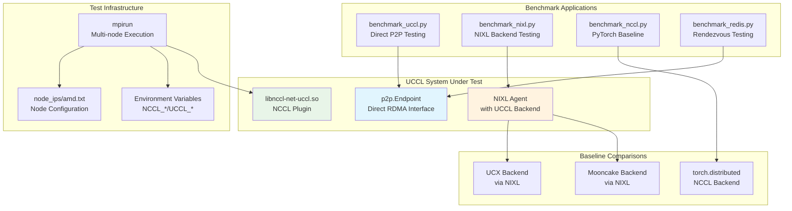
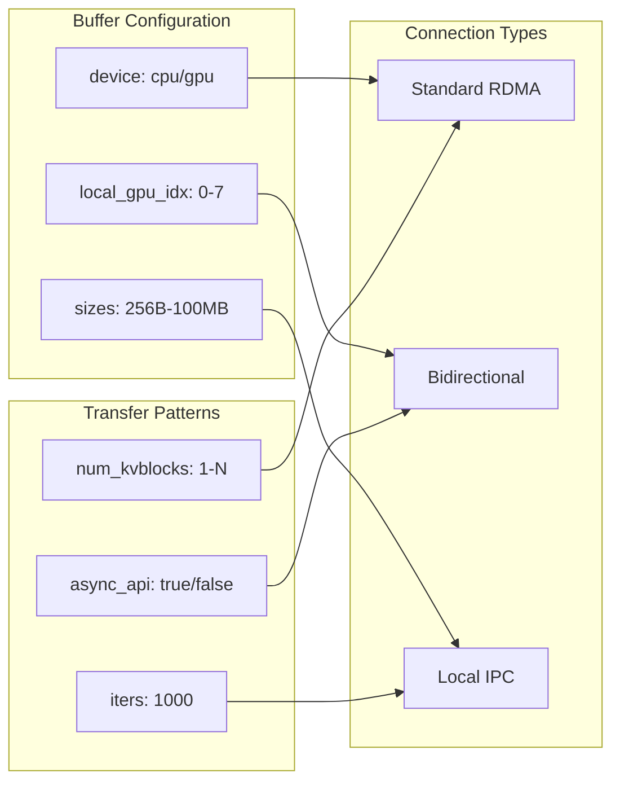
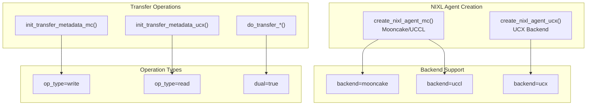
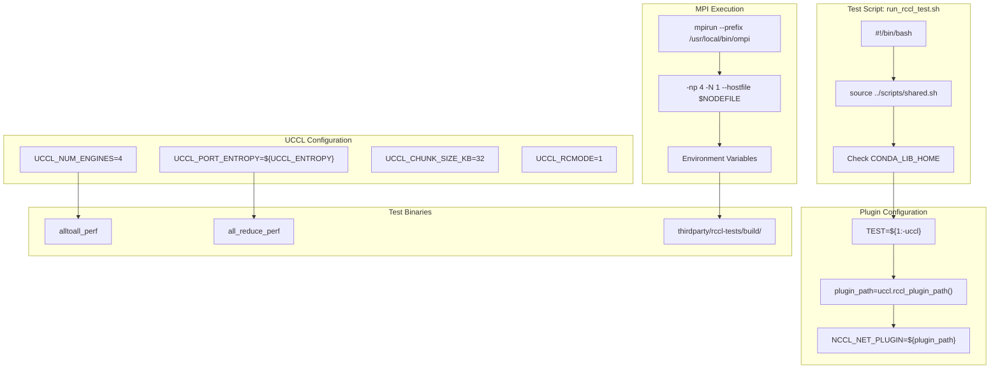
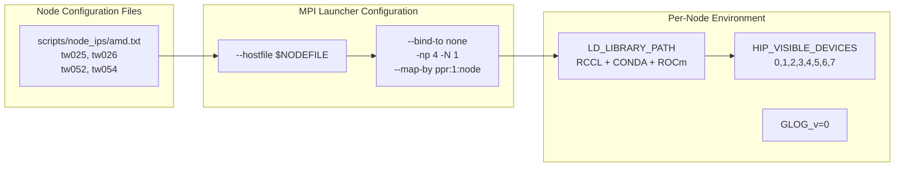
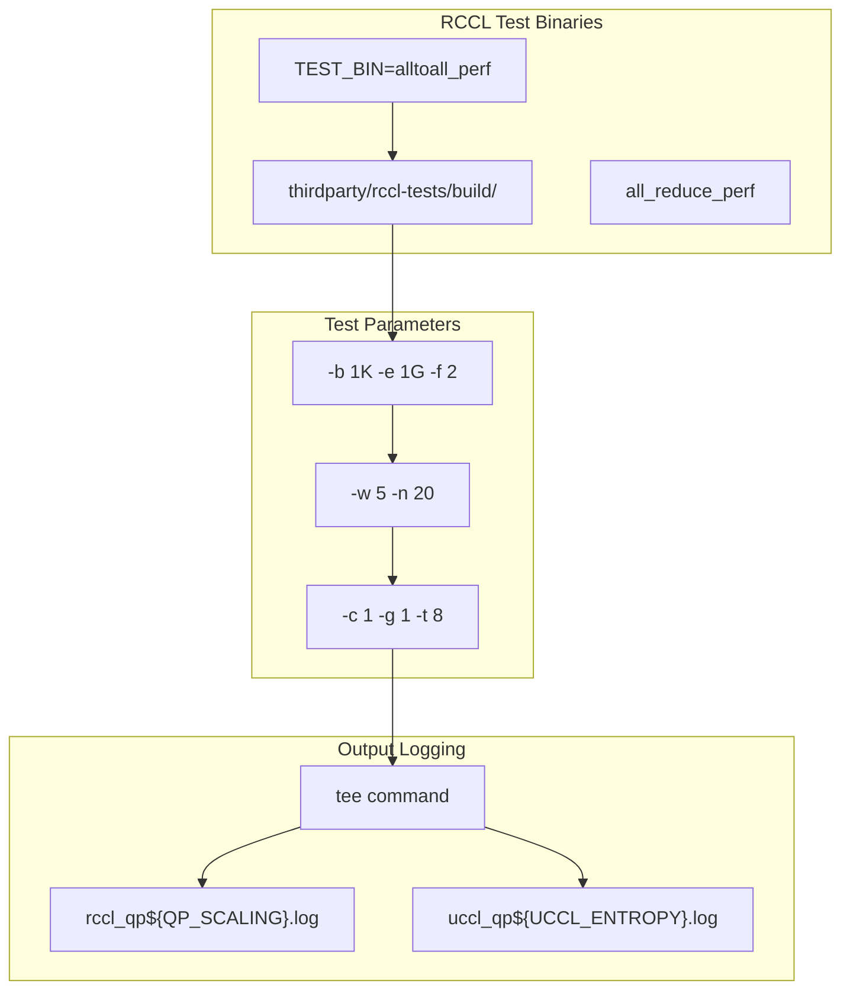
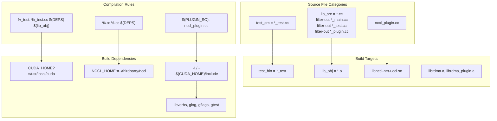
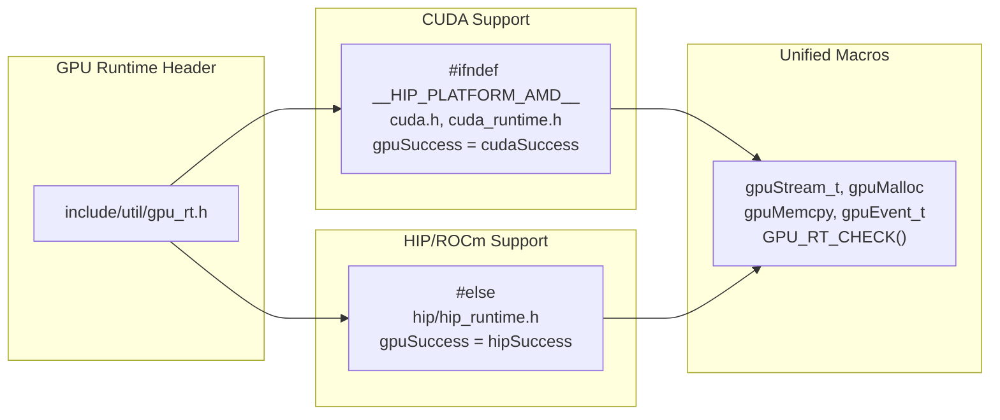
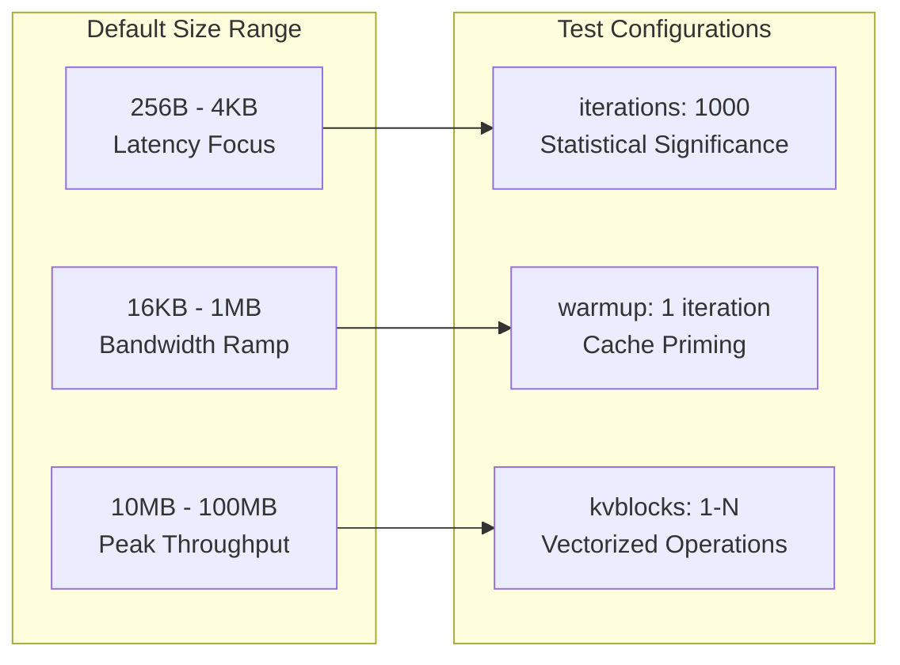

<!-- source: DeepWiki mcp.deepwiki.com · repo uccl-project/uccl · page 8 Testing and Benchmarking · fetched 2026-11-11 -->

# Testing and Benchmarking

Relevant source files

The following files were used as context for generating this wiki page:

- [.github/PULL_REQUEST_TEMPLATE.md](.github/PULL_REQUEST_TEMPLATE.md)
- [.github/workflows/uccl-build-test.yml](.github/workflows/uccl-build-test.yml)
- [README.md](README.md)
- [build.sh](build.sh)
- [collective/efa/README.md](collective/efa/README.md)
- [collective/rdma/README.md](collective/rdma/README.md)
- [docs/wheels.md](docs/wheels.md)
- [ep/Makefile](ep/Makefile)
- [ep/README.md](ep/README.md)
- [ep/bench/buffer.py](ep/bench/buffer.py)
- [ep/bench/run_ep.sh](ep/bench/run_ep.sh)
- [ep/bench/test_internode.py](ep/bench/test_internode.py)
- [ep/bench/test_low_latency.py](ep/bench/test_low_latency.py)
- [ep/bench/utils.py](ep/bench/utils.py)
- [ep/include/common.hpp](ep/include/common.hpp)
- [ep/include/ep_configs.cuh](ep/include/ep_configs.cuh)
- [ep/include/ep_utils.cuh](ep/include/ep_utils.cuh)
- [ep/include/proxy.hpp](ep/include/proxy.hpp)
- [ep/include/proxy_ctx.hpp](ep/include/proxy_ctx.hpp)
- [ep/include/rdma.hpp](ep/include/rdma.hpp)
- [ep/include/uccl_ibgda.cuh](ep/include/uccl_ibgda.cuh)
- [ep/include/uccl_proxy.hpp](ep/include/uccl_proxy.hpp)
- [ep/setup.py](ep/setup.py)
- [ep/src/common.cpp](ep/src/common.cpp)
- [ep/src/internode.cu](ep/src/internode.cu)
- [ep/src/internode_ll.cu](ep/src/internode_ll.cu)
- [ep/src/proxy.cpp](ep/src/proxy.cpp)
- [ep/src/rdma.cpp](ep/src/rdma.cpp)
- [ep/src/uccl_ep.cc](ep/src/uccl_ep.cc)
- [ep/src/uccl_proxy.cpp](ep/src/uccl_proxy.cpp)
- [include/util/gpu_rt.h](include/util/gpu_rt.h)
- [include/util/util.h](include/util/util.h)
- [p2p/Makefile](p2p/Makefile)
- [p2p/README.md](p2p/README.md)
- [p2p/benchmarks/benchmark_nccl.py](p2p/benchmarks/benchmark_nccl.py)
- [p2p/benchmarks/benchmark_nixl.py](p2p/benchmarks/benchmark_nixl.py)
- [p2p/benchmarks/benchmark_uccl.py](p2p/benchmarks/benchmark_uccl.py)
- [p2p/benchmarks/benchmark_uccl_readwrite.py](p2p/benchmarks/benchmark_uccl_readwrite.py)
- [p2p/engine.cc](p2p/engine.cc)
- [p2p/engine.h](p2p/engine.h)
- [p2p/tests/test_engine_onesided_ipc.py](p2p/tests/test_engine_onesided_ipc.py)
- [p2p/uccl_engine.cc](p2p/uccl_engine.cc)
- [p2p/uccl_engine.h](p2p/uccl_engine.h)
- [scripts/efa_monitor.sh](scripts/efa_monitor.sh)

This document covers UCCL's testing and benchmarking infrastructure, including performance measurement tools, integration testing with NCCL/RCCL, and multi-node validation systems. The testing framework validates UCCL's transport backends against established baselines and ensures compatibility with distributed training workloads.

For information about the actual transport implementations being tested, see [Transport Backends](#2). For build system configuration, see [Build System and Deployment](#6).

## Performance Benchmarking Tools

UCCL provides comprehensive benchmarking tools to measure performance across different transport backends and compare against NCCL baselines. The benchmarking suite covers latency, bandwidth, and scalability metrics for various communication patterns.

### Benchmark Architecture Overview

Sources: [p2p/benchmarks/benchmark_uccl.py](), [p2p/benchmarks/benchmark_nixl.py](), [p2p/benchmarks/benchmark_nccl.py](), [p2p/benchmarks/benchmark_redis.py](), [rdma/run_rccl_test.sh](), [scripts/node_ips/amd.txt]()

### P2P Engine Benchmarking

The `benchmark_uccl.py` script provides comprehensive testing of UCCL's P2P communication engine with support for various communication modes and configurations.

#### Benchmark Test Modes

| Mode | Function | Description |
|------|----------|-------------|
| Standard | `_run_client()`, `_run_server()` | Unidirectional send/recv testing |
| Dual | `_run_client_dual()`, `_run_server_dual()` | Bidirectional simultaneous transfers |
| IPC | `_run_client_ipc()`, `_run_server_ipc()` | Local GPU-to-GPU via memory handles |
| Async | `send_async()`, `recv_async()` | Asynchronous transfer operations |

#### Key Test Parameters

Sources: [p2p/benchmarks/benchmark_uccl.py:417-476]()

### NIXL Backend Comparison

The `benchmark_nixl.py` script enables performance comparison between UCCL and other high-performance backends through the NIXL interface.

#### Backend Configuration Matrix

Sources: [p2p/benchmarks/benchmark_nixl.py:76-96](), [p2p/benchmarks/benchmark_nixl.py:591-594]()

## Integration Testing with NCCL/RCCL

UCCL integrates with NCCL and RCCL through plugin interfaces, requiring comprehensive testing to ensure compatibility with distributed training frameworks.

### RCCL Test Execution Pipeline

Sources: [rdma/run_rccl_test.sh:1-63]()

### Environment Variable Configuration

The RCCL test script configures numerous environment variables to optimize both NCCL and UCCL behavior:

| Category | Variables | Purpose |
|----------|-----------|---------|
| NCCL Core | `NCCL_P2P_DISABLE`, `NCCL_SHM_DISABLE` | Control transport selection |
| NCCL IB | `NCCL_IB_PCI_RELAXED_ORDERING`, `NCCL_IB_QPS_PER_CONNECTION` | InfiniBand optimization |
| NCCL Buffers | `NCCL_BUFFSIZE`, `NCCL_MIN_NCHANNELS`, `NCCL_MAX_NCHANNELS` | Memory and channel tuning |
| UCCL Engine | `UCCL_NUM_ENGINES`, `UCCL_PORT_ENTROPY` | Transport backend configuration |
| UCCL Data | `UCCL_CHUNK_SIZE_KB`, `UCCL_RCMODE` | Data handling parameters |

Sources: [rdma/run_rccl_test.sh:42-60]()

## Multi-Node Testing Infrastructure

UCCL's distributed testing infrastructure supports validation across multiple nodes to ensure scalability and network transport correctness.

### Node Configuration and Hostfiles

Sources: [scripts/node_ips/amd.txt](), [rdma/run_rccl_test.sh:42-55]()

### Test Binary Integration

The testing system integrates with RCCL's standard test binaries to ensure compatibility with established benchmarks.

Sources: [rdma/run_rccl_test.sh:34-63]()

## Build System Test Integration

The UCCL build system includes comprehensive test compilation and execution targets to ensure code quality and functionality.

### Makefile Test Targets

Sources: [rdma/Makefile:15-46]()

### GPU Runtime Abstraction Testing

UCCL's testing infrastructure supports both CUDA and ROCm through a unified GPU runtime abstraction layer.

Sources: [include/util/gpu_rt.h:1-146]()

## Performance Metrics and Analysis

UCCL benchmarks provide comprehensive performance metrics including bandwidth, latency, and scalability measurements across different message sizes and communication patterns.

### Benchmark Output Format

All UCCL benchmarks follow a consistent output format for easy comparison and analysis:

| Metric | Unit | Calculation | Purpose |
|--------|------|-------------|---------|
| Bandwidth (Gbps) | Gigabits/second | `(total_bytes * 8) / elapsed / 1e9` | Network utilization |
| Throughput (GB/s) | Gigabytes/second | `total_bytes / elapsed / 1e9` | Data transfer rate |
| Latency (s) | Seconds | `elapsed / iterations` | Per-operation timing |

### Message Size Testing Matrix

Sources: [p2p/benchmarks/benchmark_uccl.py:435-446](), [p2p/benchmarks/benchmark_nixl.py:564-576]()

---

