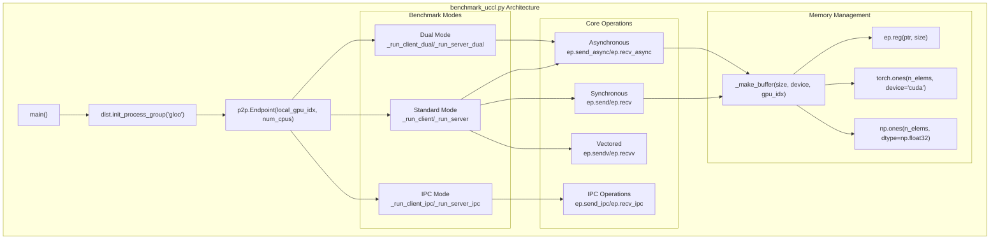
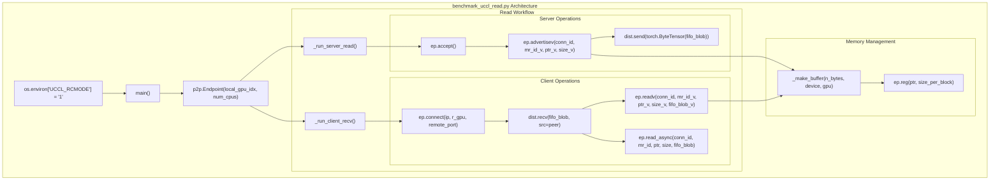
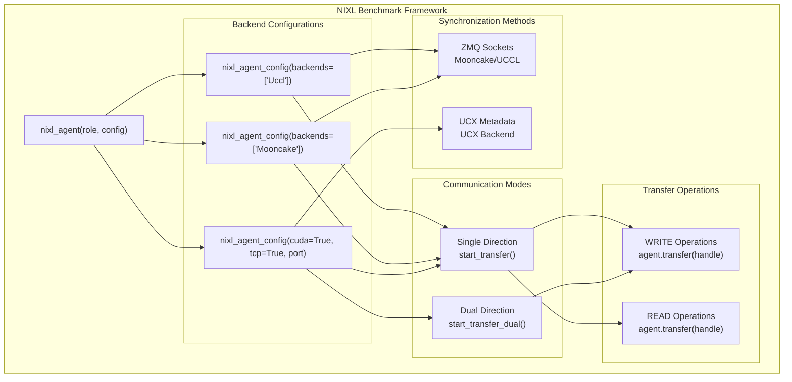
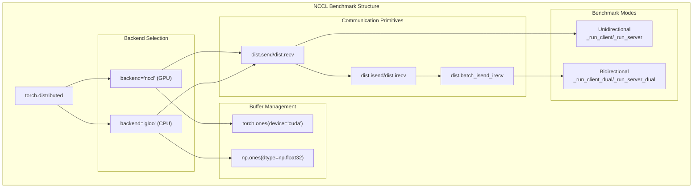
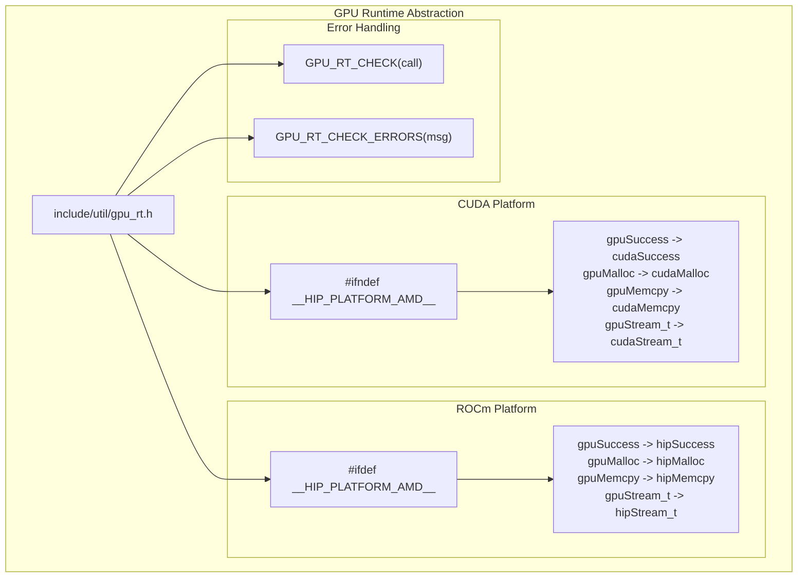

<!-- source: DeepWiki mcp.deepwiki.com · repo uccl-project/uccl · page 8.1 Performance Benchmarks · fetched 2026-11-11 -->

# Performance Benchmarks

<details>
<summary>Relevant source files</summary>

The following files were used as context for generating this wiki page:

- [ep/bench/alltoall/.gitignore](ep/bench/alltoall/.gitignore)
- [ep/bench/alltoall/Makefile](ep/bench/alltoall/Makefile)
- [ep/bench/alltoall/benchmark.cpp](ep/bench/alltoall/benchmark.cpp)
- [ep/bench/alltoall/efa_alltoall_results.md](ep/bench/alltoall/efa_alltoall_results.md)
- [ep/bench/alltoall/launch_bench.py](ep/bench/alltoall/launch_bench.py)
- [ep/bench/alltoall/test_alltoall.cpp](ep/bench/alltoall/test_alltoall.cpp)
- [ep/bench/alltoall/test_alltoall_rail.cpp](ep/bench/alltoall/test_alltoall_rail.cpp)
- [ep/bench/buffer.py](ep/bench/buffer.py)
- [ep/bench/test_internode.py](ep/bench/test_internode.py)
- [ep/bench/test_low_latency.py](ep/bench/test_low_latency.py)
- [ep/bench/utils.py](ep/bench/utils.py)
- [ep/include/common.hpp](ep/include/common.hpp)
- [ep/include/ep_configs.cuh](ep/include/ep_configs.cuh)
- [ep/include/ep_utils.cuh](ep/include/ep_utils.cuh)
- [ep/include/proxy.hpp](ep/include/proxy.hpp)
- [ep/include/proxy_ctx.hpp](ep/include/proxy_ctx.hpp)
- [ep/include/rdma.hpp](ep/include/rdma.hpp)
- [ep/include/uccl_ibgda.cuh](ep/include/uccl_ibgda.cuh)
- [ep/include/uccl_proxy.hpp](ep/include/uccl_proxy.hpp)
- [ep/src/internode.cu](ep/src/internode.cu)
- [ep/src/internode_ll.cu](ep/src/internode_ll.cu)
- [ep/src/proxy.cpp](ep/src/proxy.cpp)
- [ep/src/rdma.cpp](ep/src/rdma.cpp)
- [ep/src/uccl_ep.cc](ep/src/uccl_ep.cc)
- [ep/src/uccl_proxy.cpp](ep/src/uccl_proxy.cpp)
- [include/util/gpu_rt.h](include/util/gpu_rt.h)
- [include/util/util.h](include/util/util.h)
- [p2p/Makefile](p2p/Makefile)
- [p2p/README.md](p2p/README.md)
- [p2p/benchmarks/benchmark_nccl.py](p2p/benchmarks/benchmark_nccl.py)
- [p2p/benchmarks/benchmark_nccl_allgather.py](p2p/benchmarks/benchmark_nccl_allgather.py)
- [p2p/benchmarks/benchmark_nixl.py](p2p/benchmarks/benchmark_nixl.py)
- [p2p/benchmarks/benchmark_uccl.py](p2p/benchmarks/benchmark_uccl.py)
- [p2p/benchmarks/benchmark_uccl_allgather.py](p2p/benchmarks/benchmark_uccl_allgather.py)
- [p2p/benchmarks/benchmark_uccl_alltoall.py](p2p/benchmarks/benchmark_uccl_alltoall.py)
- [p2p/benchmarks/benchmark_uccl_collective.py](p2p/benchmarks/benchmark_uccl_collective.py)
- [p2p/benchmarks/benchmark_uccl_readwrite.py](p2p/benchmarks/benchmark_uccl_readwrite.py)
- [p2p/collective.py](p2p/collective.py)
- [p2p/engine.cc](p2p/engine.cc)
- [p2p/engine.h](p2p/engine.h)
- [p2p/rdma/tests/test_efa_endpoint.cpp](p2p/rdma/tests/test_efa_endpoint.cpp)
- [p2p/tests/test_engine_onesided_ipc.py](p2p/tests/test_engine_onesided_ipc.py)
- [p2p/tests/test_util_interval_tree.py](p2p/tests/test_util_interval_tree.py)
- [p2p/uccl_engine.cc](p2p/uccl_engine.cc)
- [p2p/uccl_engine.h](p2p/uccl_engine.h)
- [p2p/utils.py](p2p/utils.py)

</details>


This document describes the comprehensive performance benchmarking tools provided by UCCL for evaluating communication performance across different transport backends and comparing against baseline implementations like NCCL. The benchmarks measure throughput (GB/s), bandwidth (Gbps), and latency across various message sizes and communication patterns.

For information about the underlying P2P communication architecture being benchmarked, see [P2P Communication Engine](#3). For details about transport backend implementations, see [Transport Backends](#2).

## Benchmark Categories

UCCL provides several categories of benchmarks to evaluate different aspects of communication performance:

```mermaid
graph TB
    subgraph "UCCL Performance Benchmarks"
        P2P["P2P Engine Benchmarks<br/>benchmark_uccl.py"]
        READ["One-Sided Read Benchmarks<br/>benchmark_uccl_read.py"]
        NIXL["NIXL Backend Comparison<br/>benchmark_nixl.py"]
        NCCL_CMP["NCCL Comparison<br/>benchmark_nccl.py"]
    end
    
    subgraph "Communication Patterns"
        SYNC["Synchronous Operations<br/>ep.send/ep.recv"]
        ASYNC["Asynchronous Operations<br/>ep.send_async/ep.recv_async"]
        DUAL["Bidirectional Transfer<br/>dual mode"]
        IPC["Local IPC Transfer<br/>ep.send_ipc/ep.recv_ipc"]
        VECTORED["Vectored Operations<br/>ep.sendv/ep.recvv"]
        RDMA_READ["One-Sided Read<br/>ep.readv/ep.read_async"]
    end
    
    subgraph "Backend Targets"
        UCCL_P2P["uccl.p2p.Endpoint"]
        UCCL_RDMA["UCCL RDMA Transport"] 
        NCCL_REF["torch.distributed"]
        UCX_REF["nixl_agent + UCX"]
        MOONCAKE["nixl_agent + Mooncake"]
    end
    
    P2P --> SYNC
    P2P --> ASYNC
    P2P --> DUAL
    P2P --> IPC
    P2P --> VECTORED
    
    READ --> RDMA_READ
    READ --> UCCL_P2P
    
    NIXL --> UCCL_RDMA
    NIXL --> UCX_REF
    NIXL --> MOONCAKE
    
    NCCL_CMP --> NCCL_REF
```



Sources: [p2p/benchmarks/benchmark_uccl.py:1-546](), [p2p/benchmarks/benchmark_uccl_read.py:1-213](), [p2p/benchmarks/benchmark_nixl.py:1-636](), [p2p/benchmarks/benchmark_nccl.py:1-243]()

## Primary P2P Benchmarks

The `benchmark_uccl.py` script provides comprehensive benchmarking of the UCCL P2P Engine with support for multiple communication patterns and measurement modes.

### P2P Benchmark Architecture



Sources: [p2p/benchmarks/benchmark_uccl.py:417-538](), [p2p/benchmarks/benchmark_uccl.py:24-38](), [p2p/benchmarks/benchmark_uccl.py:51-124]()

### Benchmark Execution Flow

The P2P benchmarks follow a standardized execution pattern across all communication modes:

| Phase | Client Role | Server Role | Key Functions |
|-------|-------------|-------------|---------------|
| Setup | `ep.connect()` | `ep.accept()` | Connection establishment |
| Warmup | `ep.send()` x1 | `ep.recv()` x1 | Cache warming |
| Timing Loop | `ep.send()` x iters | `ep.recv()` x iters | Performance measurement |
| Cleanup | Automatic | Automatic | Resource deallocation |

Key measurement code in the timing loops:
- Start timer: `time.perf_counter()` [p2p/benchmarks/benchmark_uccl.py:161]()
- Core operation: `ep.send(conn_id, mr_id, ptr, size)` [p2p/benchmarks/benchmark_uccl.py:174]()
- End timer: `time.perf_counter()` [p2p/benchmarks/benchmark_uccl.py:177]()
- Metrics calculation: `gbps = (total_sent * 8) / elapsed / 1e9` [p2p/benchmarks/benchmark_uccl.py:179]()

Sources: [p2p/benchmarks/benchmark_uccl.py:127-198](), [p2p/benchmarks/benchmark_uccl.py:51-124]()

## One-Sided Read Benchmarks

The `benchmark_uccl_read.py` script specifically tests RDMA read operations, which require RC (Reliable Connection) mode and provide one-sided memory access capabilities.

### Read Benchmark Architecture



The read benchmark requires `UCCL_RCMODE=1` environment variable to enable RC mode for one-sided operations [p2p/benchmarks/benchmark_uccl_read.py:10](). The server advertises memory regions using `ep.advertisev()` [p2p/benchmarks/benchmark_uccl_read.py:62](), and the client performs reads using `ep.readv()` [p2p/benchmarks/benchmark_uccl_read.py:108]() or `ep.read_async()` [p2p/benchmarks/benchmark_uccl_read.py:99-106]().

Sources: [p2p/benchmarks/benchmark_uccl_read.py:41-68](), [p2p/benchmarks/benchmark_uccl_read.py:70-133](), [p2p/benchmarks/benchmark_uccl_read.py:22-30]()

## NIXL Backend Comparison Benchmarks

The `benchmark_nixl.py` script compares UCCL performance against other high-performance communication backends through the NIXL interface.

### Backend Comparison Matrix



Sources: [p2p/benchmarks/benchmark_nixl.py:76-96](), [p2p/benchmarks/benchmark_nixl.py:99-110](), [p2p/benchmarks/benchmark_nixl.py:247-328]()

### NIXL Transfer Workflow

The NIXL benchmarks implement a sophisticated transfer workflow with backend-specific optimizations:

1. **Agent Creation**: Backend-specific agent initialization [p2p/benchmarks/benchmark_nixl.py:80-82]()
2. **Memory Registration**: `agent.register_memory(descs)` [p2p/benchmarks/benchmark_nixl.py:84]()
3. **Metadata Exchange**: ZMQ or UCX-based synchronization [p2p/benchmarks/benchmark_nixl.py:87-94]()
4. **Transfer Initialization**: `agent.initialize_xfer(operation, local_descs, remote_descs, peer)` [p2p/benchmarks/benchmark_nixl.py:160-162]()
5. **Transfer Execution**: `agent.transfer(transfer_handle)` [p2p/benchmarks/benchmark_nixl.py:217]()
6. **Completion Polling**: `agent.check_xfer_state(transfer_handle)` [p2p/benchmarks/benchmark_nixl.py:220]()

Sources: [p2p/benchmarks/benchmark_nixl.py:129-164](), [p2p/benchmarks/benchmark_nixl.py:213-230]()

### NIXL Transfer Types and Backend Support

The NIXL benchmarks support different transfer patterns based on backend capabilities:

| Backend | Single Direction | Dual Direction | Sync Method | Transfer Types |
|---------|-----------------|----------------|-------------|---------------|
| UCCL | ✓ | ✗ | ZMQ | READ/WRITE |
| Mooncake | ✓ | ✗ | ZMQ | READ/WRITE |
| UCX | ✓ | ✓ | UCX Metadata | READ/WRITE |

The dual direction transfer in `start_transfer_dual()` creates symmetric bidirectional WRITE operations where both endpoints simultaneously write to each other [p2p/benchmarks/benchmark_nixl.py:427-517](). This is only supported with UCX backend due to its symmetric connection establishment model.

Sources: [p2p/benchmarks/benchmark_nixl.py:427-434](), [p2p/benchmarks/benchmark_nixl.py:609-614]()

## NCCL Performance Comparison

The `benchmark_nccl.py` provides baseline performance comparisons against PyTorch's distributed communication primitives.

### NCCL vs UCCL Comparison Framework



Sources: [p2p/benchmarks/benchmark_nccl.py:209-214](), [p2p/benchmarks/benchmark_nccl.py:35-61](), [p2p/benchmarks/benchmark_nccl.py:115-169]()

## GPU Runtime Abstraction

UCCL benchmarks support both CUDA and ROCm through a unified GPU runtime abstraction layer defined in [include/util/gpu_rt.h:1-146]().

### GPU Runtime Macros



The benchmarks use this abstraction to work seamlessly across NVIDIA and AMD GPU platforms. Buffer allocation in benchmarks uses `torch.ones(device='cuda')` for PyTorch tensors [p2p/benchmarks/benchmark_uccl.py:29]() while error checking uses `GPU_RT_CHECK()` macros [include/util/gpu_rt.h:126-134]() in the underlying C++ implementation.

Sources: [include/util/gpu_rt.h:1-146](), [p2p/benchmarks/benchmark_uccl.py:24-38]()

## Performance Metrics and Analysis

### Standard Metrics Calculation

All UCCL benchmarks report consistent performance metrics:

| Metric | Formula | Units | Purpose |
|--------|---------|--------|---------|
| Bandwidth | `(total_bytes * 8) / elapsed_time / 1e9` | Gbps | Network utilization |
| Throughput | `total_bytes / elapsed_time / 1e9` | GB/s | Data transfer rate |
| Latency | `elapsed_time / iterations` | seconds | Per-operation time |

### Message Size Patterns

Default benchmark configurations test across logarithmic message size progression:

```python
default_sizes = [256, 1024, 4096, 16384, 65536, 262144, 
                1048576, 10485760, 16777216, 104857600]  # bytes
```

This range covers small messages (256B) through large transfers (100MB) to characterize performance across different communication regimes.

Sources: [p2p/benchmarks/benchmark_uccl.py:435-446](), [p2p/benchmarks/benchmark_nccl.py:188-199](), [p2p/benchmarks/benchmark_nixl.py:564-575]()

## Running Benchmarks

### P2P Engine Benchmarks

```bash
# Standard P2P benchmark (2 processes)
torchrun --nproc_per_node=2 p2p/benchmarks/benchmark_uccl.py \
  --local-gpu-idx 0 --device gpu --iters 1000

# Dual bidirectional benchmark
torchrun --nproc_per_node=2 p2p/benchmarks/benchmark_uccl.py \
  --dual --async-api

# IPC local communication benchmark  
torchrun --nproc_per_node=2 p2p/benchmarks/benchmark_uccl.py \
  --ipc --device gpu
```

### NIXL Backend Comparison

```bash
# UCCL vs UCX comparison
python p2p/benchmarks/benchmark_nixl.py --role server --backend uccl &
python p2p/benchmarks/benchmark_nixl.py --role client --backend uccl \
  --remote-ip <server_ip>

# Dual direction UCX benchmark
python p2p/benchmarks/benchmark_nixl.py --role server --backend ucx --dual &
python p2p/benchmarks/benchmark_nixl.py --role client --backend ucx \
  --remote-ip <server_ip> --dual
```

### GPU-Driven Benchmarks

```bash
# Run GPU-driven proxy benchmarks
python gpu_driven/tests/test_local_proxy.py
```

Sources: [p2p/benchmarks/benchmark_uccl.py:486-537](), [p2p/benchmarks/benchmark_nixl.py:536-636](), [gpu_driven/tests/test_local_proxy.py:63-74]()

---

