<!-- source: DeepWiki mcp.deepwiki.com · repo uccl-project/uccl · page 8.2 Test Suites and CI · fetched 2026-11-11 -->

# Test Suites and CI

<details>
<summary>Relevant source files</summary>

The following files were used as context for generating this wiki page:

- [.github/PULL_REQUEST_TEMPLATE.md](.github/PULL_REQUEST_TEMPLATE.md)
- [.github/workflows/clang-format-check.yml](.github/workflows/clang-format-check.yml)
- [.github/workflows/uccl-build-test.yml](.github/workflows/uccl-build-test.yml)
- [README.md](README.md)
- [build.sh](build.sh)
- [collective/efa/README.md](collective/efa/README.md)
- [collective/rdma/README.md](collective/rdma/README.md)
- [docker/Dockerfile.cuda](docker/Dockerfile.cuda)
- [docker/Dockerfile.efa](docker/Dockerfile.efa)
- [docker/Dockerfile.gh](docker/Dockerfile.gh)
- [docker/Dockerfile.rocm](docker/Dockerfile.rocm)
- [docs/wheels.md](docs/wheels.md)
- [ep/Makefile](ep/Makefile)
- [ep/README.md](ep/README.md)
- [ep/bench/run_ep.sh](ep/bench/run_ep.sh)
- [ep/install_deps.sh](ep/install_deps.sh)
- [ep/setup.py](ep/setup.py)
- [ep/src/common.cpp](ep/src/common.cpp)
- [format.sh](format.sh)
- [include/util/gpu_rt.h](include/util/gpu_rt.h)
- [include/util/util.h](include/util/util.h)
- [p2p/Makefile](p2p/Makefile)
- [p2p/README.md](p2p/README.md)
- [p2p/benchmarks/benchmark_nccl.py](p2p/benchmarks/benchmark_nccl.py)
- [p2p/benchmarks/benchmark_nixl.py](p2p/benchmarks/benchmark_nixl.py)
- [p2p/benchmarks/benchmark_uccl.py](p2p/benchmarks/benchmark_uccl.py)
- [p2p/benchmarks/benchmark_uccl_readwrite.py](p2p/benchmarks/benchmark_uccl_readwrite.py)
- [p2p/engine.cc](p2p/engine.cc)
- [p2p/engine.h](p2p/engine.h)
- [p2p/tests/test_engine_onesided_ipc.py](p2p/tests/test_engine_onesided_ipc.py)
- [p2p/uccl_engine.cc](p2p/uccl_engine.cc)
- [p2p/uccl_engine.h](p2p/uccl_engine.h)
- [scripts/efa_monitor.sh](scripts/efa_monitor.sh)
- [scripts/node_ips/amd.txt](scripts/node_ips/amd.txt)
- [scripts/node_ips/tpu_2.txt](scripts/node_ips/tpu_2.txt)
- [scripts/setup_all.py](scripts/setup_all.py)
- [scripts/setup_nic.sh](scripts/setup_nic.sh)

</details>


UCCL's test infrastructure comprises GitHub Actions CI workflows, comprehensive test suites using pytest and torchrun, and multi-node testing utilities. The testing framework validates code formatting, builds across platforms, and executes distributed communication tests on GPU clusters.

For performance benchmarking results, see page 7.1. For build system configuration, see page 5.

## GitHub Actions CI Workflows

UCCL uses GitHub Actions for continuous integration, enforcing code formatting standards and validating builds on remote GPU hosts. CI workflows run on push to main and pull request events.

### Code Formatting Checks

**Workflow: clang-format-check.yml**

The formatting workflow validates C++ and Python code style using clang-format-14 and black:

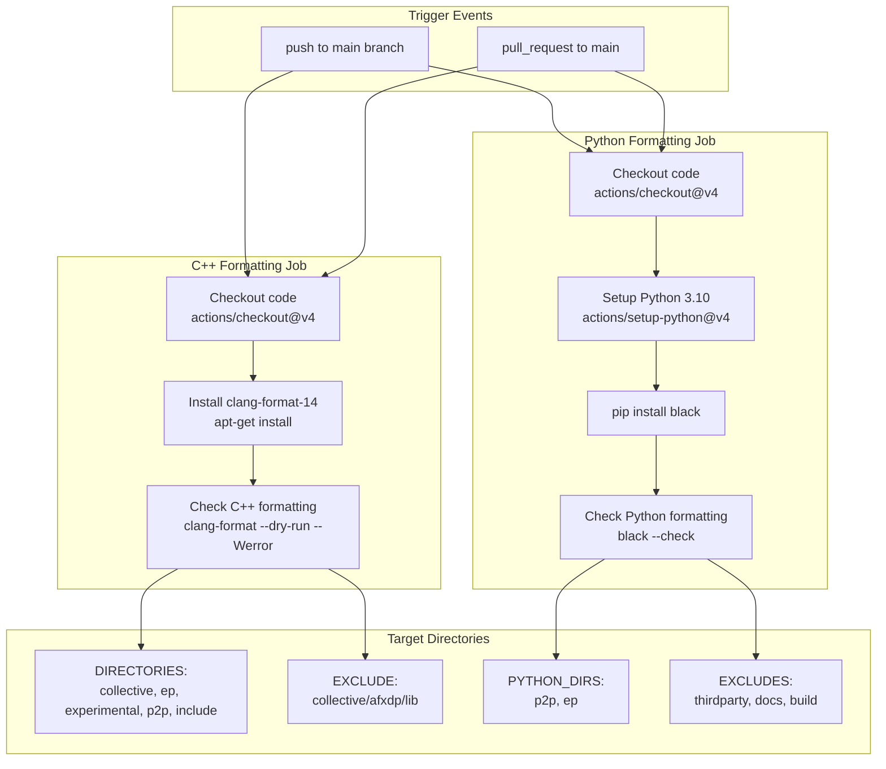

The workflow checks file extensions `cpp`, `cxx`, `cc`, `h`, `hpp`, `cu`, `cuh` for C++ code, excluding the AF_XDP library directory. Python formatting checks apply to `p2p` and `ep` directories, excluding thirdparty dependencies.

Sources: [.github/workflows/clang-format-check.yml:1-91]()

### Remote Build and Verification

**Workflow: uccl-build-test.yml**

The build workflow executes on a remote GPU host (l4-sky-test-01) to validate UCCL installation:

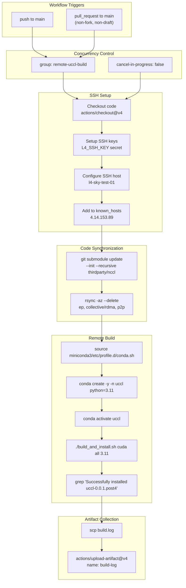

The workflow uses SSH key authentication stored in GitHub secrets to access the remote host at `4.14.153.89`. It creates a conda environment, builds UCCL with CUDA support, and verifies successful installation by checking build logs.

Sources: [.github/workflows/uccl-build-test.yml:1-96]()

### Local Formatting Script

The `format.sh` script provides local code formatting before committing:

```bash
# Format C++ files with clang-format-14
./format.sh

# Validates clang-format version is 14
# Formats files in: collective, ep, p2p, include, experimental
# Excludes: collective/afxdp/lib
# Formats Python files in: p2p, ep with black
# Excludes: thirdparty, docs, build
```

The script ensures code style consistency before CI checks run, preventing formatting-related CI failures.

Sources: [format.sh:1-74]()

## EP Test Suites

UCCL's Expert Parallelism (EP) system includes comprehensive test suites for low-latency dispatch/combine operations and internode communication. Tests use `torchrun` for distributed coordination and validate correctness across CUDA and ROCm platforms.

### Test Utilities

**File: thirdparty/DeepEP/tests/utils.py**

Core test utilities provide distributed initialization, benchmarking, and tensor manipulation functions:

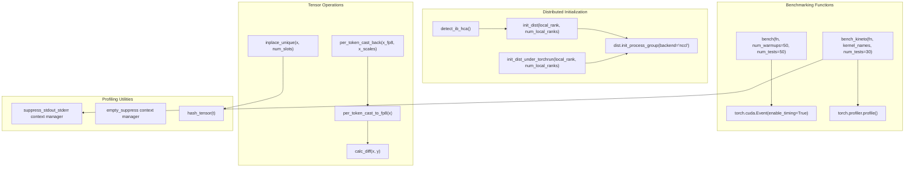

Key utility functions:

| Function | Purpose | Returns |
|----------|---------|---------|
| `init_dist()` | Initialize torch.distributed with NCCL backend | rank, world_size, process_group |
| `bench()` | Measure kernel performance with warmup | avg_time, min_time, max_time |
| `bench_kineto()` | Profile kernels using PyTorch Kineto | kernel durations in seconds |
| `per_token_cast_to_fp8()` | Convert BF16 to FP8 with per-token scaling | fp8_tensor, scales |
| `calc_diff()` | Calculate similarity difference between tensors | float difference metric |
| `detect_ib_hca()` | Find InfiniBand HCA device (mlx5_*) | device name or None |

Sources: [thirdparty/DeepEP/tests/utils.py:1-247]()

### Low-Latency EP Tests

**File: thirdparty/DeepEP/tests/test_low_latency.py**

The low-latency test suite validates `deep_ep.Buffer` dispatch and combine operations with various configurations:

```mermaid
graph TB
    subgraph "Test Configuration"
        test_main["test_main(num_tokens, hidden, num_experts, num_topk)"]
        argparse_parser["argparse.ArgumentParser"]
        test_params["num_tokens=128<br/>hidden=7168<br/>num_topk=8<br/>num_experts=288"]
    end
    
    subgraph "Buffer Initialization"
        deep_ep_Buffer["deep_ep.Buffer(group, num_rdma_bytes)"]
        get_low_latency_rdma_size_hint["Buffer.get_low_latency_rdma_size_hint()"]
        buffer_config["low_latency_mode=True<br/>num_qps_per_rank=experts/ranks<br/>allow_nvlink_for_low_latency_mode"]
    end
    
    subgraph "Dispatch Testing"
        low_latency_dispatch["buffer.low_latency_dispatch(x, topk_idx, num_tokens, num_experts)"]
        dispatch_params["use_fp8=True/False<br/>round_scale=True/False<br/>use_ue8m0=True/False<br/>async_finish=True/False"]
        packed_recv_x["packed_recv_x, packed_recv_count, handle, event, hook"]
    end
    
    subgraph "Combine Testing"
        low_latency_combine["buffer.low_latency_combine(x, topk_idx, topk_weights, handle)"]
        combine_params["use_logfmt=True/False<br/>async_finish=True/False<br/>zero_copy=True/False"]
        combined_x["combined_x, event, hook"]
    end
    
    subgraph "Correctness Validation"
        check_expert_indices["Validate recv_count matches all_gather"]
        check_received_data["Verify data integrity across ranks"]
        check_combine_output["calc_diff(expected, actual) < 7e-4"]
    end
    
    subgraph "Performance Benchmarking"
        bench_dispatch_combine["bench(test_func) with barrier"]
        bench_kineto_separate["bench_kineto() for dispatch/combine"]
        bandwidth_calculation["(dispatch_bytes + combine_bytes) / time"]
    end
    
    test_main --> argparse_parser
    argparse_parser --> test_params
    
    test_params --> deep_ep_Buffer
    deep_ep_Buffer --> get_low_latency_rdma_size_hint
    get_low_latency_rdma_size_hint --> buffer_config
    
    buffer_config --> low_latency_dispatch
    low_latency_dispatch --> dispatch_params
    dispatch_params --> packed_recv_x
    
    packed_recv_x --> low_latency_combine
    low_latency_combine --> combine_params
    combine_params --> combined_x
    
    combined_x --> check_expert_indices
    check_expert_indices --> check_received_data
    check_received_data --> check_combine_output
    
    check_combine_output --> bench_dispatch_combine
    bench_dispatch_combine --> bench_kineto_separate
    bench_kineto_separate --> bandwidth_calculation
```

Test execution modes:

| Mode | Configuration | Purpose |
|------|--------------|---------|
| FP8 Dispatch | `use_fp8=True, round_scale=True/False` | Validate FP8 quantization with per-token scaling |
| Async Operations | `async_finish=True, return_recv_hook=True/False` | Test asynchronous dispatch/combine with hooks |
| Zero-Copy Combine | `zero_copy=True` | Validate in-place combine buffer usage |
| LogFMT Combine | `use_logfmt=True` | Test logarithmic format combination |
| Pressure Testing | `--pressure-test` | Run 1e9 iterations with random seeds |

Test execution with torchrun:

```bash
# Single-node 8-GPU test
torchrun --nproc_per_node=8 test_low_latency.py \
    --num-tokens 128 --hidden 7168 --num-topk 8 --num-experts 288

# Multi-node test
torchrun --nnodes=2 --nproc_per_node=8 \
    --master-addr=$MASTER_ADDR --master-port=$MASTER_PORT \
    test_low_latency.py --num-tokens 128 --hidden 7168
```

Sources: [thirdparty/DeepEP/tests/test_low_latency.py:1-229]()

### Internode EP Tests

**File: thirdparty/DeepEP/tests/test_internode.py**

Internode tests validate dispatch/combine operations across multiple nodes with NVLink and RDMA paths:

```mermaid
graph TB
    subgraph "Multi-Node Setup"
        test_loop["test_loop(local_rank, num_local_ranks, args)"]
        world_size["WORLD_SIZE environment variable"]
        local_world_size["LOCAL_WORLD_SIZE environment variable"]
        num_nodes["num_nodes = world_size / local_world_size"]
    end
    
    subgraph "Buffer Configuration"
        buffer_init["deep_ep.Buffer(group, 2e9, 1e9)"]
        num_qps["num_qps_per_rank=max(num_sms, experts/ranks)"]
        low_latency_mode["low_latency_mode for LL compatibility"]
    end
    
    subgraph "Dispatch Layout Testing"
        get_dispatch_layout["buffer.get_dispatch_layout(topk_idx, num_experts)"]
        layout_returns["num_tokens_per_rank<br/>num_tokens_per_rdma_rank<br/>num_tokens_per_expert<br/>is_token_in_rank"]
        layout_validation["torch.allclose() with reference"]
    end
    
    subgraph "Configuration Tuning"
        deep_ep_Config["deep_ep.Config(num_sms, nvl_chunk_size, nvl_buffer_size, rdma_chunk_size, rdma_buffer_size)"]
        tune_dispatch["Sweep nvl_chunk: 4-44, rdma_chunk: 4-32"]
        tune_combine["Sweep nvl_chunk: 1-7, rdma_chunk: 8-32"]
        bench_kineto_tuning["bench_kineto(lambda, ('dispatch', 'notify'))"]
    end
    
    subgraph "Data Format Testing"
        test_bf16["Test with BF16 data"]
        test_fp8["Test with FP8 data (per_token_cast_to_fp8)"]
        test_topk["Test with/without topk_idx and topk_weights"]
        cached_dispatch["Test cached dispatch with handle"]
    end
    
    subgraph "Correctness Validation"
        check_data["Validate received data by rank"]
        check_recv_count["Verify recv count matches all_gather"]
        check_topk_indices["Validate topk_idx mapping"]
        check_combine_diff["calc_diff(expected, actual) < 5e-6"]
    end
    
    test_loop --> world_size
    world_size --> local_world_size
    local_world_size --> num_nodes
    
    num_nodes --> buffer_init
    buffer_init --> num_qps
    num_qps --> low_latency_mode
    
    low_latency_mode --> get_dispatch_layout
    get_dispatch_layout --> layout_returns
    layout_returns --> layout_validation
    
    layout_validation --> deep_ep_Config
    deep_ep_Config --> tune_dispatch
    tune_dispatch --> tune_combine
    tune_combine --> bench_kineto_tuning
    
    bench_kineto_tuning --> test_bf16
    test_bf16 --> test_fp8
    test_fp8 --> test_topk
    test_topk --> cached_dispatch
    
    cached_dispatch --> check_data
    check_data --> check_recv_count
    check_recv_count --> check_topk_indices
    check_topk_indices --> check_combine_diff
```

Test scenarios validated:

| Scenario | Parameters | Validation |
|----------|-----------|------------|
| BF16 Dispatch | `x: torch.bfloat16` | Data integrity by rank, recv counts |
| FP8 Dispatch | `x: tuple (fp8_tensor, scales)` | Per-token quantization accuracy |
| With TopK | `topk_idx, topk_weights` | Expert index mapping, weight accumulation |
| Cached Dispatch | `handle` from previous call | Reuse layout without recomputation |
| Async Mode | `async_finish=True/False` | Event synchronization, hook execution |
| Combine with Bias | `bias: (bias_0, bias_1)` | Bias addition correctness |

Torchrun execution for multi-node testing:

```bash
# 2-node, 16-GPU test
torchrun --nnodes=2 --nproc_per_node=8 \
    --master-addr=$MASTER_ADDR --master-port=29500 \
    test_internode.py --num-tokens 4096 --hidden 7168 \
    --num-experts 256 --num-topk 8
```

Environment variables set by tests:

```bash
NCCL_IB_HCA=mlx5_0  # InfiniBand device (auto-detected)
WORLD_SIZE=16       # Total processes
LOCAL_WORLD_SIZE=8  # Processes per node
RANK=0-15           # Process rank
LOCAL_RANK=0-7      # Local process rank
```

Sources: [thirdparty/DeepEP/tests/test_internode.py:1-296]()

## Multi-Node Test Infrastructure

UCCL provides scripts for coordinating multi-node testing across clusters with different network configurations and platforms.

### Cluster Setup Script

**File: scripts/setup_all.py**

The `setup_all.py` script automates multi-node environment configuration using paramiko SSH:

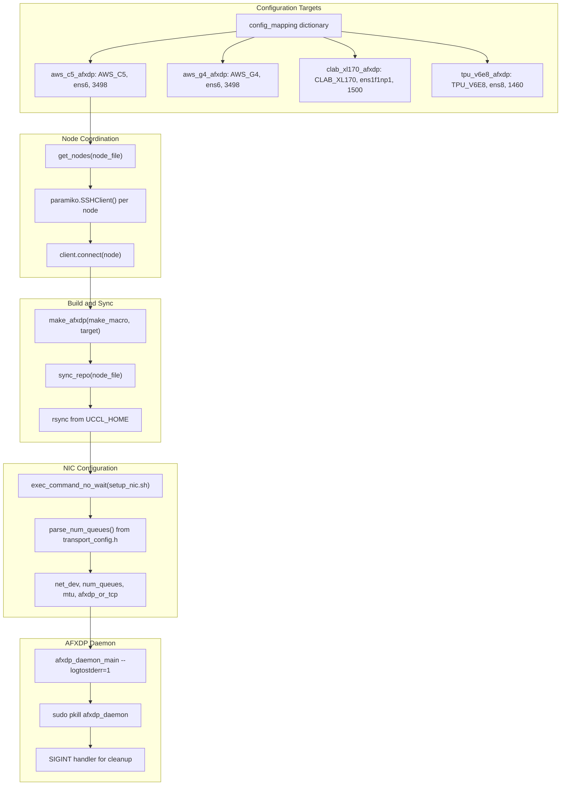

Configuration mapping structure:

| Target | Platform Macro | Network Device | MTU |
|--------|---------------|----------------|-----|
| `aws_c5_afxdp` | `AWS_C5` | `ens6` | 3498 |
| `aws_g4_afxdp` | `AWS_G4` | `ens6` | 3498 |
| `aws_g4metal_afxdp` | `AWS_G4METAL` | `enp199s0` | 3498 |
| `clab_xl170_afxdp` | `CLAB_XL170` | `ens1f1np1` | 1500 |
| `clab_d6515_afxdp` | `CLAB_D6515` | `enp65s0f0np0` | 3498 |
| `tpu_v6e8_afxdp` | `TPU_V6E8` | `ens8` | 1460 |

Usage examples:

```bash
# Setup AF_XDP on CloudLab XL170 cluster
python setup_all.py --target=clab_xl170_afxdp

# Setup TPU v6e8 cluster
python setup_all.py --target=tpu_v6e8_afxdp --node_file=node_ips/tpu_2.txt

# Sync repository only
python setup_all.py --target=setup_extra
```

Sources: [scripts/setup_all.py:1-169]()

### NIC Setup Script

**File: scripts/setup_nic.sh**

The `setup_nic.sh` script configures network interfaces for AFXDP or TCP modes:

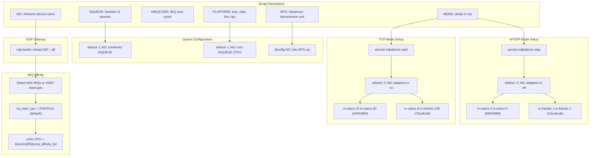

Platform-specific IRQ assignment:

```bash
# Default: Start at 3/4 of total CPUs
irq_start_cpu=$((NCPU / 4 * 3))

# AWS: Start at 1/4 (avoid conflicts with NCCL proxy)
irq_start_cpu=$((NCPU / 4))

# TPU: Start at 1/8
irq_start_cpu=$((NCPU / 8))
```

Sources: [scripts/setup_nic.sh:1-104]()

### Node Configuration Files

Cluster node specifications are stored in `scripts/node_ips/`:

**AMD GPU Cluster (scripts/node_ips/amd.txt):**
```
tw025
tw026
tw052
tw054
```

**TPU v6e8 Cluster (scripts/node_ips/tpu_2.txt):**
```
10.202.15.195
10.202.15.196
```

These files are used by `setup_all.py` to target specific node sets for configuration and testing.

Sources: [scripts/node_ips/amd.txt:1-4](), [scripts/node_ips/tpu_2.txt:1-2]()

## Test Configuration Management

Integration tests use standardized configuration files and environment variable management for consistent multi-node deployments.

### Node IP Configuration

Cluster node specifications are managed through text files in `scripts/node_ips/`:

| Configuration File | Purpose | Example Nodes |
|-------------------|---------|---------------|
| `amd.txt` | AMD GPU nodes | tw025, tw026, tw052, tw054 |

The AMD cluster configuration in [scripts/node_ips/amd.txt:1-4]() provides a 4-node setup for RCCL integration testing with HIP/ROCm environments.

### Environment Variable Framework

UCCL integration tests configure transport behavior through environment variables processed by utility functions:

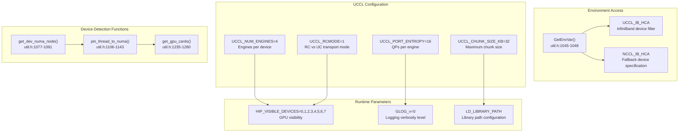

Sources: [include/util/util.h:1045-1280](), [rdma/run_rccl_test.sh:50-63]()

## Collective Communication Testing

UCCL provides comprehensive collective operation testing through both C++ transport tests and Python PyTorch integration benchmarks.

### Python Collective API Testing

The `benchmark_uccl_collective.py` validates high-level collective operations using PyTorch tensors:

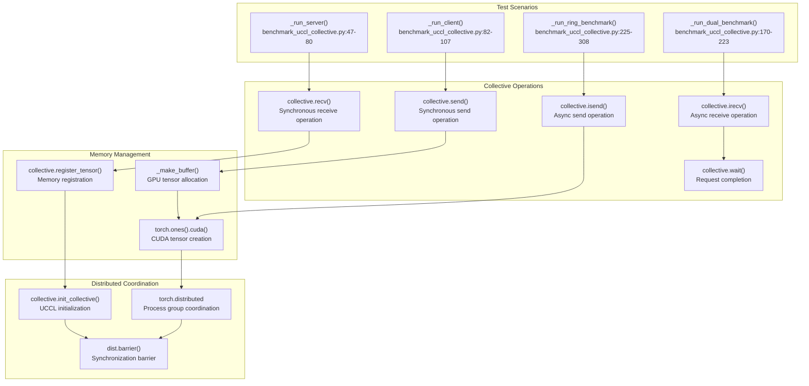

### Transport-Level Testing

Low-level transport validation through `ucclRequest` and `PollCtx` structures:

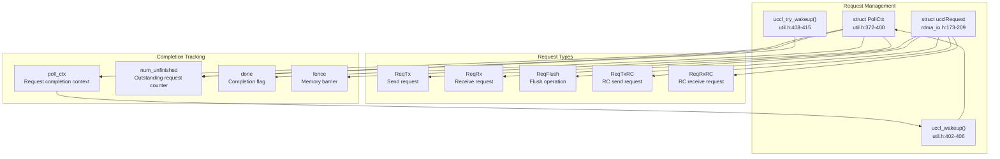

### Performance Validation Framework

Integration tests measure throughput, latency, and correctness across different message sizes and communication patterns:

| Test Mode | Function | Purpose | Metrics |
|-----------|----------|---------|---------|
| Basic | `server_basic()`, `client_basic()` | Correctness validation | Data integrity verification |
| Latency | `server_lat()`, `client_lat()` | Latency measurement | P50, P90, P99 percentiles |
| Throughput | `server_tpt()`, `client_tpt()` | Bandwidth testing | Gbps, GB/s measurements |
| Bidirectional | `client_tpt()` with dual flows | Full-duplex testing | Simultaneous send/recv |

Sources: [p2p/benchmarks/benchmark_uccl_collective.py:1-446](), [rdma/rdma_io.h:173-209](), [include/util/util.h:372-415](), [rdma/transport_test.cc:51-298]()

## Specialized Test Environments

### HPC Cluster Integration

HPC Fund cluster testing uses Slurm integration with `run_rccl_test_hpcfund.sh`:

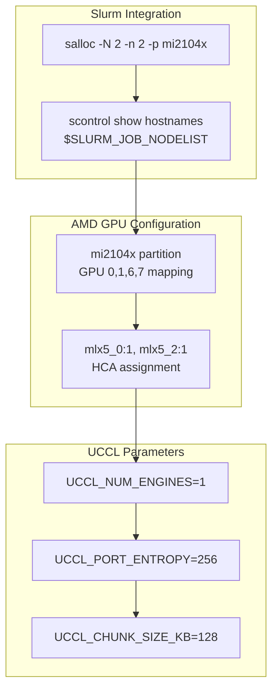

### AF_XDP Cloud Testing

AF_XDP integration testing on AWS g4dn instances requires specialized setup in [doc/dev_afxdp.md:65-92]():
1. **Driver installation**: AWS ENA driver with AF_XDP zero-copy support
2. **Privilege escalation**: `setup_all.py --target aws_g4_afxdp` for BPF capabilities
3. **Transport validation**: Direct `transport_test` before NCCL integration
4. **Multi-step verification**: Transport tests → NCCL tests → Application workloads

Sources: [rdma/run_rccl_test_hpcfund.sh:1-85](), [doc/dev_afxdp.md:65-92]()