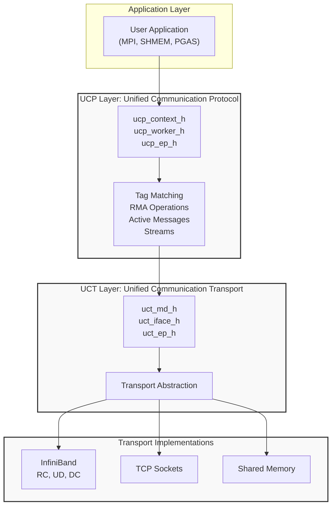
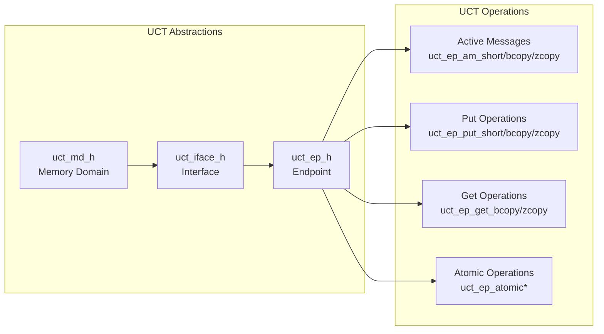
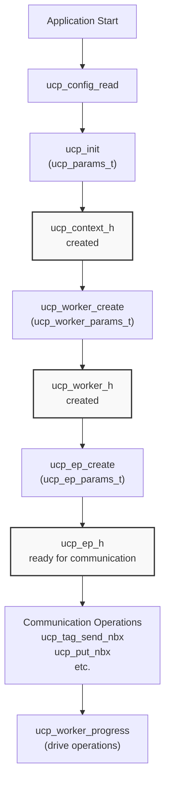
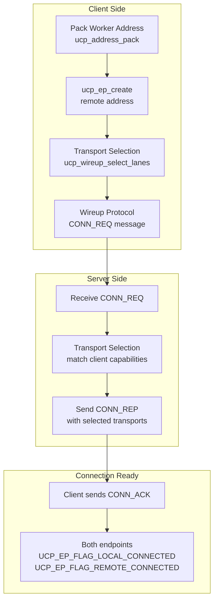
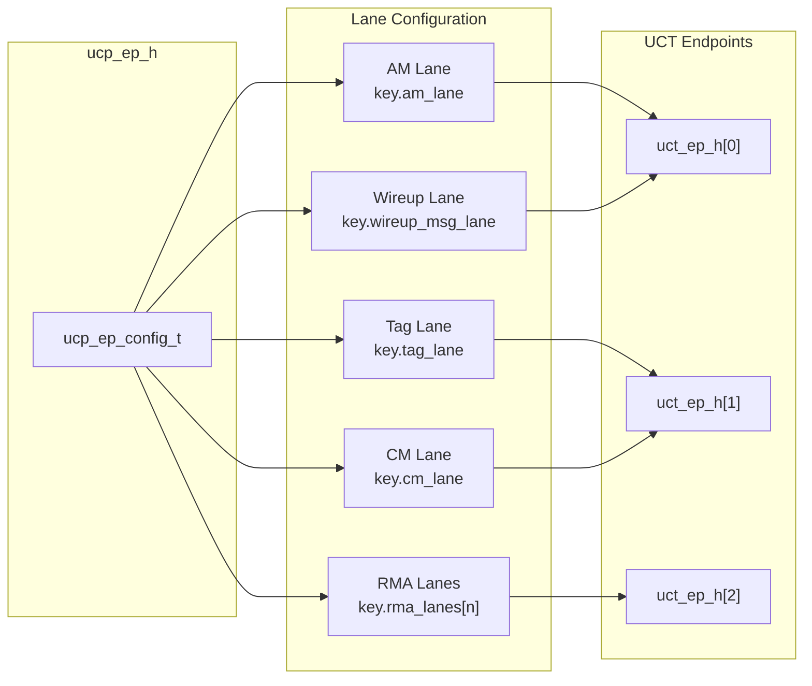
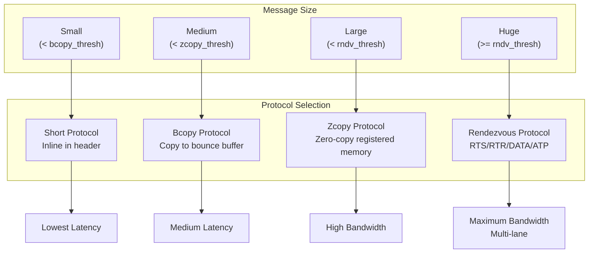

<!-- source: DeepWiki mcp.deepwiki.com · repo openucx/ucx · page 1 Overview · fetched 2026-11-11 -->

# Overview

Relevant source files

The following files were used as context for generating this wiki page:

- [src/tools/info/tl_info.c](src/tools/info/tl_info.c)
- [src/ucp/api/ucp.h](src/ucp/api/ucp.h)
- [src/ucp/api/ucp_compat.h](src/ucp/api/ucp_compat.h)
- [src/ucp/api/ucp_def.h](src/ucp/api/ucp_def.h)
- [src/ucp/core/ucp_context.c](src/ucp/core/ucp_context.c)
- [src/ucp/core/ucp_context.h](src/ucp/core/ucp_context.h)
- [src/ucp/core/ucp_ep.c](src/ucp/core/ucp_ep.c)
- [src/ucp/core/ucp_ep.h](src/ucp/core/ucp_ep.h)
- [src/ucp/core/ucp_ep.inl](src/ucp/core/ucp_ep.inl)
- [src/ucp/core/ucp_worker.c](src/ucp/core/ucp_worker.c)
- [src/ucp/core/ucp_worker.h](src/ucp/core/ucp_worker.h)
- [src/ucp/wireup/select.c](src/ucp/wireup/select.c)
- [src/ucp/wireup/wireup.c](src/ucp/wireup/wireup.c)
- [src/ucp/wireup/wireup.h](src/ucp/wireup/wireup.h)
- [src/ucp/wireup/wireup_cm.c](src/ucp/wireup/wireup_cm.c)
- [src/ucp/wireup/wireup_cm.h](src/ucp/wireup/wireup_cm.h)
- [src/ucp/wireup/wireup_ep.c](src/ucp/wireup/wireup_ep.c)
- [src/ucp/wireup/wireup_ep.h](src/ucp/wireup/wireup_ep.h)
- [src/uct/api/tl.h](src/uct/api/tl.h)
- [src/uct/api/uct.h](src/uct/api/uct.h)
- [src/uct/api/uct_def.h](src/uct/api/uct_def.h)
- [src/uct/api/v2/uct_v2.h](src/uct/api/v2/uct_v2.h)
- [src/uct/base/uct_iface.c](src/uct/base/uct_iface.c)
- [src/uct/base/uct_iface.h](src/uct/base/uct_iface.h)
- [src/uct/cuda/gdr_copy/gdr_copy_iface.c](src/uct/cuda/gdr_copy/gdr_copy_iface.c)
- [test/gtest/ucp/test_ucp_ep.cc](test/gtest/ucp/test_ucp_ep.cc)

UCX (Unified Communication X) is a communication framework designed for high-performance computing (HPC) and data-intensive applications. It provides a layered architecture that abstracts diverse network hardware through a unified API, enabling applications to achieve optimal performance across different interconnect technologies without modification.

This page introduces UCX's fundamental architecture, design principles, and core abstractions. For detailed information about specific layers, see: UCP layer ([2](#2)), UCT layer ([3](#3)), Memory Management ([4](#4)), and Testing ([5](#5)).

## Three-Layer Architecture

UCX employs a three-layer design that separates protocol semantics from transport mechanisms:

**Sources:** [src/ucp/api/ucp.h:1-100](), [src/uct/api/uct.h:1-100]()

### UCP Layer (Unified Communication Protocol)

UCP provides high-level communication semantics that applications use directly. It implements protocol logic for various communication patterns.

| Feature | API Function Prefix | Description |
|---------|-------------------|-------------|
| Tagged Messages | `ucp_tag_*` | Message matching by software tags |
| RMA | `ucp_put_*`, `ucp_get_*` | Remote Memory Access operations |
| Active Messages | `ucp_am_*` | User-defined message handlers |
| Streams | `ucp_stream_*` | Ordered, connection-oriented data transfer |
| Atomics | `ucp_atomic_*` | Atomic memory operations |

The UCP layer manages:
- **Contexts** (`ucp_context_h`): Global configuration and resource management
- **Workers** (`ucp_worker_h`): Progress engine and event handling per thread
- **Endpoints** (`ucp_ep_h`): Point-to-point connections to remote peers
- **Requests** (`ucp_request_t`): Asynchronous operation tracking

**Sources:** [src/ucp/api/ucp.h:25-100](), [src/ucp/core/ucp_context.h:1-50](), [src/ucp/core/ucp_worker.h:1-50](), [src/ucp/core/ucp_ep.h:1-100]()

### UCT Layer (Unified Communication Transport)

UCT provides a uniform interface over diverse network hardware. It exposes low-level transport capabilities while hiding hardware-specific details.

**UCT Components:**

- **Memory Domain** (`uct_md_h`): Manages memory registration and protection
- **Interface** (`uct_iface_h`): Represents a communication channel on a device
- **Endpoint** (`uct_ep_h`): Connection to a specific remote interface

UCT operations come in three flavors:
- **Short**: Inline data in protocol headers (lowest latency)
- **Bcopy**: Buffer copy to pre-registered memory (medium messages)
- **Zcopy**: Zero-copy using registered memory (large messages)

**Sources:** [src/uct/api/uct.h:50-300](), [src/uct/api/uct_def.h:1-100](), [src/uct/base/uct_iface.h:1-100]()

### Transport Layer

The transport layer implements UCT interfaces for specific hardware:

| Transport | Type | Description | Capabilities |
|-----------|------|-------------|--------------|
| RC (Reliable Connection) | InfiniBand | Hardware-reliable, connection-oriented | High bandwidth, hardware reliability |
| UD (Unreliable Datagram) | InfiniBand | Software reliability over UD QPs | Scalability, connectionless |
| DC (Dynamic Connection) | InfiniBand | Scalable connections via DCI pool | Scalable connections, hardware reliability |
| TCP | Network | Socket-based communication | Universal connectivity |
| SHM | Memory | Intra-node shared memory | Lowest latency for same-node |

Each transport is implemented as a separate component that registers with UCT during initialization.

**Sources:** [src/uct/api/uct.h:300-350](), [src/ucp/wireup/select.c:1-100]()

## Core Abstractions and Workflow

### Initialization and Resource Management

**Initialization Sequence:**

1. **Configuration**: `ucp_config_read()` loads settings from environment variables and configuration files [src/ucp/api/ucp.h:600-650]()
2. **Context Creation**: `ucp_init()` creates a `ucp_context_h` with specified features (TAG, RMA, AMO, etc.) [src/ucp/core/ucp_context.c:1-100]()
3. **Worker Creation**: `ucp_worker_create()` establishes a per-thread progress engine [src/ucp/core/ucp_worker.c:1-100]()
4. **Endpoint Creation**: `ucp_ep_create()` connects to a remote worker [src/ucp/core/ucp_ep.c:1-100]()

**Sources:** [src/ucp/api/ucp.h:1-700](), [src/ucp/core/ucp_context.c:1-200](), [src/ucp/core/ucp_worker.c:1-200](), [src/ucp/core/ucp_ep.c:1-200]()

### Connection Establishment (Wireup)

UCX uses a sophisticated wireup protocol to select optimal transports and establish connections:

The wireup process:
1. Client packs its worker address containing available transports [src/ucp/wireup/address.c:1-100]()
2. Transport selection algorithm chooses optimal lanes based on bandwidth, latency, and capabilities [src/ucp/wireup/select.c:1-500]()
3. Three-way handshake (REQ/REP/ACK) exchanges connection information [src/ucp/wireup/wireup.c:1-300]()
4. Temporary wireup endpoints proxy operations until connection completes [src/ucp/wireup/wireup_ep.c:1-200]()

**Sources:** [src/ucp/wireup/wireup.c:1-300](), [src/ucp/wireup/select.c:1-500](), [src/ucp/wireup/wireup_ep.c:1-200](), [src/ucp/wireup/address.c:1-200]()

## Communication Models

### Multi-Lane Communication

UCX uses multiple parallel lanes for different operation types to maximize performance:

Each endpoint (`ucp_ep_h`) maintains:
- **Lane array**: Up to `UCP_MAX_LANES` (16) UCT endpoints [src/ucp/core/ucp_ep.h:200-250]()
- **Lane types**: Specialized for different operations (AM, RMA, TAG, wireup, CM, keepalive) [src/ucp/proto/lane_type.h:1-100]()
- **Multi-rail**: Multiple lanes can use different devices in parallel for bandwidth aggregation [src/ucp/wireup/select.c:500-700]()

**Sources:** [src/ucp/core/ucp_ep.h:200-250](), [src/ucp/wireup/select.c:500-1000]()

### Request Management and Asynchronous Operations

All communication operations in UCP are non-blocking and return a request handle:

| Return Value | Meaning | Action |
|--------------|---------|--------|
| `NULL` | Completed immediately | No further action needed |
| `UCS_PTR_IS_PTR(req)` | In progress | Test/wait for completion |
| `UCS_PTR_IS_ERR(req)` | Failed | Extract error with `UCS_PTR_STATUS()` |

Requests are allocated from memory pools and tracked through completion:
- **Request structure**: `ucp_request_t` contains operation state [src/ucp/core/ucp_request.h:1-100]()
- **Protocol selection**: Chooses short/bcopy/zcopy/rendezvous based on message size [src/ucp/core/ucp_ep.c:600-800]()
- **Completion**: Via callbacks, polling (`ucp_request_test`), or waiting (`ucp_request_wait`) [src/ucp/api/ucp.h:1500-1600]()

**Sources:** [src/ucp/core/ucp_request.h:1-200](), [src/ucp/api/ucp.h:1500-1700]()

## Design Principles

### Hardware Abstraction

UCX abstracts hardware diversity through:
- **Runtime selection**: Transport and protocol selection at runtime based on available hardware
- **Capability queries**: UCT exposes fine-grained capabilities (`UCT_IFACE_FLAG_*`) [src/uct/api/uct.h:360-450]()
- **Zero-copy**: Direct hardware access for registered memory avoids copies
- **Multi-path**: Automatic use of multiple network paths when available

**Sources:** [src/uct/api/uct.h:300-500](), [src/ucp/wireup/select.c:1-200]()

### Performance Optimization

UCX optimizes performance through:
- **Protocol thresholds**: Configurable via `UCX_*_THRESH` environment variables [src/ucp/core/ucp_context.c:150-400]()
- **Memory registration caching**: Reduces registration overhead [src/ucp/core/ucp_rkey.c:1-200]()
- **Progress engine**: Efficient polling with adaptive progress [src/ucp/core/ucp_worker.c:500-800]()
- **Multi-rail**: Parallel data transfer across multiple lanes [src/ucp/wireup/select.c:800-1200]()

**Sources:** [src/ucp/core/ucp_context.c:150-400](), [src/ucp/wireup/select.c:800-1500]()

## Use Cases

UCX serves as the foundation for:

- **MPI Implementations**: OpenMPI, MPICH use UCX for point-to-point and collective operations
- **PGAS Languages**: UPC, Chapel, OpenSHMEM leverage UCX for remote memory access
- **Deep Learning**: TensorFlow, PyTorch use UCX for distributed training communication
- **Storage Systems**: Parallel file systems use UCX for high-performance data movement
- **HPC Applications**: Direct use of UCX API for custom communication patterns

The layered design allows each use case to operate at the appropriate abstraction level:
- MPI/PGAS frameworks use UCP for high-level semantics
- Performance-critical custom protocols may use UCT directly
- Transport developers implement UCT interfaces for new hardware

**Sources:** [src/ucp/api/ucp.h:25-100](), [src/uct/api/uct.h:1-100]()

## Key Files and Entry Points

| Component | Key Files | Entry Points |
|-----------|-----------|--------------|
| UCP API | [src/ucp/api/ucp.h]() | `ucp_init`, `ucp_worker_create`, `ucp_ep_create` |
| UCP Core | [src/ucp/core/ucp_context.c](), [src/ucp/core/ucp_worker.c](), [src/ucp/core/ucp_ep.c]() | Context/worker/endpoint implementation |
| UCT API | [src/uct/api/uct.h]() | `uct_md_open`, `uct_iface_open`, `uct_ep_create` |
| UCT Base | [src/uct/base/uct_iface.c]() | Common UCT infrastructure |
| Wireup | [src/ucp/wireup/wireup.c](), [src/ucp/wireup/select.c]() | Connection establishment and transport selection |
| Transports | `src/uct/{ib,tcp,sm}/` | Transport-specific implementations |

**Sources:** [src/ucp/api/ucp.h:1-100](), [src/uct/api/uct.h:1-100](), [src/ucp/core/](), [src/uct/base/](), [src/ucp/wireup/]()

---

