<!-- source: DeepWiki mcp.deepwiki.com · repo openucx/ucx · page 2 UCP (Unified Communication Protocol) · fetched 2026-11-11 -->

# UCP (Unified Communication Protocol)

Relevant source files

The following files were used as context for generating this wiki page:

- [src/ucp/api/ucp.h](src/ucp/api/ucp.h)
- [src/ucp/api/ucp_compat.h](src/ucp/api/ucp_compat.h)
- [src/ucp/api/ucp_def.h](src/ucp/api/ucp_def.h)
- [src/ucp/core/ucp_context.c](src/ucp/core/ucp_context.c)
- [src/ucp/core/ucp_context.h](src/ucp/core/ucp_context.h)
- [src/ucp/core/ucp_ep.c](src/ucp/core/ucp_ep.c)
- [src/ucp/core/ucp_ep.h](src/ucp/core/ucp_ep.h)
- [src/ucp/core/ucp_ep.inl](src/ucp/core/ucp_ep.inl)
- [src/ucp/core/ucp_worker.c](src/ucp/core/ucp_worker.c)
- [src/ucp/core/ucp_worker.h](src/ucp/core/ucp_worker.h)
- [src/ucp/wireup/select.c](src/ucp/wireup/select.c)
- [src/ucp/wireup/wireup.c](src/ucp/wireup/wireup.c)
- [src/ucp/wireup/wireup.h](src/ucp/wireup/wireup.h)
- [src/ucp/wireup/wireup_cm.c](src/ucp/wireup/wireup_cm.c)
- [src/ucp/wireup/wireup_cm.h](src/ucp/wireup/wireup_cm.h)
- [src/ucp/wireup/wireup_ep.c](src/ucp/wireup/wireup_ep.c)
- [src/ucp/wireup/wireup_ep.h](src/ucp/wireup/wireup_ep.h)
- [test/gtest/ucp/test_ucp_ep.cc](test/gtest/ucp/test_ucp_ep.cc)

**Purpose**: UCP is the high-level protocol layer in UCX that provides portable, feature-rich communication APIs for HPC and data-center applications. This document covers UCP's architecture, core abstractions, communication protocols, and connection establishment mechanisms.

**Scope**: This page focuses on UCP layer implementation (protocol logic, endpoint management, wireup). For UCT transport layer details, see [UCT (Unified Communication Transport)](#3). For memory registration and remote keys, see [Memory Management](#4).

---

## UCP Layer Position in UCX Architecture

UCP sits above the UCT (Unified Communication Transport) layer and provides:
- **Protocol-level features**: Tagged messaging, streams, RMA, active messages, rendezvous
- **Transport abstraction**: Hides UCT complexity from applications
- **Multi-lane optimization**: Uses multiple transports simultaneously for bandwidth
- **Connection management**: Automatic wireup and transport selection

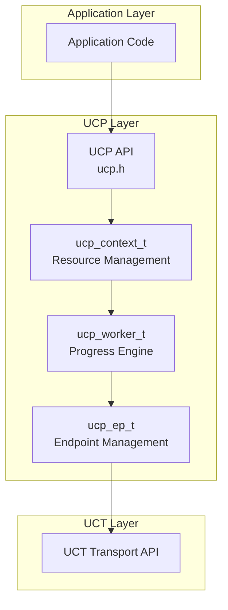

**Sources**: [src/ucp/api/ucp.h:1-900](), [Diagram 1 from overview]()

---

## Core Abstractions

### Context: `ucp_context_t`

The UCP context represents a single communication instance and holds global configuration and resources.

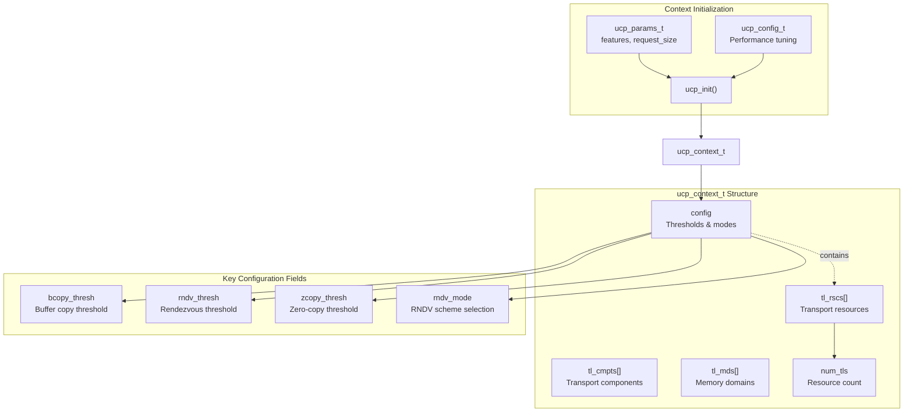

**Key Fields**:
- `config.features`: Enabled features (TAG, RMA, AMO, STREAM, AM)
- `tl_rscs[]`: Array of available transport resources
- `tl_cmpts[]`: Array of UCT components
- `tl_mds[]`: Array of memory domains for registration

**Configuration Parameters** (from `ucp_context_config_t`):
- `bcopy_thresh`: When to switch from short to buffer-copy protocol
- `rndv_thresh`: When to switch from eager to rendezvous (intra/inter node)
- `zcopy_thresh`: When to use zero-copy operations
- `rndv_mode`: Rendezvous scheme (auto, get_zcopy, put_zcopy, rkey_ptr, am)
- `max_eager_lanes`, `max_rndv_lanes`, `max_rma_lanes`: Multi-lane limits

**Sources**: [src/ucp/core/ucp_context.h:56-283](), [src/ucp/core/ucp_context.c:161-452](), [src/ucp/api/ucp.h:119-173]()

---

### Worker: `ucp_worker_t`

The worker is the progress engine that drives communication. Each worker has its own set of UCT interfaces and manages multiple endpoints.

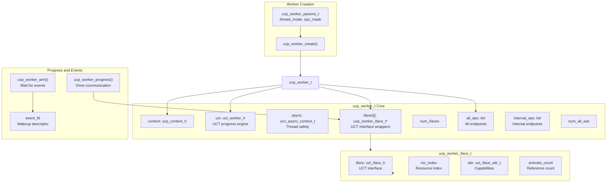

**Key Responsibilities**:
1. **Progress Engine**: `ucp_worker_progress()` polls UCT interfaces
2. **Interface Management**: Opens and activates UCT interfaces on demand
3. **Endpoint Management**: Tracks all endpoints created on this worker
4. **Event Handling**: Supports wakeup via `UCP_FEATURE_WAKEUP`

**Worker Interface (`ucp_worker_iface_t`)** wraps each UCT interface with:
- `activate_count`: Reference counting for on-demand activation
- `proxy_recv_count`: Counts messages received via proxy AM handlers
- `flags`: `UCP_WORKER_IFACE_FLAG_OFFLOAD_ACTIVATED`, `UCP_WORKER_IFACE_FLAG_ON_ARM_LIST`

**Sources**: [src/ucp/core/ucp_worker.h:206-439](), [src/ucp/core/ucp_worker.c:282-375](), [src/ucp/core/ucp_worker.c:576-609]()

---

### Endpoint: `ucp_ep_t`

An endpoint represents a connection to a remote worker. It manages multiple lanes (transport paths) for different operation types.

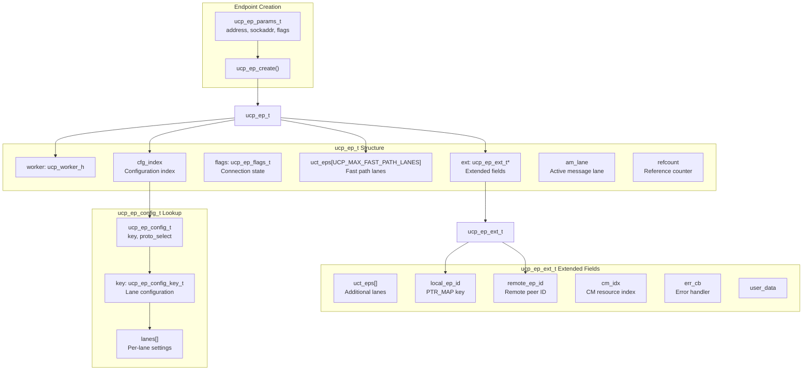

**Key Fields**:
- `cfg_index`: Index into worker's `ep_config[]` array
- `uct_eps[]`: Array of UCT endpoints (one per lane)
- `am_lane`: Primary lane for active messages
- `flags`: Connection state (`UCP_EP_FLAG_LOCAL_CONNECTED`, `UCP_EP_FLAG_REMOTE_CONNECTED`, `UCP_EP_FLAG_FAILED`)

**Endpoint Configuration Key** (`ucp_ep_config_key_t`):
- `num_lanes`: Number of active lanes
- `lanes[]`: Per-lane configuration (resource index, MD index, lane types)
- `am_lane`, `tag_lane`, `wireup_msg_lane`, `cm_lane`, `keepalive_lane`: Special purpose lanes
- `rma_lanes[]`, `rma_bw_lanes[]`, `amo_lanes[]`, `am_bw_lanes[]`: Sorted by priority

**Sources**: [src/ucp/core/ucp_ep.h:207-335](), [src/ucp/core/ucp_ep.c:183-264](), [src/ucp/core/ucp_ep.c:363-417]()

---

### Lanes: Multi-Transport Communication

UCP uses a **lane-based architecture** where each lane uses a different UCT endpoint/transport. Different operation types are mapped to different lanes for optimal performance.

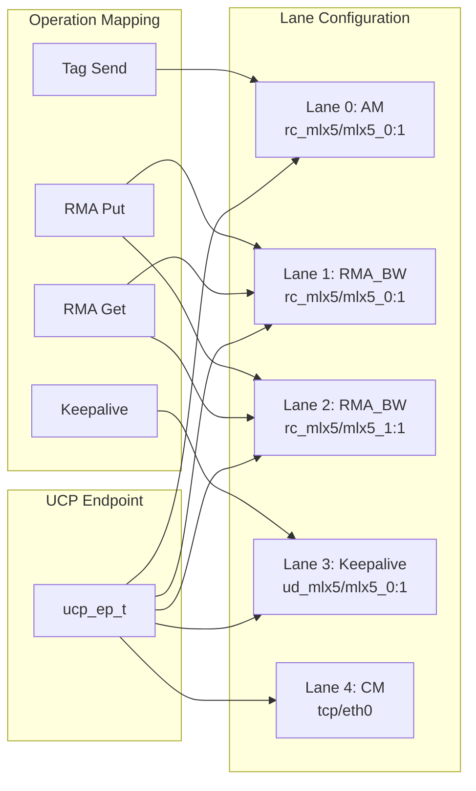

**Lane Types** (`ucp_lane_type_t`):
- `UCP_LANE_TYPE_AM`: Active messages and tag matching
- `UCP_LANE_TYPE_AM_BW`: High-bandwidth active messages
- `UCP_LANE_TYPE_RMA`: Remote memory access
- `UCP_LANE_TYPE_RMA_BW`: High-bandwidth RMA (multi-lane)
- `UCP_LANE_TYPE_AMO`: Atomic operations
- `UCP_LANE_TYPE_TAG`: Hardware tag matching offload
- `UCP_LANE_TYPE_KEEPALIVE`: Connection liveness checking
- `UCP_LANE_TYPE_CM`: Connection manager

**Multi-Lane Optimization**: For large transfers, UCP can stripe data across multiple lanes simultaneously to utilize aggregate bandwidth. Configuration controls:
- `max_eager_lanes`: Max lanes for eager messages
- `max_rndv_lanes`: Max lanes for rendezvous
- `max_rma_lanes`: Max lanes for RMA operations

**Sources**: [src/ucp/core/ucp_ep.h:207-250](), [src/ucp/proto/lane_type.h]()

---

## Connection Establishment (Wireup)

UCP implements a sophisticated wireup protocol to establish connections and select optimal transports.

### Wireup Protocol Flow

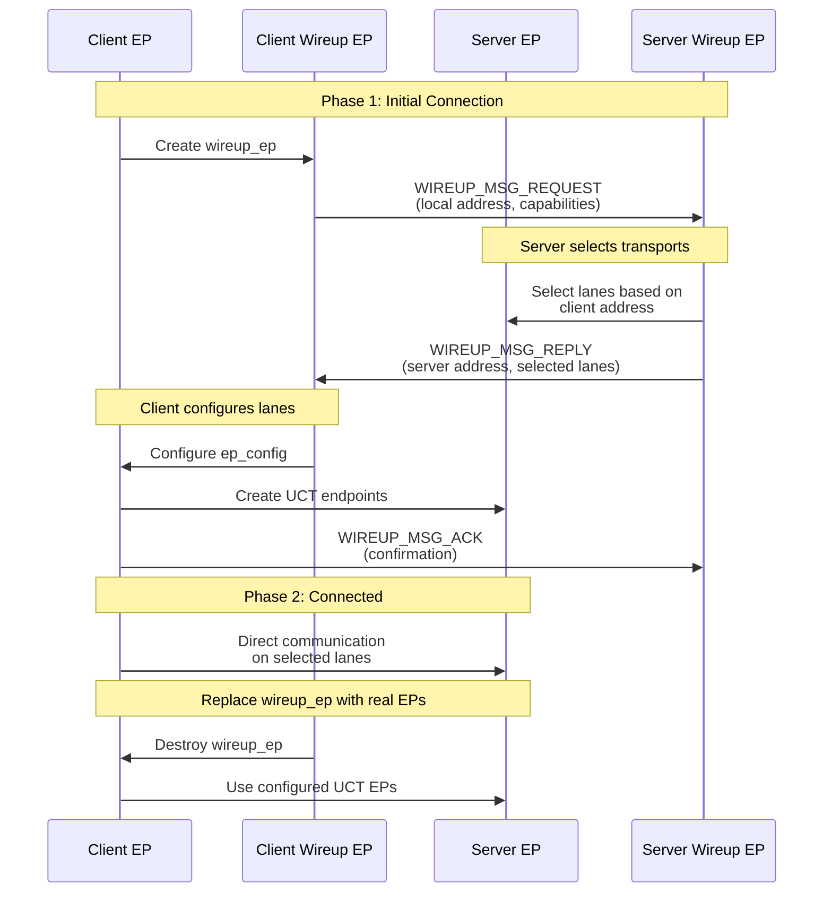

**Wireup Message Types**:
- `UCP_WIREUP_MSG_PRE_REQUEST`: Pre-connection request (CM-based)
- `UCP_WIREUP_MSG_REQUEST`: Connection request with local address
- `UCP_WIREUP_MSG_REPLY`: Connection reply with selected configuration
- `UCP_WIREUP_MSG_ACK`: Acknowledgment, connection complete

**Wireup Endpoint** (`ucp_wireup_ep_t`): A proxy endpoint that queues operations during connection establishment:
- `pending_q`: Queue of pending operations
- `aux_ep`: Auxiliary UCT endpoint for wireup messages
- `flags`: `UCP_WIREUP_EP_FLAG_READY`, `UCP_WIREUP_EP_FLAG_LOCAL_CONNECTED`, `UCP_WIREUP_EP_FLAG_REMOTE_CONNECTED`

**Sources**: [src/ucp/wireup/wireup.c:50-216](), [src/ucp/wireup/wireup.h:40-52](), [src/ucp/wireup/wireup_ep.h:44-60]()

---

### Transport Selection

Transport selection happens during wireup based on multiple criteria.

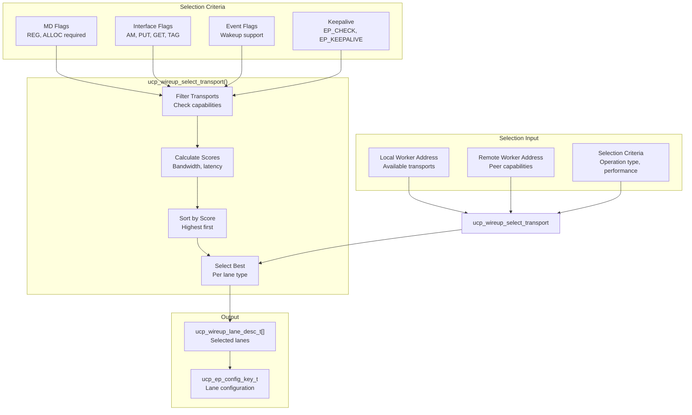

**Selection Algorithm** (`ucp_wireup_select_transport()`):
1. **Filter**: Check mandatory capabilities (MD flags, iface flags, events)
2. **Score**: Calculate transport score based on bandwidth/latency
3. **Prioritize**: Consider device distance, memory type support
4. **Select**: Choose highest scoring transport per lane type

**Scoring Functions**:
- `ucp_wireup_rma_score()`: RMA bandwidth divided by latency
- `ucp_wireup_amo_score()`: Atomic operation support
- `ucp_wireup_am_score()`: Active message bandwidth/latency
- `ucp_wireup_tag_score()`: Tag matching offload capability

**Multi-Lane Selection**: For bandwidth-intensive operations, multiple lanes of same type selected based on:
- `multi_lane_max_ratio`: Max ratio between slowest/fastest lane (default: 4)
- `multi_path_ratio`: Bandwidth efficiency when using multiple paths per device

**Sources**: [src/ucp/wireup/select.c:391-600](), [src/ucp/wireup/select.c:1200-1450](), [src/ucp/wireup/wireup.c:219-252]()

---

## Communication Protocols

### Protocol Selection

UCP dynamically selects communication protocols based on message size and memory type.

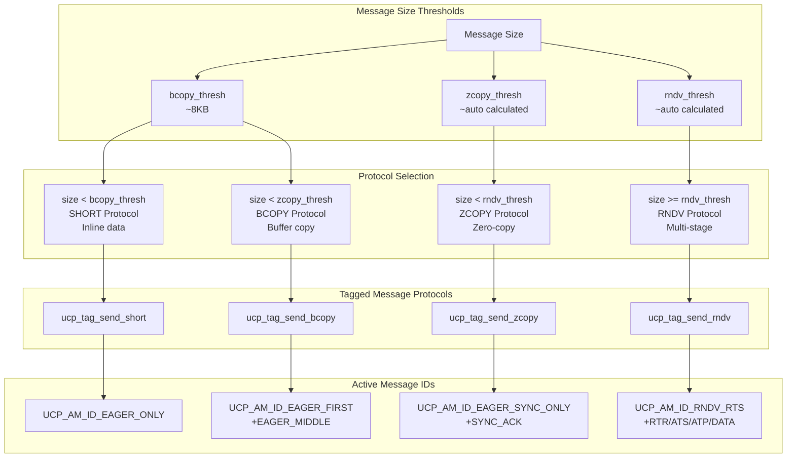

**Protocol Thresholds**:
- `bcopy_thresh`: Switch from inline (short) to buffer-copy (default: auto)
- `zcopy_thresh`: Switch from buffer-copy to zero-copy (default: auto)
- `rndv_thresh`: Switch from eager to rendezvous (default: auto, separate intra/inter node)

**Threshold Calculation**: UCP auto-calculates thresholds based on:
- Transport bandwidth and latency
- Memory copy bandwidth (`bcopy_bw`)
- Memory registration overhead
- Message size distribution

**Sources**: [src/ucp/core/ucp_context.h:56-90](), [src/ucp/core/ucp_context.c:161-199]()

---

### Rendezvous Protocol

The rendezvous protocol is a multi-stage protocol for large messages.

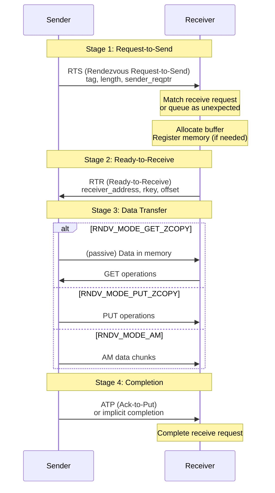

**Rendezvous Modes** (`ucp_rndv_mode_t`):
- `UCP_RNDV_MODE_GET_ZCOPY`: Receiver pulls data via GET operations
- `UCP_RNDV_MODE_PUT_ZCOPY`: Sender pushes data via PUT operations
- `UCP_RNDV_MODE_GET_PIPELINE`: Pipelined GET with staging buffers
- `UCP_RNDV_MODE_PUT_PIPELINE`: Pipelined PUT with staging buffers
- `UCP_RNDV_MODE_AM`: Active message-based transfer
- `UCP_RNDV_MODE_RKEY_PTR`: Direct memory access via rkey_ptr
- `UCP_RNDV_MODE_AUTO`: Runtime selection (default)

**Pipeline Protocol**: For GPU memory and large transfers:
- `rndv_frag_size[]`: Fragment size per memory type (default: 512KB host, 4MB GPU)
- `rndv_num_frags[]`: Number of fragments to pre-allocate (default: 128)
- Allows overlapping data movement with copy operations

**Active Message IDs for Rendezvous**:
- `UCP_AM_ID_RNDV_RTS`: Request-to-Send
- `UCP_AM_ID_RNDV_ATS`: Ack-to-Send (alternative flow)
- `UCP_AM_ID_RNDV_RTR`: Ready-to-Receive
- `UCP_AM_ID_RNDV_DATA`: Data chunks (AM mode)
- `UCP_AM_ID_RNDV_ATP`: Ack-to-Put (completion)

**Sources**: [src/ucp/core/ucp_context.h:79-83](), [src/ucp/rndv/](), [Diagram 7 from overview]()

---

## Request Management

UCP uses an asynchronous request-based model for all communication operations.

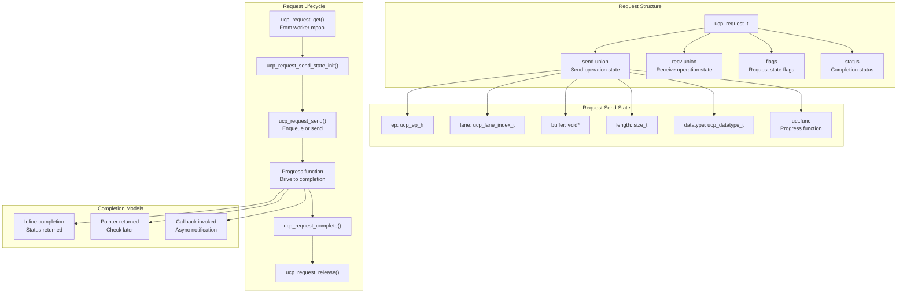

**Request Flags**:
- `UCP_REQUEST_FLAG_COMPLETED`: Request finished
- `UCP_REQUEST_FLAG_RELEASED`: User called release
- `UCP_REQUEST_FLAG_CALLBACK`: Has completion callback
- `UCP_REQUEST_FLAG_RECV_TAG`: Tagged receive
- `UCP_REQUEST_FLAG_RECV_AM`: Active message receive
- `UCP_REQUEST_FLAG_SEND`: Send operation

**Memory Pool**: Requests allocated from worker's memory pool (`ucp_worker_t.req_mp`)

**Progress Functions**: Each request type has a progress function:
- `ucp_proto_progress_am_bcopy()`: Active message bcopy
- `ucp_proto_progress_rma_zcopy()`: RMA zero-copy  
- `ucp_rndv_progress_rts()`: Rendezvous RTS
- `ucp_wireup_msg_progress()`: Wireup messages

**Sources**: [src/ucp/core/ucp_request.h](), [src/ucp/core/ucp_request.inl](), [Diagram 7 from overview]()

---

## Connection Manager (CM) Integration

UCP supports CM-based connection establishment for client-server workflows.

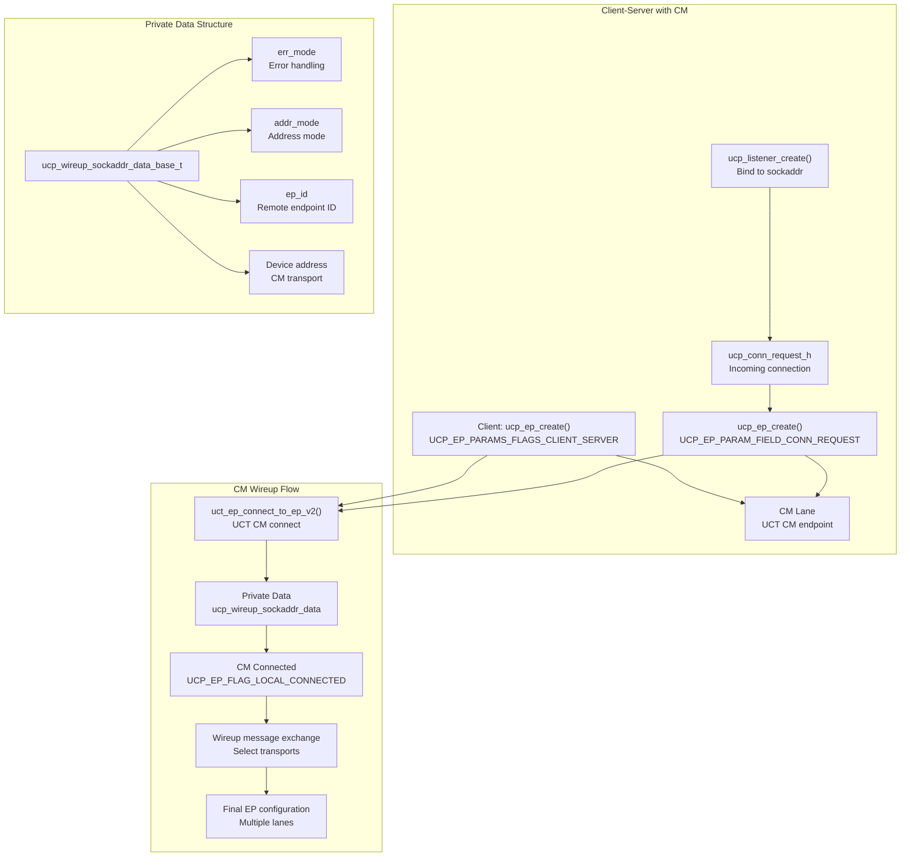

**CM Workflow**:
1. **Server**: `ucp_listener_create()` creates listener on sockaddr
2. **Client**: `ucp_ep_create()` with `UCP_EP_PARAMS_FLAGS_CLIENT_SERVER` flag
3. **UCT CM Connect**: Initial connection via `uct_ep_connect_to_ep_v2()`
4. **Private Data Exchange**: UCP address and configuration in CM private data
5. **Wireup**: Complete transport selection and lane configuration
6. **Multi-Lane**: Final configuration may use multiple transports beyond CM

**CM Lane**: Special lane type (`UCP_LANE_TYPE_CM`) holds the connection manager endpoint:
- Used for initial connection only
- May be replaced or supplemented by other lanes after wireup
- `cm_idx` in `ucp_ep_ext_t` stores CM resource index

**Sources**: [src/ucp/wireup/wireup_cm.c:1-800](), [src/ucp/wireup/wireup_cm.h:1-67](), [src/ucp/core/ucp_listener.c]()

---

## Key API Functions

### Initialization and Cleanup

| Function | Purpose | Key Parameters |
|----------|---------|----------------|
| `ucp_init()` | Initialize UCP context | `ucp_params_t` (features, request_size) |
| `ucp_cleanup()` | Cleanup UCP context | `ucp_context_h` |
| `ucp_worker_create()` | Create worker | `ucp_worker_params_t` (thread_mode, cpu_mask) |
| `ucp_worker_destroy()` | Destroy worker | `ucp_worker_h` |

### Endpoint Management

| Function | Purpose | Key Parameters |
|----------|---------|----------------|
| `ucp_ep_create()` | Create endpoint | `ucp_ep_params_t` (address, sockaddr, flags) |
| `ucp_ep_close_nbx()` | Close endpoint (async) | `ucp_ep_h`, flags |
| `ucp_ep_flush()` | Flush pending operations | `ucp_ep_h` |

### Communication Operations

| Function | Purpose | Protocol |
|----------|---------|----------|
| `ucp_tag_send_nbx()` | Send tagged message | Eager or Rendezvous |
| `ucp_tag_recv_nbx()` | Receive tagged message | Tag matching |
| `ucp_stream_send()` | Send stream data | Ordered delivery |
| `ucp_stream_recv_nbx()` | Receive stream data | FIFO ordering |
| `ucp_am_send_nbx()` | Send active message | User-defined handler |
| `ucp_put_nbx()` | RMA put | Zero-copy PUT |
| `ucp_get_nbx()` | RMA get | Zero-copy GET |
| `ucp_atomic_op_nbx()` | Atomic operation | AMO32/AMO64 |

**Sources**: [src/ucp/api/ucp.h:1-2000]()

---

## Configuration Parameters

Key UCP configuration parameters (environment variables or config file):

| Parameter | Default | Description |
|-----------|---------|-------------|
| `UCX_BCOPY_THRESH` | auto | Threshold for buffer copy protocol |
| `UCX_RNDV_THRESH` | auto | Threshold for rendezvous (intra/inter) |
| `UCX_ZCOPY_THRESH` | auto | Threshold for zero-copy |
| `UCX_RNDV_SCHEME` | auto | Rendezvous mode selection |
| `UCX_MAX_EAGER_RAILS` | 1 | Max lanes for eager messages |
| `UCX_MAX_RNDV_RAILS` | 2 | Max lanes for rendezvous |
| `UCX_MAX_RMA_RAILS` | 1 | Max lanes for RMA |
| `UCX_TM_THRESH` | 1024 | Tag offload threshold |
| `UCX_UNIFIED_MODE` | n | Homogeneous environment optimizations |
| `UCX_CM_USE_ALL_DEVICES` | y | Use all devices in CM mode |
| `UCX_PROTO_ENABLE` | y | Enable protocol selection |

**Sources**: [src/ucp/core/ucp_context.c:161-452]()

---

