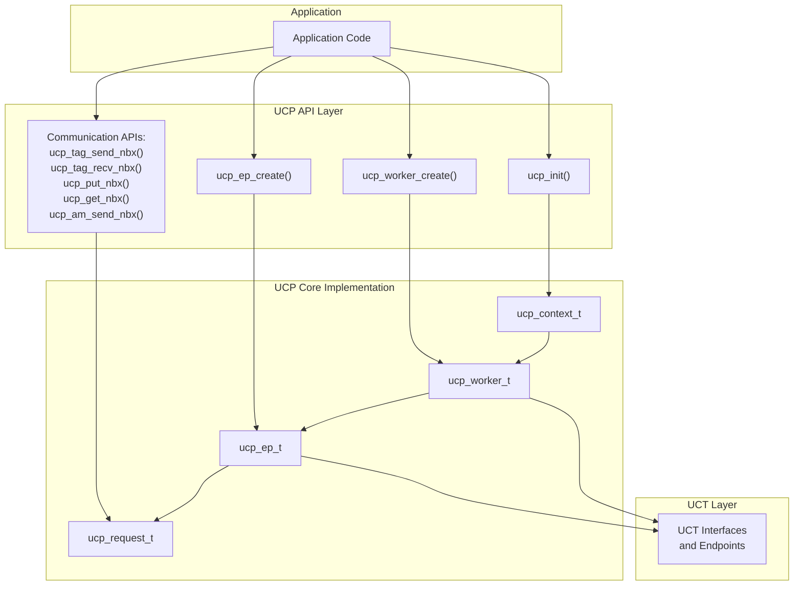
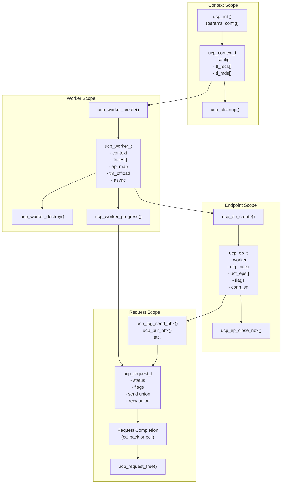
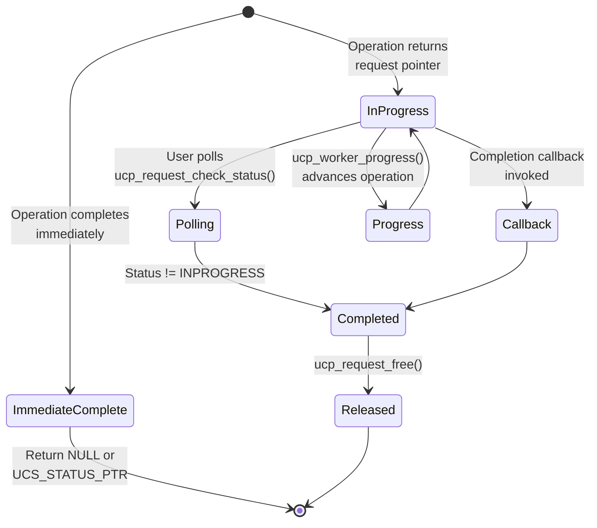
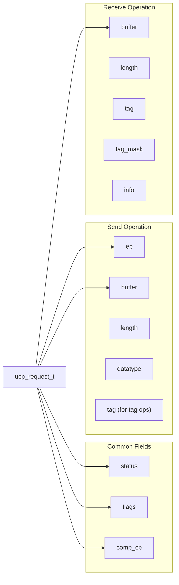

<!-- source: DeepWiki mcp.deepwiki.com · repo openucx/ucx · page 2.1 UCP API and Core Abstractions · fetched 2026-11-11 -->

# UCP API and Core Abstractions

<details>
<summary>Relevant source files</summary>

The following files were used as context for generating this wiki page:

- [src/ucp/api/ucp.h](src/ucp/api/ucp.h)
- [src/ucp/api/ucp_compat.h](src/ucp/api/ucp_compat.h)
- [src/ucp/api/ucp_def.h](src/ucp/api/ucp_def.h)
- [src/ucp/core/ucp_context.c](src/ucp/core/ucp_context.c)
- [src/ucp/core/ucp_context.h](src/ucp/core/ucp_context.h)
- [src/ucp/core/ucp_ep.c](src/ucp/core/ucp_ep.c)
- [src/ucp/core/ucp_ep.h](src/ucp/core/ucp_ep.h)
- [src/ucp/core/ucp_ep.inl](src/ucp/core/ucp_ep.inl)
- [src/ucp/core/ucp_worker.c](src/ucp/core/ucp_worker.c)
- [src/ucp/core/ucp_worker.h](src/ucp/core/ucp_worker.h)
- [src/ucp/wireup/select.c](src/ucp/wireup/select.c)
- [src/ucp/wireup/wireup.c](src/ucp/wireup/wireup.c)
- [src/ucp/wireup/wireup.h](src/ucp/wireup/wireup.h)
- [src/ucp/wireup/wireup_cm.c](src/ucp/wireup/wireup_cm.c)
- [src/ucp/wireup/wireup_cm.h](src/ucp/wireup/wireup_cm.h)
- [src/ucp/wireup/wireup_ep.c](src/ucp/wireup/wireup_ep.c)
- [src/ucp/wireup/wireup_ep.h](src/ucp/wireup/wireup_ep.h)
- [test/gtest/ucp/test_ucp_ep.cc](test/gtest/ucp/test_ucp_ep.cc)

</details>


## Purpose and Scope

This page documents the UCP (Unified Communication Protocol) public API and its fundamental abstractions. UCP is the high-level protocol layer in UCX that provides communication operations such as tag matching, streams, RMA, and active messages. This page covers the four core object types that applications interact with: contexts, workers, endpoints, and requests.

For detailed information about context and worker initialization and management, see [Contexts and Workers](#2.2). For endpoint lifecycle and connection establishment, see [Endpoints and Connection Establishment](#2.3). For request management and tag matching details, see [Request Management and Tag Matching](#2.4). For communication protocol specifics, see [Communication Protocols](#2.5).

## UCP Layer Overview

UCP provides a protocol layer that abstracts over multiple UCT (Unified Communication Transport) interfaces. It implements high-level communication semantics while selecting optimal transports based on capabilities and performance characteristics.



**Sources:** [src/ucp/api/ucp.h:1-1500](), [src/ucp/core/ucp_context.h:1-400](), [src/ucp/core/ucp_worker.h:1-300](), [src/ucp/core/ucp_ep.h:1-500]()

## Core Abstractions

UCP's API is structured around four core abstractions that form a hierarchy of objects. Each abstraction maps to specific opaque handle types and underlying implementation structures.

### Context (ucp_context_h)

The **context** represents a UCP communication instance with its global resources and configuration. It is the root object in the UCP hierarchy.

| API Type | Implementation Type | Purpose |
|----------|-------------------|---------|
| `ucp_context_h` | `struct ucp_context*` | Opaque handle to context |
| `ucp_config_t` | Configuration descriptor | Runtime configuration |
| `ucp_params_t` | Parameter structure | Context initialization parameters |

**Key Operations:**
- `ucp_init()` - Initialize context with configuration and feature flags
- `ucp_cleanup()` - Destroy context and release resources
- `ucp_context_query()` - Query context attributes

**Context Features:** The context is initialized with a bitmask of features defined in `enum ucp_feature` [src/ucp/api/ucp.h:141-172]():
- `UCP_FEATURE_TAG` - Tag matching support
- `UCP_FEATURE_RMA` - Remote memory access
- `UCP_FEATURE_AMO32`/`UCP_FEATURE_AMO64` - Atomic operations
- `UCP_FEATURE_WAKEUP` - Event notification
- `UCP_FEATURE_STREAM` - Stream semantics
- `UCP_FEATURE_AM` - Active messages

**Sources:** [src/ucp/api/ucp.h:60-77](), [src/ucp/api/ucp_def.h:40-60](), [src/ucp/core/ucp_context.h:195-370]()

### Worker (ucp_worker_h)

The **worker** represents a progress engine and communication context on a specific thread. Multiple workers can be created from a single context for multi-threaded applications.

| API Type | Implementation Type | Purpose |
|----------|-------------------|---------|
| `ucp_worker_h` | `struct ucp_worker*` | Opaque handle to worker |
| `ucp_worker_params_t` | Parameter structure | Worker creation parameters |
| `ucp_worker_attr_t` | Attribute structure | Worker attributes |
| `ucp_address_t` | Worker address | Serialized worker address for connection |

**Key Operations:**
- `ucp_worker_create()` - Create worker on context
- `ucp_worker_destroy()` - Destroy worker
- `ucp_worker_progress()` - Make progress on pending operations
- `ucp_worker_get_address()` - Get serialized worker address
- `ucp_worker_flush()` - Flush all outstanding operations

**Thread Modes:** Workers support different thread access modes [src/ucp/core/ucp_worker.h:83-114]():
- `UCP_WORKER_FLAG_THREAD_MULTI` - Concurrent access with locking
- `UCP_WORKER_FLAG_THREAD_SERIALIZED` - Sequential access without locking

**Sources:** [src/ucp/api/ucp.h:176-461](), [src/ucp/core/ucp_worker.h:1-250](), [src/ucp/core/ucp_worker.c:1-1200]()

### Endpoint (ucp_ep_h)

The **endpoint** represents a connection to a remote worker. It manages transport selection, connection establishment, and communication lanes.

| API Type | Implementation Type | Purpose |
|----------|-------------------|---------|
| `ucp_ep_h` | `struct ucp_ep*` | Opaque handle to endpoint |
| `ucp_ep_params_t` | Parameter structure | Endpoint creation parameters |
| `ucp_ep_attr_t` | Attribute structure | Endpoint attributes |

**Key Operations:**
- `ucp_ep_create()` - Create endpoint to remote worker
- `ucp_ep_close_nbx()` - Close endpoint (non-blocking)
- `ucp_ep_flush()` - Flush outstanding operations to endpoint
- `ucp_ep_query()` - Query endpoint attributes

**Endpoint Flags:** Track endpoint state [src/ucp/core/ucp_ep.h:90-132]():
- `UCP_EP_FLAG_LOCAL_CONNECTED` - Local side connected
- `UCP_EP_FLAG_REMOTE_CONNECTED` - Remote side connected
- `UCP_EP_FLAG_FAILED` - Endpoint in failed state
- `UCP_EP_FLAG_USED` - Endpoint in use

**Sources:** [src/ucp/api/ucp.h:252-339](), [src/ucp/core/ucp_ep.h:1-400](), [src/ucp/core/ucp_ep.c:1-1000]()

### Request (ucp_request_t)

The **request** represents an asynchronous communication operation. Requests are the mechanism for non-blocking operations and completion notification.

| Type | Purpose |
|------|---------|
| `void*` | Opaque request handle returned to user |
| `ucp_request_t` | Internal request structure |
| `UCS_PTR_STATUS()` macro | Check if operation completed immediately |

**Request States:**
- **Immediate completion** - Operation completed synchronously, returns `NULL` or status pointer
- **In progress** - Returns valid request pointer, operation proceeds asynchronously
- **Completion** - Request status updated, completion callback invoked (if registered)

**Sources:** [src/ucp/api/ucp.h:700-1500](), [src/ucp/core/ucp_request.h:1-300]()

## Object Hierarchy and Lifecycle

The following diagram shows the hierarchical relationship between UCP objects and their lifecycle operations:



**Key Lifecycle Rules:**

1. **Context** must be created first via `ucp_init()` [src/ucp/core/ucp_context.c:850-950]()
2. **Workers** are created from a context and destroyed before context cleanup [src/ucp/core/ucp_worker.c:380-520]()
3. **Endpoints** are created from a worker and must be closed before worker destruction [src/ucp/core/ucp_ep.c:363-416]()
4. **Requests** are allocated per-operation and freed after completion [src/ucp/core/ucp_request.h:150-250]()

**Sources:** [src/ucp/core/ucp_context.c:850-1200](), [src/ucp/core/ucp_worker.c:380-650](), [src/ucp/core/ucp_ep.c:183-530]()

## Asynchronous Request Model

UCP uses a request-based asynchronous model for all communication operations. This model allows applications to overlap communication with computation and efficiently handle completion.



### Request Return Values

Communication functions return a pointer that encodes the operation status:

| Return Value | Meaning | Action |
|--------------|---------|--------|
| `NULL` | Operation completed successfully | No request to free |
| `UCS_STATUS_PTR(status)` | Operation failed immediately | No request to free, check status |
| Valid pointer | Operation in progress | Poll or wait for completion, then free |

**Example Pattern:**
```c
// Non-blocking tagged send
void *request = ucp_tag_send_nbx(ep, buffer, length, tag, &param);

if (request == NULL) {
    // Completed immediately
} else if (UCS_PTR_IS_ERR(request)) {
    // Error occurred
    ucs_status_t status = UCS_PTR_STATUS(request);
} else {
    // In progress - must wait and free
    while (ucp_request_check_status(request) == UCS_INPROGRESS) {
        ucp_worker_progress(worker);
    }
    ucp_request_free(request);
}
```

**Sources:** [src/ucp/api/ucp.h:700-850]()

### Request Structure and Fields

The internal `ucp_request_t` structure tracks operation state [src/ucp/core/ucp_request.h:100-250]():



**Request Flags:** [src/ucp/core/ucp_request.h:50-100]()
- `UCP_REQUEST_FLAG_COMPLETED` - Operation finished
- `UCP_REQUEST_FLAG_RELEASED` - User released request handle
- `UCP_REQUEST_FLAG_CALLBACK` - Completion callback registered
- `UCP_REQUEST_FLAG_RECV_TAG` - Tagged receive operation

**Sources:** [src/ucp/core/ucp_request.h:80-280](), [src/ucp/core/ucp_request.inl:1-200]()

## API Organization

The UCP API is organized into functional groups, each with its own set of operations and parameters.

### Initialization and Configuration

**Configuration Management:**
- `ucp_config_read()` - Read configuration from environment
- `ucp_config_modify()` - Modify configuration programmatically
- `ucp_config_print()` - Print configuration options
- `ucp_config_release()` - Release configuration structure

**Context Operations:**
- `ucp_init()` - Initialize UCP context [src/ucp/core/ucp_context.c:850-950]()
- `ucp_cleanup()` - Cleanup UCP context [src/ucp/core/ucp_context.c:1400-1500]()

**Sources:** [src/ucp/api/ucp.h:100-200]()

### Worker Management

**Worker Lifecycle:**
- `ucp_worker_create()` - Create worker [src/ucp/core/ucp_worker.c:380-520]()
- `ucp_worker_destroy()` - Destroy worker [src/ucp/core/ucp_worker.c:1150-1250]()
- `ucp_worker_get_address()` - Get serialized address [src/ucp/core/ucp_worker.c:1350-1420]()
- `ucp_worker_release_address()` - Release address buffer

**Progress and Events:**
- `ucp_worker_progress()` - Make progress on operations [src/ucp/core/ucp_worker.c:1500-1600]()
- `ucp_worker_arm()` - Arm event notification
- `ucp_worker_wait()` - Wait for events
- `ucp_worker_signal()` - Signal worker from another thread

**Sources:** [src/ucp/api/ucp.h:400-600](), [src/ucp/core/ucp_worker.c:1-1600]()

### Endpoint Operations

**Endpoint Lifecycle:**
- `ucp_ep_create()` - Create endpoint [src/ucp/core/ucp_ep.c:866-1000]()
- `ucp_ep_close_nbx()` - Close endpoint non-blocking
- `ucp_ep_destroy()` - Deprecated blocking close

**Endpoint Parameters:** [src/ucp/api/ucp.h:258-272]()
- `UCP_EP_PARAM_FIELD_REMOTE_ADDRESS` - Connect via worker address
- `UCP_EP_PARAM_FIELD_SOCK_ADDR` - Connect via socket address
- `UCP_EP_PARAM_FIELD_ERR_HANDLING_MODE` - Error handling mode
- `UCP_EP_PARAM_FIELD_ERR_HANDLER` - Error handler callback

**Sources:** [src/ucp/api/ucp.h:252-400](), [src/ucp/core/ucp_ep.c:780-1100]()

### Communication APIs

**Tagged Messaging:**
- `ucp_tag_send_nbx()` - Non-blocking tagged send
- `ucp_tag_send_sync_nbx()` - Non-blocking synchronous send
- `ucp_tag_recv_nbx()` - Non-blocking tagged receive
- `ucp_tag_probe_nb()` - Probe for incoming message

**Stream Operations:**
- `ucp_stream_send_nbx()` - Non-blocking stream send
- `ucp_stream_recv_nbx()` - Non-blocking stream receive
- `ucp_stream_recv_data_nbx()` - Receive with data pointer

**RMA Operations:**
- `ucp_put_nbx()` - Non-blocking remote put
- `ucp_get_nbx()` - Non-blocking remote get

**Atomic Operations:**
- `ucp_atomic_op_nbx()` - Non-blocking atomic operation
- `ucp_atomic_fetch_nb()` - Fetch atomic (deprecated)

**Active Messages:**
- `ucp_am_send_nbx()` - Send active message
- `ucp_worker_set_am_recv_handler()` - Register AM handler

**Sources:** [src/ucp/api/ucp.h:700-1500]()

### Parameter and Attribute Structures

UCP uses field masks to allow backward-compatible API evolution. Each parameter structure includes a `field_mask` that indicates which fields are valid.

**Common Pattern:**
```c
ucp_ep_params_t ep_params;
ep_params.field_mask = UCP_EP_PARAM_FIELD_REMOTE_ADDRESS |
                       UCP_EP_PARAM_FIELD_ERR_HANDLING_MODE;
ep_params.address    = remote_addr;
ep_params.err_mode   = UCP_ERR_HANDLING_MODE_PEER;
```

**Field Mask Enumerations:** [src/ucp/api/ucp.h:119-537]()
- `ucp_params_field` - Context parameters
- `ucp_worker_params_field` - Worker parameters  
- `ucp_ep_params_field` - Endpoint parameters
- `ucp_mem_map_params_field` - Memory mapping parameters

**Sources:** [src/ucp/api/ucp.h:115-600]()

## Implementation Mapping

The following table maps public API types to their internal implementation structures:

| Public API Handle | Implementation Structure | Definition Location |
|-------------------|-------------------------|---------------------|
| `ucp_context_h` | `struct ucp_context` | [src/ucp/core/ucp_context.h:195-370]() |
| `ucp_worker_h` | `struct ucp_worker` | [src/ucp/core/ucp_worker.h:232-520]() |
| `ucp_ep_h` | `struct ucp_ep` | [src/ucp/core/ucp_ep.h:284-364]() |
| `ucp_request_t*` | `struct ucp_request` | [src/ucp/core/ucp_request.h:82-280]() |
| `ucp_mem_h` | `struct ucp_mem` | [src/ucp/core/ucp_rkey.h:45-85]() |
| `ucp_rkey_h` | `struct ucp_rkey` | [src/ucp/core/ucp_rkey.h:87-130]() |

**Key Implementation Files:**
- **Context:** [src/ucp/core/ucp_context.c]() - Context lifecycle and configuration
- **Worker:** [src/ucp/core/ucp_worker.c]() - Worker creation, progress, and address management
- **Endpoint:** [src/ucp/core/ucp_ep.c]() - Endpoint lifecycle and operations
- **Wireup:** [src/ucp/wireup/wireup.c](), [src/ucp/wireup/select.c]() - Connection establishment
- **Protocols:** [src/ucp/tag/](), [src/ucp/stream/](), [src/ucp/rma/]() - Protocol implementations

**Sources:** [src/ucp/core/ucp_context.h:195-400](), [src/ucp/core/ucp_worker.h:232-600](), [src/ucp/core/ucp_ep.h:284-500](), [src/ucp/core/ucp_request.h:82-350]()

---

