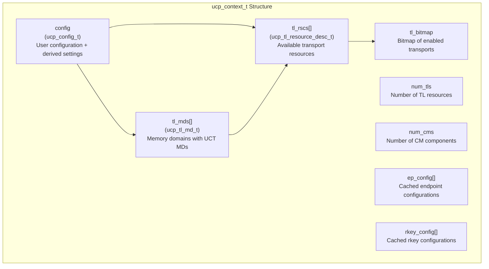
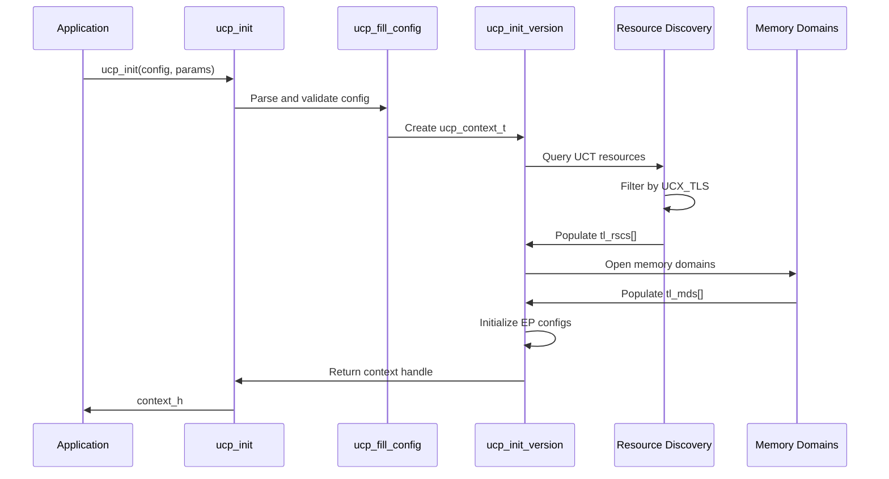
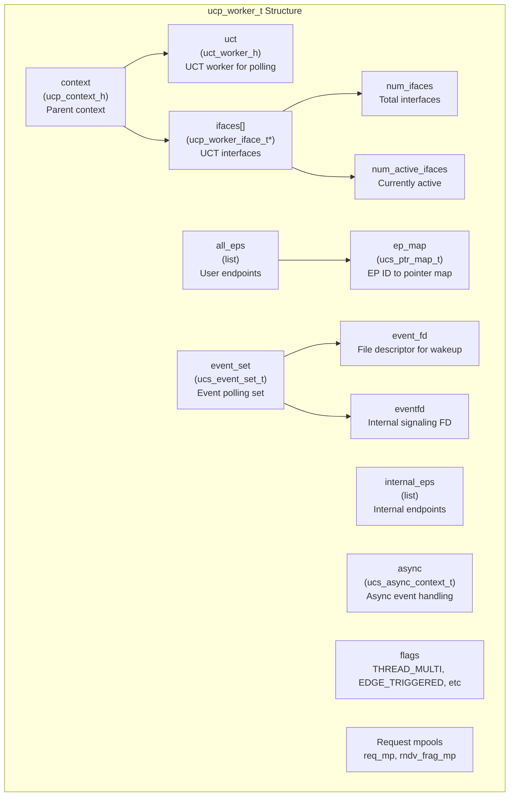
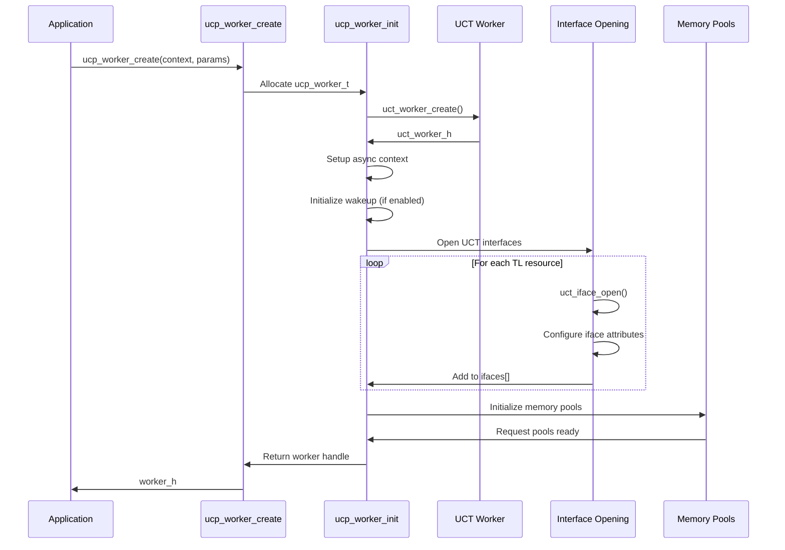
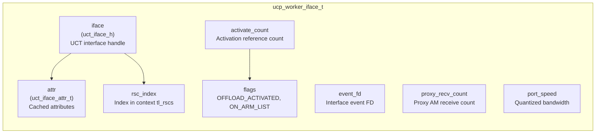
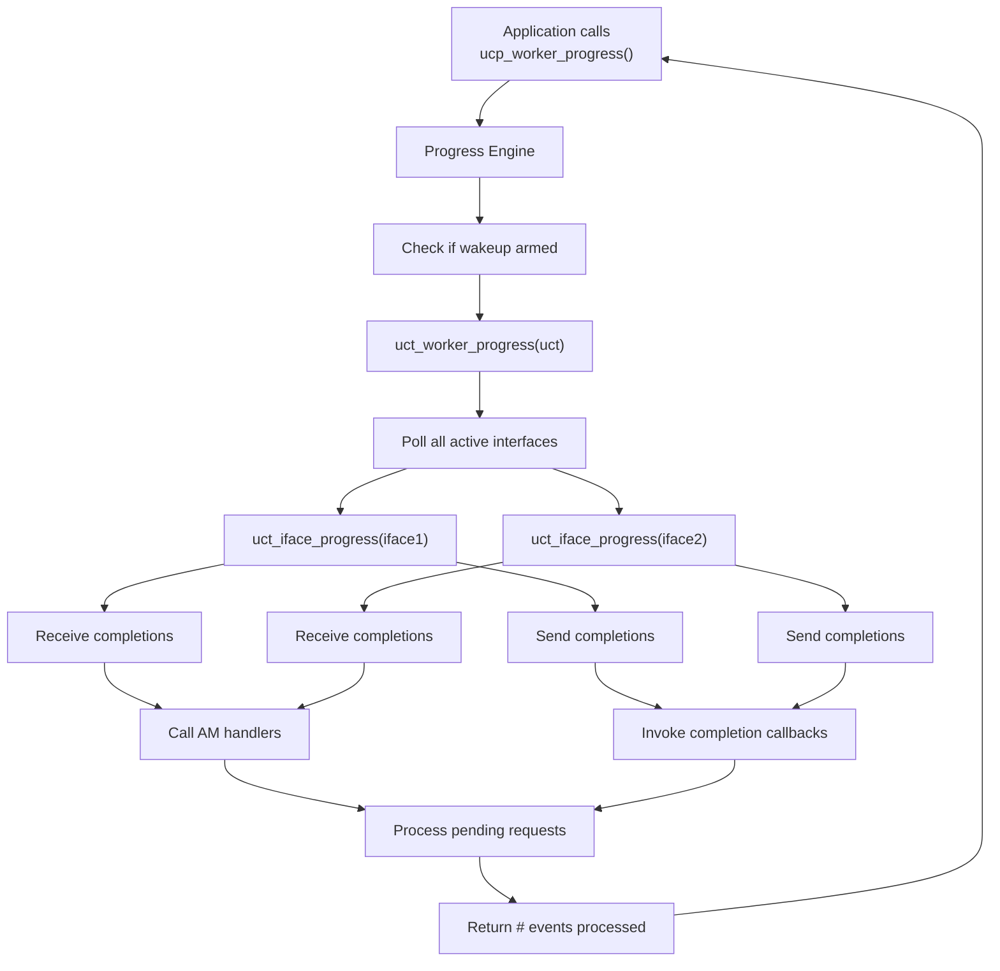
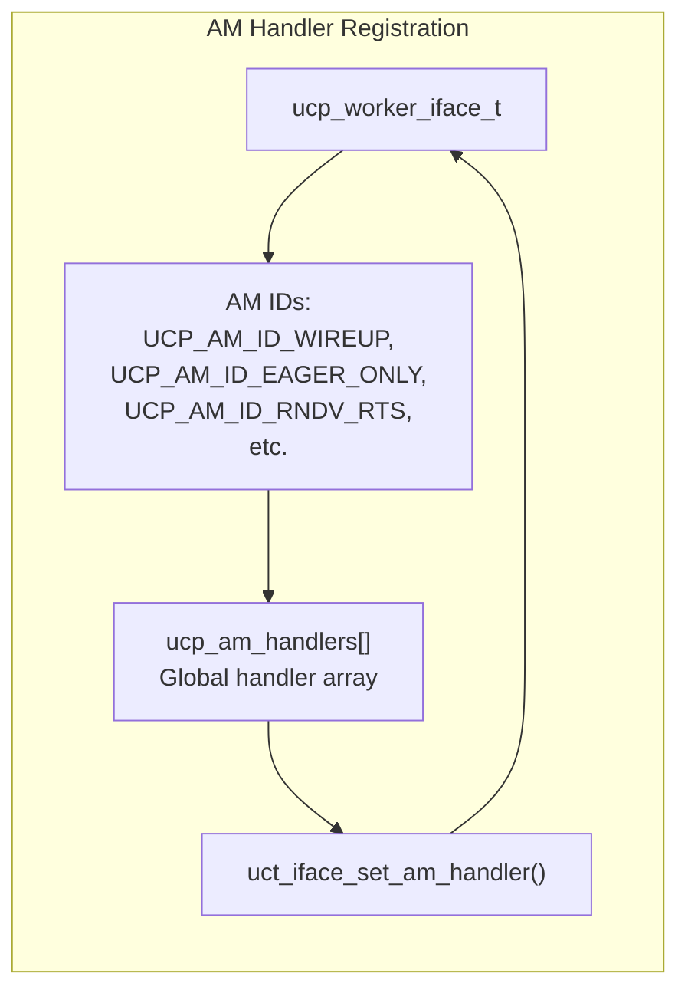
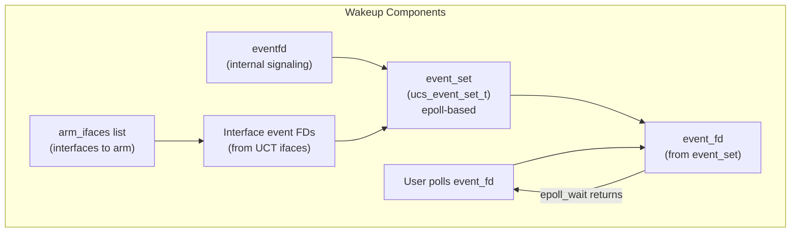
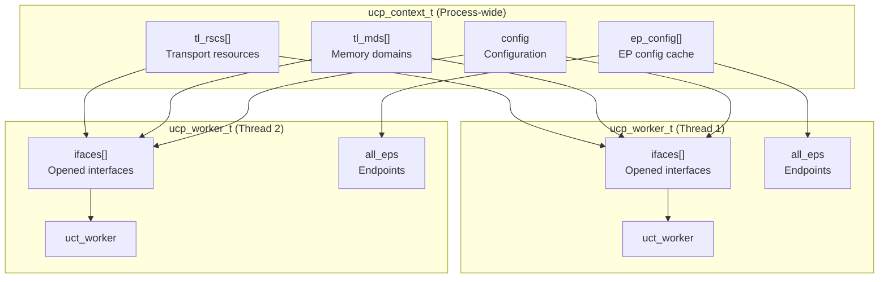
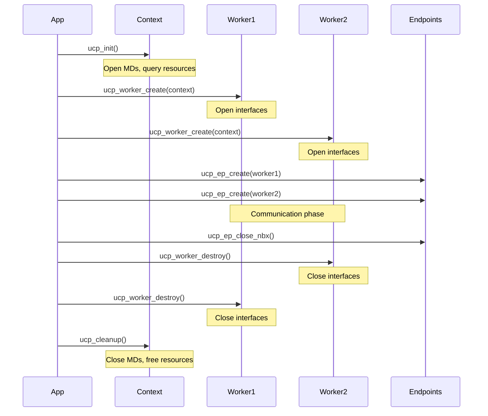

<!-- source: DeepWiki mcp.deepwiki.com · repo openucx/ucx · page 2.2 Contexts and Workers · fetched 2026-11-11 -->

# Contexts and Workers

<details>
<summary>Relevant source files</summary>

The following files were used as context for generating this wiki page:

- [src/ucp/core/ucp_context.c](src/ucp/core/ucp_context.c)
- [src/ucp/core/ucp_context.h](src/ucp/core/ucp_context.h)
- [src/ucp/core/ucp_ep.c](src/ucp/core/ucp_ep.c)
- [src/ucp/core/ucp_ep.h](src/ucp/core/ucp_ep.h)
- [src/ucp/core/ucp_ep.inl](src/ucp/core/ucp_ep.inl)
- [src/ucp/core/ucp_worker.c](src/ucp/core/ucp_worker.c)
- [src/ucp/core/ucp_worker.h](src/ucp/core/ucp_worker.h)
- [src/ucp/wireup/select.c](src/ucp/wireup/select.c)
- [src/ucp/wireup/wireup.c](src/ucp/wireup/wireup.c)
- [src/ucp/wireup/wireup.h](src/ucp/wireup/wireup.h)
- [src/ucp/wireup/wireup_cm.c](src/ucp/wireup/wireup_cm.c)
- [src/ucp/wireup/wireup_cm.h](src/ucp/wireup/wireup_cm.h)
- [src/ucp/wireup/wireup_ep.c](src/ucp/wireup/wireup_ep.c)
- [src/ucp/wireup/wireup_ep.h](src/ucp/wireup/wireup_ep.h)

</details>


This page provides a detailed explanation of `ucp_context_t` and `ucp_worker_t`, the two fundamental abstractions in the UCP layer. These structures manage resources, configuration, and runtime execution within UCX.

**Scope**: This page covers context and worker initialization, configuration, resource management, and the progress engine. For information about endpoint creation and communication protocols, see [Endpoints and Connection Establishment](#2.3). For details about the UCT layer and transport resources, see [UCT API and Interface Design](#3.1).

## Overview

The UCP layer is built on two core abstractions:

- **`ucp_context_t`**: A global application object that holds configuration, available transport resources, memory domains, and protocol definitions. It is shared across all workers in a process.
- **`ucp_worker_t`**: A thread-local execution context that manages communication operations, progress, and endpoints. Each worker owns its set of UCT interfaces and endpoints.

The typical usage pattern is: (1) create a context once per process, (2) create one or more workers, (3) create endpoints on workers, (4) perform communication.

**Key Relationship**: A context can have multiple workers, but each worker belongs to exactly one context. Workers are independent and can run on different threads.

## Context Structure and Initialization

### Context Structure

The `ucp_context_t` structure holds global state and configuration:



**Sources**: [src/ucp/core/ucp_context.h:231-391]()

Key fields in `ucp_context_t`:
- **`config`** (`ucp_config_t`): Contains `features` (UCP_FEATURE_*), `ext` (extended configuration like thresholds), and transport selection criteria
- **`tl_rscs`** (`ucp_tl_resource_desc_t[]`): Array of available transport resources, each containing a `uct_tl_resource_desc_t` and device index
- **`tl_mds`** (`ucp_tl_md_t[]`): Array of memory domains, each wrapping a `uct_md_h` handle
- **`tl_bitmap`**: Static bitmap indicating which transports are enabled
- **`ep_config`**: Cache of endpoint configurations indexed by `ucp_worker_cfg_index_t`
- **`num_tls`**, **`num_cms`**: Counts of transport layers and connection manager components

### Context Initialization Flow



**Sources**: [src/ucp/core/ucp_context.c:1-100](), [src/ucp/core/ucp_context.c:2300-2450]()

The initialization sequence:
1. **Configuration Parsing**: `ucp_fill_config` reads environment variables and user parameters to build `ucp_context_config_t` [src/ucp/core/ucp_context.c:161-485]()
2. **Resource Discovery**: `ucp_check_resources` queries all UCT components for available transport resources [src/ucp/core/ucp_context.c:1720-1900]()
3. **Filtering**: Resources are filtered based on `UCX_TLS`, `UCX_NET_DEVICES`, and other configuration variables
4. **Memory Domain Opening**: For each unique memory domain, `uct_md_open` is called to obtain handles [src/ucp/core/ucp_context.c:2050-2150]()
5. **Configuration Caching**: Endpoint and rkey configurations are pre-computed for common patterns

### Context Configuration

The `ucp_context_config_t` structure contains numerous tunable parameters:

| Configuration Parameter | Type | Purpose |
|------------------------|------|---------|
| `bcopy_thresh` | size_t | Threshold to switch from short to bcopy protocol |
| `rndv_intra_thresh`, `rndv_inter_thresh` | size_t | Rendezvous thresholds for intra/inter-node |
| `zcopy_thresh` | size_t | Threshold to switch to zero-copy protocol |
| `max_eager_lanes`, `max_rndv_lanes`, `max_rma_lanes` | unsigned | Max parallel lanes for protocols |
| `estimated_num_eps`, `estimated_num_ppn` | size_t | Hints for transport selection |
| `adaptive_progress` | int | Enable/disable adaptive progress |
| `use_mt_mutex` | int | Use mutex vs spinlock for thread safety |

**Sources**: [src/ucp/core/ucp_context.h:56-224](), [src/ucp/core/ucp_context.c:161-585]()

Configuration is parsed from three sources (in priority order):
1. Environment variables (e.g., `UCX_RNDV_THRESH`)
2. User-provided parameters in `ucp_params_t`
3. Default values

## Worker Structure and Management

### Worker Structure

The `ucp_worker_t` structure manages runtime execution:



**Sources**: [src/ucp/core/ucp_worker.h:230-380]()

Key fields in `ucp_worker_t`:
- **`context`**: Back-reference to parent context
- **`uct`**: UCT worker handle for progress operations
- **`ifaces`**: Array of `ucp_worker_iface_t*` representing opened UCT interfaces
- **`all_eps`**, **`internal_eps`**: Lists of endpoints managed by this worker
- **`ep_map`**: Maps endpoint IDs to `ucp_ep_h` pointers for fast lookup
- **`event_fd`**, **`event_set`**, **`eventfd`**: Wakeup mechanism for event-driven mode
- **`async`**: Async context for thread safety and event delivery
- **`flags`**: Worker configuration flags (thread model, edge-triggered, etc.)

### Worker Initialization Flow



**Sources**: [src/ucp/core/ucp_worker.c:1200-1550]()

Worker initialization steps:
1. **UCT Worker Creation**: `uct_worker_create` creates an underlying UCT worker for polling [src/ucp/core/ucp_worker.c:1250-1280]()
2. **Async Context Setup**: Initialize `ucs_async_context` for thread safety and callbacks [src/ucp/core/ucp_worker.c:1285-1320]()
3. **Wakeup Initialization**: If `UCP_FEATURE_WAKEUP` is set, create event fd and event set [src/ucp/core/ucp_worker.c:282-362]()
4. **Interface Opening**: For each transport resource in context, call `uct_iface_open` [src/ucp/core/ucp_worker.c:1350-1450]()
5. **Memory Pool Creation**: Initialize request pools (`req_mp`) and fragment pools (`rndv_frag_mp`) [src/ucp/core/ucp_worker.c:1480-1530]()

### Worker Interface Management

Each worker maintains an array of `ucp_worker_iface_t` structures representing opened UCT interfaces:



**Sources**: [src/ucp/core/ucp_worker.h:381-445]()

**Interface Activation**: Worker interfaces use adaptive progress to reduce overhead. Interfaces transition between active and inactive states:

- **Activation** (`ucp_worker_iface_activate`): Called when communication is expected. Sets AM handlers, enables progress, and adds to wakeup list [src/ucp/core/ucp_worker.c:576-609]()
- **Deactivation** (`ucp_worker_iface_deactivate`): Called when idle. Disables progress, removes from wakeup list, and sets proxy AM handlers [src/ucp/core/ucp_worker.c:730-765]()
- **Checking Events** (`ucp_worker_iface_check_events`): Monitors for incoming messages and arms interface event if no activity [src/ucp/core/ucp_worker.c:702-728]()

The `activate_count` field tracks nested activation, allowing multiple operations to keep an interface active simultaneously.

**Sources**: [src/ucp/core/ucp_worker.c:173-227](), [src/ucp/core/ucp_worker.c:576-789]()

## Progress Engine

The UCP progress engine drives communication forward by polling UCT interfaces and processing callbacks.

### Progress Mechanisms



**Sources**: [src/ucp/core/ucp_worker.c:2800-2850]()

The progress function `ucp_worker_progress` performs the following:
1. **Disarm wakeup**: If event fd was armed, disarm it [src/ucp/core/ucp_worker.c:2810-2820]()
2. **Poll UCT worker**: Call `uct_worker_progress` which polls all active UCT interfaces [src/ucp/core/ucp_worker.c:2830]()
3. **Process AM callbacks**: UCT delivers received messages via AM handler callbacks registered in `ucp_am_handlers` [src/ucp/core/ucp_worker.c:173-227]()
4. **Execute pending operations**: Process operations queued on endpoints that couldn't be sent immediately
5. **Return event count**: Number of events processed

### Active Message Handlers

Worker interfaces register AM handler callbacks during activation:



**Sources**: [src/ucp/core/ucp_worker.c:173-227]()

The `ucp_worker_set_am_handlers` function iterates over all AM IDs (0-63) and registers callbacks:
- Checks if the handler is defined in `ucp_am_handlers` array [src/ucp/core/ucp_worker.c:189-191]()
- Verifies required features are enabled in context [src/ucp/core/ucp_worker.c:193-195]()
- Calls `uct_iface_set_am_handler` with the appropriate callback [src/ucp/core/ucp_worker.c:207-221]()
- For proxy mode (inactive interfaces), registers proxy callbacks that increment counters [src/ucp/core/ucp_worker.c:207-215]()

When an AM arrives, UCT invokes the registered handler with the worker as the `arg` parameter.

## Event Handling and Wakeup

Workers support event-driven operation through the `UCP_FEATURE_WAKEUP` feature.

### Wakeup Architecture



**Sources**: [src/ucp/core/ucp_worker.c:282-375]()

**Initialization**: When `UCP_FEATURE_WAKEUP` is enabled:
1. Create an `ucs_event_set_t` (typically backed by epoll) [src/ucp/core/ucp_worker.c:303-312]()
2. Obtain an `event_fd` from the event set [src/ucp/core/ucp_worker.c:314-317]()
3. Create an internal `eventfd` for signaling [src/ucp/core/ucp_worker.c:323-328]()
4. Add the `eventfd` to the event set [src/ucp/core/ucp_worker.c:330]()

**Arming** (`ucp_worker_arm`): Makes the worker wait-able:
1. Flush all pending operations [src/ucp/core/ucp_worker.c:2650-2660]()
2. Iterate over `arm_ifaces` list and call `uct_iface_event_arm` on each [src/ucp/core/ucp_worker.c:2665-2695]()
3. For interfaces supporting event FD, add FD to event set [src/ucp/core/ucp_worker.c:595-598]()
4. Return `UCS_OK` if armed, or `UCS_ERR_BUSY` if new events arrived [src/ucp/core/ucp_worker.c:2700-2710]()

**Signaling** (`ucp_worker_signal_internal`): Wakes up a blocked worker:
1. Write to `eventfd` to trigger event set [src/ucp/core/ucp_worker.c:423-447]()
2. Called internally when operations complete or new work arrives [src/ucp/core/ucp_worker.c:449-454]()

**Sources**: [src/ucp/core/ucp_worker.c:2600-2750](), [src/ucp/core/ucp_worker.c:423-454]()

### Thread Safety

Workers support multiple threading modes controlled by `ucp_worker_params_t.thread_mode`:

| Thread Mode | Flag | Description |
|-------------|------|-------------|
| `UCS_THREAD_MODE_SINGLE` | None | Single-threaded, no locking |
| `UCS_THREAD_MODE_SERIALIZED` | `UCP_WORKER_FLAG_THREAD_SERIALIZED` | Multi-threaded but serialized by user |
| `UCS_THREAD_MODE_MULTI` | `UCP_WORKER_FLAG_THREAD_MULTI` | Multi-threaded with internal locking |

**Sources**: [src/ucp/core/ucp_worker.h:83-114]()

**Async Context**: The worker's `async` field (`ucs_async_context_t`) provides thread safety:
- **Block/Unblock**: `UCS_ASYNC_BLOCK` and `UCS_ASYNC_UNBLOCK` macros control critical sections [src/ucp/core/ucp_worker.h:40-77]()
- **Mutex vs Spinlock**: Controlled by `UCX_USE_MT_MUTEX` configuration [src/ucp/core/ucp_context.h:118]()
- **Nested Blocking**: Reference counting allows nested calls to block the async context

Example usage pattern:
```c
UCS_ASYNC_BLOCK(&worker->async);
// Modify worker state safely
ucp_ep_update_flags(ep, UCP_EP_FLAG_REMOTE_CONNECTED, 0);
UCS_ASYNC_UNBLOCK(&worker->async);
```

**Sources**: [src/ucp/core/ucp_worker.c:130](), [src/ucp/core/ucp_worker.c:543-573]()

## Context-Worker Relationship

### Resource Sharing



**Sources**: [src/ucp/core/ucp_context.h:231-391](), [src/ucp/core/ucp_worker.h:230-380]()

**Resource Usage Pattern**:
1. Context owns the **definition** of available resources (which transports, which MDs exist)
2. Each worker **opens its own instance** of UCT interfaces from those resources
3. Workers share cached configurations (EP configs, rkey configs) from context
4. Workers maintain **independent** UCT workers and endpoint lists

This design allows:
- Multiple workers to use the same transport resources without contention
- Configuration changes in context to apply to all workers
- Workers to run on different threads safely
- Efficient resource sharing (shared MD handles, shared configuration cache)

### Lifecycle Management



**Destruction Order**: Workers must be destroyed before their context:
1. Close all endpoints on each worker [src/ucp/core/ucp_ep.c:492-524]()
2. Destroy workers, which closes UCT interfaces [src/ucp/core/ucp_worker.c:2000-2100]()
3. Cleanup context, which closes UCT MDs [src/ucp/core/ucp_context.c:2500-2600]()

Violating this order causes resource leaks or crashes.

**Sources**: [src/ucp/core/ucp_worker.c:2000-2150](), [src/ucp/core/ucp_context.c:2500-2650]()

---

