<!-- source: DeepWiki mcp.deepwiki.com · repo openucx/ucx · page 2.3 Endpoints and Connection Establishment · fetched 2026-11-11 -->

# Endpoints and Wireup

<details>
<summary>Relevant source files</summary>

The following files were used as context for generating this wiki page:

- [src/ucp/core/ucp_context.c](src/ucp/core/ucp_context.c)
- [src/ucp/core/ucp_context.h](src/ucp/core/ucp_context.h)
- [src/ucp/core/ucp_ep.c](src/ucp/core/ucp_ep.c)
- [src/ucp/core/ucp_ep.h](src/ucp/core/ucp_ep.h)
- [src/ucp/core/ucp_ep.inl](src/ucp/core/ucp_ep.inl)
- [src/ucp/core/ucp_listener.c](src/ucp/core/ucp_listener.c)
- [src/ucp/core/ucp_listener.h](src/ucp/core/ucp_listener.h)
- [src/ucp/core/ucp_worker.c](src/ucp/core/ucp_worker.c)
- [src/ucp/core/ucp_worker.h](src/ucp/core/ucp_worker.h)
- [src/ucp/wireup/address.c](src/ucp/wireup/address.c)
- [src/ucp/wireup/address.h](src/ucp/wireup/address.h)
- [src/ucp/wireup/select.c](src/ucp/wireup/select.c)
- [src/ucp/wireup/wireup.c](src/ucp/wireup/wireup.c)
- [src/ucp/wireup/wireup.h](src/ucp/wireup/wireup.h)
- [src/ucp/wireup/wireup_cm.c](src/ucp/wireup/wireup_cm.c)
- [src/ucp/wireup/wireup_cm.h](src/ucp/wireup/wireup_cm.h)
- [src/ucp/wireup/wireup_ep.c](src/ucp/wireup/wireup_ep.c)
- [src/ucp/wireup/wireup_ep.h](src/ucp/wireup/wireup_ep.h)
- [test/gtest/ucp/test_ucp_peer_failure.cc](test/gtest/ucp/test_ucp_peer_failure.cc)
- [test/gtest/ucp/test_ucp_sockaddr.cc](test/gtest/ucp/test_ucp_sockaddr.cc)
- [test/gtest/ucp/test_ucp_wireup.cc](test/gtest/ucp/test_ucp_wireup.cc)
- [test/gtest/ucp/ucp_test.cc](test/gtest/ucp/ucp_test.cc)
- [test/gtest/ucp/ucp_test.h](test/gtest/ucp/ucp_test.h)

</details>


This page documents the UCP endpoint lifecycle, connection establishment through the wireup protocol, transport selection, lane assignment, and client-server connection models. For information about memory management and registration, see [Memory Management](#4).

## 1. Overview

A UCP endpoint (`ucp_ep_h`) represents a communication channel to a remote UCP worker. The **wireup protocol** is responsible for establishing connections between endpoints, exchanging worker addresses, selecting optimal transports, and configuring communication lanes. This page covers the complete endpoint lifecycle from creation through connection establishment to destruction.
</thinking>

**Key Components:**
- `ucp_ep_h` - opaque endpoint handle
- `ucp_ep_config_key_t` - lane configuration for an endpoint
- `ucp_wireup_ep_t` - proxy endpoint used during connection establishment
- Wireup messages - protocol messages for connection negotiation

**UCP Endpoint Architecture: Multi-Lane Communication**

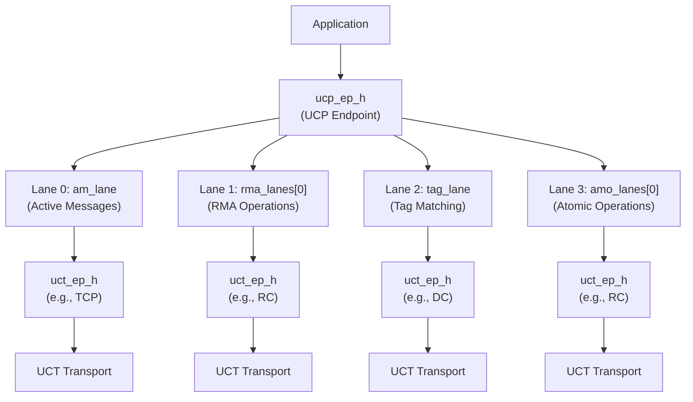

Sources: [src/ucp/core/ucp_ep.h:216-268](), [src/ucp/core/ucp_ep.inl:32-42]()

## 2. Endpoint Structure and Lanes

A UCP endpoint is represented by the `ucp_ep_h` opaque handle. Internally, it consists of several components:

**Core Endpoint Data Structures**

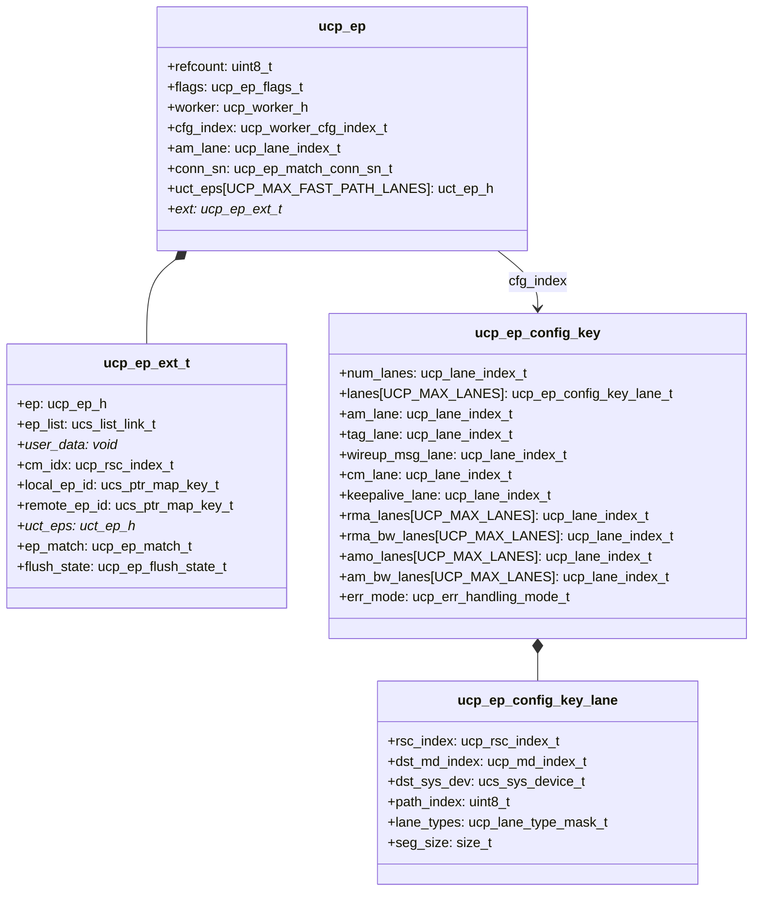

Sources: [src/ucp/core/ucp_ep.h:199-208](), [src/ucp/core/ucp_ep.h:216-268]()

### 2.1 Lane Configuration

Each endpoint has multiple **lanes** - independent communication paths that can use different transports. The `ucp_ep_config_key_t` structure defines which lanes exist and how they map to UCT resources.

**Lane Types and Their Purpose:**

| Lane Type | Purpose | Key Fields |
|-----------|---------|------------|
| `am_lane` | Active message operations | `ucp_ep_config_key.am_lane` |
| `tag_lane` | Tag matching offload | `ucp_ep_config_key.tag_lane` |
| `wireup_msg_lane` | Wireup protocol messages | `ucp_ep_config_key.wireup_msg_lane` |
| `cm_lane` | Connection manager lane | `ucp_ep_config_key.cm_lane` |
| `keepalive_lane` | Connection health checking | `ucp_ep_config_key.keepalive_lane` |
| `rma_lanes[]` | Remote memory access | Array of lane indices |
| `rma_bw_lanes[]` | High-bandwidth RMA | Array of lane indices |
| `amo_lanes[]` | Atomic memory operations | Array of lane indices |
| `am_bw_lanes[]` | High-bandwidth AM | Array of lane indices |

Sources: [src/ucp/core/ucp_ep.h:216-268](), [src/ucp/wireup/select.c:52-61]()

### 2.2 Endpoint Flags

Endpoints maintain various flags to track their state:

| Flag | Description |
|------|-------------|
| UCP_EP_FLAG_LOCAL_CONNECTED | All local endpoints are connected |
| UCP_EP_FLAG_REMOTE_CONNECTED | All remote endpoints are connected |
| UCP_EP_FLAG_CONNECT_REQ_QUEUED | Connection request was queued |
| UCP_EP_FLAG_FAILED | EP is in failed state |
| UCP_EP_FLAG_USED | EP is in use by the user |
| UCP_EP_FLAG_REMOTE_ID | Remote ID is valid |
| UCP_EP_FLAG_CLOSED | EP was closed |
| UCP_EP_FLAG_INTERNAL | Internal EP for temporary wireup or mem-type transfers |

Sources: [src/ucp/core/ucp_ep.h:90-132]()

### 2.3 Endpoint Initialization Flags

When creating an endpoint, several initialization flags can be specified:

| Flag | Description |
|------|-------------|
| UCP_EP_INIT_FLAG_MEM_TYPE | Endpoint for local memory type transfers |
| UCP_EP_INIT_CREATE_AM_LANE | Endpoint requires an AM lane |
| UCP_EP_INIT_CM_WIREUP_CLIENT | Endpoint wireup protocol is based on CM, client side |
| UCP_EP_INIT_CM_WIREUP_SERVER | Endpoint wireup protocol is based on CM, server side |
| UCP_EP_INIT_ERR_MODE_PEER_FAILURE | Endpoint requires peer failure handling |
| UCP_EP_INIT_CM_PHASE | Endpoint connection to a peer is on CM phase |

Sources: [src/ucp/core/ucp_ep.h:149-170]()

## 3. Endpoint Lifecycle

### 3.1 Endpoint Creation

**Endpoint Creation Flow with Wireup**

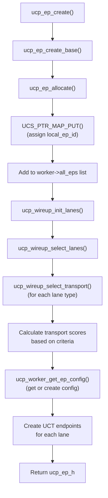

The endpoint creation process involves:

1. **Allocation** - `ucp_ep_allocate()` allocates the `ucp_ep` structure and extension
2. **ID Assignment** - `UCS_PTR_MAP_PUT()` assigns a unique `local_ep_id`
3. **Worker Registration** - Endpoint is added to `worker->all_eps` list
4. **Lane Selection** - `ucp_wireup_init_lanes()` calls `ucp_wireup_select_lanes()` to choose transports
5. **Configuration** - `ucp_worker_get_ep_config()` retrieves or creates an endpoint configuration
6. **UCT Endpoint Creation** - Create `uct_ep_h` for each selected lane

Sources: [src/ucp/core/ucp_ep.c:189-261](), [src/ucp/core/ucp_ep.c:361-414](), [src/ucp/core/ucp_ep.c:822-858]()

### 3.2 Connection Establishment and Wireup Protocol

Connections between endpoints can be established in two ways:

1. **Direct connection** - Using explicit UCP worker addresses
2. **Client-Server connection** - Using TCP/IP socket addresses (sockaddr) through a connection manager (CM)

#### 3.2.1 Direct Connection with Wireup Protocol

**Wireup Message Exchange**

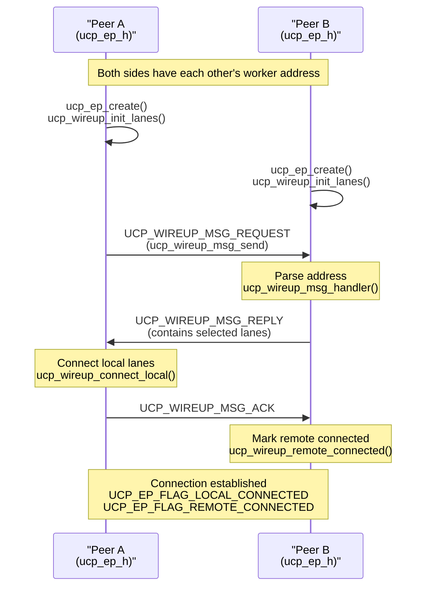

**Wireup Message Structure (`ucp_wireup_msg_t`):**

| Field | Description |
|-------|-------------|
| `type` | Message type (REQUEST/REPLY/ACK) |
| `err_mode` | Error handling mode |
| `conn_sn` | Connection sequence number |
| `src_ep_id` | Source endpoint ID |
| `dst_ep_id` | Destination endpoint ID |
| Packed address | Variable-length worker/device/interface addresses |

Sources: [src/ucp/wireup/wireup.h:122-130](), [src/ucp/wireup/wireup.c:118-215](), [src/ucp/wireup/wireup.c:254-299]()

#### 3.2.2 Client-Server Connection via Connection Manager

**Connection Manager (CM) Flow**

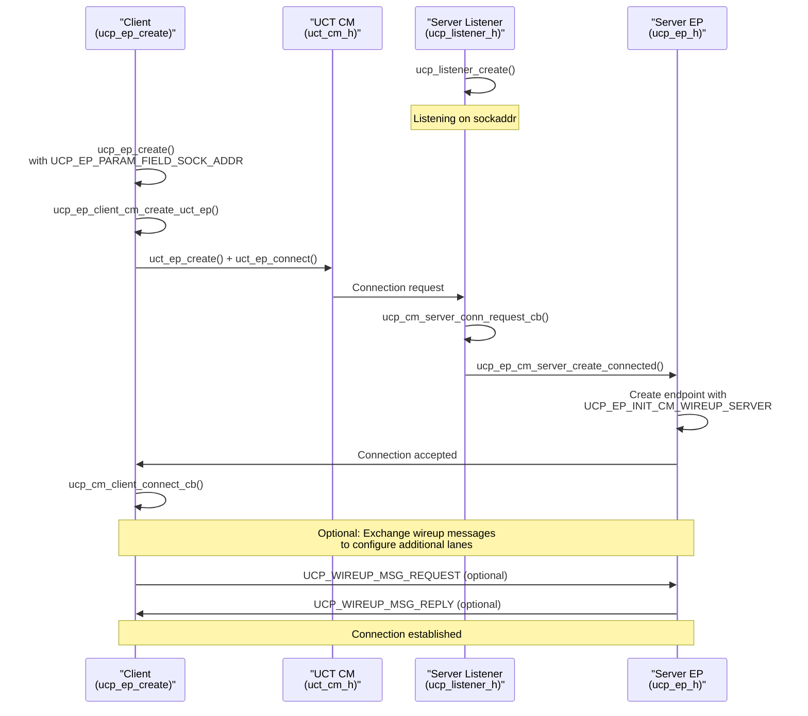

**Key Functions in CM Wireup:**

| Function | Purpose |
|----------|---------|
| `ucp_ep_client_cm_create_uct_ep()` | Create UCT CM endpoint on client |
| `ucp_cm_server_conn_request_cb()` | Server callback for incoming connections |
| `ucp_ep_cm_server_create_connected()` | Create server endpoint from connection request |
| `ucp_cm_client_connect_cb()` | Client callback when connection completes |

Sources: [src/ucp/wireup/wireup_cm.c:52-142](), [src/ucp/wireup/wireup_cm.c:165-218](), [src/ucp/core/ucp_listener.c]()

### 3.3 Transport Selection and Lane Assignment

Lane selection is the core responsibility of the wireup subsystem. The `ucp_wireup_select_lanes()` function evaluates all available transports and assigns them to lanes based on communication requirements.

**Transport Selection Process**

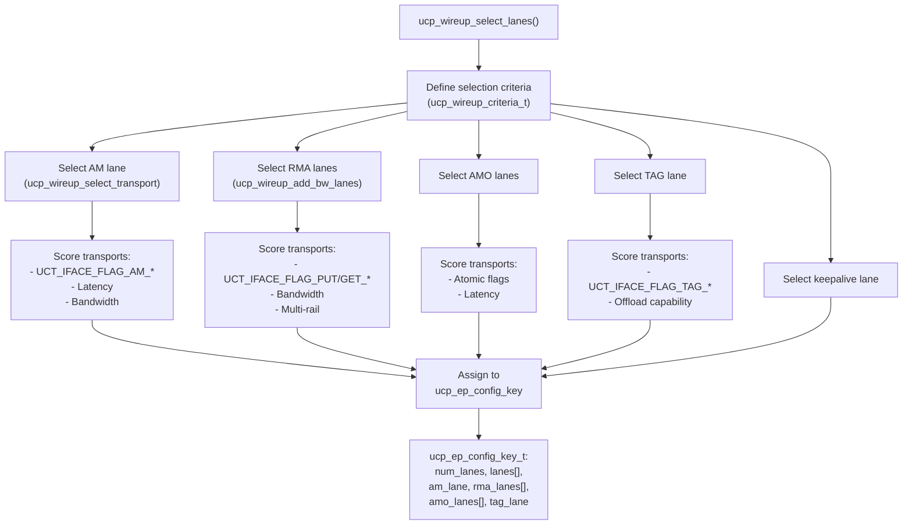

**Selection Criteria (`ucp_wireup_criteria_t`):**

| Field | Description |
|-------|-------------|
| `title` | Human-readable criteria name (e.g., "active messages") |
| `local_md_flags` | Required local MD flags (e.g., `UCT_MD_FLAG_REG`) |
| `local_iface_flags` | Required local interface flags (e.g., `UCT_IFACE_FLAG_AM_BCOPY`) |
| `remote_iface_flags` | Required remote interface flags |
| `calc_score` | Function pointer to calculate transport score |
| `lane_type` | Lane type being selected (e.g., `UCP_LANE_TYPE_AM`) |
| `tl_rsc_flags` | Transport resource flags (e.g., `UCP_TL_RSC_FLAG_AUX`) |

**Transport Scoring:**

For each candidate transport, `calc_score()` is called to evaluate suitability:
- **Latency-based:** Prefer lower latency for AM and small messages
- **Bandwidth-based:** Prefer higher bandwidth for RMA and large transfers  
- **Capability-based:** Must support required flags (AM, PUT/GET, atomics)
- **Distance-based:** Consider NUMA locality and device distance

Sources: [src/ucp/wireup/wireup.h:58-116](), [src/ucp/wireup/select.c:390-739]()

### 3.4 Wireup Endpoint (`ucp_wireup_ep_t`)

During connection establishment, a special **wireup endpoint** acts as a proxy before the final transport endpoints are ready.

**Wireup Endpoint Structure**

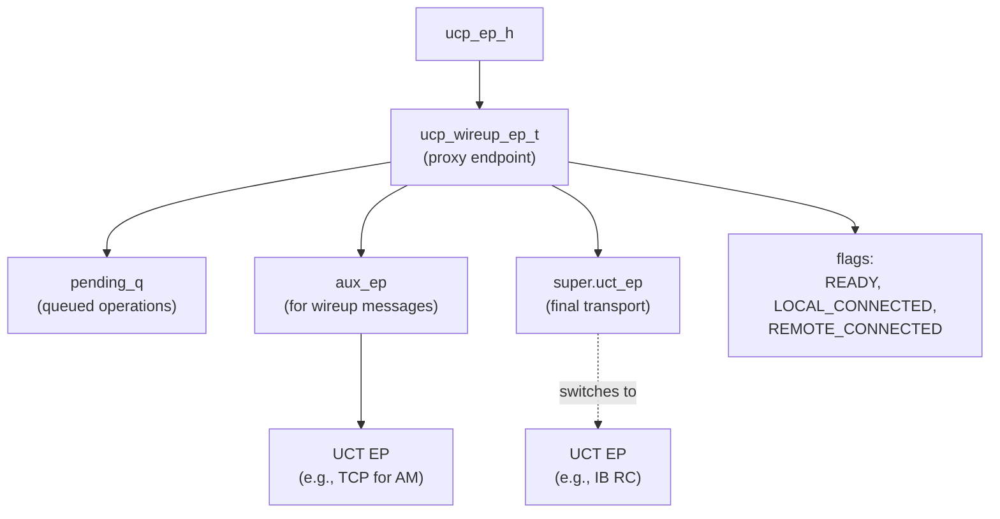

**Wireup EP Lifecycle:**

1. **Creation** - `ucp_wireup_ep_create()` creates proxy endpoint
2. **Auxiliary EP** - `ucp_wireup_ep_set_aux()` sets up aux_ep for wireup messages
3. **Queue Operations** - User operations queued in `pending_q` until connection ready
4. **Ready State** - `UCP_WIREUP_EP_FLAG_READY` set when connection established
5. **Switch** - `ucp_wireup_eps_progress()` switches from wireup_ep to final transport
6. **Replay** - Queued operations replayed on final transport

Sources: [src/ucp/wireup/wireup_ep.h:44-60](), [src/ucp/wireup/wireup_ep.c:66-127](), [src/ucp/wireup/wireup.c:485-557]()

### 3.5 Endpoint ID Mapping

UCX maintains a mapping between local and remote endpoint IDs to ensure proper message routing:

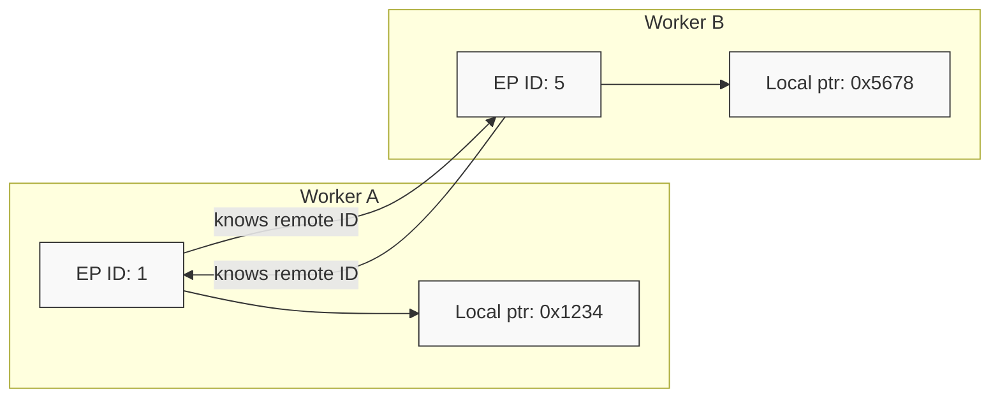

The mapping is implemented using a ptr_map data structure:
1. Each endpoint is assigned a unique ID within its worker
2. During connection, endpoints exchange their IDs
3. Messages include the destination endpoint ID for routing

This indirection helps with:
- Error handling (detecting when an endpoint is destroyed)
- Supporting indirect access in protocols
- Maintaining endpoint validity checks

Sources: [src/ucp/core/ucp_ep.c:552-568](), [src/ucp/core/ucp_worker.h:570-580]()

## 4. Wireup Protocol Details

The wireup protocol establishes connections through a three-way handshake, similar to TCP. It exchanges worker addresses, selects optimal transports, and configures communication lanes.

### 4.1 Wireup Message Types and Handlers

**Wireup Message Types:**

| Type | Value | Purpose |
|------|-------|---------|
| `UCP_WIREUP_MSG_PRE_REQUEST` | 0 | Optional pre-request for preparation |
| `UCP_WIREUP_MSG_REQUEST` | 1 | Connection request with address |
| `UCP_WIREUP_MSG_REPLY` | 2 | Connection reply with selected transports |
| `UCP_WIREUP_MSG_ACK` | 3 | Connection acknowledgment |
| `UCP_WIREUP_MSG_EP_CHECK` | 4 | Keepalive/health check |
| `UCP_WIREUP_MSG_EP_REMOVED` | 5 | Endpoint removal notification |

**Message Handler Flow**

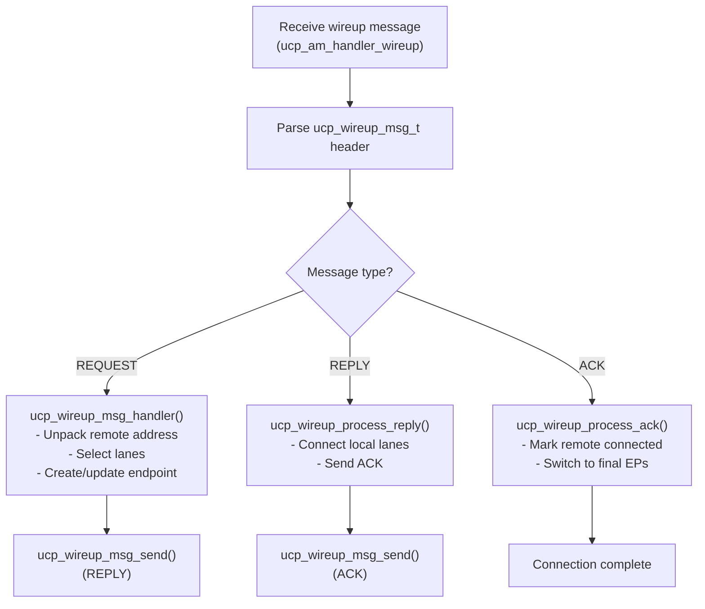

Sources: [src/ucp/wireup/wireup.h:43-52](), [src/ucp/wireup/wireup.c:59-77](), [src/ucp/wireup/wireup.c:118-215]()

### 4.2 Address Packing and Unpacking

Wireup messages contain packed worker addresses with device and interface information.

**Address Components:**

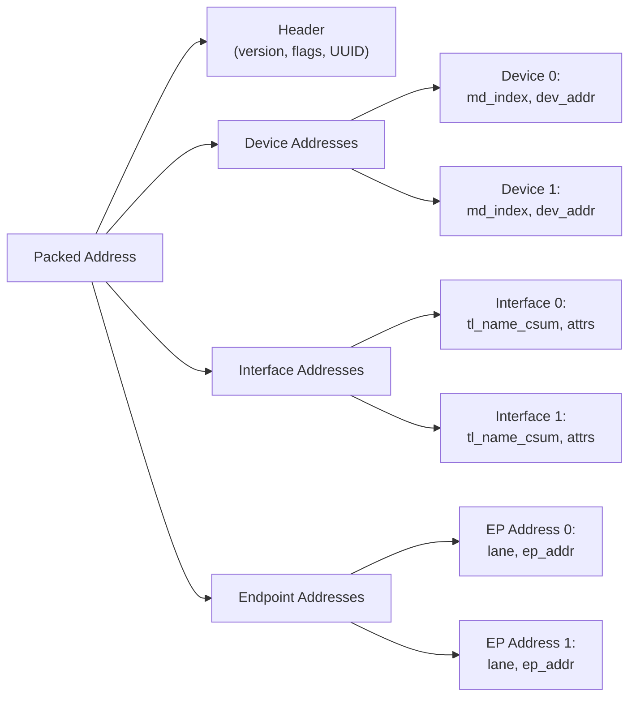

**Address Packing Functions:**

| Function | Purpose |
|----------|---------|
| `ucp_address_pack()` | Pack worker address into wire format |
| `ucp_address_unpack()` | Unpack wire format into `ucp_unpacked_address_t` |
| `ucp_wireup_msg_prepare()` | Prepare wireup message with packed address |

Sources: [src/ucp/wireup/address.c:1601-1883](), [src/ucp/wireup/address.h:119-168](), [src/ucp/wireup/wireup.c:218-251]()

### 4.3 Lane Connection (`ucp_wireup_connect_local`)

After selecting transports, the endpoint must connect to remote addresses.

**Connect Local Lanes to Remote Addresses**

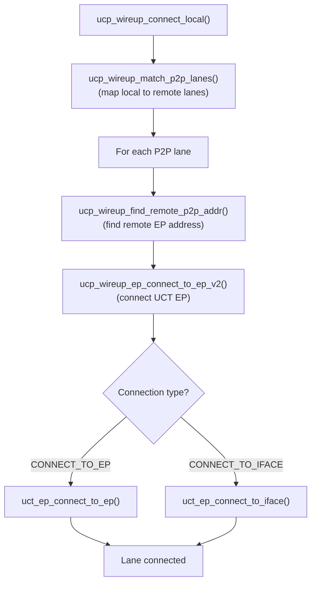

**P2P Lane Matching:**

The `ucp_wireup_match_p2p_lanes()` function creates a mapping between local lane indices and remote lane indices:

1. For each local lane that requires P2P connection
2. Find the corresponding address entry in remote address
3. Select the appropriate EP address within that entry
4. Store mapping in `lanes2remote[]` array

Sources: [src/ucp/wireup/wireup.c:330-390](), [src/ucp/wireup/wireup.c:416-455]()

## 5. Special Endpoint Types

### 5.1 Memory Type Endpoints

UCX creates special internal endpoints for memory type operations. These are created during worker initialization via `ucp_worker_mem_type_eps_create()`.

**Memory Type Endpoint Creation**

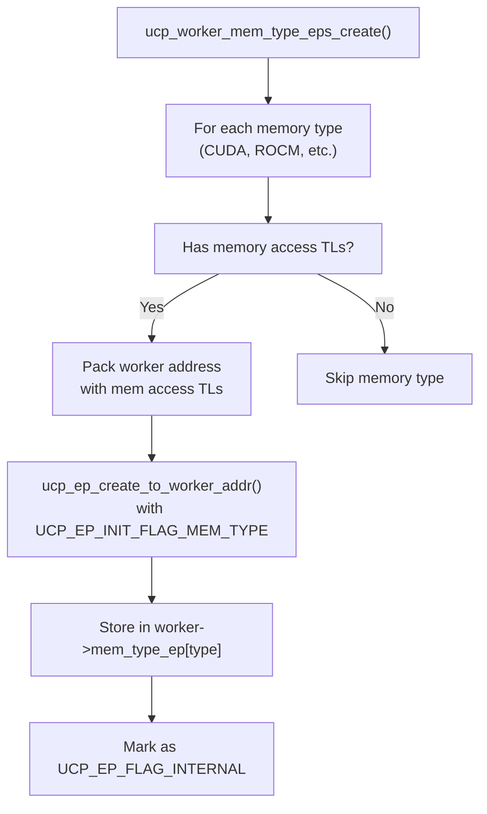

**Memory Type Endpoints:**

| Memory Type | Worker Field | Purpose |
|-------------|--------------|---------|
| `UCS_MEMORY_TYPE_CUDA` | `worker->mem_type_ep[CUDA]` | CUDA memory operations |
| `UCS_MEMORY_TYPE_ROCM` | `worker->mem_type_ep[ROCM]` | ROCm memory operations |
| `UCS_MEMORY_TYPE_ZE_*` | `worker->mem_type_ep[ZE_*]` | Intel GPU memory operations |

These endpoints facilitate operations between different memory types:
- Host ↔ GPU memory transfers
- Memory copies between different accelerator types
- Optimized paths for heterogeneous memory

Sources: [src/ucp/core/ucp_ep.c:678-743](), [src/ucp/core/ucp_worker.h:230-284]()

## 6. Error Handling

UCX provides error handling mechanisms for endpoint failures:

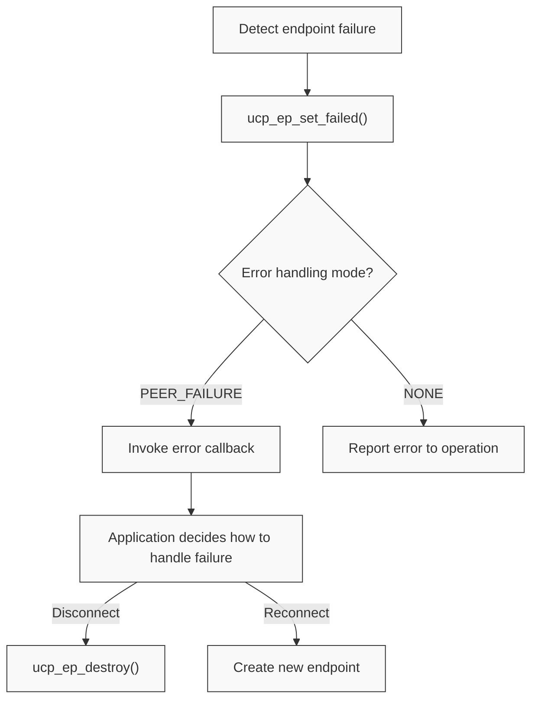

Error handling options:
1. `UCP_ERR_HANDLING_MODE_NONE`: Operations return errors, no special handling
2. `UCP_ERR_HANDLING_MODE_PEER`: Invoke user-provided error callback for peer failures

When an endpoint fails:
1. It's marked with `UCP_EP_FLAG_FAILED`
2. Pending operations are completed with error status
3. Future operations on the failed endpoint immediately return an error

Sources: [src/ucp/core/ucp_ep.c:589-599](), [test/gtest/ucp/test_ucp_peer_failure.cc]()

## 7. Keepalive Mechanism

UCX implements a keepalive mechanism to detect endpoint failures. The keepalive lane is selected during wireup if error handling mode is `UCP_ERR_HANDLING_MODE_PEER`.

**Keepalive Lane Selection**

During lane selection in `ucp_wireup_select_lanes()`, if `err_mode == UCP_ERR_HANDLING_MODE_PEER`, a keepalive lane is chosen. The selection criteria (`ucp_wireup_check_keepalive()`) checks for:

1. **Native keepalive:** `UCT_IFACE_FLAG_EP_KEEPALIVE` + `UCT_IFACE_FLAG_CONNECT_TO_EP`
2. **Endpoint check:** `UCT_IFACE_FLAG_EP_CHECK` + `UCT_IFACE_FLAG_CONNECT_TO_EP`
3. **AM-based keepalive:** `UCT_IFACE_FLAG_CONNECT_TO_IFACE` + `UCT_IFACE_FLAG_AM_BCOPY`

**Keepalive Configuration:**

| Configuration | Description |
|---------------|-------------|
| `UCX_KEEPALIVE_INTERVAL` | Time between keepalive rounds (default: 20s) |
| `UCX_KEEPALIVE_NUM_EPS` | Max endpoints to check per round (default: 128) |

Sources: [src/ucp/wireup/select.c:309-351](), [src/ucp/core/ucp_context.h:152-156]()

## 8. Endpoint Cleanup and Disconnection

### 8.1 Endpoint Disconnection

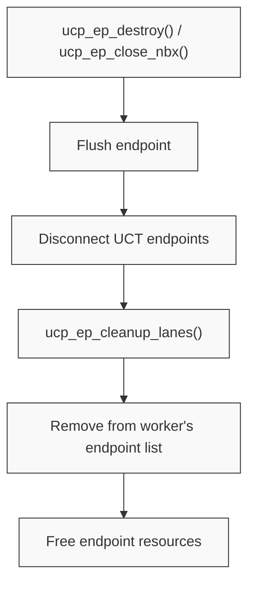

The disconnection process ensures:
1. Any in-flight operations are completed
2. Transport-level connections are properly terminated
3. All resources associated with the endpoint are freed

Sources: [src/ucp/core/ucp_ep.c:490-522](), [test/gtest/ucp/test_ucp_wireup.cc:62-64]()

### 8.2 Reference Counting

Endpoints use reference counting to manage their lifecycle:

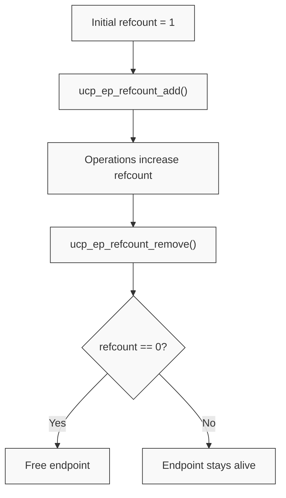

Reference counting ensures that:
1. The endpoint isn't destroyed while operations are pending
2. Resources are properly released once all operations complete
3. Multiple components can safely use the same endpoint

Sources: [src/ucp/core/ucp_ep.h:54-74](), [src/ucp/core/ucp_ep.c:181-187]()

## 9. API Examples

Example of creating a UCP endpoint:

```c
/* UCP endpoint parameters */
ucp_ep_params_t ep_params;
ucp_ep_h ep;
ucs_status_t status;

/* Fill endpoint parameters */
ep_params.field_mask        = UCP_EP_PARAM_FIELD_REMOTE_ADDRESS |
                              UCP_EP_PARAM_FIELD_ERR_HANDLER;
ep_params.address           = remote_worker_address;
ep_params.err_handler.cb    = error_handler_cb;
ep_params.err_handler.arg   = NULL;

/* Create the endpoint */
status = ucp_ep_create(worker, &ep_params, &ep);
if (status != UCS_OK) {
    /* Handle error */
}
```

Example of creating a UCP endpoint with sockaddr:

```c
/* UCP endpoint parameters for sockaddr connection */
ucp_ep_params_t ep_params;
ucp_ep_h ep;
ucs_status_t status;
struct sockaddr_in server_addr;

/* Fill sockaddr */
memset(&server_addr, 0, sizeof(server_addr));
server_addr.sin_family      = AF_INET;
server_addr.sin_port        = htons(13337);
inet_pton(AF_INET, "192.168.1.100", &server_addr.sin_addr);

/* Fill endpoint parameters */
ep_params.field_mask        = UCP_EP_PARAM_FIELD_FLAGS |
                              UCP_EP_PARAM_FIELD_SOCK_ADDR |
                              UCP_EP_PARAM_FIELD_ERR_HANDLER;
ep_params.flags             = UCP_EP_PARAMS_FLAGS_CLIENT_SERVER;
ep_params.sockaddr.addr     = (struct sockaddr*)&server_addr;
ep_params.sockaddr.addrlen  = sizeof(server_addr);
ep_params.err_handler.cb    = error_handler_cb;
ep_params.err_handler.arg   = NULL;

/* Create the endpoint */
status = ucp_ep_create(worker, &ep_params, &ep);
if (status != UCS_OK) {
    /* Handle error */
}
```

Sources: [test/gtest/ucp/test_ucp_wireup.cc](), [test/gtest/ucp/test_ucp_sockaddr.cc]()

---

