<!-- source: DeepWiki mcp.deepwiki.com · repo openucx/ucx · page 2.4 Request Management and Tag Matching · fetched 2026-11-11 -->

# Request Management and Tag Matching

<details>
<summary>Relevant source files</summary>

The following files were used as context for generating this wiki page:

- [src/ucp/core/ucp_request.c](src/ucp/core/ucp_request.c)
- [src/ucp/core/ucp_request.h](src/ucp/core/ucp_request.h)
- [src/ucp/core/ucp_request.inl](src/ucp/core/ucp_request.inl)
- [src/ucp/proto/proto_am.inl](src/ucp/proto/proto_am.inl)
- [src/ucp/stream/stream.h](src/ucp/stream/stream.h)
- [src/ucp/stream/stream_recv.c](src/ucp/stream/stream_recv.c)
- [src/ucp/stream/stream_send.c](src/ucp/stream/stream_send.c)
- [src/ucp/tag/eager_rcv.c](src/ucp/tag/eager_rcv.c)
- [src/ucp/tag/eager_snd.c](src/ucp/tag/eager_snd.c)
- [src/ucp/tag/offload.c](src/ucp/tag/offload.c)
- [src/ucp/tag/offload.h](src/ucp/tag/offload.h)
- [src/ucp/tag/tag_match.c](src/ucp/tag/tag_match.c)
- [src/ucp/tag/tag_match.h](src/ucp/tag/tag_match.h)
- [src/ucp/tag/tag_match.inl](src/ucp/tag/tag_match.inl)
- [src/ucp/tag/tag_recv.c](src/ucp/tag/tag_recv.c)
- [src/ucp/tag/tag_send.c](src/ucp/tag/tag_send.c)

</details>


This page documents UCP's request management system and tag matching subsystem. These components form the foundation for asynchronous communication in UCX, managing the lifecycle of send/receive operations and implementing message matching semantics for tagged messaging.

**Scope:** This page covers the `ucp_request_t` structure, request allocation/completion mechanisms, and the tag matching algorithm including expected/unexpected queues, hash-based matching, and hardware offload. For endpoint management and connection establishment, see [Endpoints and Connection Establishment](#2.3). For protocol selection and data transfer mechanisms, see [Communication Protocols](#2.5).

---

## Request Structure and Lifecycle

UCP requests represent asynchronous communication operations. Each request tracks the operation's state, associated resources, and completion information. The request structure is the central data structure for all UCP operations including tagged messaging, streams, RMA, and active messages.

### Request Structure (`ucp_request_t`)

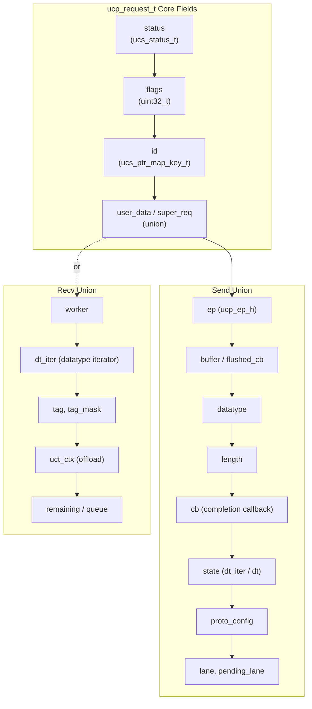

**Sources:** [src/ucp/core/ucp_request.h:145-488]()

The request structure uses a union to support different operation types (send vs. receive). Key fields include:

| Field | Type | Purpose |
|-------|------|---------|
| `status` | `ucs_status_t` | Operation completion status |
| `flags` | `uint32_t` | Request state flags (see below) |
| `id` | `ucs_ptr_map_key_t` | Request ID for protocol operations |
| `send.ep` | `ucp_ep_h` | Target endpoint for send operations |
| `send.buffer` | `void*` | Send buffer pointer |
| `send.datatype` | `ucp_datatype_t` | Datatype descriptor |
| `send.length` | `size_t` | Total message length |
| `send.state` | Union | Progress state (dt_iter or dt) |
| `recv.tag.tag` | `ucp_tag_t` | Expected receive tag |
| `recv.tag.tag_mask` | `ucp_tag_t` | Tag mask for matching |
| `recv.dt_iter` | `ucp_datatype_iter_t` | Receive buffer iterator |

**Sources:** [src/ucp/core/ucp_request.h:145-488]()

### Request Flags

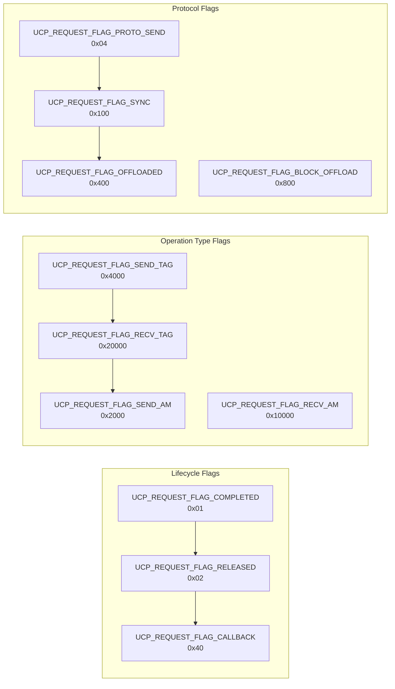

**Sources:** [src/ucp/core/ucp_request.h:36-67]()

Request flags encode the state and operation type:

| Flag | Value | Description |
|------|-------|-------------|
| `UCP_REQUEST_FLAG_COMPLETED` | 0x01 | Operation has completed |
| `UCP_REQUEST_FLAG_RELEASED` | 0x02 | User has released the request |
| `UCP_REQUEST_FLAG_CALLBACK` | 0x40 | Completion callback is set |
| `UCP_REQUEST_FLAG_SEND_TAG` | 0x4000 | Tagged send operation |
| `UCP_REQUEST_FLAG_RECV_TAG` | 0x20000 | Tagged receive operation |
| `UCP_REQUEST_FLAG_SYNC` | 0x100 | Synchronous send (requires ACK) |
| `UCP_REQUEST_FLAG_OFFLOADED` | 0x400 | Posted to hardware tag matching |
| `UCP_REQUEST_FLAG_BLOCK_OFFLOAD` | 0x800 | Cannot be offloaded to hardware |

**Sources:** [src/ucp/core/ucp_request.h:36-67]()

### Request Allocation and Release

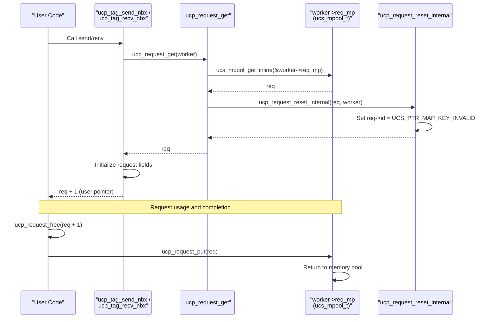

**Sources:** [src/ucp/core/ucp_request.inl:56-66](), [src/ucp/core/ucp_request.inl:233-241](), [src/ucp/core/ucp_request.c:272-284]()

Requests are allocated from a per-worker memory pool:

1. **Allocation:** `ucp_request_get(worker)` obtains a request from `worker->req_mp`
2. **Reset:** `ucp_request_reset_internal()` initializes the request ID to invalid
3. **User Pointer:** The returned pointer is `req + 1`, hiding internal UCP header
4. **Release:** User calls `ucp_request_free()` or `ucp_request_release()`
5. **Pool Return:** `ucp_request_put()` returns request to memory pool

**Sources:** [src/ucp/core/ucp_request.inl:56-66](), [src/ucp/core/ucp_request.inl:233-241]()

### Request Completion Model

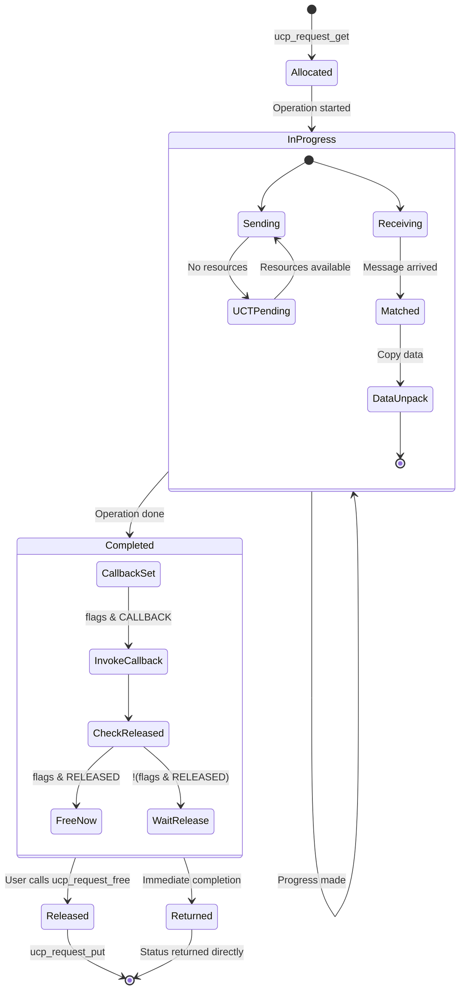

**Sources:** [src/ucp/core/ucp_request.inl:68-88](), [src/ucp/core/ucp_request.c:204-240]()

The completion model handles both synchronous and asynchronous completion:

1. **In Progress:** Request transitions through protocol states (sending, pending, receiving)
2. **Completion:** `UCP_REQUEST_FLAG_COMPLETED` is set and status is updated
3. **Callback:** If `UCP_REQUEST_FLAG_CALLBACK` is set, user callback is invoked
4. **Early Release:** If user called `ucp_request_free()` before completion, request is freed immediately
5. **Deferred Release:** If not released by user, request waits for explicit `ucp_request_free()`

**Macro:** `ucp_request_complete(req, cb, status, ...)` [src/ucp/core/ucp_request.inl:68-88]()

**Sources:** [src/ucp/core/ucp_request.inl:68-88](), [src/ucp/core/ucp_request.c:204-240]()

---

## Tag Matching Architecture

Tag matching enables message passing where sends and receives are matched based on 64-bit tags and tag masks. This is the fundamental mechanism for MPI-like tagged messaging semantics.

### Tag Matching Context (`ucp_tag_match_t`)

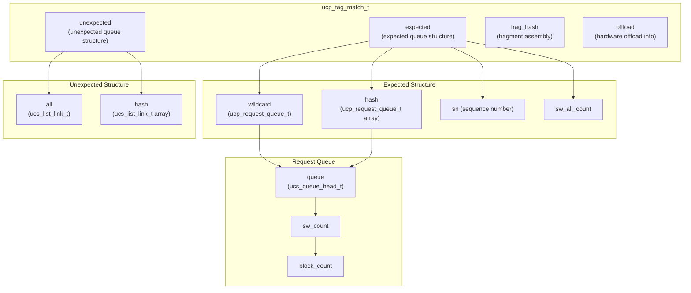

**Sources:** [src/ucp/tag/tag_match.h:61-101](), [src/ucp/tag/tag_match.h:36-42]()

The tag matching context maintains two primary data structures:

1. **Expected Queue:** Receive requests posted before matching messages arrive
   - `wildcard`: Queue for receives with wildcards in tag mask
   - `hash`: Hash table (size 1021) for specific-tag receives
   - `sn`: Sequence number for ordering
   - `sw_all_count`: Count of requests not offloaded to hardware

2. **Unexpected Queue:** Messages that arrive before matching receive is posted
   - `all`: Linked list of all unexpected messages
   - `hash`: Hash table (size 1021) for fast lookup by tag

**Sources:** [src/ucp/tag/tag_match.h:61-101](), [src/ucp/tag/tag_match.c:15-54]()

### Tag Matching Algorithm

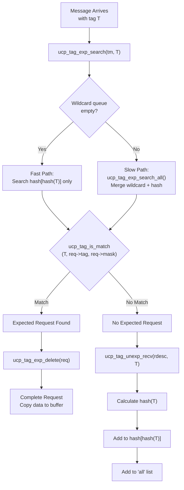

**Sources:** [src/ucp/tag/tag_match.inl:97-122](), [src/ucp/tag/tag_match.inl:36-43](), [src/ucp/tag/tag_match.inl:142-150]()

The matching algorithm when a message arrives:

1. **Search Expected:** Call `ucp_tag_exp_search(tm, tag)` to find matching receive
2. **Check Wildcard Queue:** If empty, use fast path; otherwise use slow path
3. **Fast Path:** Search only `hash[hash(tag)]` queue
4. **Slow Path:** Merge-search both wildcard and hash queues by sequence number
5. **Match Check:** `ucp_tag_is_match(tag, req->tag, req->mask)` tests: `(tag ^ req->tag) & req->mask == 0`
6. **Found:** Remove from expected queue, copy data to buffer, complete request
7. **Not Found:** Add to unexpected queue in both hash table and all-list

**Hash Function:** `hash(tag) = (tag % 1021) ^ ((tag >> 32) % 1021)` [src/ucp/tag/tag_match.inl:45-51]()

**Sources:** [src/ucp/tag/tag_match.inl:97-122](), [src/ucp/tag/tag_match.c:104-150]()

### Expected and Unexpected Queue Management

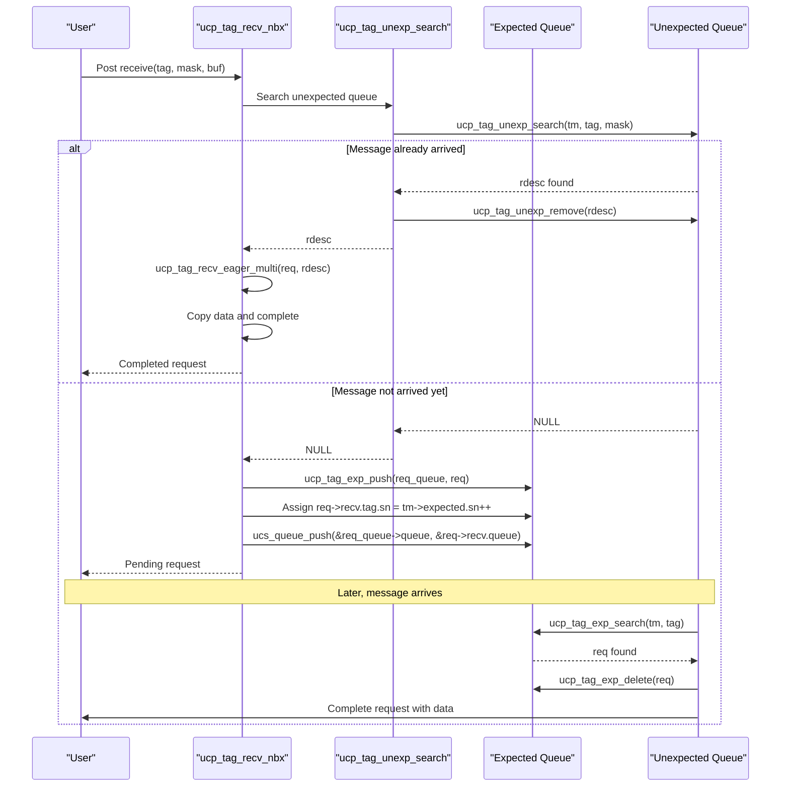

**Sources:** [src/ucp/tag/tag_recv.c:58-186](), [src/ucp/tag/tag_match.inl:75-81](), [src/ucp/tag/tag_match.inl:142-150]()

Queue management flow:

**Posting a Receive:**
1. Search unexpected queue for matching message
2. If found: Remove from unexpected, complete immediately
3. If not found: Add request to expected queue with sequence number

**Message Arrival:**
1. Search expected queue for matching receive
2. If found: Remove from expected, complete the receive
3. If not found: Add descriptor to unexpected queue

**Sources:** [src/ucp/tag/tag_recv.c:58-186](), [src/ucp/tag/tag_match.inl:75-81]()

---

## Tag Send Operations

Tag send operations initiate message transmission with an associated tag. The sender does not need to match; only the receiver performs matching.

### Send Request Initialization

```mermaid
graph LR
    USER["ucp_tag_send_nbx<br/>(buffer, count, tag, param)"]
    
    INIT["ucp_tag_send_req_init"]
    
    SET_FLAGS["Set flags:<br/>UCP_REQUEST_FLAG_SEND_TAG"]
    SET_EP["req->send.ep = ep"]
    SET_BUFFER["req->send.buffer = buffer"]
    SET_TAG["req->send.msg_proto.tag = tag"]
    SET_DT["req->send.datatype = datatype"]
    CALC_LEN["req->send.length = ucp_dt_length()"]
    SET_LANE["req->send.lane = config->tag.lane"]
    
    PROTO_SELECT["ucp_tag_send_req<br/>Protocol Selection"]
    
    USER --> INIT
    INIT --> SET_FLAGS
    SET_FLAGS --> SET_EP
    SET_EP --> SET_BUFFER
    SET_BUFFER --> SET_TAG
    SET_TAG --> SET_DT
    SET_DT --> CALC_LEN
    CALC_LEN --> SET_LANE
    SET_LANE --> PROTO_SELECT
```

**Sources:** [src/ucp/tag/tag_send.c:129-148](), [src/ucp/tag/tag_send.c:231-307]()

Send initialization steps:

1. **Allocate Request:** `ucp_request_get_param(worker, param)`
2. **Set Flags:** Add `UCP_REQUEST_FLAG_SEND_TAG`
3. **Initialize Fields:**
   - `req->send.ep`: Target endpoint
   - `req->send.buffer`: User buffer pointer
   - `req->send.msg_proto.tag`: User-provided tag
   - `req->send.datatype`: Datatype descriptor
   - `req->send.length`: Total message length (calculated via `ucp_dt_length`)
   - `req->send.lane`: Tag lane from endpoint configuration
4. **Protocol Selection:** Call `ucp_tag_send_req()` to select protocol

**Sources:** [src/ucp/tag/tag_send.c:129-148]()

### Protocol Selection (Eager vs. Rendezvous)

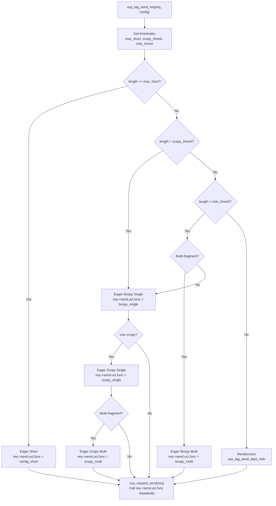

**Sources:** [src/ucp/tag/tag_send.c:49-127](), [src/ucp/core/ucp_request.c:588-655]()

Protocol selection thresholds:

| Protocol | Threshold | Description |
|----------|-----------|-------------|
| **Short** | `length <= max_short` | Inline data in AM header (typically ~128 bytes) |
| **Bcopy** | `length < zcopy_thresh` | Copy to UCT buffer (typically ~8KB) |
| **Zcopy** | `length < rndv_thresh` | Zero-copy with memory registration (typically ~512KB) |
| **Rendezvous** | `length >= rndv_thresh` | Multi-phase protocol for large messages |

**Multi-fragment:** Messages exceeding `max_bcopy` or `max_zcopy` use multi-fragment protocols

**Sources:** [src/ucp/core/ucp_request.c:588-655](), [src/ucp/tag/tag_send.c:49-127]()

---

## Tag Receive Operations

Tag receive operations post a buffer with a tag and tag mask to the expected queue, then wait for a matching message to arrive.

### Receive Request Initialization and Matching

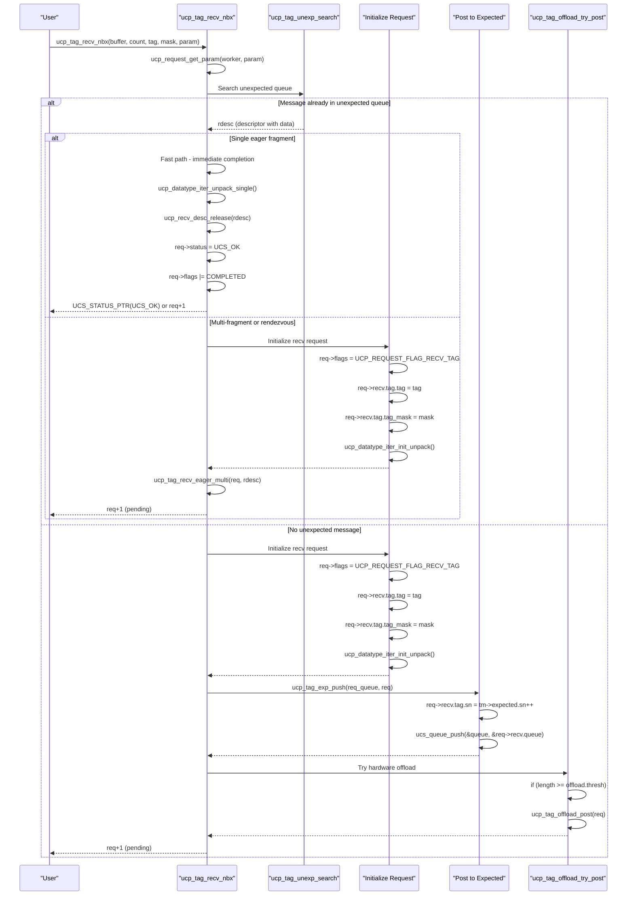

**Sources:** [src/ucp/tag/tag_recv.c:58-186](), [src/ucp/tag/tag_recv.c:224-252]()

Receive flow:

1. **Allocate Request:** Get request from memory pool
2. **Search Unexpected:** Check if matching message already arrived
3. **Fast Path (Eager Only):** 
   - Message is single fragment in unexpected queue
   - Unpack data directly to user buffer
   - Complete immediately with status
4. **Deferred Completion:**
   - Initialize request with tag, mask, and buffer iterator
   - Post to expected queue with sequence number
   - Try to offload to hardware if buffer is large enough
   - Return pending request to user

**Sources:** [src/ucp/tag/tag_recv.c:58-186]()

### Unexpected Message Processing

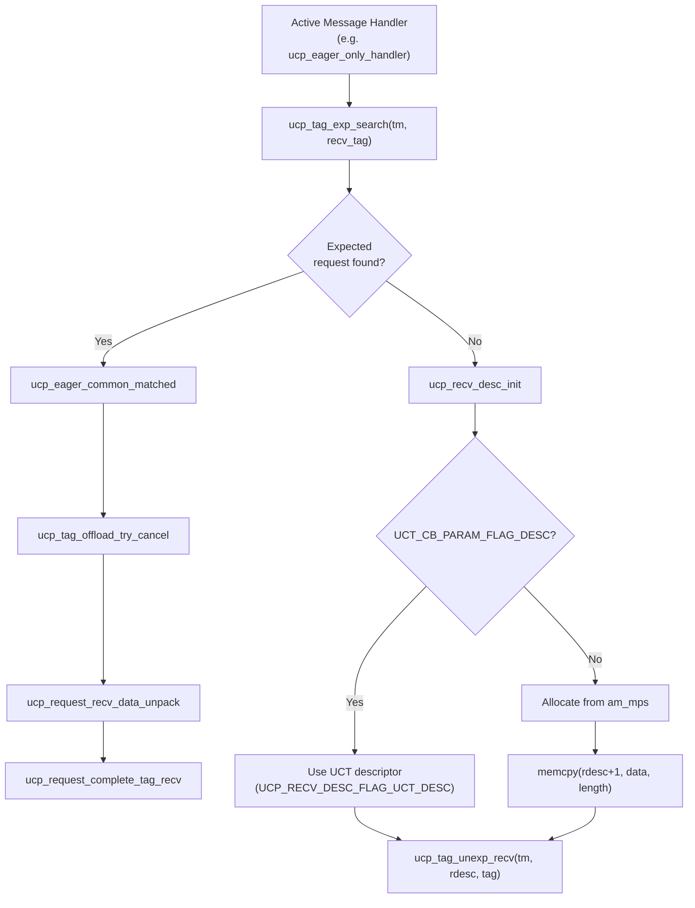

**Sources:** [src/ucp/tag/eager_rcv.c:78-136](), [src/ucp/core/ucp_request.inl:613-657]()

When an unexpected message arrives:

1. **Active Message Handler:** UCT calls handler (e.g., `ucp_eager_only_handler`)
2. **Search Expected Queue:** `ucp_tag_exp_search(tm, tag)` looks for matching receive
3. **If Matched:**
   - Cancel hardware offload if request was posted there
   - Unpack data to user buffer
   - Complete the receive request
4. **If Not Matched:**
   - Initialize receive descriptor (`ucp_recv_desc_t`)
   - Either use UCT descriptor directly or allocate from UCP pool
   - Copy data if using UCP pool
   - Add to unexpected queue: `ucp_tag_unexp_recv(tm, rdesc, tag)`
   - Descriptor remains in queue until matched receive is posted

**Sources:** [src/ucp/tag/eager_rcv.c:78-136](), [src/ucp/core/ucp_request.inl:613-657]()

---

## Hardware Tag Matching Offload

Modern RDMA hardware (e.g., Mellanox ConnectX-5 and later) supports hardware-accelerated tag matching. This offloads the matching logic from software to hardware, reducing CPU overhead and latency.

### Offload Architecture

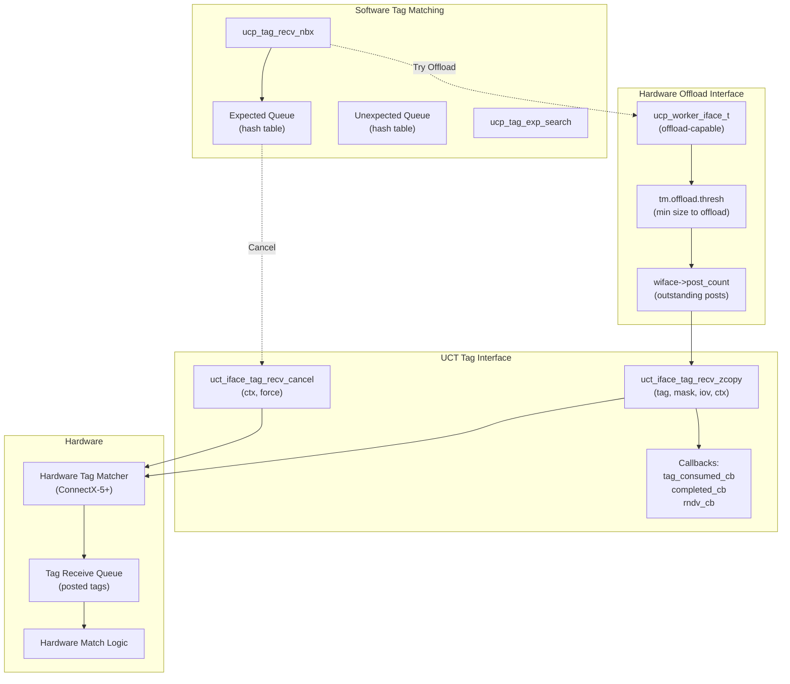

**Sources:** [src/ucp/tag/offload.h:99-121](), [src/ucp/tag/offload.c:264-363]()

Offload flow:

1. **Threshold Check:** Only buffers ≥ `worker->tm.offload.thresh` are candidates
2. **Interface Selection:** Choose hardware-capable interface via hash or cached pointer
3. **Post to Hardware:** `uct_iface_tag_recv_zcopy()` posts tag to UCT
4. **Callbacks:**
   - `tag_consumed_cb`: Tag removed from hardware queue
   - `completed_cb`: Message matched and data received
   - `rndv_cb`: Rendezvous message matched (fallback to SW)

**Sources:** [src/ucp/tag/offload.c:264-363]()

### Posting to Hardware Offload

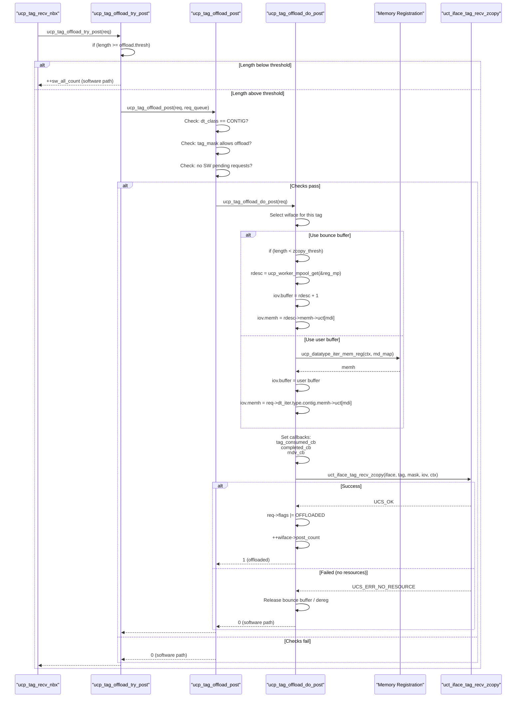

**Sources:** [src/ucp/tag/offload.c:264-363](), [src/ucp/tag/offload.c:432-467]()

Offload posting conditions:

| Condition | Requirement | Reason |
|-----------|-------------|--------|
| Buffer Size | `length >= tm.offload.thresh` | Small messages don't benefit from offload |
| Datatype | `dt_class == UCP_DATATYPE_CONTIG` | Hardware only supports contiguous buffers |
| Tag Mask | Not a sender wildcard | Hardware needs specific matching |
| SW Queue | No pending SW requests | Maintain ordering |
| Resources | Hardware queue not full | Limited outstanding posts |

**Bounce Buffer vs. Direct:**
- If `length < tm.offload.zcopy_thresh`: Use pre-registered bounce buffer
- Otherwise: Register user buffer directly with hardware

**Sources:** [src/ucp/tag/offload.c:264-363]()

### Offload Cancellation

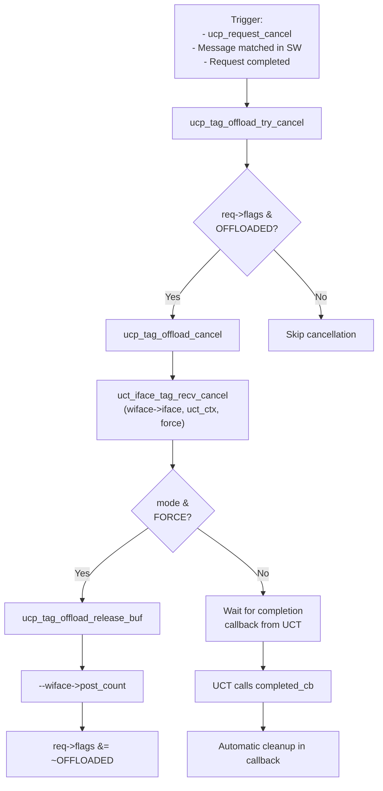

**Sources:** [src/ucp/tag/offload.h:114-121](), [src/ucp/tag/offload.c:240-262]()

Cancellation scenarios:

1. **User Cancel:** `ucp_request_cancel()` called by user
2. **SW Match:** Message matched in software (peer doesn't support offload)
3. **Mode:**
   - `FORCE`: Immediately cancel and release resources
   - Non-force: Allow hardware completion callback to run

**Process:**
1. Check if request has `UCP_REQUEST_FLAG_OFFLOADED`
2. Call `uct_iface_tag_recv_cancel()` to remove from hardware queue
3. If forced: Release buffer/memh and decrement post count
4. Otherwise: Wait for UCT completion callback

**Sources:** [src/ucp/tag/offload.c:240-262]()

---

## Receive Descriptor Management

Receive descriptors (`ucp_recv_desc_t`) represent incoming data that hasn't been matched to a receive request yet. They're crucial for unexpected message handling.

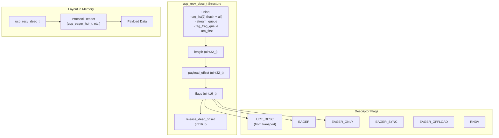

**Sources:** [src/ucp/core/ucp_request.h:491-528](), [src/ucp/core/ucp_request.h:85-112]()

Descriptor structure:

| Field | Type | Purpose |
|-------|------|---------|
| `tag_list[2]` | `ucs_list_link_t[2]` | Links in hash table and all-list |
| `length` | `uint32_t` | Total received data length |
| `payload_offset` | `uint32_t` | Offset from rdesc to payload start |
| `flags` | `uint16_t` | Descriptor type and state flags |
| `release_desc_offset` | `int16_t` | Offset for proper release |

**Memory Layout:**
```
+-------------------+
| ucp_recv_desc_t   |
+-------------------+
| Protocol Header   | <- payload_offset points here
+-------------------+
| Payload Data      |
+-------------------+
```

**Descriptor Lifecycle:**
1. **Allocation:** Either UCT descriptor or UCP memory pool
2. **Initialization:** `ucp_recv_desc_init()` sets up fields
3. **Queue Addition:** Added to unexpected queue
4. **Matching:** Found by receive, data copied out
5. **Release:** `ucp_recv_desc_release()` returns to pool

**Sources:** [src/ucp/core/ucp_request.h:491-528](), [src/ucp/core/ucp_request.inl:613-672]()

---

## Summary Tables

### Key Data Structures

| Structure | Location | Purpose |
|-----------|----------|---------|
| `ucp_request_t` | [src/ucp/core/ucp_request.h:145-488]() | Represents asynchronous operation request |
| `ucp_tag_match_t` | [src/ucp/tag/tag_match.h:61-101]() | Tag matching context (expected/unexpected) |
| `ucp_request_queue_t` | [src/ucp/tag/tag_match.h:36-42]() | Queue of expected requests |
| `ucp_recv_desc_t` | [src/ucp/core/ucp_request.h:506-528]() | Unexpected message descriptor |

### Key Functions

| Function | Location | Purpose |
|----------|----------|---------|
| `ucp_request_get()` | [src/ucp/core/ucp_request.inl:56-66]() | Allocate request from pool |
| `ucp_request_complete()` | [src/ucp/core/ucp_request.inl:68-88]() | Complete request, invoke callback |
| `ucp_tag_exp_search()` | [src/ucp/tag/tag_match.inl:97-122]() | Search expected queue for match |
| `ucp_tag_unexp_recv()` | [src/ucp/tag/tag_match.inl:142-150]() | Add descriptor to unexpected queue |
| `ucp_tag_offload_post()` | [src/ucp/tag/offload.c:432-467]() | Post receive to hardware offload |

### Request Flags Summary

| Flag | Hex | Meaning |
|------|-----|---------|
| `COMPLETED` | 0x01 | Operation finished |
| `RELEASED` | 0x02 | User freed request |
| `CALLBACK` | 0x40 | Has completion callback |
| `SEND_TAG` | 0x4000 | Tagged send |
| `RECV_TAG` | 0x20000 | Tagged receive |
| `OFFLOADED` | 0x400 | Posted to hardware |

**Sources:** [src/ucp/core/ucp_request.h:36-67]()

---

