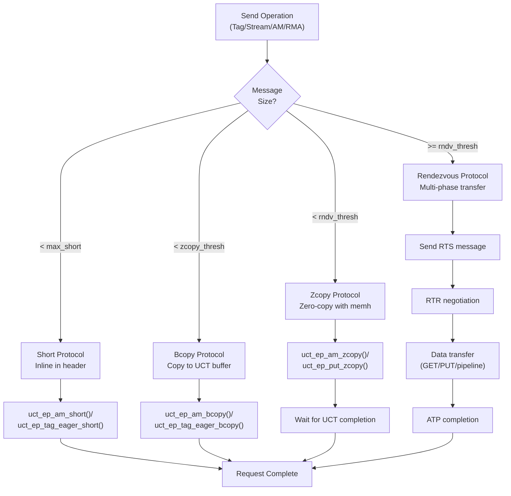
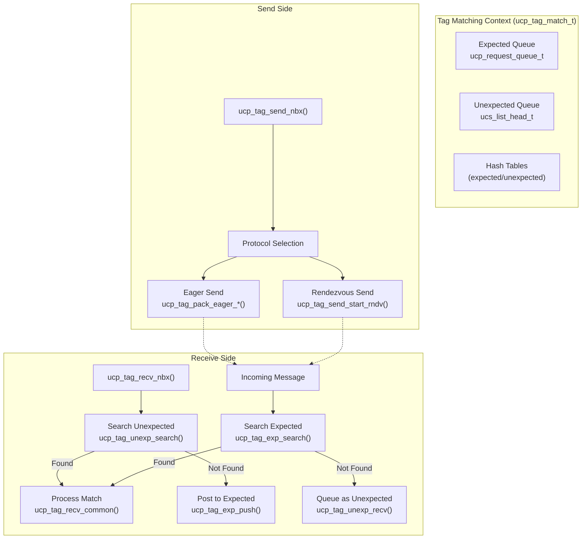
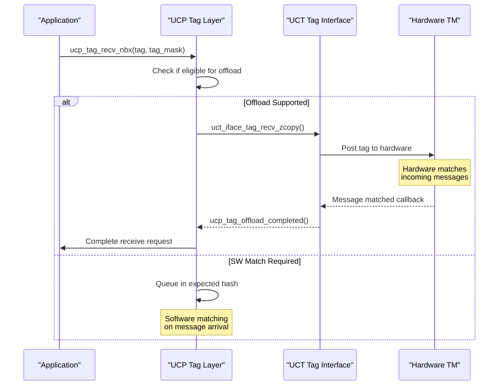
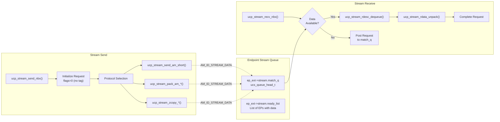
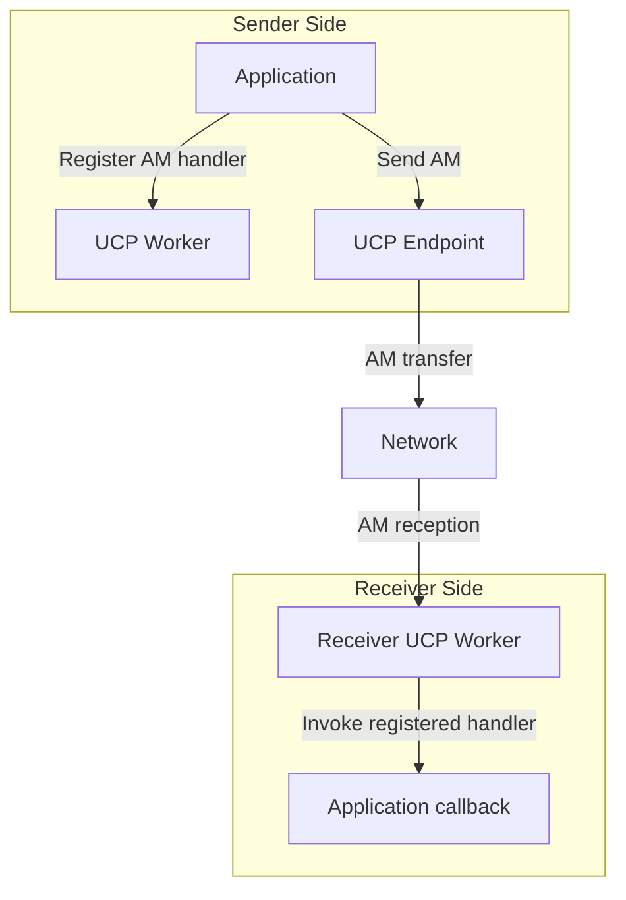
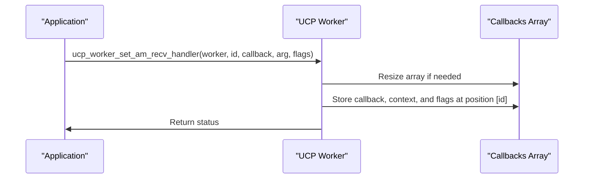
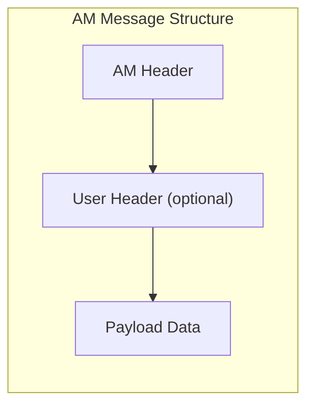
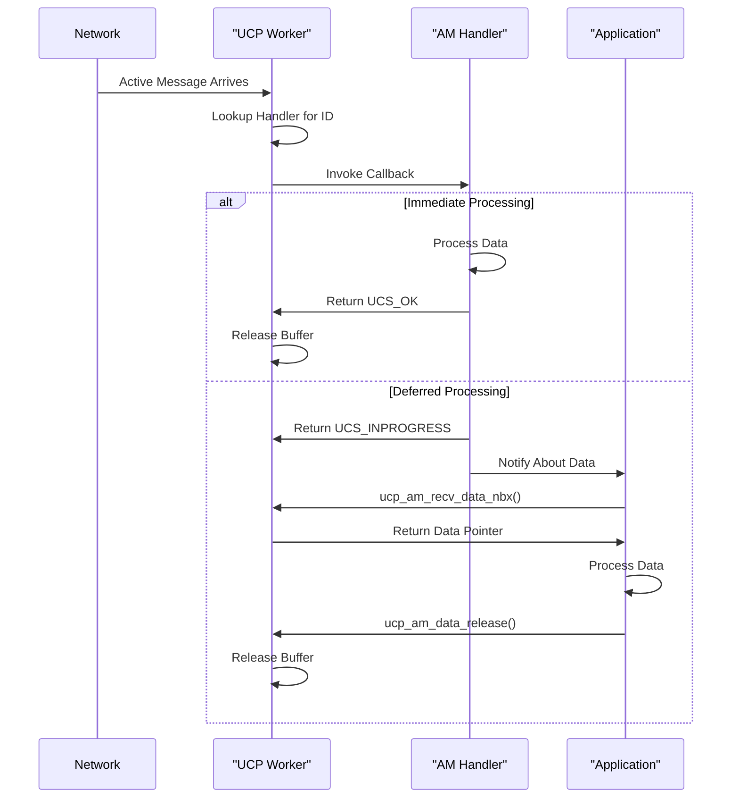
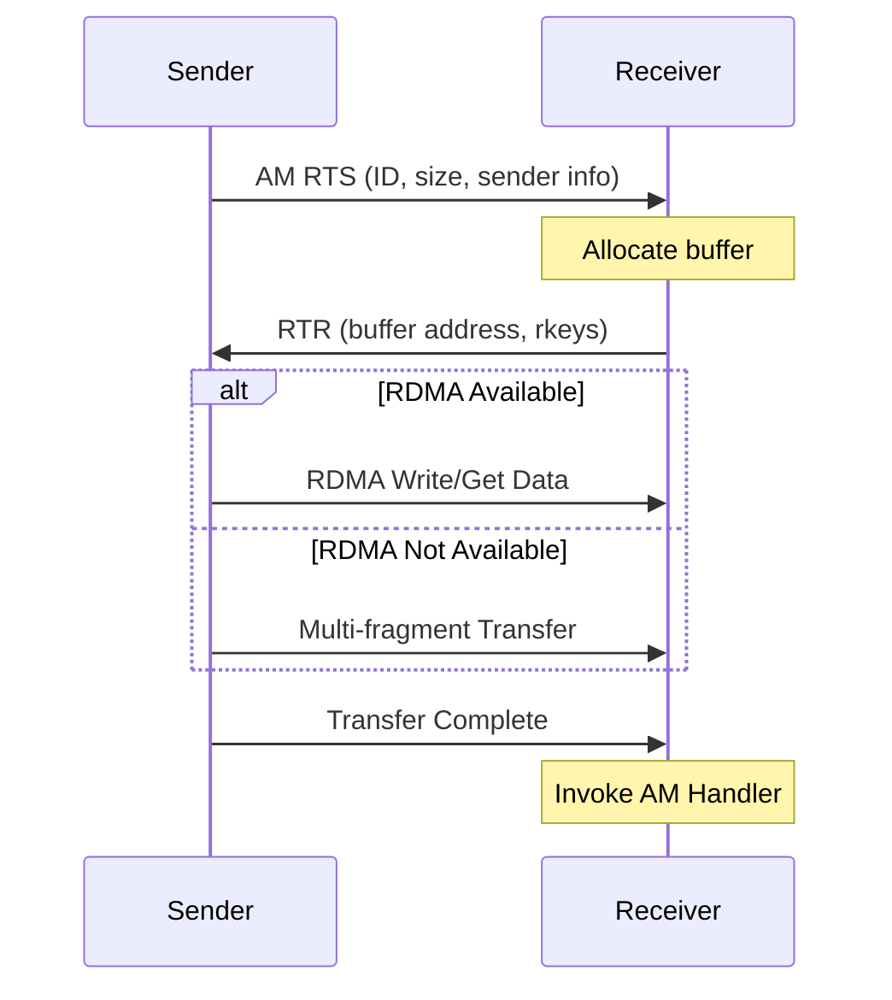
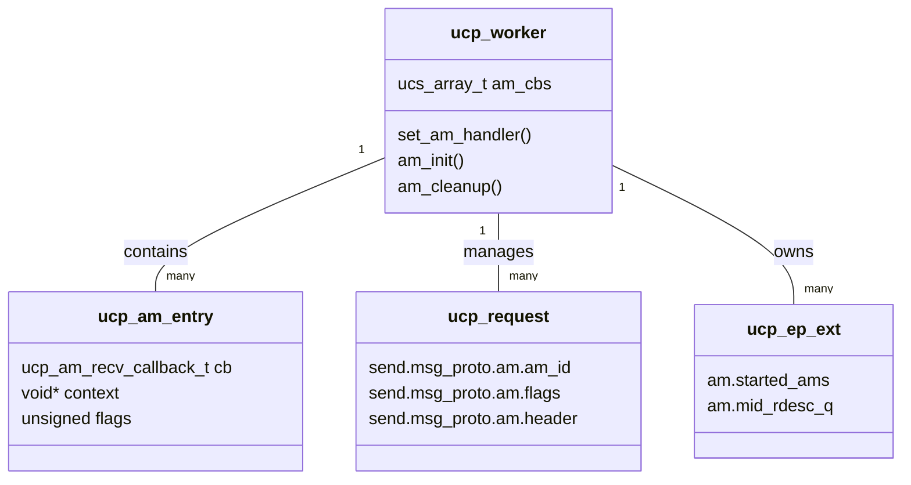

<!-- source: DeepWiki mcp.deepwiki.com · repo openucx/ucx · page 2.5 Communication Protocols · fetched 2026-11-11 -->

# Communication Protocols

<details>
<summary>Relevant source files</summary>

The following files were used as context for generating this wiki page:

- [src/ucp/api/ucp.h](src/ucp/api/ucp.h)
- [src/ucp/api/ucp_compat.h](src/ucp/api/ucp_compat.h)
- [src/ucp/api/ucp_def.h](src/ucp/api/ucp_def.h)
- [src/ucp/core/ucp_request.c](src/ucp/core/ucp_request.c)
- [src/ucp/core/ucp_request.h](src/ucp/core/ucp_request.h)
- [src/ucp/core/ucp_request.inl](src/ucp/core/ucp_request.inl)
- [src/ucp/proto/proto_am.inl](src/ucp/proto/proto_am.inl)
- [src/ucp/stream/stream.h](src/ucp/stream/stream.h)
- [src/ucp/stream/stream_recv.c](src/ucp/stream/stream_recv.c)
- [src/ucp/stream/stream_send.c](src/ucp/stream/stream_send.c)
- [src/ucp/tag/eager_rcv.c](src/ucp/tag/eager_rcv.c)
- [src/ucp/tag/eager_snd.c](src/ucp/tag/eager_snd.c)
- [src/ucp/tag/offload.c](src/ucp/tag/offload.c)
- [src/ucp/tag/offload.h](src/ucp/tag/offload.h)
- [src/ucp/tag/tag_match.c](src/ucp/tag/tag_match.c)
- [src/ucp/tag/tag_match.h](src/ucp/tag/tag_match.h)
- [src/ucp/tag/tag_match.inl](src/ucp/tag/tag_match.inl)
- [src/ucp/tag/tag_recv.c](src/ucp/tag/tag_recv.c)
- [src/ucp/tag/tag_send.c](src/ucp/tag/tag_send.c)
- [test/gtest/ucp/test_ucp_ep.cc](test/gtest/ucp/test_ucp_ep.cc)

</details>


UCP implements multiple communication protocols, each optimized for specific messaging patterns and performance requirements. These protocols operate on top of the UCT transport layer and utilize the request management infrastructure described in page 2.4.

## Protocol Overview

UCP provides five primary communication protocols:

| Protocol | API Feature Flag | Primary Use Case | Key Characteristics |
|----------|------------------|------------------|---------------------|
| **Tagged Messaging** | `UCP_FEATURE_TAG` | MPI-style message passing | Software tag matching, send/receive semantics |
| **Stream** | `UCP_FEATURE_STREAM` | Ordered byte streams | Connection-oriented, FIFO delivery |
| **Active Messages** | `UCP_FEATURE_AM` | Custom message handlers | User-defined callbacks, flexible data handling |
| **RMA** | `UCP_FEATURE_RMA` | One-sided operations | Direct memory access (put/get) |
| **Atomics** | `UCP_FEATURE_AMO32/64` | Atomic operations | Hardware-accelerated atomic memory ops |

All protocols share common protocol selection logic that chooses between eager, bcopy, zcopy, and rendezvous transfer mechanisms based on message size, memory type, and transport capabilities.

Sources: [src/ucp/api/ucp.h:141-172](), [src/ucp/core/ucp_request.h:145-488]()

## Protocol Selection Logic

UCP automatically selects the optimal transfer protocol based on message characteristics and endpoint configuration. The selection hierarchy applies across all communication protocols:



Sources: [src/ucp/core/ucp_request.c:572-592](), [src/ucp/tag/tag_send.c:24-127]()

### Protocol Thresholds

Protocol selection is controlled by configurable thresholds stored in `ucp_ep_msg_config_t`:

| Threshold | Typical Value | Determines |
|-----------|---------------|------------|
| `max_short` | ~8-128 bytes | Short vs. bcopy boundary |
| `max_bcopy` | ~8-32 KB | Maximum bcopy size |
| `zcopy_thresh` | ~4-16 KB | Bcopy vs. zcopy boundary |
| `rndv_thresh` | ~8-256 KB | Zcopy vs. rendezvous boundary |

These thresholds vary by transport (e.g., RC vs. UD vs. TCP) and are computed during endpoint configuration based on transport capabilities and memory type.

Sources: [src/ucp/tag/tag_send.c:49-127](), [src/ucp/core/ucp_request.c:572-592]()

## Tagged Messaging

Tagged messaging provides MPI-style send/receive semantics with software-based tag matching. Messages are identified by 64-bit tags, and receives can specify tag masks to match multiple senders.

### Tag Matching Architecture

The tag matching system maintains two primary queues per worker:



Sources: [src/ucp/tag/tag_match.inl:98-187](), [src/ucp/tag/tag_send.c:179-307](), [src/ucp/tag/tag_recv.c:58-186]()

### Tagged Send Operations

The `ucp_tag_send_nbx()` function initiates a tagged send:

1. **Request Initialization**: Allocate `ucp_request_t` and initialize `send.msg_proto.tag` field
2. **Protocol Selection**: Determine threshold based on datatype and message size
3. **Send Dispatch**: Choose between short, bcopy, zcopy, or rendezvous protocols
4. **Progress**: Drive send operation via `ucp_request_send()`

For multi-fragment messages, the first fragment includes `ucp_eager_first_hdr_t` with `total_len` and `msg_id` fields, while subsequent fragments use `ucp_eager_middle_hdr_t` with `offset` and `msg_id`.

Sources: [src/ucp/tag/tag_send.c:231-307](), [src/ucp/tag/eager_snd.c:18-112]()

### Tagged Receive Operations

The `ucp_tag_recv_nbx()` function posts a tagged receive:

1. **Fast Path**: Check for single-fragment eager-only match in unexpected queue
2. **Slow Path**: Initialize receive request with `recv.tag.tag` and `recv.tag.tag_mask`
3. **Search Unexpected**: Scan hash table for matching message
4. **Post Expected**: If no match, add to expected queue and potentially offload to hardware

Receive requests use `ucp_datatype_iter_t` for unpacking data incrementally as fragments arrive.

Sources: [src/ucp/tag/tag_recv.c:58-186](), [src/ucp/tag/tag_match.inl:98-187]()

### Hardware Tag Offload

UCP can offload tag matching to capable transports (e.g., InfiniBand Tag Matching):



Offload is controlled by thresholds in `worker->tm.offload` and requires contiguous buffers with specific tag masks.

Sources: [src/ucp/tag/offload.c:23-467](), [src/ucp/tag/offload.h:1-80]()

## Stream Messaging

Stream protocol provides connection-oriented, ordered byte-stream semantics similar to TCP. Messages are delivered in FIFO order per endpoint without explicit matching.

### Stream Architecture

Stream endpoints maintain a match queue per endpoint extension (`ucp_ep_ext_t`):



Sources: [src/ucp/stream/stream_send.c:27-199](), [src/ucp/stream/stream_recv.c:22-273](), [src/ucp/stream/stream.h:15-69]()

### Stream vs. Tag Comparison

| Aspect | Stream | Tagged |
|--------|--------|--------|
| **Matching** | Implicit (FIFO per EP) | Explicit (64-bit tag + mask) |
| **Ordering** | Strict per-endpoint | Message-level only |
| **Unexpected Queue** | Per-endpoint | Global with hash table |
| **Partial Receive** | Supported with `WAITALL` flag | Not supported |
| **Use Case** | Streaming data, pipes | MPI-style messaging |

Sources: [src/ucp/stream/stream_recv.c:153-244](), [src/ucp/tag/tag_recv.c:58-186]()

## Active Messages

### Overview of Active Messages

Active messaging represents a powerful communication pattern where messages trigger specific actions at the destination. The key concept involves:

1. The sender attaches an ID to each message
2. The receiver has previously registered a callback function associated with that ID
3. When the message arrives, the corresponding callback is automatically invoked
4. The callback can process the message data immediately or defer processing

Sources: [src/ucp/core/ucp_am.h:12-33](), [src/ucp/core/ucp_am.c:27-44](), [test/gtest/ucp/test_ucp_am.cc:70-141]()



## Handler Registration

Before receiving active messages, applications must register their callback handlers with the worker. Each handler is identified by a unique integer ID (0-65535) and is invoked when a message with the matching ID is received.

Sources: [src/ucp/core/ucp_am.c:167-184](), [src/ucp/core/ucp_am.c:213-232](), [src/ucp/core/ucp_am.c:323-359]()

```c
typedef ucs_status_t (*ucp_am_recv_callback_t)(
    void *arg,             /* User-defined argument passed during registration */
    const void *header,    /* Points to user header (may be NULL) */
    size_t header_length,  /* Length of user header */
    void *data,            /* Points to data buffer */
    size_t length,         /* Length of data */
    const ucp_am_recv_param_t *param /* Additional receive parameters */
);
```

Registration can be done with either the older API (`ucp_worker_set_am_handler()`) or the newer NBX API (`ucp_worker_set_am_recv_handler()`). The NBX API offers more flexibility and is recommended for new applications.



Sources: [src/ucp/core/ucp_am.c:167-210](), [src/ucp/core/ucp_am.c:323-359]()

## Sending Active Messages

UCX provides several API functions for sending active messages:

1. `ucp_am_send_nbx()` - Main NBX-style API for sending AM with flexible parameter passing
2. `ucp_am_send_nb()` - Legacy API for sending active messages

Messages can be sent with various options, including:
- Header data (optional) for control information
- Payload data in various formats (contiguous, IOV, generic)
- Flags controlling behavior (e.g., reply expectation)

Sources: [src/ucp/core/ucp_am.c:477-745](), [test/gtest/ucp/test_ucp_am.cc:164-218]()

### Protocol Selection

When sending an active message, UCX automatically selects the most efficient protocol based on message size, memory type, and available hardware capabilities:

| Protocol | Typical Use Case | Description |
|----------|------------------|-------------|
| Short    | Small messages (< 8KB) | Single copy, inline with the control message |
| Bcopy    | Medium messages  | Sender copies data into UCT buffer before sending |
| Zcopy    | Large messages   | Zero-copy transfer using memory registration |
| Rendezvous | Very large messages | Handshake-based protocol with direct memory access |

The specific thresholds for protocol selection are configurable and depend on the transport capabilities.

Sources: [src/ucp/core/ucp_am.c:773-834](), [src/ucp/am/eager_single.c:32-189](), [src/ucp/am/eager_multi.c:19-79]()

```mermaid
flowchart TD
    start["AM Send Request"] --> size{"Message Size?"}
    
    size -- "Small" --> short["Short Protocol"]
    size -- "Medium" --> bcopy["Bcopy Protocol"]
    size -- "Large" --> zcopy["Zcopy Protocol"]
    size -- "Very Large" --> config{"Is RNDV allowed?"}
    
    config -- "Yes" --> rndv["Rendezvous Protocol"]
    config -- "No" --> zcopy
    
    short --> end["Complete Send"]
    bcopy --> end
    zcopy --> end
    rndv --> end
```

Sources: [src/ucp/core/ucp_am.c:773-834](), [src/ucp/rndv/rndv.c:138-157]()

## Message Format and Headers

Active messages contain several structural components that vary depending on the protocol used. The basic format includes:



The AM header itself contains:
- Message ID: Identifies which callback to invoke
- Flags: Control message handling behavior
- Header length: Size of the optional user header

For multi-fragment messages, additional information is included:
- For first fragments: total message length and message ID
- For middle fragments: fragment offset and message ID

Sources: [src/ucp/core/ucp_am.c:262-291](), [src/ucp/proto/proto_am.inl:175-312]()

## Receiving and Processing Messages

When an active message arrives, UCX invokes the registered callback associated with the message ID. The callback can process the data immediately or defer processing by returning appropriate status codes:

- `UCS_OK`: Data was fully consumed, UCX can release the buffer
- `UCS_INPROGRESS`: Application needs the data buffer, will release it later with `ucp_am_data_release()`

If the callback returns `UCS_INPROGRESS`, the application must either:
1. Call `ucp_am_recv_data_nbx()` to obtain a persistent data buffer
2. Eventually call `ucp_am_data_release()` when done with the data

Sources: [src/ucp/core/ucp_am.c:108-137](), [src/ucp/core/ucp_am.c:139-165]()



Sources: [src/ucp/core/ucp_am.c:139-165](), [test/gtest/ucp/test_ucp_am.cc:92-141]()

## Rendezvous Protocol for Large Messages

For large active messages, UCX employs a rendezvous protocol to avoid overwhelming receiver buffers and to enable direct data transfers:

1. Sender sends a small Rendezvous Request To Send (RTS) message
2. Receiver allocates buffer and responds with Ready To Receive (RTR)
3. Data is transferred directly using RDMA or multi-fragment messages
4. Sender is notified when transfer completes

This protocol is particularly beneficial for GPU memory or other non-host memory types, as it avoids unnecessary copying.

Sources: [src/ucp/core/ucp_am.c:689-727](), [src/ucp/rndv/rndv.c:159-199]()



Sources: [src/ucp/rndv/rndv.c:159-199](), [src/ucp/core/ucp_am.c:689-727]()

## Active Message Flags

UCX supports various flags that control the behavior of active messages:

| Flag | Description |
|------|-------------|
| `UCP_AM_FLAG_WHOLE_MSG` | Handler receives only complete messages |
| `UCP_AM_SEND_FLAG_REPLY` | Message expects a reply |
| `UCP_AM_SEND_FLAG_EAGER` | Force eager protocol (avoid rendezvous) |
| `UCP_AM_SEND_FLAG_RNDV` | Force rendezvous protocol |
| `UCP_AM_SEND_FLAG_COPY_HEADER` | Copy user header (allows release of user header buffer) |

Sources: [src/ucp/core/ucp_am.c:773-834](), [test/gtest/ucp/test_ucp_am.cc:164-218]()

## Performance Considerations

Several factors affect active message performance:

1. **Protocol Selection**: Choosing appropriate protocols based on message size can significantly impact performance
2. **Memory Registration**: Zero-copy transfers require memory registration, which has overhead
3. **Header Size**: Keeping header size small reduces protocol overhead
4. **Memory Type**: Host memory generally performs better than GPU memory for small messages
5. **Reply Messages**: Using reply flag can reduce connection setup overhead

Sources: [src/ucp/core/ucp_am.c:773-834](), [src/ucp/am/eager_single.c:19-79]()

## Internal Implementation

The internal implementation of active messages involves several core components:



The AM system processes requests through several stages:

1. Send request initialization and protocol selection
2. Protocol-specific send operations (short, bcopy, zcopy, rndv)
3. Reception and callback invocation
4. Data processing and buffer release

Sources: [src/ucp/core/ucp_am.c:46-86](), [src/ucp/core/ucp_request.h:127-469]()

## Integration with Other UCX Components

Active messages are integrated with other UCX components:

1. **Memory Management**: Uses UCX memory registration system for zero-copy transfers
2. **Endpoint Management**: Active messages are sent through UCX endpoints
3. **Transport Selection**: Leverages UCX transport selection for optimal performance
4. **Request Handling**: Uses the common UCX request infrastructure

Sources: [src/ucp/core/ucp_am.c:27-44](), [src/ucp/core/ucp_request.h:127-469]()

## Conclusion

Active Messages provide a flexible and efficient mechanism for implementing complex communication patterns in UCX. By combining data transfer with immediate action at the destination, they enable one-sided communication models that can simplify application design and improve performance for many distributed applications.

The AM system's selection of appropriate protocols based on message size and its integration with UCX's memory management facilities allows it to deliver excellent performance across a wide range of message sizes and memory types.

---

