<!-- source: DeepWiki mcp.deepwiki.com · repo openucx/ucx · page 3 UCT (Unified Communication Transport) · fetched 2026-11-11 -->

# UCT (Unified Communication Transport)

<details>
<summary>Relevant source files</summary>

The following files were used as context for generating this wiki page:

- [src/tools/info/tl_info.c](src/tools/info/tl_info.c)
- [src/uct/api/tl.h](src/uct/api/tl.h)
- [src/uct/api/uct.h](src/uct/api/uct.h)
- [src/uct/api/uct_def.h](src/uct/api/uct_def.h)
- [src/uct/api/v2/uct_v2.h](src/uct/api/v2/uct_v2.h)
- [src/uct/base/uct_iface.c](src/uct/base/uct_iface.c)
- [src/uct/base/uct_iface.h](src/uct/base/uct_iface.h)
- [src/uct/cuda/gdr_copy/gdr_copy_iface.c](src/uct/cuda/gdr_copy/gdr_copy_iface.c)

</details>


## Purpose and Scope

UCT (Unified Communication Transport) is the middle layer in UCX's three-layer architecture, providing a **transport-agnostic interface** that abstracts diverse network hardware and communication mechanisms. UCT sits between the high-level UCP protocol layer and the low-level transport implementations (InfiniBand, TCP, shared memory).

UCT enables:
- Uniform API across different network hardware (InfiniBand, Ethernet, shared memory, GPUs)
- Multiple communication primitives: Active Messages (AM), Remote Memory Access (RMA), Atomic operations
- Zero-copy, buffered, and inline operation variants
- Hardware offload capabilities when available
- Memory registration and remote key management

For high-level protocol features like tag matching and rendezvous, see [UCP (Unified Communication Protocol)](#2). For specific transport implementations, see [InfiniBand Base Infrastructure](#3.2), [RC Transport](#3.3), [UD Transport](#3.4), [DC Transport](#3.5), and [TCP Transport](#3.6).

---

## Core Abstractions

### Three Primary Objects

UCT organizes communication around three main abstractions:

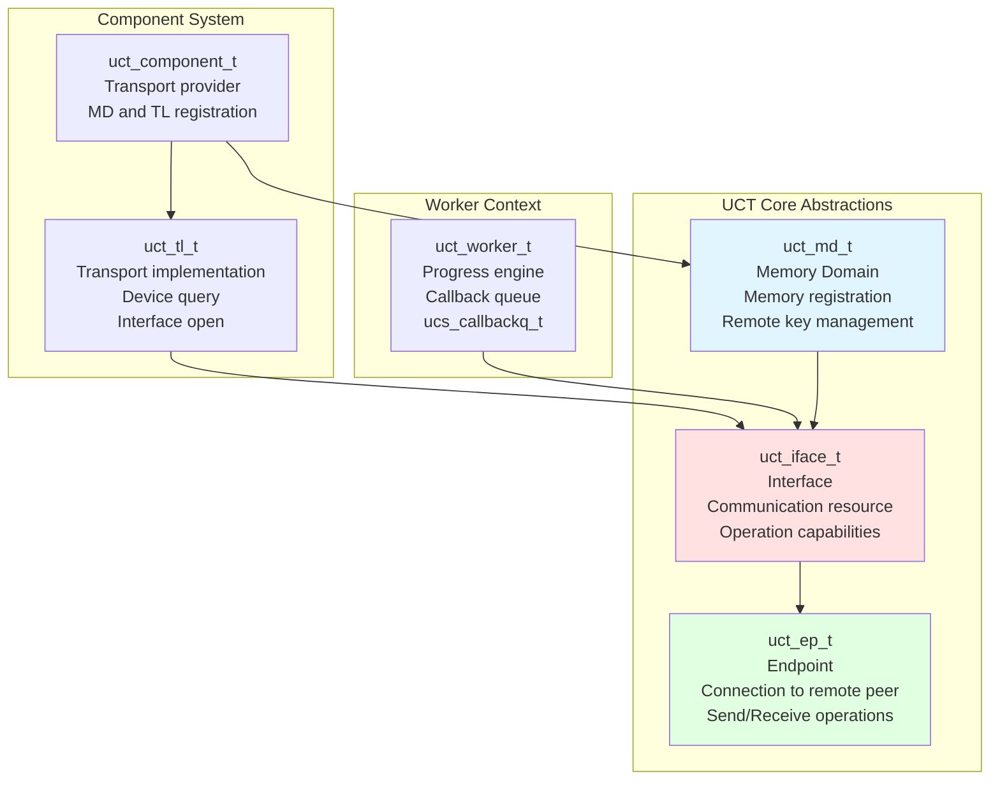

**Memory Domain (`uct_md_t`)**: Manages memory registration, allocation, and remote key packing. Each MD corresponds to a specific device or memory region type. Operations include `uct_md_mem_reg()`, `uct_md_mkey_pack()`, and `uct_md_query()`.

**Interface (`uct_iface_t`)**: Represents a communication resource (e.g., an InfiniBand port, a TCP socket interface). Provides capabilities like maximum message sizes, supported operations, and bandwidth/latency characteristics.

**Endpoint (`uct_ep_t`)**: A connection to a remote peer, created on an interface. Through endpoints, applications invoke communication operations like `uct_ep_put_short()`, `uct_ep_am_bcopy()`, or `uct_ep_atomic64_fetch()`.

Sources: [src/uct/api/uct.h:1-210](), [src/uct/api/uct_def.h:78-121](), [src/uct/api/tl.h:382-409](), [src/uct/base/uct_iface.h:336-395]()

---

## UCT API Organization

### API Structure and Operations

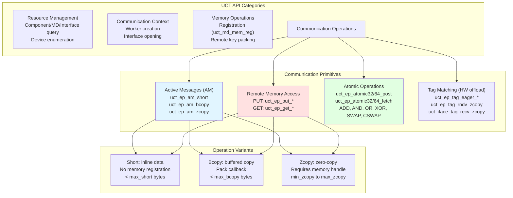

**Active Messages**: User-defined message handlers identified by an 8-bit ID. Supports inline data (short), callback packing (bcopy), or registered buffers (zcopy).

**RMA Operations**: Direct read (GET) and write (PUT) to remote memory using remote keys. All three variants (short, bcopy, zcopy) are available.

**Atomic Operations**: Hardware atomic operations (32-bit and 64-bit). Post operations (no return value) and fetch operations (return old/new value). Supported operations: ADD, AND, OR, XOR, SWAP, CSWAP.

**Tag Matching**: Hardware-offloaded tag matching for message-passing protocols. Eager and rendezvous variants supported by capable hardware (e.g., InfiniBand with tag matching).

Sources: [src/uct/api/uct.h:44-111](), [src/uct/api/tl.h:27-194](), [src/uct/api/v2/uct_v2.h:34-54]()

---

## Interface Operations Table

### `uct_iface_ops_t` Structure

The `uct_iface_ops_t` structure defines all operations that a transport must implement. Here's the complete operation table:

| Category | Operation | Function Signature |
|----------|-----------|-------------------|
| **PUT Operations** | `ep_put_short` | `(ep, buffer, length, remote_addr, rkey)` |
|  | `ep_put_bcopy` | `(ep, pack_cb, arg, remote_addr, rkey)` |
|  | `ep_put_zcopy` | `(ep, iov, iovcnt, remote_addr, rkey, comp)` |
| **GET Operations** | `ep_get_short` | `(ep, buffer, length, remote_addr, rkey)` |
|  | `ep_get_bcopy` | `(ep, unpack_cb, arg, length, remote_addr, rkey, comp)` |
|  | `ep_get_zcopy` | `(ep, iov, iovcnt, remote_addr, rkey, comp)` |
| **Active Messages** | `ep_am_short` | `(ep, id, header, payload, length)` |
|  | `ep_am_short_iov` | `(ep, id, iov, iovcnt)` |
|  | `ep_am_bcopy` | `(ep, id, pack_cb, arg, flags)` |
|  | `ep_am_zcopy` | `(ep, id, header, header_length, iov, iovcnt, flags, comp)` |
| **Atomics** | `ep_atomic32_post` | `(ep, opcode, value, remote_addr, rkey)` |
|  | `ep_atomic64_post` | `(ep, opcode, value, remote_addr, rkey)` |
|  | `ep_atomic32_fetch` | `(ep, opcode, value, result, remote_addr, rkey, comp)` |
|  | `ep_atomic64_fetch` | `(ep, opcode, value, result, remote_addr, rkey, comp)` |
|  | `ep_atomic_cswap32` | `(ep, compare, swap, remote_addr, rkey, result, comp)` |
|  | `ep_atomic_cswap64` | `(ep, compare, swap, remote_addr, rkey, result, comp)` |
| **Tag Matching** | `ep_tag_eager_short` | `(ep, tag, data, length)` |
|  | `ep_tag_eager_bcopy` | `(ep, tag, imm, pack_cb, arg, flags)` |
|  | `ep_tag_eager_zcopy` | `(ep, tag, imm, iov, iovcnt, flags, comp)` |
|  | `ep_tag_rndv_zcopy` | `(ep, tag, header, header_length, iov, iovcnt, flags, comp)` |
|  | `iface_tag_recv_zcopy` | `(iface, tag, tag_mask, iov, iovcnt, ctx)` |
| **Flow Control** | `ep_pending_add` | `(ep, req, flags)` |
|  | `ep_pending_purge` | `(ep, cb, arg)` |
|  | `ep_flush` | `(ep, flags, comp)` |
|  | `ep_fence` | `(ep, flags)` |
|  | `ep_check` | `(ep, flags, comp)` |
| **Connection** | `ep_create` | `(params, ep_p)` |
|  | `ep_connect` | `(ep, params)` |
|  | `ep_disconnect` | `(ep, flags)` |
|  | `ep_destroy` | `(ep)` |
|  | `ep_get_address` | `(ep, addr)` |
|  | `ep_connect_to_ep` | `(ep, dev_addr, ep_addr)` |
| **Interface** | `iface_flush` | `(iface, flags, comp)` |
|  | `iface_fence` | `(iface, flags)` |
|  | `iface_progress` | `(iface)` → returns count |
|  | `iface_query` | `(iface, iface_attr)` |
|  | `iface_get_address` | `(iface, addr)` |
|  | `iface_get_device_address` | `(iface, addr)` |
|  | `iface_is_reachable` | `(iface, dev_addr, iface_addr)` → bool |

Sources: [src/uct/api/tl.h:295-375](), [src/uct/base/uct_iface.c:26-43]()

---

## Base Interface Implementation

### `uct_base_iface_t` Structure

```mermaid
graph TB
    subgraph "uct_base_iface_t Structure"
        SUPER["super: uct_iface_t<br/>ops: uct_iface_ops_t"]
        INTERNAL["internal_ops<br/>uct_iface_internal_ops_t<br/>iface_query_v2<br/>iface_estimate_perf<br/>ep_query, ep_invalidate"]
        MD_REF["md: uct_md_h<br/>Memory domain reference"]
        WORKER_REF["worker: uct_priv_worker_t*<br/>Progress engine"]
    end
    
    subgraph "Active Message Handling"
        AM_TABLE["am[UCT_AM_ID_MAX]<br/>uct_am_handler_t array<br/>cb, arg, flags per ID"]
        AM_TRACER["am_tracer<br/>am_tracer_arg<br/>Debug tracing"]
    end
    
    subgraph "Error Handling"
        ERR_HANDLER["err_handler<br/>err_handler_arg<br/>err_handler_flags<br/>uct_error_handler_t"]
    end
    
    subgraph "Progress Management"
        PROG["prog: uct_worker_progress_t<br/>id: callback queue ID<br/>progress_flags"]
    end
    
    subgraph "Configuration"
        CONFIG["config.num_alloc_methods<br/>config.alloc_methods[]<br/>config.failure_level<br/>config.max_num_eps"]
    end
    
    subgraph "Statistics"
        STATS["stats: UCS_STATS_NODE<br/>RX_AM, RX_AM_BYTES<br/>TX_NO_DESC, FLUSH, FENCE"]
    end
    
    SUPER --> INTERNAL
    SUPER --> MD_REF
    SUPER --> WORKER_REF
    SUPER --> AM_TABLE
    SUPER --> AM_TRACER
    SUPER --> ERR_HANDLER
    SUPER --> PROG
    SUPER --> CONFIG
    SUPER --> STATS
    
    style SUPER fill:#e1f5ff
    style AM_TABLE fill:#ffe1e1
    style ERR_HANDLER fill:#e1ffe1
```

The `uct_base_iface_t` structure (defined at [src/uct/base/uct_iface.h:340-363]()) provides common functionality for all UCT transport implementations:

**Active Message Handlers**: Array of 32 handler slots (`UCT_AM_ID_MAX` = 32), each containing a callback function, user argument, and flags. Set via `uct_iface_set_am_handler()` at [src/uct/base/uct_iface.c:107-145]().

**Error Handling**: User-provided error handler invoked when endpoint operations fail. Called via `uct_iface_handle_ep_err()` at [src/uct/base/uct_iface.c:495-507]().

**Progress Control**: Integration with worker's callback queue for driving send/receive progress. Enabled/disabled via `uct_base_iface_progress_enable()` and `uct_base_iface_progress_disable()` at [src/uct/base/uct_iface.c:406-467]().

Sources: [src/uct/base/uct_iface.h:336-363](), [src/uct/base/uct_iface.c:100-467]()

---

## Interface Capabilities

### `uct_iface_attr_t` and Capability Flags

Each interface reports its capabilities through `uct_iface_attr_t` queried via `uct_iface_query()`:

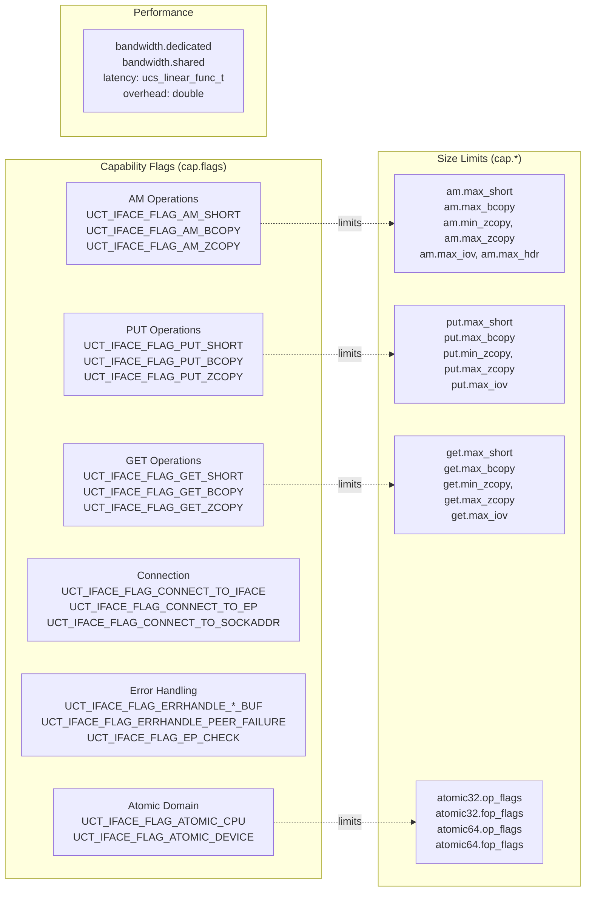

**Operation Flags**: Define which operation variants are supported. For example, `UCT_IFACE_FLAG_AM_SHORT` indicates short active messages are available.

**Size Limits**: Specify maximum sizes for each operation variant. For example, `cap.am.max_short` is typically 2KB or less, while `cap.am.max_bcopy` can be 64KB or larger.

**Performance Characteristics**: Include bandwidth (dedicated and shared), latency as a linear function `c + m*N`, and per-operation overhead.

**Connection Models**: Interfaces may support connecting to another interface's address (`CONNECT_TO_IFACE`), a specific endpoint's address (`CONNECT_TO_EP`), or IP/port sockaddr (`CONNECT_TO_SOCKADDR`).

Sources: [src/uct/api/uct.h:360-443](), [src/tools/info/tl_info.c:124-358]()

---

## Transport Layer Architecture

### Component and Transport Registration

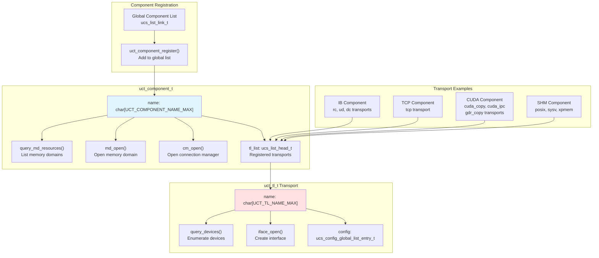

**Component**: Top-level structure representing a class of transports (e.g., InfiniBand, TCP). Components provide memory domains and transports. Defined at [src/uct/base/uct_component.h]().

**Transport (`uct_tl_t`)**: Specific transport implementation within a component. Each transport can query available devices and open interfaces on those devices. Defined at [src/uct/base/uct_iface.h:414-428]().

**Registration Macros**:
- `UCT_TL_DEFINE()`: Register a transport with a component at [src/uct/base/uct_iface.h:490-498]()
- `UCT_COMPONENT_DEFINE()`: Register a component globally

Transport registration happens at initialization time, populating the component's transport list which is queried by higher layers during resource discovery.

Sources: [src/uct/base/uct_iface.h:414-551](), [src/uct/base/uct_component.h]()

---

## Memory Domain Operations

### Registration and Remote Keys

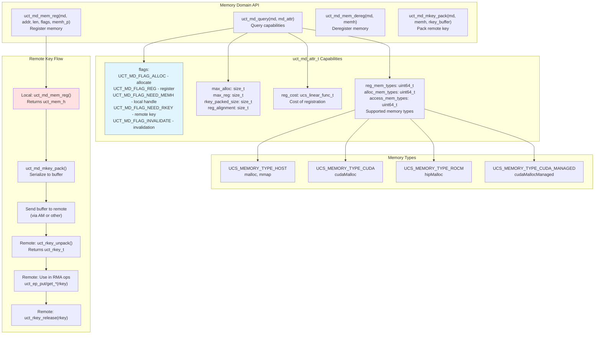

**Memory Registration Flow**:
1. Application registers memory with `uct_md_mem_reg()` to obtain a `uct_mem_h` handle
2. Handle is packed into a portable buffer with `uct_md_mkey_pack()`
3. Buffer is sent to remote peer (e.g., via Active Message)
4. Remote peer unpacks with `uct_rkey_unpack()` to obtain `uct_rkey_t`
5. Remote key is used in RMA operations (`uct_ep_put_zcopy()`, `uct_ep_get_zcopy()`)
6. When done, remote releases key with `uct_rkey_release()`
7. Local deregisters with `uct_md_mem_dereg()`

**Memory Domain Flags**:
- `UCT_MD_FLAG_REG`: Supports memory registration
- `UCT_MD_FLAG_NEED_MEMH`: Zero-copy operations require local memory handle
- `UCT_MD_FLAG_NEED_RKEY`: RMA operations require remote key
- `UCT_MD_FLAG_ALLOC`: Can allocate memory with specific properties
- `UCT_MD_FLAG_INVALIDATE`: Supports memory invalidation (deregistration with callback)

Sources: [src/uct/api/uct.h:709-777](), [src/uct/api/v2/uct_v2.h:224-825]()

---

## Connection Models

### Three Connection Establishment Patterns

```mermaid
graph TB
    subgraph "1. Connect to Interface"
        CI_DESC["Connection established using<br/>remote iface_addr only<br/>No per-peer state"]
        CI_CREATE["uct_ep_create(iface_addr)<br/>UCT_IFACE_FLAG_CONNECT_TO_IFACE"]
        CI_EXAMPLE["Examples: UD transport<br/>Datagram-based"]
    end
    
    subgraph "2. Connect to Endpoint"
        CE_DESC["Connection to specific endpoint<br/>Using device_addr + ep_addr<br/>Per-peer state maintained"]
        CE_CREATE["ep1 = uct_ep_create(iface1)<br/>uct_ep_get_address(ep1, addr1)"]
        CE_CONNECT["ep2 = uct_ep_create(iface2)<br/>uct_ep_connect_to_ep(ep2, dev_addr, addr1)<br/>UCT_IFACE_FLAG_CONNECT_TO_EP"]
        CE_EXAMPLE["Examples: RC, DC transports<br/>Connection-oriented"]
        CE_CREATE --> CE_CONNECT
    end
    
    subgraph "3. Connect via Sockaddr"
        CS_DESC["Client-server using IP:port<br/>Connection manager handles setup<br/>UCT_IFACE_FLAG_CONNECT_TO_SOCKADDR"]
        CS_SERVER["Server: uct_listener_create(sockaddr)<br/>Callback on connection request"]
        CS_CLIENT["Client: uct_ep_create(sockaddr)<br/>Connect to listening address"]
        CS_HANDSHAKE["3-way handshake:<br/>CONN_REQ → CONN_RESP → ACK"]
        CS_EXAMPLE["Examples: TCP, RDMA_CM<br/>Network-addressable"]
        CS_SERVER --> CS_HANDSHAKE
        CS_CLIENT --> CS_HANDSHAKE
    end
    
    CI_DESC --> CI_CREATE
    CI_CREATE --> CI_EXAMPLE
    
    CE_DESC --> CE_CREATE
    CE_CONNECT --> CE_EXAMPLE
    
    CS_DESC --> CS_SERVER
    CS_DESC --> CS_CLIENT
    CS_HANDSHAKE --> CS_EXAMPLE
    
    style CI_CREATE fill:#e1f5ff
    style CE_CONNECT fill:#ffe1e1
    style CS_HANDSHAKE fill:#e1ffe1
```

**Connect to Interface**: Lightweight connection model where endpoints address peers using only the interface address. No per-peer state. Used by unreliable datagram transports like UD.

**Connect to Endpoint**: Full connection model requiring both device and endpoint addresses. Establishes dedicated resources per peer. Used by reliable connection-oriented transports like RC and DC.

**Connect via Sockaddr**: Client-server model using standard IP address and port. Involves connection manager for protocol negotiation and private data exchange. Used by TCP and RDMA CM transports.

Sources: [src/uct/api/uct.h:404-407](), [src/uct/api/uct.h:118-210]()

---

## Completion and Flow Control

### Asynchronous Operations

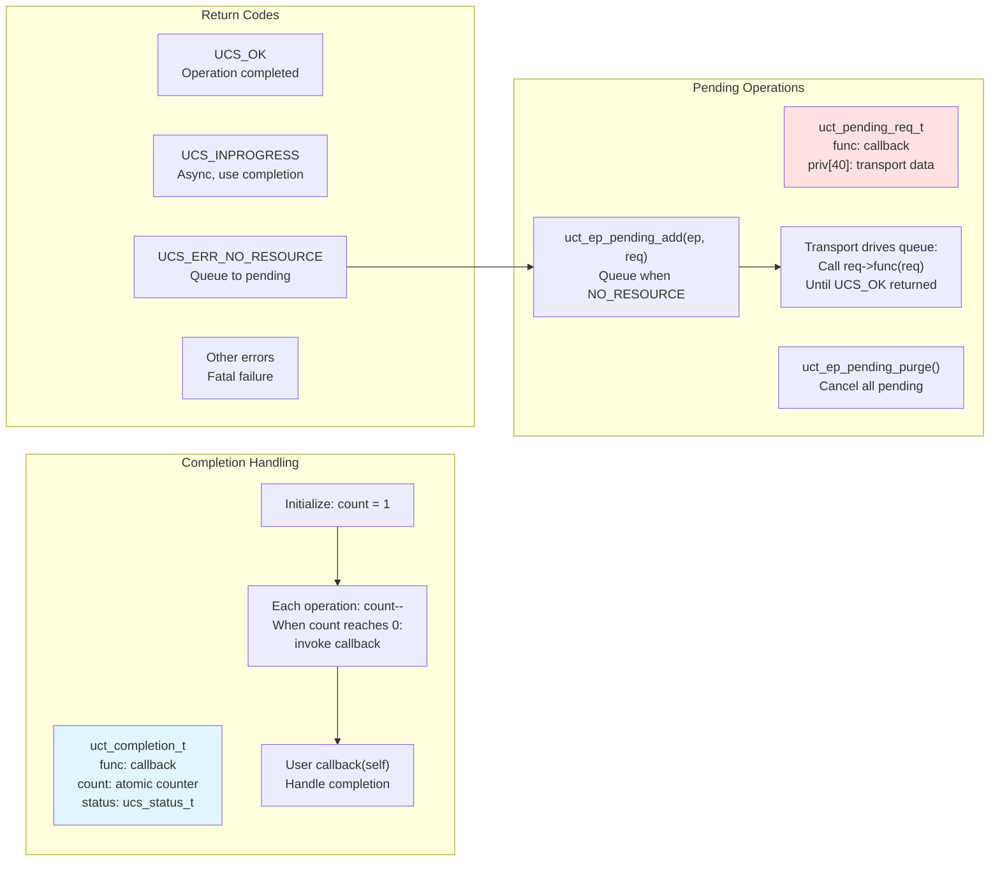

**Completion Object** (`uct_completion_t`): Used for asynchronous operations that may not complete immediately. The application initializes `count` to 1, then passes it to operations. Each operation decrements the count when it completes. When count reaches 0, the callback is invoked. Defined at [src/uct/api/uct.h:1327-1360]().

**Pending Queue** (`uct_pending_req_t`): When an operation returns `UCS_ERR_NO_RESOURCE`, the user can add it to the endpoint's pending queue via `uct_ep_pending_add()`. The transport will later retry by calling the request's callback. The callback should return `UCS_OK` when successful, `UCS_INPROGRESS` to keep processing, or an error to stop. Defined at [src/uct/api/uct.h:1375-1411]().

**Flow Control**:
- **Flush**: `uct_ep_flush()` ensures all outstanding operations on an endpoint complete. Returns `UCS_OK` or `UCS_INPROGRESS`.
- **Fence**: `uct_ep_fence()` ensures ordering of operations. Operations after fence will not start until all before complete.

Sources: [src/uct/api/uct.h:1327-1411](), [src/uct/base/uct_iface.h:662-748]()

---

## Progress and Event-Driven I/O

### Worker Progress Engine

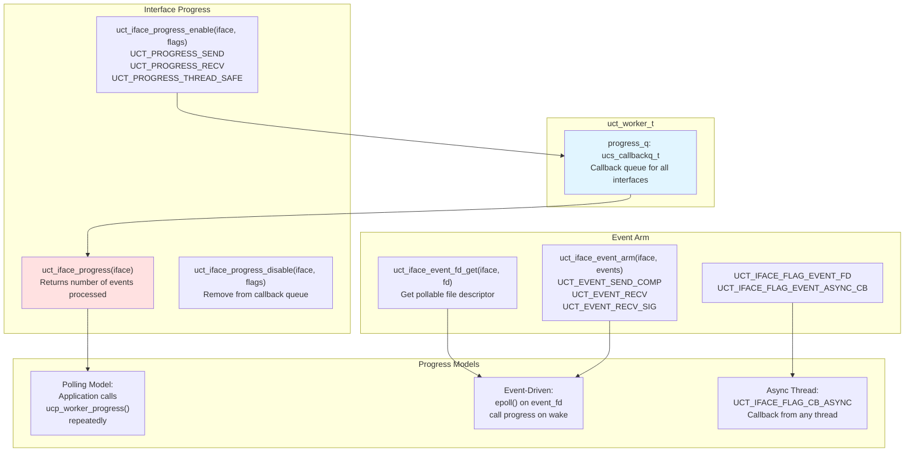

**Progress Function**: Each interface implements `iface_progress()` which polls for completions and incoming messages. Returns the number of events processed. Applications must call this regularly (either via polling or event-driven).

**Progress Control**:
- Enable: `uct_iface_progress_enable()` adds the interface's progress function to the worker's callback queue
- Disable: `uct_iface_progress_disable()` removes it
- Flags: `UCT_PROGRESS_SEND` (send completions), `UCT_PROGRESS_RECV` (receive messages), `UCT_PROGRESS_THREAD_SAFE` (safe concurrent calls)

**Event Arm**: For event-driven I/O, interfaces can provide a file descriptor via `uct_iface_event_fd_get()`. The application uses `uct_iface_event_arm()` to request notification when events occur, then uses epoll/select on the FD.

**Callback Flags**:
- `UCT_CB_FLAG_ASYNC`: Callback can be invoked from any thread (requires `UCT_IFACE_FLAG_CB_ASYNC`)
- Without flag: Callback only from `uct_iface_progress()` context (requires `UCT_IFACE_FLAG_CB_SYNC`)

Sources: [src/uct/api/uct.h:456-470](), [src/uct/api/uct.h:500-506](), [src/uct/api/uct.h:585-602](), [src/uct/base/uct_iface.c:406-467]()

---

## Error Handling

### Error Handler Callback

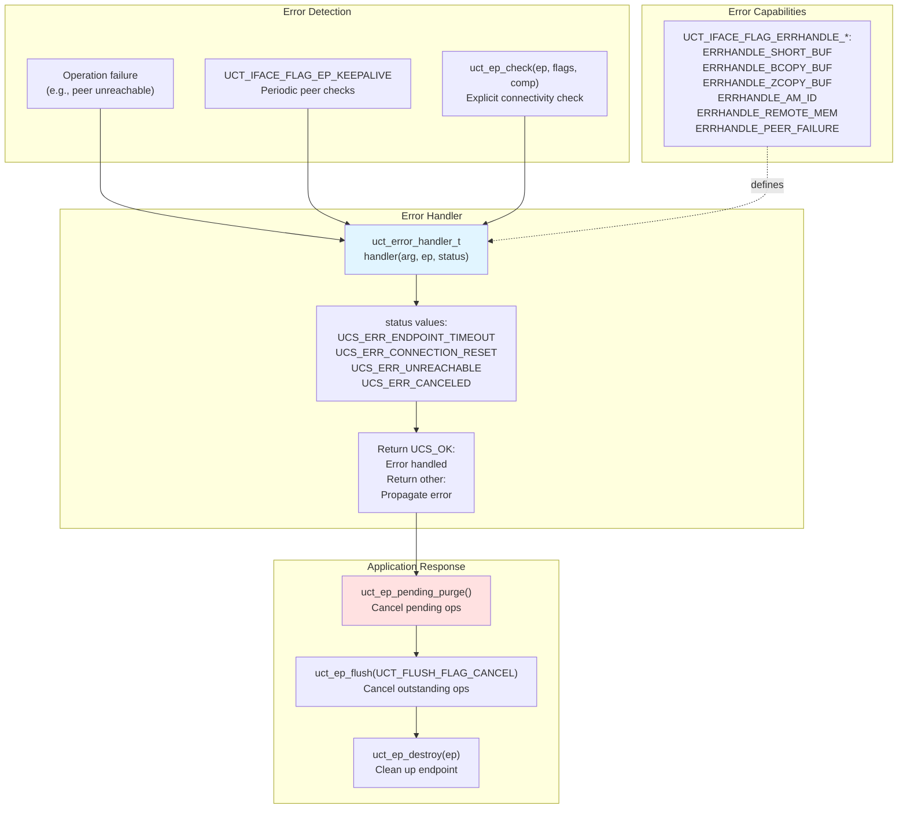

**Error Handler Setup**: Applications register an error handler via `uct_iface_params_t.err_handler` when opening an interface. The handler receives the failing endpoint, error status, and user argument.

**Error Scenarios**:
- **Buffer Errors**: Invalid buffer for operation (controlled by `ERRHANDLE_*_BUF` flags)
- **Remote Memory**: Invalid remote address or permissions
- **Peer Failure**: Remote endpoint disconnected or crashed
- **AM ID**: Invalid active message ID on receive

**Error Recovery**:
1. Error handler is invoked with endpoint and status
2. Application should purge pending operations
3. Cancel outstanding operations with `uct_ep_flush(UCT_FLUSH_FLAG_CANCEL)`
4. Destroy the failed endpoint
5. Optionally re-establish connection

**Keepalive**: Transports with `UCT_IFACE_FLAG_EP_KEEPALIVE` automatically detect dead peers without active operations, guaranteeing error callback invocation.

Sources: [src/uct/api/uct.h:394-401](), [src/uct/api/uct.h:426-430](), [src/uct/api/uct.h:562-576](), [src/uct/base/uct_iface.h:340-363](), [src/uct/base/uct_iface.c:495-507]()

---

## Transport Query and Resource Discovery

### Device and Interface Enumeration

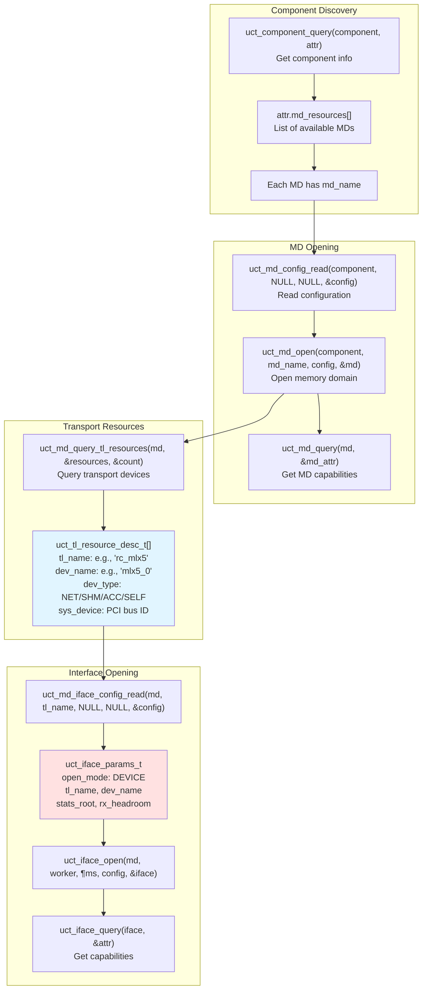

**Discovery Flow**:

1. **Query Components**: Enumerate all available components (IB, TCP, SHM, CUDA, etc.)
2. **Query MDs per Component**: Each component lists its memory domains (e.g., mlx5_0, mlx5_1 for InfiniBand)
3. **Query Transport Resources**: Each MD lists available transport/device pairs (e.g., rc_mlx5/mlx5_0, ud_mlx5/mlx5_0)
4. **Open Interface**: Select a transport/device pair and open an interface on it
5. **Query Interface**: Get capabilities, size limits, performance characteristics

**Resource Descriptor** (`uct_tl_resource_desc_t`):
- `tl_name`: Transport name (e.g., "rc_mlx5", "tcp", "cuda_copy")
- `dev_name`: Device name (e.g., "mlx5_0", "eth0", "cuda0")
- `dev_type`: Device type (NET, SHM, ACC, SELF)
- `sys_device`: System topology information (PCI bus ID, NUMA node)

**Interface Parameters** (`uct_iface_params_t`):
- `open_mode`: DEVICE, SOCKADDR_SERVER, or SOCKADDR_CLIENT
- `mode.device.{tl_name, dev_name}`: For DEVICE mode
- `err_handler`, `err_handler_arg`: Error handling
- `rx_headroom`: Reserve space before received messages

Sources: [src/uct/api/uct.h:218-279](), [src/uct/api/uct.h:318-336](), [src/uct/api/uct.h:630-689](), [src/tools/info/tl_info.c:360-396]()

---

## Operation Patterns

### Short, Bcopy, and Zcopy Variants

Each communication primitive (AM, PUT, GET) typically provides three variants with different tradeoffs:

```mermaid
graph LR
    subgraph "Short Operations"
        SHORT_DESC["Data passed inline<br/>No memory registration<br/>Typically ≤ 2KB"]
        SHORT_SYNC["Synchronous return<br/>UCS_OK or error"]
        SHORT_EXAMPLE["uct_ep_put_short(ep, buffer,<br/>  length, remote_addr, rkey)<br/>uct_ep_am_short(ep, id,<br/>  header, payload, length)"]
    end
    
    subgraph "Bcopy Operations"
        BCOPY_DESC["Data via pack callback<br/>Transport provides buffer<br/>Typically ≤ 64KB"]
        BCOPY_CALLBACK["User callback:<br/>pack_cb(dest, arg)<br/>Copies data to dest"]
        BCOPY_RETURN["Returns bytes packed<br/>or error"]
        BCOPY_EXAMPLE["uct_ep_put_bcopy(ep, pack_cb,<br/>  arg, remote_addr, rkey)<br/>uct_ep_am_bcopy(ep, id,<br/>  pack_cb, arg, flags)"]
    end
    
    subgraph "Zcopy Operations"
        ZCOPY_DESC["Zero-copy from<br/>registered memory<br/>min_zcopy to max_zcopy"]
        ZCOPY_IOV["Scatter-gather:<br/>uct_iov_t array<br/>buffer, length, memh"]
        ZCOPY_COMP["Completion object<br/>uct_completion_t<br/>Async notification"]
        ZCOPY_EXAMPLE["uct_ep_put_zcopy(ep, iov,<br/>  iovcnt, remote_addr,<br/>  rkey, comp)<br/>uct_ep_am_zcopy(ep, id, hdr,<br/>  hdr_len, iov, iovcnt, flags, comp)"]
    end
    
    SHORT_DESC --> SHORT_SYNC
    SHORT_SYNC --> SHORT_EXAMPLE
    
    BCOPY_DESC --> BCOPY_CALLBACK
    BCOPY_CALLBACK --> BCOPY_RETURN
    BCOPY_RETURN --> BCOPY_EXAMPLE
    
    ZCOPY_DESC --> ZCOPY_IOV
    ZCOPY_IOV --> ZCOPY_COMP
    ZCOPY_COMP --> ZCOPY_EXAMPLE
    
    style SHORT_DESC fill:#e1f5ff
    style BCOPY_DESC fill:#ffe1e1
    style ZCOPY_DESC fill:#e1ffe1
```

**Short Operations**:
- **Pros**: Lowest latency, simplest API, no memory registration
- **Cons**: Limited size (typically ≤ 2KB), data must be immediately available
- **Use Cases**: Small control messages, headers, metadata

**Bcopy (Buffered Copy)**:
- **Pros**: Moderate size (up to ~64KB), transport manages buffer, no registration required
- **Cons**: Copy overhead, pack callback complexity
- **Use Cases**: Medium messages where registration overhead not justified

**Zcopy (Zero-Copy)**:
- **Pros**: No copy overhead, large transfers efficient, scatter-gather support
- **Cons**: Requires memory registration, asynchronous completion, size limits
- **Use Cases**: Large data transfers, registered buffers, high bandwidth

**Size Selection**:
```
if (size <= max_short)
    use short
else if (size <= max_bcopy)
    use bcopy
else if (size <= max_zcopy && registered)
    use zcopy
else
    multi-fragment or rendezvous
```

Sources: [src/uct/api/tl.h:26-96](), [src/uct/base/uct_iface.h:620-641]()

---

## Interface Base Classes

### Inheritance Hierarchy

Transport implementations typically derive from base classes that provide common functionality:

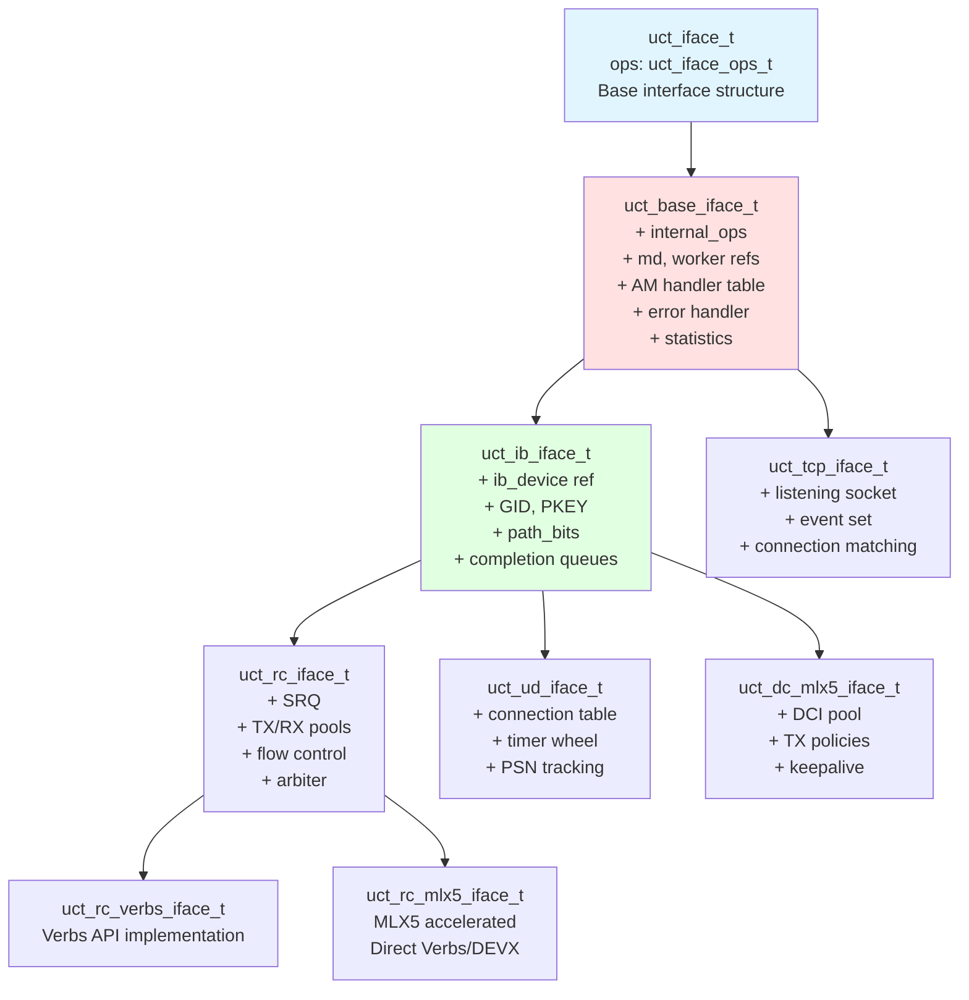

**Base Classes**:

- **`uct_iface_t`**: Minimal interface with operation table only
  - Defined at [src/uct/api/tl.h:390-392]()

- **`uct_base_iface_t`**: Adds common infrastructure
  - Active message handler table (32 slots)
  - Error handler and flags
  - Progress control integration
  - Statistics collection
  - Memory allocation methods configuration
  - Defined at [src/uct/base/uct_iface.h:340-363]()

- **`uct_ib_iface_t`**: InfiniBand-specific base
  - Device and port management
  - GID, PKEY, path bits
  - Completion queue handling
  - Async event processing
  - Defined in [src/uct/ib/base/ib_iface.h]()

**Transport-Specific Interfaces**: Each transport (RC, UD, DC, TCP) extends the appropriate base with specialized structures for flow control, connection management, and protocol state.

Sources: [src/uct/api/tl.h:382-409](), [src/uct/base/uct_iface.h:340-363]()

---

## Key Files Reference

### Core API Headers

| File | Purpose | Key Structures |
|------|---------|----------------|
| [src/uct/api/uct.h:1-2650]() | Main UCT API | Operation function prototypes, capability flags, attribute structures |
| [src/uct/api/uct_def.h:1-900]() | Type definitions | `uct_iface_h`, `uct_ep_h`, `uct_md_h`, `uct_completion_t`, `uct_pending_req_t` |
| [src/uct/api/tl.h:1-428]() | Transport layer | `uct_iface_ops_t`, `uct_worker_t`, `uct_iface_t`, `uct_ep_t` |
| [src/uct/api/v2/uct_v2.h:1-1100]() | API v2 extensions | `uct_perf_attr_t`, `uct_iface_is_reachable_params_t`, memory registration v2 |

### Implementation Files

| File | Purpose | Key Functions |
|------|---------|---------------|
| [src/uct/base/uct_iface.c:1-1047]() | Base interface | `uct_iface_set_am_handler()`, `uct_base_iface_progress_enable()`, error handling |
| [src/uct/base/uct_iface.h:1-1200]() | Base structures | `uct_base_iface_t`, `uct_base_ep_t`, transport registration macros |
| [src/uct/base/uct_component.h]() | Component system | Component registration and query |

### Example Transport

| File | Purpose |
|------|---------|
| [src/uct/cuda/gdr_copy/gdr_copy_iface.c:1-268]() | GDR_COPY transport example showing interface implementation |

Sources: All files listed above

---

