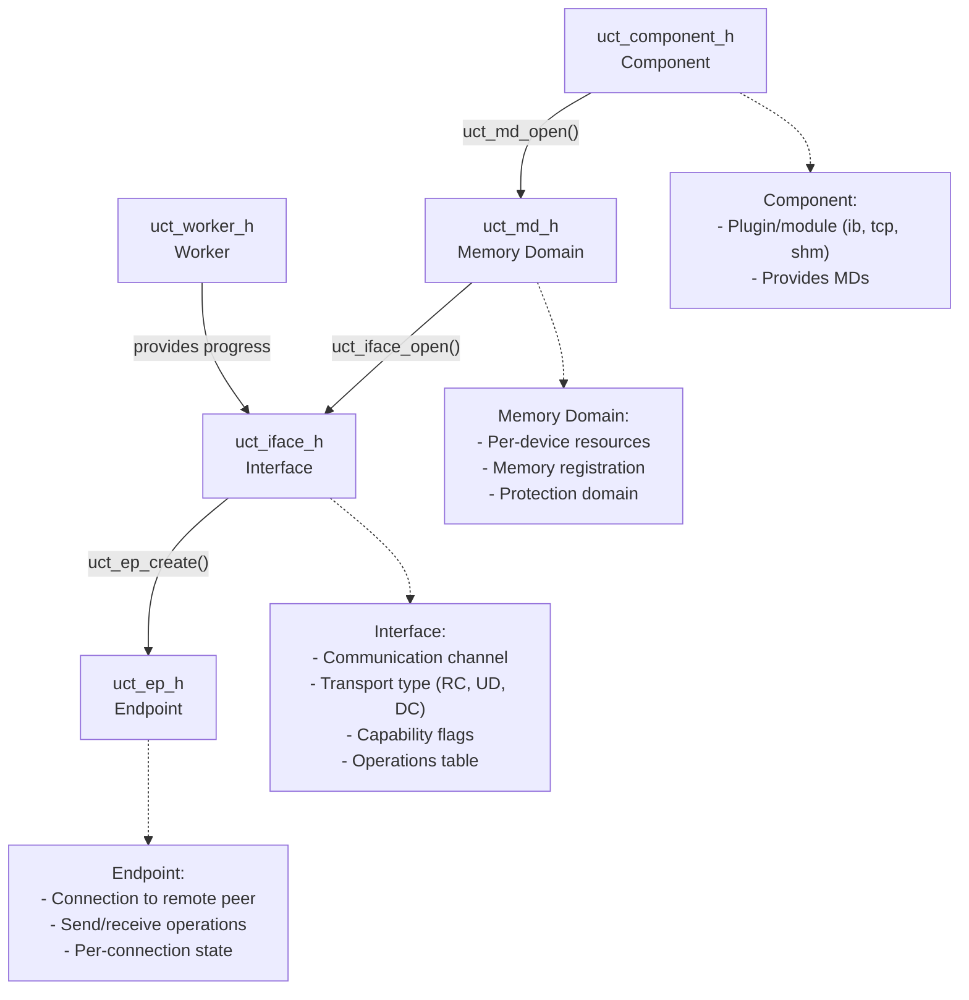
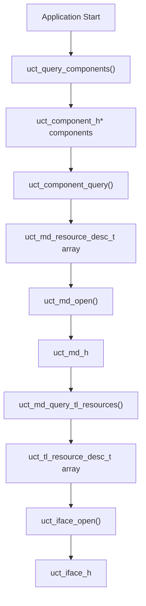
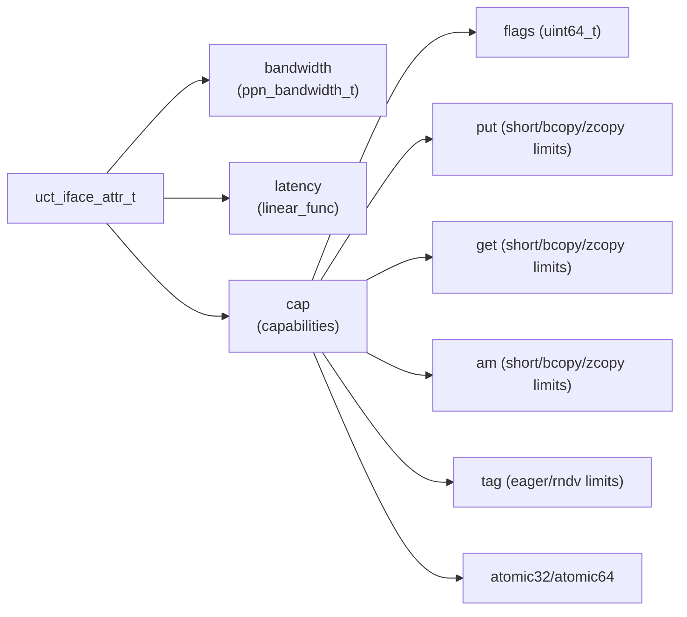
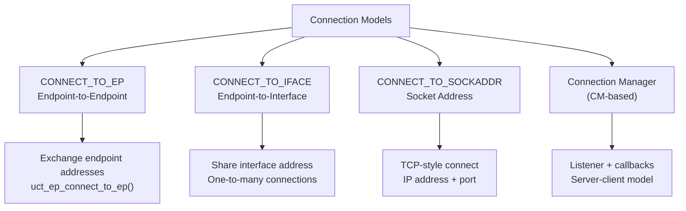
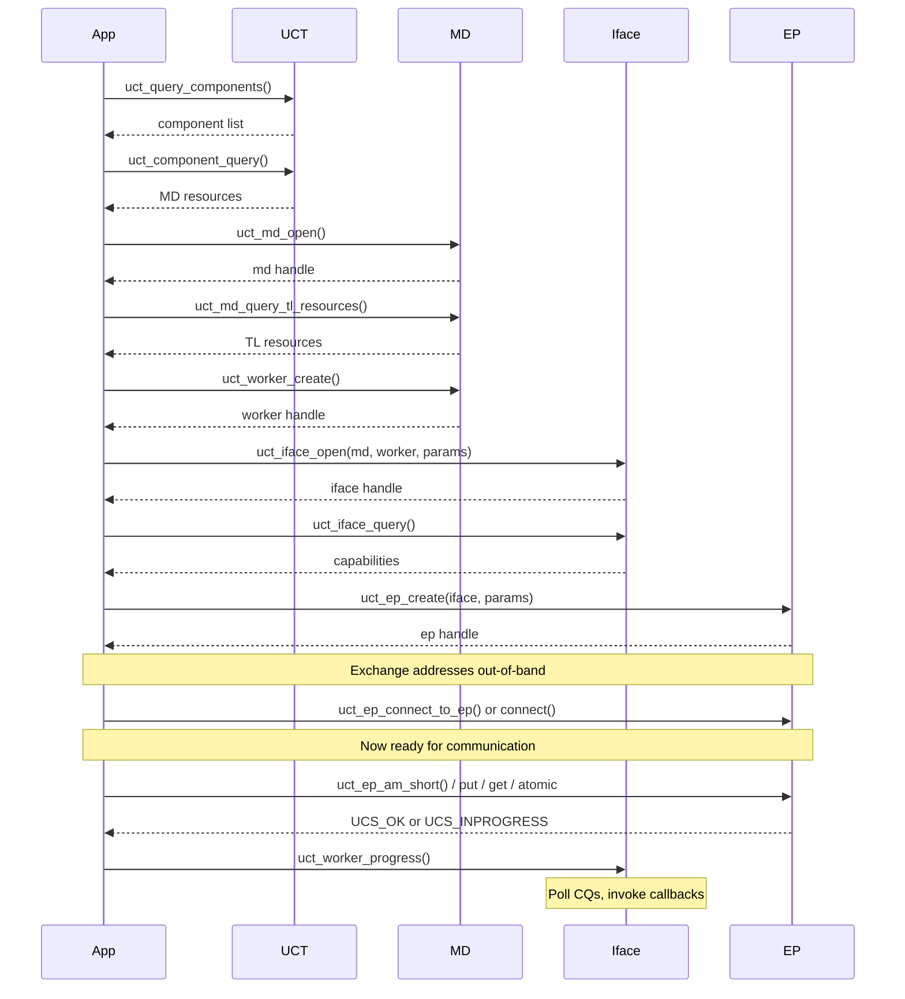

<!-- source: DeepWiki mcp.deepwiki.com · repo openucx/ucx · page 3.1 UCT API and Interface Design · fetched 2026-11-11 -->

# UCT API

<details>
<summary>Relevant source files</summary>

The following files were used as context for generating this wiki page:

- [src/tools/info/tl_info.c](src/tools/info/tl_info.c)
- [src/uct/api/tl.h](src/uct/api/tl.h)
- [src/uct/api/uct.h](src/uct/api/uct.h)
- [src/uct/api/uct_def.h](src/uct/api/uct_def.h)
- [src/uct/api/v2/uct_v2.h](src/uct/api/v2/uct_v2.h)
- [src/uct/base/uct_iface.c](src/uct/base/uct_iface.c)
- [src/uct/base/uct_iface.h](src/uct/base/uct_iface.h)
- [src/uct/cuda/gdr_copy/gdr_copy_iface.c](src/uct/cuda/gdr_copy/gdr_copy_iface.c)

</details>


## Purpose and Scope

The UCT (Unified Communication Transport) API provides a low-level, transport-agnostic abstraction layer for network communication operations. UCT sits between the high-level UCP protocol layer and the hardware-specific transport implementations, enabling portable access to diverse network technologies including InfiniBand, shared memory, TCP, and GPU interconnects.

This document covers the core UCT API including the object model, resource enumeration, capability queries, communication operations, and connection establishment. For higher-level protocol abstractions built on top of UCT, see [UCP API](#2.1). For UCT transport implementations (IB RC, DC, UD, etc.), see [InfiniBand Base Infrastructure](#3.2), [RC Transport](#3.3), and [Other Transports](#3.5).

**Sources:** [src/uct/api/uct.h:1-112]()

---

## UCT Object Model and Hierarchy

The UCT API is organized around a four-level object hierarchy that mirrors the hardware structure:



### Object Definitions

| Handle Type | Structure | Description |
|-------------|-----------|-------------|
| `uct_component_h` | Opaque pointer | Represents a transport plugin (e.g., `mlx5`, `tcp`, `cma`) |
| `uct_md_h` | `uct_md_t*` | Memory Domain - manages memory registration for a device |
| `uct_iface_h` | `uct_iface_t*` | Interface - communication channel with specific transport type |
| `uct_ep_h` | `uct_ep_t*` | Endpoint - connection to a remote peer |
| `uct_worker_h` | `uct_worker_t*` | Worker - progress engine for driving communication |

The `uct_iface_t` structure contains the operations table:

```c
typedef struct uct_iface {
    uct_iface_ops_t ops;
} uct_iface_t;
```

The `uct_ep_t` structure links back to its interface:

```c
typedef struct uct_ep {
    uct_iface_h iface;
} uct_ep_t;
```

**Sources:** [src/uct/api/uct_def.h:78-114](), [src/uct/api/tl.h:382-420]()

---

## Resource Enumeration

UCT provides a multi-stage resource discovery process to enumerate available components, memory domains, and transport resources.



### Component Query

Components represent transport plugins. Applications enumerate all available components:

```c
uct_component_h *components;
unsigned num_components;
uct_query_components(&components, &num_components);
```

Each component has attributes queried via `uct_component_query()`:

| Attribute | Type | Description |
|-----------|------|-------------|
| `name` | `char[UCT_COMPONENT_NAME_MAX]` | Component name (e.g., "ib", "tcp") |
| `md_resource_count` | `unsigned` | Number of memory domains |
| `md_resources` | `uct_md_resource_desc_t*` | Array of MD descriptors |
| `flags` | `uint64_t` | Capability flags (CM support, RKEY_PTR) |

**Sources:** [src/uct/api/uct.h:230-302](), [src/tools/info/tl_info.c:625-663]()

### Memory Domain Resources

Each component provides memory domain resources, one per hardware device:

```c
typedef struct uct_md_resource_desc {
    char md_name[UCT_MD_NAME_MAX];  // e.g., "mlx5_0", "mlx5_1"
} uct_md_resource_desc_t;
```

Opening a memory domain:

```c
uct_md_config_t *md_config;
uct_md_h md;
uct_md_config_read(component, NULL, NULL, &md_config);
uct_md_open(component, md_name, md_config, &md);
```

**Sources:** [src/uct/api/uct.h:218-221](), [src/tools/info/tl_info.c:414-425]()

### Transport Layer Resources

Each memory domain provides transport layer resources describing available communication channels:

```c
typedef struct uct_tl_resource_desc {
    char              tl_name[UCT_TL_NAME_MAX];      // "rc_mlx5", "ud_mlx5", etc.
    char              dev_name[UCT_DEVICE_NAME_MAX];  // "mlx5_0:1", "eth0"
    uct_device_type_t dev_type;                       // NET, SHM, ACC, SELF
    ucs_sys_device_t  sys_device;                     // PCIe bus ID
} uct_tl_resource_desc_t;
```

Querying transport resources:

```c
uct_tl_resource_desc_t *resources;
unsigned num_resources;
uct_md_query_tl_resources(md, &resources, &num_resources);
```

**Sources:** [src/uct/api/uct.h:328-339](), [src/tools/info/tl_info.c:427-433]()

---

## Interface Capabilities and Attributes

### Capability Flags

Interfaces advertise their capabilities through bit flags in `uct_iface_attr_t.cap.flags`:

| Flag Category | Flags | Description |
|--------------|-------|-------------|
| **Active Messages** | `UCT_IFACE_FLAG_AM_SHORT`<br/>`UCT_IFACE_FLAG_AM_BCOPY`<br/>`UCT_IFACE_FLAG_AM_ZCOPY` | Short (inline), buffered-copy, or zero-copy active messages |
| **PUT Operations** | `UCT_IFACE_FLAG_PUT_SHORT`<br/>`UCT_IFACE_FLAG_PUT_BCOPY`<br/>`UCT_IFACE_FLAG_PUT_ZCOPY` | Remote write operations |
| **GET Operations** | `UCT_IFACE_FLAG_GET_SHORT`<br/>`UCT_IFACE_FLAG_GET_BCOPY`<br/>`UCT_IFACE_FLAG_GET_ZCOPY` | Remote read operations |
| **Tag Matching** | `UCT_IFACE_FLAG_TAG_EAGER_SHORT`<br/>`UCT_IFACE_FLAG_TAG_EAGER_BCOPY`<br/>`UCT_IFACE_FLAG_TAG_EAGER_ZCOPY`<br/>`UCT_IFACE_FLAG_TAG_RNDV_ZCOPY` | Hardware tag matching support |
| **Atomics** | `UCT_IFACE_FLAG_ATOMIC_CPU`<br/>`UCT_IFACE_FLAG_ATOMIC_DEVICE` | Atomic operation consistency domain |
| **Connection** | `UCT_IFACE_FLAG_CONNECT_TO_EP`<br/>`UCT_IFACE_FLAG_CONNECT_TO_IFACE`<br/>`UCT_IFACE_FLAG_CONNECT_TO_SOCKADDR` | Connection establishment method |
| **Error Handling** | `UCT_IFACE_FLAG_ERRHANDLE_*`<br/>`UCT_IFACE_FLAG_EP_CHECK`<br/>`UCT_IFACE_FLAG_EP_KEEPALIVE` | Error detection and handling |
| **Callbacks** | `UCT_IFACE_FLAG_CB_SYNC`<br/>`UCT_IFACE_FLAG_CB_ASYNC` | Callback invocation context |

**Sources:** [src/uct/api/uct.h:360-443]()

### Interface Attributes Structure

The `uct_iface_attr_t` structure contains detailed capability information:



Key attributes:

| Field | Type | Description |
|-------|------|-------------|
| `cap.flags` | `uint64_t` | Capability flags |
| `cap.put.max_short` | `size_t` | Maximum inline PUT size |
| `cap.put.max_bcopy` | `size_t` | Maximum buffered PUT size |
| `cap.put.max_zcopy` | `size_t` | Maximum zero-copy PUT size |
| `cap.put.max_iov` | `size_t` | Maximum IOV entries for PUT |
| `cap.am.max_short` | `size_t` | Maximum inline AM size |
| `cap.am.max_hdr` | `size_t` | Maximum AM header for zcopy |
| `cap.atomic*.op_flags` | `uint64_t` | Supported atomic operations (ADD, AND, OR, XOR) |
| `cap.atomic*.fop_flags` | `uint64_t` | Supported fetch-atomic operations (SWAP, CSWAP) |
| `device_addr_len` | `size_t` | Size of device address |
| `iface_addr_len` | `size_t` | Size of interface address |
| `ep_addr_len` | `size_t` | Size of endpoint address |
| `max_num_eps` | `size_t` | Maximum endpoints per interface |
| `priority` | `int` | Device priority for selection |

**Sources:** [src/uct/api/uct.h:1049-1159](), [src/tools/info/tl_info.c:172-297]()

---

## Communication Operations

### Operation Table Structure

All UCT communication operations are accessed through function pointers in the `uct_iface_ops_t` structure:

```mermaid
graph TB
    OPS["uct_iface_ops_t"]
    
    PUT_GROUP["PUT Operations"]
    GET_GROUP["GET Operations"]
    AM_GROUP["Active Messages"]
    ATOMIC_GROUP["Atomic Operations"]
    TAG_GROUP["Tag Matching"]
    MGMT_GROUP["Management"]
    
    OPS --> PUT_GROUP
    OPS --> GET_GROUP
    OPS --> AM_GROUP
    OPS --> ATOMIC_GROUP
    OPS --> TAG_GROUP
    OPS --> MGMT_GROUP
    
    PUT_GROUP --> PUT_SHORT["ep_put_short"]
    PUT_GROUP --> PUT_BCOPY["ep_put_bcopy"]
    PUT_GROUP --> PUT_ZCOPY["ep_put_zcopy"]
    
    GET_GROUP --> GET_SHORT["ep_get_short"]
    GET_GROUP --> GET_BCOPY["ep_get_bcopy"]
    GET_GROUP --> GET_ZCOPY["ep_get_zcopy"]
    
    AM_GROUP --> AM_SHORT["ep_am_short"]
    AM_GROUP --> AM_BCOPY["ep_am_bcopy"]
    AM_GROUP --> AM_ZCOPY["ep_am_zcopy"]
    
    ATOMIC_GROUP --> ATOMIC_POST["ep_atomic32/64_post"]
    ATOMIC_GROUP --> ATOMIC_FETCH["ep_atomic32/64_fetch"]
    ATOMIC_GROUP --> CSWAP["ep_atomic_cswap32/64"]
    
    TAG_GROUP --> TAG_EAGER["ep_tag_eager_*"]
    TAG_GROUP --> TAG_RNDV["ep_tag_rndv_*"]
    TAG_GROUP --> TAG_RECV["iface_tag_recv_*"]
```



**Sources:** [src/uct/api/tl.h:295-376]()

### Active Messages

Active messages provide low-latency notification-style communication with immediate handler invocation:

| Variant | Function Pointer Type | Description |
|---------|----------------------|-------------|
| **Short** | `uct_ep_am_short_func_t` | Inline message with 8-byte header + small payload |
| **Bcopy** | `uct_ep_am_bcopy_func_t` | Buffered-copy using pack callback |
| **Zcopy** | `uct_ep_am_zcopy_func_t` | Zero-copy from registered memory with separate header |

Active message callback signature:
```c
typedef ucs_status_t (*uct_am_callback_t)(void *arg, void *data, 
                                          size_t length, unsigned flags);
```

Handlers are registered with `uct_iface_set_am_handler()` for AM IDs 0-31.

**Sources:** [src/uct/api/tl.h:70-95](), [src/uct/api/uct_def.h:484-529](), [src/uct/api/uct.h:369-372]()

### RMA Operations

Remote Memory Access (RMA) operations provide one-sided PUT and GET:

| Operation | Function Pointer Type | Parameters |
|-----------|----------------------|------------|
| **PUT Short** | `uct_ep_put_short_func_t` | `buffer, length, remote_addr, rkey` |
| **PUT Bcopy** | `uct_ep_put_bcopy_func_t` | `pack_cb, arg, remote_addr, rkey` |
| **PUT Zcopy** | `uct_ep_put_zcopy_func_t` | `iov, iovcnt, remote_addr, rkey, comp` |
| **GET Short** | `uct_ep_get_short_func_t` | `buffer, length, remote_addr, rkey` |
| **GET Bcopy** | `uct_ep_get_bcopy_func_t` | `unpack_cb, arg, length, remote_addr, rkey, comp` |
| **GET Zcopy** | `uct_ep_get_zcopy_func_t` | `iov, iovcnt, remote_addr, rkey, comp` |

All RMA operations require a remote key (`uct_rkey_t`) obtained from the target process's memory registration.

**Sources:** [src/uct/api/tl.h:28-68](), [src/uct/api/uct.h:376-384]()

### Atomic Operations

Atomic operations provide hardware-accelerated atomic memory operations:

**Post Operations (fire-and-forget):**
- `ep_atomic32_post` / `ep_atomic64_post`
- Supported ops: `UCT_ATOMIC_OP_ADD`, `UCT_ATOMIC_OP_AND`, `UCT_ATOMIC_OP_OR`, `UCT_ATOMIC_OP_XOR`

**Fetch Operations (with returned value):**
- `ep_atomic32_fetch` / `ep_atomic64_fetch`
- Additional ops: `UCT_ATOMIC_OP_SWAP`
- `ep_atomic_cswap32` / `ep_atomic_cswap64` - Compare-and-swap

Atomic consistency domain:
- `UCT_IFACE_FLAG_ATOMIC_CPU` - Consistent with CPU operations
- `UCT_IFACE_FLAG_ATOMIC_DEVICE` - Consistent only with other device atomics

**Sources:** [src/uct/api/tl.h:97-141](), [src/uct/api/uct.h:342-356](), [src/uct/api/uct.h:386-392]()

### Tag Matching Operations

Hardware tag matching offloads message matching to the NIC:

| Operation | Direction | Description |
|-----------|-----------|-------------|
| `ep_tag_eager_short` | Send | Short eager tagged message |
| `ep_tag_eager_bcopy` | Send | Bcopy eager with tag and immediate data |
| `ep_tag_eager_zcopy` | Send | Zcopy eager with tag and immediate data |
| `ep_tag_rndv_zcopy` | Send | Rendezvous protocol initiation |
| `iface_tag_recv_zcopy` | Receive | Post receive buffer with tag/mask |
| `iface_tag_recv_cancel` | Receive | Cancel posted receive |

Tag matching uses 64-bit tags with mask-based matching:
```c
typedef uint64_t uct_tag_t;

ucs_status_t uct_iface_tag_recv_zcopy(uct_iface_h iface,
                                      uct_tag_t tag,
                                      uct_tag_t tag_mask,
                                      const uct_iov_t *iov,
                                      size_t iovcnt,
                                      uct_tag_context_t *ctx);
```

**Sources:** [src/uct/api/tl.h:143-193](), [src/uct/api/uct.h:432-437]()

---

## Connection Establishment Models

UCT supports multiple connection establishment paradigms:

### Connection Model Matrix



### Endpoint-to-Endpoint Connection

Used by RC (Reliable Connection) transports where each endpoint has a unique address:

1. Create endpoint: `uct_ep_create(&params, &ep)`
2. Get local endpoint address: `uct_ep_get_address(ep, &ep_addr)`
3. Exchange addresses with peer (out-of-band)
4. Connect: `uct_ep_connect_to_ep(ep, &remote_dev_addr, &remote_ep_addr)`

**Sources:** [src/uct/api/tl.h:231-236](), [src/uct/api/uct.h:405-407]()

### Endpoint-to-Interface Connection

Used by UD (Unreliable Datagram) where one interface address is shared:

1. Open interface: `uct_iface_open(md, worker, &params, config, &iface)`
2. Get interface address: `uct_iface_get_address(iface, &iface_addr)`
3. Broadcast interface address to all peers
4. Create endpoint to peer: `uct_ep_create()` with `UCT_EP_PARAM_FIELD_IFACE_ADDR`

**Sources:** [src/uct/api/tl.h:279-287](), [src/uct/api/uct.h:404-407]()

### Connection Manager Based

Used for TCP-like transports with listener/accept model:

**Server Side:**
```c
// Open CM
uct_cm_open(component, worker, cm_config, &cm);

// Create listener
uct_listener_params_t params = {
    .field_mask = UCT_LISTENER_PARAM_FIELD_CONN_REQUEST_CB,
    .conn_request_cb = server_conn_request_handler,
    .user_data = ctx
};
uct_listener_create(cm, &sockaddr, &params, &listener);

// In connection request callback:
void server_conn_request_handler(...) {
    // Accept connection
    uct_ep_create(&ep_params, &ep);  // Creates endpoint for this client
}
```

**Client Side:**
```c
// Open CM
uct_cm_open(component, worker, cm_config, &cm);

// Create endpoint
uct_ep_params_t params = {
    .field_mask = UCT_EP_PARAM_FIELD_CM | UCT_EP_PARAM_FIELD_SOCKADDR,
    .cm = cm,
    .sockaddr = &server_addr,
    .sockaddr_cb_client = client_connect_callback
};
uct_ep_create(&params, &ep);

// Connect after address resolution
uct_ep_connect(ep, &connect_params);
```

**Sources:** [src/uct/api/uct.h:113-210](), [src/uct/api/uct_def.h:643-800]()

---

## Memory Management at UCT Level

### Memory Domains

Memory domains (`uct_md_h`) manage memory registration and provide memory-related capabilities:

| Capability Flag | Description |
|----------------|-------------|
| `UCT_MD_FLAG_ALLOC` | Can allocate memory (registered by default) |
| `UCT_MD_FLAG_REG` | Can register external memory |
| `UCT_MD_FLAG_NEED_MEMH` | Zero-copy operations require local memory handle |
| `UCT_MD_FLAG_NEED_RKEY` | RMA operations require remote key |
| `UCT_MD_FLAG_ADVISE` | Supports memory advice (e.g., `madvise`) |
| `UCT_MD_FLAG_FIXED` | Supports fixed-address allocation |
| `UCT_MD_FLAG_RKEY_PTR` | Supports direct pointer from remote key |
| `UCT_MD_FLAG_SOCKADDR` | Supports socket address communication |
| `UCT_MD_FLAG_INVALIDATE` | Supports memory invalidation |
| `UCT_MD_FLAG_EXPORTED_MKEY` | Supports exporting memory keys |
| `UCT_MD_FLAG_REG_DMABUF` | Supports registering DMA-BUF file descriptors |

**Sources:** [src/uct/api/uct.h:708-777]()

### Memory Registration

Memory registration pins and prepares memory for RDMA operations:

```c
// Memory registration parameters
uct_mem_alloc_params_t params = {
    .field_mask = UCT_MEM_ALLOC_PARAM_FIELD_FLAGS |
                  UCT_MEM_ALLOC_PARAM_FIELD_ADDRESS |
                  UCT_MEM_ALLOC_PARAM_FIELD_MEM_TYPE,
    .flags = UCT_MD_MEM_ACCESS_ALL,
    .address = buffer,
    .mem_type = UCS_MEMORY_TYPE_HOST
};

uct_mem_h memh;
uct_md_mem_reg(md, buffer, length, &params, &memh);
```

Memory registration flags:

| Flag | Description |
|------|-------------|
| `UCT_MD_MEM_FLAG_NONBLOCK` | Non-blocking registration (deferred pinning) |
| `UCT_MD_MEM_FLAG_FIXED` | Fixed address allocation |
| `UCT_MD_MEM_FLAG_LOCK` | Lock pages in memory |
| `UCT_MD_MEM_ACCESS_REMOTE_PUT` | Allow remote PUT |
| `UCT_MD_MEM_ACCESS_REMOTE_GET` | Allow remote GET |
| `UCT_MD_MEM_ACCESS_REMOTE_ATOMIC` | Allow remote atomics |
| `UCT_MD_MEM_ACCESS_LOCAL_READ` | Local read access |
| `UCT_MD_MEM_ACCESS_LOCAL_WRITE` | Local write access |
| `UCT_MD_MEM_SYMMETRIC_RKEY` | Generate symmetric remote key |

**Sources:** [src/uct/api/uct.h:783-863]()

### Remote Keys

Remote keys (rkeys) enable remote access to registered memory:

```c
// Pack remote key for transmission
void *rkey_buffer;
size_t rkey_size;
uct_md_mkey_pack(md, memh, &rkey_buffer);

// Send rkey_buffer to remote peer...

// On remote side: unpack
uct_rkey_bundle_t rkey_bundle;
uct_rkey_unpack(component, rkey_buffer, &rkey_bundle);

// Use rkey in RMA operation
uct_ep_put_short(ep, buffer, length, remote_addr, rkey_bundle.rkey);

// Release rkey
uct_rkey_release(component, &rkey_bundle);
```

**Sources:** Memory domain operations for packing/unpacking rkeys are defined in MD operations (not shown in provided files but referenced in [src/uct/api/uct.h:1583-1650]())

### IOV Structure

Scatter-gather I/O uses the `uct_iov_t` structure:

```c
typedef struct uct_iov {
    void     *buffer;    // Data buffer
    size_t    length;    // Payload length in bytes
    uct_mem_h memh;      // Local memory handle
    size_t    stride;    // Stride between elements (for strided access)
    unsigned  count;     // Number of elements
} uct_iov_t;
```

The IOV structure supports:
- Contiguous buffers (`count == 1`)
- Strided access (`count > 1`, elements separated by `stride` bytes)

**Sources:** [src/uct/api/uct_def.h:149-156]()

---

## Worker and Progress Engine

### Worker Structure

The `uct_worker_t` provides the progress engine:

```c
typedef struct uct_worker {
    ucs_callbackq_t progress_q;  // Callback queue for progress
} uct_worker_t;
```

Creating a worker:
```c
ucs_async_context_t *async;
uct_worker_h worker;
uct_worker_create(async, UCS_THREAD_MODE_SINGLE, &worker);
```

**Sources:** [src/uct/api/tl.h:382-384]()

### Progress Operations

Progress drives communication forward by polling completion queues and invoking callbacks:

| Function | Description |
|----------|-------------|
| `uct_iface_progress_enable()` | Enable progress on interface |
| `uct_iface_progress_disable()` | Disable progress on interface |
| `uct_iface_progress()` | Poll interface and make progress |
| `uct_worker_progress()` | Progress all interfaces on worker |

Progress types (flags):
- `UCT_PROGRESS_SEND` - Progress send operations
- `UCT_PROGRESS_RECV` - Progress receive operations
- `UCT_PROGRESS_THREAD_SAFE` - Thread-safe progress

**Sources:** [src/uct/api/tl.h:254-260](), [src/uct/api/uct.h:548-554]()

### Event Notification

Interfaces can support event-driven progress:

```c
// Get file descriptor for epoll/select
int fd;
uct_iface_event_fd_get(iface, &fd);

// Arm event (must be called before waiting)
uct_iface_event_arm(iface, UCT_EVENT_RECV | UCT_EVENT_SEND_COMP);

// Wait on fd, then progress
poll(&pollfd, 1, -1);
uct_iface_progress(iface);
```

Event types:
- `UCT_EVENT_SEND_COMP` - Send completion event
- `UCT_EVENT_RECV` - Receive event
- `UCT_EVENT_RECV_SIG` - Signaled receive event

**Sources:** [src/uct/api/tl.h:264-268](), [src/uct/api/uct.h:456-505]()

---

## Interface Parameters and Configuration

### Interface Opening Parameters

The `uct_iface_params_t` structure specifies interface configuration:

```c
typedef struct uct_iface_params {
    uint64_t                  field_mask;      // Which fields are valid
    uct_iface_open_mode_t     open_mode;       // Device or sockaddr mode
    ucs_cpu_set_t             cpu_mask;        // CPU affinity
    size_t                    rx_headroom;     // RX descriptor headroom
    uct_error_handler_t       err_handler;     // Error callback
    void                     *err_handler_arg;
    unsigned                  err_handler_flags;
    
    // Hardware tag matching callbacks
    uct_tag_unexp_eager_cb_t  eager_cb;
    void                     *eager_arg;
    uct_tag_unexp_rndv_cb_t   rndv_cb;
    void                     *rndv_arg;
    
    uct_async_event_cb_t      async_event_cb;  // Async event callback
    void                     *async_event_arg;
    
    ucs_stats_node_t         *stats_root;      // Statistics node
    uint64_t                  features;        // Requested features
    
    // Mode-specific parameters
    union {
        struct {
            const char *tl_name;
            const char *dev_name;
        } device;
        struct {
            ucs_sock_addr_t sockaddr;
            ...
        } sockaddr;
    } mode;
} uct_iface_params_t;
```

Field mask values enable specific fields (see `enum uct_iface_params_field` at [src/uct/api/uct.h:629-688]()).

**Sources:** [src/uct/api/uct.h:629-688](), Interface params structure definition

### Endpoint Parameters

The `uct_ep_params_t` structure specifies endpoint creation parameters:

Key fields:
- `iface` - Interface to create endpoint on
- `dev_addr` - Device address of remote peer
- `iface_addr` - Interface address (for CONNECT_TO_IFACE)
- `ep_addr` - Endpoint address (for CONNECT_TO_EP)
- `sockaddr` - Socket address (for CONNECT_TO_SOCKADDR)
- `cm` - Connection manager handle
- `conn_request` - Connection request (server side)
- `user_data` - User context pointer
- Various callbacks for CM-based connections

**Sources:** [src/uct/api/uct.h:931-988]()

---

## Key Data Structures Summary

### Core Types Reference

| Type | Definition Location | Purpose |
|------|-------------------|---------|
| `uct_component_h` | [src/uct/api/uct_def.h:78]() | Transport plugin handle |
| `uct_md_h` | [src/uct/api/uct_def.h:86]() | Memory domain handle |
| `uct_iface_h` | [src/uct/api/uct_def.h:79]() | Interface handle |
| `uct_ep_h` | [src/uct/api/uct_def.h:83]() | Endpoint handle |
| `uct_worker_h` | [src/uct/api/uct_def.h:95]() | Worker handle |
| `uct_mem_h` | [src/uct/api/uct_def.h:84]() | Memory handle (opaque) |
| `uct_rkey_t` | [src/uct/api/uct_def.h:85]() | Remote key (uintptr_t) |
| `uct_completion_t` | [src/uct/api/uct_def.h:93]() | Completion structure |
| `uct_pending_req_t` | [src/uct/api/uct_def.h:94]() | Pending request structure |
| `uct_iface_ops_t` | [src/uct/api/tl.h:295-375]() | Interface operations table |
| `uct_iface_attr_t` | [src/uct/api/uct_def.h:89]() | Interface attributes |
| `uct_md_attr_t` | [src/uct/api/uct_def.h:92]() | Memory domain attributes |

### Resource Descriptor Types

| Type | Purpose |
|------|---------|
| `uct_md_resource_desc_t` | Describes available memory domain |
| `uct_tl_resource_desc_t` | Describes available transport resource |
| `uct_component_attr_t` | Component attributes and capabilities |

### Operation Parameter Types

| Type | Used For |
|------|----------|
| `uct_iface_params_t` | Interface opening |
| `uct_ep_params_t` | Endpoint creation |
| `uct_ep_connect_params_t` | Endpoint connection (CM) |
| `uct_listener_params_t` | Listener creation (CM) |
| `uct_iov_t` | Scatter-gather I/O |

**Sources:** [src/uct/api/uct_def.h:75-118](), [src/uct/api/tl.h:295-420]()

---

## Usage Pattern Example



**Sources:** Typical usage pattern derived from [src/tools/info/tl_info.c:360-396]()

---

