<!-- source: DeepWiki mcp.deepwiki.com · repo openucx/ucx · page 3.2 InfiniBand Base Infrastructure · fetched 2026-11-11 -->

# InfiniBand Base Infrastructure

<details>
<summary>Relevant source files</summary>

The following files were used as context for generating this wiki page:

- [src/uct/ib/base/ib_device.c](src/uct/ib/base/ib_device.c)
- [src/uct/ib/base/ib_device.h](src/uct/ib/base/ib_device.h)
- [src/uct/ib/base/ib_iface.c](src/uct/ib/base/ib_iface.c)
- [src/uct/ib/base/ib_iface.h](src/uct/ib/base/ib_iface.h)
- [src/uct/ib/base/ib_md.c](src/uct/ib/base/ib_md.c)
- [src/uct/ib/base/ib_md.h](src/uct/ib/base/ib_md.h)
- [src/uct/ib/configure.m4](src/uct/ib/configure.m4)
- [src/uct/ib/mlx5/dv/ib_mlx5_dv.c](src/uct/ib/mlx5/dv/ib_mlx5_dv.c)
- [src/uct/ib/mlx5/dv/ib_mlx5_ifc.h](src/uct/ib/mlx5/dv/ib_mlx5_ifc.h)
- [src/uct/ib/mlx5/dv/ib_mlx5dv_md.c](src/uct/ib/mlx5/dv/ib_mlx5dv_md.c)
- [src/uct/ib/mlx5/ib_mlx5.c](src/uct/ib/mlx5/ib_mlx5.c)
- [src/uct/ib/mlx5/ib_mlx5.h](src/uct/ib/mlx5/ib_mlx5.h)
- [src/uct/ib/mlx5/ib_mlx5.inl](src/uct/ib/mlx5/ib_mlx5.inl)
- [test/gtest/uct/ib/test_cqe_zipping.cc](test/gtest/uct/ib/test_cqe_zipping.cc)
- [test/gtest/uct/ib/test_ib.cc](test/gtest/uct/ib/test_ib.cc)
- [test/gtest/uct/ib/test_ib.h](test/gtest/uct/ib/test_ib.h)
- [test/gtest/uct/ib/test_ib_pkey.cc](test/gtest/uct/ib/test_ib_pkey.cc)
- [test/gtest/uct/ib/test_ud_ds.cc](test/gtest/uct/ib/test_ud_ds.cc)

</details>


## Purpose and Scope

This page documents the foundational InfiniBand (IB) transport components that underlie all IB-based UCT transports in UCX. These components provide hardware abstraction, address management, reachability determination, and event handling that higher-level transports (RC, DC, UD) build upon.

For information about specific transport implementations, see:
- RC (Reliable Connection) Transport: [3.3](#3.3)
- MLX5 Hardware Acceleration: [3.4](#3.4)
- Other Transports (UD, DC, TCP, SHM): [3.5](#3.5)

For memory management aspects, see [Memory Domains](#4.1) and [Memory Registration and Remote Keys](#4.2).

## Core Abstractions

The IB base layer defines three primary abstractions that work together to provide communication services:

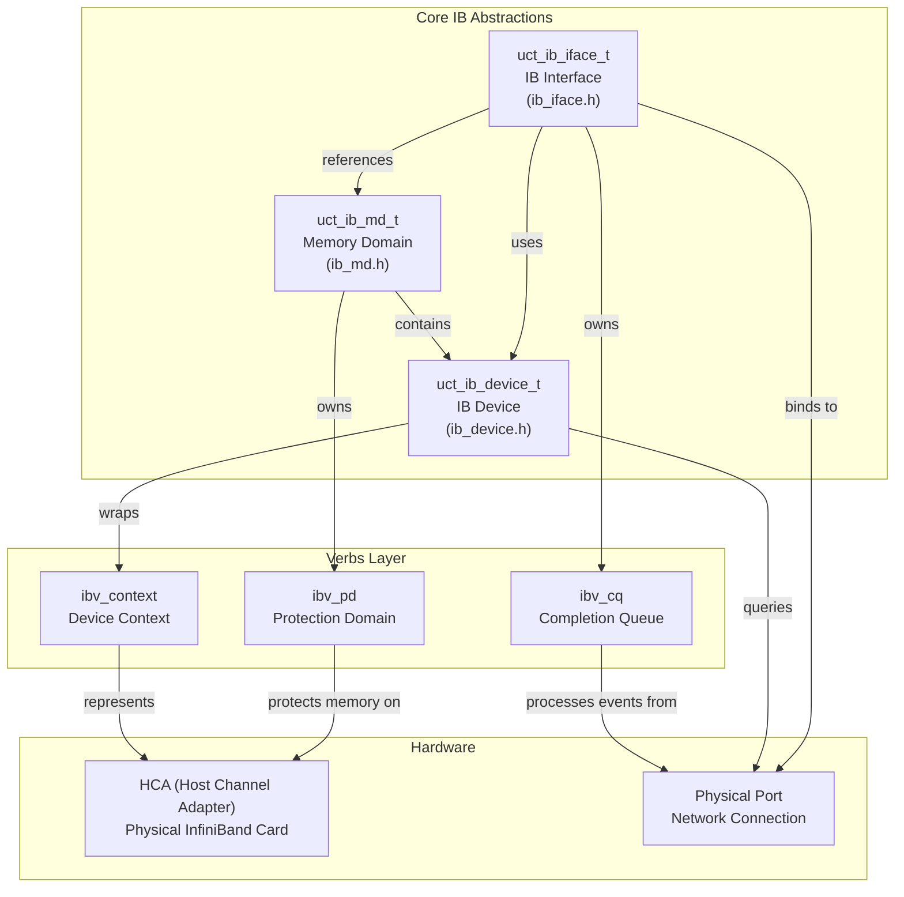

**Sources:** [src/uct/ib/base/ib_device.h:218-253](), [src/uct/ib/base/ib_iface.h:327-372](), [src/uct/ib/base/ib_md.h:141-175]()

### IB Device (`uct_ib_device_t`)

The `uct_ib_device_t` structure represents a single InfiniBand Host Channel Adapter (HCA). It encapsulates hardware capabilities, port information, and event handling state.

#### Key Components

| Field | Type | Purpose |
|-------|------|---------|
| `ibv_context` | `struct ibv_context*` | Verbs device context for all operations |
| `dev_attr` | `uct_ib_device_attr` | Cached device attributes (vendor, max QPs, etc.) |
| `port_attr[]` | `struct ibv_port_attr[2]` | Cached attributes for up to 2 physical ports |
| `local_cpus` | `ucs_sys_cpuset_t` | CPUs physically close to this device |
| `pci_id` | `uct_ib_pci_id_t` | PCI vendor and device ID |
| `sys_dev` | `ucs_sys_device_t` | System device identifier for topology |
| `pci_bw` | `double` | Measured/configured PCI bandwidth |
| `ah_hash` | `khash_t(uct_ib_ah)` | Cached address handles for performance |
| `async_events_hash` | `khash_t(uct_ib_async_event)` | Registered async event handlers |

**Sources:** [src/uct/ib/base/ib_device.h:218-253]()

#### Device Discovery and Initialization

The device discovery process queries available IB devices and initializes their state:

```mermaid
sequenceDiagram
    participant APP as Application
    participant MD as uct_ib_md_open
    participant QUERY as uct_ib_base_query_md_resources
    participant INIT as uct_ib_device_init
    participant VERBS as libibverbs
    
    APP->>MD: Open MD for device
    MD->>QUERY: Query available devices
    QUERY->>VERBS: ibv_get_device_list()
    VERBS-->>QUERY: List of ibv_device
    
    loop For each device
        QUERY->>QUERY: uct_ib_device_is_accessible()
        Note over QUERY: Check /dev/infiniband/* permissions
    end
    
    QUERY-->>MD: Accessible devices
    MD->>INIT: Initialize selected device
    INIT->>VERBS: ibv_query_device()
    INIT->>VERBS: ibv_query_port() for each port
    INIT->>INIT: uct_ib_device_get_locality()
    Note over INIT: Read /sys/class/infiniband/.../local_cpus
    INIT->>INIT: ucs_async_set_event_handler()
    Note over INIT: Register async event handler
    INIT-->>MD: Device initialized
```

**Sources:** [src/uct/ib/base/ib_md.c:834-895](), [src/uct/ib/base/ib_device.c:604-657]()

#### Device Specifications

UCX maintains a table of known device specifications for optimizations:

```c
// Built-in device specifications
static uct_ib_device_spec_t uct_ib_builtin_device_specs[] = {
  {"ConnectX-3", {0x15b3, 4099}, UCT_IB_DEVICE_FLAG_MLX4_PRM, 10},
  {"ConnectX-5", {0x15b3, 4119}, UCT_IB_DEVICE_FLAG_MLX5_PRM | 
                                  UCT_IB_DEVICE_FLAG_DC_V2, 38},
  {"ConnectX-6", {0x15b3, 4123}, UCT_IB_DEVICE_FLAG_MLX5_PRM | 
                                  UCT_IB_DEVICE_FLAG_DC_V2, 50},
  // ... more devices
};
```

Each specification includes:
- Device name and PCI ID (vendor:device)
- Capability flags (MLX4/MLX5 PRM, DC versions, etc.)
- Priority for device selection

**Sources:** [src/uct/ib/base/ib_device.c:131-204]()

### IB Interface (`uct_ib_iface_t`)

The `uct_ib_iface_t` structure represents a communication endpoint bound to a specific port on an IB device. It manages queues, addressing, and configuration for a single communication path.

#### Key Components

| Field | Type | Purpose |
|-------|------|---------|
| `super` | `uct_base_iface_t` | Base interface inheritance |
| `cq[2]` | `struct ibv_cq*` | Completion queues (TX and RX) |
| `comp_channel` | `struct ibv_comp_channel*` | Async completion notification channel |
| `path_bits` | `uint8_t*` | Array of path bits for multipath |
| `path_bits_count` | `unsigned` | Number of available path bits |
| `num_paths` | `unsigned` | Number of paths to use |
| `pkey` | `uint16_t` | Partition key value |
| `pkey_index` | `uint16_t` | Index into port's pkey table |
| `gid_info` | `uct_ib_device_gid_info_t` | GID and RoCE information |
| `config` | `struct { ... }` | Interface-specific configuration |

**Sources:** [src/uct/ib/base/ib_iface.h:327-372]()

#### Interface Configuration

The interface configuration controls queue lengths, inline sizes, and other operational parameters:

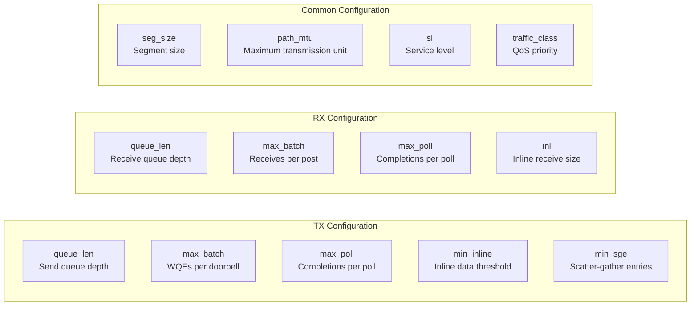

**Sources:** [src/uct/ib/base/ib_iface.h:169-248](), [src/uct/ib/base/ib_iface.c:94-268]()

### IB Memory Domain (`uct_ib_md_t`)

The `uct_ib_md_t` structure manages memory registration and provides the memory domain (protection domain) for all memory operations.

#### Key Components

| Field | Type | Purpose |
|-------|------|---------|
| `super` | `uct_md_t` | Base MD inheritance |
| `pd` | `struct ibv_pd*` | IB protection domain |
| `dev` | `uct_ib_device_t` | Associated IB device |
| `reg_cost` | `ucs_linear_func_t` | Memory registration cost model |
| `config` | `uct_ib_md_ext_config_t` | Extended configuration |
| `relaxed_order` | `int` | PCI relaxed ordering support |
| `flush_rkey` | `uint32_t` | Special rkey for flush operations |

**Sources:** [src/uct/ib/base/ib_md.h:141-175]()

## Address Handling

IB addresses encode network location information for endpoint reachability. UCX supports both InfiniBand native addresses (LID + GID) and RoCE Ethernet addresses.

### Address Structure

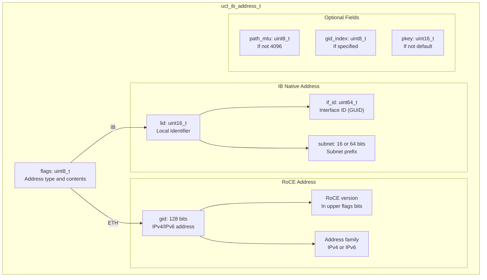

**Sources:** [src/uct/ib/base/ib_device.h:137-152](), [src/uct/ib/base/ib_iface.h:131-150]()

### Address Packing and Unpacking

The address packing functions serialize network addresses into a compact wire format:

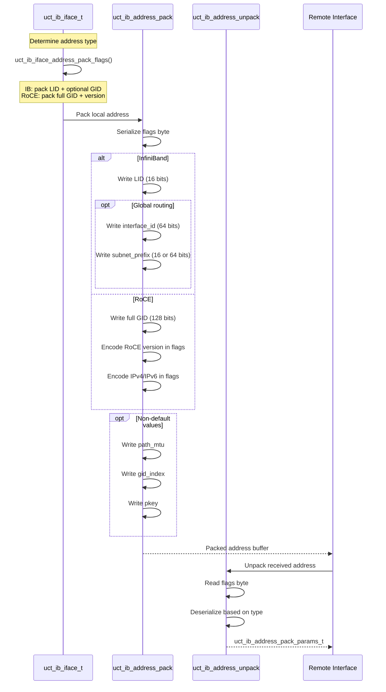

**Sources:** [src/uct/ib/base/ib_iface.c:424-487](), [src/uct/ib/base/ib_iface.c:541-613]()

### Address Types and Flags

The address flags indicate what fields are present and the link layer type:

| Flag | Value | Meaning |
|------|-------|---------|
| `UCT_IB_ADDRESS_FLAG_LINK_LAYER_ETH` | 0x08 | Ethernet/RoCE link layer |
| `UCT_IB_ADDRESS_FLAG_ROCE_IPV6` | 0x10 | RoCE uses IPv6 (vs IPv4) |
| `UCT_IB_ADDRESS_FLAG_SUBNET16` | 0x10 | 16-bit site-local subnet |
| `UCT_IB_ADDRESS_FLAG_SUBNET64` | 0x20 | 64-bit global subnet |
| `UCT_IB_ADDRESS_FLAG_IF_ID` | 0x40 | Interface ID present |
| `UCT_IB_ADDRESS_FLAG_PATH_MTU` | 0x02 | Path MTU specified |
| `UCT_IB_ADDRESS_FLAG_PKEY` | 0x04 | PKEY specified |

**Sources:** [src/uct/ib/base/ib_device.h:109-131]()

## Reachability Checks

Reachability determination answers whether two endpoints can communicate directly. This involves checking subnet compatibility, routing, and port capabilities.

### Reachability Modes

UCX supports three reachability modes configurable via `UCX_IB_ROCE_REACHABILITY_MODE`:

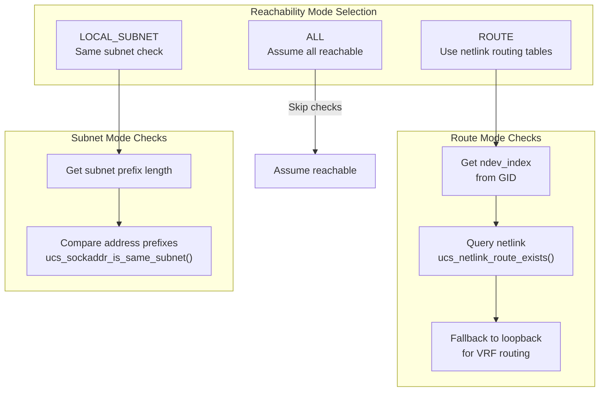

**Sources:** [src/uct/ib/base/ib_iface.c:68-73](), [src/uct/ib/base/ib_iface.h:115-120]()

### InfiniBand Reachability

For native InfiniBand, reachability is determined by subnet prefix matching:

```c
// Link-local prefix: fe80:0:0:0
#define UCT_IB_LINK_LOCAL_PREFIX  be64toh(0xfe80000000000000ul)

// Site-local prefix: fec0:0:0:0
#define UCT_IB_SITE_LOCAL_PREFIX  be64toh(0xfec0000000000000ul)
#define UCT_IB_SITE_LOCAL_MASK    be64toh(0xffffffffffff0000ul)
```

Endpoints are reachable if:
1. Both have link-local prefix (same fabric)
2. Both have matching site-local subnet (same site)
3. Both have matching global subnet prefix (routable)

**Sources:** [src/uct/ib/base/ib_device.h:52-54](), [src/uct/ib/base/ib_iface.c:1463-1527]()

### RoCE Reachability

For RoCE (RDMA over Converged Ethernet), reachability checking is more complex:

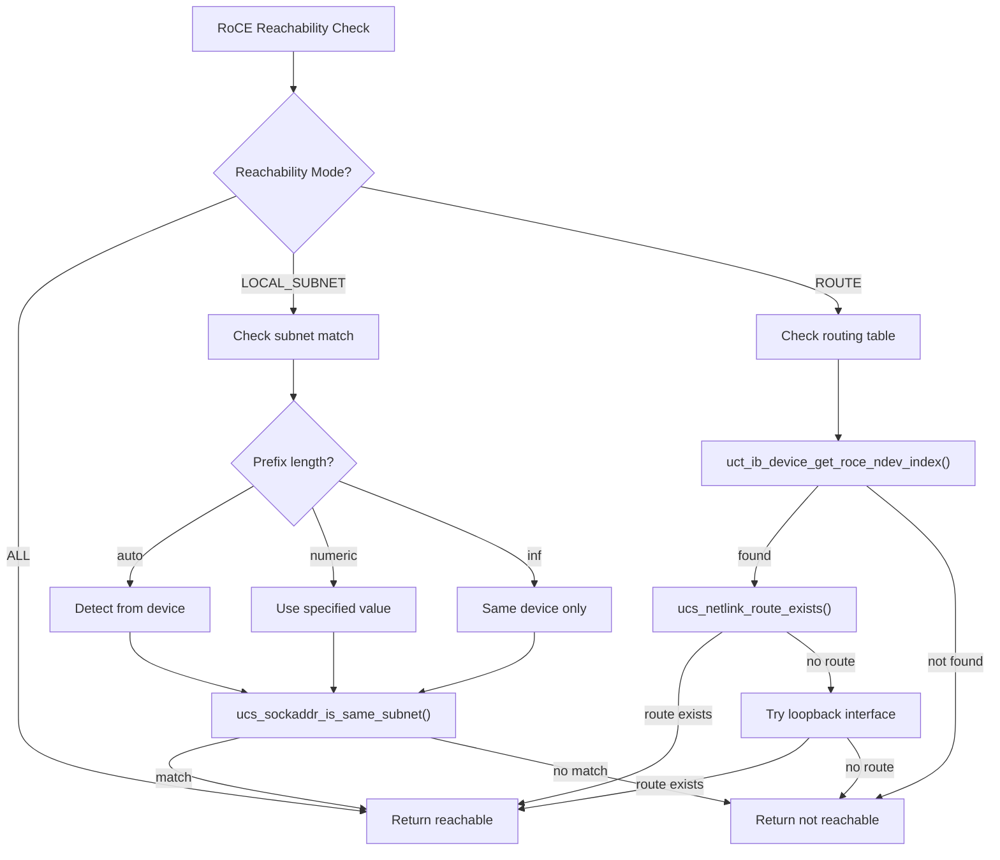

**Sources:** [src/uct/ib/base/ib_iface.c:694-771](), [src/uct/ib/base/ib_iface.c:774-864]()

## Async Event Processing

InfiniBand devices generate asynchronous events for various hardware and network conditions. UCX handles these events through a centralized dispatch mechanism.

### Event Types

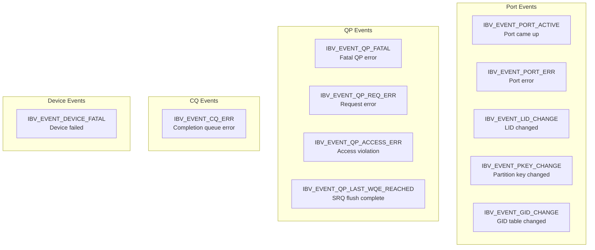

**Sources:** [src/uct/ib/base/ib_device.c:391-444](), [src/uct/ib/base/ib_device.c:446-520]()

### Event Handling Flow

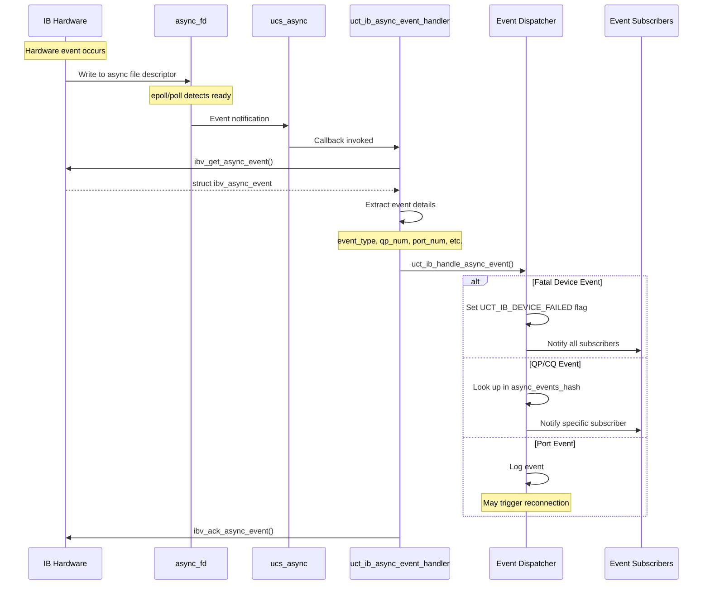

**Sources:** [src/uct/ib/base/ib_device.c:391-444](), [src/uct/ib/base/ib_device.c:256-292]()

### Event Subscription

Components can subscribe to specific events using the registration API:

```c
// Register for an event
ucs_status_t uct_ib_device_async_event_register(
    uct_ib_device_t *dev,
    enum ibv_event_type event_type,
    uint32_t resource_id);

// Wait for an event with callback
ucs_status_t uct_ib_device_async_event_wait(
    uct_ib_device_t *dev,
    enum ibv_event_type event_type,
    uint32_t resource_id,
    uct_ib_async_event_wait_t *wait_ctx);

// Unregister event
void uct_ib_device_async_event_unregister(
    uct_ib_device_t *dev,
    enum ibv_event_type event_type,
    uint32_t resource_id);
```

The event hash table (`async_events_hash`) maps event identifiers to subscriber contexts:

```c
typedef struct uct_ib_async_event {
    enum ibv_event_type event_type;  // Type of event
    union {
        uint32_t qp_num;             // For QP events
        uint8_t  port_num;           // For port events
        void     *cookie;            // For CQ/SRQ events
        uint32_t resource_id;        // Opaque identifier
    };
} uct_ib_async_event_t;

typedef struct {
    unsigned                  fired;      // Event occurred
    uct_ib_async_event_wait_t *wait_ctx;  // Waiting context
} uct_ib_async_event_val_t;
```

**Sources:** [src/uct/ib/base/ib_device.h:178-212](), [src/uct/ib/base/ib_device.c:294-389]()

## Device Discovery

### Query and Initialization

The device discovery process identifies available IB devices and validates their accessibility:

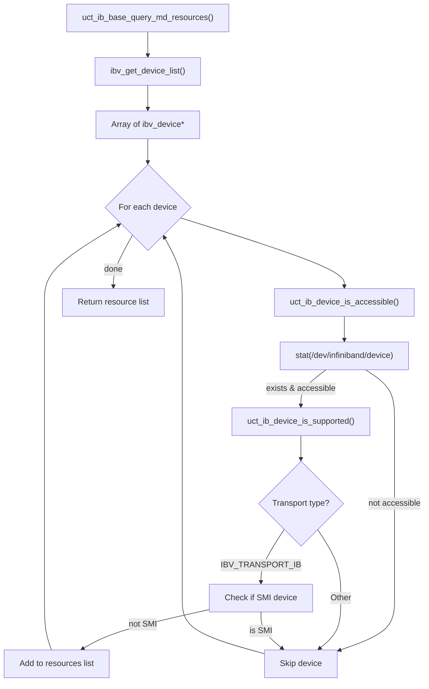

The accessibility check verifies:
1. Device node exists at `/dev/infiniband/{device}`
2. Node is a character device
3. User has read/write permissions
4. Transport type is supported (currently IB only)
5. Device is not an SMI (Subnet Management Interface) device

**Sources:** [src/uct/ib/base/ib_md.c:834-895](), [src/uct/ib/base/ib_md.c:813-831]()

### CPU Locality Detection

UCX detects which CPUs are physically close to each IB device for optimal thread placement:

```c
static void uct_ib_device_get_locality(const char *dev_name, 
                                       ucs_sys_cpuset_t *cpu_mask)
{
    // Read /sys/class/infiniband/{dev}/device/local_cpus
    // Parse hexadecimal CPU mask
    // Set bits in cpu_mask for local CPUs
}
```

The locality information is stored in `dev.local_cpus` and used by higher layers for:
- Worker thread affinity
- Memory allocation on local NUMA node
- Multi-threaded registration core selection

**Sources:** [src/uct/ib/base/ib_device.c:206-243]()

## GID Index Selection

For RoCE and global routing, selecting the correct GID (Global Identifier) index is critical:

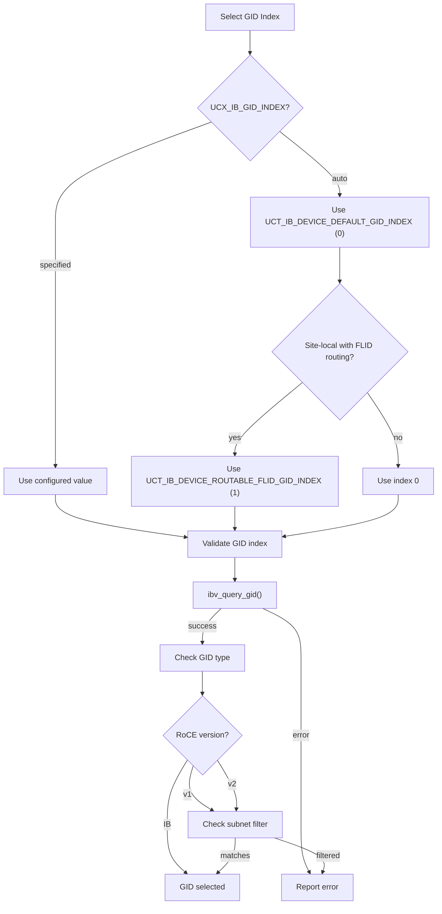

**Sources:** [src/uct/ib/base/ib_device.c:715-722](), [src/uct/ib/base/ib_device.c:1007-1151]()

## Summary

The IB base infrastructure provides:

1. **Hardware Abstraction**: `uct_ib_device_t` wraps IB devices with cached attributes and event handling
2. **Interface Management**: `uct_ib_iface_t` manages queues, addressing, and configuration per port
3. **Memory Protection**: `uct_ib_md_t` provides protection domains and registration services
4. **Address Handling**: Compact serialization of LID/GID addresses for both IB and RoCE
5. **Reachability**: Flexible checking of endpoint connectivity via subnet or routing
6. **Event Processing**: Centralized async event dispatch to interested subscribers

These components form the foundation that specific transports (RC, DC, UD) build upon to provide reliable or unreliable communication services.

**Sources:** [src/uct/ib/base/ib_device.h:1-289](), [src/uct/ib/base/ib_iface.h:1-672](), [src/uct/ib/base/ib_md.h:1-428]()

---

