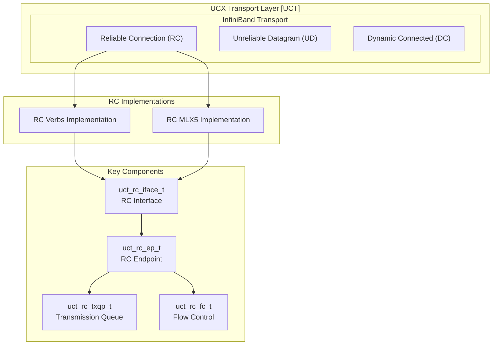
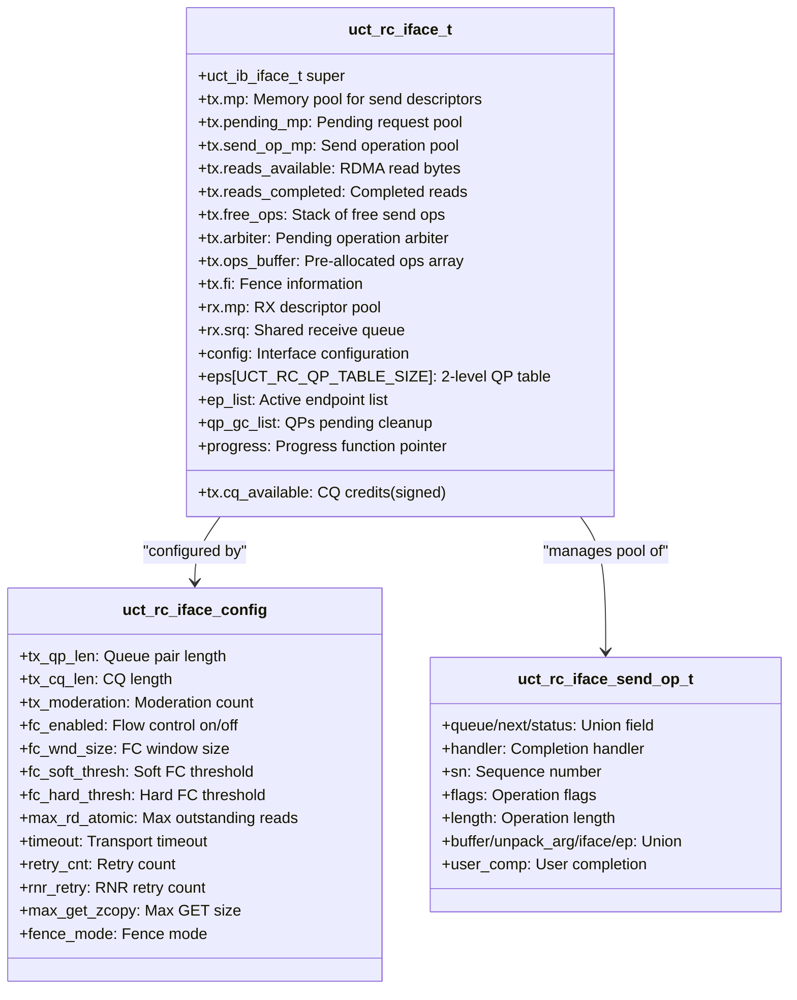
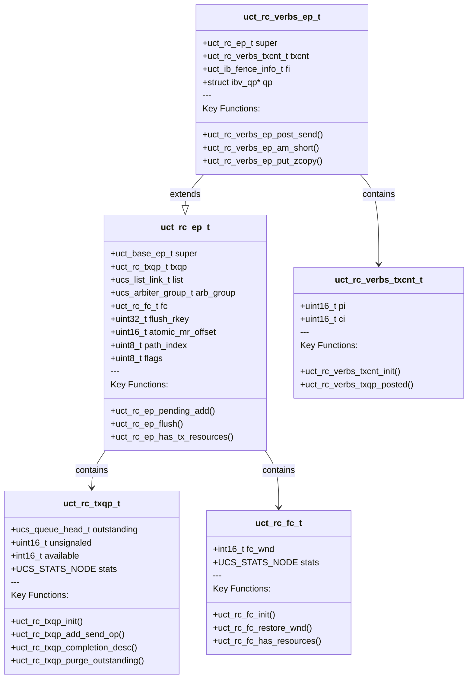
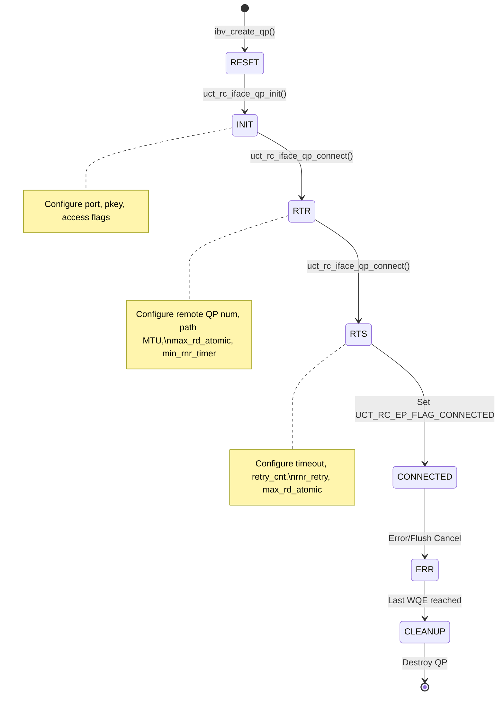
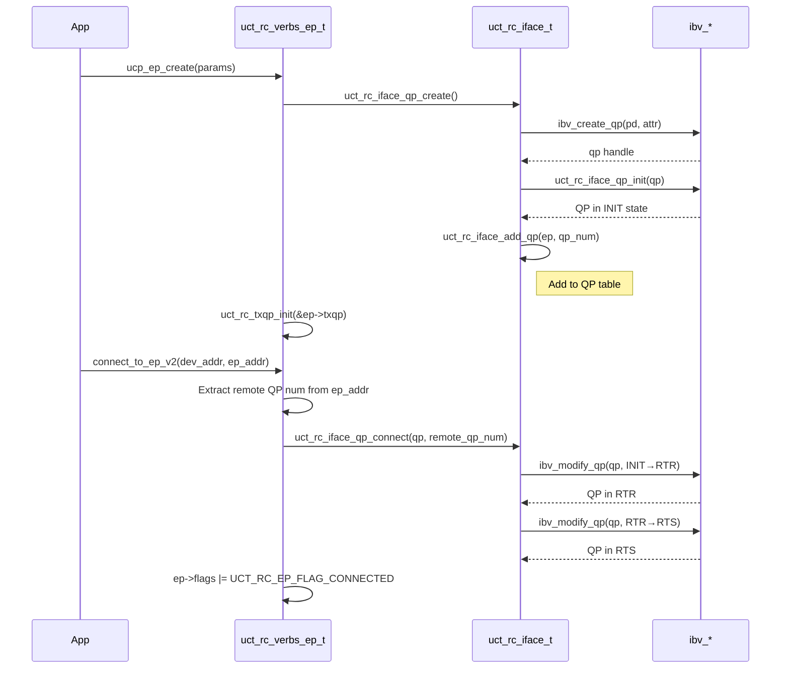
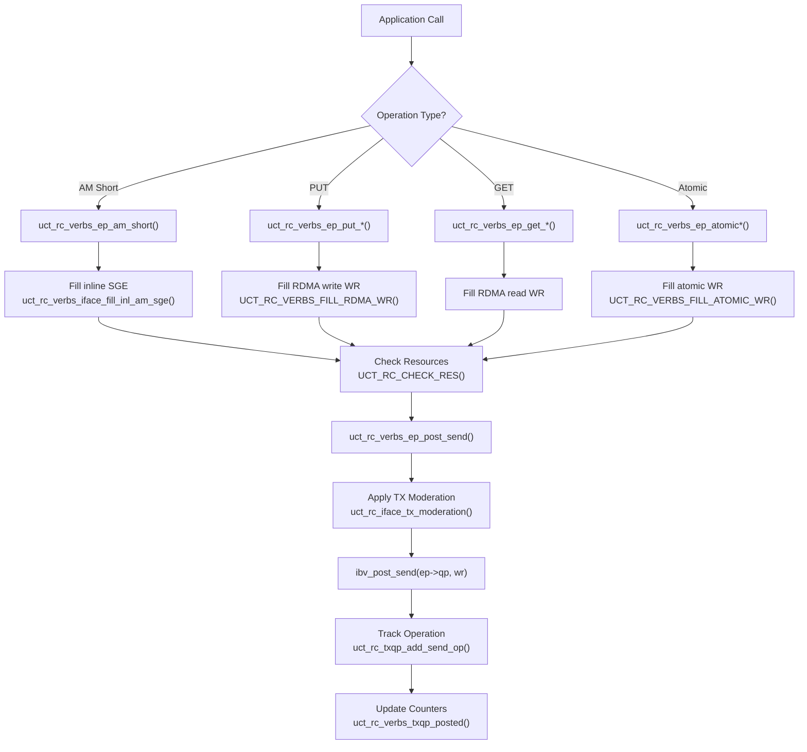
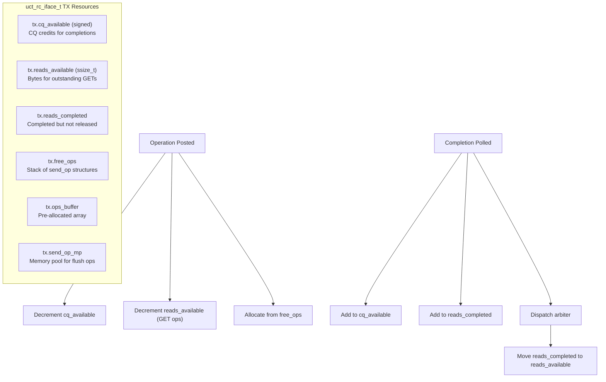
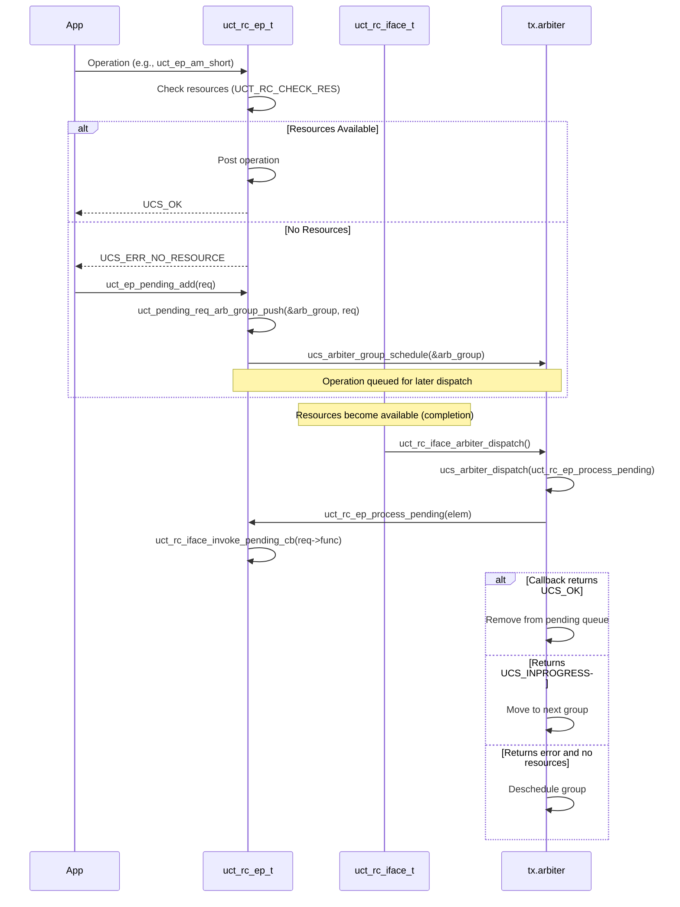
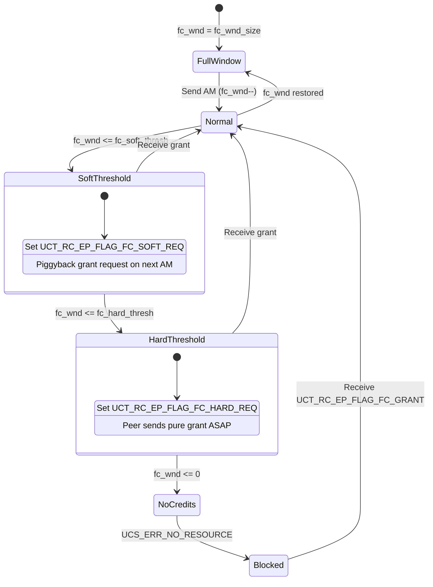
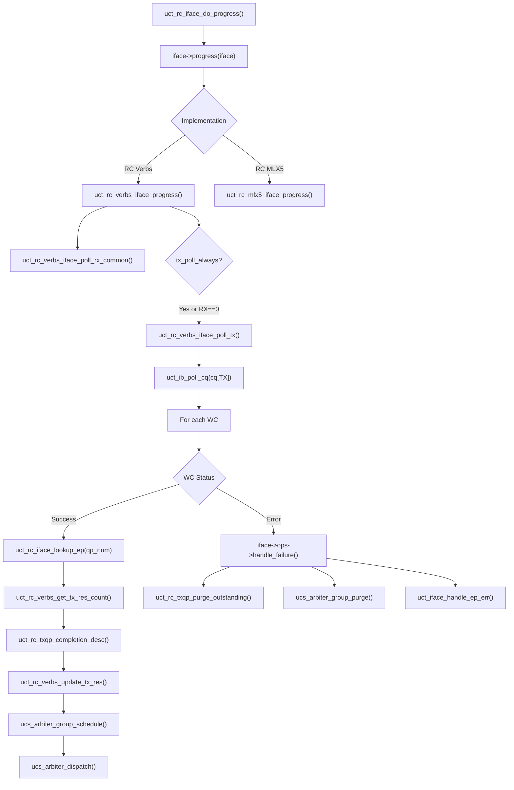

<!-- source: DeepWiki mcp.deepwiki.com · repo openucx/ucx · page 3.3 RC (Reliable Connection) Transport · fetched 2026-11-11 -->

# RC (Reliable Connection) Transport

Relevant source files

The following files were used as context for generating this wiki page:

- [src/uct/ib/rc/base/rc_ep.c](src/uct/ib/rc/base/rc_ep.c)
- [src/uct/ib/rc/base/rc_ep.h](src/uct/ib/rc/base/rc_ep.h)
- [src/uct/ib/rc/base/rc_iface.c](src/uct/ib/rc/base/rc_iface.c)
- [src/uct/ib/rc/base/rc_iface.h](src/uct/ib/rc/base/rc_iface.h)
- [src/uct/ib/rc/verbs/rc_verbs.h](src/uct/ib/rc/verbs/rc_verbs.h)
- [src/uct/ib/rc/verbs/rc_verbs_ep.c](src/uct/ib/rc/verbs/rc_verbs_ep.c)
- [src/uct/ib/rc/verbs/rc_verbs_iface.c](src/uct/ib/rc/verbs/rc_verbs_iface.c)
- [test/gtest/uct/ib/test_dc.cc](test/gtest/uct/ib/test_dc.cc)
- [test/gtest/uct/ib/test_rc.cc](test/gtest/uct/ib/test_rc.cc)
- [test/gtest/uct/ib/test_rc.h](test/gtest/uct/ib/test_rc.h)

The RC transport is a connection-oriented InfiniBand transport providing reliable point-to-point communication through dedicated Queue Pairs (QPs). Each endpoint maintains a dedicated QP with hardware-level retransmission, flow control, and support for RDMA and atomic operations. The implementation centers around `uct_rc_iface_t` (interface management), `uct_rc_ep_t` (per-connection state), and `uct_rc_txqp_t` (transmission queue management).

## Overview

The Reliable Connection transport establishes a dedicated Queue Pair (QP) between each pair of communicating endpoints, providing a reliable channel with hardware-level retransmission, congestion control, and flow control. RC offers the richest feature set among InfiniBand transports including Remote Memory Access (RMA) and atomic operations.

### RC in UCX Architecture

Sources: [src/uct/ib/rc/base/rc_iface.h:9-645](), [src/uct/ib/rc/base/rc_ep.h:7-591]()

## Key Components

### RC Interface (`uct_rc_iface_t`)

The RC interface manages shared resources including completion queues, shared receive queues (SRQs), memory pools, and a two-level QP lookup table. The interface tracks available TX resources (CQ credits, RDMA read credits, send operations) and coordinates progress across all endpoints.

**uct_rc_iface_t Structure Layout**

**QP Table Management**

The interface maintains a two-level QP number to endpoint mapping table (`eps[][]`) for fast endpoint lookup during completion processing:

- First level: `UCT_RC_QP_TABLE_SIZE` (4096) entries
- Second level: Allocated on-demand per first-level entry
- Functions: `uct_rc_iface_add_qp()` [src/uct/ib/rc/base/rc_iface.c:263-281](), `uct_rc_iface_remove_qp()` [src/uct/ib/rc/base/rc_iface.c:283-291](), `uct_rc_iface_lookup_ep()` [src/uct/ib/rc/base/rc_iface.h:468-474]()

**Resource Management**

TX resources are tracked to prevent queue overflow:
- CQ credits (`tx.cq_available`): Decremented per posted operation, replenished on completion polling
- RDMA read credits (`tx.reads_available`): Limits outstanding GET operations in bytes
- Send operations (`tx.free_ops`): Pre-allocated completion tracking structures

Sources: [src/uct/ib/rc/base/rc_iface.h:245-319](), [src/uct/ib/rc/base/rc_iface.h:326-353](), [src/uct/ib/rc/base/rc_iface.c:573-756](), [src/uct/ib/rc/base/rc_iface.c:263-291]()

### RC Endpoint (`uct_rc_ep_t`)

An RC endpoint represents a connection to a remote peer with an associated InfiniBand Queue Pair. The endpoint tracks transmission queue state, flow control window, pending operations, and connection status.

**uct_rc_ep_t Structure and Hierarchy**

**Endpoint State Flags**

The `flags` field tracks endpoint state using these bits:
- `UCT_RC_EP_FLAG_KEEPALIVE_PENDING`: Keepalive request scheduled
- `UCT_RC_EP_FLAG_CONNECTED`: Connection established
- `UCT_RC_EP_FLAG_FLUSH_CANCEL`: Flush cancel executed
- `UCT_RC_EP_FLAG_ERR_HANDLER_INVOKED`: Error handler called
- `UCT_RC_EP_FLAG_FLUSH_REMOTE`: Remote flush needed
- `UCT_RC_EP_FLAG_FC_SOFT_REQ`: FC soft request bit (piggyback grant)
- `UCT_RC_EP_FLAG_FC_HARD_REQ`: FC hard request bit (urgent grant)
- `UCT_RC_EP_FLAG_FC_GRANT`: FC grant notification

**TX Queue Management (`uct_rc_txqp_t`)**

The transmission queue manages per-endpoint send resources:

- **`outstanding`**: Queue of in-flight `uct_rc_iface_send_op_t` structures tracking operations awaiting completion. Each operation has a sequence number (`sn`) for ordered completion processing.

- **`unsignaled`**: Count of posted work requests without `IBV_SEND_SIGNALED` flag. Used for CQ moderation - when approaching `tx_moderation` threshold, forces next post to be signaled. Set to `RC_UNSIGNALED_INF` (65535) when CQ credits are low to force immediate signaling.

- **`available`**: Available send queue slots (max = `tx_qp_len`). Decremented by `uct_rc_txqp_available_add()` [src/uct/ib/rc/base/rc_ep.h:315-318]() on post, incremented on completion. Prevents QP overflow checked via `UCT_RC_CHECK_TXQP_RET()` [src/uct/ib/rc/base/rc_ep.h:108-113]().

**Key Functions**

- **`uct_rc_txqp_init()`** [src/uct/ib/rc/base/rc_ep.c:56-66](): Initializes `outstanding` queue and stats, sets `unsignaled=0` and `available=0` (updated by first completion).

- **`uct_rc_txqp_add_send_op()`** [src/uct/ib/rc/base/rc_ep.h:353-365](): Adds operation to outstanding queue. Sets `UCT_RC_IFACE_SEND_OP_FLAG_INUSE` flag and pushes to queue.

- **`uct_rc_txqp_add_send_op_sn()`** [src/uct/ib/rc/base/rc_ep.h:367-374](): Wrapper that sets sequence number before adding to queue.

- **`uct_rc_txqp_completion_desc()`** [src/uct/ib/rc/base/rc_ep.h:444-454](): Removes and invokes handlers for all operations with `sn <= completed_sn`.

- **`uct_rc_txqp_purge_outstanding()`** [src/uct/ib/rc/base/rc_ep.c:443-503](): Called on error to purge all outstanding operations with `sn <= error_sn`, invoking user completions with error status and releasing resources.

Sources: [src/uct/ib/rc/base/rc_ep.h:198-205](), [src/uct/ib/rc/base/rc_ep.c:56-72](), [src/uct/ib/rc/base/rc_ep.h:310-374](), [src/uct/ib/rc/base/rc_ep.h:444-454](), [src/uct/ib/rc/base/rc_ep.c:443-503]()

## QP Management

RC endpoints manage InfiniBand Queue Pairs through their entire lifecycle: creation, initialization, connection, operation, and cleanup.

### QP Creation and Initialization

**QP Lifecycle State Transitions**

**Key Functions**

1. **`uct_rc_iface_qp_create()`** [src/uct/ib/rc/base/rc_iface.c:835-842](): Creates QP with attributes
   - Fills `uct_ib_qp_attr_t` via `uct_rc_iface_fill_attr()` [src/uct/ib/rc/base/rc_iface.c:820-833]()
   - Sets `max_send_wr`, `max_send_sge`, `max_inline_data`, `sq_sig_all`
   - Calls `uct_ib_iface_create_qp()`

2. **`uct_rc_iface_qp_init()`** [src/uct/ib/rc/base/rc_iface.c:844-869](): Transitions RESET→INIT
   - Sets `qp_state = IBV_QPS_INIT`
   - Configures `pkey_index`, `port_num`
   - Sets access flags: `IBV_ACCESS_LOCAL_WRITE | IBV_ACCESS_REMOTE_WRITE | IBV_ACCESS_REMOTE_READ | IBV_ACCESS_REMOTE_ATOMIC`

3. **`uct_rc_iface_qp_connect()`** [src/uct/ib/rc/base/rc_iface.c:871-940](): Transitions INIT→RTR→RTS
   - **RTR stage**: Configures `dest_qp_num`, `path_mtu`, `max_dest_rd_atomic`, `min_rnr_timer`, `ah_attr`
   - **RTS stage**: Configures `timeout`, `retry_cnt`, `rnr_retry`, `max_rd_atomic`
   - Applies ECE settings via `uct_ib_device_set_ece()`

### Connection Establishment Sequence

### QP Cleanup

When an endpoint is destroyed, the QP must be cleaned up asynchronously:

1. **Initiate Cleanup**: `uct_rc_ep_cleanup_qp()` [src/uct/ib/rc/base/rc_ep.c:110-135]()
   - Removes EP from QP table via `uct_rc_iface_remove_qp()`
   - Allocates `uct_rc_iface_qp_cleanup_ctx_t` and adds to `qp_gc_list`
   - Registers for `IBV_EVENT_QP_LAST_WQE_REACHED` async event

2. **Wait for Drain**: Progress handler waits for event

3. **Complete Cleanup**: `uct_rc_iface_qp_cleanup_progress()` [src/uct/ib/rc/base/rc_iface.c:758-779]()
   - Calls transport-specific `cleanup_qp()` (destroys QP)
   - Returns CQ credits via `uct_rc_iface_add_cq_credits()`
   - Removes from `qp_gc_list`

Sources: [src/uct/ib/rc/base/rc_iface.c:820-940](), [src/uct/ib/rc/verbs/rc_verbs_ep.c:629-703](), [src/uct/ib/rc/base/rc_ep.c:110-135](), [src/uct/ib/rc/base/rc_iface.c:758-791]()

## Operation Posting

RC endpoints post operations to InfiniBand Queue Pairs through work requests. Each operation type (AM, PUT, GET, atomic) constructs an appropriate work request and posts it using verbs or direct hardware access.

### Work Request Construction and Posting

**RC Verbs Operation Posting Flow**

**uct_rc_verbs_ep_post_send() Details**

This function [src/uct/ib/rc/verbs/rc_verbs_ep.c:34-63]() is the central posting function:

1. **Apply Moderation**: Determine if `IBV_SEND_SIGNALED` flag needed based on `unsignaled` counter
2. **Apply Fence**: Add `IBV_SEND_FENCE` flag for RDMA reads if needed
3. **Set Work Request Fields**:
   - `wr->send_flags`: Combined signaling + fence flags
   - `wr->wr_id`: Set to `ep->txcnt.pi + 1` (producer index)
4. **Post to Hardware**: Call `ibv_post_send(ep->qp, wr, &bad_wr)`
5. **Update TX Counter**: Call `uct_rc_verbs_txqp_posted()` to update `pi` and resource counts

### Operation Variants and Implementations

| Operation | Variants | Function | Work Request Type |
|-----------|----------|----------|-------------------|
| AM | short | `uct_rc_verbs_ep_am_short()` [src/uct/ib/rc/verbs/rc_verbs_ep.c:270-285]() | `IBV_WR_SEND` with inline data |
| AM | bcopy | `uct_rc_verbs_ep_am_bcopy()` [src/uct/ib/rc/verbs/rc_verbs_ep.c:306-330]() | `IBV_WR_SEND` with descriptor |
| AM | zcopy | `uct_rc_verbs_ep_am_zcopy()` [src/uct/ib/rc/verbs/rc_verbs_ep.c:332-367]() | `IBV_WR_SEND` with SGE list |
| PUT | short | `uct_rc_verbs_ep_put_short()` [src/uct/ib/rc/verbs/rc_verbs_ep.c:154-171]() | `IBV_WR_RDMA_WRITE` inline |
| PUT | bcopy | `uct_rc_verbs_ep_put_bcopy()` [src/uct/ib/rc/verbs/rc_verbs_ep.c:173-193]() | `IBV_WR_RDMA_WRITE` with buffer |
| PUT | zcopy | `uct_rc_verbs_ep_put_zcopy()` [src/uct/ib/rc/verbs/rc_verbs_ep.c:195-214]() | `IBV_WR_RDMA_WRITE` with IOVs |
| GET | bcopy | `uct_rc_verbs_ep_get_bcopy()` [src/uct/ib/rc/verbs/rc_verbs_ep.c:216-240]() | `IBV_WR_RDMA_READ` |
| GET | zcopy | `uct_rc_verbs_ep_get_zcopy()` [src/uct/ib/rc/verbs/rc_verbs_ep.c:242-268]() | `IBV_WR_RDMA_READ` with IOVs |
| Atomic | add | `uct_rc_verbs_ep_atomic64_post()` [src/uct/ib/rc/verbs/rc_verbs_ep.c:369-389]() | `IBV_WR_ATOMIC_FETCH_AND_ADD` |
| Atomic | cswap | `uct_rc_verbs_ep_atomic_cswap64()` [src/uct/ib/rc/verbs/rc_verbs_ep.c:405-412]() | `IBV_WR_ATOMIC_CMP_AND_SWP` |

### Resource Checking Macros

Operations check resources before posting using layered macros:

**`UCT_RC_CHECK_CQE_RET(iface, ep, ret)`** [src/uct/ib/rc/base/rc_ep.h:96-106](): Checks CQ credits available. If `cq_available <= tx_moderation`, attempts to find available credit or sets `unsignaled = RC_UNSIGNALED_INF` to force signaling. Updates `UCT_RC_IFACE_STAT_NO_CQE` stat on failure.

**`UCT_RC_CHECK_TXQP_RET(iface, ep, ret)`** [src/uct/ib/rc/base/rc_ep.h:108-113](): Checks TX queue slots via `uct_rc_txqp_available()` [src/uct/ib/rc/base/rc_ep.h:310-313](). Updates `UCT_RC_TXQP_STAT_QP_FULL` stat on failure.

**`UCT_RC_CHECK_NUM_RDMA_READ_RET(iface, ret)`** [src/uct/ib/rc/base/rc_ep.h:115-120](): Checks RDMA read byte credits (`reads_available > 0`). Updates `UCT_RC_IFACE_STAT_NO_READS` stat on failure.

**`UCT_RC_CHECK_RES(iface, ep)`** [src/uct/ib/rc/base/rc_ep.h:138-141](): Combined check of CQ credits, TX queue slots, and RDMA read credits. Also asserts `UCT_RC_EP_FLAG_CONNECTED`.

**`UCT_RC_CHECK_RES_AND_FC(iface, ep, am_id)`** [src/uct/ib/rc/base/rc_ep.h:192-195](): Combines `UCT_RC_CHECK_RES()` with flow control checks (`UCT_RC_CHECK_FC()`) and pending queue validation (`uct_rc_iface_check_pending()`).

Sources: [src/uct/ib/rc/base/rc_ep.h:96-141](), [src/uct/ib/rc/base/rc_ep.h:192-195](), [src/uct/ib/rc/base/rc_ep.h:310-313](), [src/uct/ib/rc/base/rc_iface.h:604-607]()

## TX Resource Management

RC interface tracks multiple resource types to prevent queue overflow and ensure correct operation ordering:

**TX Resource Tracking**

**CQ Credits** (`tx.cq_available`): Tracks available completion queue entries. Initialized to `tx_cq_len - 2` to prevent overflow. Each posted operation decrements this counter; completion polling increments it. Operations are blocked when credits are exhausted via `UCT_RC_CHECK_CQE_RET()` [src/uct/ib/rc/base/rc_ep.h:96-106]().

**RDMA Read Credits** (`tx.reads_available`): Limits outstanding GET operations in bytes. Configured via `RC_TX_NUM_GET_BYTES` (default: infinite). GET operations decrement this value via `UCT_RC_RDMA_READ_POSTED()` [src/uct/ib/rc/base/rc_ep.h:122-126](). Completions update `reads_completed`, which is released to `reads_available` by `uct_rc_iface_update_reads()` [src/uct/ib/rc/base/rc_iface.h:490-497]() during arbiter dispatch to avoid out-of-order operations.

**Send Operation Pool**: Pre-allocated array of `uct_rc_iface_send_op_t` structures (size = `tx_cq_len`) maintained as a LIFO stack via `tx.free_ops`. Operations are allocated via `uct_rc_iface_get_send_op()` [src/uct/ib/rc/base/rc_iface.h:509-516]() and released via `uct_rc_iface_put_send_op()` [src/uct/ib/rc/base/rc_iface.h:518-528](). Each structure tracks completion handler, sequence number, flags, and user completion.

Sources: [src/uct/ib/rc/base/rc_iface.h:245-268](), [src/uct/ib/rc/base/rc_iface.c:438-498](), [src/uct/ib/rc/base/rc_iface.h:490-528]()

## Pending Operations and Arbiter

When resources are unavailable, operations are queued in a pending queue managed by the arbiter (`ucs_arbiter_t`). Each endpoint has an arbiter group (`ucs_arbiter_group_t arb_group`) that holds its pending operations.

**Pending Operation Flow**

**Key Functions**

- **`uct_rc_ep_pending_add()`** [src/uct/ib/rc/base/rc_ep.c:311-333](): Adds request to endpoint's arbiter group. Checks if resources are actually available (returns `UCS_ERR_BUSY` if so). Schedules the group if endpoint has resources but interface doesn't.

- **`uct_rc_ep_process_pending()`** [src/uct/ib/rc/base/rc_ep.c:335-365](): Arbiter callback that invokes pending request's callback. Returns:
  - `UCS_ARBITER_CB_RESULT_REMOVE_ELEM` if `UCS_OK` (operation completed)
  - `UCS_ARBITER_CB_RESULT_NEXT_GROUP` if `UCS_INPROGRESS` (try other groups)
  - `UCS_ARBITER_CB_RESULT_DESCHED_GROUP` if no EP resources
  - `UCS_ARBITER_CB_RESULT_STOP` if no interface resources

- **`uct_rc_iface_arbiter_dispatch()`** [src/uct/ib/rc/base/rc_iface.h:452-457](): Wrapper that calls `ucs_arbiter_dispatch()` to process one pending operation per group.

**Pending Purge**: When an endpoint is destroyed or flushed with cancel, pending operations are purged via `uct_rc_ep_pending_purge()` [src/uct/ib/rc/base/rc_ep.c:415-424]() which calls `ucs_arbiter_group_purge()` with callback `uct_rc_ep_arbiter_purge_cb()` [src/uct/ib/rc/base/rc_ep.c:391-413]().

Sources: [src/uct/ib/rc/base/rc_ep.c:311-365](), [src/uct/ib/rc/base/rc_ep.c:391-424](), [src/uct/ib/rc/base/rc_iface.h:452-457]()

## Flow Control Mechanism

RC implements a credit-based flow control protocol to prevent senders from overwhelming receivers with active messages. Each endpoint maintains a flow control window (`fc_wnd`) that tracks available credits.

**Flow Control State Machine**

**Flow Control Flags in AM Header**

The `am_id` field in `uct_rc_hdr_t` uses upper bits for FC flags:
- Bit 5: `UCT_RC_EP_FLAG_FC_SOFT_REQ` - Request for piggybacked grant
- Bit 6: `UCT_RC_EP_FLAG_FC_HARD_REQ` - Urgent grant needed
- Bit 7: `UCT_RC_EP_FLAG_FC_GRANT` - Grant notification
- All 3 bits set: `UCT_RC_EP_FC_PURE_GRANT` - Pure grant message (no payload)

**Sender Side Flow Control**

Checked via `UCT_RC_CHECK_FC()` [src/uct/ib/rc/base/rc_ep.h:162-174]() before sending AM:

1. If `fc_wnd <= fc_soft_thresh`: Add soft or hard request flag via `uct_rc_fc_req_moderation()` [src/uct/ib/rc/base/rc_ep.h:498-521]()
2. If `fc_wnd <= 0`: Return `UCS_ERR_NO_RESOURCE` via `UCT_RC_CHECK_FC_WND()` [src/uct/ib/rc/base/rc_ep.h:146-151]()
3. Decrement `fc_wnd` via `UCT_RC_UPDATE_FC_WND()` [src/uct/ib/rc/base/rc_ep.h:154-160]()
4. Extract grant bit from `ep->flags` and add to AM header

**Receiver Side Flow Control**

Handled by `uct_rc_iface_fc_handler()` [src/uct/ib/rc/base/rc_iface.c:356-436]():

1. **Process Grant**: If `UCT_RC_EP_FLAG_FC_GRANT` received, restore sender's window via `uct_rc_fc_restore_wnd()` [src/uct/ib/rc/base/rc_ep.h:338-343]() and schedule arbiter to dispatch pending operations.

2. **Handle Soft Request**: Set `UCT_RC_EP_FLAG_FC_GRANT` on endpoint to piggyback grant on next outgoing AM.

3. **Handle Hard Request**: Allocate `uct_rc_pending_req_t` and post pure grant via `uct_rc_ep_fc_grant()` [src/uct/ib/rc/base/rc_ep.c:426-441]() immediately (or queue if no resources).

**Configuration Parameters**

| Parameter | Default | Description |
|-----------|---------|-------------|
| `FC_ENABLE` | y | Enable/disable flow control |
| `FC_WND_SIZE` | 512 | Initial window size (# of AMs) |
| `FC_HARD_THRESH` | 0.25 | Hard request threshold (% of window) |
| `FC_SOFT_THRESH` | 0.5 | Soft request threshold (% of window, RC only) |

Sources: [src/uct/ib/rc/base/rc_ep.h:41-79](), [src/uct/ib/rc/base/rc_ep.h:146-174](), [src/uct/ib/rc/base/rc_iface.c:356-436](), [src/uct/ib/rc/base/rc_iface.c:30-106]()

## Completion Processing and Progress

RC interface processes completions through a polling-based progress model that updates resource counters and dispatches pending operations.

**Progress Flow**

**RC Verbs Completion Polling**

`uct_rc_verbs_iface_poll_tx()` [src/uct/ib/rc/verbs/rc_verbs_iface.c:134-167]() polls TX CQ:

1. Poll up to `tx_max_poll` work completions from TX CQ
2. For each completion:
   - Look up endpoint via `uct_rc_iface_lookup_ep()` [src/uct/ib/rc/base/rc_iface.h:468-474]()
   - Calculate completed operations: `wc.wr_id - ep->txcnt.ci`
   - Process completions: `uct_rc_txqp_completion_desc()` [src/uct/ib/rc/base/rc_ep.h:444-454]()
   - Update resources: `uct_rc_verbs_update_tx_res()` [src/uct/ib/rc/verbs/rc_verbs_iface.c:70-78]()
     - Increment `ep->txcnt.ci` (consumer index)
     - Add to `txqp.available`
     - Update `reads_completed` → `reads_available`
     - Add to `cq_available`
   - Schedule endpoint's arbiter group
3. Dispatch arbiter to process one pending operation

**Error Handling**

`uct_rc_verbs_handle_failure()` [src/uct/ib/rc/verbs/rc_verbs_iface.c:80-132]():

1. Calculate failed operation count from work completion
2. Purge outstanding ops: `uct_rc_txqp_purge_outstanding()` [src/uct/ib/rc/base/rc_ep.c:443-503]()
   - Invoke user completions with error status
   - Release RDMA read resources
   - Clear operation flags
3. Purge arbiter pending queue
4. Update TX resources
5. Invoke error handler via `uct_iface_handle_ep_err()` if not already invoked
6. Restore FC window
7. Dispatch arbiter for other endpoints

Sources: [src/uct/ib/rc/base/rc_iface.c:500-504](), [src/uct/ib/rc/verbs/rc_verbs_iface.c:169-180](), [src/uct/ib/rc/verbs/rc_verbs_iface.c:134-167](), [src/uct/ib/rc/verbs/rc_verbs_iface.c:70-78](), [src/uct/ib/rc/verbs/rc_verbs_iface.c:80-132]()

## Performance Considerations

RC provides the richest set of features but has some performance limitations:

1. **Scalability**: Creates one QP per connection, which limits scalability for large numbers of peers
2. **Resource Usage**: Each QP consumes non-trivial hardware resources
3. **Connection Setup**: Requires explicit connection establishment adding latency
4. **Reliability Overhead**: Reliability mechanisms add some overhead compared to UD

The RC transport is optimized for:
- Performance-critical point-to-point communication
- Operations requiring RDMA or atomics
- Applications with a moderate number of communicating pairs

Sources: [src/uct/ib/rc/verbs/rc_verbs_iface.c:196-225]()

## Configuration

RC transport can be tuned through various configuration parameters:

| Parameter | Default | Description |
|-----------|---------|-------------|
| MAX_RD_ATOMIC | auto | Maximum outstanding RDMA read/atomic operations |
| TIMEOUT | 1.0s | Transport timeout for retransmissions |
| RETRY_COUNT | 7 | Number of retry attempts for failed operations |
| RNR_TIMEOUT | 1ms | Receiver Not Ready timeout |
| RNR_RETRY_COUNT | 7 | Number of RNR retry attempts |
| FC_ENABLE | y | Enable flow control |
| FC_WND_SIZE | 512 | Flow control window size |
| TX_CQ_LEN | 4096 | Send completion queue length |

Sources: [src/uct/ib/rc/base/rc_iface.c:30-129](), [src/uct/ib/rc/verbs/rc_verbs_iface.c:38-61]()

## Implementation Details

RC has two main implementations in UCX:

1. **Verbs-based** (`uct_rc_verbs_*`): Uses the standard verbs API for broader hardware compatibility
2. **MLX5** (`uct_rc_mlx5_*`): Uses Mellanox-specific optimizations for better performance on supported hardware

The Verbs implementation is contained in:
- [src/uct/ib/rc/verbs/rc_verbs_ep.c]()
- [src/uct/ib/rc/verbs/rc_verbs_iface.c]()

Base RC functionality shared by both implementations is in:
- [src/uct/ib/rc/base/rc_ep.c]()
- [src/uct/ib/rc/base/rc_iface.c]()

---

