<!-- source: DeepWiki mcp.deepwiki.com · repo openucx/ucx · page 3.4 UD (Unreliable Datagram) Transport · fetched 2026-11-11 -->

# UD (Unreliable Datagram) Transport

<details>
<summary>Relevant source files</summary>

The following files were used as context for generating this wiki page:

- [src/uct/ib/ud/base/ud_def.h](src/uct/ib/ud/base/ud_def.h)
- [src/uct/ib/ud/base/ud_ep.c](src/uct/ib/ud/base/ud_ep.c)
- [src/uct/ib/ud/base/ud_ep.h](src/uct/ib/ud/base/ud_ep.h)
- [src/uct/ib/ud/base/ud_iface.c](src/uct/ib/ud/base/ud_iface.c)
- [src/uct/ib/ud/base/ud_iface.h](src/uct/ib/ud/base/ud_iface.h)
- [src/uct/ib/ud/base/ud_inl.h](src/uct/ib/ud/base/ud_inl.h)
- [src/uct/ib/ud/base/ud_log.c](src/uct/ib/ud/base/ud_log.c)
- [src/uct/ib/ud/verbs/ud_verbs.c](src/uct/ib/ud/verbs/ud_verbs.c)

</details>


## Purpose and Scope

The UD (Unreliable Datagram) transport implements reliable, connection-oriented communication over InfiniBand Unreliable Datagram queue pairs. While native IB UD provides unreliable, unordered packet delivery, UCX's UD transport adds a software reliability layer that includes:

- **Packet sequencing** using PSNs (Packet Sequence Numbers)
- **ACK/NACK protocol** for reliability
- **Retransmission** of lost packets
- **Congestion control** using additive increase/multiplicative decrease (AIMD)
- **Connection establishment** via CREQ/CREP handshake

This transport is part of the UCT layer and provides a scalable alternative to RC (Reliable Connection) for many-to-many communication patterns. For RC transport details, see [3.3](#3.3). For DC transport, see [3.5](#3.5).

---

## Core Components

### Component Architecture

```mermaid
graph TB
    subgraph "UD Interface - uct_ud_iface_t"
        IFACE[uct_ud_iface_t]
        QP[ibv_qp<br/>UD Queue Pair]
        TX_MP[TX Memory Pool<br/>uct_ud_send_skb_t]
        RX_MP[RX Memory Pool<br/>uct_ud_recv_skb_t]
        TIMER[ucs_twheel_t<br/>Timer Wheel]
        PENDING[ucs_arbiter_t<br/>Pending Queue]
        OUTSTANDING["Outstanding TX<br/>queue/map"]
        CEP[ucs_conn_match_ctx_t<br/>Connection Matching]
        
        IFACE --> QP
        IFACE --> TX_MP
        IFACE --> RX_MP
        IFACE --> TIMER
        IFACE --> PENDING
        IFACE --> OUTSTANDING
        IFACE --> CEP
    end
    
    subgraph "UD Endpoint - uct_ud_ep_t"
        EP[uct_ud_ep_t]
        TX_STATE["tx state<br/>psn, acked_psn, max_psn"]
        TX_WINDOW["tx.window<br/>ucs_queue_head_t"]
        RX_STATE["rx state<br/>acked_psn"]
        OOO["rx.ooo_pkts<br/>ucs_frag_list_t"]
        CA["ca state<br/>cwnd, wmax"]
        RESEND["resend state<br/>psn, pos, max_psn"]
        
        EP --> TX_STATE
        EP --> TX_WINDOW
        EP --> RX_STATE
        EP --> OOO
        EP --> CA
        EP --> RESEND
    end
    
    subgraph "Packet Structure"
        SKB[uct_ud_send_skb_t]
        NETH[uct_ud_neth_t<br/>Network Header]
        PAYLOAD[Payload Data]
        
        SKB --> NETH
        NETH --> PAYLOAD
    end
    
    IFACE -.manages.-> EP
    EP -.sends via.-> QP
    EP -.uses.-> TX_MP
    EP -.queues in.-> TX_WINDOW
```

**Sources:** [src/uct/ib/ud/base/ud_iface.h:161-220](), [src/uct/ib/ud/base/ud_ep.h:224-269](), [src/uct/ib/ud/base/ud_def.h:153-159]()

### UD Interface Structure

The `uct_ud_iface_t` manages the UD queue pair and all endpoints created on it. Key members include:

| Component | Type | Purpose |
|-----------|------|---------|
| `super` | `uct_ib_iface_t` | Base IB interface |
| `qp` | `struct ibv_qp*` | UD queue pair |
| `tx.mp` | `ucs_mpool_t` | TX buffer memory pool |
| `rx.mp` | `ucs_mpool_t` | RX buffer memory pool |
| `tx.timer` | `ucs_twheel_t` | Timer wheel for retransmissions |
| `tx.pending_q` | `ucs_arbiter_t` | Pending operations arbiter |
| `tx.outstanding` | `queue/map` | Outstanding control packets |
| `conn_match_ctx` | `ucs_conn_match_ctx_t` | Connection matching context |
| `eps` | `ucs_ptr_array_t` | Array of all endpoints |

**Sources:** [src/uct/ib/ud/base/ud_iface.h:161-220](), [src/uct/ib/ud/base/ud_iface.c:412-598]()

### UD Endpoint Structure

The `uct_ud_ep_t` maintains per-connection state for reliability and flow control:

| Component | Type | Purpose |
|-----------|------|---------|
| `ep_id` | `uint32_t` | Local endpoint ID |
| `dest_ep_id` | `uint32_t` | Remote endpoint ID |
| `tx.psn` | `uct_ud_psn_t` | Next PSN to send |
| `tx.acked_psn` | `uct_ud_psn_t` | Last PSN acked by remote |
| `tx.max_psn` | `uct_ud_psn_t` | Maximum PSN allowed (flow control) |
| `tx.window` | `ucs_queue_head_t` | Unacknowledged packets |
| `rx.acked_psn` | `uct_ud_psn_t` | Last PSN we acked |
| `rx.ooo_pkts` | `ucs_frag_list_t` | Out-of-order packet reassembly |
| `ca.cwnd` | `uct_ud_psn_t` | Congestion window size |
| `resend` | `struct` | Retransmission state |

**Sources:** [src/uct/ib/ud/base/ud_ep.h:224-269](), [src/uct/ib/ud/base/ud_ep.c:403-428]()

---

## Packet Structure and Network Header

### Network Header Layout

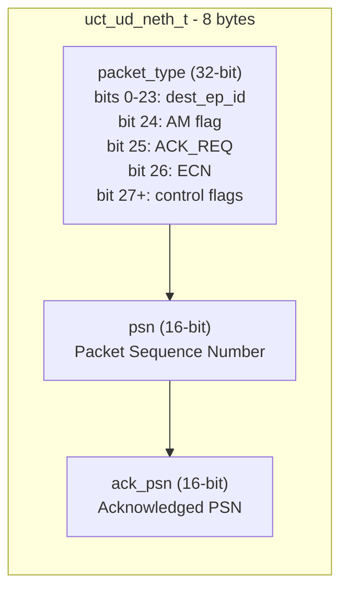

The `uct_ud_neth_t` header appears at the beginning of every UD packet:

```c
typedef struct uct_ud_neth {
    uint32_t            packet_type;  // dest_ep_id[23:0] | flags[31:24]
    uct_ud_psn_t        psn;          // This packet's sequence number
    uct_ud_psn_t        ack_psn;      // Latest received PSN being acked
} UCS_S_PACKED uct_ud_neth_t;
```

**Packet Type Flags:**

| Flag | Bit | Purpose |
|------|-----|---------|
| `UCT_UD_PACKET_FLAG_AM` | 24 | Active Message packet |
| `UCT_UD_PACKET_FLAG_ACK_REQ` | 25 | Sender requests ACK |
| `UCT_UD_PACKET_FLAG_ECN` | 26 | Explicit Congestion Notification |
| `UCT_UD_PACKET_FLAG_NACK` | 27 | Negative acknowledgment |
| `UCT_UD_PACKET_FLAG_PUT` | 28 | PUT operation |
| `UCT_UD_PACKET_FLAG_CTL` | 29 | Control packet |

**Sources:** [src/uct/ib/ud/base/ud_def.h:118-122](), [src/uct/ib/ud/base/ud_def.h:47-62]()

### Send Buffer Structure

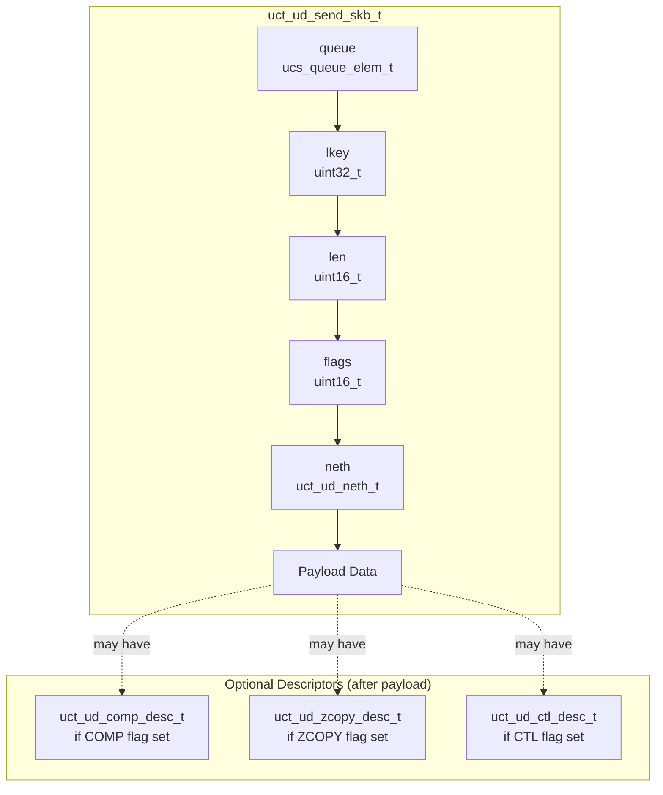

**SKB Flags:**

| Flag | Purpose |
|------|---------|
| `UCT_UD_SEND_SKB_FLAG_ACK_REQ` | ACK was requested for this packet |
| `UCT_UD_SEND_SKB_FLAG_COMP` | Contains user completion callback |
| `UCT_UD_SEND_SKB_FLAG_ZCOPY` | Contains zero-copy IOV descriptors |
| `UCT_UD_SEND_SKB_FLAG_RESENDING` | Active control skb refers to this skb |
| `UCT_UD_SEND_SKB_FLAG_CTL_ACK` | Control ACK packet |
| `UCT_UD_SEND_SKB_FLAG_CTL_RESEND` | Control resend packet |

**Sources:** [src/uct/ib/ud/base/ud_def.h:153-159](), [src/uct/ib/ud/base/ud_def.h:128-144]()

---

## Reliability Protocol

### Sequence Number Management

The UD transport uses 16-bit circular sequence numbers (`uct_ud_psn_t`) with comparison via `UCT_UD_PSN_COMPARE`:

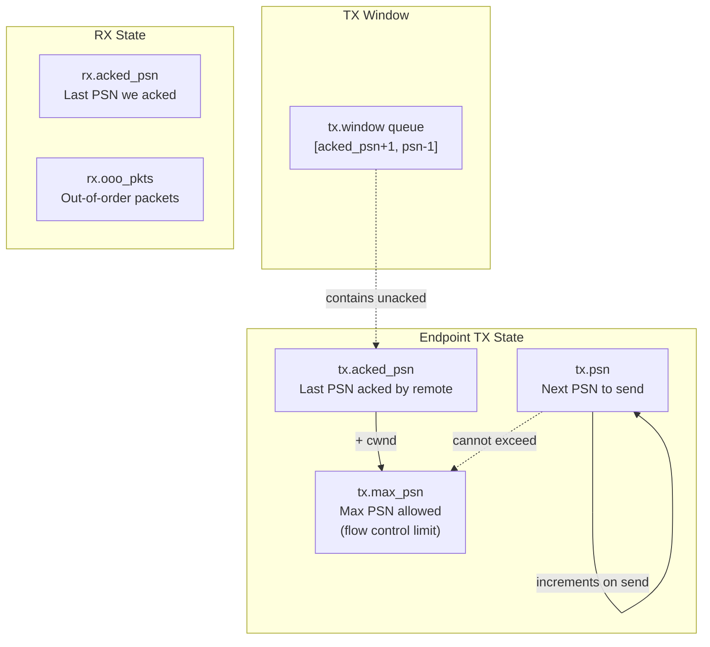

**Key Invariants:**
- TX window = `[tx.acked_psn + 1, tx.psn - 1]`
- `tx.max_psn = tx.acked_psn + ca.cwnd` (congestion window)
- Cannot send if `tx.psn >= tx.max_psn` (window full)
- Initial PSN = `UCT_UD_INITIAL_PSN` (1)

**Sources:** [src/uct/ib/ud/base/ud_ep.h:224-269](), [src/uct/ib/ud/base/ud_ep.c:119-139](), [src/uct/ib/ud/base/ud_def.h:21]()

### ACK/NACK Protocol

Every packet carries an `ack_psn` field that acknowledges all packets up to that PSN:

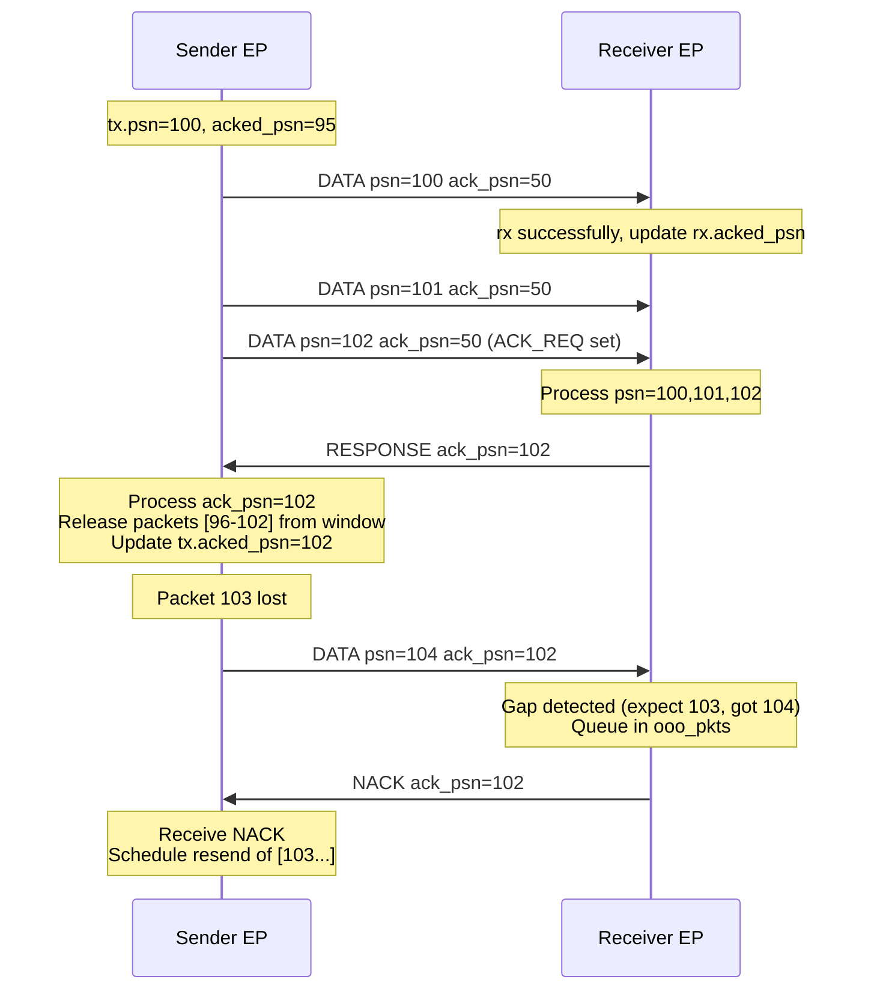

**ACK Processing Flow:**

1. **On packet receive:** Extract `neth->ack_psn` [src/uct/ib/ud/base/ud_ep.c:723-754]()
2. **Validate ACK PSN:** Must be in range `(tx.acked_psn, tx.psn)` [src/uct/ib/ud/base/ud_ep.c:727-738]()
3. **Release window:** Remove packets `[old_acked+1, new_acked]` from `tx.window` [src/uct/ib/ud/base/ud_ep.c:167-197]()
4. **Update congestion:** Call `uct_ud_ep_ca_ack()` to increase window [src/uct/ib/ud/base/ud_ep.c:106-112]()
5. **Update resend state:** Check if resend operation can complete [src/uct/ib/ud/base/ud_ep.c:68-89]()

**ACK Request Strategy:**

ACK is requested when:
- PSN reaches 25% through the window: `psn == (acked_psn*3 + max_psn)/4`
- PSN reaches window end: `psn + 1 == max_psn`
- Explicit ACK_REQ operation is pending

**Sources:** [src/uct/ib/ud/base/ud_ep.c:722-754](), [src/uct/ib/ud/base/ud_ep.h:421-432]()

### Retransmission Mechanism

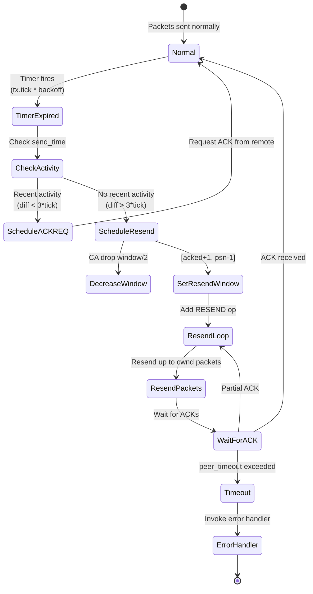

**Resend State:**

| Field | Purpose |
|-------|---------|
| `resend.psn` | Next PSN to retransmit |
| `resend.max_psn` | Upper bound of resend window |
| `resend.pos` | Iterator position in tx.window queue |

**Resend Algorithm:**

1. **Timer expiration:** [src/uct/ib/ud/base/ud_ep.c:341-401]()
   - Check if `tx.window` is non-empty
   - Check time since last send: `now - max(send_time, resend_time)`
   - If `diff > 3 * tick`: trigger resend

2. **Decrease congestion window:** [src/uct/ib/ud/base/ud_ep.c:91-104]()
   ```c
   ep->ca.cwnd /= UCT_UD_CA_MD_FACTOR;  // Divide by 2
   if (ep->ca.cwnd < UCT_UD_CA_MIN_WINDOW)
       ep->ca.cwnd = UCT_UD_CA_MIN_WINDOW;
   ```

3. **Set resend window:** [src/uct/ib/ud/base/ud_ep.c:54-60]()
   ```c
   ep->resend.max_psn = ep->tx.psn - 1;
   ep->resend.psn = ep->tx.acked_psn + 1;
   ep->resend.pos = ucs_queue_iter_begin(&ep->tx.window);
   ```

4. **Resend packets:** During progress, resend up to `cwnd` packets with ACK_REQ flag set every `UCT_UD_RESENDS_PER_ACK` (4) packets

**Sources:** [src/uct/ib/ud/base/ud_ep.c:54-104](), [src/uct/ib/ud/base/ud_ep.c:341-401]()

---

## Congestion Control

### AIMD Algorithm

The UD transport implements Additive Increase / Multiplicative Decrease (AIMD) congestion control:

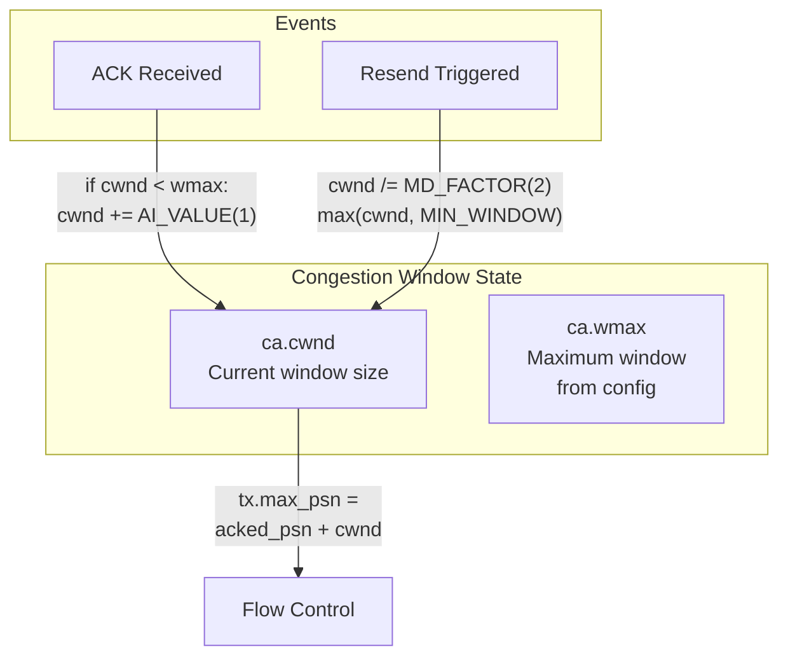

**Parameters:**

| Constant | Value | Purpose |
|----------|-------|---------|
| `UCT_UD_CA_MIN_WINDOW` | 2 | Minimum congestion window |
| `UCT_UD_CA_MAX_WINDOW` | 1025 | Maximum congestion window (configurable) |
| `UCT_UD_CA_AI_VALUE` | 1 | Additive increase value |
| `UCT_UD_CA_MD_FACTOR` | 2 | Multiplicative decrease divisor |

**Additive Increase:** [src/uct/ib/ud/base/ud_ep.c:106-112]()
```c
static UCS_F_ALWAYS_INLINE void uct_ud_ep_ca_ack(uct_ud_ep_t *ep)
{
    if (ep->ca.cwnd < ep->ca.wmax) {
        ep->ca.cwnd += UCT_UD_CA_AI_VALUE;
    }
    ep->tx.max_psn = ep->tx.acked_psn + ep->ca.cwnd;
}
```

**Multiplicative Decrease:** [src/uct/ib/ud/base/ud_ep.c:91-104]()
```c
static void uct_ud_ep_ca_drop(uct_ud_ep_t *ep)
{
    ep->ca.cwnd /= UCT_UD_CA_MD_FACTOR;
    if (ep->ca.cwnd < UCT_UD_CA_MIN_WINDOW) {
        ep->ca.cwnd = UCT_UD_CA_MIN_WINDOW;
    }
    ep->tx.max_psn = ep->tx.acked_psn + ep->ca.cwnd;
}
```

**Sources:** [src/uct/ib/ud/base/ud_ep.c:91-112](), [src/uct/ib/ud/base/ud_def.h:23-35]()

---

## Connection Establishment

### CREQ/CREP Protocol

UD endpoints establish connections using a 3-way handshake:

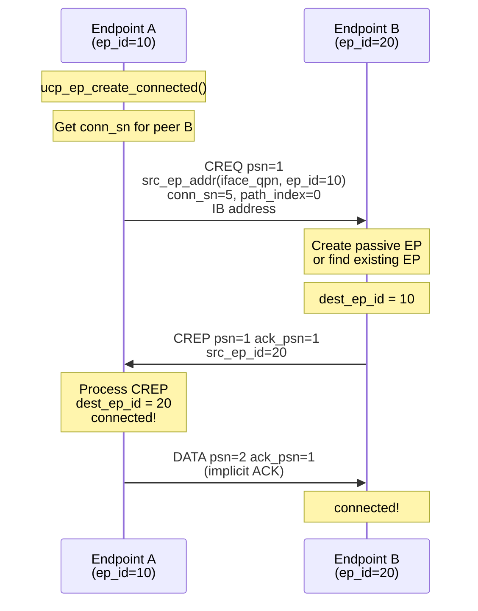

**Connection Establishment Steps:**

1. **Get Connection SN:** [src/uct/ib/ud/base/ud_iface.c:69-87]()
   - Compute peer address from IB address + interface address
   - Get next connection sequence number via `ucs_conn_match_get_next_sn()`

2. **Check for Existing EP:** [src/uct/ib/ud/base/ud_iface.c:118-155]()
   - Look up EP in connection matching context by `(peer_addr, conn_sn)`
   - Reuse if found (e.g., passive EP from earlier CREQ)

3. **Send CREQ:** [src/uct/ib/ud/base/ud_ep.c:956-1009]()
   - Prepare `uct_ud_ctl_hdr_t` with type `UCT_UD_PACKET_CREQ`
   - Include: `ep_addr`, `conn_sn`, `path_index`, IB device address
   - Set PSN = `UCT_UD_INITIAL_PSN` (1)

4. **Receive CREQ:** [src/uct/ib/ud/base/ud_ep.c:820-924]()
   - Create passive EP via `uct_ud_ep_create_passive()`
   - Set `rx.ooo_pkts.head_sn = neth->psn`
   - Schedule CREP control operation

5. **Send CREP:** 
   - `uct_ud_ctl_hdr_t` with type `UCT_UD_PACKET_CREP`
   - Include `src_ep_id` so sender knows remote EP ID

6. **Receive CREP:** [src/uct/ib/ud/base/ud_ep.c:926-954]()
   - Set `dest_ep_id = ctl->conn_rep.src_ep_id`
   - Mark connection as established
   - Schedule pending operations

**Simultaneous Connection:**

If both sides initiate connection simultaneously:
- Both send CREQ
- Each creates passive EP upon receiving peer's CREQ
- EP with NULL `dest_ep_id` receives CREQ: treat as simultaneous connection
- Process peer's CREQ (treat as ACK for our CREQ) and send CREP

**Sources:** [src/uct/ib/ud/base/ud_ep.c:597-682](), [src/uct/ib/ud/base/ud_ep.c:766-803](), [src/uct/ib/ud/base/ud_ep.c:820-924](), [src/uct/ib/ud/base/ud_ep.c:926-954]()

### Control Packet Structure

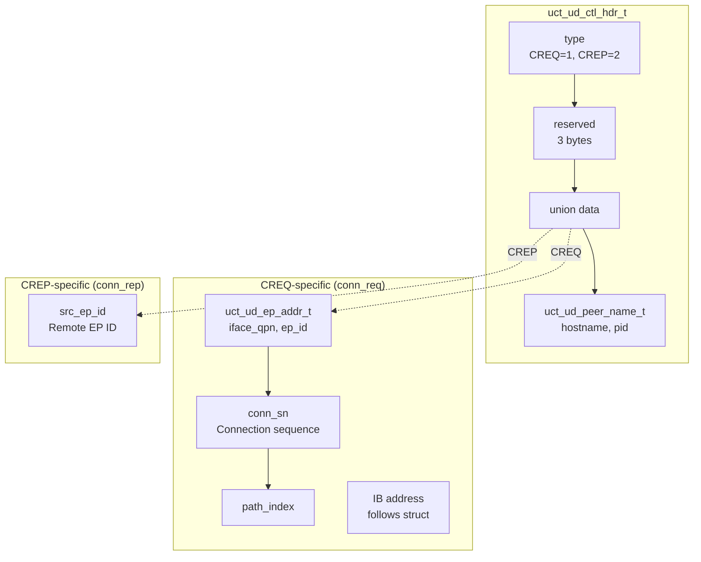

**Sources:** [src/uct/ib/ud/base/ud_iface.h:228-244]()

---

## Send and Receive Flow

### Send Path

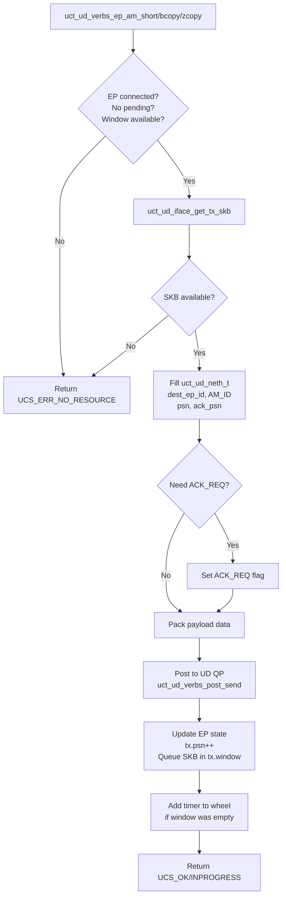

**Key Functions:**

1. **Get TX buffer:** [src/uct/ib/ud/base/ud_inl.h:44-69]()
   - Check TX queue space available
   - Get cached or new SKB from mpool

2. **Prepare network header:** [src/uct/ib/ud/base/ud_ep.h:344-361]()
   - Set `dest_ep_id`, packet flags
   - Set `psn = ep->tx.psn`
   - Set `ack_psn = ep->rx.acked_psn`

3. **Post send:** [src/uct/ib/ud/verbs/ud_verbs.c:73-108]()
   - Fill `ibv_send_wr` with AH, QPN, SGEs
   - Set signaling based on moderation
   - Call `ibv_post_send()`

4. **Complete TX:** [src/uct/ib/ud/base/ud_inl.h:158-178]()
   - Increment `tx.psn`
   - Queue SKB in `tx.window`
   - Start timer if window was empty

**Sources:** [src/uct/ib/ud/verbs/ud_verbs.c:173-207](), [src/uct/ib/ud/verbs/ud_verbs.c:246-274](), [src/uct/ib/ud/base/ud_inl.h:158-178]()

### Receive Path

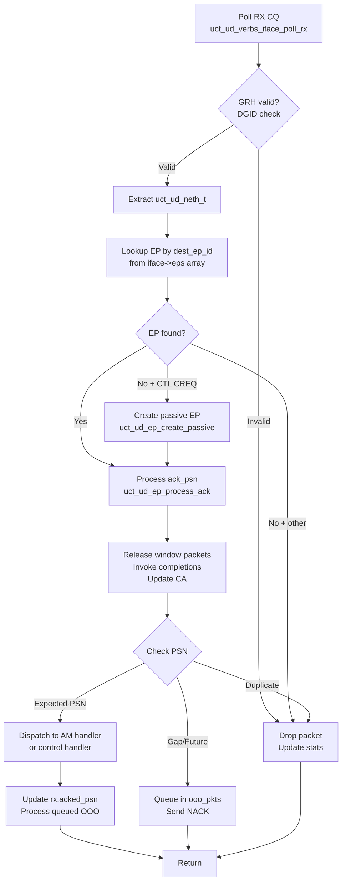

**Key Functions:**

1. **Poll CQ:** [src/uct/ib/ud/verbs/ud_verbs.c:433-471]()
   - Call `uct_ib_poll_cq()` for RX completions
   - Check GRH DGID if RoCE

2. **Process RX:** [src/uct/ib/ud/base/ud_ep.c:1011-1158]()
   - Extract `dest_ep_id` from `neth->packet_type`
   - Lookup EP: `iface->eps[dest_ep_id]`
   - Process `ack_psn` field

3. **Check PSN:** [src/uct/ib/ud/base/ud_ep.c:1057-1112]()
   - Compare `neth->psn` with `rx.ooo_pkts.head_sn`
   - If gap: queue in `rx.ooo_pkts`, send NACK
   - If expected: dispatch to handler

4. **Dispatch:**
   - **AM packet:** Call registered AM handler [src/uct/ib/ud/base/ud_ep.c:1124-1146]()
   - **CTL packet:** Handle CREQ/CREP [src/uct/ib/ud/base/ud_ep.c:820-954]()
   - **PUT packet:** Inline copy to target [src/uct/ib/ud/base/ud_ep.c:756-764]()

**Sources:** [src/uct/ib/ud/verbs/ud_verbs.c:433-471](), [src/uct/ib/ud/base/ud_ep.c:1011-1158]()

---

## Progress and Timer Management

### Timer Wheel

The UD interface uses `ucs_twheel_t` for managing retransmission timers:

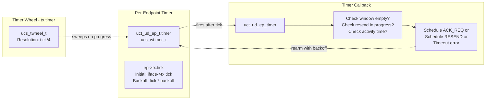

**Timer Management:**

1. **Initialization:** [src/uct/ib/ud/base/ud_iface.c:314-319]()
   ```c
   ucs_twheel_init(&iface->tx.timer, iface->tx.tick / 4, ucs_get_time());
   ```

2. **EP timer start:** [src/uct/ib/ud/base/ud_inl.h:174-177]()
   - Add to wheel when first packet sent (window empty → non-empty)
   - Scheduled at `now + ep->tx.tick`

3. **Timer sweep:** [src/uct/ib/ud/base/ud_iface.h:443-455]()
   - Called every `UCT_UD_SKIP_SWEEP` (8) progress calls
   - `ucs_twheel_sweep(&iface->tx.timer, ucs_get_time())`

4. **Timer callback:** [src/uct/ib/ud/base/ud_ep.c:341-401]()
   - Check if all ACKed: remove timer
   - Check resend in progress: backoff and rearm
   - Check activity time: schedule ACK_REQ or RESEND
   - Check peer timeout: invoke error handler

5. **Timer backoff:** [src/uct/ib/ud/base/ud_ep.c:306-313]()
   ```c
   ep->tx.tick = min(ep->tx.tick * iface->tx.timer_backoff, 
                     iface->config.peer_timeout / 3);
   ```

**Sources:** [src/uct/ib/ud/base/ud_ep.c:341-401](), [src/uct/ib/ud/base/ud_ep.c:306-313](), [src/uct/ib/ud/base/ud_iface.h:443-455]()

### Asynchronous Progress

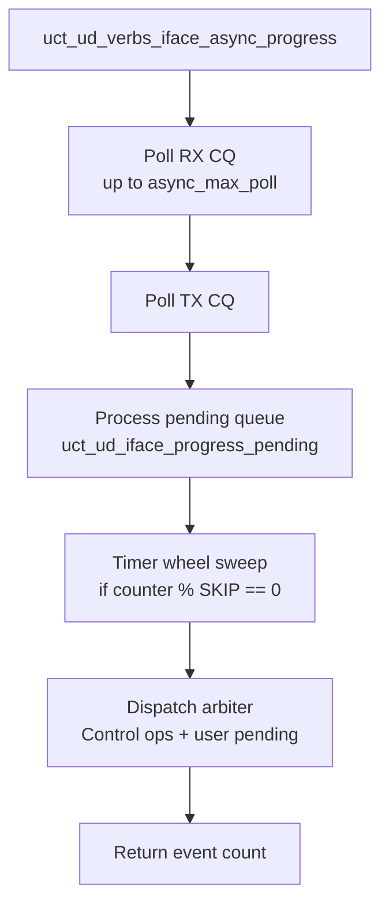

Async progress is triggered by:
- Completion channel events (if enabled)
- Explicit `uct_iface_progress()` calls
- Timer events

**Sources:** [src/uct/ib/ud/verbs/ud_verbs.c:473-488](), [src/uct/ib/ud/verbs/ud_verbs.c:490-511]()

---

## Verbs vs MLX5 Implementations

The UD transport has two implementations:

### Common Base (`ud_base`)

Provides:
- Reliability protocol (ACK/NACK, retransmit)
- Congestion control
- Connection establishment
- Timer management
- Packet structure

**Sources:** [src/uct/ib/ud/base/]()

### Verbs Implementation (`ud_verbs`)

Uses standard IB Verbs API:

| Component | Implementation |
|-----------|----------------|
| Interface | `uct_ud_verbs_iface_t` |
| Endpoint | `uct_ud_verbs_ep_t` containing `peer_address.ah` |
| Send | `ibv_post_send()` with `ibv_send_wr` |
| Recv | `ibv_poll_cq()` on RX CQ |
| AH | Create `ibv_ah` from peer address |

**Key Operations:**

- **Send control:** [src/uct/ib/ud/verbs/ud_verbs.c:131-170]()
  - Fills `ibv_send_wr` with dest QPN and AH
  - Supports inline, bcopy, zcopy
  - Moderation for signaled sends

- **Send data:** [src/uct/ib/ud/verbs/ud_verbs.c:173-363]()
  - AM short/bcopy/zcopy operations
  - PUT short operation

- **Poll TX:** [src/uct/ib/ud/verbs/ud_verbs.c:366-417]()
  - Process completions ordered or unordered
  - Call `uct_ud_iface_send_completion_*()`

- **Poll RX:** [src/uct/ib/ud/verbs/ud_verbs.c:433-471]()
  - Extract GRH, validate DGID
  - Call `uct_ud_ep_process_rx()`

**Sources:** [src/uct/ib/ud/verbs/ud_verbs.c]()

### MLX5 Implementation (referenced but not detailed)

Uses MLX5 Direct Verbs for hardware acceleration:
- Direct QP access
- Optimized send/recv paths
- Hardware-assisted features

For MLX5 optimizations, see [3.7](#3.7).

---

## Configuration Parameters

### Interface Configuration

From `uct_ud_iface_config_t`:

| Parameter | Default | Description |
|-----------|---------|-------------|
| `LINGER_TIMEOUT` | 5.0m | Keep closed connection open internally |
| `TIMEOUT` | 30s | Peer unreachable timeout |
| `TIMER_TICK` | 10ms | Initial retransmission timeout |
| `TIMER_BACKOFF` | 2.0 | Timeout multiplier (min 1.0) |
| `ASYNC_TIMER_TICK` | 100ms | Async timer resolution |
| `MIN_POKE_TIME` | 250ms | Min interval for solicited ACK requests |
| `ETH_DGID_CHECK` | y | Check destination GID for RoCE |
| `MAX_WINDOW` | 1025 | Max congestion window size |
| `RX_ASYNC_MAX_POLL` | 64 | Max RX polls during async progress |

**Sources:** [src/uct/ib/ud/base/ud_iface.c:651-703]()

### Queue Configuration

From `uct_ib_iface_config_t`:

| Parameter | Purpose |
|-----------|---------|
| `TX_QUEUE_LEN` | UD QP send queue length |
| `RX_QUEUE_LEN` | UD QP receive queue length |
| `TX_MIN_INLINE` | Max inline data size |
| `TX_MIN_SGE` | Min scatter-gather entries |

**Sources:** [src/uct/ib/ud/base/ud_iface.c:186-253]()

---

## Key Data Structures Summary

### Interface State

```c
struct uct_ud_iface {
    uct_ib_iface_t           super;           // Base IB interface
    struct ibv_qp           *qp;              // UD queue pair
    struct {
        ucs_mpool_t          mp;              // RX buffer pool
        unsigned             available;       // RX buffers available
        ucs_queue_head_t     pending_q;       // Pending RX packets
    } rx;
    struct {
        uct_ud_send_skb_t   *skb;             // Cached TX skb
        ucs_mpool_t          mp;              // TX buffer pool
        int16_t              available;       // TX queue slots
        unsigned             unsignaled;      // Unsignaled sends
        union {
            ucs_queue_head_t                queue;  // Ordered device
            khash_t(uct_ud_iface_ctl_desc_hash) map; // Unordered
        } outstanding;                        // Outstanding control
        ucs_arbiter_t        pending_q;       // Pending operations
        ucs_twheel_t         timer;           // Timer wheel
    } tx;
    ucs_conn_match_ctx_t     conn_match_ctx;  // Connection matching
    ucs_ptr_array_t          eps;             // Endpoint array
};
```

**Sources:** [src/uct/ib/ud/base/ud_iface.h:161-220]()

### Endpoint State

```c
struct uct_ud_ep {
    uct_base_ep_t           super;            // Base endpoint
    uint32_t                ep_id;            // Local EP ID
    uint32_t                dest_ep_id;       // Remote EP ID
    struct {
        uct_ud_psn_t        psn;              // Next PSN to send
        uct_ud_psn_t        max_psn;          // Max allowed PSN
        uct_ud_psn_t        acked_psn;        // Last ACKed PSN
        ucs_queue_head_t    window;           // Unacked packets
        ucs_time_t          send_time;        // Last send time
        ucs_time_t          tick;             // Timer interval
    } tx;
    struct {
        uct_ud_psn_t        acked_psn;        // Last PSN acked
        ucs_frag_list_t     ooo_pkts;         // Out-of-order queue
    } rx;
    struct {
        uct_ud_psn_t        wmax;             // Max window size
        uct_ud_psn_t        cwnd;             // Current window
    } ca;
    struct {
        ucs_queue_iter_t    pos;              // Resend position
        uct_ud_psn_t        psn;              // Resend PSN
        uct_ud_psn_t        max_psn;          // Resend upper bound
    } resend;
    ucs_wtimer_t            timer;            // Retransmit timer
    uct_ud_ep_conn_sn_t     conn_sn;          // Connection SN
};
```

**Sources:** [src/uct/ib/ud/base/ud_ep.h:224-269]()

---

