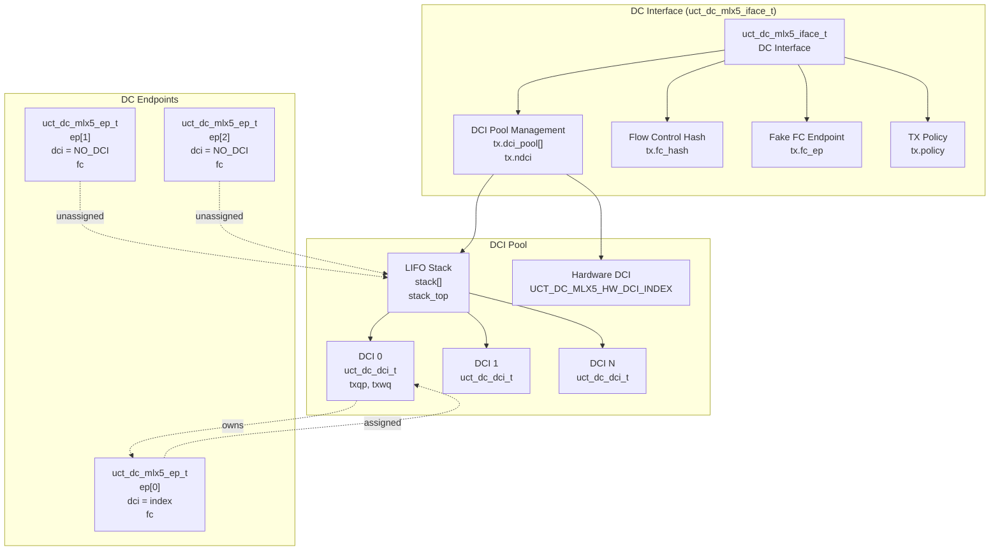
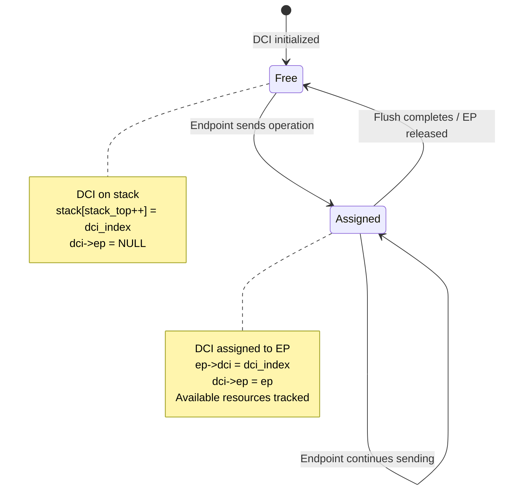
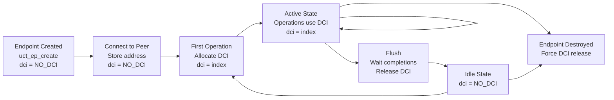
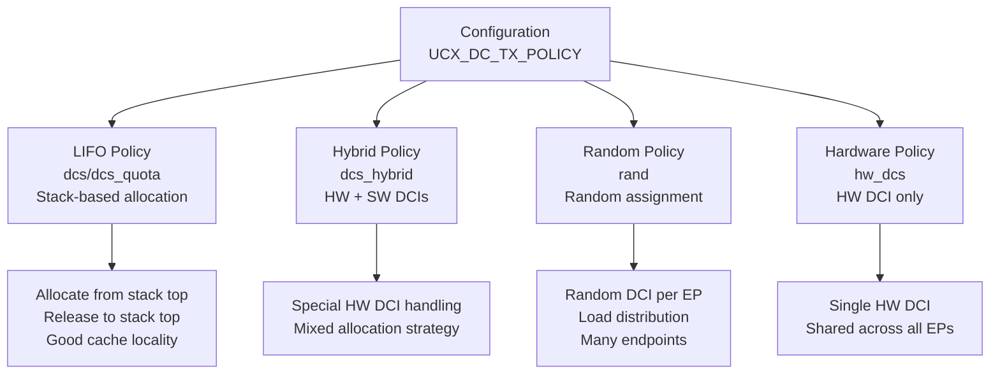
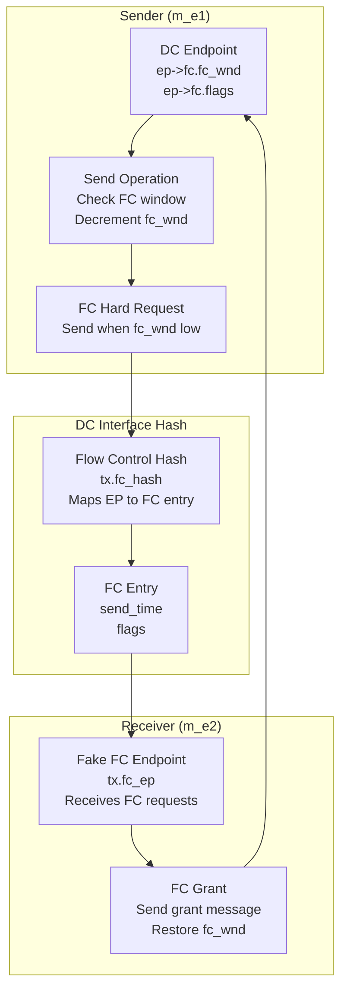
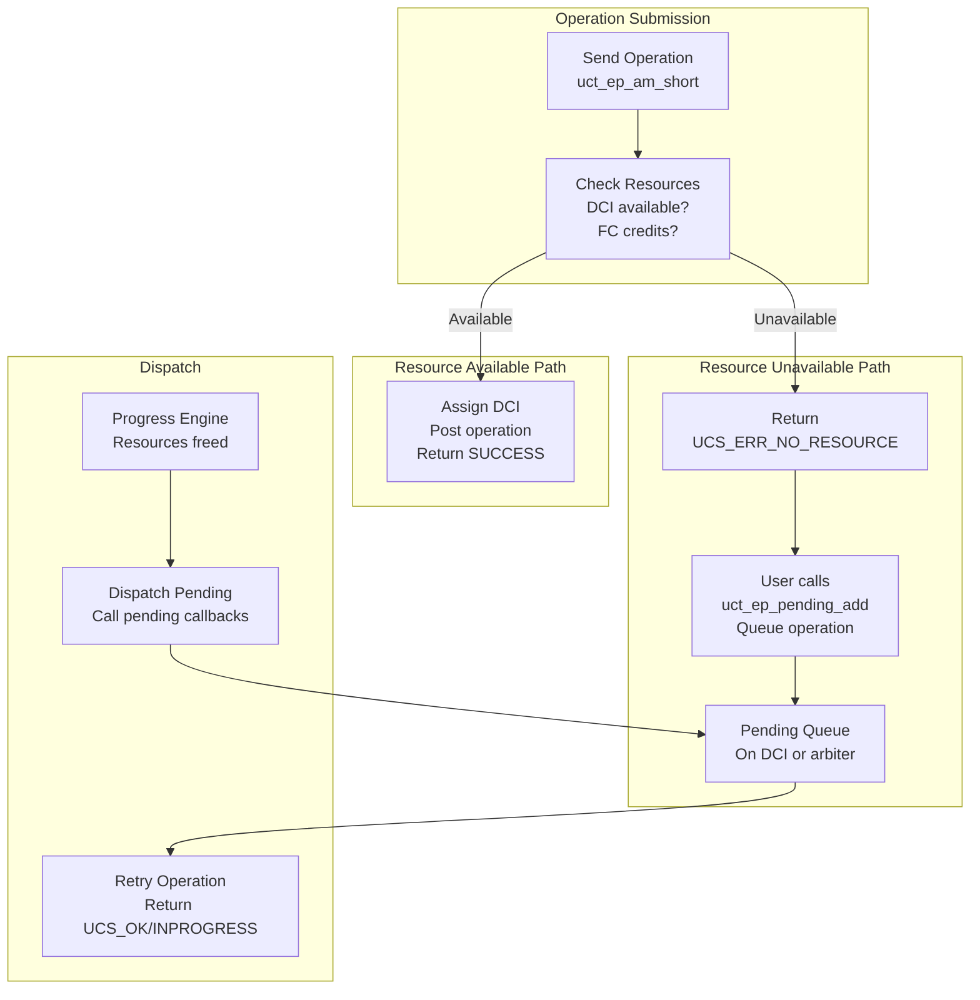
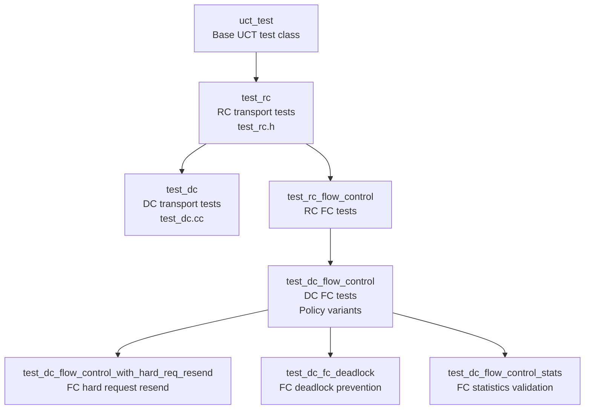

<!-- source: DeepWiki mcp.deepwiki.com · repo openucx/ucx · page 3.5 DC (Dynamic Connection) Transport · fetched 2026-11-11 -->

# DC (Dynamic Connection) Transport

<details>
<summary>Relevant source files</summary>

The following files were used as context for generating this wiki page:

- [test/gtest/uct/ib/test_dc.cc](test/gtest/uct/ib/test_dc.cc)
- [test/gtest/uct/ib/test_rc.cc](test/gtest/uct/ib/test_rc.cc)
- [test/gtest/uct/ib/test_rc.h](test/gtest/uct/ib/test_rc.h)

</details>


## Purpose and Scope

This page documents the DC (Dynamic Connection) transport, a scalable InfiniBand transport implementation in UCX that uses Mellanox MLX5 hardware features. DC enables efficient many-to-many communication by dynamically sharing a pool of connection resources (DCIs) among multiple endpoints. This design provides scalability advantages over RC (Reliable Connection) transport in scenarios with large numbers of communicating peers.

For information about RC transport, see [RC (Reliable Connection) Transport](#3.3). For UD transport, see [UD (Unreliable Datagram) Transport](#3.4). For general UCT layer concepts, see [UCT API and Interface Design](#3.1).

---

## Overview

### What is DC Transport?

DC (Dynamic Connection) transport is a hardware-accelerated transport for Mellanox ConnectX-4 and later adapters that provides reliable, ordered delivery similar to RC transport, but with a fundamentally different connection model. Instead of maintaining a dedicated QP (Queue Pair) for each endpoint connection as RC does, DC uses a pool of Dynamic Connection Initiators (DCIs) that are dynamically assigned to endpoints on-demand.

**Key characteristics:**
- **Scalability**: Supports many endpoints with a small number of DCIs
- **Dynamic assignment**: DCIs are allocated from a pool and returned after use
- **Hardware reliability**: Provides reliable, ordered delivery like RC
- **MLX5-specific**: Requires Mellanox ConnectX-4 or newer hardware

### DC vs RC Comparison

| Aspect | RC Transport | DC Transport |
|--------|--------------|--------------|
| Connection model | One QP per endpoint | DCI pool shared across endpoints |
| Memory footprint | O(N) connections | O(1) DCI pool + O(N) endpoints |
| Connection setup | Pre-allocated QPs | Dynamic DCI assignment |
| Scalability | Limited by QP resources | Scales to many endpoints |
| Hardware support | All IB adapters | MLX5 (ConnectX-4+) only |

**Sources:** [test/gtest/uct/ib/test_dc.cc:1-25](), [test/gtest/uct/ib/test_rc.h:1-18]()

---

## Architecture Overview

### DC Interface and Endpoint Structure



**DC Interface Components:**
- **`uct_dc_mlx5_iface_t`**: Main interface structure containing DCI pool and configuration
- **DCI Pool**: Array of DCI structures (`tx.dci_pool[]`) with LIFO allocation stack
- **Flow Control Hash**: Tracks FC state for endpoints (`tx.fc_hash`)
- **Fake FC Endpoint**: Special endpoint for receiving FC grants (`tx.fc_ep`)
- **TX Policy**: Determines DCI allocation strategy (`tx.policy`)

**DC Endpoint:**
- **`uct_dc_mlx5_ep_t`**: Endpoint structure with DCI index field
- **`dci`**: Current DCI assignment (or `UCT_DC_MLX5_EP_NO_DCI` if unassigned)
- **`fc`**: Per-endpoint flow control structure

**Sources:** [test/gtest/uct/ib/test_dc.cc:48-54](), [test/gtest/uct/ib/test_dc.cc:175-204]()

---

## DCI Pool Management

### DCI Structure and Lifecycle

Each DCI (`uct_dc_dci_t`) represents a hardware Dynamic Connection Initiator with its own send queue and resources. DCIs are managed in pools and allocated on-demand to endpoints.



### DCI Allocation Algorithm

DCIs are allocated from a LIFO (Last-In-First-Out) stack per pool:

**Allocation:**
1. Check if endpoint already has a DCI assigned (`ep->dci != UCT_DC_MLX5_EP_NO_DCI`)
2. If not, pop DCI from pool stack: `dci_index = stack[--stack_top]`
3. Assign DCI to endpoint: `ep->dci = dci_index; dci->ep = ep`
4. Return success or `UCS_ERR_NO_RESOURCE` if stack empty

**Release:**
1. Complete all outstanding operations on DCI
2. Clear endpoint assignment: `ep->dci = UCT_DC_MLX5_EP_NO_DCI; dci->ep = NULL`
3. Push DCI back to stack: `stack[stack_top++] = dci_index`

**Sources:** [test/gtest/uct/ib/test_dc.cc:175-204](), [test/gtest/uct/ib/test_dc.cc:206-245]()

### Multiple DCI Test

The following test demonstrates multi-DCI behavior:

```cpp
// From test_dc.cc:206-245
// Create more endpoints than DCIs available
for (i = 0; i < iface->tx.ndci; i++) {
    m_e1->connect_to_iface(i, *m_e2);
    ep = dc_ep(m_e1, i);
    EXPECT_EQ(UCT_DC_MLX5_EP_NO_DCI, ep->dci);  // Initially unassigned
    
    status = uct_ep_am_short(m_e1->ep(i), 0, 0, NULL, 0);
    EXPECT_UCS_OK(status);
    
    // Verify DCI was allocated from stack
    EXPECT_EQ(ucs_array_elem(&iface->tx.dci_pool[0].stack, i), ep->dci);
    EXPECT_EQ(i+1, iface->tx.dci_pool[0].stack_top);
    EXPECT_EQ(ep, uct_dc_mlx5_iface_dci(iface, ep->dci)->ep);
}

// This should fail - no free DCIs
status = uct_ep_am_short(m_e1->ep(i), 0, 0, NULL, 0);
if (!uct_dc_mlx5_iface_is_hybrid(iface)) {
    EXPECT_EQ(UCS_ERR_NO_RESOURCE, status);
}
```

**Sources:** [test/gtest/uct/ib/test_dc.cc:206-245]()

### Multiple DCI Pools

DC supports multiple DCI pools for path diversity (multi-path routing):

**Pool Indices:**
- Maximum pools: `UCT_DC_MLX5_IFACE_MAX_DCI_POOLS`
- Pool selection based on endpoint path configuration
- Each pool maintains independent DCI stack

**Pool Index Test:**
```cpp
// From test_dc.cc:476-500
constexpr uint8_t max_dci_pools = UCT_DC_MLX5_IFACE_MAX_DCI_POOLS;

// Set num paths to max
modify_config("IB_NUM_PATHS", std::to_string(max_dci_pools).c_str());

// Create an ep for each pool
for (int i = 0; i < max_dci_pools; i++) {
    rand_e->connect_to_iface(i, *m_e2, i);  // Path index i
    uct_dc_mlx5_ep_t *ep = dc_ep(rand_e, i);
    if (uct_dc_mlx5_ep_pool_index(ep) == last_dci_pool_index) {
        used_last_pool = true;
    }
}

uint8_t num_dci_pools = dc_iface(rand_e)->tx.num_dci_pools;
EXPECT_EQ(num_dci_pools, max_dci_pools);
```

**Sources:** [test/gtest/uct/ib/test_dc.cc:476-500]()

---

## DC Endpoint Management

### Endpoint Lifecycle



### Endpoint Creation and Connection

DC endpoints are lightweight structures that do not allocate DCIs until first use:

**Initial State:**
- Endpoint allocated with `ep->dci = UCT_DC_MLX5_EP_NO_DCI`
- Remote address information stored
- Flow control state initialized

**First Operation:**
- DCI allocated on-demand when first send operation is issued
- If no DCI available, returns `UCS_ERR_NO_RESOURCE`
- Pending operations may be queued until DCI available

**Sources:** [test/gtest/uct/ib/test_dc.cc:175-204]()

### Endpoint Flush and DCI Release

Flushing an endpoint completes all outstanding operations and releases its DCI:

**Flush Operation:**
```cpp
// From test_dc.cc:281-309
status = uct_ep_flush(m_e1->ep(0), 0, &comp.uct_comp);
do {
    progress();
} while (comp.uct_comp.count > 0);

// After flush, DCI is released
EXPECT_EQ(UCT_DC_MLX5_EP_NO_DCI, ep->dci);
EXPECT_EQ(0, iface->tx.dci_pool[0].stack_top);  // DCI back in stack
```

**Flush from Completion Callback:**
- DC supports destroying endpoints from flush completion callbacks
- This is safe because DCIs are independent of specific endpoints
- Test: [test/gtest/uct/ib/test_dc.cc:281-309]()

**Sources:** [test/gtest/uct/ib/test_dc.cc:281-309]()

### Endpoint Destruction

Destroying an endpoint with outstanding operations:

**Behavior:**
- DCI is released after outstanding operations complete
- Warning message logged if operations outstanding
- DCI becomes available for other endpoints

**Test Example:**
```cpp
// From test_dc.cc:251-275
send_am_messages(m_e1, 2, UCS_OK);  // Send with outstanding ops

// DCI assigned to EP
EXPECT_EQ(ucs_array_elem(&iface->tx.dci_pool[0].stack, 0), ep->dci);
EXPECT_EQ(ep, uct_dc_mlx5_iface_dci(iface, ep->dci)->ep);

m_e1->destroy_eps();  // Destroy with ops outstanding
EXPECT_EQ(1, iface->tx.dci_pool[0].stack_top);  // DCI still assigned

flush();  // Complete operations
EXPECT_EQ(0, iface->tx.dci_pool[0].stack_top);  // DCI released
```

**Warning Detection:**
```cpp
// Log handler counts warnings
static ucs_log_func_rc_t log_ep_destroy(...) {
    if (strcmp("ep (%p) is destroyed with %d outstanding ops", message) == 0) {
        n_warnings++;
    }
    return UCS_LOG_FUNC_RC_STOP;
}
```

**Sources:** [test/gtest/uct/ib/test_dc.cc:251-275](), [test/gtest/uct/ib/test_dc.cc:73-87]()

---

## TX Policies

DC supports multiple transmission policies that determine how DCIs are assigned to endpoints. The policy affects scalability, latency, and resource utilization characteristics.

### Policy Types

| Policy | Configuration Value | Description |
|--------|-------------------|-------------|
| **LIFO/Quota** | `dcs` or `dcs_quota` | Default LIFO allocation with quota limits |
| **Hybrid** | `dcs_hybrid` | Combines hardware DCI with software DCIs |
| **Random** | `rand` | Random DCI assignment to endpoints |
| **Hardware** | `hw_dcs` | Use hardware DCI only |

Configuration: `UCX_DC_TX_POLICY` or `UCX_DC_MLX5_TX_POLICY`

### LIFO/Quota Policy (Default)

**Characteristics:**
- DCIs allocated in LIFO order from stack
- Most recently released DCI is reused first
- Promotes DCI cache locality
- Simple and efficient for most workloads

**Stack Management:**
```
Initial state: stack = [0, 1, 2, 3, ..., N-1], stack_top = 0

Allocate:  dci = stack[stack_top++]
Release:   stack[--stack_top] = dci
```

**Sources:** [test/gtest/uct/ib/test_dc.cc:175-204]()

### Random Policy

**Characteristics:**
- DCIs assigned randomly to new endpoints
- Reduces contention for specific DCIs
- Better load distribution across DCIs
- Useful for many-endpoint scenarios

**Random Assignment Test:**
```cpp
// From test_dc.cc:403-432
// Enable random policy
if (UCS_OK != uct_config_modify(m_iface_config, "DC_TX_POLICY", "rand")) {
    UCS_TEST_ABORT("Error: cannot enable random DCI policy");
}

int num_eps = 2 * iface->tx.ndci;  // More EPs than DCIs

// Create many endpoints - all should get valid DCIs via random assignment
for (int i = 0; i < num_eps; i++) {
    rand_e->connect_to_iface(i, *m_e2);
    ep = dc_ep(rand_e, i);
    EXPECT_NE(UCT_DC_MLX5_EP_NO_DCI, ep->dci);  // Always has DCI
}
```

**Sources:** [test/gtest/uct/ib/test_dc.cc:39-46](), [test/gtest/uct/ib/test_dc.cc:403-432]()

### Hybrid Policy

**Characteristics:**
- Combines hardware DCI (`UCT_DC_MLX5_HW_DCI_INDEX`) with software DCIs
- Hardware DCI used for certain operations
- Software DCIs managed in pool
- Special handling for pending operations

**Hybrid Detection:**
```cpp
// From test_dc.cc:184-186, 320-322
bool is_hybrid = uct_dc_mlx5_iface_is_hybrid(iface);
if (is_hybrid) {
    // Skip certain tests or adjust expectations
    UCS_TEST_SKIP_R("hybrid DCI policy does not support...");
}
```

**Sources:** [test/gtest/uct/ib/test_dc.cc:184-186](), [test/gtest/uct/ib/test_dc.cc:320-322]()

### Policy Selection and Configuration



**Sources:** [test/gtest/uct/ib/test_dc.cc:511-558]()

### Policy Test Framework

The test framework enumerates all policies:

```cpp
// From test_dc_flow_control.cc:520-548
static std::vector<const struct resource*>
enum_resources(const std::string &tl_name) {
    std::vector<uct_dc_tx_policy_t> policies = {
        UCT_DC_TX_POLICY_DCS_QUOTA,
        UCT_DC_TX_POLICY_DCS_HYBRID,
        UCT_DC_TX_POLICY_RAND,
        UCT_DC_TX_POLICY_HW_DCS
    };
    
    for (auto policy : policies) {
        for (const auto &elem : resources) {
            struct resource rsc = *elem;
            rsc.variant         = policy;
            rsc.variant_name    = uct_dc_tx_policy_names[policy];
            all_resources.push_back(rsc);
        }
    }
}
```

**Sources:** [test/gtest/uct/ib/test_dc.cc:520-548]()

---

## Flow Control

DC transport inherits flow control mechanisms from RC but with modifications for the shared DCI model.

### DC Flow Control Architecture



### Flow Control Differences from RC

**DC-Specific Behavior:**

1. **Fake FC Endpoint**: DC uses a special "fake" endpoint (`tx.fc_ep`) to handle incoming FC grant messages
2. **Per-Endpoint FC State**: Each DC endpoint maintains its own `fc` structure despite sharing DCIs
3. **FC Hash Table**: Tracks pending FC requests using hash of endpoint pointers
4. **No Soft Requests**: DC ignores soft FC requests (only hard requests supported)

**Flow Control Structures:**
```cpp
// DC Endpoint FC state
uct_dc_mlx5_ep_t {
    uct_rc_fc_t fc;           // Per-endpoint flow control
    uint8_t dci;              // Current DCI assignment
    ...
};

// DC Interface FC structures
uct_dc_mlx5_iface_t {
    struct {
        uct_dc_mlx5_ep_t *fc_ep;       // Fake FC endpoint
        khash_t(uct_dc_mlx5_fc_hash) fc_hash;  // FC request tracking
        ...
    } tx;
};
```

**Sources:** [test/gtest/uct/ib/test_dc.cc:560-563](), [test/gtest/uct/ib/test_dc.cc:900-903]()

### Flow Control Test Cases

**General FC Test:**
```cpp
// From test_dc_flow_control.cc:621-632
test_general(8, 4, 1, true);  // wnd=8, soft_thresh=4, hard_thresh=1

// Test verifies:
// - FC window limits sending
// - FC grant restores window
// - Pending operations queue correctly
```

**FC with Pending Operations:**
```cpp
// From test_dc_flow_control.cc:634-637
test_pending_grant(5);  // Window size 5

// Test verifies:
// - Pending queue correctly stores FC grant requests
// - Grant dispatch when resources available
// - DCI release after grant processing
```

**FC Disabled Tests:**
```cpp
// From test_dc_flow_control.cc:639-672
set_fc_disabled(m_e1);
set_fc_wnd(m_e1, ep_index, 0);  // Set window to 0

// Should still allow operations even with fc_wnd=0
status = uct_ep_pending_add(m_e1->ep(ep_index), &pending_req.uct, 0);
ASSERT_UCS_OK(status);
```

**Sources:** [test/gtest/uct/ib/test_dc.cc:621-672]()

### Soft Request Behavior

DC transport does not support soft FC requests (unlike RC):

```cpp
// From test_dc_flow_control.cc:675-690
int wnd = 8, s_thresh = 4, h_thresh = 1;
set_fc_attributes(m_e1, true, wnd, s_thresh, h_thresh);

send_am_and_flush(m_e1, wnd - (s_thresh - 1));  // Trigger soft threshold
send_am_and_flush(m_e2, 1);                      // Peer sends message

// Check that window is NOT updated (soft request ignored)
EXPECT_EQ(get_fc_ptr(m_e1)->fc_wnd, s_thresh - 1);
```

**Sources:** [test/gtest/uct/ib/test_dc.cc:675-690]()

### FC Deadlock Prevention

DC handles potential FC deadlock scenarios:

```cpp
// From test_dc_fc_deadlock.cc:846-880
// Setup: m_e1 exhausted DCIs and FC window=0
// m_e2 wants to send grant but m_e1 has no resources

// Key: DC must send grant even when FC window empty
// to prevent deadlock
validate_grant(m_e2);  // Grant successfully received

// Test verifies grant sent despite empty FC window
```

**Deadlock Scenario:**
1. Endpoint A exhausts DCI resources and FC window
2. Endpoint B needs to send FC grant to A
3. Grant added to pending on A (no resources)
4. A must dispatch grant even with empty FC window
5. Otherwise, deadlock: A waits for resources, B waits for grant

**Sources:** [test/gtest/uct/ib/test_dc.cc:826-882]()

### FC Statistics

DC maintains FC statistics (when `ENABLE_STATS` defined):

```cpp
// From test_dc_flow_control_stats.cc:911-933
// Fake EP statistics
v = UCS_STATS_GET_COUNTER(fake_ep_fc_ptr(m_e2)->stats, 
                          UCT_RC_FC_STAT_RX_HARD_REQ);
EXPECT_EQ(1ul, v);

v = UCS_STATS_GET_COUNTER(fake_ep_fc_ptr(m_e2)->stats,
                          UCT_RC_FC_STAT_TX_PURE_GRANT);
EXPECT_EQ(1ul, v);
```

**FC Statistics Counters:**
- `UCT_RC_FC_STAT_NO_CRED`: Operations blocked by FC
- `UCT_RC_FC_STAT_TX_HARD_REQ`: Hard FC requests sent
- `UCT_RC_FC_STAT_TX_SOFT_REQ`: Soft FC requests sent (DC: always 0)
- `UCT_RC_FC_STAT_RX_HARD_REQ`: Hard FC requests received
- `UCT_RC_FC_STAT_TX_GRANT`: Grants sent
- `UCT_RC_FC_STAT_RX_GRANT`: Grants received
- `UCT_RC_FC_STAT_RX_PURE_GRANT`: Pure grants received
- `UCT_RC_FC_STAT_TX_PURE_GRANT`: Pure grants sent

**Sources:** [test/gtest/uct/ib/test_dc.cc:886-937]()

### Hard Request Resend

DC supports retransmission of hard FC requests:

```cpp
// From test_dc_flow_control_with_hard_req_resend.cc:776-802
// Configure short timeout for testing
modify_config("DC_FC_HARD_REQ_TIMEOUT", "0.1s");

// Find FC entry in hash
khiter_t it = kh_get(uct_dc_mlx5_fc_hash, &iface->tx.fc_hash, (uint64_t)ep);
uct_dc_mlx5_ep_fc_entry_t *fc_entry = &kh_value(&iface->tx.fc_hash, it);

// Wait for resend
ucs_time_t fc_send_time = fc_entry->send_time;
wait_for_value_change(&fc_entry->send_time, e);
EXPECT_NE(fc_send_time, fc_entry->send_time);  // Verify resent
```

**Sources:** [test/gtest/uct/ib/test_dc.cc:775-809]()

---

## Pending Operations

DC supports queueing operations when resources (DCIs or FC credits) are unavailable.

### Pending Queue Architecture



### Pending Flush Operations

DC supports adding flush operations to pending queue:

```cpp
// From test_dc.cc:311-361
// Exhaust DCI resources
do {
    status = uct_ep_am_short(m_e1->ep(1), 0, 0, NULL, 0);
} while (status == UCS_OK);
EXPECT_EQ(UCS_ERR_NO_RESOURCE, status);

// Flush another ep - fails due to no free DCI
status = uct_ep_flush(m_e1->ep(0), 0, NULL);
EXPECT_EQ(UCS_ERR_NO_RESOURCE, status);

// Add flush to pending
preq.is_done = 0;
preq.e = m_e1;
preq.uct_req.func = uct_pending_flush;
status = uct_ep_pending_add(m_e1->ep(0), &preq.uct_req, 0);
EXPECT_UCS_OK(status);

// Progress until flush completes
do {
    progress();
} while (!preq.is_done);
```

**Pending Flush Callback:**
```cpp
static ucs_status_t uct_pending_flush(uct_pending_req_t *uct_req) {
    struct dcs_pending *preq = (struct dcs_pending *)uct_req;
    
    // Verify DCI assigned
    ep = dc_ep(preq->e, 0);
    EXPECT_NE(UCT_DC_MLX5_EP_NO_DCI, ep->dci);
    
    status = uct_ep_flush(preq->e->ep(0), 0, NULL);
    if (status == UCS_OK) {
        preq->is_done = 1;
    }
    return status;
}
```

**Sources:** [test/gtest/uct/ib/test_dc.cc:311-361](), [test/gtest/uct/ib/test_dc.cc:125-139]()

### Pending Purge

Purging pending operations releases queued operations and their associated resources:

```cpp
// From test_dc.cc:365-401
// Exhaust resources
do {
    status = uct_ep_am_short(m_e1->ep(0), 0, 0, NULL, 0);
} while (status == UCS_OK);

// Add flush to pending
status = uct_ep_pending_add(m_e1->ep(0), &preq.uct_req, 0);
EXPECT_UCS_OK(status);

// Purge pending operations
uct_ep_pending_purge(m_e1->ep(0), purge_cb, NULL);

flush();
// Verify DCI released after purge
EXPECT_EQ(UCT_DC_MLX5_EP_NO_DCI, ep->dci);
```

**Purge Callback:**
```cpp
static void purge_cb(uct_pending_req_t *uct_req, void *arg) {
    struct dcs_pending *preq = (struct dcs_pending *)uct_req;
    
    // Verify EP still has DCI during purge
    EXPECT_NE(UCT_DC_MLX5_EP_NO_DCI, dc_ep(preq->e, 0)->dci);
}
```

**Sources:** [test/gtest/uct/ib/test_dc.cc:365-401](), [test/gtest/uct/ib/test_dc.cc:157-162]()

### Random Policy Pending Purge

Random policy with many endpoints and pending operations:

```cpp
// From test_dc.cc:434-474
int num_eps = 5;
int ndci = iface->tx.ndci;
int num_reqs = 10;

// Create endpoints and exhaust DCI resources
for (dci_id = 0; dci_id < ndci; ++dci_id) {
    for (int i = 0; i < num_eps; i++) {
        rand_e->connect_to_iface(ep_id, *m_e2);
        ep = dc_ep(rand_e, ep_id);
        
        // Exhaust DCI TX resources
        uct_dc_dci_t *dci = uct_dc_mlx5_iface_dci(iface, ep->dci);
        dci->txqp.available = 0;
        
        // Add pending requests
        for (int j = 0; j < num_reqs; ++j) {
            ASSERT_UCS_OK(uct_ep_pending_add(rand_e->ep(ep_id), &preq[idx], 0));
        }
        dci->txqp.available = available;  // Restore
    }
}

// Purge all and verify count
for (dci_id = 0; dci_id < ndci; ++dci_id) {
    for (int i = 0; i < num_eps; i++) {
        m_purge_count = 0;
        uct_ep_pending_purge(rand_e->ep(i + dci_id*ndci), purge_count_cb, NULL);
        EXPECT_EQ(num_reqs, m_purge_count);
    }
}
```

**Sources:** [test/gtest/uct/ib/test_dc.cc:434-474]()

---

## Testing and Validation

### Test Structure Overview

DC transport tests are organized in `test/gtest/uct/ib/test_dc.cc` and inherit from RC test infrastructure:



**Sources:** [test/gtest/uct/ib/test_dc.cc:1-25](), [test/gtest/uct/ib/test_rc.h:1-61]()

### Key Test Categories

**DCI Management Tests:**
- `dcs_single`: Single DCI allocation and release [test/gtest/uct/ib/test_dc.cc:175-204]()
- `dcs_multi`: Multiple DCIs with resource exhaustion [test/gtest/uct/ib/test_dc.cc:206-245]()
- `dcs_ep_destroy`: Endpoint destruction with active DCI [test/gtest/uct/ib/test_dc.cc:251-275]()
- `pool_indices`: Multiple DCI pools for path diversity [test/gtest/uct/ib/test_dc.cc:476-500]()

**Endpoint Lifecycle Tests:**
- `dcs_ep_flush_destroy`: Flush with completion callback [test/gtest/uct/ib/test_dc.cc:281-309]()
- `dcs_ep_flush_pending`: Flush operations in pending queue [test/gtest/uct/ib/test_dc.cc:311-361]()
- `dcs_ep_purge_pending`: Pending operation purge [test/gtest/uct/ib/test_dc.cc:365-401]()

**TX Policy Tests:**
- `rand_dci_many_eps`: Random policy with many endpoints [test/gtest/uct/ib/test_dc.cc:403-432]()
- `rand_dci_pending_purge`: Random policy pending purge [test/gtest/uct/ib/test_dc.cc:434-474]()
- All FC tests run with all policy variants [test/gtest/uct/ib/test_dc.cc:520-548]()

**Flow Control Tests:**
- `general_enabled`/`general_disabled`: Basic FC behavior [test/gtest/uct/ib/test_dc.cc:621-632]()
- `pending_grant`: FC grant in pending queue [test/gtest/uct/ib/test_dc.cc:634-637]()
- `fc_disabled_flush`: Flush with FC disabled [test/gtest/uct/ib/test_dc.cc:639-642]()
- `soft_request`: Soft request handling [test/gtest/uct/ib/test_dc.cc:675-690]()
- `flush_destroy`: Flush and destroy with pending grant [test/gtest/uct/ib/test_dc.cc:695-735]()
- `dci_leak`: DCI leak prevention [test/gtest/uct/ib/test_dc.cc:740-770]()
- `basic` (deadlock): FC deadlock prevention [test/gtest/uct/ib/test_dc.cc:846-880]()

**Sources:** [test/gtest/uct/ib/test_dc.cc:1-939]()

### Test Utilities

**DC-Specific Accessors:**
```cpp
// From test_dc.cc:48-54
static uct_dc_mlx5_iface_t* dc_iface(entity *e) {
    return ucs_derived_of(e->iface(), uct_dc_mlx5_iface_t);
}

static uct_dc_mlx5_ep_t* dc_ep(entity *e, int idx) {
    return ucs_derived_of(e->ep(idx), uct_dc_mlx5_ep_t);
}
```

**DCI Availability Control:**
```cpp
// From test_dc.cc:56-65
// Reduce DCI QP resources for faster testing
void set_first_dci_availability(uct_ep_h ep, int available = 8) {
    ucs_status_t status = uct_ep_am_short(ep, 0, 0, NULL, 0);
    EXPECT_UCS_OK(status);
    uct_dc_mlx5_iface_dci(dc_iface(m_e1), 0)->txqp.available = available;
}
```

**Entity Disabling for FC Tests:**
```cpp
// From test_dc_flow_control.cc:577-612
virtual void disable_entity(entity *e) {
    uct_dc_mlx5_iface_t *iface = ucs_derived_of(e->iface(), uct_dc_mlx5_iface_t);
    uct_dci_index_t dci_index;
    uct_dc_dci_t *dci;
    
    // Set all DCI resources to 0
    uct_dc_iface_for_each_valid_dci(dci_index, dci, iface) {
        uct_rc_txqp_available_set(&dci->txqp, 0);
    }
    
    // Fill stack (simulate all allocated)
    for (int i = ucs_array_length(stack); i < iface->tx.ndci; i++) {
        *ucs_array_append(stack, FAIL()) = i;
    }
    iface->tx.dci_pool[0].stack_top = iface->tx.ndci;
}
```

**Sources:** [test/gtest/uct/ib/test_dc.cc:48-65](), [test/gtest/uct/ib/test_dc.cc:577-612]()

### Test Configuration

**Common Configuration Options:**
- `UCX_DC_TX_POLICY`: Set TX policy (`dcs`, `dcs_quota`, `dcs_hybrid`, `rand`, `hw_dcs`)
- `UCX_DC_NUM_DCI`: Number of DCIs (default: auto-detect)
- `UCX_RC_FC_ENABLE`: Enable flow control
- `UCX_DC_FC_HARD_REQ_TIMEOUT`: FC hard request timeout
- `UCX_IB_NUM_PATHS`: Number of paths/DCI pools

**Test Instantiation:**
```cpp
// From test_dc.cc:20-21, 508
#define UCT_DC_INSTANTIATE_TEST_CASE(_test_case) \
    _UCT_INSTANTIATE_TEST_CASE(_test_case, dc_mlx5)

UCT_DC_INSTANTIATE_TEST_CASE(test_dc)
```

**Sources:** [test/gtest/uct/ib/test_dc.cc:20-21](), [test/gtest/uct/ib/test_dc.cc:508]()

---

## Summary

DC (Dynamic Connection) transport provides a scalable alternative to RC transport for InfiniBand networks with MLX5 hardware. Key characteristics:

**Scalability:**
- Shared DCI pool reduces memory footprint from O(N) to O(1) + O(N) endpoints
- Supports large-scale many-to-many communication patterns
- Multiple TX policies optimize for different workload characteristics

**Resource Management:**
- Dynamic DCI allocation/release on-demand
- LIFO stack-based allocation promotes cache locality
- Support for multiple DCI pools for path diversity

**Reliability:**
- Hardware-guaranteed reliable, ordered delivery
- Per-endpoint flow control prevents resource exhaustion
- Pending queue handles resource contention gracefully

**Implementation:**
- MLX5-specific hardware features (`uct/ib/mlx5/dc/`)
- Inherits from RC base infrastructure
- Extensive test coverage for correctness and edge cases

**Trade-offs:**
- Requires MLX5 hardware (ConnectX-4+)
- Slightly higher latency than dedicated RC connections for first operation
- Flow control more complex than RC due to shared DCI model

**Sources:** [test/gtest/uct/ib/test_dc.cc:1-939](), [test/gtest/uct/ib/test_rc.h:1-185]()

---

