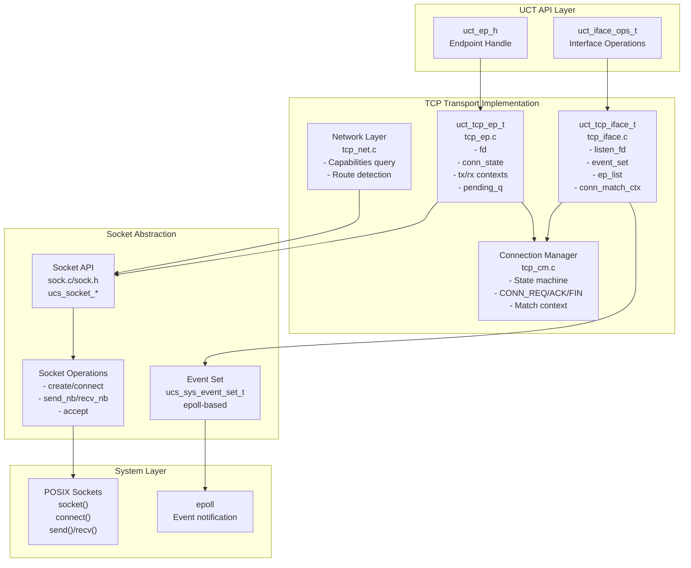
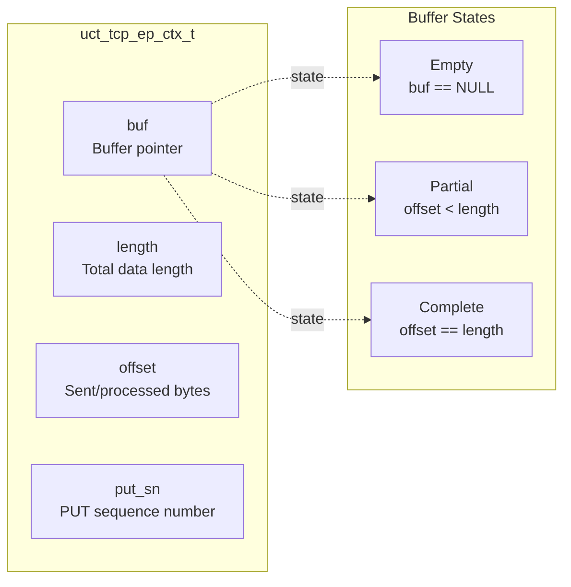
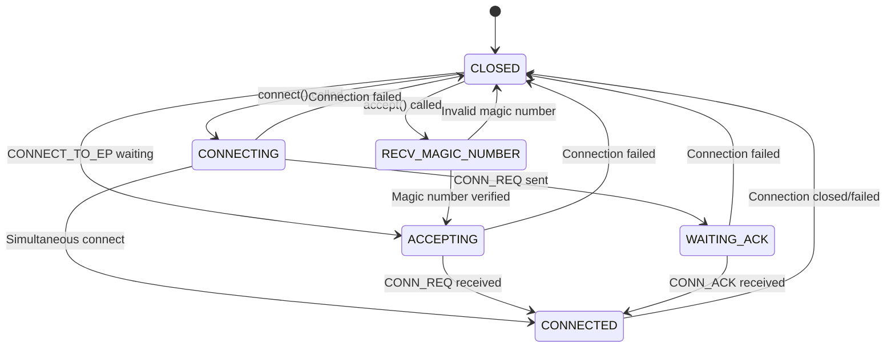
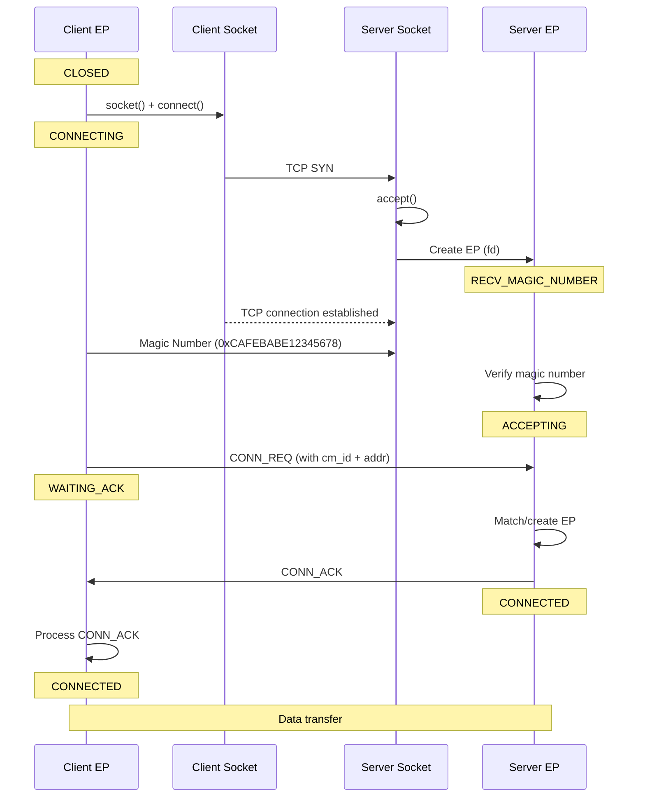
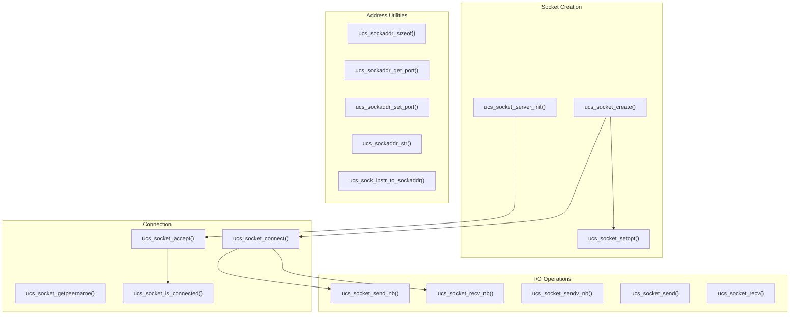
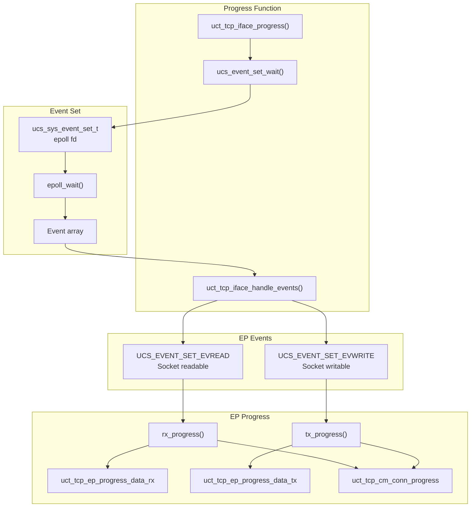
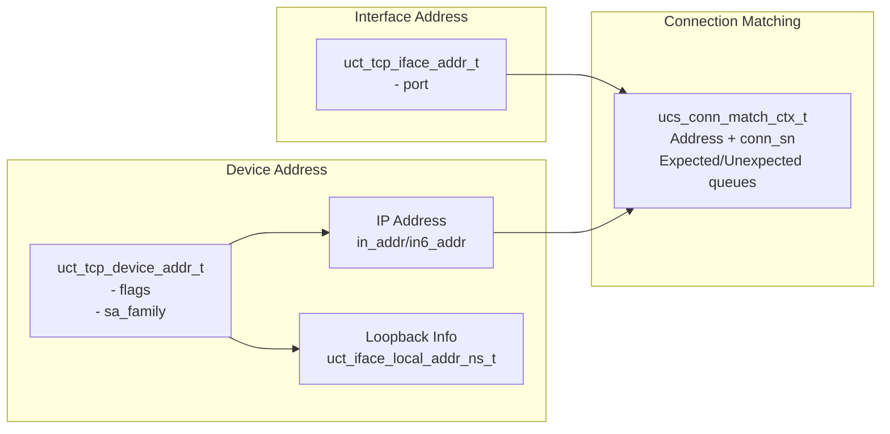
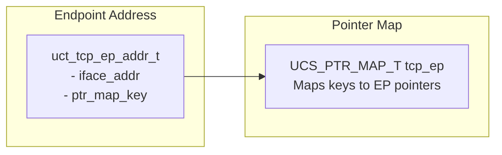
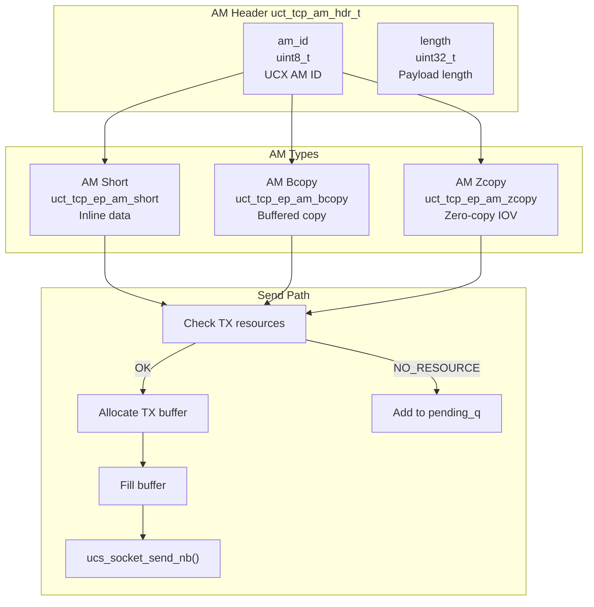
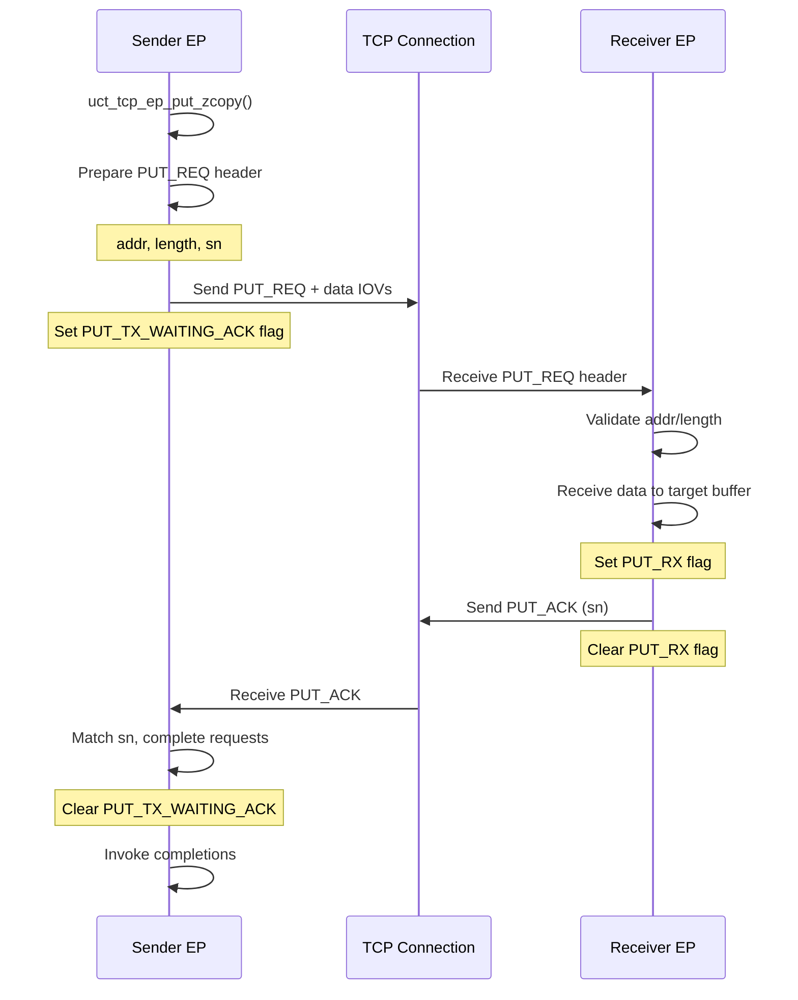

<!-- source: DeepWiki mcp.deepwiki.com · repo openucx/ucx · page 3.6 TCP and Network Transports · fetched 2026-11-11 -->

# TCP and Network Transports

<details>
<summary>Relevant source files</summary>

The following files were used as context for generating this wiki page:

- [src/ucs/sys/sock.c](src/ucs/sys/sock.c)
- [src/ucs/sys/sock.h](src/ucs/sys/sock.h)
- [src/uct/tcp/tcp.h](src/uct/tcp/tcp.h)
- [src/uct/tcp/tcp_cm.c](src/uct/tcp/tcp_cm.c)
- [src/uct/tcp/tcp_ep.c](src/uct/tcp/tcp_ep.c)
- [src/uct/tcp/tcp_iface.c](src/uct/tcp/tcp_iface.c)
- [src/uct/tcp/tcp_net.c](src/uct/tcp/tcp_net.c)
- [test/gtest/ucs/test_sock.cc](test/gtest/ucs/test_sock.cc)
- [test/gtest/uct/tcp/test_tcp.cc](test/gtest/uct/tcp/test_tcp.cc)

</details>


## Purpose and Scope

This document describes the TCP transport implementation in UCX, which provides network-based communication over standard TCP/IP sockets. The TCP transport implements the UCT (Unified Communication Transport) API to enable UCX to work on systems without RDMA hardware, using standard socket-based networking. For information about the UCT API layer, see [UCT (Unified Communication Transport)](#3). For information about other transport implementations like InfiniBand RC/UD/DC, see sections [3.3](#3.3), [3.4](#3.4), and [3.5](#3.5).

The TCP transport is particularly important for:
- Environments without RDMA-capable hardware
- Cross-network communication where RDMA is not available
- Development and testing on standard workstations
- Hybrid deployments mixing RDMA and TCP connectivity

## Architecture Overview

The TCP transport consists of several key components that work together to provide reliable communication over TCP sockets:



Sources: [src/uct/tcp/tcp.h:1-433](), [src/uct/tcp/tcp_iface.c:539-566](), [src/ucs/sys/sock.h:1-600]()

## Core Data Structures

### TCP Interface (`uct_tcp_iface_t`)

The TCP interface structure manages all endpoints and provides the listening socket for incoming connections:

| Field | Type | Description |
|-------|------|-------------|
| `super` | `uct_base_iface_t` | Base interface structure |
| `listen_fd` | `int` | Server socket for accepting connections |
| `conn_match_ctx` | `ucs_conn_match_ctx_t` | Connection matching context for CONNECT_TO_IFACE |
| `ep_ptr_map` | `UCS_PTR_MAP_T(tcp_ep)` | Endpoint pointer map for CONNECT_TO_EP |
| `ep_list` | `ucs_list_link_t` | List of all endpoints |
| `event_set` | `ucs_sys_event_set_t*` | Event set for epoll-based I/O |
| `tx_mpool` | `ucs_mpool_t` | TX buffer memory pool |
| `rx_mpool` | `ucs_mpool_t` | RX buffer memory pool |
| `outstanding` | `size_t` | Outstanding operations counter |

Sources: [src/uct/tcp/tcp.h:367-432]()

### TCP Endpoint (`uct_tcp_ep_t`)

Each TCP endpoint represents a connection to a remote peer:

| Field | Type | Description |
|-------|------|-------------|
| `super` | `uct_base_ep_t` | Base endpoint structure |
| `fd` | `int` | Socket file descriptor |
| `conn_state` | `uint8_t` | Connection state (see state machine) |
| `flags` | `uint16_t` | Endpoint flags (TX/RX capabilities, etc.) |
| `events` | `ucs_event_set_types_t` | Current event notifications (EVREAD/EVWRITE) |
| `tx` | `uct_tcp_ep_ctx_t` | TX context (buffer, offset, length) |
| `rx` | `uct_tcp_ep_ctx_t` | RX context (buffer, offset, length) |
| `pending_q` | `ucs_queue_head_t` | Pending operations queue |
| `cm_id` | `uct_tcp_ep_cm_id_t` | Connection manager ID |
| `peer_addr` | `char[0]` | Remote address (variable length) |

Sources: [src/uct/tcp/tcp.h:336-358]()

### EP Context (`uct_tcp_ep_ctx_t`)

The TX and RX contexts manage partial send/receive operations:



Sources: [src/uct/tcp/tcp.h:267-274]()

## Connection State Machine

The TCP transport implements a sophisticated connection state machine to handle connection establishment, including simultaneous connection attempts:



### Connection States

| State | Name | TX Progress | RX Progress | Description |
|-------|------|-------------|-------------|-------------|
| 0 | `UCT_TCP_EP_CONN_STATE_CLOSED` | None | None | No active connection |
| 1 | `UCT_TCP_EP_CONN_STATE_CONNECTING` | `uct_tcp_cm_conn_progress` | `uct_tcp_ep_progress_data_rx` | Non-blocking connect() in progress |
| 2 | `UCT_TCP_EP_CONN_STATE_RECV_MAGIC_NUMBER` | None | `uct_tcp_ep_progress_magic_number_rx` | Receiving and verifying magic number |
| 3 | `UCT_TCP_EP_CONN_STATE_ACCEPTING` | None | `uct_tcp_ep_progress_data_rx` | Waiting for CONN_REQ |
| 4 | `UCT_TCP_EP_CONN_STATE_WAITING_ACK` | None | `uct_tcp_ep_progress_data_rx` | Waiting for CONN_ACK |
| 5 | `UCT_TCP_EP_CONN_STATE_CONNECTED` | `uct_tcp_ep_progress_data_tx` | `uct_tcp_ep_progress_data_rx` | Fully connected |

Sources: [src/uct/tcp/tcp_ep.c:23-54](), [src/uct/tcp/tcp.h:124-147]()

## Connection Management Protocol

The TCP transport uses a custom connection management protocol to establish connections reliably:



### Connection Request Packet

The `uct_tcp_cm_conn_req_pkt_t` structure carries connection establishment information:

| Field | Type | Description |
|-------|------|-------------|
| `event` | `uct_tcp_cm_conn_event_t` | Event type (CONN_REQ/CONN_ACK/CONN_FIN) |
| `flags` | `uint8_t` | Packet flags (e.g., CONNECT_TO_EP) |
| `cm_id` | `uct_tcp_ep_cm_id_t` | Connection manager ID (conn_sn or ptr_map_key) |
| (variable) | `sockaddr` | Socket address follows |

Sources: [src/uct/tcp/tcp.h:199-205](), [src/uct/tcp/tcp_cm.c:184-259]()

## Socket Abstraction Layer

The TCP transport uses a socket abstraction layer (`ucs/sys/sock.c`) that wraps POSIX socket APIs with UCX-specific error handling and non-blocking I/O:

### Key Socket Operations



### Error Handling

The socket layer maps system errors to UCX status codes:

| errno | UCS Status | Description |
|-------|-----------|-------------|
| `EAGAIN`, `EWOULDBLOCK`, `EINTR` | `UCS_ERR_NO_PROGRESS` | Operation would block, try again |
| `ECONNRESET` | `UCS_ERR_CONNECTION_RESET` | Connection reset by peer |
| `ECONNREFUSED` | `UCS_ERR_REJECTED` | Connection refused |
| `ETIMEDOUT` | `UCS_ERR_TIMED_OUT` | Connection timed out |
| `EPIPE` | `UCS_ERR_CONNECTION_RESET` | Broken pipe |
| `EINPROGRESS` | `UCS_INPROGRESS` | Non-blocking operation in progress |

Sources: [src/ucs/sys/sock.c:291-314]()

## Event-Driven Progress

The TCP transport uses an epoll-based event system for efficient I/O handling:



### Event Management

Endpoints register for events dynamically based on their state and pending operations:

- **EVREAD**: Registered when waiting for incoming data or connection events
- **EVWRITE**: Registered when there is data to send or connection in progress

The function `uct_tcp_ep_mod_events()` manages event registration:

Sources: [src/uct/tcp/tcp_ep.c:982-1011](), [src/uct/tcp/tcp_iface.c:435-457]()

## Address Structures and Connection Methods

The TCP transport supports two connection establishment methods with different addressing schemes:

### CONNECT_TO_IFACE Method

Used for traditional UCX connections where endpoints are matched by address and connection sequence number:



### CONNECT_TO_EP Method

Used for explicit endpoint-to-endpoint connections using pointer map keys:



Sources: [src/uct/tcp/tcp.h:304-330](), [src/uct/tcp/tcp_ep.c:867-904]()

## Data Transfer Operations

### Active Message Protocol

TCP active messages use a simple header followed by payload:



### Reserved AM IDs

The TCP transport reserves several AM IDs for internal protocols:

| AM ID | Name | Purpose |
|-------|------|---------|
| `UCT_AM_ID_MAX` | `UCT_TCP_EP_CM_AM_ID` | Connection manager messages |
| `UCT_AM_ID_MAX + 1` | `UCT_TCP_EP_PUT_REQ_AM_ID` | PUT Zcopy request |
| `UCT_AM_ID_MAX + 2` | `UCT_TCP_EP_PUT_ACK_AM_ID` | PUT Zcopy acknowledgment |
| `UCT_AM_ID_MAX + 3` | `UCT_TCP_EP_KEEPALIVE_AM_ID` | Keepalive messages |

Sources: [src/uct/tcp/tcp.h:211-229]()

### PUT Zcopy Protocol

The TCP transport supports zero-copy PUT operations with acknowledgment:



Sources: [src/uct/tcp/tcp.h:235-261]()

## Network Capabilities Query

The TCP transport queries network interface capabilities to estimate bandwidth and latency:

### Bandwidth Estimation

The bandwidth calculation considers:

1. **Link Speed**: Obtained via `ETHTOOL_GSET` ioctl
2. **MTU**: Maximum transmission unit from `SIOCGIFMTU` ioctl
3. **Link Layer Headers**: Protocol-specific overheads
4. **TCP/IP Headers**: 40 bytes per packet

Formula for effective bandwidth:
```
bandwidth = (link_speed_bps / 8) * (mtu - 40) / (mtu + ll_headers)
```

### Latency Estimation

Latency is estimated based on serialization delay and processing overhead:
```
latency = (576 bytes / link_speed_bps) + 5.2 microseconds
```

Sources: [src/uct/tcp/tcp_net.c:28-107]()

## Configuration Parameters

The TCP interface supports numerous configuration parameters:

| Parameter | Default | Description |
|-----------|---------|-------------|
| `TX_SEG_SIZE` | 8KB | Size of TX copy-out buffer |
| `RX_SEG_SIZE` | 64KB | Size of RX copy-out buffer |
| `MAX_IOV` | 6 | Maximum IOV count for vectored I/O |
| `SENDV_THRESH` | 2KB | Threshold for using sendmsg() vs send() |
| `PUT_ENABLE` | yes | Enable PUT Zcopy support |
| `CONN_NB` | no | Use non-blocking connect() |
| `MAX_POLL` | 16 | Number of events to poll per progress |
| `MAX_CONN_RETRIES` | 25 | Connection retry attempts |
| `NODELAY` | yes | TCP_NODELAY socket option |
| `PORT_RANGE` | 0 | Port range for bind() |
| `KEEPIDLE` | 10s | TCP keepalive idle time |
| `KEEPCNT` | auto | TCP keepalive probe count |
| `KEEPINTVL` | 2s | TCP keepalive interval |

Sources: [src/uct/tcp/tcp_iface.c:28-123]()

## Interface Operations Summary

The TCP transport implements the full UCT interface operations table:

| Operation | Function | Description |
|-----------|----------|-------------|
| `ep_am_short` | `uct_tcp_ep_am_short` | Short active message |
| `ep_am_short_iov` | `uct_tcp_ep_am_short_iov` | Short active message with IOV |
| `ep_am_bcopy` | `uct_tcp_ep_am_bcopy` | Buffered copy active message |
| `ep_am_zcopy` | `uct_tcp_ep_am_zcopy` | Zero-copy active message |
| `ep_put_zcopy` | `uct_tcp_ep_put_zcopy` | Zero-copy PUT operation |
| `ep_pending_add` | `uct_tcp_ep_pending_add` | Add pending operation |
| `ep_pending_purge` | `uct_tcp_ep_pending_purge` | Purge pending operations |
| `ep_flush` | `uct_tcp_ep_flush` | Flush endpoint |
| `ep_create` | `uct_tcp_ep_create` | Create endpoint |
| `ep_destroy` | `uct_tcp_ep_destroy` | Destroy endpoint |
| `ep_get_address` | `uct_tcp_ep_get_address` | Get endpoint address |
| `ep_connect_to_ep` | `uct_tcp_ep_connect_to_ep_v2` | Connect to endpoint |
| `iface_flush` | `uct_tcp_iface_flush` | Flush interface |
| `iface_progress` | `uct_tcp_iface_progress` | Progress I/O |
| `iface_query` | `uct_tcp_iface_query` | Query interface attributes |
| `iface_is_reachable` | `uct_tcp_iface_is_reachable_v2` | Check reachability |

Sources: [src/uct/tcp/tcp_iface.c:539-566]()

---

