<!-- source: DeepWiki mcp.deepwiki.com · repo openucx/ucx · page 3.7 MLX5 Hardware Acceleration · fetched 2026-11-11 -->

# MLX5 Hardware Acceleration

Relevant source files

The following files were used as context for generating this wiki page:

- [src/uct/ib/base/ib_md.c](src/uct/ib/base/ib_md.c)
- [src/uct/ib/base/ib_md.h](src/uct/ib/base/ib_md.h)
- [src/uct/ib/configure.m4](src/uct/ib/configure.m4)
- [src/uct/ib/mlx5/dv/ib_mlx5_dv.c](src/uct/ib/mlx5/dv/ib_mlx5_dv.c)
- [src/uct/ib/mlx5/dv/ib_mlx5_ifc.h](src/uct/ib/mlx5/dv/ib_mlx5_ifc.h)
- [src/uct/ib/mlx5/dv/ib_mlx5dv_md.c](src/uct/ib/mlx5/dv/ib_mlx5dv_md.c)
- [src/uct/ib/mlx5/ib_mlx5.c](src/uct/ib/mlx5/ib_mlx5.c)
- [src/uct/ib/mlx5/ib_mlx5.h](src/uct/ib/mlx5/ib_mlx5.h)
- [src/uct/ib/mlx5/ib_mlx5.inl](src/uct/ib/mlx5/ib_mlx5.inl)
- [src/uct/ib/rc/base/rc_ep.c](src/uct/ib/rc/base/rc_ep.c)
- [src/uct/ib/rc/base/rc_ep.h](src/uct/ib/rc/base/rc_ep.h)
- [src/uct/ib/rc/base/rc_iface.c](src/uct/ib/rc/base/rc_iface.c)
- [src/uct/ib/rc/base/rc_iface.h](src/uct/ib/rc/base/rc_iface.h)
- [src/uct/ib/rc/verbs/rc_verbs.h](src/uct/ib/rc/verbs/rc_verbs.h)
- [src/uct/ib/rc/verbs/rc_verbs_ep.c](src/uct/ib/rc/verbs/rc_verbs_ep.c)
- [src/uct/ib/rc/verbs/rc_verbs_iface.c](src/uct/ib/rc/verbs/rc_verbs_iface.c)

This document covers MLX5-specific hardware acceleration features in UCX. These optimizations target Mellanox ConnectX-5, ConnectX-6, and ConnectX-7 network adapters, providing direct hardware access and specialized features that bypass or extend standard InfiniBand Verbs.

**Code Organization**: MLX5 support is implemented in [src/uct/ib/mlx5/]() with:
- **Core abstractions**: [src/uct/ib/mlx5/ib_mlx5.h](), [src/uct/ib/mlx5/ib_mlx5.c]()
- **Inline helpers**: [src/uct/ib/mlx5/ib_mlx5.inl]()
- **Direct Verbs wrapper**: [src/uct/ib/mlx5/dv/ib_mlx5_dv.c]()
- **DEVX memory domain**: [src/uct/ib/mlx5/dv/ib_mlx5dv_md.c]()
- **Hardware interface definitions**: [src/uct/ib/mlx5/dv/ib_mlx5_ifc.h]()

**Scope**: This page documents the low-level MLX5 hardware interface layer including Direct Verbs (DV), DEVX (Direct Hardware Access), optimized WQE posting mechanisms, CQE compression, and advanced memory key management. For RC/DC/UD transport protocols that use these facilities, see [3.3](#3.3), [3.4](#3.4), and [3.5](#3.5). For general IB infrastructure, see [3.2](#3.2).

**Sources**: [src/uct/ib/mlx5/ib_mlx5.h:1-10](), [src/uct/ib/mlx5/ib_mlx5.c:1-10]()

## MLX5 Hardware Interface Methods

MLX5 hardware can be accessed through two primary interfaces that provide different levels of hardware control and performance optimization.

### Verbs vs Direct Verbs vs DEVX

MLX5 hardware access levels (from most portable to most optimized):

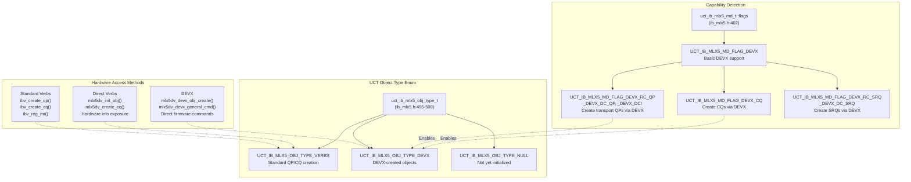

**Sources**: [src/uct/ib/mlx5/ib_mlx5.h:172-220](), [src/uct/ib/mlx5/ib_mlx5.h:495-502]()

**Hardware Access Levels**:

1. **Standard Verbs**: Portable `ibv_*` API functions. Maximum compatibility but limited optimization.
2. **Direct Verbs (DV)**: `mlx5dv_init_obj()` extracts hardware-specific fields from Verbs objects (queue buffer addresses, doorbells, etc.). Enables zero-copy posting. Function: [src/uct/ib/mlx5/dv/ib_mlx5_dv.c:15-26]()
3. **DEVX**: `mlx5dv_devx_obj_create()` creates objects via firmware commands, bypassing kernel. Enables advanced features (UMR, KSM, cross-device access). Code: [src/uct/ib/mlx5/dv/ib_mlx5dv_md.c]()

**Object Type Selection**: The `uct_ib_mlx5_obj_type_t` enum (lines 495-502) tags each QP, CQ, and SRQ object with its creation method. The `type` field appears in:
- `uct_ib_mlx5_qp_t::type` [src/uct/ib/mlx5/ib_mlx5.h:658]()
- `uct_ib_mlx5_cq_t::type` [src/uct/ib/mlx5/ib_mlx5.h:600]()
- `uct_ib_mlx5_srq_t::type` [src/uct/ib/mlx5/ib_mlx5.h:505]()

**Capability Flags**: The `uct_ib_mlx5_md_t::flags` field (line 402) is a bitmask set during MD initialization. DEVX object creation flags are configured via `UCX_IB_MLX5_DEVX_OBJECTS` environment variable, parsed at [src/uct/ib/base/ib_md.c:144-147]().

### Hardware Access Code Paths

QP and CQ Creation Flows

```mermaid
graph TB
    subgraph "QP Creation: uct_ib_mlx5_iface_create_qp()"
        CREATE_QP["uct_ib_mlx5_iface_create_qp()<br/>(ib_mlx5.c:348)"]
        GET_RES["uct_ib_mlx5_iface_get_res_domain()<br/>Get/create resource domain"]
        CHECK_DEVX{"Check qp_type-specific<br/>DEVX flag in md->flags"}
        VERBS_PATH["Verbs Path"]
        DEVX_PATH["DEVX Path"]
        
        VERBS_QP["uct_ib_iface_create_qp()<br/>ibv_create_qp_ex()"]
        VERBS_DV["mlx5dv_init_obj()<br/>Extract HW info"]
        
        DEVX_QP["uct_ib_mlx5_devx_create_qp()<br/>Build firmware command"]
        DEVX_CMD["mlx5dv_devx_obj_create()<br/>Execute CREATE_QP"]
        DEVX_QUERY["mlx5dv_devx_obj_query()<br/>Get qp_num"]
    end
    
    subgraph "CQ Creation: uct_ib_mlx5_create_cq()"
        CREATE_CQ["uct_ib_mlx5_create_cq()<br/>(ib_mlx5.c:117)"]
        CQ_DV_CREATE["mlx5dv_create_cq()<br/>Set CQE size (64/128)"]
        CQ_FILL["uct_ib_mlx5_fill_cq()<br/>mlx5dv_init_obj() + parse"]
        CQ_INIT["uct_ib_mlx5_init_cq_common()<br/>Initialize fields"]
        CQ_FILLBUF["uct_ib_mlx5_fill_cq_buf()<br/>Set owner bits"]
        
        CQ_DEVX_PATH["DEVX CQ Path"]
        DEVX_CQ["uct_ib_mlx5_devx_create_cq()<br/>Build CQ firmware cmd"]
        DEVX_CQ_CMD["mlx5dv_devx_obj_create()<br/>Execute CREATE_CQ"]
    end
    
    CREATE_QP --> GET_RES
    GET_RES --> CHECK_DEVX
    CHECK_DEVX -->|"No DEVX flag"| VERBS_PATH
    CHECK_DEVX -->|"Has DEVX flag"| DEVX_PATH
    
    VERBS_PATH --> VERBS_QP
    VERBS_QP --> VERBS_DV
    
    DEVX_PATH --> DEVX_QP
    DEVX_QP --> DEVX_CMD
    DEVX_CMD --> DEVX_QUERY
    
    CREATE_CQ --> CQ_DV_CREATE
    CQ_DV_CREATE --> CQ_FILL
    CQ_FILL --> CQ_INIT
    CQ_INIT --> CQ_FILLBUF
    
    CREATE_CQ -.->|"If DEVX_CQ flag"| CQ_DEVX_PATH
    CQ_DEVX_PATH --> DEVX_CQ
    DEVX_CQ --> DEVX_CQ_CMD
```

**Sources**: [src/uct/ib/mlx5/ib_mlx5.c:348-373](), [src/uct/ib/mlx5/ib_mlx5.c:117-157](), [src/uct/ib/mlx5/ib_mlx5.c:174-198]()

**QP Creation Path** [src/uct/ib/mlx5/ib_mlx5.c:348-373]():
1. `uct_ib_mlx5_iface_create_qp()` entry point
2. `uct_ib_mlx5_iface_get_res_domain()` obtains resource domain (thread domain + PD)
3. Checks transport-specific DEVX flags: `UCT_IB_MLX5_MD_FLAG_DEVX_RC_QP`, `UCT_IB_MLX5_MD_FLAG_DEVX_DCI`, etc.
4. **Verbs path**: `uct_ib_iface_create_qp()` → `ibv_create_qp_ex()` → `mlx5dv_init_obj()` to extract hardware fields
5. **DEVX path**: `uct_ib_mlx5_devx_create_qp()` builds firmware command buffer → `mlx5dv_devx_obj_create()` → `mlx5dv_devx_obj_query()` for QP number

**CQ Creation Path** [src/uct/ib/mlx5/ib_mlx5.c:117-157]():
1. `uct_ib_mlx5_create_cq()` entry point
2. `mlx5dv_create_cq()` creates CQ with specified CQE size (64 or 128 bytes based on inline data requirements)
3. `uct_ib_mlx5_fill_cq()` calls `mlx5dv_init_obj()` to extract hardware info (CQ buffer, doorbell, CQN)
4. `uct_ib_mlx5_init_cq_common()` initializes CQ structure fields
5. `uct_ib_mlx5_fill_cq_buf()` sets owner bits on all CQEs
6. **DEVX CQ alternative** (if `UCT_IB_MLX5_MD_FLAG_DEVX_CQ` set): `uct_ib_mlx5_devx_create_cq()` creates CQ via firmware command

## MMIO Posting Modes

Memory-Mapped I/O (MMIO) posting determines how Work Queue Entries are written to hardware. MLX5 supports multiple posting modes optimized for different threading and latency requirements.

### Posting Mode Selection

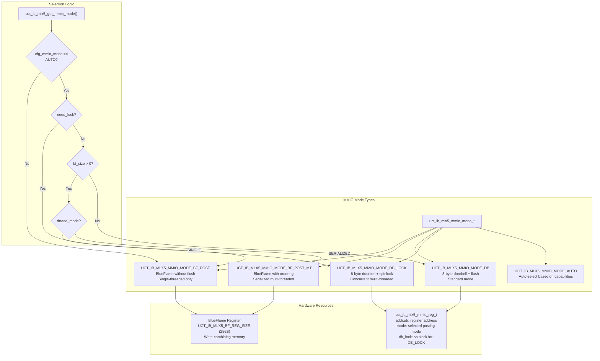

**Sources**: [src/uct/ib/mlx5/ib_mlx5.h:457-468](), [src/uct/ib/mlx5/ib_mlx5.c:738-764]()

The mode selection at [src/uct/ib/mlx5/ib_mlx5.c:738-764]() follows this logic:
1. If user specified non-AUTO mode, use that
2. If need_lock is true (no thread domain support), use `DB_LOCK`
3. If BlueFlame register available (bf_size > 0):
   - Single-threaded: `BF_POST` (maximum performance)
   - Serialized multi-threaded: `BF_POST_MT` (with WC fence)
4. Otherwise: `DB` (8-byte doorbell with memory fence)

### WQE Posting Implementation

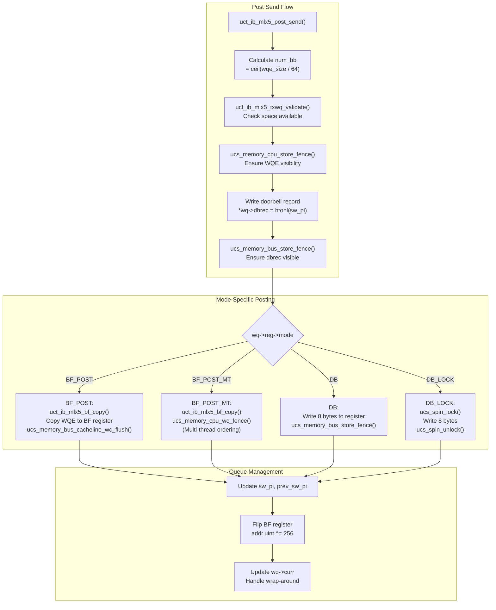

**Sources**: [src/uct/ib/mlx5/ib_mlx5.inl:576-647]()

The posting flow at [src/uct/ib/mlx5/ib_mlx5.inl:576-647]() implements hardware-specific optimizations:

**BlueFlame Posting** (BF_POST/BF_POST_MT):
- Copies entire WQE (up to 256 bytes) to write-combining BlueFlame register via `uct_ib_mlx5_bf_copy()` [src/uct/ib/mlx5/ib_mlx5.inl:559-574]()
- Hardware DMAs directly from register to NIC, reducing latency by ~10-30ns
- `uct_ib_mlx5_bf_copy_bb()` [src/uct/ib/mlx5/ib_mlx5.inl:536-557]() uses SIMD:
  - ARM NEON: `vst4q_u64()` / `vld4q_u64()` for 4× 64-bit stores
  - x86 SSE4.2: `_mm_load_si128()` / `_mm_store_si128()` for 128-bit moves
- BF register flips between two 256-byte regions (`addr.uint ^= UCT_IB_MLX5_BF_REG_SIZE`) to allow pipelining
- `ucs_memory_bus_cacheline_wc_flush()` ensures WC buffer flushed to bus

**Doorbell Posting** (DB/DB_LOCK):
- Writes only 8 bytes (control segment header) to MMIO register at [src/uct/ib/mlx5/ib_mlx5.inl:633-634]()
- Hardware fetches full WQE from memory using DMA
- `ucs_memory_bus_store_fence()` ensures WQE written before doorbell [src/uct/ib/mlx5/ib_mlx5.inl:629]()
- DB_LOCK adds `ucs_spin_lock(&wq->reg->db_lock)` for concurrent thread access [src/uct/ib/mlx5/ib_mlx5.inl:636-641]()

## CQE Zipping (Compression)

CQE zipping reduces PCIe bandwidth by merging multiple similar Completion Queue Entries into a compressed block. This is especially effective for bulk data transfers with similar completion patterns.

### CQE Zipping Architecture

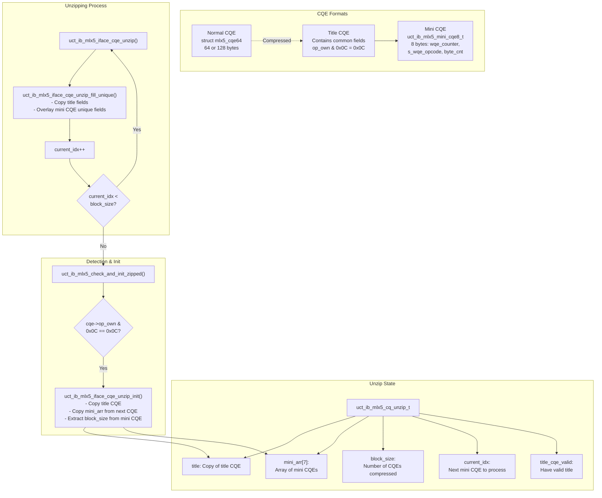

**Sources**: [src/uct/ib/mlx5/ib_mlx5.h:544-559](), [src/uct/ib/mlx5/ib_mlx5.c:415-487](), [src/uct/ib/mlx5/ib_mlx5.inl:139-153]()

**Compression Format**:
- **Title CQE**: First CQE in block contains common fields (timestamp, vendor_syndrome, etc.)
  - Detection: `uct_ib_mlx5_cqe_is_error_or_zipped(cqe->op_own)` checks `(op_own & 0x0C) == 0x0C` [src/uct/ib/mlx5/ib_mlx5.inl:50-56]()
- **Mini CQE Array**: Following CQE(s) contain up to 7 mini-CQEs (8 bytes each)
  - `uct_ib_mlx5_mini_cqe8_t` struct [src/uct/ib/mlx5/ib_mlx5.h:533-538](): `wqe_counter`, `s_wqe_opcode`, `byte_cnt`
  - Extracted at [src/uct/ib/mlx5/ib_mlx5.c:432-448]() into `cq->cq_unzip.mini_arr[]`
- **Block Size**: Stored in mini CQE `op_own` field, extracted via `((miniCQE[0]->op_own >> 4) & 7) + 1` [src/uct/ib/mlx5/ib_mlx5.c:443]()

**Unzipping Process**:
1. **Detection** [src/uct/ib/mlx5/ib_mlx5.inl:139-153](): `uct_ib_mlx5_check_and_init_zipped()` identifies title CQE
2. **Initialization** [src/uct/ib/mlx5/ib_mlx5.c:415-456](): `uct_ib_mlx5_iface_cqe_unzip_init()`
   - Copies title CQE to `cq->cq_unzip.title`
   - Extracts mini CQE array from next CQE(s)
   - Sets `cq->cq_unzip.block_size` and `current_idx = 1` (skipping title)
3. **Reconstruction** [src/uct/ib/mlx5/ib_mlx5.c:458-487](): `uct_ib_mlx5_iface_cqe_unzip()`
   - Calls `uct_ib_mlx5_iface_cqe_unzip_fill_unique()` [src/uct/ib/mlx5/ib_mlx5.inl:155-184]()
   - Copies title fields, overlays mini CQE unique fields
   - Increments `current_idx`, returns pointer to reconstructed CQE
4. **Continuation**: Loop until `current_idx >= block_size`, then resume normal CQ polling

**Configuration** [src/uct/ib/mlx5/ib_mlx5.c:88-106]():
- Function: `uct_ib_mlx5_parse_cqe_zipping()` sets `init_attr->cqe_zip_sizes[dir]` based on:
  - Environment variables: `UCX_IB_TX_CQE_ZIP_ENABLE`, `UCX_IB_RX_CQE_ZIP_ENABLE`
  - Hardware flags: `UCT_IB_MLX5_MD_FLAG_CQE64_ZIP` or `UCT_IB_MLX5_MD_FLAG_CQE128_ZIP`
- Zipping enabled by passing `UCT_IB_MLX5_CQ_CQE_ZIP` flag to `uct_ib_mlx5_create_cq()`

## Queue Pair and Work Queue Structures

MLX5 extends standard IB queue structures with hardware-specific fields for direct hardware access and optimized posting.

### Send Work Queue (TXWQ)

```mermaid
graph TB
    subgraph "uct_ib_mlx5_txwq_t Structure"
        TXWQ["uct_ib_mlx5_txwq_t"]
        SUPER["super: uct_ib_mlx5_qp_t<br/>- qp_num: QP number<br/>- type: VERBS/DEVX/NULL"]
        SW_PI["sw_pi: Software producer index<br/>Next WQE to post"]
        PREV_SW_PI["prev_sw_pi: Previous sw_pi<br/>First BB of last posted WQE"]
        REG["reg: uct_ib_mlx5_mmio_reg_t*<br/>BlueFlame/Doorbell register"]
        CURR["curr: void*<br/>Current WQE pointer"]
        DBREC["dbrec: volatile uint32_t*<br/>Doorbell record"]
        QSTART["qstart: void*<br/>Queue start address"]
        QEND["qend: void*<br/>Queue end address"]
        BB_MAX["bb_max: uint16_t<br/>Max BBs minus 2*MAX_BB"]
        SIG_PI["sig_pi: uint16_t<br/>PI of last signaled WQE"]
        HW_CI["hw_ci: uint16_t (ASSERT)<br/>Hardware consumer index"]
        FI["fi: uct_ib_fence_info_t<br/>Fence tracking"]
    end
    
    subgraph "Basic Block (BB) Concept"
        BB_SIZE["BB Size = 64 bytes<br/>MLX5_SEND_WQE_BB"]
        WQE_LAYOUT["WQE spans 1-4 BBs<br/>UCT_IB_MLX5_MAX_BB = 4"]
        BB_CALC["num_bb = ceil(wqe_size / 64)"]
    end
    
    subgraph "Wrap-Around Handling"
        WRAP_NONE["uct_ib_mlx5_txwq_wrap_none()<br/>No wrap expected"]
        WRAP_EXACT["uct_ib_mlx5_txwq_wrap_exact()<br/>Wrap only at qend"]
        WRAP_ANY["uct_ib_mlx5_txwq_wrap_any()<br/>Wrap past qend"]
        WRAP_DATA["uct_ib_mlx5_txwq_wrap_data()<br/>Wrap without alignment check"]
    end
    
    TXWQ --> SUPER
    TXWQ --> SW_PI
    TXWQ --> PREV_SW_PI
    TXWQ --> REG
    TXWQ --> CURR
    TXWQ --> DBREC
    TXWQ --> QSTART
    TXWQ --> QEND
    TXWQ --> BB_MAX
    TXWQ --> SIG_PI
    TXWQ --> HW_CI
    TXWQ --> FI
    
    BB_SIZE --> WQE_LAYOUT
    WQE_LAYOUT --> BB_CALC
    
    QEND -.-> WRAP_NONE
    QEND -.-> WRAP_EXACT
    QEND -.-> WRAP_ANY
    QEND -.-> WRAP_DATA
```

**Sources**: [src/uct/ib/mlx5/ib_mlx5.h:676-693](), [src/uct/ib/mlx5/ib_mlx5.inl:289-333]()

**Key Fields**:
- **sw_pi** (software producer index): Points to next WQE to post, incremented by `num_bb`
- **prev_sw_pi**: Starting BB index of last posted WQE; used to calculate available space
- **curr**: Pointer to next WQE location in queue buffer
- **bb_max**: Available space = `qp_wqe_cnt - 2*UCT_IB_MLX5_MAX_BB`
  - Reserve 2×MAX_BB because: (1) CQE gives index of last BB, not first; (2) we check space before knowing exact WQE size
- **dbrec**: Doorbell record written to notify hardware of new WQEs
- **reg**: MMIO register for BlueFlame or Doorbell posting

**Wrap-Around Functions** at [src/uct/ib/mlx5/ib_mlx5.inl:289-333]():
- Used to handle circular queue buffer when `curr` reaches `qend`
- `wrap_none`: Asserts no wrap needed (internal queue segments)
- `wrap_exact`: Handles wrap exactly at `qend` boundary
- `wrap_any`: Handles wrap past `qend` (when adding variable sizes)
- `wrap_data`: Like `wrap_any` but no alignment checks (for inline data)

### Completion Queue (CQ)

```mermaid
graph TB
    subgraph "uct_ib_mlx5_cq_t Structure"
        CQ["uct_ib_mlx5_cq_t"]
        CQ_TYPE["type: uct_ib_mlx5_obj_type_t<br/>VERBS or DEVX"]
        CQ_BUF["cq_buf: void*<br/>CQ buffer base"]
        CQ_CI["cq_ci: unsigned<br/>Consumer index"]
        CQ_SN["cq_sn: unsigned<br/>Sequence number"]
        CQ_LEN_LOG["cq_length_log: unsigned<br/>log2(cq_size)"]
        CQ_LEN_MASK["cq_length_mask: unsigned<br/>cq_size - 1"]
        CQE_SIZE_LOG["cqe_size_log: unsigned<br/>log2(64 or 128)"]
        CQ_NUM["cq_num: unsigned<br/>CQ number"]
        UAR["uar: void*<br/>CQ doorbell register"]
        DBREC["dbrec: volatile uint32_t*<br/>Consumer index record"]
        ZIP["zip: int<br/>Zipping enabled flag"]
        OWN_OFFSET["own_field_offset: unsigned<br/>Ownership field offset"]
        OWN_MASK["own_mask: unsigned<br/>Ownership bit mask"]
        UNZIP["cq_unzip: uct_ib_mlx5_cq_unzip_t<br/>Unzipping state"]
    end
    
    subgraph "CQE Polling"
        GET_CQE["uct_ib_mlx5_get_cqe(cq, idx)<br/>= cq_buf + (idx & mask) << size_log"]
        CHECK_OWN["uct_ib_mlx5_cqe_is_hw_owned()<br/>Check ownership bit:<br/>sw_count = idx >> length_log<br/>(sw_count ^ cqe->op_own) & mask"]
        POLL_CQ["uct_ib_mlx5_poll_cq()<br/>- Get CQE at cq_ci<br/>- Check ownership<br/>- Memory fence<br/>- Check for error/zip<br/>- Increment cq_ci"]
    end
    
    subgraph "CQ Creation"
        CREATE["uct_ib_mlx5_create_cq()"]
        DV_CREATE["mlx5dv_create_cq()<br/>Set CQE size 64/128"]
        FILL_CQ["uct_ib_mlx5_fill_cq()<br/>Query DV info"]
        INIT_COMMON["uct_ib_mlx5_init_cq_common()<br/>Initialize fields"]
        FILL_BUF["uct_ib_mlx5_fill_cq_buf()<br/>Set owner bits"]
    end
    
    CQ --> CQ_TYPE
    CQ --> CQ_BUF
    CQ --> CQ_CI
    CQ --> CQ_SN
    CQ --> CQ_LEN_LOG
    CQ --> CQ_LEN_MASK
    CQ --> CQE_SIZE_LOG
    CQ --> CQ_NUM
    CQ --> UAR
    CQ --> DBREC
    CQ --> ZIP
    CQ --> OWN_OFFSET
    CQ --> OWN_MASK
    CQ --> UNZIP
    
    CQ_BUF --> GET_CQE
    GET_CQE --> CHECK_OWN
    CHECK_OWN --> POLL_CQ
    
    CREATE --> DV_CREATE
    DV_CREATE --> FILL_CQ
    FILL_CQ --> INIT_COMMON
    INIT_COMMON --> FILL_BUF
```

**Sources**: [src/uct/ib/mlx5/ib_mlx5.h:599-632](), [src/uct/ib/mlx5/ib_mlx5.c:117-254](), [src/uct/ib/mlx5/ib_mlx5.inl:21-188]()

**Ownership Tracking**:
- Hardware and software maintain iteration counters for the circular CQ
- **sw_count** = `cq_ci >> cq_length_log`: Software's lap number around CQ
- **hw_count**: Hardware's lap number, stored in CQE
- CQE is hardware-owned when `(sw_count ^ hw_count) & own_mask != 0`
- For zipping: `own_field_offset` points to signature field; `own_mask = 0xff`
- For normal: `own_field_offset` points to op_own field; `own_mask = MLX5_CQE_OWNER_MASK`

**CQE Size Selection** at [src/uct/ib/mlx5/ib_mlx5.c:133]():
- 64-byte CQE: Up to 32 bytes inline receive data
- 128-byte CQE: Up to 64 bytes inline receive data
- Selected based on `inl > 32` during CQ creation

## Memory Key Management

MLX5 provides advanced memory key (MKEY) features for indirect addressing, atomic operations, and cross-device access.

### MKEY Types and Usage

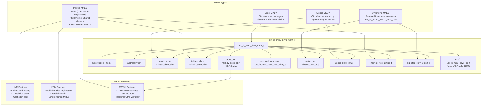

**Sources**: [src/uct/ib/mlx5/ib_mlx5.h:316-332](), [src/uct/ib/mlx5/ib_mlx5.h:344-366]()

**MKEY Types**:

1. **Direct MKEY**: Standard memory region with direct physical address translation
   - Created via `ibv_reg_mr()` or DEVX `mlx5dv_devx_obj_create()`

2. **Atomic MKEY** (lines 328-329): Separate rkey with offset for atomic operations
   - Required when atomics need different addressing than regular RDMA
   - `atomic_dvmr` stores the DEVX object, `atomic_rkey` is the packed remote key

3. **Indirect MKEY** (lines 319-330): Points to other MKEYs, provides indirection
   - **UMR (User Mode Registration)**: Creates indirect MKEY through QP operations
   - **KSM (Kernel Shared Memory)**: Indirect MKEY pointing to multiple memory regions
   - Used for multi-threaded registration: register chunks in parallel, wrap with single KSM
   - `indirect_dvmr` stores object, `indirect_rkey` for remote access

4. **Symmetric MKEY** (line 323): Reserved MKEY index for cross-device communication
   - `smkey_mr` and `exported_lkey` allow predictable addressing
   - Identified by `mkey_tag == UCT_IB_MLX5_MKEY_TAG_UMR` (line 382)

5. **XGVMI MKEY** (line 321): Cross-device access from DPU to host
   - `cross_mr` provides alias for UMR mkeys on remote device
   - Requires `UCT_IB_MLX5_MD_FLAG_XGVMI_UMR` support (line 204)

### MKEY Tag and LRU Cache

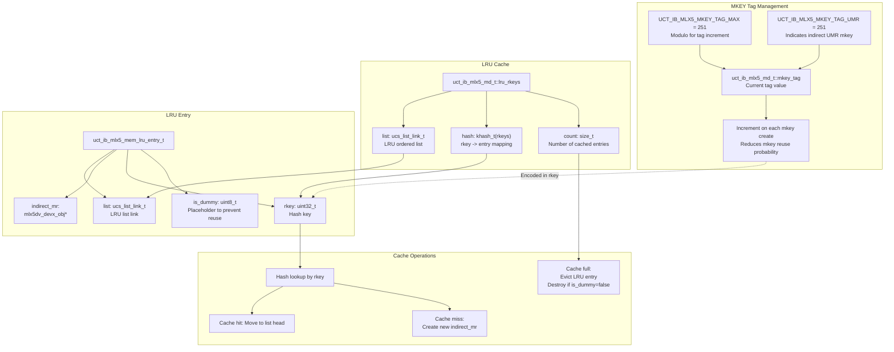

**Sources**: [src/uct/ib/mlx5/ib_mlx5.h:376-383](), [src/uct/ib/mlx5/ib_mlx5.h:344-366](), [src/uct/ib/mlx5/ib_mlx5.h:411-415]()

**MKEY Tag** (lines 376-383):
- 8 LSB of mkey index incremented for each new mkey
- Uses modulo 251 (`UCT_IB_MLX5_MKEY_TAG_MAX`) to avoid hitting reserved values
- Reduces probability of accidentally reusing same mkey value across registrations
- Special tag `UCT_IB_MLX5_MKEY_TAG_UMR` (251) indicates exported indirect UMR mkey

**LRU Cache** (lines 344-366, 411-415):
- Caches indirect rkeys to avoid repeatedly creating/destroying indirect MKEYs
- **Hash table**: Fast lookup by rkey value
- **Linked list**: Maintains LRU ordering for eviction
- **is_dummy flag**: Entry holds rkey reservation but no active memh reference
  - When `is_dummy=true`: Placeholder to prevent rkey reuse, destroy indirect_mr on eviction
  - When `is_dummy=false`: Active memh reference, don't destroy on eviction
- Cache operations:
  - Hit: Move entry to list head (most recently used)
  - Miss: Create new indirect_mr, add to cache
  - Full: Evict tail entry (least recently used)

### UMR MKEY Pool and Cross-Device Mapping

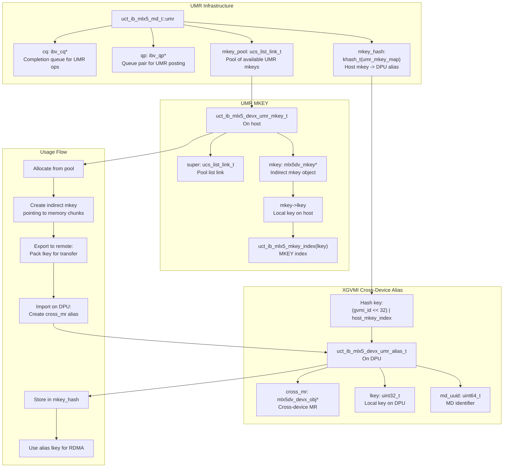

**Sources**: [src/uct/ib/mlx5/ib_mlx5.h:286-304](), [src/uct/ib/mlx5/ib_mlx5.h:298-309](), [src/uct/ib/mlx5/ib_mlx5.h:424-433]()

**UMR MKEY Pool** (lines 424-433):
- `umr.cq` and `umr.qp`: Used to post UMR operations creating indirect mkeys
- `umr.mkey_pool`: Linked list of available `uct_ib_mlx5_devx_umr_mkey_t` objects
- Each entry contains `mlx5dv_mkey*` representing an indirect mkey
- Mkeys allocated from pool, returned after use for reuse

**XGVMI Cross-Device Mapping** (lines 298-313):
- Enables DPU to access host memory through UMR mkeys
- **Host side** (lines 286-295):
  - Creates UMR mkey with `mlx5dv_mkey`
  - Exports `lkey` to DPU via packed buffer
  - Stored in `uct_ib_mlx5_devx_mem_t::exported_umr_mkey`
- **DPU side** (lines 298-309):
  - Creates `cross_mr` alias for host's UMR mkey
  - `uct_ib_mlx5_devx_umr_alias_t` contains local `lkey` on DPU
  - Stored in hash map with key = `(gvmi_id << 32) | host_mkey_index`
  - GVMI (Global Virtual Memory Identifier) identifies source device
- Requires `UCT_IB_MLX5_MD_FLAG_XGVMI_UMR` support
- Workflow enables zero-copy DMA between host and DPU

## Work Queue Element (WQE) Helpers

MLX5 provides optimized inline functions for constructing and copying WQE segments with SIMD acceleration.

### WQE Segment Construction

```mermaid
graph TB
    subgraph "Control Segment"
        CTRL_SEG["struct mlx5_wqe_ctrl_seg"]
        SET_CTRL["uct_ib_mlx5_set_ctrl_seg()"]
        SET_CTRL_IMM["uct_ib_mlx5_set_ctrl_seg_with_imm()"]
        CTRL_FIELDS["- opmod_idx_opcode<br/>- qpn_ds<br/>- dci_stream_channel_id<br/>- fm_ce_se<br/>- imm (optional)"]
        SIMD_CTRL["SIMD optimization:<br/>SSE4.2: _mm_shuffle_epi8<br/>ARM NEON: vqtbl1q_u8"]
    end
    
    subgraph "Data Segment"
        DATA_SEG["struct mlx5_wqe_data_seg"]
        SET_DATA["uct_ib_mlx5_set_data_seg()"]
        SET_DATA_IOV["uct_ib_mlx5_set_data_seg_iov()"]
        DATA_FIELDS["- byte_count: htonl(length)<br/>- lkey: htonl(lkey)<br/>- addr: htobe64(address)"]
    end
    
    subgraph "RDMA Segment"
        RDMA_SEG["struct mlx5_wqe_raddr_seg"]
        SET_RDMA["uct_ib_mlx5_ep_set_rdma_seg()"]
        RDMA_FIELDS["- raddr: htobe64(rdma_raddr)<br/>- rkey: htonl(rdma_rkey)<br/>- reserved: 0"]
        SIMD_RDMA["SIMD optimization:<br/>SSE4.2: _mm_shuffle_epi8<br/>ARM NEON: vqtbl1q_u8"]
    end
    
    subgraph "Datagram Segment"
        DGRAM_SEG["struct mlx5_wqe_datagram_seg"]
        SET_DGRAM_GRH["uct_ib_mlx5_set_dgram_seg_grh()"]
        AV_BASE["av.base:<br/>uct_ib_mlx5_base_av_t"]
        AV_GRH["av.grh (optional):<br/>mlx5_grh_av"]
        DGRAM_SIZE["Returns:<br/>UCT_IB_MLX5_AV_BASE_SIZE (16)<br/>or UCT_IB_MLX5_AV_FULL_SIZE (48)"]
    end
    
    subgraph "Inline Data"
        INLINE_COPY["uct_ib_mlx5_inline_copy()"]
        INLINE_IOV["uct_ib_mlx5_inline_iov_copy()"]
        WRAP_CHECK["Handle wrap-around at qend<br/>- Copy to qend<br/>- Continue from qstart"]
    end
    
    SET_CTRL --> CTRL_SEG
    SET_CTRL_IMM --> CTRL_SEG
    CTRL_SEG --> CTRL_FIELDS
    CTRL_FIELDS --> SIMD_CTRL
    
    SET_DATA --> DATA_SEG
    SET_DATA_IOV --> DATA_SEG
    DATA_SEG --> DATA_FIELDS
    
    SET_RDMA --> RDMA_SEG
    RDMA_SEG --> RDMA_FIELDS
    RDMA_FIELDS --> SIMD_RDMA
    
    SET_DGRAM_GRH --> DGRAM_SEG
    DGRAM_SEG --> AV_BASE
    DGRAM_SEG --> AV_GRH
    AV_GRH --> DGRAM_SIZE
    
    INLINE_COPY --> WRAP_CHECK
    INLINE_IOV --> WRAP_CHECK
```

**Sources**: [src/uct/ib/mlx5/ib_mlx5.inl:390-506](), [src/uct/ib/mlx5/ib_mlx5.inl:336-387](), [src/uct/ib/mlx5/ib_mlx5.inl:238-285]()

**Control Segment** at [src/uct/ib/mlx5/ib_mlx5.inl:390-494]():
- `uct_ib_mlx5_set_ctrl_seg()`: Sets opcode, QP number, data size, fence/signal flags
- Uses SIMD shuffle instructions (SSE4.2 `_mm_shuffle_epi8` or ARM NEON `vqtbl1q_u8`) to arrange bytes
- `uct_ib_mlx5_set_ctrl_seg_with_imm()`: Variant that includes immediate data field
- `uct_ib_mlx5_set_ctrl_qpn_ds()`: Helper to set QP number and data size fields

**Data Segment** at [src/uct/ib/mlx5/ib_mlx5.inl:498-533]():
- `uct_ib_mlx5_set_data_seg()`: Single scatter-gather entry with address, length, lkey
- `uct_ib_mlx5_set_data_seg_iov()`: Constructs multiple data segments from `uct_iov_t` array
- Handles wrap-around for each segment using `uct_ib_mlx5_txwq_wrap_any()`

**RDMA Segment** at [src/uct/ib/mlx5/ib_mlx5.inl:337-357]():
- `uct_ib_mlx5_ep_set_rdma_seg()`: Sets remote address and remote key for RDMA operations
- SIMD optimized to pack 8-byte address and 4-byte rkey efficiently

**Datagram Segment** at [src/uct/ib/mlx5/ib_mlx5.inl:361-387]():
- `uct_ib_mlx5_set_dgram_seg_grh()`: Sets address vector for UD transport
- Returns base size (16 bytes) or full size (48 bytes) if GRH (Global Routing Header) included
- Copies rmac, tclass, hop_limit, GID fields when GRH present

**Inline Copy** at [src/uct/ib/mlx5/ib_mlx5.inl:238-285]():
- `uct_ib_mlx5_inline_copy()`: Copies data to inline segment, handling queue wrap-around
- `uct_ib_mlx5_inline_iov_copy()`: Copies from `uct_iov_t` array to inline segment
- Checks if destination exceeds `qend`; if so, splits copy between end and start of queue

### BlueFlame Copy Optimization

BlueFlame WQE Copy with SIMD Acceleration

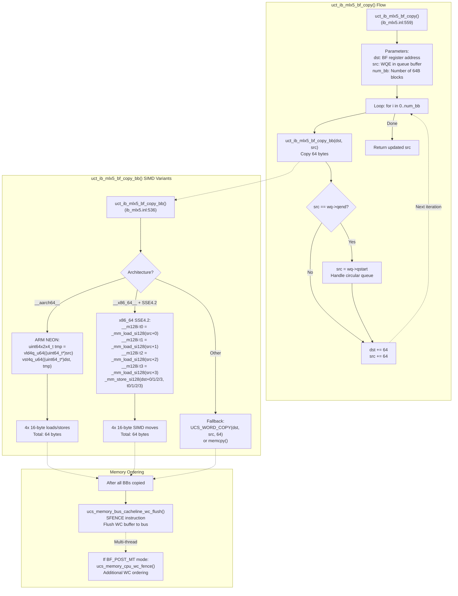

**Sources**: [src/uct/ib/mlx5/ib_mlx5.inl:536-574]()

**Copy Loop** [src/uct/ib/mlx5/ib_mlx5.inl:559-574]():
- `uct_ib_mlx5_bf_copy(dst, src, num_bb, wq)` copies `num_bb` Basic Blocks (64 bytes each)
- Queue wrap-around: `if (src == wq->qend) src = wq->qstart`
- Returns updated `src` pointer for next operation

**SIMD Implementations** [src/uct/ib/mlx5/ib_mlx5.inl:536-557]():

1. **ARM NEON** (lines 540-544):
   - `vld4q_u64()`: Loads 4× 16-byte chunks (64 bytes total) with de-interleaving
   - `vst4q_u64()`: Stores 4× 16-byte chunks with interleaving
   - Single load/store pair handles entire 64-byte block

2. **x86 SSE4.2** (lines 545-552):
   - `_mm_load_si128()`: 4 consecutive 16-byte aligned loads
   - `_mm_store_si128()`: 4 consecutive 16-byte stores
   - Requires 16-byte alignment (guaranteed by WQE layout)

3. **Scalar Fallback** (lines 554-556):
   - `UCS_WORD_COPY(dst, src, 64)` or `memcpy(dst, src, 64)`
   - Used when SIMD unavailable

**Memory Ordering**:
- `ucs_memory_bus_cacheline_wc_flush()`: Issues `SFENCE` or equivalent to flush write-combining buffer to PCIe bus
- Required because BlueFlame registers are write-combining memory
- `ucs_memory_cpu_wc_fence()`: Additional ordering for `BF_POST_MT` mode to prevent reordering between threads

## Memory Domain and Object Lifecycle

The MLX5 memory domain manages device-specific resources including doorbell records, UAR allocation, and indirect mkey infrastructure.

### MLX5 Memory Domain Structure

```mermaid
graph TB
    subgraph "uct_ib_mlx5_md_t"
        MD["uct_ib_mlx5_md_t"]
        SUPER["super: uct_ib_md_t<br/>Base IB MD"]
        FLAGS["flags: uint32_t<br/>Capability flags"]
        DBREC_POOL["dbrec_pool: ucs_mpool_t<br/>Doorbell record pool"]
        DBREC_LOCK["dbrec_lock:<br/>ucs_recursive_spinlock_t"]
    end
    
    subgraph "Device Memory Buffers"
        ZERO_BUF["zero_buf: void*<br/>Buffer filled with zeros"]
        ZERO_MEM["zero_mem:<br/>uct_ib_mlx5_devx_umem_t<br/>DEVX umem for zero_buf"]
        FLUSH_MR["flush_mr: ibv_mr*<br/>For flush operations"]
        FLUSH_DVMR["flush_dvmr:<br/>mlx5dv_devx_obj*"]
    end
    
    subgraph "Port Configuration"
        PORT_SELECT["port_select_mode:<br/>uct_ib_port_select_mode_t"]
        DIRECT_NIC["direct_nic_sys_dev:<br/>ucs_sys_device_t"]
        PORT_COUNTER["port_counter_set_ids[8]:<br/>Cached counter set IDs"]
    end
    
    subgraph "Transport Ratios"
        DV_RATIO["dv_tx_wqe_ratio"]
        DC_RATIO["dc: size_t<br/>DC WQE ratio"]
        UD_RATIO["ud: size_t<br/>UD WQE ratio"]
        MAX_RD_ATOMIC["max_rd_atomic_dc: uint8_t<br/>Max outstanding ops"]
    end
    
    subgraph "Data Path Ordering"
        DP_ORDER_CAP["dp_ordering_cap_devx"]
        DP_RC["rc: uint8_t<br/>RC ordering level"]
        DP_DC["dc: uint8_t<br/>DC ordering level"]
        DDP_SUPPORT["ddp_support_dv"]
        DDP_RC["rc: uint8_t<br/>RC DDP support"]
        DDP_DC["dc: uint8_t<br/>DC DDP support"]
    end
    
    MD --> SUPER
    MD --> FLAGS
    MD --> DBREC_POOL
    MD --> DBREC_LOCK
    MD --> ZERO_BUF
    MD --> ZERO_MEM
    MD --> FLUSH_MR
    MD --> FLUSH_DVMR
    MD --> PORT_SELECT
    MD --> DIRECT_NIC
    MD --> PORT_COUNTER
    MD --> DV_RATIO
    DV_RATIO --> DC_RATIO
    DV_RATIO --> UD_RATIO
    MD --> MAX_RD_ATOMIC
    MD --> DP_ORDER_CAP
    DP_ORDER_CAP --> DP_RC
    DP_ORDER_CAP --> DP_DC
    MD --> DDP_SUPPORT
    DDP_SUPPORT --> DDP_RC
    DDP_SUPPORT --> DDP_DC
```

**Sources**: [src/uct/ib/mlx5/ib_mlx5.h:400-454]()

**Key Components**:

- **flags** (lines 402): Bitmask of `UCT_IB_MLX5_MD_FLAG_*` indicating hardware capabilities (KSM, DEVX, MP_RQ, CQE zipping, etc.)
- **dbrec_pool** (lines 403-404): Memory pool for doorbell records
  - Allocated via `uct_ib_mlx5_get_dbrec()`, freed via `uct_ib_mlx5_put_dbrec()`
  - Each dbrec contains 2× uint32_t for send/receive doorbells
  - Recursive spinlock protects concurrent pool access
- **zero_buf/zero_mem** (lines 408-409): DEVX umem buffer filled with zeros, used for padding operations
- **flush_mr/flush_dvmr** (lines 417-418): Memory region for remote flush operations
- **port_counter_set_ids** (line 422): Cached counter set IDs per port to avoid repeated queries
- **dv_tx_wqe_ratio** (lines 435-438): Ratios for DC/UD transport WQE sizes, used in resource calculations
- **max_rd_atomic_dc** (line 440): Maximum outstanding RDMA Read/Atomic operations for DC QPs
- **dp_ordering_cap_devx** (lines 443-448): Data path ordering capabilities per transport (RC/DC)
  - Controls out-of-order RDMA read/write/send/recv semantics
  - Enum values: IBTA (standard), OOO_RW (reads/writes), OOO_ALL (all ops)
- **ddp_support_dv** (lines 449-453): Direct Data Placement support flags per transport

### Doorbell Record Management

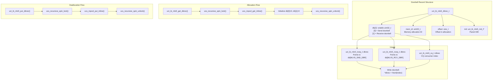

**Sources**: [src/uct/ib/mlx5/ib_mlx5.h:487-492](), [src/uct/ib/mlx5/ib_mlx5.h:1285-1308]()

**Doorbell Record (DBRec)** at [src/uct/ib/mlx5/ib_mlx5.h:487-492]():
- Two 32-bit fields: `db[MLX5_SND_DBR]` for send, `db[MLX5_RCV_DBR]` for receive
- Hardware reads doorbell records to determine which WQEs/CQEs to process
- Software writes updated indices (PI for send, CI for CQ) to notify hardware
- Stored in pinned memory for direct hardware access

**Allocation** at [src/uct/ib/mlx5/ib_mlx5.h:1285-1299]():
- `uct_ib_mlx5_get_dbrec()`: Allocates from memory pool with locking
- Initializes both doorbells to 0
- Sets `md` pointer for deallocation

**Deallocation** at [src/uct/ib/mlx5/ib_mlx5.h:1301-1308]():
- `uct_ib_mlx5_put_dbrec()`: Returns to pool with locking
- Must be called from same thread/context that allocated

**Usage**: TXWQs, RXWQs, and CQs store pointers to appropriate doorbell field and write indices during operation

### DEVX UAR Allocation

```mermaid
graph TB
    subgraph "UAR Types"
        WC_UAR["Write-Combining UAR<br/>UCT_IB_MLX5_UAR_ALLOC_TYPE_WC<br/>Optimal for BlueFlame"]
        NC_UAR["Non-Cacheable UAR<br/>UCT_IB_MLX5_UAR_ALLOC_TYPE_NC<br/>Fallback mode"]
    end
    
    subgraph "uct_ib_mlx5_devx_uar_t"
        UAR["uct_ib_mlx5_devx_uar_t"]
        UAR_SUPER["super: uct_ib_mlx5_mmio_reg_t<br/>addr.ptr: Register address<br/>mode: MMIO posting mode"]
        UAR_OBJ["uar: mlx5dv_devx_uar*<br/>DEVX UAR object"]
        UAR_CTX["ctx: ibv_context*<br/>Device context"]
    end
    
    subgraph "Allocation Flow"
        CHECK["uct_ib_mlx5_devx_check_uar()"]
        TRY_WC["Try WC allocation"]
        CHECK_WC{"Success?"}
        TRY_NC["Try NC allocation"]
        CHECK_NC{"Success?"}
        SET_FLAG["Set UCT_IB_MLX5_MD_FLAG_UAR_USE_WC"]
        FAIL["Return UNSUPPORTED"]
    end
    
    subgraph "Usage"
        INIT_UAR["uct_ib_mlx5_devx_uar_init()"]
        ALLOC_UAR["mlx5dv_devx_alloc_uar()"]
        ASSIGN["uar->super.addr.ptr =<br/>uar->uar->reg_addr"]
        TL_DATA["Store in worker TL data<br/>key: UCT_IB_MLX5_DEVX_UAR_KEY"]
        CLEANUP["uct_ib_mlx5_devx_uar_cleanup()"]
        FREE_UAR["mlx5dv_devx_free_uar()"]
    end
    
    WC_UAR -.-> UAR_OBJ
    NC_UAR -.-> UAR_OBJ
    
    UAR --> UAR_SUPER
    UAR --> UAR_OBJ
    UAR --> UAR_CTX
    
    CHECK --> TRY_WC
    TRY_WC --> CHECK_WC
    CHECK_WC -->|Yes| SET_FLAG
    CHECK_WC -->|No| TRY_NC
    TRY_NC --> CHECK_NC
    CHECK_NC -->|Yes| FAIL
    CHECK_NC -->|No| SET_FLAG
    
    INIT_UAR --> ALLOC_UAR
    ALLOC_UAR --> ASSIGN
    ASSIGN --> TL_DATA
    
    CLEANUP --> FREE_UAR
```

**Sources**: [src/uct/ib/mlx5/ib_mlx5.h:574-580](), [src/uct/ib/mlx5/ib_mlx5.c:621-692]()

**UAR (User Access Region)** provides memory-mapped access to hardware registers:
- **Write-Combining (WC)**: Allows CPU to buffer multiple writes, optimal for BlueFlame posting
- **Non-Cacheable (NC)**: Guaranteed ordering, required when WC not available

**Allocation Check** at [src/uct/ib/mlx5/ib_mlx5.c:621-655]():
- `uct_ib_mlx5_devx_check_uar()`: Probes UAR support at MD initialization
- Tries WC first via `mlx5dv_devx_alloc_uar(ctx, UCT_IB_MLX5_UAR_ALLOC_TYPE_WC)`
- Falls back to NC if WC unsupported
- Sets `UCT_IB_MLX5_MD_FLAG_UAR_USE_WC` flag if WC succeeds
- Returns `UCS_ERR_UNSUPPORTED` if neither type available

**UAR Initialization** at [src/uct/ib/mlx5/ib_mlx5.c:657-685]():
- `uct_ib_mlx5_devx_uar_init()`: Allocates UAR with appropriate flags based on `UCT_IB_MLX5_MD_FLAG_UAR_USE_WC`
- Stores register address in `super.addr.ptr` for WQE posting
- UAR shared across QPs via worker TL data with key `UCT_IB_MLX5_DEVX_UAR_KEY` (line 53)

**Cleanup** at [src/uct/ib/mlx5/ib_mlx5.c:687-692]():
- `uct_ib_mlx5_devx_uar_cleanup()`: Calls `mlx5dv_devx_free_uar()`
- Managed through TL data reference counting

---

