<!-- source: DeepWiki mcp.deepwiki.com · repo openucx/ucx · page 4 Memory Management · fetched 2026-11-11 -->

# Memory Management

<details>
<summary>Relevant source files</summary>

The following files were used as context for generating this wiki page:

- [src/ucp/core/ucp_request.c](src/ucp/core/ucp_request.c)
- [src/ucp/core/ucp_request.h](src/ucp/core/ucp_request.h)
- [src/ucp/core/ucp_request.inl](src/ucp/core/ucp_request.inl)
- [src/ucp/proto/proto_am.inl](src/ucp/proto/proto_am.inl)
- [src/ucp/stream/stream.h](src/ucp/stream/stream.h)
- [src/ucp/stream/stream_recv.c](src/ucp/stream/stream_recv.c)
- [src/ucp/stream/stream_send.c](src/ucp/stream/stream_send.c)
- [src/ucp/tag/eager_rcv.c](src/ucp/tag/eager_rcv.c)
- [src/ucp/tag/eager_snd.c](src/ucp/tag/eager_snd.c)
- [src/ucp/tag/offload.c](src/ucp/tag/offload.c)
- [src/ucp/tag/offload.h](src/ucp/tag/offload.h)
- [src/ucp/tag/tag_match.c](src/ucp/tag/tag_match.c)
- [src/ucp/tag/tag_match.h](src/ucp/tag/tag_match.h)
- [src/ucp/tag/tag_match.inl](src/ucp/tag/tag_match.inl)
- [src/ucp/tag/tag_recv.c](src/ucp/tag/tag_recv.c)
- [src/ucp/tag/tag_send.c](src/ucp/tag/tag_send.c)
- [src/uct/ib/base/ib_md.c](src/uct/ib/base/ib_md.c)
- [src/uct/ib/base/ib_md.h](src/uct/ib/base/ib_md.h)
- [src/uct/ib/configure.m4](src/uct/ib/configure.m4)
- [src/uct/ib/mlx5/dv/ib_mlx5_dv.c](src/uct/ib/mlx5/dv/ib_mlx5_dv.c)
- [src/uct/ib/mlx5/dv/ib_mlx5_ifc.h](src/uct/ib/mlx5/dv/ib_mlx5_ifc.h)
- [src/uct/ib/mlx5/dv/ib_mlx5dv_md.c](src/uct/ib/mlx5/dv/ib_mlx5dv_md.c)
- [src/uct/ib/mlx5/ib_mlx5.c](src/uct/ib/mlx5/ib_mlx5.c)
- [src/uct/ib/mlx5/ib_mlx5.h](src/uct/ib/mlx5/ib_mlx5.h)
- [src/uct/ib/mlx5/ib_mlx5.inl](src/uct/ib/mlx5/ib_mlx5.inl)

</details>


## Purpose and Scope

This document describes UCX's memory management system, which handles registration, protection, and remote access of memory regions. Memory management in UCX operates across two layers: the high-level UCP layer provides portable memory handles for applications, while the lower UCT layer implements transport-specific memory registration and key generation for hardware like InfiniBand NICs and GPUs.

For information about memory domains as UCT components, see [Memory Domains](#4.1). For details on memory types and GPU-specific handling, see [Memory Types and GPU Support](#4.3). For memory registration and remote key mechanisms, see [Memory Registration and Remote Keys](#4.2).

## Architecture Overview

Memory management in UCX spans both the UCP (Protocol) and UCT (Transport) layers, with the UCP layer providing a unified interface while UCT handles hardware-specific registration.

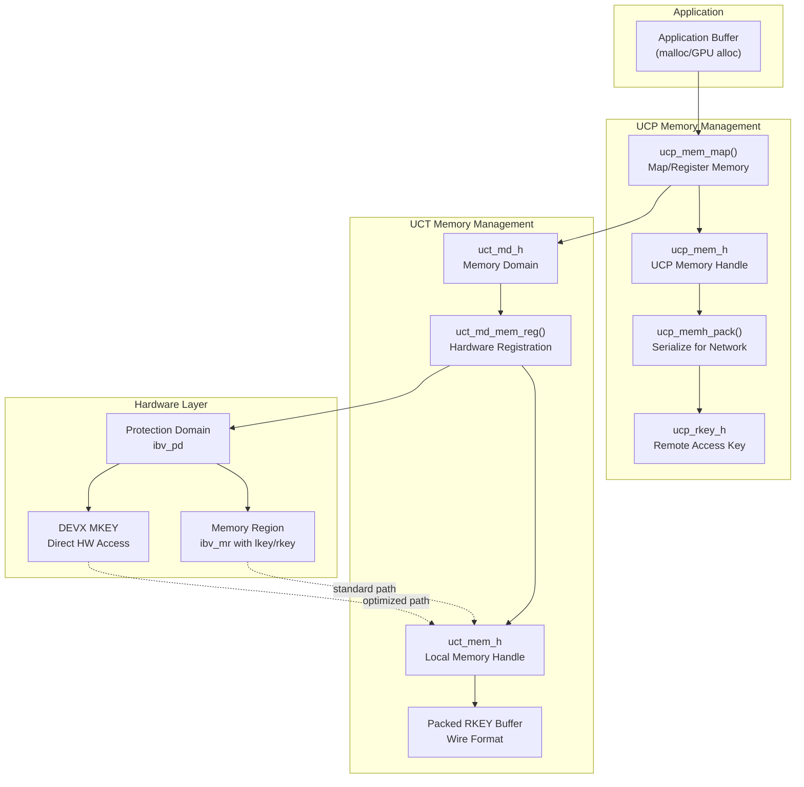

**Sources:** [src/ucp/api/ucp.h:369-400](), [src/uct/ib/base/ib_md.h:116-126](), [src/uct/ib/base/ib_md.h:141-175]()

## UCP Memory API

The UCP layer provides application-facing memory management through handles and operations that abstract transport-specific details.

### Memory Handle Structure

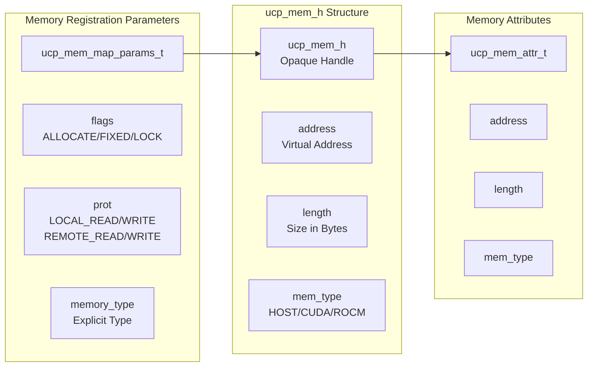

The `ucp_mem_h` handle represents a registered memory region. Applications create it using `ucp_mem_map()` and can query its properties using `ucp_mem_query()`.

Key API functions:
- `ucp_mem_map()` - Register or allocate memory [src/ucp/api/ucp.h:377-400]()
- `ucp_mem_unmap()` - Unregister memory
- `ucp_memh_pack()` - Serialize for remote access [src/ucp/api/ucp.h:1156-1215]()
- `ucp_mem_query()` - Query memory attributes

**Sources:** [src/ucp/api/ucp_def.h:155-167](), [src/ucp/api/ucp_def.h:185-207](), [src/ucp/api/ucp.h:547-582]()

### Memory Mapping Flags

| Flag | Value | Description |
|------|-------|-------------|
| `UCP_MEM_MAP_NONBLOCK` | `UCS_BIT(0)` | Complete mapping faster, populate pages lazily |
| `UCP_MEM_MAP_ALLOCATE` | `UCS_BIT(1)` | Allocate memory (not just register) |
| `UCP_MEM_MAP_FIXED` | `UCS_BIT(2)` | Use exact address provided |
| `UCP_MEM_MAP_SYMMETRIC_RKEY` | `UCS_BIT(3)` | Generate symmetric remote keys |
| `UCP_MEM_MAP_LOCK` | `UCS_BIT(4)` | Pin and populate pages immediately |

**Sources:** [src/ucp/api/ucp.h:547-582]()

### Remote Key Management

Remote keys enable memory access from remote endpoints:

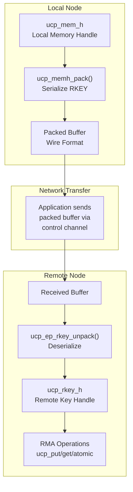

**Sources:** [src/ucp/api/ucp.h:1156-1215](), [src/ucp/api/ucp.h:1227-1264](), [src/ucp/api/ucp_def.h:142-152]()

## UCT Memory Domains

At the UCT layer, memory domains (`uct_md_h`) represent physical devices capable of memory registration. Each transport (IB, TCP, GPU) provides its own memory domain implementation.

### Memory Domain Structure

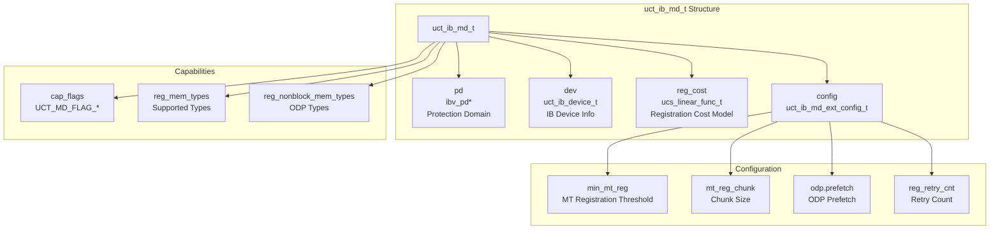

**Sources:** [src/uct/ib/base/ib_md.h:141-175](), [src/uct/ib/base/ib_md.h:87-113](), [src/uct/ib/base/ib_md.h:188-209]()

### Memory Registration Flow

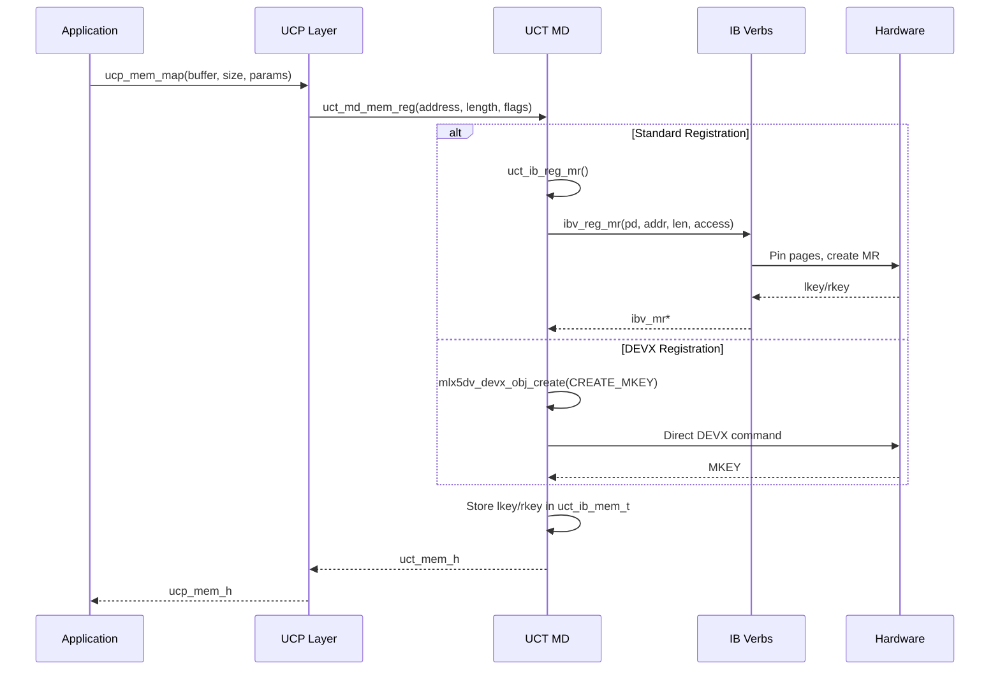

**Sources:** [src/uct/ib/base/ib_md.c:469-528](), [src/uct/ib/mlx5/dv/ib_mlx5dv_md.c:136-189]()

## Memory Registration Methods

UCX supports multiple memory registration paths with different characteristics.

### Standard Verbs Registration

The standard path uses `ibv_reg_mr()` to register memory:

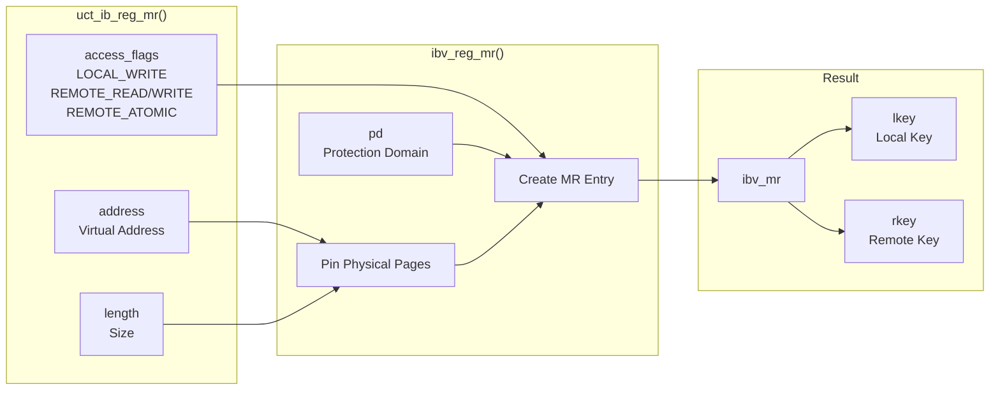

The function `uct_ib_reg_mr()` wraps `ibv_reg_mr()` with retry logic and profiling. On success, it returns an `ibv_mr` structure containing local and remote keys.

**Sources:** [src/uct/ib/base/ib_md.c:469-528](), [src/uct/ib/base/ib_md.c:269-297]()

### Multi-Threaded Registration

For large memory regions (>= `IB_REG_MT_THRESH`), UCX uses multi-threaded registration to parallelize the work:

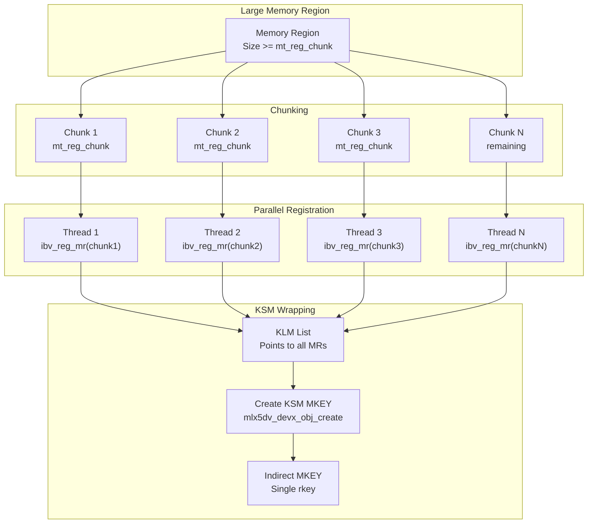

Multi-threaded registration creates multiple `ibv_mr` structures in parallel, then wraps them with a KSM (Kernel Shared Memory) indirect MKEY that provides a single rkey for the entire region.

**Sources:** [src/uct/ib/base/ib_md.c:308-349](), [src/uct/ib/base/ib_md.c:351-467](), [src/uct/ib/mlx5/dv/ib_mlx5dv_md.c:229-282]()

### Configuration Parameters

| Parameter | Default | Description |
|-----------|---------|-------------|
| `IB_REG_MT_THRESH` | 4GB | Minimum size for multi-threaded registration |
| `IB_REG_MT_CHUNK` | 2GB | Size of each chunk in MT registration |
| `IB_REG_MT_BIND` | no | Bind registration threads to CPUs |
| `IB_REG_RETRY_CNT` | inf | Number of registration retry attempts |

**Sources:** [src/uct/ib/base/ib_md.c:144-169]()

## Memory Keys and RKEY Packing

Memory keys enable local and remote access to registered memory.

### Key Structure

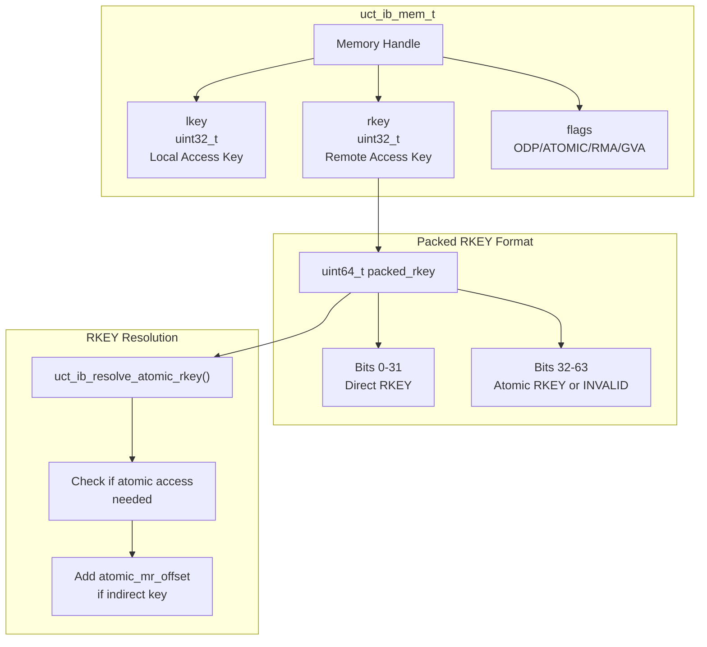

The packed RKEY format encodes both a direct key (for standard operations) and optionally an atomic key (for atomic operations requiring special alignment):

```c
packed_rkey = (atomic_rkey << 32) | direct_rkey
```

**Sources:** [src/uct/ib/base/ib_md.h:116-126](), [src/uct/ib/base/ib_md.h:260-278](), [src/uct/ib/base/ib_md.h:301-312]()

### RKEY Packing Function Flow

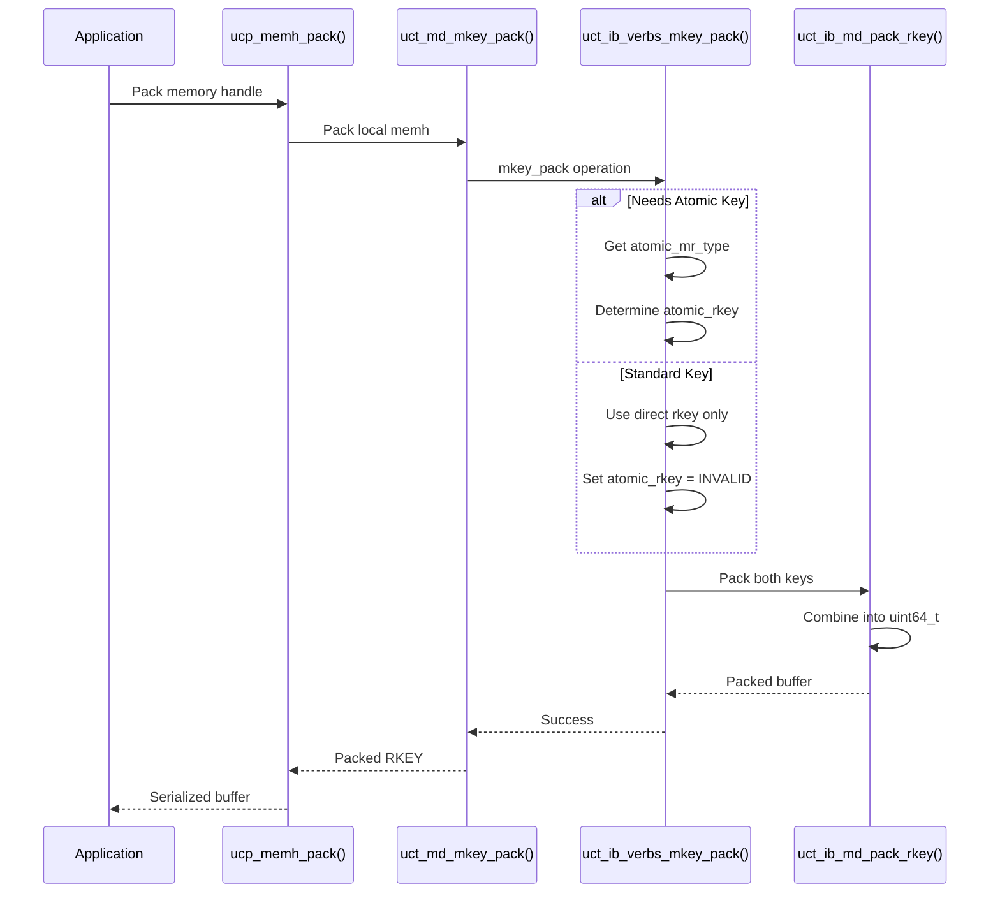

**Sources:** [src/uct/ib/base/ib_md.c:732-752](), [src/uct/ib/base/ib_md.h:272-279]()

## MLX5 DEVX Memory Management

MLX5 devices support DEVX (Direct Export Verbs) for optimized memory registration and key management.

### DEVX Memory Handle

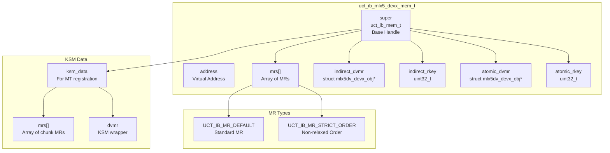

**Sources:** [src/uct/ib/mlx5/dv/ib_mlx5dv_md.c:542-575](), [src/uct/ib/mlx5/dv/ib_mlx5dv_md.c:593-616]()

### KSM (Kernel Shared Memory) Registration

KSM allows creating an indirect memory key that points to multiple underlying memory regions:

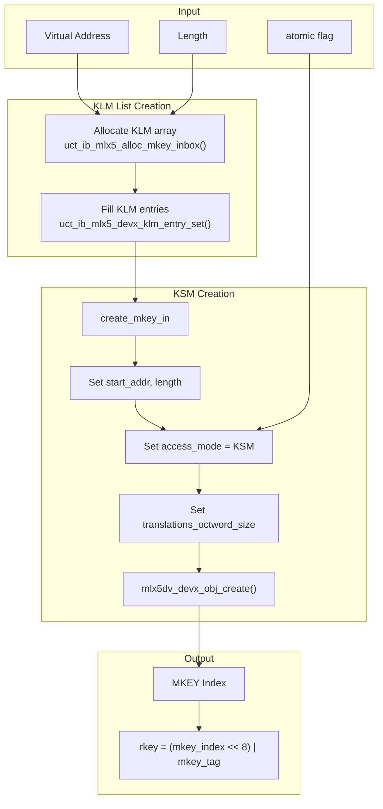

KSM registration creates a hardware memory key that references a list of KLM (Key-List-Memory) entries, where each entry points to an underlying memory region. This enables:
1. Wrapping multiple MRs with a single rkey
2. Creating atomic-aligned indirect keys
3. Supporting very large memory registrations

**Sources:** [src/uct/ib/mlx5/dv/ib_mlx5dv_md.c:136-189](), [src/uct/ib/mlx5/dv/ib_mlx5dv_md.c:214-227](), [src/uct/ib/mlx5/dv/ib_mlx5dv_md.c:324-350]()

### Indirect and Atomic Keys

MLX5 creates specialized keys for different access patterns:

| Key Type | Purpose | Creation |
|----------|---------|----------|
| Direct Key | Standard RMA operations | From `ibv_mr->rkey` |
| Indirect Key | Single key for multi-MR regions | `uct_ib_mlx5_devx_reg_indirect_key()` |
| Atomic Key | Atomic operations with alignment | `uct_ib_mlx5_devx_reg_atomic_key()` |

**Atomic Key Requirements:**
- Address aligned to `UCT_IB_MD_MAX_MR_SIZE` (2GB)
- Length aligned to device atomic_align
- Offset added for actual atomic access address

**Sources:** [src/uct/ib/mlx5/dv/ib_mlx5dv_md.c:542-575](), [src/uct/ib/mlx5/dv/ib_mlx5dv_md.c:593-616](), [src/uct/ib/mlx5/dv/ib_mlx5dv_md.c:324-350]()

## LRU Cache for Indirect Keys

MLX5 maintains an LRU (Least Recently Used) cache for indirect memory keys to avoid recreating them:

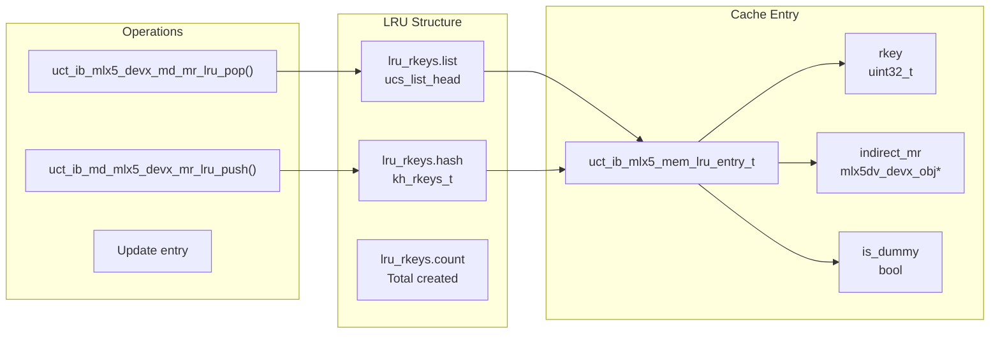

The LRU cache:
- Stores up to `max_idle_rkey_count` entries (default 16)
- Evicts oldest entry when full
- Enables RKEY reuse without HW resources
- Increments `mkey_tag` periodically to prevent collisions

**Sources:** [src/uct/ib/mlx5/dv/ib_mlx5dv_md.c:376-404](), [src/uct/ib/mlx5/dv/ib_mlx5dv_md.c:429-492](), [src/uct/ib/mlx5/dv/ib_mlx5dv_md.c:494-513]()

## Special Features

### On-Demand Paging (ODP)

ODP enables registration without pre-faulting pages:

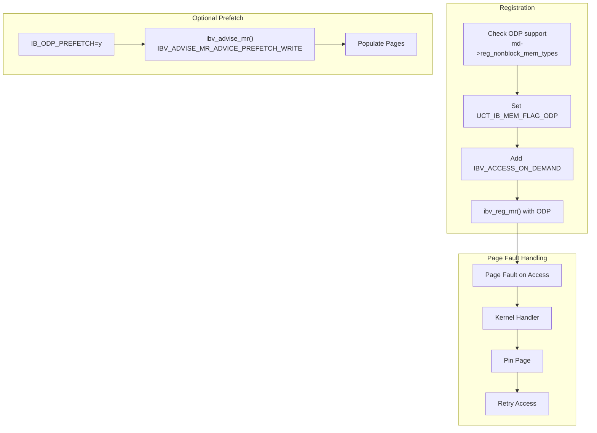

ODP registration:
- Uses `UCT_MD_MEM_FLAG_NONBLOCK` flag
- Sets `memh->flags |= UCT_IB_MEM_FLAG_ODP`
- Adds `IBV_ACCESS_ON_DEMAND` to access flags
- Optionally prefetches via `uct_ib_mem_prefetch()`

**Sources:** [src/uct/ib/base/ib_md.c:592-631](), [src/uct/ib/base/ib_md.c:546-577](), [src/uct/ib/base/ib_md.c:579-590]()

### Relaxed Ordering

PCIe relaxed ordering improves performance on some systems:

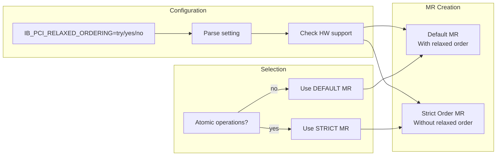

When enabled:
- Creates two MRs: `UCT_IB_MR_DEFAULT` (relaxed), `UCT_IB_MR_STRICT_ORDER`
- Atomic operations use strict-order MR
- Adds `IBV_ACCESS_RELAXED_ORDERING` flag to default MR
- Atomic RKEY provides strict-order access

**Sources:** [src/uct/ib/base/ib_md.c:648-703](), [src/uct/ib/base/ib_md.h:128-135](), [src/uct/ib/base/ib_md.c:634-646]()

### Symmetric Keys

Symmetric keys enable RKEY comparison across peers:

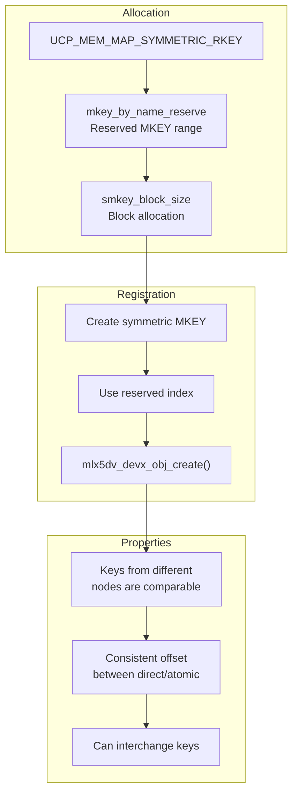

Symmetric keys are allocated from a reserved MKEY space, ensuring that peers registering the same memory region get comparable keys.

**Sources:** [test/gtest/uct/ib/test_ib_md.cc:190-249](), [src/ucp/api/ucp.h:574-575]()

## Memory Types and GPU Support

UCX supports heterogeneous memory including GPU memory.

### Memory Type Detection

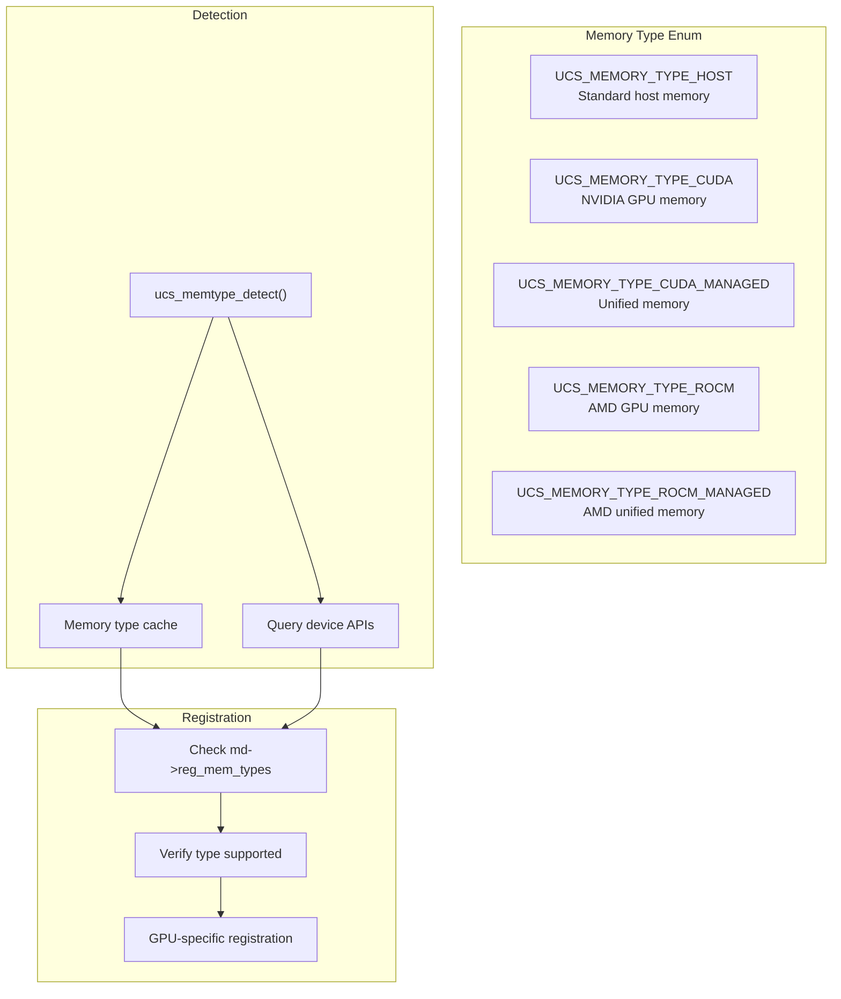

Memory types are detected and cached. Each memory domain reports supported types via `md_attr.reg_mem_types`.

**Sources:** [src/ucp/api/ucp.h:396-397](), [src/uct/ib/base/ib_md.h:158-160]()

### GPU Direct RDMA

GPU Direct RDMA enables direct NIC-to-GPU transfers:

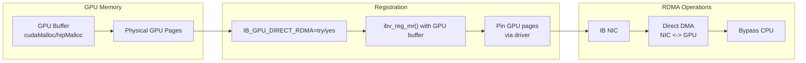

GPU Direct RDMA:
- Enabled via `IB_GPU_DIRECT_RDMA` configuration
- Requires GPU driver support (nvidia-peermem, ROCm KFD)
- Registers GPU memory directly with IB NIC
- Enables zero-copy GPU-to-GPU transfers

**Sources:** [src/uct/ib/base/ib_md.c:118-120](), [src/uct/ib/base/ib_md.h:207]()

### DMA-BUF Support

DMA-BUF provides another mechanism for GPU memory:

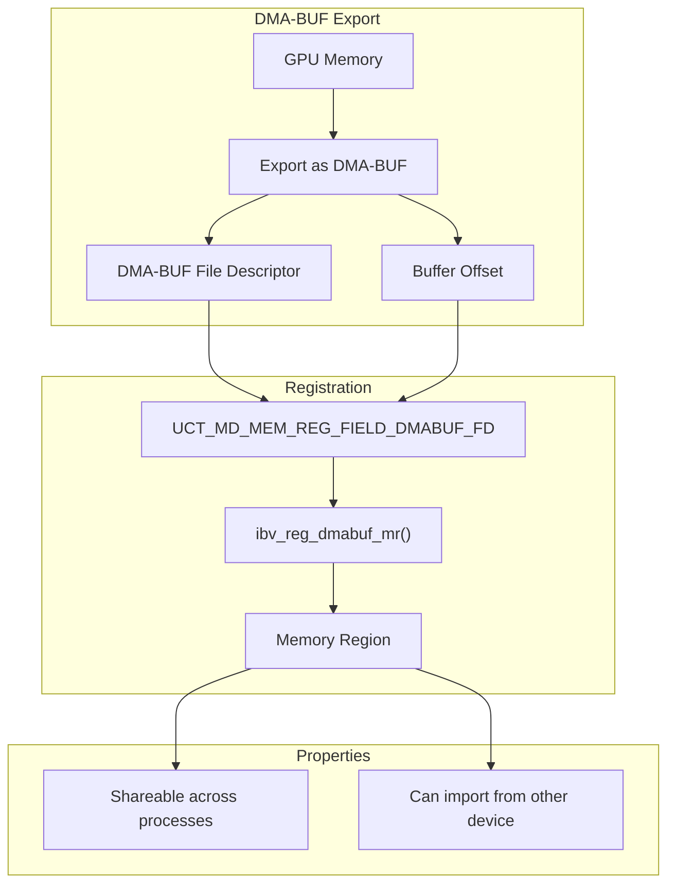

DMA-BUF allows GPU memory to be:
- Exported as a file descriptor
- Registered with `ibv_reg_dmabuf_mr()`
- Shared across processes
- Imported from other devices

**Sources:** [src/uct/ib/base/ib_md.c:483-486](), [src/uct/ib/base/ib_md.c:507-514]()

## Memory Registration Statistics

UCX tracks memory registration costs for optimization:

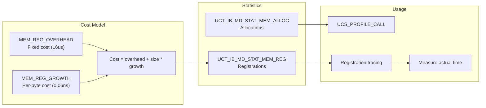

The cost model helps UCX decide between eager, zcopy, and rendezvous protocols based on registration overhead.

**Sources:** [src/uct/ib/base/ib_md.c:55-59](), [src/uct/ib/base/ib_md.c:192-200](), [src/uct/ib/base/ib_md.h:50-54]()

## Key API Functions Summary

### UCP Layer

| Function | Purpose | Returns |
|----------|---------|---------|
| `ucp_mem_map()` | Register or allocate memory | `ucs_status_t` |
| `ucp_mem_unmap()` | Unregister memory | `ucs_status_t` |
| `ucp_mem_query()` | Query memory attributes | `ucs_status_t` |
| `ucp_memh_pack()` | Serialize memory handle | `ucs_status_t` |
| `ucp_ep_rkey_unpack()` | Deserialize remote key | `ucs_status_t` |
| `ucp_rkey_destroy()` | Release remote key | `void` |

### UCT Layer

| Function | Purpose | File Location |
|----------|---------|---------------|
| `uct_md_mem_reg()` | Register memory | [src/uct/ib/base/ib_md.c:648-703]() |
| `uct_md_mem_dereg()` | Deregister memory | [src/uct/ib/base/ib_md.c:706-730]() |
| `uct_md_mkey_pack()` | Pack memory key | [src/uct/ib/base/ib_md.c:732-752]() |
| `uct_ib_reg_mr()` | IB registration | [src/uct/ib/base/ib_md.c:469-528]() |
| `uct_ib_dereg_mr()` | IB deregistration | [src/uct/ib/base/ib_md.c:530-544]() |

### MLX5 DEVX

| Function | Purpose | File Location |
|----------|---------|---------------|
| `uct_ib_mlx5_devx_reg_ksm_data()` | Create KSM key | [src/uct/ib/mlx5/dv/ib_mlx5dv_md.c:519-540]() |
| `uct_ib_mlx5_devx_reg_indirect_key()` | Register indirect key | [src/uct/ib/mlx5/dv/ib_mlx5dv_md.c:542-575]() |
| `uct_ib_mlx5_devx_reg_atomic_key()` | Register atomic key | [src/uct/ib/mlx5/dv/ib_mlx5dv_md.c:593-616]() |
| `uct_ib_md_mlx5_devx_mr_lru_push()` | Add to LRU cache | [src/uct/ib/mlx5/dv/ib_mlx5dv_md.c:429-492]() |

**Sources:** [src/ucp/api/ucp.h:369-400](), [src/uct/ib/base/ib_md.c:241-268](), [src/uct/ib/base/ib_md.h:354-440]()

---

