<!-- source: DeepWiki mcp.deepwiki.com · repo openucx/ucx · page 4.1 Memory Domains and Registration · fetched 2026-11-11 -->

# Memory Domains and Registration

<details>
<summary>Relevant source files</summary>

The following files were used as context for generating this wiki page:

- [src/uct/ib/base/ib_md.c](src/uct/ib/base/ib_md.c)
- [src/uct/ib/base/ib_md.h](src/uct/ib/base/ib_md.h)
- [src/uct/ib/configure.m4](src/uct/ib/configure.m4)
- [src/uct/ib/mlx5/dv/ib_mlx5_dv.c](src/uct/ib/mlx5/dv/ib_mlx5_dv.c)
- [src/uct/ib/mlx5/dv/ib_mlx5_ifc.h](src/uct/ib/mlx5/dv/ib_mlx5_ifc.h)
- [src/uct/ib/mlx5/dv/ib_mlx5dv_md.c](src/uct/ib/mlx5/dv/ib_mlx5dv_md.c)
- [src/uct/ib/mlx5/ib_mlx5.c](src/uct/ib/mlx5/ib_mlx5.c)
- [src/uct/ib/mlx5/ib_mlx5.h](src/uct/ib/mlx5/ib_mlx5.h)
- [src/uct/ib/mlx5/ib_mlx5.inl](src/uct/ib/mlx5/ib_mlx5.inl)

</details>


## Purpose and Scope

This page documents UCX's memory domain (MD) abstraction and memory registration mechanisms at the UCT layer. A memory domain represents a hardware device's capability to perform DMA operations on registered memory regions. This page covers:

- Memory domain structures and initialization
- Memory registration flows (Verbs and DEVX APIs)
- Memory handle management and remote key generation
- Multi-threaded registration for large buffers
- MLX5-specific optimizations (KSM, UMR, indirect atomics)

For higher-level UCP memory management including multi-MD registration and caching, see [Memory Registration Flows and Caching](#4.2). For remote key lifecycle and zero-copy RMA operations, see [Remote Keys and Zero-Copy Operations](#4.3). For GPU memory type handling, see [GPU Memory Support](#4.4).

---

## Memory Domain Architecture

The memory domain (`uct_ib_md_t`) is the core abstraction that owns the protection domain and provides memory registration services. Each IB device has one or more memory domains depending on the transport implementation.

### Memory Domain Structure

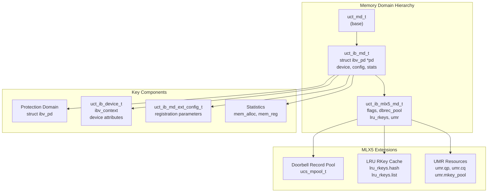

**Sources:**
- [src/uct/ib/base/ib_md.h:145-179]()
- [src/uct/ib/mlx5/ib_mlx5.h:403-457]()

### Memory Domain Operations

The memory domain exposes operations through `uct_md_ops_t` extended by `uct_ib_md_ops_t`:

| Operation | Function | Purpose |
|-----------|----------|---------|
| Query | `uct_ib_md_query` | Return MD capabilities and attributes |
| Register | `uct_ib_verbs_mem_reg` or DEVX variant | Register memory region |
| Deregister | `uct_ib_verbs_mem_dereg` | Unregister memory region |
| Pack mkey | `uct_ib_verbs_mkey_pack` | Serialize remote key for transmission |
| Advise | `uct_ib_mem_advise` | Prefetch or advise memory usage |

**Sources:**
- [src/uct/ib/base/ib_md.h:231-234]()
- [src/uct/ib/base/ib_md.c:246-273]()

---

## Memory Registration Flow

Memory registration creates a Memory Region (MR) that pins physical pages and generates local and remote keys for DMA access.

### Basic Registration Path (Verbs)

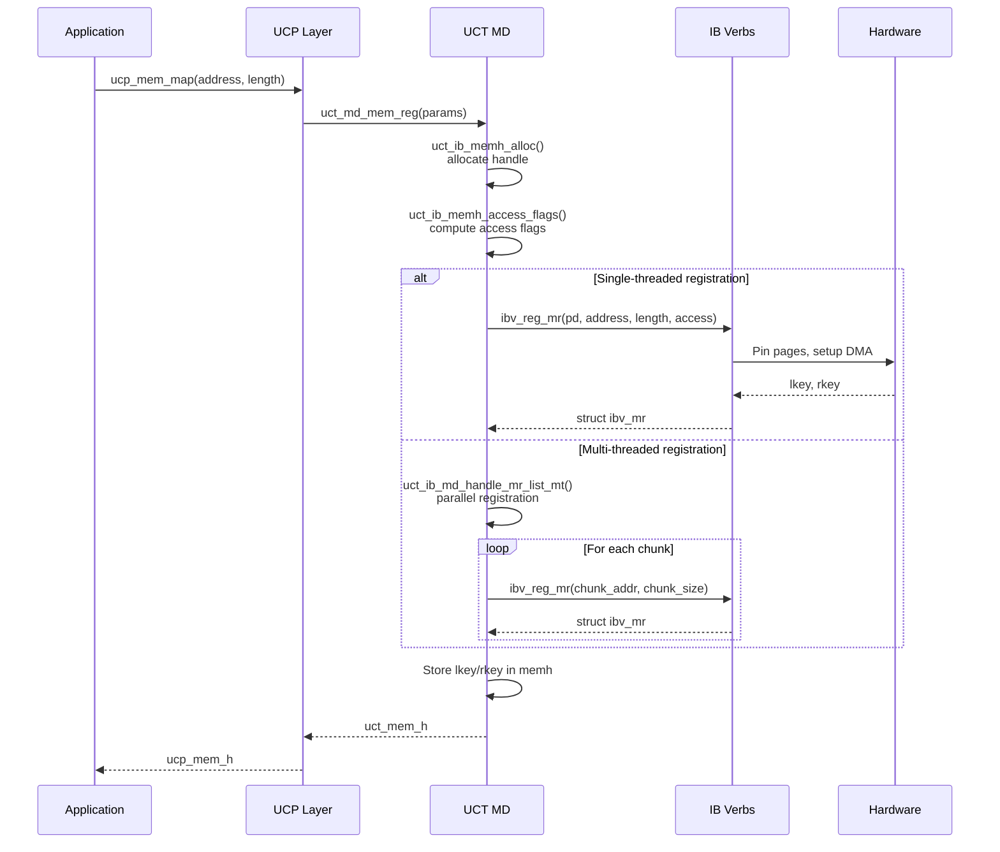

**Sources:**
- [src/uct/ib/base/ib_md.c:653-708]()
- [src/uct/ib/base/ib_md.c:474-533]()

### Memory Handle Structure

After registration, UCT maintains a memory handle that tracks the registration state:

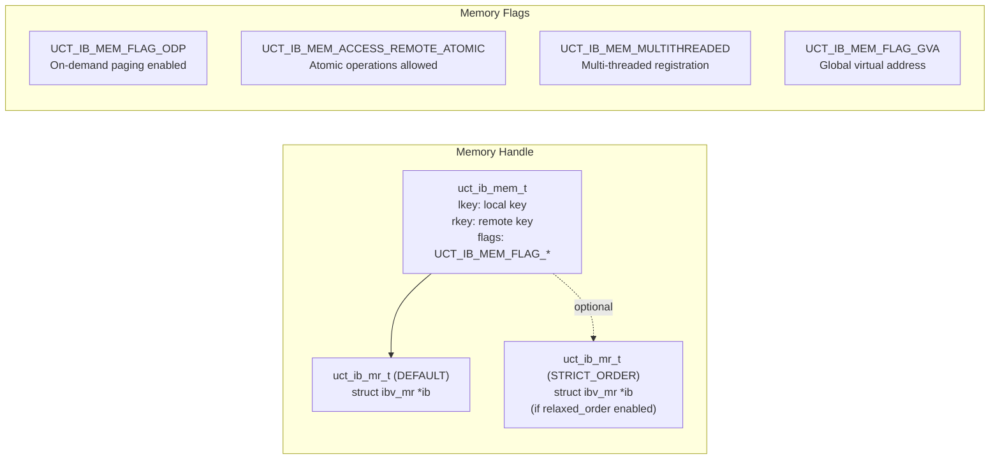

**Sources:**
- [src/uct/ib/base/ib_md.h:120-139]()
- [src/uct/ib/base/ib_md.h:58-78]()

---

## Multi-Threaded Registration

For large memory regions (> `REG_MT_THRESH`, default 4GB), UCX parallelizes registration across multiple threads to reduce latency.

### Multi-Threaded Registration Flow

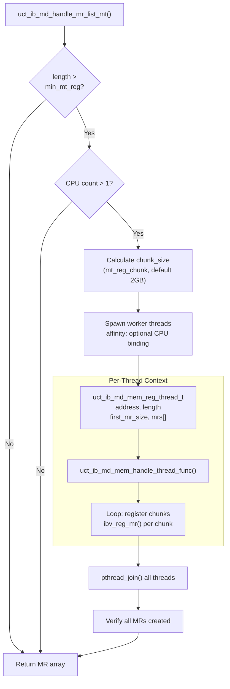

**Key Parameters:**
- `REG_MT_THRESH`: Minimum buffer size for multi-threaded registration (default: 4GB)
- `REG_MT_CHUNK`: Chunk size per thread (default: 2GB, must be power of 2)
- `REG_MT_BIND`: Whether to bind registration threads to specific CPUs

**Sources:**
- [src/uct/ib/base/ib_md.c:356-472]()
- [src/uct/ib/base/ib_md.c:313-354]()
- [src/uct/ib/base/ib_md.h:105-107]()

### Registration Thread Implementation

The thread worker function handles chunk-based registration:

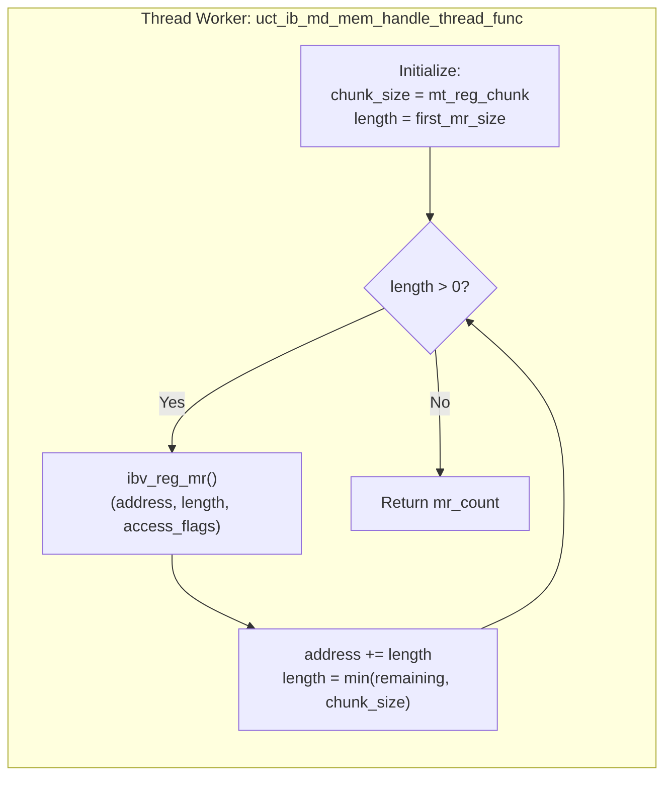

**Sources:**
- [src/uct/ib/base/ib_md.c:313-354]()

---

## Remote Key Management

Remote keys (rkeys) enable remote peers to perform RDMA operations on registered memory.

### Remote Key Format

UCX packs two keys into a 64-bit value to support both normal and atomic operations:

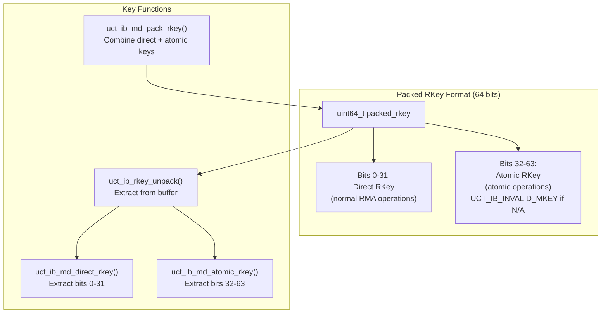

**Sources:**
- [src/uct/ib/base/ib_md.h:276-283]()
- [src/uct/ib/base/ib_md.h:264-273]()
- [src/uct/ib/base/ib_md.c:759-772]()

### Remote Key Packing/Unpacking

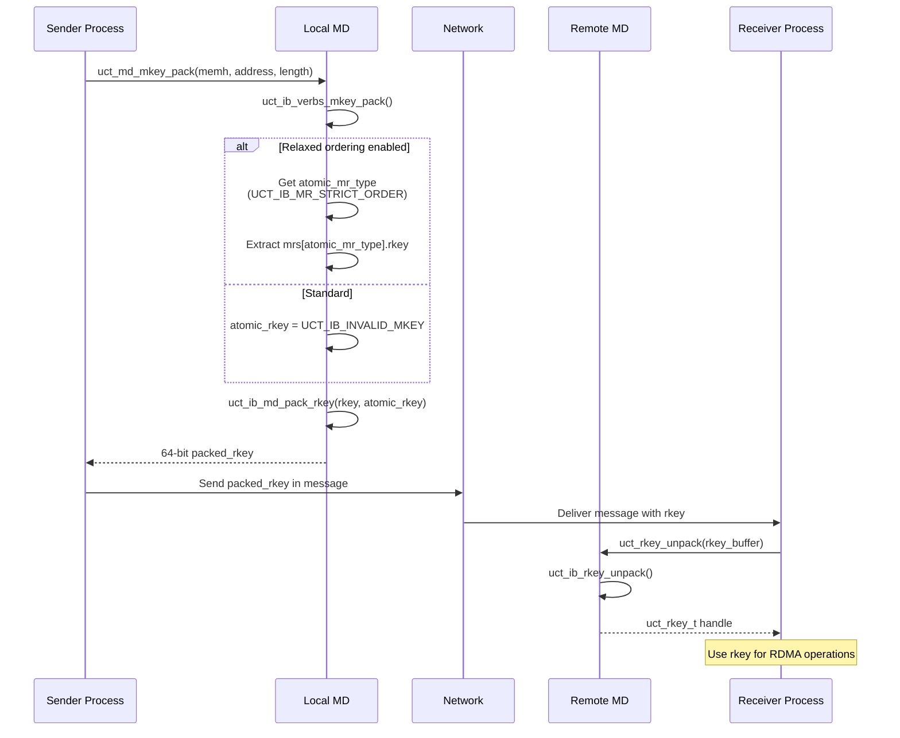

**Sources:**
- [src/uct/ib/base/ib_md.c:737-757]()
- [src/uct/ib/base/ib_md.c:759-772]()

---

## MLX5 DEVX Registration

MLX5 devices support advanced registration through DEVX (Direct Verbs Extensions) which enables optimizations like KSM and UMR.

### MLX5 Memory Handle Structure

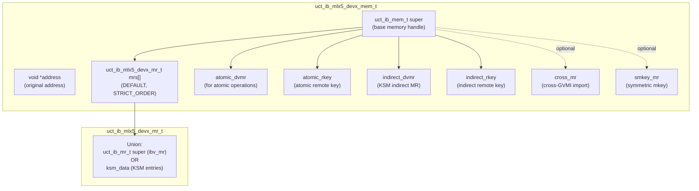

**Sources:**
- [src/uct/ib/mlx5/ib_mlx5.h:319-335]()
- [src/uct/ib/mlx5/ib_mlx5.h:283-286]()

### KSM (Kernel Shared Memory) Registration

KSM allows creating indirect memory keys that reference multiple base MRs, used for:
1. **Multi-threaded registration**: Each chunk gets its own MR, then KSM aggregates them
2. **Large buffer optimization**: Split >2GB regions into manageable pieces
3. **Atomic operation support**: Create indirect keys with atomic access rights

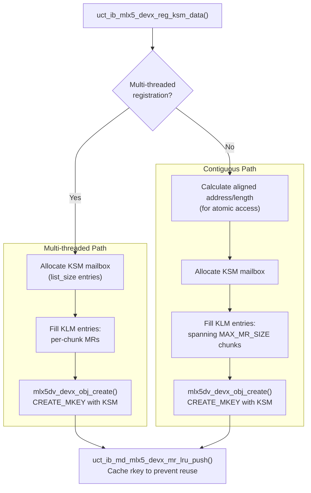

**KSM Mailbox Structure:**
```
CREATE_MKEY_IN:
  opcode: CREATE_MKEY
  input_mkey_index: <mkey_index>
  memory_key_mkey_entry (mkc):
    access_mode: KSM
    access rights: rw, rr, lw, lr, [a]
    pd: <protection domain>
    translations_octword_size: <list_size>
    log_entity_size: log2(chunk_size)
    start_addr: <iova>
    len: <total_length>
  klm_pas_mtt[]: array of KLM entries
    - address: <chunk_address>
    - mkey: <base_mr_lkey>
    - byte_count: <chunk_size>
```

**Sources:**
- [src/uct/ib/mlx5/dv/ib_mlx5dv_md.c:525-546]()
- [src/uct/ib/mlx5/dv/ib_mlx5dv_md.c:141-195]()
- [src/uct/ib/mlx5/dv/ib_mlx5dv_md.c:239-288]()

### LRU RKey Cache

To prevent rkey reuse issues (stale rkeys accessing new registrations), MLX5 maintains an LRU cache:

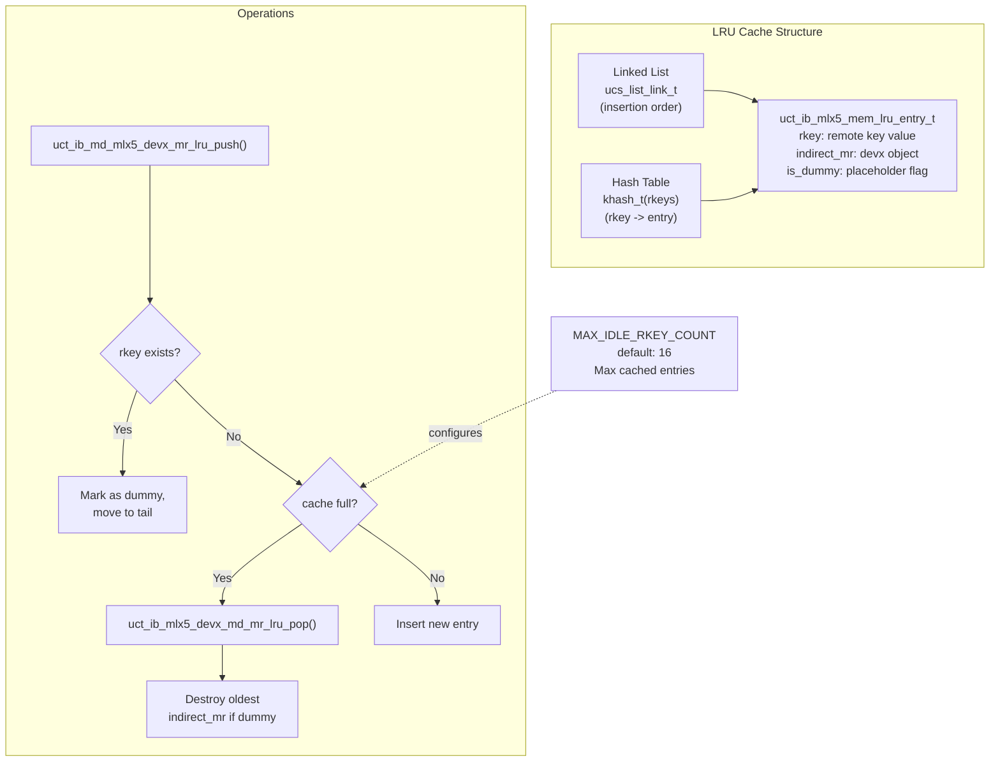

**LRU Cache Invariant:**
- When an rkey is reused, the old `indirect_mr` is destroyed and marked as dummy
- This prevents remote peers from accidentally accessing new memory with stale rkeys
- Every ~MAX_IDLE_RKEY_COUNT registrations, mkey_tag is incremented to further reduce collisions

**Sources:**
- [src/uct/ib/mlx5/ib_mlx5.h:347-369]()
- [src/uct/ib/mlx5/dv/ib_mlx5dv_md.c:435-498]()
- [src/uct/ib/mlx5/dv/ib_mlx5dv_md.c:382-410]()

---

## Registration Access Flags

Access flags control what operations can be performed on registered memory:

### Standard Access Flags

| Flag | Constant | Purpose |
|------|----------|---------|
| Local Write | `IBV_ACCESS_LOCAL_WRITE` | Allow local write access |
| Remote Write | `IBV_ACCESS_REMOTE_WRITE` | Allow remote RDMA write |
| Remote Read | `IBV_ACCESS_REMOTE_READ` | Allow remote RDMA read |
| Remote Atomic | `IBV_ACCESS_REMOTE_ATOMIC` | Allow remote atomic operations |
| On-Demand | `IBV_ACCESS_ON_DEMAND` | Enable ODP (if supported) |
| Relaxed Ordering | `IBV_ACCESS_RELAXED_ORDERING` | Allow PCIe relaxed ordering |

**Sources:**
- [src/uct/ib/base/ib_md.h:21-24]()
- [src/uct/ib/base/ib_md.c:639-651]()

### Access Flag Computation

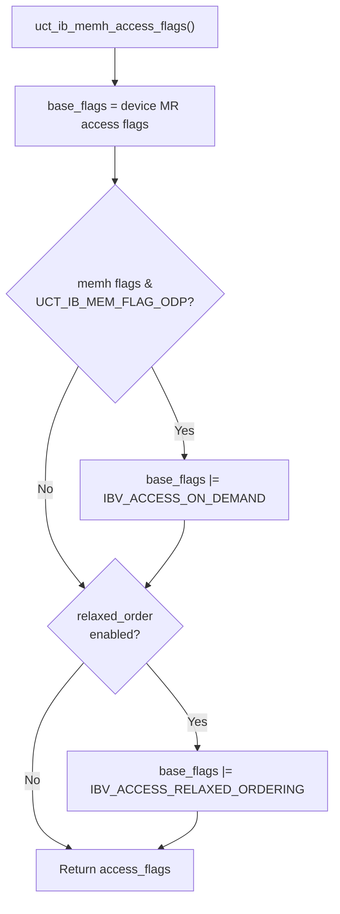

**Sources:**
- [src/uct/ib/base/ib_md.c:639-651]()

---

## Memory Domain Configuration

The MD configuration controls registration behavior:

### Key Configuration Parameters

| Parameter | Config Variable | Default | Description |
|-----------|----------------|---------|-------------|
| Registration Cost | `MEM_REG_OVERHEAD` | 16us | Fixed registration overhead |
| Registration Growth | `MEM_REG_GROWTH` | 0.06ns | Cost per byte |
| Multi-thread Threshold | `REG_MT_THRESH` | 4G | Minimum size for MT registration |
| Multi-thread Chunk | `REG_MT_CHUNK` | 2G | Chunk size per thread (power of 2) |
| Multi-thread Bind | `REG_MT_BIND` | no | Bind registration threads to CPUs |
| Max Idle RKey Count | `MAX_IDLE_RKEY_COUNT` | 16 | LRU cache size for rkeys |
| Registration Retry | `REG_RETRY_CNT` | inf | Retry count for ODP registration |
| Relaxed Ordering | `PCI_RELAXED_ORDERING` | auto | Enable PCIe relaxed ordering |
| ODP Prefetch | `ODP_PREFETCH` | no | Force prefetch for ODP regions |

**Sources:**
- [src/uct/ib/base/ib_md.c:52-194]()

### Registration Cost Model

UCX estimates registration cost using a linear model:

```
cost = reg_cost.c + (reg_cost.m * size)
```

Where:
- `c` = overhead (default 16 microseconds)
- `m` = growth rate (default 0.06 nanoseconds/byte)

This model helps UCP decide whether to register memory or use staged copy.

**Sources:**
- [src/uct/ib/base/ib_md.c:56-60]()

---

## On-Demand Paging (ODP)

ODP allows registration without pinning physical pages, enabling larger registrations with lazy page faulting.

### ODP Registration Flow

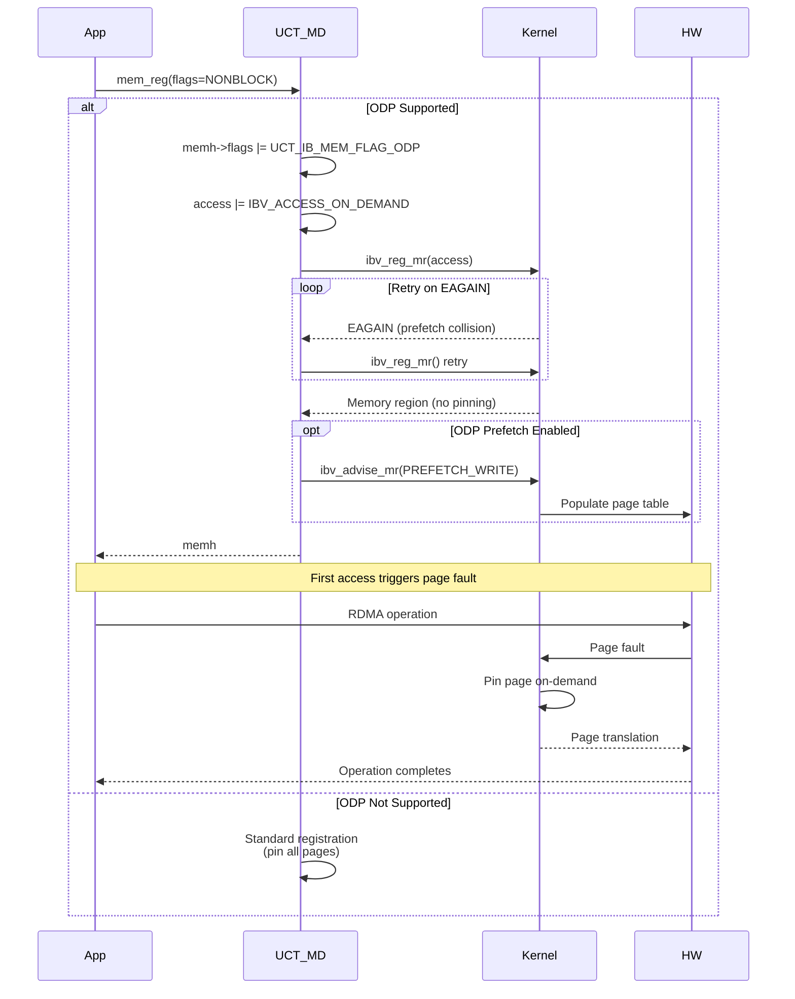

**Sources:**
- [src/uct/ib/base/ib_md.c:616-620]()
- [src/uct/ib/base/ib_md.c:642-644]()
- [src/uct/ib/base/ib_md.c:551-582]()

---

## Relaxed Ordering Support

For systems with PCIe relaxed ordering, UCX creates two MRs per registration:

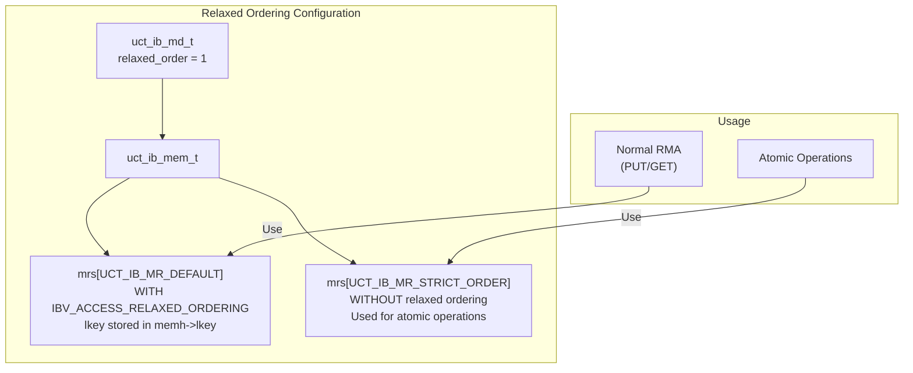

**Rationale:**
- Relaxed ordering improves performance for bulk transfers
- Atomic operations require strict ordering for correctness
- Solution: dual registration with different access flags

**Sources:**
- [src/uct/ib/base/ib_md.c:686-693]()
- [src/uct/ib/base/ib_md.h:132-138]()

---

## Key Data Structures Summary

### Core Structures

```c
// Base memory domain
typedef struct uct_ib_md {
    uct_md_t                 super;
    struct ibv_pd            *pd;              // Protection domain
    uct_ib_device_t          dev;              // IB device
    ucs_linear_func_t        reg_cost;         // Registration cost model
    uct_ib_md_ext_config_t   config;           // Configuration
    int                      relaxed_order;    // Relaxed ordering enabled
    uint64_t                 reg_mem_types;    // Supported memory types
    uint64_t                 cap_flags;        // Capability flags
    uint32_t                 flush_rkey;       // Flush remote key
} uct_ib_md_t;

// Memory handle
typedef struct {
    uint32_t lkey;   // Local key for local DMA
    uint32_t rkey;   // Remote key for remote RDMA
    uint32_t flags;  // UCT_IB_MEM_FLAG_*
} uct_ib_mem_t;

// Memory region (Verbs)
typedef struct {
    struct ibv_mr *ib;  // Verbs MR handle
} uct_ib_mr_t;

// MLX5 memory domain extensions
typedef struct uct_ib_mlx5_md {
    uct_ib_md_t               super;
    uint32_t                  flags;              // MLX5 feature flags
    ucs_mpool_t               dbrec_pool;         // Doorbell records
    struct {
        ucs_list_link_t      list;               // LRU list
        khash_t(rkeys)       hash;               // RKey hash table
        size_t               count;              // Total registrations
    } lru_rkeys;
    struct {
        struct ibv_cq         *cq;               // UMR CQ
        struct ibv_qp         *qp;               // UMR QP
        ucs_list_link_t       mkey_pool;         // UMR mkey pool
    } umr;
} uct_ib_mlx5_md_t;
```

**Sources:**
- [src/uct/ib/base/ib_md.h:145-179]()
- [src/uct/ib/base/ib_md.h:120-139]()
- [src/uct/ib/mlx5/ib_mlx5.h:403-457]()

---

