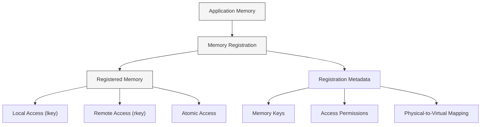
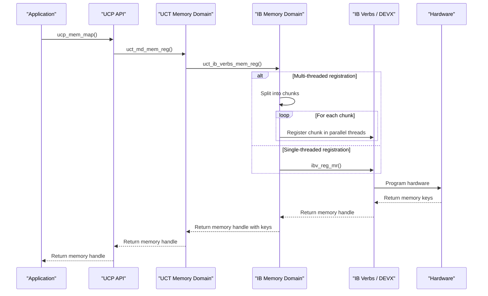
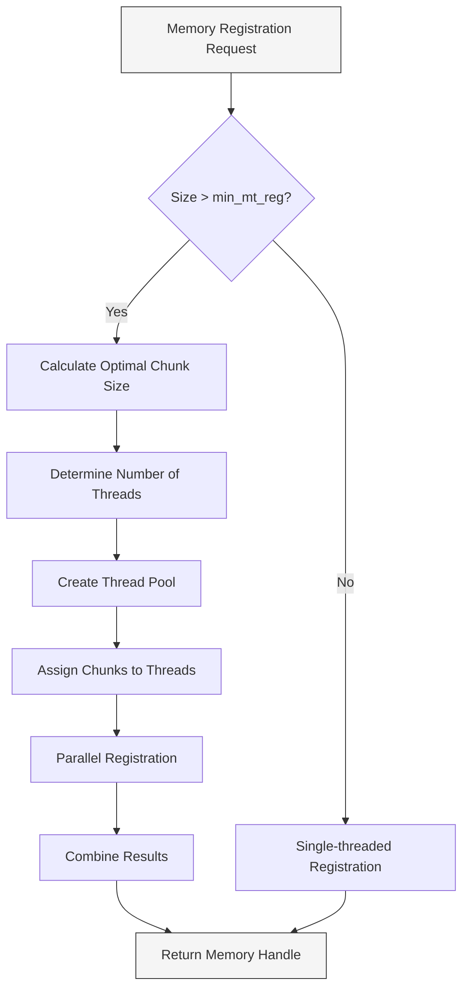
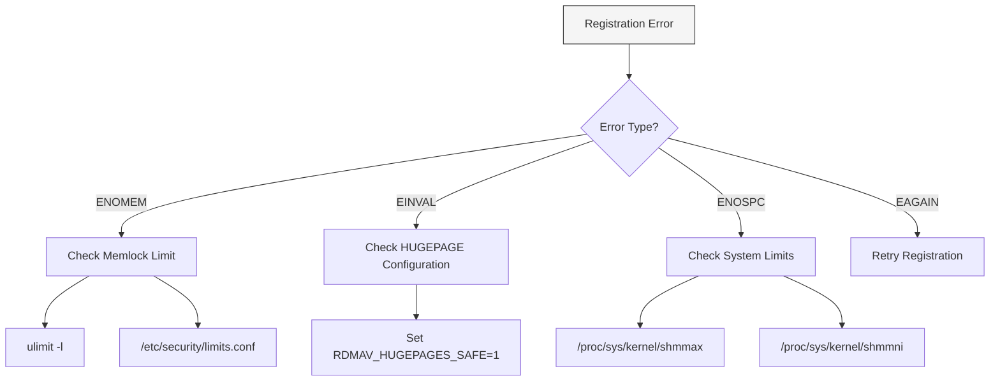

<!-- source: DeepWiki mcp.deepwiki.com · repo openucx/ucx · page 4.2 Memory Registration Flows and Caching · fetched 2026-11-11 -->

# Memory Registration

<details>
<summary>Relevant source files</summary>

The following files were used as context for generating this wiki page:

- [src/ucp/core/ucp_request.c](src/ucp/core/ucp_request.c)
- [src/ucp/core/ucp_request.h](src/ucp/core/ucp_request.h)
- [src/ucp/core/ucp_request.inl](src/ucp/core/ucp_request.inl)
- [src/ucp/proto/proto_am.inl](src/ucp/proto/proto_am.inl)
- [src/ucp/stream/stream.h](src/ucp/stream/stream.h)
- [src/ucp/stream/stream_recv.c](src/ucp/stream/stream_recv.c)
- [src/ucp/stream/stream_send.c](src/ucp/stream/stream_send.c)
- [src/ucp/tag/eager_rcv.c](src/ucp/tag/eager_rcv.c)
- [src/ucp/tag/eager_snd.c](src/ucp/tag/eager_snd.c)
- [src/ucp/tag/offload.c](src/ucp/tag/offload.c)
- [src/ucp/tag/offload.h](src/ucp/tag/offload.h)
- [src/ucp/tag/tag_match.c](src/ucp/tag/tag_match.c)
- [src/ucp/tag/tag_match.h](src/ucp/tag/tag_match.h)
- [src/ucp/tag/tag_match.inl](src/ucp/tag/tag_match.inl)
- [src/ucp/tag/tag_recv.c](src/ucp/tag/tag_recv.c)
- [src/ucp/tag/tag_send.c](src/ucp/tag/tag_send.c)
- [src/uct/ib/base/ib_md.c](src/uct/ib/base/ib_md.c)
- [src/uct/ib/base/ib_md.h](src/uct/ib/base/ib_md.h)
- [src/uct/ib/configure.m4](src/uct/ib/configure.m4)
- [src/uct/ib/mlx5/dv/ib_mlx5_dv.c](src/uct/ib/mlx5/dv/ib_mlx5_dv.c)
- [src/uct/ib/mlx5/dv/ib_mlx5_ifc.h](src/uct/ib/mlx5/dv/ib_mlx5_ifc.h)
- [src/uct/ib/mlx5/dv/ib_mlx5dv_md.c](src/uct/ib/mlx5/dv/ib_mlx5dv_md.c)
- [src/uct/ib/mlx5/ib_mlx5.c](src/uct/ib/mlx5/ib_mlx5.c)
- [src/uct/ib/mlx5/ib_mlx5.h](src/uct/ib/mlx5/ib_mlx5.h)
- [src/uct/ib/mlx5/ib_mlx5.inl](src/uct/ib/mlx5/ib_mlx5.inl)

</details>


Memory registration is a critical process in UCX that prepares memory regions for use in communication operations, particularly for RDMA (Remote Direct Memory Access). It involves making memory accessible to network hardware by pinning physical pages, generating access keys, and setting up appropriate permissions. This page details the memory registration mechanisms in UCX, focusing on the IB (InfiniBand) transport implementation.

For information about memory domains that manage registration, see [Memory Domains](#4.1).

## Memory Registration Concepts

Memory registration is necessary because high-performance network devices like InfiniBand adapters need direct access to memory for RDMA operations. Registration provides the following:

1. **Memory Pinning**: Prevents the operating system from swapping out memory pages during communication operations
2. **Key Generation**: Creates local and remote keys (lkey/rkey) that hardware uses to access memory 
3. **Access Control**: Defines which operations (read/write/atomic) are allowed on the registered memory
4. **Hardware Resources**: Allocates hardware resources to track the registered memory region



Sources: [src/uct/ib/base/ib_md.c:400-432](), [src/uct/ib/base/ib_md.h:118-133]()

## Memory Registration API

UCX provides a layered API for memory registration:

1. **UCP Layer**: Application-facing high-level API
2. **UCT Layer**: Transport-level registration operations
3. **Transport-Specific Implementation**: Hardware-specific registration code (e.g., InfiniBand verbs or Mellanox DEVX)

The core function for memory registration at the UCT layer is:

```c
ucs_status_t uct_md_mem_reg(uct_md_h md, void *address, size_t length,
                            const uct_md_mem_reg_params_t *params,
                            uct_mem_h *memh_p);
```

The corresponding deregistration function is:

```c
ucs_status_t uct_md_mem_dereg(uct_md_h md, 
                             const uct_md_mem_dereg_params_t *params);
```

Sources: [src/uct/ib/base/ib_md.c:460-523](), [src/uct/ib/base/ib_md.c:525-539]()

## Memory Registration Parameters

The registration API uses a parameters structure that contains:

| Parameter | Description |
|-----------|-------------|
| `flags` | Controls memory access permissions and registration behavior |
| `dmabuf_fd` | File descriptor for DMABUF (device memory buffer) |
| `dmabuf_offset` | Offset within the DMABUF |
| `field_mask` | Bitmap indicating which fields are valid |

Common memory access flags include:

| Flag | Description |
|------|-------------|
| `UCT_MD_MEM_ACCESS_LOCAL_READ` | Local read access |
| `UCT_MD_MEM_ACCESS_LOCAL_WRITE` | Local write access |
| `UCT_MD_MEM_ACCESS_REMOTE_READ` | Remote read access |
| `UCT_MD_MEM_ACCESS_REMOTE_WRITE` | Remote write access |
| `UCT_MD_MEM_ACCESS_REMOTE_ATOMIC` | Remote atomic operations |
| `UCT_MD_MEM_FLAG_NONBLOCK` | Non-blocking registration (uses ODP if supported) |
| `UCT_MD_MEM_FLAG_HIDE_ERRORS` | Suppress error messages |
| `UCT_MD_MEM_FLAG_FIXED` | Use fixed address mapping |
| `UCT_MD_MEM_FLAG_SYMMETRIC_RKEY` | Request symmetric remote key |

Sources: [src/uct/ib/base/ib_md.c:53-80](), [src/uct/ib/base/ib_md.h:58-76]()

## Memory Registration Flow

The following diagram illustrates the memory registration flow in UCX, focusing on the InfiniBand implementation:



Sources: [src/uct/ib/base/ib_md.c:300-432](), [src/uct/ib/base/ib_md.c:460-539]()

## InfiniBand Memory Registration Implementation

The InfiniBand transport implements memory registration using either the standard Verbs API or the DEVX API for Mellanox adapters:

1. **Standard Verbs registration**:
   - Uses `ibv_reg_mr()` to register memory with the InfiniBand HCA
   - Returns local and remote keys for memory access

2. **DEVX registration** (Mellanox specific):
   - Uses direct command interface to hardware
   - Provides optimizations like Key Shared Memory (KSM)
   - Supports advanced features like indirect memory keys

Registration may require special handling for:
- Huge pages
- Memory alignment
- RDMA-capable GPU memory
- Relaxed ordering operations

Sources: [src/uct/ib/base/ib_md.c:460-523](), [src/uct/ib/mlx5/dv/ib_mlx5dv_md.c:457-762]()

## Memory Handle Structure

After registration, a memory handle (`uct_mem_h`) is returned which contains:

```mermaid
classDiagram
    class uct_ib_mem_t {
        +uint32_t lkey
        +uint32_t rkey
        +uint32_t flags
    }
    
    class uct_ib_mr_t {
        +struct ibv_mr* ib
    }
    
    class uct_ib_verbs_mem_t {
        +uct_ib_mem_t super
        +uct_ib_mr_t mrs[]
    }
    
    class uct_ib_mlx5_devx_mem_t {
        +uct_ib_mem_t super
        +void* address
        +uct_ib_mlx5_devx_mr_t mrs[]
        +struct mlx5dv_devx_obj* atomic_dvmr
        +struct mlx5dv_devx_obj* indirect_dvmr
        +uint32_t atomic_rkey
        +uint32_t indirect_rkey
    }
    
    uct_ib_mem_t <|-- uct_ib_verbs_mem_t : inherits
    uct_ib_mem_t <|-- uct_ib_mlx5_devx_mem_t : inherits
    uct_ib_verbs_mem_t o-- uct_ib_mr_t : contains
    uct_ib_mlx5_devx_mem_t o-- "uct_ib_mlx5_devx_mr_t" : contains
```

Sources: [src/uct/ib/base/ib_md.h:118-134](), [src/uct/ib/base/ib_md.c:214]()

## Multi-threaded Registration

For large memory regions, UCX can use multi-threaded registration to improve performance. This works by:

1. Splitting the memory region into chunks
2. Registering chunks in parallel using multiple threads
3. Combining the results into a single memory handle

Multi-threaded registration is enabled when:
- The memory region size exceeds `min_mt_reg` (default: 4GB)
- The registration isn't using On-Demand Paging (ODP)
- The registration doesn't request symmetric remote keys



Sources: [src/uct/ib/base/ib_md.c:299-458](), [src/uct/ib/mlx5/dv/ib_mlx5dv_md.c:561-669]()

## On-Demand Paging (ODP)

UCX supports On-Demand Paging for memory registration which:

1. Allows registration of memory without pinning it immediately
2. Pages are faulted and pinned only when actually accessed
3. Reduces registration overhead for large memory regions
4. Enables more efficient memory utilization

ODP is enabled when:
- The `UCT_MD_MEM_FLAG_NONBLOCK` flag is set
- The memory domain supports ODP (reported in capabilities)
- The memory type is supported for ODP operations

Sources: [src/uct/ib/base/ib_md.c:606-610](), [src/uct/ib/base/ib_md.c:174-177]()

## Memory Key Packing and Handling

After registration, memory keys can be packed for remote use:

1. **Local Key (lkey)**: Used by the local adapter for accessing memory
2. **Remote Key (rkey)**: Sent to remote peers for RDMA operations
3. **Atomic Key**: Special key for atomic operations

The packed key format combines both the direct access key and atomic access key:

```
+----------------+----------------+
| Atomic Key     | Direct Key     |
| (32 bits)      | (32 bits)      |
+----------------+----------------+
```

Sources: [src/uct/ib/base/ib_md.h:270-276](), [src/uct/ib/base/ib_md.c:726-747]()

## Relaxed Ordering

UCX supports relaxed ordering memory access which can improve performance but requires special handling:

1. Multiple memory keys may be created for a single memory region:
   - Default key with relaxed ordering enabled
   - Strict ordering key for operations that require it

2. The appropriate key is selected based on the operation:
   - Regular operations use the relaxed ordering key
   - Atomic operations use the strict ordering key

Sources: [src/uct/ib/base/ib_md.c:591-594](), [src/uct/ib/base/ib_md.c:662-683]()

## Error Handling

Common registration errors include:

| Error | Possible Causes | Resolution |
|-------|-----------------|------------|
| `EINVAL` | Invalid parameters, HUGEPAGE issues | Set `RDMAV_HUGEPAGES_SAFE=1` |
| `ENOMEM` | Insufficient memory or locked pages limit | Increase memlock limit (ulimit -l) |
| `ENOSPC` | Reached system limits for shared segments | Check/increase kernel settings (shmmax, etc.) |
| `EAGAIN` | Registration collided with invalidation | Retry registration |



Sources: [src/uct/ib/base/ib_md.c:261-288](), [src/ucs/sys/sys.c:739-774]()

## Memory Registration Best Practices

1. **Registration Size**:
   - Register large contiguous regions rather than many small ones
   - Consider using ODP for very large regions

2. **Registration Lifetime**:
   - Register memory once and reuse it when possible
   - Deregister memory when no longer needed to free resources

3. **Memory Alignment**:
   - Align memory to page boundaries for best performance
   - Use huge pages for large memory regions

4. **Registration Flags**:
   - Request only necessary access permissions
   - Use `UCT_MD_MEM_FLAG_NONBLOCK` for large regions

Sources: [src/uct/ib/base/ib_md.c:587-627](), [src/uct/base/uct_mem.c:72-554]()

---

