<!-- source: DeepWiki mcp.deepwiki.com · repo openucx/ucx · page 4.3 Remote Keys and Zero-Copy Operations · fetched 2026-11-11 -->

# Remote Keys and Zero-Copy Operations

<details>
<summary>Relevant source files</summary>

The following files were used as context for generating this wiki page:

- [src/uct/ib/base/ib_md.c](src/uct/ib/base/ib_md.c)
- [src/uct/ib/base/ib_md.h](src/uct/ib/base/ib_md.h)
- [src/uct/ib/configure.m4](src/uct/ib/configure.m4)
- [src/uct/ib/mlx5/dv/ib_mlx5_dv.c](src/uct/ib/mlx5/dv/ib_mlx5_dv.c)
- [src/uct/ib/mlx5/dv/ib_mlx5_ifc.h](src/uct/ib/mlx5/dv/ib_mlx5_ifc.h)
- [src/uct/ib/mlx5/dv/ib_mlx5dv_md.c](src/uct/ib/mlx5/dv/ib_mlx5dv_md.c)
- [src/uct/ib/mlx5/ib_mlx5.c](src/uct/ib/mlx5/ib_mlx5.c)
- [src/uct/ib/mlx5/ib_mlx5.h](src/uct/ib/mlx5/ib_mlx5.h)
- [src/uct/ib/mlx5/ib_mlx5.inl](src/uct/ib/mlx5/ib_mlx5.inl)
- [src/uct/ib/rc/base/rc_ep.c](src/uct/ib/rc/base/rc_ep.c)
- [src/uct/ib/rc/base/rc_ep.h](src/uct/ib/rc/base/rc_ep.h)
- [src/uct/ib/rc/base/rc_iface.c](src/uct/ib/rc/base/rc_iface.c)
- [src/uct/ib/rc/base/rc_iface.h](src/uct/ib/rc/base/rc_iface.h)
- [src/uct/ib/rc/verbs/rc_verbs.h](src/uct/ib/rc/verbs/rc_verbs.h)
- [src/uct/ib/rc/verbs/rc_verbs_ep.c](src/uct/ib/rc/verbs/rc_verbs_ep.c)
- [src/uct/ib/rc/verbs/rc_verbs_iface.c](src/uct/ib/rc/verbs/rc_verbs_iface.c)

</details>


## Purpose and Scope

This document describes UCX's remote key (rkey) management system and zero-copy RDMA operations. Remote keys enable direct memory access operations (RDMA READ/WRITE, atomic operations) by providing remote peers with access credentials to locally registered memory regions. Zero-copy operations use these keys to transfer data without intermediate buffering.

This page covers:
- Memory registration flows and memory handle creation
- Remote key structure, packing, and unpacking mechanisms
- Direct memory regions (MR) vs indirect keys (KSM/UMR)
- Remote key lifecycle management and LRU caching to prevent reuse
- Zero-copy operation implementations (PUT/GET/ATOMIC)

For information about memory domain operations and registration caching, see [Memory Domains and Registration](#4.1). For GPU memory handling, see [GPU Memory Support](#4.4).

---

## Memory Registration and Remote Key Creation

Memory must be registered with the InfiniBand hardware before it can be accessed remotely. Registration produces a memory handle containing local keys (lkey) for local access and remote keys (rkey) for remote access.

### Registration Flow

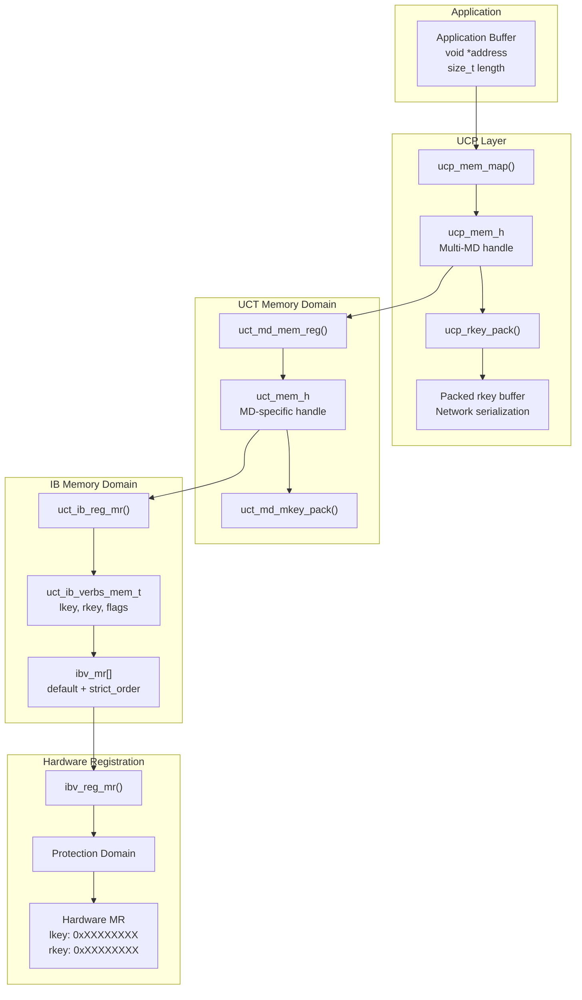

**Sources:** [src/uct/ib/base/ib_md.c:653-708](), [src/uct/ib/base/ib_md.c:474-533]()

The registration process flows from application memory through multiple layers:

1. **Application calls** `ucp_mem_map()` with a memory buffer
2. **UCP layer** creates a multi-MD handle that may span multiple memory domains
3. **UCT layer** calls `uct_md_mem_reg()` for each relevant memory domain
4. **IB MD layer** calls `uct_ib_reg_mr()` to register with verbs
5. **Verbs layer** calls `ibv_reg_mr()` which programs the hardware

The resulting memory handle contains both local and remote keys that are used for subsequent data transfer operations.

---

## Remote Key Structure and Format

### Packed Remote Key Format

Remote keys are packed into a 64-bit structure for network transmission:

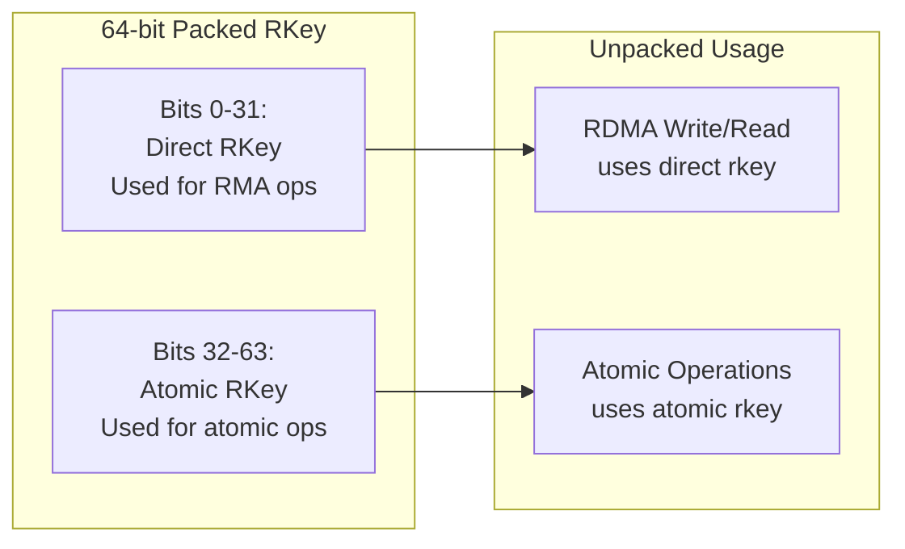

**Sources:** [src/uct/ib/base/ib_md.h:264-283]()

The packing is implemented in `uct_ib_md_pack_rkey()`:

| Field | Bits | Purpose |
|-------|------|---------|
| Direct RKey | 0-31 | Used for RDMA Read/Write operations |
| Atomic RKey | 32-63 | Used for atomic operations (may differ for relaxed ordering) |

**Sources:** [src/uct/ib/base/ib_md.h:276-283]()

### Memory Handle Structure

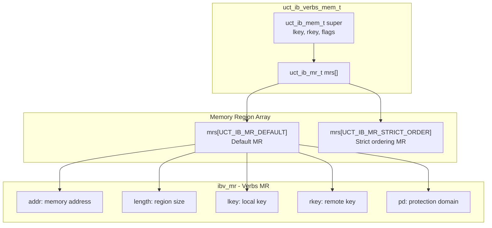

**Sources:** [src/uct/ib/base/ib_md.c:226-228](), [src/uct/ib/base/ib_md.h:121-129]()

The memory handle may contain two memory regions when relaxed ordering is enabled:
- `UCT_IB_MR_DEFAULT`: Primary MR (may have relaxed ordering)
- `UCT_IB_MR_STRICT_ORDER`: Strict ordering MR for atomic operations

**Sources:** [src/uct/ib/base/ib_md.h:132-139](), [src/uct/ib/base/ib_md.c:686-693]()

---

## Direct vs Indirect Memory Keys

UCX supports two types of remote keys for different use cases:

### Direct Keys (Standard MR)

Direct keys map directly to a single hardware memory region registered via `ibv_reg_mr()`.

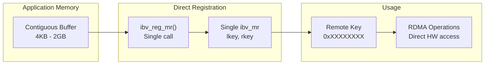

**Sources:** [src/uct/ib/base/ib_md.c:653-708]()

### Indirect Keys (KSM/UMR)

Indirect keys use Key by Name (KSM) or User Mode Registration (UMR) for special cases:

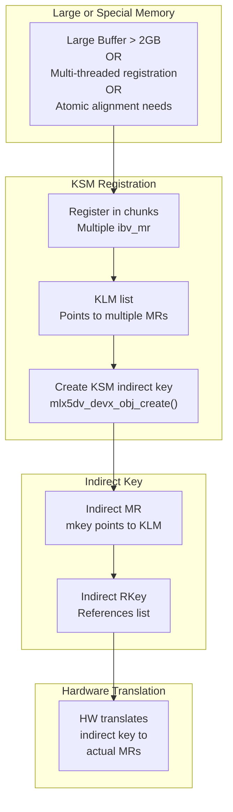

**Sources:** [src/uct/ib/mlx5/dv/ib_mlx5dv_md.c:142-195](), [src/uct/ib/mlx5/dv/ib_mlx5dv_md.c:239-288]()

KSM registration creates a Key-by-Name mapping with a list of Key-Length-Memory (KLM) entries:

**Multi-threaded Registration Flow:**

1. Split large buffer into chunks (configurable, default 2GB)
2. Register each chunk with `ibv_reg_mr()` in parallel threads
3. Create KSM with KLM list pointing to all chunks
4. Hardware resolves indirect key to actual memory regions

**Sources:** [src/uct/ib/mlx5/dv/ib_mlx5dv_md.c:625-677](), [src/uct/ib/base/ib_md.c:313-354]()

---

## Remote Key Lifecycle and LRU Caching

### Key Creation and Export

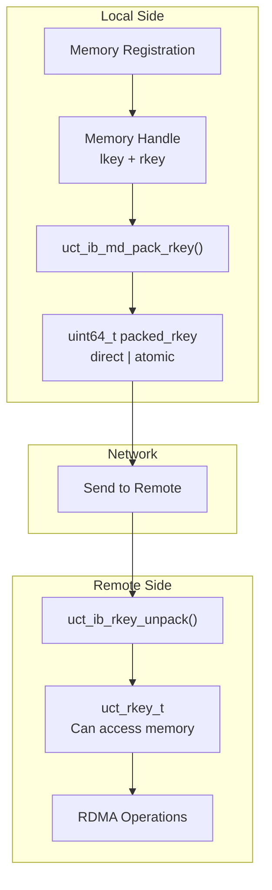

**Sources:** [src/uct/ib/base/ib_md.c:737-757](), [src/uct/ib/base/ib_md.c:759-772]()

### LRU Cache for Key Reuse Prevention

MLX5 maintains an LRU cache of invalidated rkeys to prevent premature key reuse, which could cause data corruption:

```mermaid
graph TB
    subgraph "Problem: RKey Reuse"
        OLD_RKEY["Old RKey: 0x12345678<br/>References freed memory"]
        HW_ASSIGN["HW assigns same key<br/>to new memory"]
        STALE_ACCESS["Stale remote access<br/>Data corruption!"]
        
        OLD_RKEY --> HW_ASSIGN
        HW_ASSIGN --> STALE_ACCESS
    end
    
    subgraph "Solution: LRU Cache"
        DEREG["Memory deregistration"]
        LRU_PUSH["Push rkey to LRU<br/>kh_put(rkeys)"]
        LRU_LIST["LRU List<br/>Max 16 entries"]
        LRU_POP["Pop oldest when full"]
        SAFE_REUSE["Safe for HW reuse"]
        
        DEREG --> LRU_PUSH
        LRU_PUSH --> LRU_LIST
        LRU_LIST --> LRU_POP
        LRU_POP --> SAFE_REUSE
    end
```

**Sources:** [src/uct/ib/mlx5/dv/ib_mlx5dv_md.c:435-498](), [src/uct/ib/mlx5/ib_mlx5.h:347-369]()

**LRU Cache Structure:**

```c
struct {
    ucs_list_link_t    list;      // Ordered by age
    khash_t(rkeys)     hash;      // Fast lookup by rkey
    size_t             count;     // Total keys processed
} lru_rkeys;
```

**Sources:** [src/uct/ib/mlx5/ib_mlx5.h:415-418]()

Each LRU entry tracks:

| Field | Type | Purpose |
|-------|------|---------|
| `rkey` | `uint32_t` | The remote key value (hash key) |
| `indirect_mr` | `mlx5dv_devx_obj*` | Associated MR object (or NULL) |
| `is_dummy` | `uint8_t` | True if created only to block reuse |
| `list` | `ucs_list_link_t` | Position in LRU list |

**Sources:** [src/uct/ib/mlx5/ib_mlx5.h:347-369]()

**Cache Operations:**

1. **Push:** When MR is destroyed, rkey enters cache with `uct_ib_md_mlx5_devx_mr_lru_push()`
2. **Pop:** When cache reaches `max_idle_rkey_count` (default 16), oldest entry is evicted
3. **Tag Increment:** After every N keys, mkey tag increments to vary key space

**Sources:** [src/uct/ib/mlx5/dv/ib_mlx5dv_md.c:382-410](), [src/uct/ib/mlx5/dv/ib_mlx5dv_md.c:492-495](), [src/uct/ib/base/ib_md.c:168-170]()

---

## Zero-Copy RDMA Operations

Zero-copy operations transfer data directly between registered memory regions without intermediate buffering.

### RDMA Write (PUT) Operation

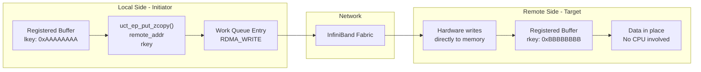

**Sources:** [src/uct/ib/rc/verbs/rc_verbs_ep.c:154-170](), [src/uct/ib/rc/verbs/rc_verbs_ep.c:82-114]()

**PUT Operation Code Path:**

```
uct_rc_verbs_ep_put_short()           // Short inline PUT
  └─> uct_ib_resolve_atomic_rkey()    // Handle atomic offset
  └─> UCT_RC_VERBS_FILL_INL_PUT_WR()  // Build inline WR
  └─> uct_rc_verbs_ep_post_send()     // Post to QP

uct_rc_verbs_ep_put_zcopy()           // Zero-copy PUT
  └─> uct_ib_verbs_sge_fill_iov()     // Build scatter-gather list
  └─> UCT_RC_VERBS_FILL_RDMA_WR_IOV() // Build RDMA WR
  └─> uct_rc_verbs_ep_post_send()     // Post to QP
```

**Sources:** [src/uct/ib/rc/verbs/rc_verbs_ep.c:154-170](), [src/uct/ib/rc/verbs/rc_verbs_ep.c:172-196]()

### RDMA Read (GET) Operation

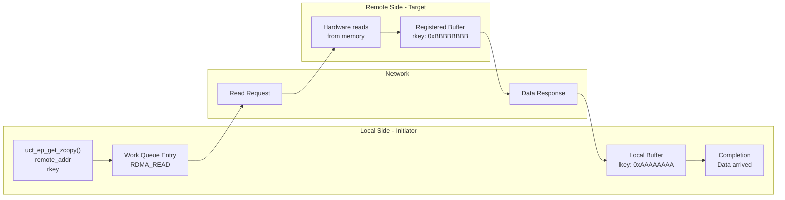

**Sources:** [src/uct/ib/rc/verbs/rc_verbs_ep.c:198-231]()

**GET Operation Details:**

- Requires available RDMA_READ credit (tracked per-interface)
- Consumes QP send queue entry
- Always signaled for completion
- May require fence bit if previous operations pending

**Sources:** [src/uct/ib/rc/verbs/rc_verbs_ep.c:45-49](), [src/uct/ib/rc/base/rc_ep.h:115-126]()

---

## MLX5 Advanced Memory Key Features

### UMR (User Mode Registration) Keys

UMR provides fast memory registration by posting work requests to a special QP instead of system calls:

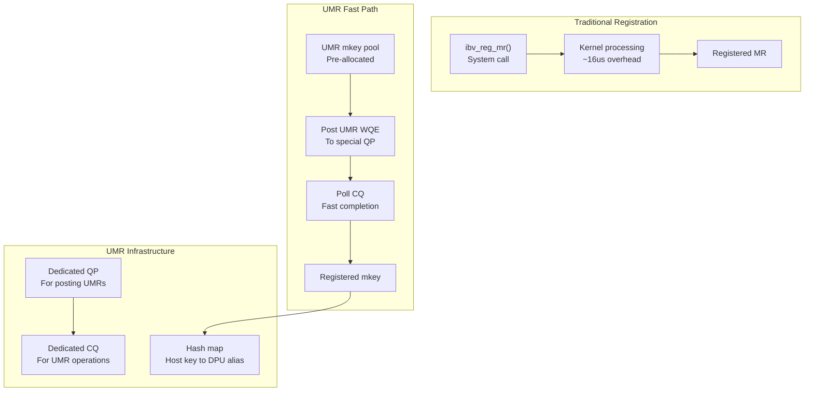

**Sources:** [src/uct/ib/mlx5/ib_mlx5.h:427-436](), [src/uct/ib/mlx5/ib_mlx5.h:290-293]()

**UMR Components:**

| Component | Type | Purpose |
|-----------|------|---------|
| `umr.cq` | `ibv_cq*` | Completion queue for UMR operations |
| `umr.qp` | `ibv_qp*` | Queue pair for posting UMR requests |
| `umr.mkey_pool` | `ucs_list_link_t` | Pool of pre-allocated indirect mkeys |
| `umr.mkey_hash` | `khash_t(umr_mkey_map)` | Maps host mkey to DPU mkey alias |

**Sources:** [src/uct/ib/mlx5/ib_mlx5.h:427-436]()

### Exported Memory Keys

For memory exported across processes or to accelerators:

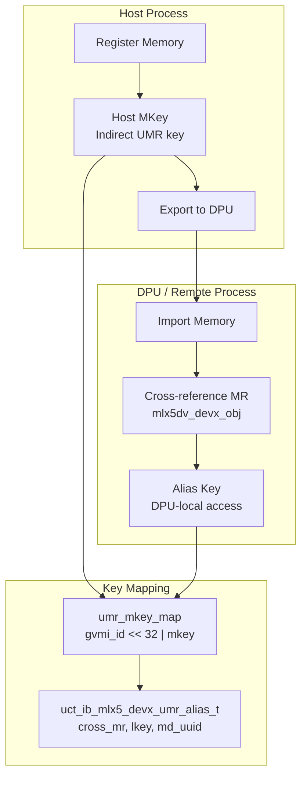

**Sources:** [src/uct/ib/mlx5/ib_mlx5.h:301-312](), [src/uct/ib/mlx5/ib_mlx5.h:314-316]()

The hash map uses a composite key: `(gvmi_id << 32) | mkey_index` to track the relationship between host and DPU memory keys.

**Sources:** [src/uct/ib/mlx5/ib_mlx5.h:315]()

### Relaxed Ordering

MLX5 supports PCIe relaxed ordering for improved performance:

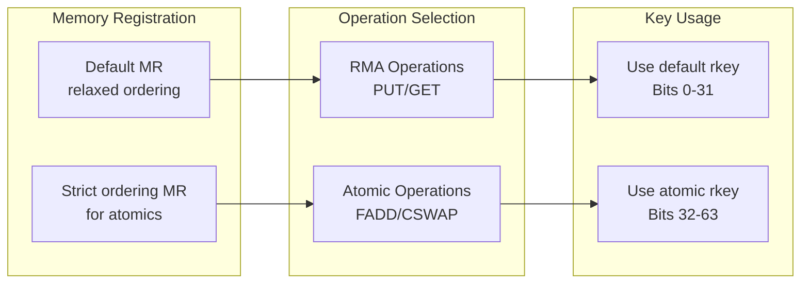

**Sources:** [src/uct/ib/base/ib_md.c:686-693](), [src/uct/ib/base/ib_md.c:639-651]()

When relaxed ordering is enabled:
- Two MRs are created: `UCT_IB_MR_DEFAULT` (relaxed) and `UCT_IB_MR_STRICT_ORDER`
- RMA operations use the default relaxed MR for performance
- Atomic operations use the strict ordering MR for correctness
- The packed rkey contains both keys in a single 64-bit value

**Sources:** [src/uct/ib/base/ib_md.h:132-139](), [src/uct/ib/base/ib_md.h:276-283]()

---

## Configuration Parameters

Key configuration parameters affecting remote key behavior:

| Parameter | Default | Description |
|-----------|---------|-------------|
| `UCX_IB_REG_MT_THRESH` | 4G | Minimum size for multi-threaded registration with KSM |
| `UCX_IB_REG_MT_CHUNK` | 2G | Chunk size for parallel registration |
| `UCX_IB_MAX_IDLE_RKEY_COUNT` | 16 | LRU cache size for invalidated rkeys |
| `UCX_IB_PCI_RELAXED_ORDERING` | auto | Enable relaxed ordering for PCIe |
| `UCX_IB_REG_RETRY_CNT` | inf | Retries for memory registration with ODP |

**Sources:** [src/uct/ib/base/ib_md.c:149-174]()

These parameters can be tuned based on:
- Memory region sizes (use KSM for large regions)
- Performance requirements (relaxed ordering for throughput)
- System characteristics (ODP retry for page faults)

---

## Code Entity Reference

### Key Functions

| Function | File | Purpose |
|----------|------|---------|
| `uct_ib_reg_mr()` | [src/uct/ib/base/ib_md.c:474-533]() | Register memory region with verbs |
| `uct_ib_dereg_mr()` | [src/uct/ib/base/ib_md.c:535-549]() | Deregister memory region |
| `uct_ib_md_pack_rkey()` | [src/uct/ib/base/ib_md.h:276-283]() | Pack rkey for network transmission |
| `uct_ib_rkey_unpack()` | [src/uct/ib/base/ib_md.c:759-772]() | Unpack received rkey |
| `uct_ib_mlx5_devx_reg_ksm()` | [src/uct/ib/mlx5/dv/ib_mlx5dv_md.c:142-195]() | Register KSM indirect key |
| `uct_ib_md_mlx5_devx_mr_lru_push()` | [src/uct/ib/mlx5/dv/ib_mlx5dv_md.c:435-498]() | Add rkey to LRU cache |
| `uct_rc_verbs_ep_put_zcopy()` | [src/uct/ib/rc/verbs/rc_verbs_ep.c:172-196]() | Zero-copy PUT operation |
| `uct_rc_verbs_ep_get_zcopy()` | [src/uct/ib/rc/verbs/rc_verbs_ep.c:198-231]() | Zero-copy GET operation |

### Key Data Structures

| Structure | File | Purpose |
|-----------|------|---------|
| `uct_ib_mem_t` | [src/uct/ib/base/ib_md.h:121-124]() | Base IB memory handle |
| `uct_ib_verbs_mem_t` | [src/uct/ib/base/ib_md.c:226-228]() | Verbs memory handle with MR array |
| `uct_ib_mlx5_devx_mem_t` | [src/uct/ib/mlx5/ib_mlx5.h:319-335]() | MLX5 DEVX memory handle with indirect keys |
| `uct_ib_mlx5_mem_lru_entry_t` | [src/uct/ib/mlx5/ib_mlx5.h:347-369]() | LRU cache entry for rkeys |
| `uct_ib_md_packed_mkey_t` | [src/uct/ib/base/ib_md.h:182-186]() | Packed exported mkey format |

**Sources:** Multiple files as cited above

---

