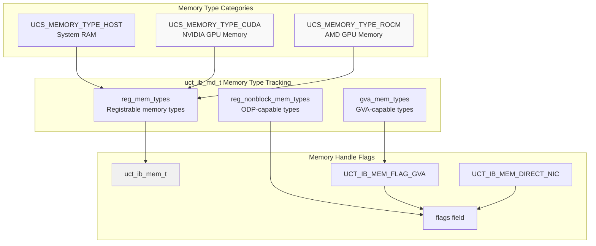
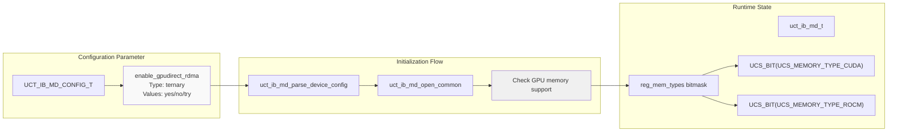
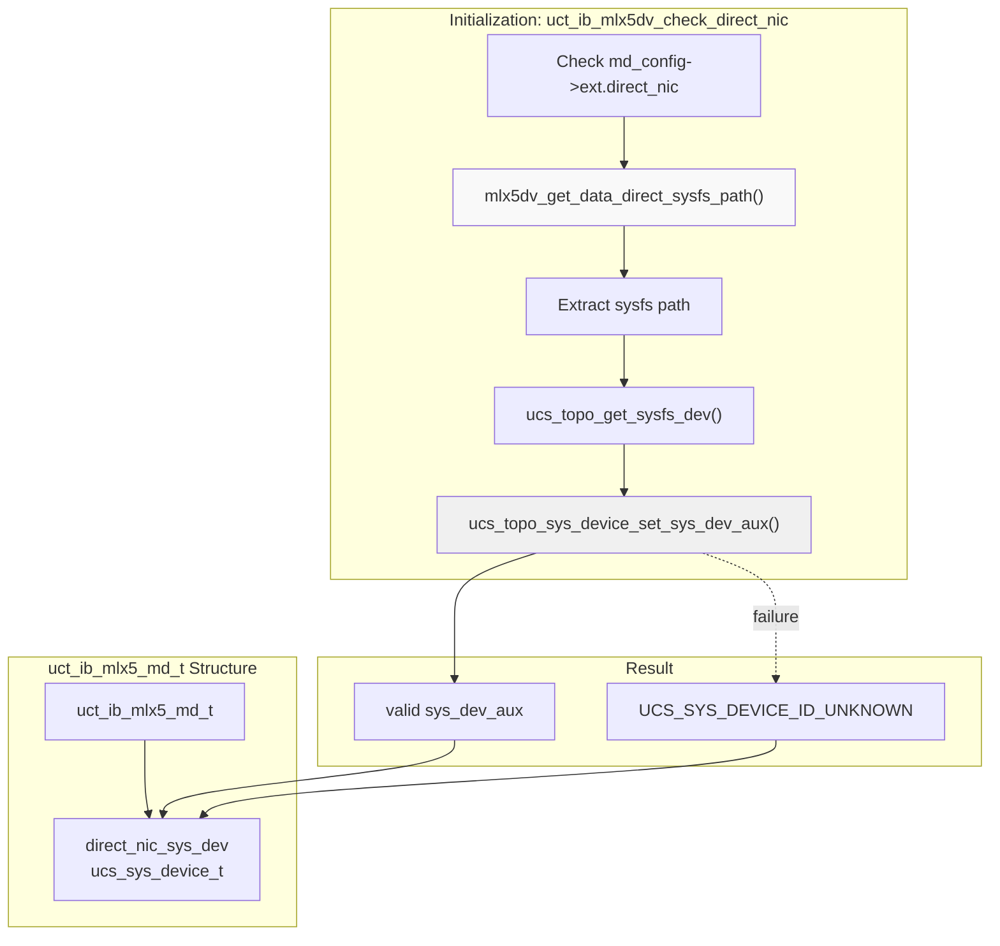
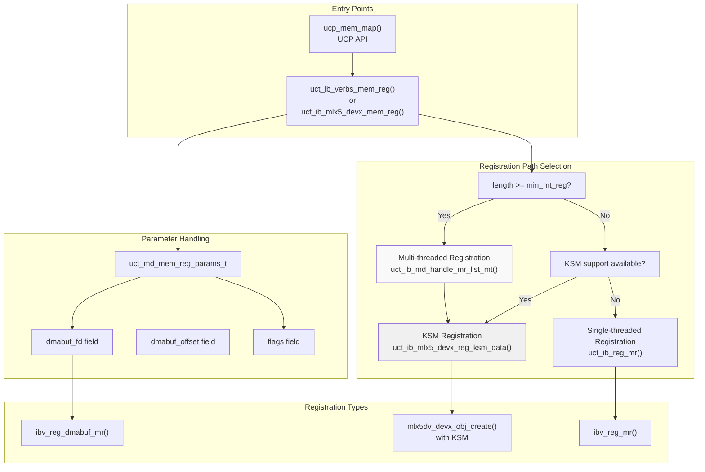
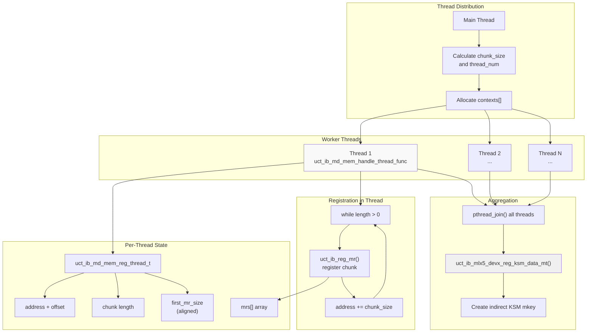
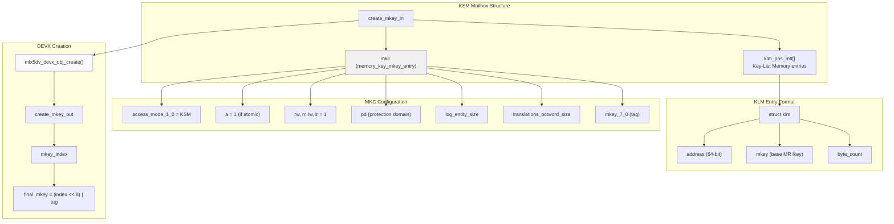
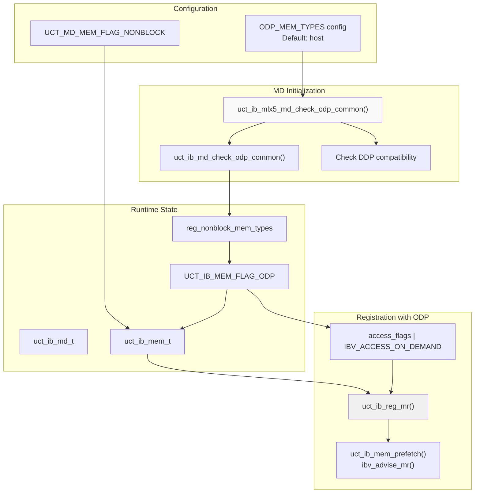

<!-- source: DeepWiki mcp.deepwiki.com · repo openucx/ucx · page 4.4 GPU Memory Support · fetched 2026-11-11 -->

# GPU Memory Support

<details>
<summary>Relevant source files</summary>

The following files were used as context for generating this wiki page:

- [src/uct/ib/base/ib_md.c](src/uct/ib/base/ib_md.c)
- [src/uct/ib/base/ib_md.h](src/uct/ib/base/ib_md.h)
- [src/uct/ib/configure.m4](src/uct/ib/configure.m4)
- [src/uct/ib/mlx5/dv/ib_mlx5_dv.c](src/uct/ib/mlx5/dv/ib_mlx5_dv.c)
- [src/uct/ib/mlx5/dv/ib_mlx5_ifc.h](src/uct/ib/mlx5/dv/ib_mlx5_ifc.h)
- [src/uct/ib/mlx5/dv/ib_mlx5dv_md.c](src/uct/ib/mlx5/dv/ib_mlx5dv_md.c)
- [src/uct/ib/mlx5/ib_mlx5.c](src/uct/ib/mlx5/ib_mlx5.c)
- [src/uct/ib/mlx5/ib_mlx5.h](src/uct/ib/mlx5/ib_mlx5.h)
- [src/uct/ib/mlx5/ib_mlx5.inl](src/uct/ib/mlx5/ib_mlx5.inl)

</details>


## Purpose and Scope

This page documents UCX's support for GPU memory across the InfiniBand transport layer. GPU memory support enables zero-copy communication with GPU-resident data through GPUDirect RDMA and Direct NIC technologies. This includes memory type detection, registration workflows, and hardware acceleration for CUDA and ROCm memory.

For general memory registration mechanisms, see [Memory Domains and Registration](#4.1). For remote key management, see [Remote Keys and Zero-Copy Operations](#4.3).

---

## Memory Type Framework

UCX distinguishes between different memory types to handle GPU memory appropriately. The memory domain tracks which memory types support registration, Global Virtual Addressing (GVA), and non-blocking (on-demand paging) access.



**Sources:** [src/uct/ib/base/ib_md.h:146-179](), [src/uct/ib/base/ib_md.h:58-78]()

The `uct_ib_md_t` structure maintains three bitmasks for memory type capabilities:
- **`reg_mem_types`**: Memory types that can be registered with hardware
- **`gva_mem_types`**: Memory types supporting Global Virtual Addressing
- **`reg_nonblock_mem_types`**: Memory types supporting On-Demand Paging (ODP)

Each registered memory handle (`uct_ib_mem_t`) carries flags indicating its characteristics, including whether it was registered as GVA or through Direct NIC.

**Sources:** [src/uct/ib/base/ib_md.h:120-124](), [src/uct/ib/base/ib_md.c:256-260]()

---

## GPUDirect RDMA Configuration

GPUDirect RDMA allows InfiniBand adapters to directly access GPU memory without involving the CPU, enabling true zero-copy GPU-to-GPU transfers. UCX provides configuration controls for this functionality.



**Sources:** [src/uct/ib/base/ib_md.c:119-121](), [src/uct/ib/md_config_table]()

| Parameter | Type | Default | Description |
|-----------|------|---------|-------------|
| `GPU_DIRECT_RDMA` | ternary | try | Enable GPU Direct RDMA for HCA to access GPU pages directly |
| `DIRECT_NIC` | bool | yes | Use Direct NIC functionality for GPU memory access |
| `GDA_MAX_HCA_PER_GPU` | uint | 1 | Max number of HCA devices to use per GPU device |
| `GDA_DMABUF_ENABLE` | ternary | try | Enable DMA-BUF in GDA |

When `enable_gpudirect_rdma` is set to "try" (default), UCX attempts to enable GPU memory registration and gracefully falls back if unsupported. Setting it to "yes" requires GPU support and fails initialization if unavailable.

**Sources:** [src/uct/ib/base/ib_md.c:119-131]()

---

## Direct NIC Support

Direct NIC (Data Direct NIC) is an NVIDIA technology that provides optimized data paths between GPU memory and network adapters. It creates a separate DMA device from a topology perspective, enabling better NUMA affinity and bandwidth utilization.



**Sources:** [src/uct/ib/mlx5/ib_mlx5.h:409](), [src/uct/ib/mlx5/dv/ib_mlx5dv_md.c:39-92]()

The Direct NIC initialization process:

1. **Configuration Check**: Verify `DIRECT_NIC` configuration is enabled ([src/uct/ib/base/ib_md.c:190-191]())
2. **Query System Path**: Call `mlx5dv_get_data_direct_sysfs_path()` to obtain the Direct NIC sysfs path ([src/uct/ib/mlx5/dv/ib_mlx5dv_md.c:57]())
3. **Create Topology Device**: Register a separate system device for DMA operations ([src/uct/ib/mlx5/dv/ib_mlx5dv_md.c:65-67]())
4. **Set Auxiliary Device**: Associate the Direct NIC device as auxiliary to the main IB device ([src/uct/ib/mlx5/dv/ib_mlx5dv_md.c:69]())

If Direct NIC is supported, `direct_nic_sys_dev` contains a valid system device ID. Otherwise, it is set to `UCS_SYS_DEVICE_ID_UNKNOWN` ([src/uct/ib/mlx5/dv/ib_mlx5dv_md.c:91]()).

Memory registered through Direct NIC receives the `UCT_IB_MEM_DIRECT_NIC` flag ([src/uct/ib/base/ib_md.h:76-77]()).

**Sources:** [src/uct/ib/mlx5/dv/ib_mlx5dv_md.c:39-92](), [src/uct/ib/base/ib_md.h:114]()

---

## Memory Registration with GPU Memory

GPU memory registration follows specialized paths to accommodate hardware requirements and optimizations. The registration process differs based on whether multi-threaded registration is used and whether indirect keys (KSM) are employed.

### Registration Entry Point



**Sources:** [src/uct/ib/base/ib_md.c:653-708](), [src/uct/ib/base/ib_md.c:474-533]()

### Registration Options

The registration flow accommodates three distinct registration mechanisms:

**1. Standard Registration (`ibv_reg_mr`)**:
Direct registration with the verbs API. Supports host and GPU memory when GPUDirect RDMA is enabled. The access flags are determined by `uct_ib_memh_access_flags()` which may include `IBV_ACCESS_ON_DEMAND` for ODP.

**Sources:** [src/uct/ib/base/ib_md.c:502-510](), [src/uct/ib/base/ib_md.c:639-651]()

**2. DMA-BUF Registration (`ibv_reg_dmabuf_mr`)**:
Used when `dmabuf_fd` is provided in registration parameters. Enables sharing of GPU memory across process boundaries using file descriptors. Requires `HAVE_DECL_IBV_REG_DMABUF_MR` capability.

**Sources:** [src/uct/ib/base/ib_md.c:512-519](), [src/uct/ib/base/ib_md.c:488-491]()

**3. KSM (Key by Name) Registration**:
MLX5-specific indirect memory key mechanism. Creates a kernel-managed list of memory regions that can span discontiguous memory or support special access patterns. Used for:
- Multi-threaded registration splitting large buffers into chunks
- Atomic memory access requiring aligned indirect keys
- GPU memory with special addressing requirements

**Sources:** [src/uct/ib/mlx5/dv/ib_mlx5dv_md.c:142-194](), [src/uct/ib/mlx5/dv/ib_mlx5dv_md.c:239-288]()

### Multi-threaded GPU Memory Registration



**Sources:** [src/uct/ib/base/ib_md.c:356-472](), [src/uct/ib/mlx5/dv/ib_mlx5dv_md.c:239-288]()

Multi-threaded registration is triggered when the memory size exceeds `min_mt_reg` threshold (default 4GB). The process:

1. **Thread Distribution**: Determine thread count based on CPU affinity mask ([src/uct/ib/base/ib_md.c:375-383]())
2. **Chunk Calculation**: Divide memory into `chunk_size` blocks (default 2GB), with first chunk aligned to chunk boundary ([src/uct/ib/base/ib_md.c:415-417]())
3. **Parallel Registration**: Each thread registers its chunks sequentially via `uct_ib_md_mem_handle_thread_func()` ([src/uct/ib/base/ib_md.c:313-354]())
4. **KSM Creation**: Aggregate all MRs into a single indirect KSM key via `uct_ib_mlx5_devx_reg_ksm_data_mt()` ([src/uct/ib/mlx5/dv/ib_mlx5dv_md.c:239-288]())

The multi-threaded path does **not** support DMA-BUF registration ([src/uct/ib/mlx5/dv/ib_mlx5dv_md.c:646-651]()).

**Sources:** [src/uct/ib/base/ib_md.c:356-472](), [src/uct/ib/base/ib_md.h:105-107]()

---

## KSM (Kernel Scalable Memory) for GPU Memory

KSM provides indirect memory keys that reference a list of base memory regions. This is critical for GPU memory to support atomic operations and large registrations.

### KSM Structure and Creation



**Sources:** [src/uct/ib/mlx5/dv/ib_mlx5dv_md.c:142-194](), [src/uct/ib/mlx5/dv/ib_mlx5dv_md.c:220-233]()

The KSM creation flow (`uct_ib_mlx5_devx_reg_ksm`):

1. **Allocate Mailbox**: Create input buffer sized for command plus KLM entries ([src/uct/ib/mlx5/dv/ib_mlx5dv_md.c:120-139]())
2. **Configure MKC**: Set access mode to `UCT_IB_MLX5_MKC_ACCESS_MODE_KSM`, atomic flag, and permissions ([src/uct/ib/mlx5/dv/ib_mlx5dv_md.c:151-167]())
3. **Populate KLM List**: Fill each KLM entry with base MR address, lkey, and byte count ([src/uct/ib/mlx5/dv/ib_mlx5dv_md.c:220-233]())
4. **Create DEVX Object**: Issue `CREATE_MKEY` command via DevX ([src/uct/ib/mlx5/dv/ib_mlx5dv_md.c:169-180]())
5. **Extract MKey**: Combine returned index with mkey_tag to form final 32-bit key ([src/uct/ib/mlx5/dv/ib_mlx5dv_md.c:183-184]())

### Atomic Access Requirements

For GPU memory requiring atomic operations, the indirect KSM key must be aligned:

```c
// Address alignment for atomic indirect MR
ksm_address = ucs_align_down_pow2((uint64_t)address, UCT_IB_MD_MAX_MR_SIZE);
ksm_length = ucs_align_up(ksm_length, md->super.dev.atomic_align);
```

**Sources:** [src/uct/ib/mlx5/dv/ib_mlx5dv_md.c:330-356](), [src/uct/ib/mlx5/dv/ib_mlx5dv_md.c:343-346]()

The atomic KSM registration (`uct_ib_mlx5_devx_reg_atomic_key`) determines the appropriate MR type (default or strict-order), calculates the atomic offset, and creates an indirect key with the atomic flag set in the MKC ([src/uct/ib/mlx5/dv/ib_mlx5dv_md.c:599-622]()).

**Sources:** [src/uct/ib/mlx5/dv/ib_mlx5dv_md.c:588-622]()

---

## ODP (On-Demand Paging) for GPU Memory

On-Demand Paging enables page-fault-based memory registration, avoiding upfront pinning costs. GPU memory can leverage ODP when supported by hardware and configured appropriately.

### ODP Capability Detection



**Sources:** [src/uct/ib/mlx5/dv/ib_mlx5dv_md.c:102-118](), [src/uct/ib/base/ib_md.c:616-620]()

ODP is disabled for GPU memory by default due to compatibility issues with DDP (Data Direct Placement) ordering modes:

```c
/* Issue 4238670 */
if ((md->dp_ordering_cap_devx.rc == UCT_IB_MLX5_DP_ORDERING_OOO_ALL) ||
    (md->dp_ordering_cap_devx.dc == UCT_IB_MLX5_DP_ORDERING_OOO_ALL) ||
    md->ddp_support_dv.rc || md->ddp_support_dv.dc) {
    *reason_ptr = "ODP does not work with DDP";
    return 0;
}
```

**Sources:** [src/uct/ib/mlx5/dv/ib_mlx5dv_md.c:110-115]()

When ODP is enabled for a memory type (configured via `ODP_MEM_TYPES`), registration includes the `IBV_ACCESS_ON_DEMAND` flag ([src/uct/ib/base/ib_md.c:643]()). Optional prefetching can warm pages via `ibv_advise_mr()` ([src/uct/ib/base/ib_md.c:551-582]()).

**Sources:** [src/uct/ib/base/ib_md.c:184-189](), [src/uct/ib/base/ib_md.c:551-595]()

---

## Configuration Parameters Summary

| Parameter | Location | Type | Default | Purpose |
|-----------|----------|------|---------|---------|
| `GPU_DIRECT_RDMA` | `ib_md_config_table` | ternary | try | Enable GPU memory registration via RDMA |
| `DIRECT_NIC` | `ib_md_config_table` | bool | yes | Enable Direct NIC DMA paths for GPU |
| `GDA_MAX_HCA_PER_GPU` | `ib_md_config_table` | uint | 1 | Maximum HCAs to associate per GPU |
| `GDA_DMABUF_ENABLE` | `ib_md_config_table` | ternary | try | Enable DMA-BUF sharing for GDA |
| `REG_MT_THRESH` | `ib_md_config_table` | memunits | 4G | Minimum size for multi-threaded registration |
| `REG_MT_CHUNK` | `ib_md_config_table` | memunits | 2G | Chunk size in multi-threaded registration |
| `REG_MT_BIND` | `ib_md_config_table` | bool | no | Bind registration threads to CPUs |
| `ODP_MEM_TYPES` | `ib_md_config_table` | bitmap | host | Memory types supporting ODP |
| `ODP_PREFETCH` | `ib_md_config_table` | bool | no | Force prefetch of ODP regions |

**Sources:** [src/uct/ib/base/ib_md.c:52-194]()

---

