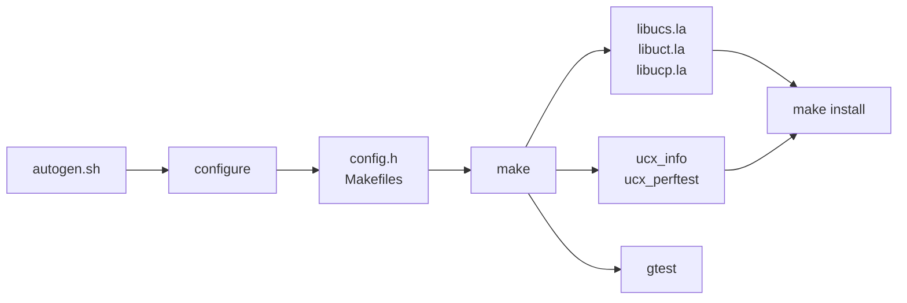
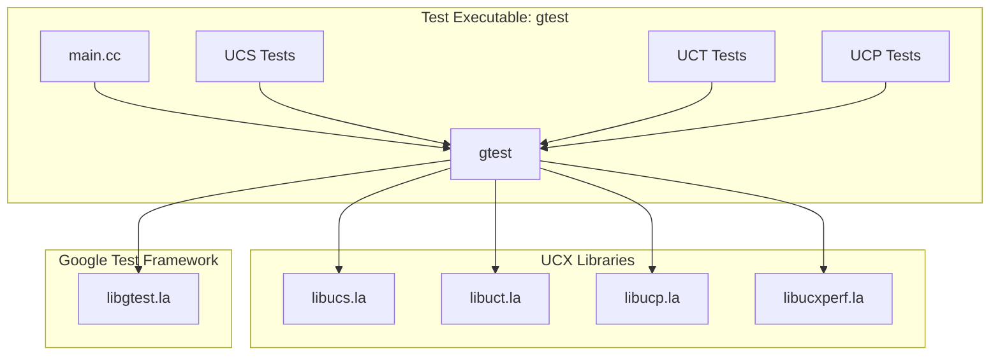
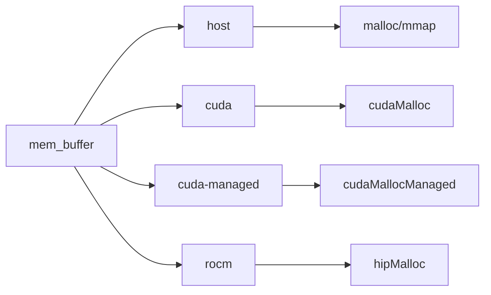
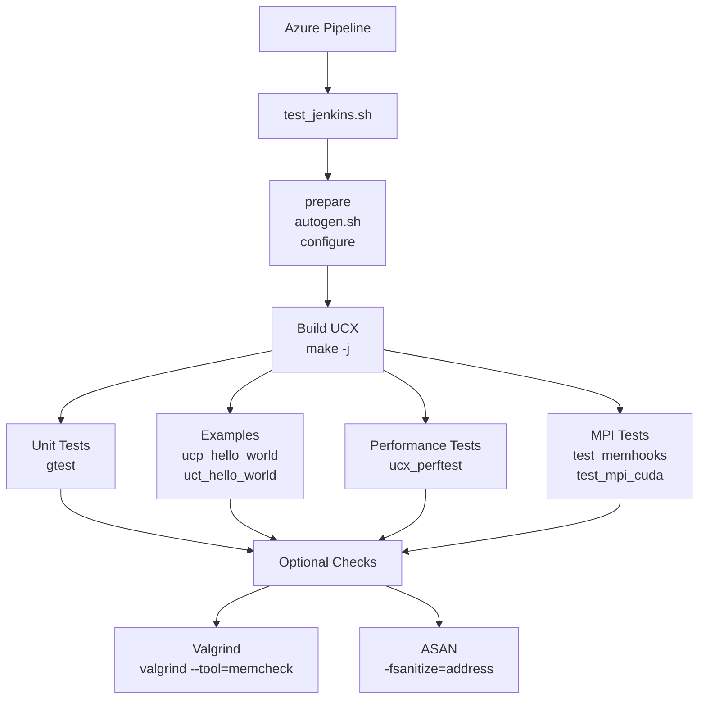
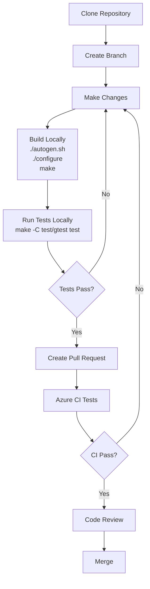

<!-- source: DeepWiki mcp.deepwiki.com · repo openucx/ucx · page 5 Testing and Development · fetched 2026-11-11 -->

# Testing and Development

<details>
<summary>Relevant source files</summary>

The following files were used as context for generating this wiki page:

- [buildlib/az-helpers.sh](buildlib/az-helpers.sh)
- [buildlib/azure-pipelines-pr.yml](buildlib/azure-pipelines-pr.yml)
- [buildlib/tools/builds.sh](buildlib/tools/builds.sh)
- [buildlib/tools/common.sh](buildlib/tools/common.sh)
- [buildlib/tools/coverity.sh](buildlib/tools/coverity.sh)
- [buildlib/tools/perf-common.yml](buildlib/tools/perf-common.yml)
- [contrib/test_jenkins.sh](contrib/test_jenkins.sh)
- [src/ucs/Makefile.am](src/ucs/Makefile.am)
- [src/ucs/type/float8.h](src/ucs/type/float8.h)
- [src/ucs/type/init_once.h](src/ucs/type/init_once.h)
- [src/ucs/type/serialize.h](src/ucs/type/serialize.h)
- [test/apps/uct_info/Makefile.in](test/apps/uct_info/Makefile.in)
- [test/apps/uct_info/configure.m4](test/apps/uct_info/configure.m4)
- [test/apps/uct_info/uct_info.c](test/apps/uct_info/uct_info.c)
- [test/gtest/Makefile.am](test/gtest/Makefile.am)
- [test/gtest/ucs/test_type.cc](test/gtest/ucs/test_type.cc)

</details>


This document provides an overview of UCX's testing infrastructure and development workflows. UCX maintains a comprehensive testing framework based on Google Test, an autotools-based build system, and an automated CI/CD pipeline using Azure Pipelines and Jenkins.

## Overview

UCX testing and development infrastructure consists of:

- **Build System**: Autotools-based configuration with multiple build profiles (page 5.1)
- **Testing Framework**: Google Test-based unit and integration tests for UCP (page 5.2) and UCT (page 5.3) layers
- **CI/CD Pipeline**: Automated testing on Azure Pipelines with parallel test distribution (page 5.4)
- **Development Tools**: Profiling, memory tracking, and debugging utilities

Testing covers all UCX layers (UCS, UCT, UCP) and validates functionality across diverse hardware (InfiniBand, TCP, shared memory) and memory types (host, CUDA, ROCm).

## Build System

UCX uses GNU Autotools (autoconf, automake, libtool) for configuration and build management. The build system detects available hardware, enables appropriate transport modules, and generates optimized builds for various configurations.

### Build Configuration Scripts

The `contrib/` directory provides wrapper scripts for common build profiles:

| Script | Purpose |
|--------|---------|
| `contrib/configure-devel` | Development build with debug symbols and assertions |
| `contrib/configure-release` | Optimized production build |
| `contrib/configure-prof` | Build with profiling instrumentation |
| `contrib/buildrpm.sh` | Generate RPM packages |

**Build System Flow**



**Configuration Phase**

The `configure` script detects system capabilities and generates build configurations. Key detection includes:

- Available transports (IB verbs, TCP, shared memory)
- CUDA/ROCm support for GPU communication
- Hardware acceleration features (MLX5 DV, DEVX)
- Build options (debug, optimization level, assertions)

**Build Phase**

The build compiles three main libraries:
- `libucs.la`: Core utilities and system abstractions [src/ucs/Makefile.am:12-223]()
- `libuct.la`: Transport layer implementations
- `libucp.la`: Protocol layer

It also builds tools (`ucx_info`, `ucx_perftest`) and test executables (`gtest`).

**Package Generation**

The build system can generate distribution packages:
- RPM packages via `contrib/buildrpm.sh` [buildlib/tools/builds.sh:87-96]()
- Debian packages via `dpkg-buildpackage` [buildlib/tools/builds.sh:78-85]()

For detailed build system documentation, see page 5.1.

Sources: [buildlib/tools/common.sh:76-143](), [buildlib/tools/builds.sh:56-111](), [src/ucs/Makefile.am:1-252]()

## Testing Framework

UCX uses Google Test (gtest) for comprehensive unit and integration testing. The test suite is organized into three main categories:

1. **UCS Tests**: Core utility and data structure tests (page 5.2)
2. **UCT Tests**: Transport layer tests for all transport implementations (page 5.3)
3. **UCP Tests**: Protocol layer tests for tagged messaging, streams, RMA, and active messages (page 5.2)

**Google Test Integration**

The gtest executable is built by [test/gtest/Makefile.am]() and links against all UCX libraries:



**Test Organization**

Tests are organized by layer and component:

| Test Suite | Source Files | Purpose |
|------------|--------------|---------|
| UCS Tests | `test/gtest/ucs/test_*.cc` | Data structures, utilities, memory management |
| UCT Tests | `test/gtest/uct/test_*.cc` | Transport operations, MD tests, P2P communication |
| UCT IB Tests | `test/gtest/uct/ib/test_*.cc` | InfiniBand-specific tests (RC, UD, DC) |
| UCP Tests | `test/gtest/ucp/test_*.cc` | Protocol operations, wireup, request management |

**Test Execution Control**

The gtest framework supports test filtering and sharding:

```bash
# Run specific tests
./test/gtest/gtest --gtest_filter='test_ucp_tag.*'

# Distribute tests across workers
GTEST_SHARD_INDEX=0 GTEST_TOTAL_SHARDS=4 ./test/gtest/gtest

# Run with specific transport
UCX_TLS=rc,tcp ./test/gtest/gtest
```

Configuration is managed through environment variables defined in [test/gtest/Makefile.am:16-29]():
- `UCX_HANDLE_ERRORS`: Error handling mode (freeze, bt, none)
- `UCX_LOG_LEVEL`: Logging verbosity
- `GTEST_FILTER`: Test name filter pattern
- `GTEST_EXTRA_ARGS`: Additional gtest arguments

For detailed testing framework documentation, see pages 5.2 (UCP Testing) and 5.3 (UCT Testing).

Sources: [test/gtest/Makefile.am:13-392](), [test/gtest/common/main.cc](), [test/gtest/common/test_helpers.h]()

### Test Helper Infrastructure

The testing framework provides common utilities in `test/gtest/common/`:

- **test_helpers.cc/h**: Entity creation, resource management, memory buffers
- **mem_buffer.cc/h**: Memory allocation for different memory types (host, CUDA, ROCm)
- **test_watchdog.cc/h**: Test timeout detection and termination
- **test_perf.cc/h**: Performance measurement utilities

**Memory Buffer Management**

Tests support multiple memory types for validating GPU communication:



Memory buffers are filled with patterns and validated after transfers to detect corruption [test/gtest/common/mem_buffer.cc]().

Sources: [test/gtest/common/test_helpers.h](), [test/gtest/common/test_helpers.cc](), [test/gtest/common/mem_buffer.h](), [test/gtest/common/test_watchdog.cc]()

## CI/CD Pipeline

UCX uses Azure Pipelines for continuous integration, orchestrated by the `contrib/test_jenkins.sh` script. The CI system performs parallel test execution across multiple workers and validates builds on diverse hardware configurations.

**CI Pipeline Trigger**

Azure Pipelines triggers on pull requests via [buildlib/azure-pipelines-pr.yml:1-29]():

```yaml
trigger: none
pr:
  branches:
    include:
    - master
    - v*.*.x
```

**Test Orchestration**

The main test script `contrib/test_jenkins.sh` orchestrates the entire CI workflow:



**Parallel Test Distribution**

Tests are distributed across workers using sharding [contrib/test_jenkins.sh:84-127]():

```bash
# Worker assignment
worker=$1    # Current worker index
nworkers=$2  # Total number of workers

should_do_task() {
    [[ $((task % nworkers)) -eq ${worker} ]]
}
```

Environment variables control CI execution:

| Variable | Purpose | Set By |
|----------|---------|--------|
| `WORKSPACE` | Work directory | Azure Pipelines |
| `BUILD_NUMBER` | Build identifier | Azure Pipelines |
| `EXECUTOR_NUMBER` | Executor index | Azure Pipelines |
| `worker` / `nworkers` | Parallel distribution | Job configuration |
| `RUN_TESTS` | Enable unit tests | Job configuration |
| `TEST_PERF` | Enable performance validation | Job configuration |
| `ASAN_CHECK` | Enable AddressSanitizer | Job configuration |
| `VALGRIND_CHECK` | Enable Valgrind checks | Job configuration |

**Test Categories in CI**

The CI pipeline runs multiple test categories [contrib/test_jenkins.sh:1235-1277]():

1. **MPI Tests**: Memory hooks, CUDA transfers with MPI [contrib/test_jenkins.sh:700-762]()
2. **Configuration Tests**: Module detection, feature flags [contrib/test_jenkins.sh:1212-1230]()
3. **Development Tests**: UCX info, transport selection, dlopen [contrib/test_jenkins.sh:1248-1260]()
4. **Example Applications**: Hello world, client-server, IO demo [contrib/test_jenkins.sh:215-404]()
5. **Performance Tests**: UCX perftest with various transports [contrib/test_jenkins.sh:411-561]()
6. **Google Test Suite**: All gtest tests with sharding [contrib/test_jenkins.sh:1074-1096]()

**Memory Sanitizers**

The CI supports multiple sanitizer modes [test/gtest/Makefile.am:30-38]():

- **AddressSanitizer (ASAN)**: Detects memory errors, leaks, use-after-free
- **Valgrind**: Memory leak detection with suppressions
- **ThreadSanitizer (TSAN)**: Race condition detection

For detailed CI/CD pipeline documentation, see page 5.4.

Sources: [contrib/test_jenkins.sh:1-1325](), [buildlib/az-helpers.sh:1-309](), [buildlib/azure-pipelines-pr.yml:1-29](), [test/gtest/Makefile.am:30-392]()

## Development Workflow

UCX development follows standard open-source practices with automated testing and validation.

**Typical Development Cycle**



**Local Testing**

Developers can run tests locally before submitting:

```bash
# Build with gtest support
./contrib/configure-devel --enable-gtest
make -j

# Run all tests
make -C test/gtest test

# Run specific test suites
GTEST_FILTER='test_ucp_tag.*' make -C test/gtest test

# Run with Valgrind
make -C test/gtest test_valgrind

# Run examples
./examples/ucp_hello_world
./examples/uct_hello_world -d mlx5_0:1 -t rc_verbs
```

**Environment Module Loading**

The CI system uses environment modules to load dependencies [buildlib/az-helpers.sh:99-133]():

```bash
# Initialize module system
az_init_modules

# Load CUDA for GPU testing
az_module_load dev/cuda13.0.2

# Load MPI for MPI tests
az_module_load hpcx-ga-gcc
```

**Build Configuration Detection**

The CI validates that UCX correctly detects and enables features [contrib/test_jenkins.sh:1212-1230]():

```bash
# Test with verbs
./contrib/configure-release --with-verbs
grep 'build_modules=.*:ib.*:rdmacm.*:mlx5' config.log

# Test without verbs
./contrib/configure-release --without-verbs
! grep 'build_modules=.*:(ib|rdmacm|efa|mlx5)' config.log
```

**Performance Testing**

The CI includes performance validation [contrib/test_jenkins.sh:411-561]():

```bash
# Run ucx_perftest with various transports
ucx_perftest -t tag_lat -s 8 -n 1000
ucx_perftest -t tag_bw -s 65536 -n 1000

# Measure latency/bandwidth across devices
for device in $(get_active_ib_devices); do
    ucx_perftest -d $device -x rc_verbs -t tag_lat
done
```

**Debugging Utilities**

UCX provides several tools for debugging [contrib/test_jenkins.sh:773-889]():

- **ucx_info**: Display UCX configuration and capabilities [contrib/test_jenkins.sh:1162-1165]()
- **ucx_read_profile**: Analyze profiling data [contrib/test_jenkins.sh:780-783]()
- **Memory tracking**: Track allocations with `UCX_MEMTRACK_DEST=stdout`
- **Fuzzy matching**: Suggest similar environment variables for typos [contrib/test_jenkins.sh:887-888]()

Sources: [contrib/test_jenkins.sh:1235-1324](), [buildlib/tools/common.sh:76-143](), [buildlib/az-helpers.sh:99-309]()

## Debugging and Analysis Tools

### Logging Infrastructure

UCX provides a flexible logging system with different verbosity levels:

| Level | Description |
|-------|-------------|
| FATAL | Fatal errors that cause immediate termination |
| ERROR | Errors that prevent normal operation |
| WARN | Warnings about potential issues |
| INFO | Informational messages |
| DEBUG | Detailed debugging information |
| TRACE | Very detailed tracing information |
| TRACE_REQ | Request tracing information |
| TRACE_DATA | Data tracing (very verbose) |

Sources: [test/gtest/uct/uct_p2p_test.cc:102-145]()

### Memory Tracking

The memory tracking infrastructure helps detect memory leaks and track memory usage:

```
UCX_MEMTRACK_DEST=stdout ./test_app
```

Sources: [contrib/test_jenkins.sh:819-825]()

### Profiling

UCX includes profiling tools to analyze performance:

1. `ucx_read_profile`: Reads and analyzes profile data
2. Built-in profiling API for instrumenting code

Sources: [contrib/test_jenkins.sh:720-730]()

## Conclusion

This document provided an overview of the development and testing infrastructure in UCX. It covered build systems, testing frameworks, continuous integration, and debugging tools. For more detailed information about specific components, please refer to the corresponding documentation.

For information about UCX installation, see the [Overview](#1) section. For information about specific transport types, see the [UCT (Unified Communication Transport)](#3) section.

Sources: [Makefile.am:1-151](), [test/gtest/uct/uct_test.h:9-642](), [test/gtest/uct/uct_test.cc:1-835](), [contrib/test_jenkins.sh:1-1272]()

---

