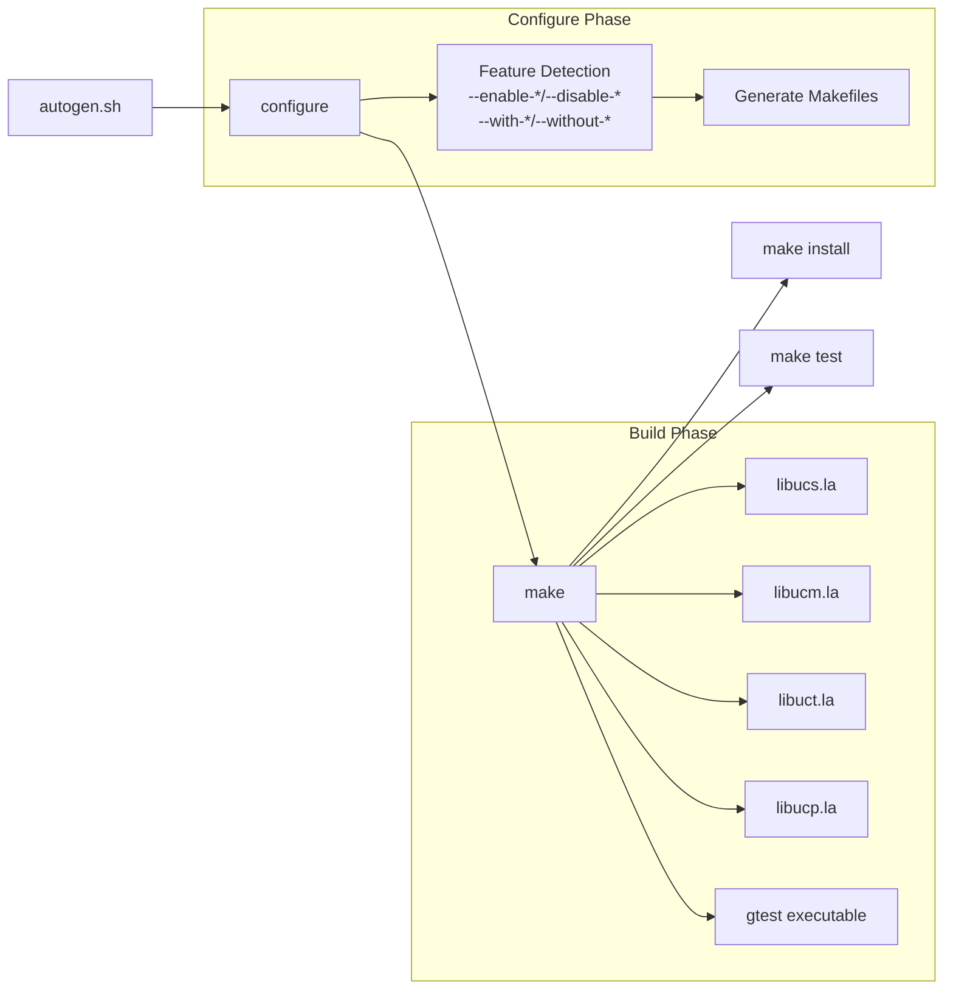
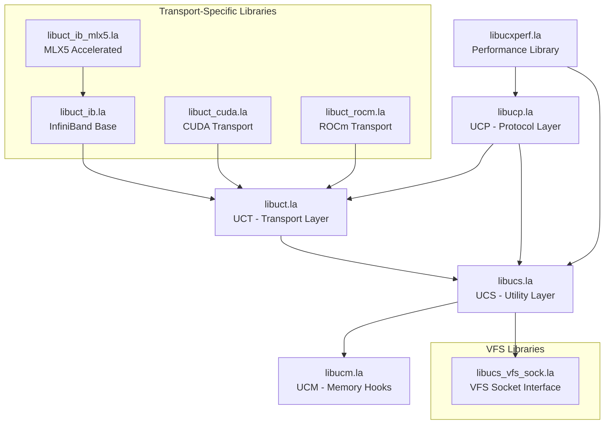
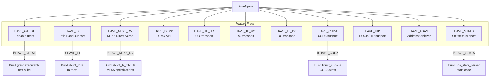
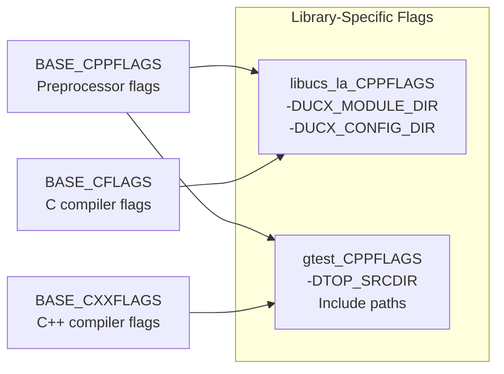
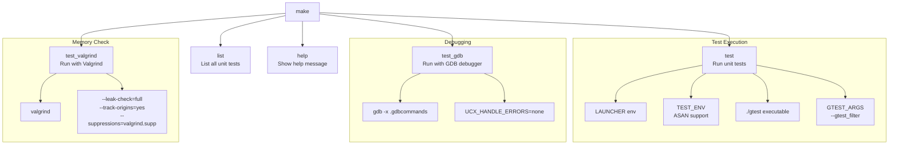
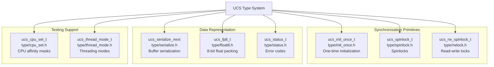

<!-- source: DeepWiki mcp.deepwiki.com · repo openucx/ucx · page 5.1 Build System and Configuration · fetched 2026-11-11 -->

# Build System and Configuration

<details>
<summary>Relevant source files</summary>

The following files were used as context for generating this wiki page:

- [src/ucs/Makefile.am](src/ucs/Makefile.am)
- [src/ucs/type/float8.h](src/ucs/type/float8.h)
- [src/ucs/type/init_once.h](src/ucs/type/init_once.h)
- [src/ucs/type/serialize.h](src/ucs/type/serialize.h)
- [test/gtest/Makefile.am](test/gtest/Makefile.am)
- [test/gtest/ucs/test_type.cc](test/gtest/ucs/test_type.cc)

</details>


## Purpose and Scope

This document describes UCX's build system architecture, library structure, and configuration options. It covers the autotools-based build infrastructure, library dependencies, conditional compilation, and how tests are integrated into the build process. For information about running tests and CI/CD pipelines, see [CI/CD Pipeline and Testing Infrastructure](#5.4). For details about specific test frameworks, see [UCP Testing Framework](#5.2) and [UCT Testing Framework](#5.3).

## Build System Architecture

UCX uses GNU Autotools (autoconf, automake, libtool) as its build system. The build process follows the standard configure-make-install workflow with extensive feature detection and conditional compilation support.

### Build Workflow



**Sources:** [test/gtest/Makefile.am:1-393](), [src/ucs/Makefile.am:1-253]()

The build process generates several key artifacts:
- **Shared libraries** (`.la` files): Core UCX libraries
- **Test executables**: Including the main `gtest` binary
- **Utility programs**: Such as `ucs_stats_parser`
- **Header files**: Installed to system include directories

## Library Structure and Dependencies

UCX consists of multiple libraries with clear dependency relationships. The library hierarchy reflects the layered architecture described in the overall system design.

### Library Dependency Graph



**Sources:** [test/gtest/Makefile.am:62-71](), [src/ucs/Makefile.am:12-21]()

### Library Definitions

| Library | Description | Key Dependencies |
|---------|-------------|------------------|
| `libucs.la` | Core utility library providing data structures, memory management, async services | `libucm.la`, system libraries (libdl, libm) |
| `libucm.la` | Memory event hooks for tracking memory operations | None |
| `libuct.la` | Transport abstraction layer | `libucs.la` |
| `libucp.la` | High-level protocol layer | `libuct.la`, `libucs.la` |
| `libucxperf.la` | Performance benchmarking library | `libucp.la`, `libucs.la` |
| `libuct_ib.la` | InfiniBand transport base | `libuct.la`, verbs libraries |
| `libuct_ib_mlx5.la` | MLX5-accelerated InfiniBand | `libuct_ib.la`, MLX5 DV libraries |
| `libuct_cuda.la` | CUDA memory and IPC transport | `libuct.la`, CUDA runtime |
| `libuct_rocm.la` | ROCm memory transport | `libuct.la`, HIP runtime |

### Test Executable Dependencies

The `gtest` test executable links against all UCX libraries to enable comprehensive testing:

[test/gtest/Makefile.am:62-71]()
```
gtest_LDADD = \
    $(top_builddir)/src/ucs/libucs.la \
    $(top_builddir)/src/ucs/vfs/sock/libucs_vfs_sock.la \
    $(top_builddir)/src/uct/libuct.la \
    $(top_builddir)/src/ucm/libucm.la \
    $(top_builddir)/src/ucp/libucp.la \
    $(top_builddir)/src/tools/perf/lib/libucxperf.la \
    common/googletest/libgtest.la
```

**Sources:** [test/gtest/Makefile.am:55-93]()

## UCS Utility Library Structure

The UCS (Unified Communication Services) library provides foundational utilities used throughout UCX. It is organized into logical subdirectories based on functionality.

### UCS Component Organization

```mermaid
graph TB
    LIBUCS["libucs.la"]
    
    subgraph "Core Modules"
        ARCH["arch/<br/>CPU architecture abstractions<br/>atomic operations, bitops"]
        ALGORITHM["algorithm/<br/>CRC, qsort_r<br/>string distance"]
        ASYNC["async/<br/>Async framework<br/>pipes, eventfd, signals"]
        CONFIG["config/<br/>Configuration parser<br/>INI files, global_opts"]
        DATASTRUCT["datastruct/<br/>Data structures<br/>mpool, khash, lists, queues"]
        DEBUG["debug/<br/>Logging, assertions<br/>memtrack"]
        MEMORY["memory/<br/>Registration cache<br/>memory type detection<br/>NUMA"]
        PROFILE["profile/<br/>Profiling support"]
        STATS["stats/<br/>Statistics collection"]
        SYS["sys/<br/>System utilities<br/>sockets, event_set<br/>topology"]
        TIME["time/<br/>Time utilities<br/>timer_wheel, timerq"]
        TYPE["type/<br/>Type definitions<br/>spinlock, status<br/>serialize, init_once"]
        VFS["vfs/<br/>Virtual filesystem<br/>callback interface"]
    end
    
    LIBUCS --> ARCH
    LIBUCS --> ALGORITHM
    LIBUCS --> ASYNC
    LIBUCS --> CONFIG
    LIBUCS --> DATASTRUCT
    LIBUCS --> DEBUG
    LIBUCS --> MEMORY
    LIBUCS --> PROFILE
    LIBUCS --> STATS
    LIBUCS --> SYS
    LIBUCS --> TIME
    LIBUCS --> TYPE
    LIBUCS --> VFS
```



**Sources:** [src/ucs/Makefile.am:23-149]()

### Public vs. Private Headers

UCS distinguishes between public API headers (installed for external use) and internal implementation headers:

| Category | Location | Purpose |
|----------|----------|---------|
| Public Headers | `nobase_dist_libucs_la_HEADERS` | Stable API exposed to users, installed to `$(includedir)/ucs` |
| Private Headers | `noinst_HEADERS` | Internal implementation details, not installed |

Public headers include:
- [src/ucs/Makefile.am:23-91](): Type definitions (`type/status.h`, `type/spinlock.h`), data structures (`datastruct/mpool.h`, `datastruct/list.h`), architecture-specific interfaces (`arch/atomic.h`, `arch/bitops.h`)

Private headers include:
- [src/ucs/Makefile.am:93-148](): Internal implementations (`debug/log.h`, `memory/rcache_int.h`), inline implementations (`.inl` files), advanced data structures

## Configuration Options

UCX's configure script provides extensive options for customizing the build. These options control feature enablement, transport selection, and optimization settings.

### Feature Detection and Conditional Compilation



**Sources:** [test/gtest/Makefile.am:13-316](), [src/ucs/Makefile.am:230-240]()

### Conditional Build Sections

The Makefile uses Automake conditionals to include or exclude code based on detected features:

#### InfiniBand Support
[test/gtest/Makefile.am:219-265]()
```automake
if HAVE_IB
gtest_SOURCES += \
    uct/ib/test_ib.cc \
    uct/ib/test_ib_md.cc
gtest_LDADD += \
    $(top_builddir)/src/uct/ib/libuct_ib.la
if HAVE_MLX5_DV
gtest_LDADD += \
    $(top_builddir)/src/uct/ib/mlx5/libuct_ib_mlx5.la
endif
if HAVE_TL_UD
gtest_SOURCES += \
    uct/ib/test_ud.cc
endif
```

#### CUDA Support
[test/gtest/Makefile.am:267-301]()
```automake
if HAVE_CUDA
gtest_SOURCES += \
    ucm/cuda_hooks.cc \
    uct/cuda/test_cuda_ipc_md.cc
gtest_CPPFLAGS += $(CUDA_CPPFLAGS)
gtest_LDFLAGS += $(CUDA_LDFLAGS)
gtest_LDADD += $(CUDA_LIBS) $(CUDART_LIBS)
endif
```

#### Statistics Support
[src/ucs/Makefile.am:230-240]()
```automake
if HAVE_STATS
libucs_la_SOURCES += \
    stats/client_server.c \
    stats/serialization.c
bin_PROGRAMS += ucs_stats_parser
ucs_stats_parser_LDADD = libucs.la
endif
```

**Sources:** [test/gtest/Makefile.am:219-316](), [src/ucs/Makefile.am:230-240]()

### Common Configuration Flags

| Configure Flag | Purpose | Default |
|----------------|---------|---------|
| `--enable-gtest` | Enable Google Test framework and test building | Auto-detect |
| `--with-verbs=<path>` | Specify InfiniBand Verbs library location | Auto-detect |
| `--with-cuda=<path>` | Enable CUDA support and specify path | Auto-detect |
| `--with-rocm=<path>` | Enable ROCm/HIP support and specify path | Auto-detect |
| `--enable-debug` | Build with debug symbols and assertions | Disabled |
| `--enable-optimizations` | Enable compiler optimizations | Enabled |
| `--enable-stats` | Enable statistics collection | Disabled |
| `--enable-mt` | Enable thread safety | Enabled |
| `--enable-assertions` | Enable runtime assertions | Debug only |

## Build Flags and Compiler Options

UCX uses consistent compiler flags across all components, defined through base variables and extended per-component.

### Base Compiler Flags



### Test Executable Configuration

The `gtest` executable has extensive configuration for testing all UCX components:

[test/gtest/Makefile.am:74-93]()
```automake
gtest_CPPFLAGS = \
    $(BASE_CPPFLAGS) \
    -DTOP_SRCDIR=\"$(abs_top_srcdir)\" \
    -I$(top_srcdir)/src \
    -I$(top_builddir)/src \
    $(GTEST_CPPFLAGS) \
    $(OPENMP_CFLAGS)

gtest_CXXFLAGS = \
    $(BASE_CXXFLAGS) $(GTEST_CXXFLAGS) -std=c++11 \
    -DGTEST_UCM_HOOK_LIB_DIR="\"${abs_builddir}/ucm/test_dlopen/.libs\""

gtest_LDFLAGS = $(GTEST_LDFLAGS) -no-install $(LDFLAGS_DYNAMIC_LIST_DATA)
gtest_LDFLAGS += -Wl,--disable-new-dtags
```

Key flags:
- `-DTOP_SRCDIR`: Absolute path to source root, used by tests to locate configuration files
- `-no-install`: Test executable is not installed
- `-Wl,--disable-new-dtags`: Force RPATH instead of RUNPATH to prevent loading incorrect shared libraries

**Sources:** [test/gtest/Makefile.am:74-93]()

## Sanitizer Integration

UCX supports Address Sanitizer (ASAN) for memory error detection during testing:

[test/gtest/Makefile.am:30-38]()
```automake
if HAVE_ASAN
export LSAN_OPTIONS=suppressions=$(abs_top_srcdir)/contrib/lsan.supp
export ASAN_OPTIONS=protect_shadow_gap=0

# LD_PRELOAD puts ASAN first in initial library list
ASAN_LIB=$(shell ldd $(abs_builddir)/gtest | grep libasan.so | cut -d' ' -f3)
TEST_ENV=LD_PRELOAD=$(ASAN_LIB):$(LD_PRELOAD)
endif
```

When ASAN is enabled:
1. ASAN library is preloaded before all other libraries
2. Leak suppression file is loaded from `contrib/lsan.supp`
3. Shadow gap protection is disabled for compatibility

**Sources:** [test/gtest/Makefile.am:30-38]()

## Test Targets and Execution

The build system provides several targets for running tests with different tools:

### Available Test Targets



**Sources:** [test/gtest/Makefile.am:340-392]()

### Test Execution Environment Variables

[test/gtest/Makefile.am:15-22]()
```automake
UCX_HANDLE_ERRORS        ?= freeze
UCX_LOG_LEVEL            ?= warn
UCX_LOG_PRINT_ENABLE     ?= y
GTEST_FILTER             ?= *
GTEST_EXTRA_ARGS         ?=
LAUNCHER                 ?=
VALGRIND_EXTRA_ARGS      ?=
```

| Variable | Default | Purpose |
|----------|---------|---------|
| `UCX_HANDLE_ERRORS` | freeze | Error handling mode (freeze, bt, debug) |
| `UCX_LOG_LEVEL` | warn | Logging verbosity |
| `UCX_LOG_PRINT_ENABLE` | y | Enable log output |
| `GTEST_FILTER` | * | Filter which tests to run |
| `LAUNCHER` | (empty) | Custom test launcher (e.g., mpirun) |
| `VALGRIND_EXTRA_ARGS` | (empty) | Additional Valgrind arguments |

### Valgrind Configuration

[test/gtest/Makefile.am:44-53]()
```automake
VALGRIND_ARGS = \
    --tool=memcheck \
    --leak-check=full \
    --track-origins=yes \
    --fair-sched=try \
    --num-callers=25 \
    --error-exitcode=1 \
    --child-silent-after-fork=yes \
    --suppressions=$(top_srcdir)/contrib/valgrind.supp
```

Valgrind is configured for:
- **Full leak checking**: Detect all memory leaks
- **Origin tracking**: Track where uninitialized values originated
- **Fair scheduling**: Improve detection of race conditions
- **Custom suppressions**: Filter known false positives from `contrib/valgrind.supp`
- **Non-zero exit on error**: Fail CI builds on memory errors

**Sources:** [test/gtest/Makefile.am:44-53](), [test/gtest/Makefile.am:389-391]()

## Module and Plugin System

UCX uses a dynamic module system for loading transport and memory domain plugins at runtime.

### Module Installation Paths

[src/ucs/Makefile.am:15-17]()
```automake
libucs_la_CPPFLAGS = $(BASE_CPPFLAGS) $(BFD_CPPFLAGS) \
    -DUCX_MODULE_DIR=\"$(moduledir)\" \
    -DUCX_CONFIG_DIR=\"$(ucx_config_dir)\"
```

- `UCX_MODULE_DIR`: Directory where transport modules (`.so` files) are installed
- `UCX_CONFIG_DIR`: Directory containing default configuration files

At build time, a symbolic link is created for module discovery:

[src/ucs/Makefile.am:242-245]()
```automake
$(objdir)/$(modulesubdir): $(lib_LTLIBRARIES)
    $(AM_V_at)$(LN_RS) -fn $(localmoduledir) $(objdir)/$(modulesubdir)
```

This allows the build tree to be used without installation for testing purposes.

**Sources:** [src/ucs/Makefile.am:15-17](), [src/ucs/Makefile.am:242-245]()

## Architecture-Specific Code

UCX includes optimized implementations for different CPU architectures, conditionally compiled based on architecture detection.

### Architecture Support

[src/ucs/Makefile.am:225-228]()
```automake
if HAVE_AARCH64_THUNDERX2
libucs_la_SOURCES += \
    arch/aarch64/memcpy_thunderx2.S
endif
```

Supported architectures include:
- **x86_64**: Intel/AMD processors with SSE/AVX optimizations
- **aarch64**: ARM 64-bit, including ThunderX2 optimizations
- **ppc64**: IBM POWER processors
- **rv64**: RISC-V 64-bit

Architecture-specific code includes:
- CPU feature detection ([src/ucs/Makefile.am:154-161]())
- Atomic operations ([src/ucs/Makefile.am:84-88]())
- Bit manipulation routines ([src/ucs/Makefile.am:24-27]())
- Memory copy optimizations

**Sources:** [src/ucs/Makefile.am:154-161](), [src/ucs/Makefile.am:225-228]()

## Type System and Serialization Utilities

UCX provides several utility types and macros that are core to the build system's type safety and serialization capabilities.

### UCS Type Utilities Overview



**Sources:** [src/ucs/Makefile.am:74-80](), [test/gtest/ucs/test_type.cc:1-372]()

### Init Once Mechanism

The `ucs_init_once_t` type provides thread-safe one-time initialization:

[src/ucs/type/init_once.h:17-25]()
```c
typedef struct ucs_init_once {
    pthread_mutex_t lock;        /* Protects the initialization */
    int             initialized; /* Whether initialization took place */
} ucs_init_once_t;

#define UCS_INIT_ONCE_INITIALIZER \
    { PTHREAD_MUTEX_INITIALIZER, 0 }
```

Usage pattern:
[src/ucs/type/init_once.h:56-59]()
```c
#define UCS_INIT_ONCE(_once) \
    for (pthread_mutex_lock(&(_once)->lock); \
         !(_once)->initialized || ucs_init_once_mutex_unlock(&(_once)->lock); \
         (_once)->initialized = 1)
```

This macro ensures initialization code runs exactly once, even with multiple threads. Tests verify this behavior in [test/gtest/ucs/test_type.cc:361-370]().

**Sources:** [src/ucs/type/init_once.h:1-82](), [test/gtest/ucs/test_type.cc:347-370]()

### Serialization Support

The serialization utilities enable type-safe buffer packing and unpacking:

[src/ucs/type/serialize.h:26-31]()
```c
#define ucs_serialize_next_raw(_iter, _type, _offset) \
    ({ \
        _type *_result = (_type*)(*(_iter)); \
        *(_iter)       = UCS_PTR_BYTE_OFFSET(*(_iter), _offset); \
        _result; \
    })
```

[src/ucs/type/serialize.h:44-45]()
```c
#define ucs_serialize_next(_iter, _type) \
    ucs_serialize_next_raw(_iter, _type, sizeof(_type))
```

These macros advance a pointer and return typed references, used extensively for:
- Network protocol packing/unpacking
- Memory buffer management
- Configuration serialization

Test coverage in [test/gtest/ucs/test_type.cc:58-104]() validates serialization of various data types.

**Sources:** [src/ucs/type/serialize.h:1-48](), [test/gtest/ucs/test_type.cc:58-104]()

### Floating Point Compression

UCX includes a specialized 8-bit floating point representation for compressing performance metrics:

[src/ucs/type/float8.h:195-210]()
```c
#define UCS_FP8_DECLARE_TYPE(_name, _min, _max) \
    static UCS_F_ALWAYS_INLINE ucs_fp8_t _UCS_FP8_IDENTIFIER(_name, _pack)( \
            double value) \
    { \
        ucs_assert(ucs_ilog2((_max) / (_min)) < \
                   UCS_BIT(_UCS_FP8_EXPONENT_BITS) - 2); \
        return ucs_fp8_pack(value, _min, _max); \
    }
```

This allows representing values in a configurable range (e.g., latencies from 128ns to 1ms) with ~6% precision loss, using only one byte instead of eight. Test coverage in [test/gtest/ucs/test_type.cc:109-144]() validates precision throughout the supported range.

**Sources:** [src/ucs/type/float8.h:1-257](), [test/gtest/ucs/test_type.cc:109-144]()

## Summary

UCX's build system provides:

1. **Modular architecture**: Separate libraries for utilities (UCS), transports (UCT), and protocols (UCP)
2. **Extensive configurability**: Feature detection and conditional compilation for hardware support
3. **Comprehensive testing**: Integrated Google Test framework with sanitizer support
4. **Cross-platform support**: Architecture-specific optimizations for x86_64, ARM, POWER, and RISC-V
5. **Runtime flexibility**: Dynamic module loading for transport plugins
6. **Type safety utilities**: Serialization, synchronization primitives, and specialized data types

The autotools-based build system ensures portability across different Unix-like systems while maximizing performance through conditional compilation of hardware-specific optimizations.

---

