<!-- source: DeepWiki mcp.deepwiki.com · repo openucx/ucx · page 5.2 UCP Testing Framework · fetched 2026-11-11 -->

# UCP Testing Framework

Relevant source files

The following files were used as context for generating this wiki page:

- [src/ucp/core/ucp_listener.c](src/ucp/core/ucp_listener.c)
- [src/ucp/core/ucp_listener.h](src/ucp/core/ucp_listener.h)
- [src/ucp/wireup/address.c](src/ucp/wireup/address.c)
- [src/ucp/wireup/address.h](src/ucp/wireup/address.h)
- [test/gtest/ucp/test_ucp_peer_failure.cc](test/gtest/ucp/test_ucp_peer_failure.cc)
- [test/gtest/ucp/test_ucp_sockaddr.cc](test/gtest/ucp/test_ucp_sockaddr.cc)
- [test/gtest/ucp/test_ucp_wireup.cc](test/gtest/ucp/test_ucp_wireup.cc)
- [test/gtest/ucp/ucp_test.cc](test/gtest/ucp/ucp_test.cc)
- [test/gtest/ucp/ucp_test.h](test/gtest/ucp/ucp_test.h)

## Purpose and Scope

The UCP Testing Framework provides a Google Test-based infrastructure for testing the UCP (Unified Communication Protocol) layer of UCX. This framework enables systematic testing of UCP's high-level communication protocols including tag matching, streams, active messages, and RMA operations across different transport configurations. For information about UCT layer testing, see [UCT Testing Framework](#5.3). For CI/CD integration, see [CI/CD Pipeline and Testing Infrastructure](#5.4).

**Sources:** [test/gtest/ucp/ucp_test.h:1-492](), [test/gtest/ucp/ucp_test.cc:1-100]()

---

## Core Architecture

The UCP testing framework is built on three fundamental components: the base test infrastructure, the parameterized test class, and the entity abstraction for managing UCP resources.

### Test Class Hierarchy

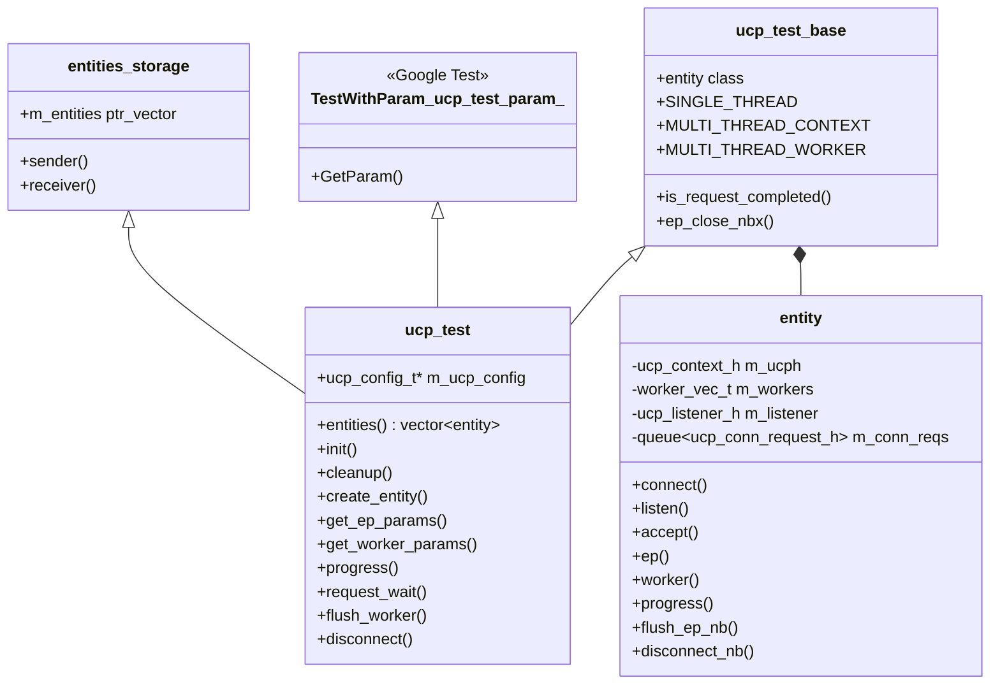

**Sources:** [test/gtest/ucp/ucp_test.h:58-195](), [test/gtest/ucp/ucp_test.h:200-392](), [test/gtest/ucp/ucp_test.cc:57-78]()

---

## Entity Abstraction

The `entity` class encapsulates a complete UCP communication peer, including context, workers, endpoints, and listeners. This abstraction allows tests to easily create and manage multiple communicating entities.

### Entity Resource Management

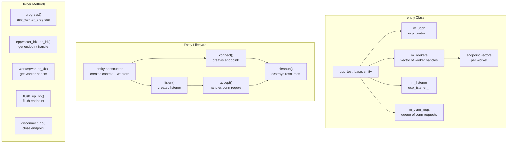

### Entity Creation and Configuration

The entity constructor is called with test parameters that configure the UCP context and workers:

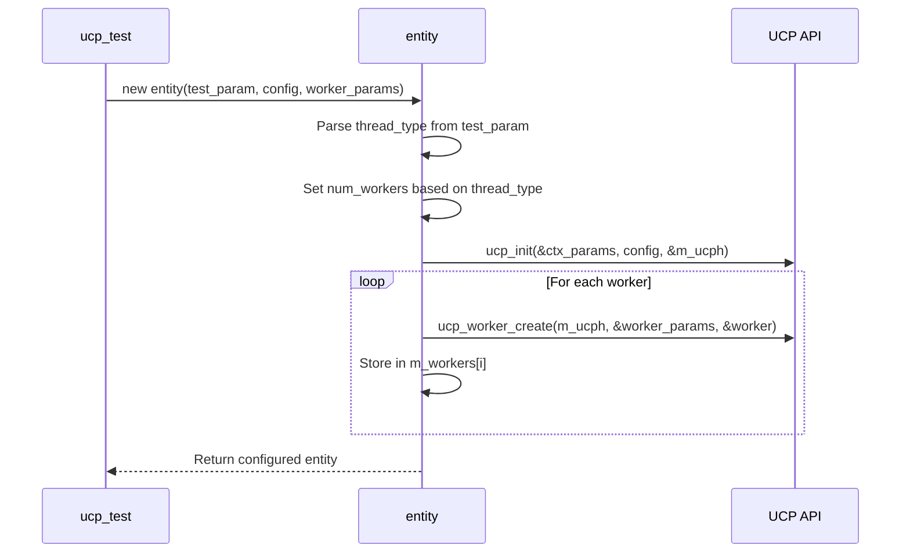

**Sources:** [test/gtest/ucp/ucp_test.cc:634-686](), [test/gtest/ucp/ucp_test.h:66-190]()

---

## Connection Establishment Patterns

The framework provides multiple patterns for establishing connections between entities, supporting both traditional address exchange and client-server (sockaddr) connections.

### Traditional Address-Based Connection

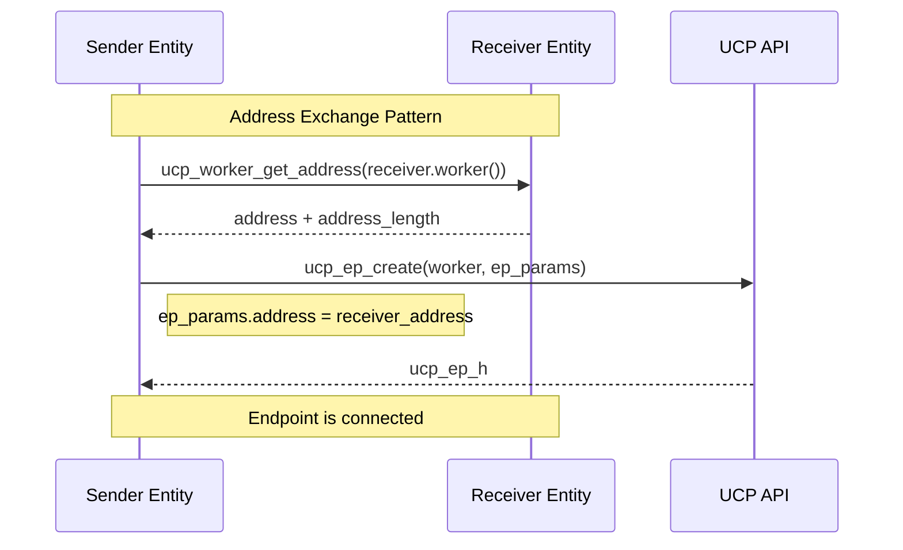

### Client-Server (Sockaddr) Connection

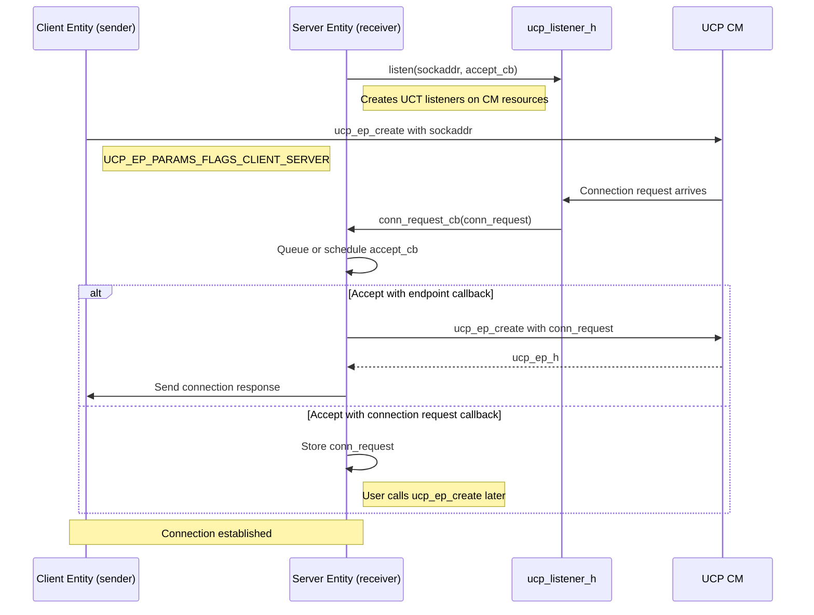

**Sources:** [test/gtest/ucp/ucp_test.cc:692-728](), [test/gtest/ucp/test_ucp_sockaddr.cc:227-262](), [test/gtest/ucp/test_ucp_sockaddr.cc:650-678]()

---

## Test Parameters and Variants

Tests are parameterized using the `ucp_test_param` structure, which includes transport lists and variant specifications. This enables the same test to run across multiple configurations.

### Test Parameter Structure

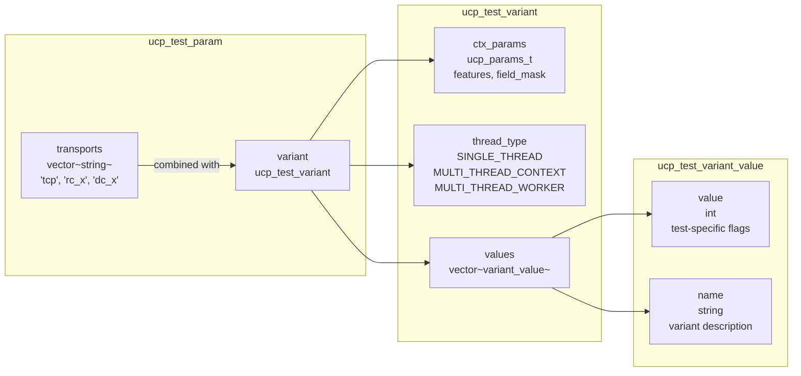

### Variant Generation Example

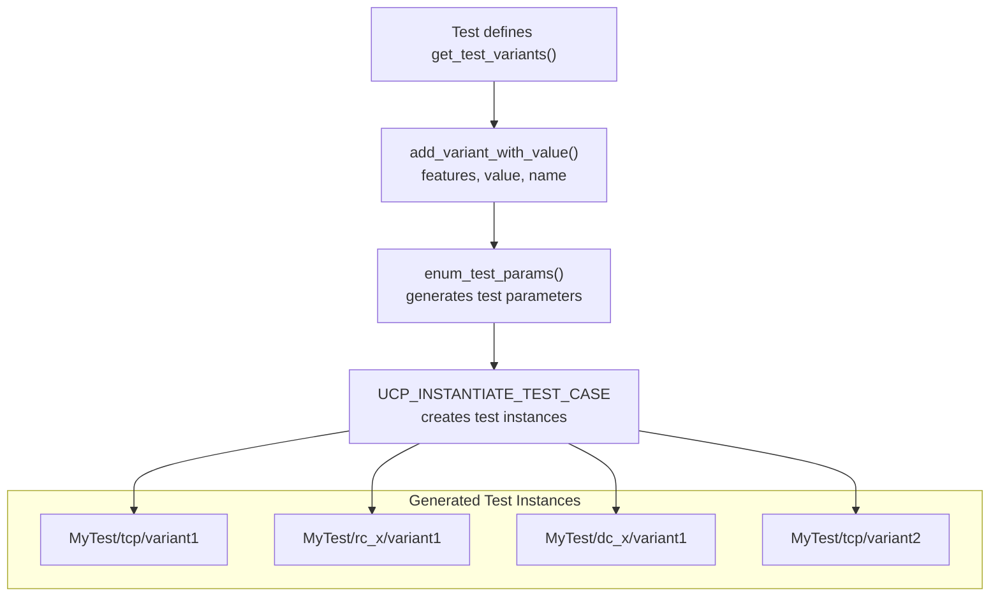

**Sources:** [test/gtest/ucp/ucp_test.h:33-53](), [test/gtest/ucp/ucp_test.cc:431-509](), [test/gtest/ucp/test_ucp_wireup.cc:101-152]()

---

## Test Utilities and Helpers

The framework provides extensive helper functions for common testing operations, reducing boilerplate code in individual tests.

### Progress and Request Handling

| Function | Purpose | Behavior |
|----------|---------|----------|
| `progress(worker_index)` | Drive UCP progress | Calls `ucp_worker_progress()` on all entities |
| `request_wait(req, entities, worker_index, wakeup)` | Wait for request completion | Polls progress until request completes or timeout |
| `requests_wait(reqs, worker_index)` | Wait for multiple requests | Waits for all requests in vector |
| `request_release(req)` | Release completed request | Calls `ucp_request_release()` |
| `flush_ep(entity, worker_index, ep_index)` | Flush endpoint | Waits for `ucp_ep_flush_nb()` completion |
| `flush_worker(entity, worker_index)` | Flush worker | Waits for `ucp_worker_flush_nb()` completion |

### Memory and Buffer Management

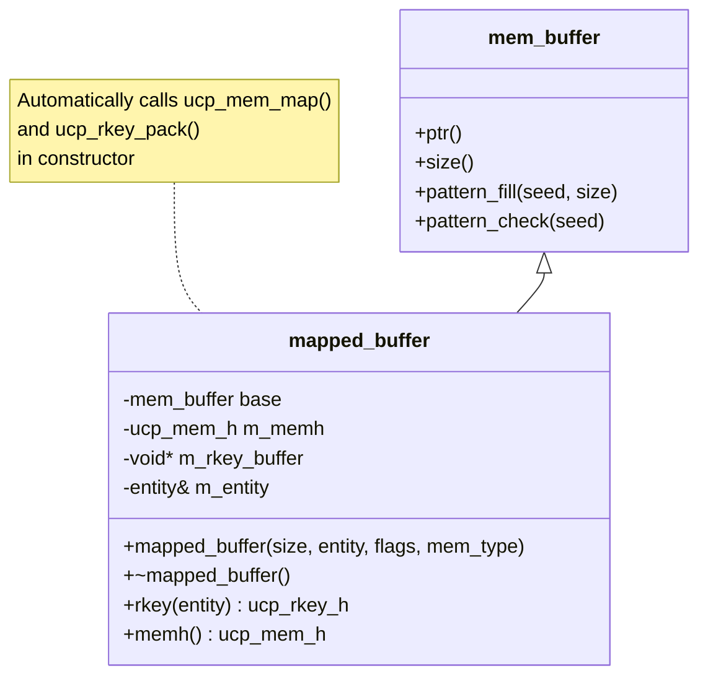

### Wait and Polling Helpers

| Function | Purpose | Usage Example |
|----------|---------|---------------|
| `wait_for_flag(flag, timeout)` | Wait for volatile flag | `wait_for_flag(&received, 10.0)` |
| `wait_for_value(var, value, timeout)` | Wait for specific value | `wait_for_value(&count, 5, 10.0)` |
| `message_wait(entity, tag, tag_mask, info)` | Wait for tagged message | Tag matching probe with progress |
| `wait_for_wakeup(entities, poll_timeout)` | Wait for event notification | Polls `epoll` on worker event FDs |

**Sources:** [test/gtest/ucp/ucp_test.cc:162-394](), [test/gtest/ucp/ucp_test.h:372-390](), [test/gtest/ucp/ucp_test.h:352-366]()

---

## Test Categories and Examples

### Wireup Tests

Wireup tests validate connection establishment, address packing/unpacking, and endpoint configuration.

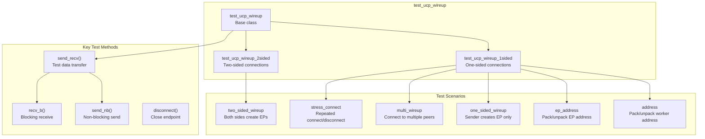

**Key wireup test functions:**
- **Address packing tests** [test/gtest/ucp/test_ucp_wireup.cc:452-506](): Validate `ucp_address_pack()` and `ucp_address_unpack()`
- **One-sided wireup** [test/gtest/ucp/test_ucp_wireup.cc:567-571](): Only sender creates endpoint to receiver
- **Multi-endpoint tests** [test/gtest/ucp/test_ucp_wireup.cc:747-757](): Multiple endpoints from one sender

**Sources:** [test/gtest/ucp/test_ucp_wireup.cc:23-99](), [test/gtest/ucp/test_ucp_wireup.cc:162-241]()

### Sockaddr Tests

Sockaddr tests validate client-server connection establishment using socket addresses and listeners.

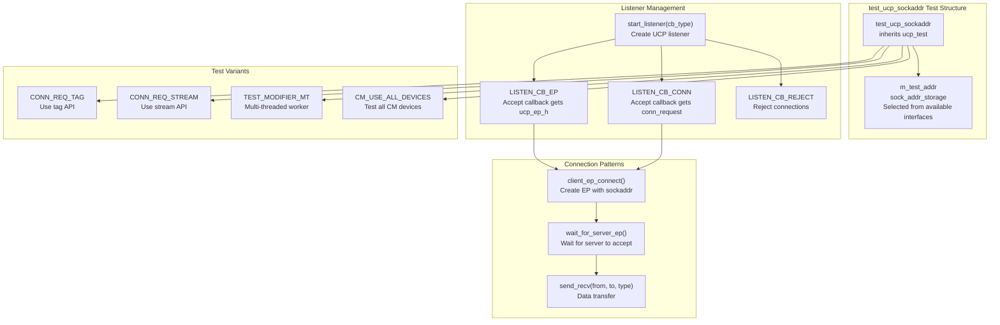

**Key sockaddr test patterns:**
- **Interface selection** [test/gtest/ucp/test_ucp_sockaddr.cc:180-225](): Choose network interface for testing
- **Listener creation** [test/gtest/ucp/test_ucp_sockaddr.cc:227-262](): Start UCP listener on sockaddr
- **Client connection** [test/gtest/ucp/test_ucp_sockaddr.cc:650-678](): Connect client to server using sockaddr
- **Send/receive with callbacks** [test/gtest/ucp/test_ucp_sockaddr.cc:549-595](): Test data transfer with various completion callbacks

**Sources:** [test/gtest/ucp/test_ucp_sockaddr.cc:38-109](), [test/gtest/ucp/test_ucp_sockaddr.cc:158-178]()

### Peer Failure Tests

Peer failure tests validate error handling when remote peers become unreachable or timeout.

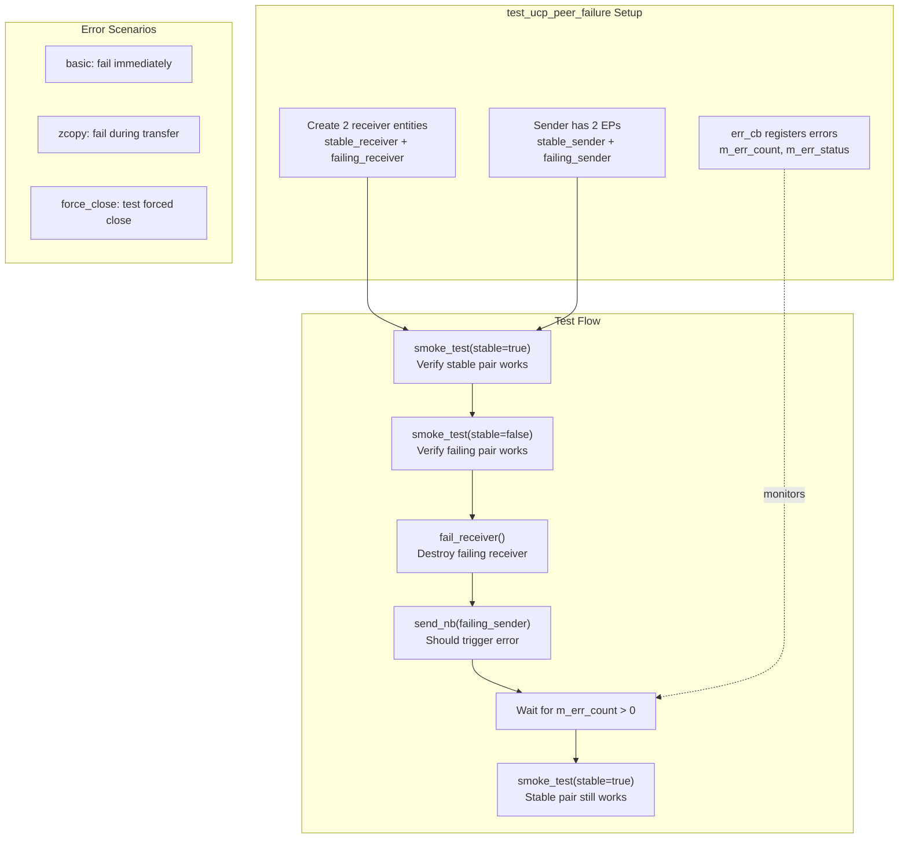

**Sources:** [test/gtest/ucp/test_ucp_peer_failure.cc:22-92](), [test/gtest/ucp/test_ucp_peer_failure.cc:354-474]()

---

## Test Configuration Macros

The framework provides macros to instantiate tests across multiple transport configurations:

### Transport Instantiation

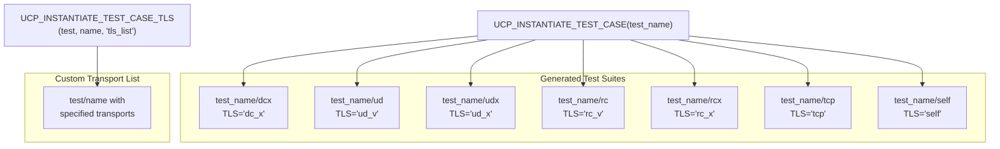

**Common instantiation patterns:**

| Macro | Purpose | Example Usage |
|-------|---------|---------------|
| `UCP_INSTANTIATE_TEST_CASE(test)` | All standard transports | `UCP_INSTANTIATE_TEST_CASE(test_ucp_wireup_1sided)` |
| `UCP_INSTANTIATE_TEST_CASE_TLS(test, name, tls)` | Specific transport list | `UCP_INSTANTIATE_TEST_CASE_TLS(test, dc_mlx5, "dc_mlx5")` |
| `UCP_INSTANTIATE_ALL_TEST_CASE(test)` | Include "all" transport | For comprehensive coverage |

**Sources:** [test/gtest/ucp/ucp_test.h:414-455](), [test/gtest/ucp/test_ucp_sockaddr.cc:26-36]()

---

## Send/Receive Operations

The framework provides unified interfaces for different communication types, enabling tests to be protocol-agnostic.

### Unified Send/Receive Interface

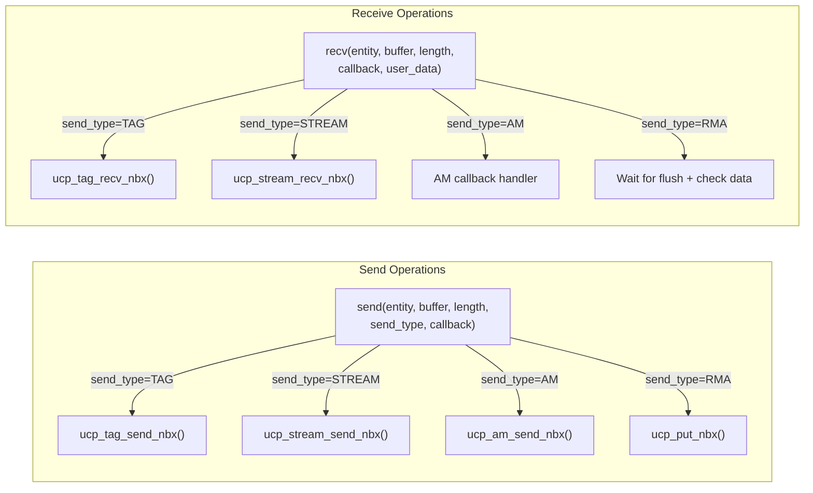

**Send/receive implementation:**
- **Generic send** [test/gtest/ucp/test_ucp_sockaddr.cc:396-418](): Dispatches to appropriate UCP API based on `send_recv_type_t`
- **Generic receive** [test/gtest/ucp/test_ucp_sockaddr.cc:420-473](): Handles tag, stream, and AM receives uniformly
- **Completion callbacks** [test/gtest/ucp/test_ucp_sockaddr.cc:281-369](): Various callback types for different test scenarios

**Sources:** [test/gtest/ucp/test_ucp_sockaddr.cc:60-64](), [test/gtest/ucp/test_ucp_wireup.cc:247-362]()

---

## Error Handling and Validation

The framework provides mechanisms for testing error scenarios and validating error handling.

### Error Detection and Logging

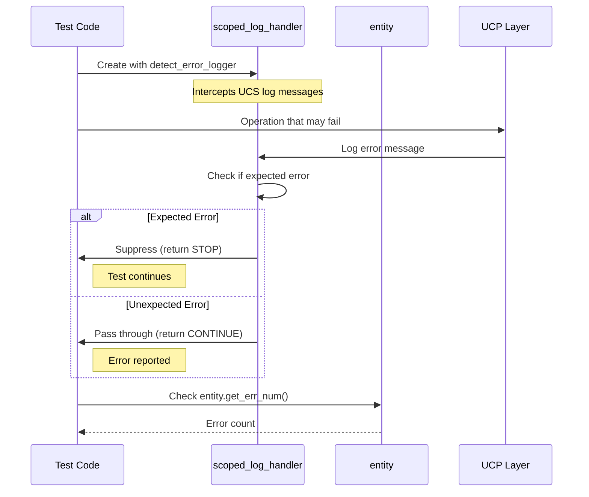

**Error handling patterns:**
- **Error callbacks** [test/gtest/ucp/test_ucp_sockaddr.cc:842-867](): Register `err_handler_cb` to track errors
- **Log filtering** [test/gtest/ucp/test_ucp_sockaddr.cc:110-156](): Filter expected log messages during error tests
- **Error verification** [test/gtest/ucp/test_ucp_sockaddr.cc:271-279](): Check status codes match expected errors
- **Cleanup after errors** [test/gtest/ucp/test_ucp_peer_failure.cc:230-248](): Handle resource cleanup when errors occur

**Sources:** [test/gtest/ucp/ucp_test.cc:210-224](), [test/gtest/ucp/test_ucp_sockaddr.cc:127-156]()

---

## Multi-Threading Support

The framework supports testing with different threading modes to validate thread-safety.

### Thread Mode Configuration

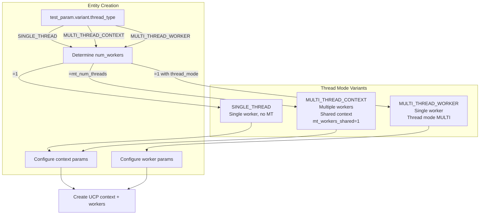

**Threading test setup:**
- **Thread mode selection** [test/gtest/ucp/ucp_test.cc:646-663](): Configure based on `thread_type` in test variant
- **Worker count** [test/gtest/ucp/ucp_test.cc:617-631](): Calculate number of workers for multi-threading tests
- **Multi-threaded variants** [test/gtest/ucp/test_ucp_sockaddr.cc:84-101](): Add MT variants to test parameters

**Sources:** [test/gtest/ucp/ucp_test.h:60-64](), [test/gtest/ucp/ucp_test.cc:634-686]()

---

