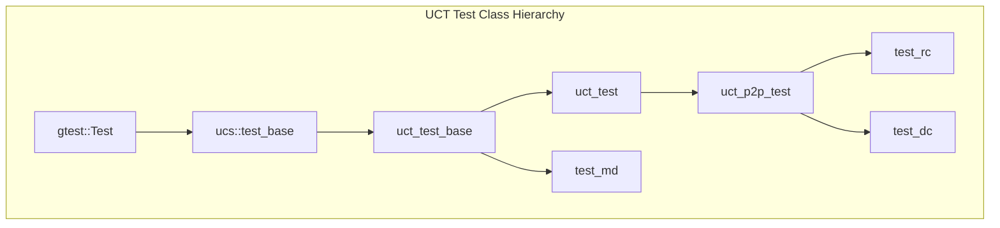
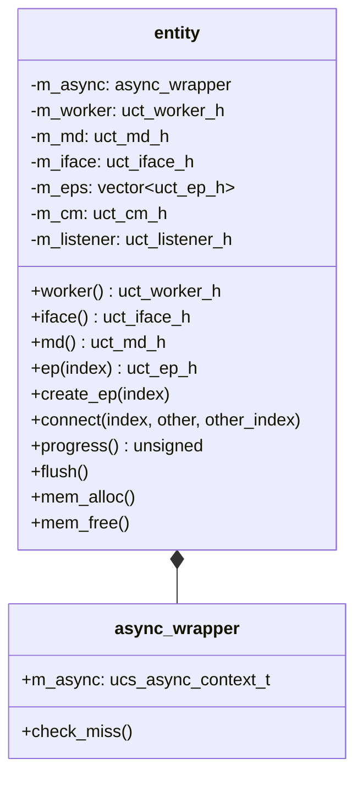
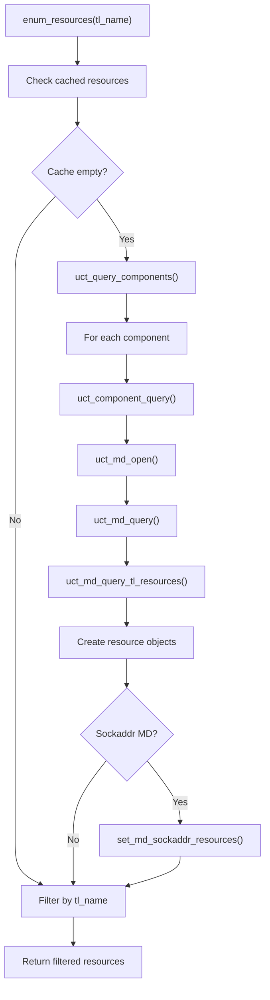
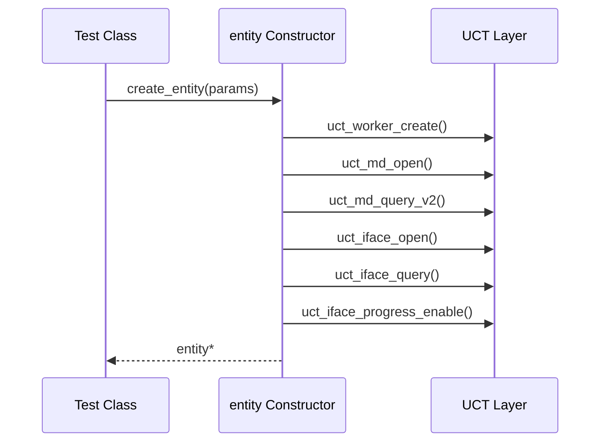
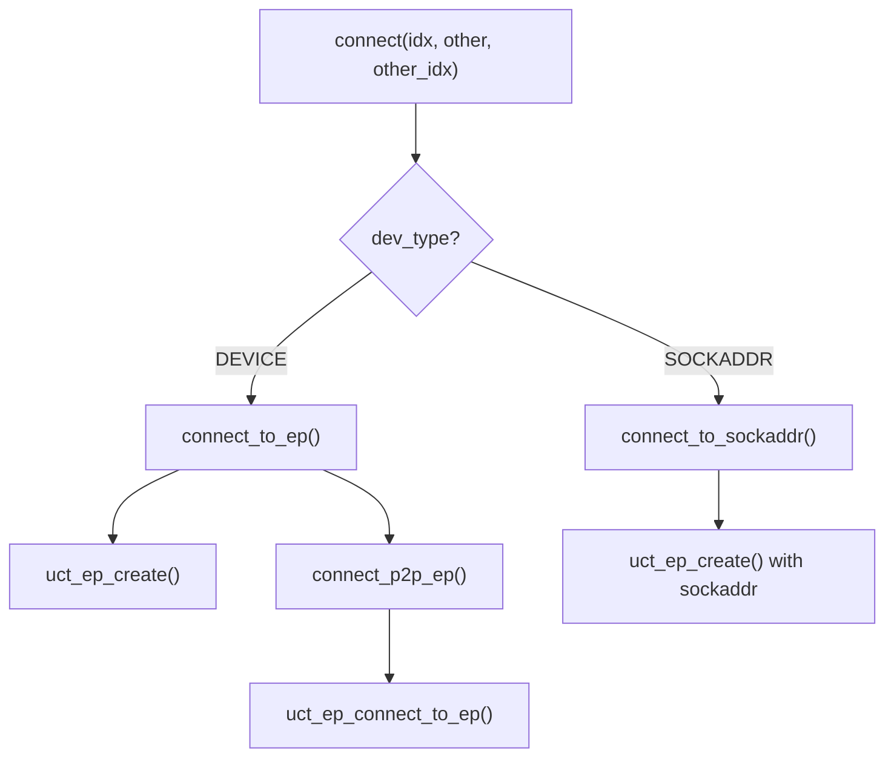
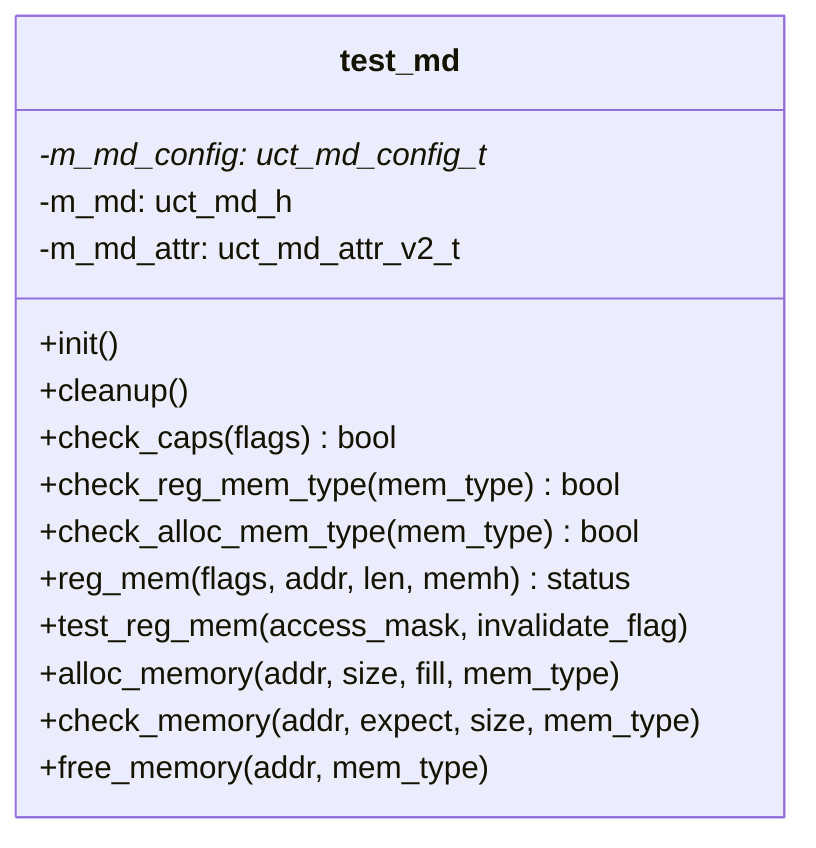
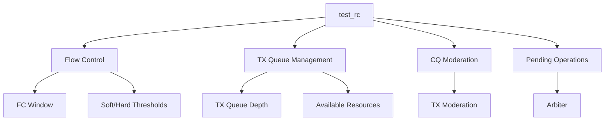
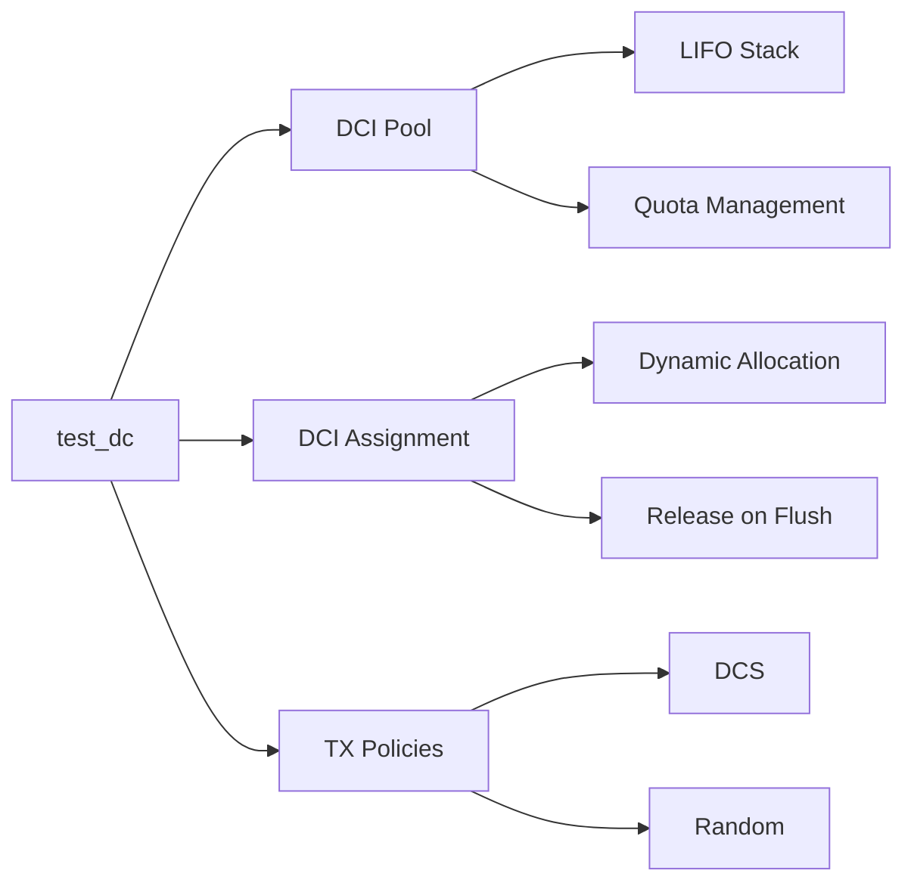

<!-- source: DeepWiki mcp.deepwiki.com · repo openucx/ucx · page 5.3 UCT Testing Framework · fetched 2026-11-11 -->

# UCT Testing Framework

<details>
<summary>Relevant source files</summary>

The following files were used as context for generating this wiki page:

- [test/gtest/common/test_helpers.cc](test/gtest/common/test_helpers.cc)
- [test/gtest/common/test_helpers.h](test/gtest/common/test_helpers.h)
- [test/gtest/uct/ib/test_dc.cc](test/gtest/uct/ib/test_dc.cc)
- [test/gtest/uct/ib/test_ib_md.cc](test/gtest/uct/ib/test_ib_md.cc)
- [test/gtest/uct/ib/test_rc.cc](test/gtest/uct/ib/test_rc.cc)
- [test/gtest/uct/ib/test_rc.h](test/gtest/uct/ib/test_rc.h)
- [test/gtest/uct/test_md.cc](test/gtest/uct/test_md.cc)
- [test/gtest/uct/test_md.h](test/gtest/uct/test_md.h)
- [test/gtest/uct/test_p2p_am.cc](test/gtest/uct/test_p2p_am.cc)
- [test/gtest/uct/test_p2p_rma.cc](test/gtest/uct/test_p2p_rma.cc)
- [test/gtest/uct/test_p2p_rma.h](test/gtest/uct/test_p2p_rma.h)
- [test/gtest/uct/uct_p2p_test.cc](test/gtest/uct/uct_p2p_test.cc)
- [test/gtest/uct/uct_p2p_test.h](test/gtest/uct/uct_p2p_test.h)
- [test/gtest/uct/uct_test.cc](test/gtest/uct/uct_test.cc)
- [test/gtest/uct/uct_test.h](test/gtest/uct/uct_test.h)

</details>


This page documents the UCT (Unified Communication Transport) testing framework, which provides a comprehensive Google Test-based infrastructure for testing UCX transport layer functionality. The framework handles resource enumeration, entity lifecycle management, and provides specialized test classes for different transport types.

## Overview

The UCT testing framework is built on Google Test and provides:
- Resource enumeration for discovering available transports and devices
- Entity abstractions for managing UCT workers, interfaces, and endpoints
- Base test classes for common UCT testing patterns
- Transport-specific test classes (RC, DC, UD)
- Memory domain testing infrastructure
- Utilities for memory allocation, registration, and pattern validation



Sources: [test/gtest/uct/uct_test.h:92-108](), [test/gtest/uct/uct_p2p_test.h:15-88](), [test/gtest/uct/ib/test_rc.h:20-61]()

## UCT Test Organization

The UCT testing framework is organized into several test categories:

| Test Category | Purpose | Key Files |
|---------------|---------|-----------|
| **Memory Domain Tests** | Test memory registration, allocation, and remote key management | `test/gtest/uct/test_md.cc`, `test/gtest/uct/ib/test_ib_md.cc` |
| **Point-to-Point Tests** | Test bidirectional communication between entities | `test/gtest/uct/uct_p2p_test.cc` |
| **Active Message Tests** | Test AM short/bcopy/zcopy operations | `test/gtest/uct/test_p2p_am.cc` |
| **RMA Tests** | Test put/get operations | `test/gtest/uct/test_p2p_rma.cc` |
| **RC Transport Tests** | Test Reliable Connection transport | `test/gtest/uct/ib/test_rc.cc` |
| **DC Transport Tests** | Test Dynamic Connection transport | `test/gtest/uct/ib/test_dc.cc` |
| **UD Transport Tests** | Test Unreliable Datagram transport | Various UD test files |

Sources: [test/gtest/uct/test_md.cc:1-10](), [test/gtest/uct/test_p2p_am.cc:1-10](), [test/gtest/uct/test_p2p_rma.cc:1-10](), [test/gtest/uct/ib/test_rc.cc:1-10](), [test/gtest/uct/ib/test_dc.cc:1-10]()

## Core UCT Test Classes

### uct_test_base

The `uct_test_base` class provides the foundation for all UCT tests:

**Key Responsibilities:**
- Enumerates memory domain resources via `enum_md_resources()`
- Provides base test infrastructure inherited from `ucs::test_base`

**Core Structure:**
```
struct md_resource {
    uct_component_h        cmpt;
    uct_component_attr_t   cmpt_attr;
    uct_md_resource_desc_t rsc_desc;
};
```

Sources: [test/gtest/uct/uct_test.h:92-101](), [test/gtest/uct/uct_test.cc:113-172]()

### uct_test

The `uct_test` class extends `uct_test_base` and is parameterized on `resource*`:

**Key Methods:**

| Method | Purpose |
|--------|---------|
| `enum_resources()` | Enumerates available UCT transport resources |
| `create_entity()` | Creates a UCT entity (worker + iface + MD) |
| `create_connected_entities()` | Creates and connects two entities |
| `check_caps()` | Verifies interface capabilities |
| `modify_config()` | Modifies interface/MD configuration |
| `progress()` | Progresses all entities |
| `flush()` | Flushes all interfaces |

**Member Variables:**
- `m_entities`: Vector of test entities
- `m_iface_config`: Interface configuration
- `m_md_config`: Memory domain configuration
- `m_cm_config`: Connection manager configuration (for sockaddr transports)

Sources: [test/gtest/uct/uct_test.h:107-455](), [test/gtest/uct/uct_test.cc:174-235]()

### UCT Test Entity

The `uct_test::entity` class encapsulates a complete UCT communication endpoint:

**Core Components Diagram:**



Sources: [test/gtest/uct/uct_test.h:131-244](), [test/gtest/uct/uct_test.cc:839-904]()

### mapped_buffer

The `mapped_buffer` utility class manages memory buffers for testing:

**Functionality:**
- Allocates memory via entity's MD
- Registers memory and obtains remote keys
- Fills buffers with test patterns
- Validates buffer contents
- Handles different memory types (host, CUDA, ROCm)

**Key Methods:**
```
mapped_buffer(size, seed, entity, offset, mem_type, flags);
void* ptr();
size_t length();
uct_mem_h memh();
uct_rkey_t rkey();
void pattern_fill(seed);
void pattern_check(seed);
```

Sources: [test/gtest/uct/uct_test.h:246-288](), [test/gtest/uct/uct_test.cc:1360-1516]()

## Resource Enumeration

### Resource Structure

The `resource` structure identifies a UCT transport:

```
struct resource {
    uct_component_h     component;
    std::string         component_name;
    std::string         md_name;
    ucs_cpu_set_t       local_cpus;
    std::string         tl_name;        // Transport layer name
    std::string         dev_name;       // Device name
    std::string         variant_name;
    uct_device_type_t   dev_type;
    ucs_sys_device_t    sys_device;
    int                 variant;
    
    std::string name() const;  // Returns "tl_name/dev_name"
};
```

Sources: [test/gtest/uct/uct_test.h:45-74](), [test/gtest/uct/uct_test.cc:21-64]()

### Resource Enumeration Flow

**Resource Discovery Diagram:**



**Key Functions:**
- `enum_md_resources()`: Enumerates all MD resources across components
- `enum_resources(tl_name)`: Enumerates transport resources, optionally filtered by transport name
- `set_md_sockaddr_resources()`: Creates sockaddr-specific resources for network interfaces

Sources: [test/gtest/uct/uct_test.cc:113-172](), [test/gtest/uct/uct_test.cc:398-478]()

### Resource Filtering

Resources can be filtered using helper functions:

```
std::vector<const resource*> filter_resources(
    const std::vector<T> &resources,
    bool is_equal(const resource&, const std::string&),
    const std::string &filter
);
```

**Built-in Filters:**
- `resource::is_equal_tl_name()`: Filter by transport name
- `resource::is_equal_component_name()`: Filter by component name

Sources: [test/gtest/uct/uct_test.h:318-330](), [test/gtest/uct/uct_test.cc:66-74]()

### Sockaddr Resources

For connection-manager based transports (TCP, RDMACM), the framework creates multiple resource variants per interface:

1. **Variant 0**: Connect to interface's IP address
2. **Variant 1**: Connect to interface's IP with source address specified
3. **Variant 2**: Listen on `INADDR_ANY`, connect to interface's IP

This tests different address binding scenarios.

Sources: [test/gtest/uct/uct_test.cc:249-305](), [test/gtest/uct/uct_test.cc:320-366]()

## Entity Creation and Management

### Creating UCT Entities

The `uct_test::create_entity()` method creates a complete UCT entity:

**Entity Creation Flow:**



**Parameters:**
- `rx_headroom`: Receive buffer headroom
- `err_handler`: Error callback handler
- `eager_cb` / `rndv_cb`: Tag matching callbacks
- `async_event_cb`: Async event handler

Sources: [test/gtest/uct/uct_test.cc:652-702](), [test/gtest/uct/uct_test.cc:839-904]()

### Creating Connected Entities

The `create_connected_entities()` helper creates and connects two entities:

**Connection Types:**
- **Loopback**: Entity connects to itself (for SELF device type)
- **Peer-to-peer**: Two entities connect to each other

```
void create_connected_entities(
    size_t rx_headroom,
    uct_error_handler_t err_handler = NULL,
    ...
);
```

Sources: [test/gtest/uct/uct_test.cc:704-733]()

### Endpoint Management

Entities manage multiple endpoints via the `eps_vec_t` vector:

**Key Methods:**

| Method | Purpose |
|--------|---------|
| `create_ep(index)` | Creates endpoint at specified index |
| `destroy_ep(index)` | Destroys endpoint at index |
| `destroy_eps()` | Destroys all endpoints |
| `ep(index)` | Returns endpoint handle |
| `reserve_ep(index)` | Pre-allocates space in endpoint vector |

Sources: [test/gtest/uct/uct_test.cc:1139-1241]()

### Connection Establishment

**Connection Methods:**



**Key Functions:**
- `connect_to_iface()`: Connects to peer's interface address
- `connect_to_ep()`: Connects to peer's endpoint address
- `connect_to_sockaddr()`: Connects to sockaddr (for TCP/RDMACM)
- `listen()`: Creates listener for incoming connections

Sources: [test/gtest/uct/uct_test.cc:1243-1310](), [test/gtest/uct/uct_test.cc:1312-1358]()

## Memory Domain Testing

### test_md Class

The `test_md` class provides infrastructure for testing memory domain functionality:

**Class Structure:**



**Test Categories:**
- Memory registration with different access flags
- Memory allocation via MD
- Remote key packing/unpacking
- Memory type detection (host/CUDA/ROCm)
- Memory advise operations

Sources: [test/gtest/uct/test_md.h:23-88](), [test/gtest/uct/test_md.cc:170-221]()

### Memory Registration Testing

The framework tests various memory registration scenarios:

**Registration Flags:**
- `UCT_MD_MEM_ACCESS_ALL`: Full access
- `UCT_MD_MEM_ACCESS_RMA`: RMA access only
- `UCT_MD_MEM_ACCESS_REMOTE_ATOMIC`: Atomic access
- `UCT_MD_MEM_SYMMETRIC_RKEY`: Symmetric remote key

**Test Pattern:**
```
1. Allocate memory buffer
2. Register with specified flags: uct_md_mem_reg_v2()
3. Pack remote key: uct_md_mkey_pack_v2()
4. Unpack on remote side: uct_rkey_unpack()
5. Verify access capabilities
6. Deregister: uct_md_mem_dereg_v2()
```

Sources: [test/gtest/uct/test_md.cc:66-150]()

### IB-Specific MD Tests

The `test_ib_md` class extends `test_md` for InfiniBand-specific testing:

**Special Features Tested:**
- UMR (User Mode Registration) for large buffers
- KSM (Key by Name) indirect registration
- Atomic memory key management
- Relaxed ordering support
- DEVX-based registration

Sources: [test/gtest/uct/ib/test_ib_md.cc:17-51](), [test/gtest/uct/ib/test_ib_md.cc:95-162]()

## Transport-Specific Test Patterns

### Point-to-Point Tests (uct_p2p_test)

The `uct_p2p_test` class provides a base for testing bidirectional communication:

**Key Features:**
- Supports loopback and peer-to-peer configurations
- Tests multiple protocol variants (short/bcopy/zcopy)
- Tests different memory types
- Handles completion tracking

**p2p_resource Structure:**
```
struct p2p_resource : public resource {
    bool loopback;  // Self-connection vs peer connection
    std::string name() const;  // "tl_name/dev_name/loopback"
};
```

**Test Pattern:**
```
void test_xfer(send_func_t send, size_t length, 
               unsigned flags, ucs_memory_type_t mem_type);
void test_xfer_multi(send_func_t send, size_t min_length, 
                     size_t max_length, unsigned flags);
void blocking_send(send_func_t send, uct_ep_h ep, 
                   const mapped_buffer &sendbuf,
                   const mapped_buffer &recvbuf, 
                   bool wait_for_completion);
```

Sources: [test/gtest/uct/uct_p2p_test.h:15-88](), [test/gtest/uct/uct_p2p_test.cc:17-48]()

### Active Message Tests

The `uct_p2p_am_test` class tests UCT active message operations:

**AM Operations Tested:**
- `uct_ep_am_short()`: Short messages with inline data
- `uct_ep_am_short_iov()`: Short messages with IOV
- `uct_ep_am_bcopy()`: Buffered copy messages
- `uct_ep_am_zcopy()`: Zero-copy messages

**Handler Registration:**
```
uct_iface_set_am_handler(iface, AM_ID, am_handler, arg, flags);
```

**Test Modes:**
- Synchronous callbacks (`UCT_CB_FLAG_SYNC=0`)
- Asynchronous callbacks (`UCT_CB_FLAG_ASYNC`)

Sources: [test/gtest/uct/test_p2p_am.cc:12-328]()

### RMA Tests

The `uct_p2p_rma_test` class tests put/get operations:

**Operations:**
- `uct_ep_put_short/bcopy/zcopy()`
- `uct_ep_get_short/bcopy/zcopy()`

**Test Flow:**
```
1. Allocate sendbuf (source) and recvbuf (target)
2. Fill sendbuf with pattern
3. Execute put/get operation
4. Wait for completion
5. Verify recvbuf contents
```

Sources: [test/gtest/uct/test_p2p_rma.h:12-45](), [test/gtest/uct/test_p2p_rma.cc:12-139]()

### RC Transport Tests (test_rc)

The `test_rc` class tests Reliable Connection transport:

**RC-Specific Components Tested:**



**Key Methods:**
- `rc_iface()`: Returns `uct_rc_iface_t*`
- `rc_ep()`: Returns `uct_rc_ep_t*`
- `send_am_messages()`: Sends multiple AM messages
- `test_iface_ops()`: Tests interface operation management

**Test Categories:**
- Flow control (`test_rc_flow_control`)
- Max work requests (`test_rc_max_wr`)
- Flush operations
- Interface resource management

Sources: [test/gtest/uct/ib/test_rc.h:20-185](), [test/gtest/uct/ib/test_rc.cc:13-145]()

### DC Transport Tests (test_dc)

The `test_dc` class tests Dynamic Connection transport:

**DC-Specific Features:**



**Key Methods:**
- `dc_iface()`: Returns `uct_dc_mlx5_iface_t*`
- `dc_ep()`: Returns `uct_dc_mlx5_ep_t*`
- `create_rand_entity()`: Creates entity with random DCI policy
- `set_first_dci_availability()`: Modifies DCI resources for testing

**Test Scenarios:**
- Single DCI allocation
- Multiple DCI allocation
- DCI exhaustion
- DCI release on flush
- Endpoint destruction with active DCI

Sources: [test/gtest/uct/ib/test_dc.cc:24-169]()

## Test Instantiation Macros

The framework provides macros to instantiate parameterized tests across multiple transports:

### Basic Instantiation

**UCT_INSTANTIATE_TEST_CASE:**
```
UCT_INSTANTIATE_TEST_CASE(test_class_name)
```
Instantiates test for all UCT transports: IB (rc_mlx5, rc_verbs, dc_mlx5, ud_verbs, ud_mlx5), TCP, shared memory (posix, sysv, xpmem), GPU transports (cuda_copy, gdr_copy, rocm_copy), etc.

### Transport-Specific Macros

| Macro | Transports | Use Case |
|-------|-----------|----------|
| `UCT_INSTANTIATE_IB_TEST_CASE` | rc_mlx5, rc_verbs, dc_mlx5, ud_verbs, ud_mlx5, srd | InfiniBand-only tests |
| `UCT_INSTANTIATE_RC_TEST_CASE` | rc_mlx5, rc_verbs | RC transport tests |
| `UCT_INSTANTIATE_RC_DC_TEST_CASE` | rc_mlx5, rc_verbs, dc_mlx5 | RC/DC tests |
| `UCT_INSTANTIATE_MM_TEST_CASE` | posix, sysv, xpmem | Shared memory tests |
| `UCT_INSTANTIATE_NO_SELF_TEST_CASE` | All except self | Non-loopback tests |

**Example Usage:**
```
class my_rc_test : public test_rc {
    // Test implementation
};

UCS_TEST_P(my_rc_test, test_name) {
    // Test body
}

UCT_INSTANTIATE_RC_TEST_CASE(my_rc_test)
```

Sources: [test/gtest/uct/uct_test.h:473-638]()

### Conditional Test Execution

Tests can be conditionally skipped using macros:

**UCS_TEST_SKIP_COND_P:**
```
UCS_TEST_SKIP_COND_P(test_class, test_name, 
                     !check_caps(UCT_IFACE_FLAG_PUT_ZCOPY))
{
    // Test only runs if condition is false
}
```

**Capability Checks:**
- `check_caps(flags)`: Check interface capabilities
- `check_event_caps(flags)`: Check event capabilities
- `check_atomics(ops, mode)`: Check atomic operations support

Sources: [test/gtest/uct/uct_test.cc:490-531]()

## Common Test Utilities

### Progress and Synchronization

**Progress Methods:**
```
unsigned progress() const;        // Progress all entities
void flush(ucs_time_t deadline);  // Flush all interfaces
void short_progress_loop(double delay_ms, entity *e);
void wait_for_flag(volatile T *flag, double timeout);
void wait_for_value(const volatile T *var, T value, bool progress);
```

Sources: [test/gtest/uct/uct_test.cc:758-808]()

### Capability Checking

Tests should check capabilities before testing features:

```
bool check_caps(uint64_t required_flags, uint64_t invalid_flags);
void check_caps_skip(uint64_t required_flags, uint64_t invalid_flags);

// Examples:
check_caps(UCT_IFACE_FLAG_PUT_ZCOPY);
check_caps(UCT_IFACE_FLAG_AM_BCOPY | UCT_IFACE_FLAG_AM_ZCOPY);
check_atomics(UCT_ATOMIC_OP_ADD, OP64);
```

**Common Capability Flags:**
- `UCT_IFACE_FLAG_AM_SHORT/BCOPY/ZCOPY`: Active message support
- `UCT_IFACE_FLAG_PUT_SHORT/BCOPY/ZCOPY`: Put operation support
- `UCT_IFACE_FLAG_GET_SHORT/BCOPY/ZCOPY`: Get operation support
- `UCT_IFACE_FLAG_PENDING`: Pending operations support

Sources: [test/gtest/uct/uct_test.cc:490-531]()

### Configuration Modification

Tests can modify UCT configuration at runtime:

```
void modify_config(const std::string& name, 
                   const std::string& value,
                   modify_config_mode_t mode = FAIL_IF_NOT_EXIST);

// Examples:
modify_config("RC_TX_QUEUE_LEN", "32");
modify_config("IB_MLX5_DEVX_OBJECTS", "dct,dcsrq");
```

**Configuration Scopes:**
- `m_iface_config`: Interface configuration
- `m_md_config`: Memory domain configuration
- `m_cm_config`: Connection manager configuration

Sources: [test/gtest/uct/uct_test.cc:533-570]()

### Memory Pattern Validation

The `mapped_buffer` class provides pattern-based validation:

```
mapped_buffer sendbuf(length, SEED1, sender());
sendbuf.pattern_fill(SEED1);   // Fill with pattern
sendbuf.pattern_check(SEED1);  // Verify pattern

// Static validation
mem_buffer::pattern_check(data, length, seed);
```

Sources: [test/gtest/uct/uct_test.cc:1360-1516]()

### Transport-Specific Helpers

**Transport Detection:**
```
bool has_transport(const std::string& tl_name);
bool has_ud();     // UD transport
bool has_rc();     // RC transport
bool has_ib();     // Any IB transport
bool has_mm();     // Shared memory
bool has_gpu();    // GPU memory transports
```

**Connection Limits:**
```
int max_connections();      // Maximum connections supported
int max_connect_batch();    // Maximum batch connection size
```

Sources: [test/gtest/uct/uct_test.cc:604-651](), [test/gtest/uct/uct_test.cc:810-837]()

## Best Practices for Writing Tests

When writing tests using the UCX testing framework, follow these practices:

1. Derive from the appropriate base class (`uct_test` or `ucp_test`)
2. Use the provided resource management utilities
3. Check capabilities before testing features
4. Use appropriate synchronization mechanisms
5. Clean up resources properly
6. Use parameterized tests to cover multiple configurations
7. Handle timeouts and error cases properly

Example test structure:
```
class my_test : public uct_test {
public:
    // Define test variants
    static void get_test_variants(std::vector<ucp_test_variant>& variants);
    
    // Override initialization if needed
    virtual void init();
    
    // Test cases
    UCS_TEST_P(my_test, test_case_1) {
        // Test implementation
    }
    
    // Cleanup if needed
    virtual void cleanup();
};

// Instantiate with appropriate transports
UCT_INSTANTIATE_TEST_CASE(my_test)
```

Sources: [test/gtest/ucp/test_ucp_wireup.cc:430-466](), [test/gtest/uct/test_p2p_am.cc:12-105]()

## Conclusion

The UCX testing framework provides a comprehensive set of tools for testing different aspects of the UCX communication stack. It handles resource management, provides common testing patterns, and supports a wide range of test configurations. The framework is designed to be extended for testing new features and components of UCX.

The testing framework plays a crucial role in ensuring the quality and reliability of the UCX library, helping to catch bugs and regressions early in the development process.

---

